# marketingcorps.eu.teamwork.com — site document

Crawled 2026-11-11T03:50:08+05:00 from `https://marketingcorps.eu.teamwork.com/`.

## Overview

- Pages: 50
- States captured: 247
- Controls recorded: 7216
- Links in the skeleton: 2915
- Redirect aliases: 5
- URLs not crawled: 25
- Duration: 12431.54s

Each page chapter lists the screenshot of the default state, the heading outline,
every recorded control, and any extra state opened from a menu, tab, accordion, or button.
Dropdown options are listed even when the operating-system popup cannot be screenshotted.
Buttons that submit, pay, delete, or sign out are inventoried and left unclicked.

## Sitemap

- Home - Home - marketing corps — https://marketingcorps.eu.teamwork.com/app/home
- Inbox - marketing corps — https://marketingcorps.eu.teamwork.com/app/inbox
- Welcome - marketing corps — https://marketingcorps.eu.teamwork.com/app/welcome/the-fundamentals
- Project list - marketing corps — https://marketingcorps.eu.teamwork.com/app/projects/list
- Clients - marketing corps — https://marketingcorps.eu.teamwork.com/app/clients/clients
- Projects - Home - marketing corps — https://marketingcorps.eu.teamwork.com/app/work/projects
- My tasks - Home - marketing corps — https://marketingcorps.eu.teamwork.com/app/work/tasks
- My calendar - Home - marketing corps — https://marketingcorps.eu.teamwork.com/app/work/calendar
- My timesheet - Home - marketing corps — https://marketingcorps.eu.teamwork.com/app/work/timesheet
- Activity - Home - marketing corps — https://marketingcorps.eu.teamwork.com/app/work/activity
- Ask AI - marketing corps — https://marketingcorps.eu.teamwork.com/app/ai/ask
- Teammate onboarding - marketing corps — https://marketingcorps.eu.teamwork.com/app/ai/teammates/personalAssistant/onboard
- All completed tasks - marketing corps — https://marketingcorps.eu.teamwork.com/app/tasks/completedTasks
- All active tasks - marketing corps — https://marketingcorps.eu.teamwork.com/app/tasks/tasks
- Board - marketing corps — https://marketingcorps.eu.teamwork.com/app/tasks/board
- Table - marketing corps — https://marketingcorps.eu.teamwork.com/app/tasks/table
- All - Reporting - marketing corps — https://marketingcorps.eu.teamwork.com/app/reports/all
- Custom Reports - Reporting - marketing corps — https://marketingcorps.eu.teamwork.com/app/reports/custom-reports
- Scheduled - Reporting - marketing corps — https://marketingcorps.eu.teamwork.com/app/reports/scheduled
- Invoices - marketing corps — https://marketingcorps.eu.teamwork.com/app/finance/invoices/table
- People rates - Rates - marketing corps — https://marketingcorps.eu.teamwork.com/app/finance/rates/people
- Budgets - marketing corps — https://marketingcorps.eu.teamwork.com/app/finance/budgets
- Expenses - marketing corps — https://marketingcorps.eu.teamwork.com/app/finance/expenses
- Task lists - Malcolm Hedding (Book Project) - marketing corps — https://marketingcorps.eu.teamwork.com/app/projects/622746/tasks/list
- General tasks - Malcolm Hedding (Book Project) - marketing corps — https://marketingcorps.eu.teamwork.com/app/tasklists/2420320/list
- Task lists - Julie - marketing corps — https://marketingcorps.eu.teamwork.com/app/projects/622744/tasks/list
- Integrations - Book Publishers - marketing corps — https://marketingcorps.eu.teamwork.com/app/people/555920/integrations/all
- Integrations - Settings - marketing corps — https://marketingcorps.eu.teamwork.com/app/settings
- Subscription - Settings - marketing corps — https://marketingcorps.eu.teamwork.com/app/settings/subscription/plans
- Tasks - Book Publishers - marketing corps — https://marketingcorps.eu.teamwork.com/app/people/555920/tasks
- Integrations - Settings - marketing corps — https://marketingcorps.eu.teamwork.com/app/settings/integrations/all
- General tasks - Malcolm Hedding (Book Project) - marketing corps — https://marketingcorps.eu.teamwork.com/app/tasklists/2420320/list?projectId=622746
- Task lists - Charles Cooper - marketing corps — https://marketingcorps.eu.teamwork.com/app/projects/622742/tasks/list
- Messages - Malcolm Hedding (Book Project) - marketing corps — https://marketingcorps.eu.teamwork.com/app/messages/519066
- Project templates - marketing corps — https://marketingcorps.eu.teamwork.com/app/projects/templates/projects/teamwork
- Time Approvals - marketing corps — https://marketingcorps.eu.teamwork.com/app/time/approvals
- Timesheet - marketing corps — https://marketingcorps.eu.teamwork.com/app/time/user
- Company timesheet - marketing corps — https://marketingcorps.eu.teamwork.com/app/time/company
- All time - marketing corps — https://marketingcorps.eu.teamwork.com/app/time/all
- People - People - marketing corps — https://marketingcorps.eu.teamwork.com/app/people/people
- Roles - People - marketing corps — https://marketingcorps.eu.teamwork.com/app/people/roles
- Skills - People - marketing corps — https://marketingcorps.eu.teamwork.com/app/people/skills
- Teams - People - marketing corps — https://marketingcorps.eu.teamwork.com/app/people/teams
- Statuses - People - marketing corps — https://marketingcorps.eu.teamwork.com/app/people/statuses
- Chart - Resourcing - marketing corps — https://marketingcorps.eu.teamwork.com/app/planning/chart
- Overview - Resourcing - marketing corps — https://marketingcorps.eu.teamwork.com/app/planning/overview
- Projects - Resourcing - marketing corps — https://marketingcorps.eu.teamwork.com/app/planning/schedule/projects
- Workload - Resourcing - marketing corps — https://marketingcorps.eu.teamwork.com/app/planning/workload
- Boards - Portfolio - Resourcing - marketing corps — https://marketingcorps.eu.teamwork.com/app/planning/portfolio/boards
- Teamwork Chat - Playground — https://marketingcorps.eu.teamwork.com/chat/channels/49310

## Architecture

Home - Home - marketing corps — link: Teamwork.com home → Home - Home - marketing corps
Home - Home - marketing corps — link: My work → Projects - Home - marketing corps
Home - Home - marketing corps — link: Inbox → Inbox - marketing corps
Home - Home - marketing corps — link: Teamwork AI → Ask AI - marketing corps
Home - Home - marketing corps — link: Welcome → Welcome - marketing corps
Home - Home - marketing corps — link: Projects → Project list - marketing corps
Home - Home - marketing corps — link: Tasks → All completed tasks - marketing corps
Home - Home - marketing corps — link: Clients → Clients - marketing corps
Home - Home - marketing corps — link: Reporting → All - Reporting - marketing corps
Home - Home - marketing corps — link: Finance → Invoices - marketing corps
Home - Home - marketing corps — link: M Malcolm Hedding (Book Project) → Task lists - Malcolm Hedding (Book Project) - marketing corps
Home - Home - marketing corps — link: J Julie → Task lists - Julie - marketing corps
Home - Home - marketing corps — link: My tasks → My tasks - Home - marketing corps
Home - Home - marketing corps — link: My calendar → My calendar - Home - marketing corps
Home - Home - marketing corps — link: My timesheet → My timesheet - Home - marketing corps
Home - Home - marketing corps — link: My projects → Projects - Home - marketing corps
Home - Home - marketing corps — link: Activity → Activity - Home - marketing corps
Home - Home - marketing corps — link: Ask AI → Ask AI - marketing corps
Home - Home - marketing corps — link: AI Teammates → Teammate onboarding - marketing corps
Home - Home - marketing corps — link: Tasks → All active tasks - marketing corps
Home - Home - marketing corps — link: Board → Board - marketing corps
Home - Home - marketing corps — link: Table → Table - marketing corps
Home - Home - marketing corps — link: Completed tasks → All completed tasks - marketing corps
Home - Home - marketing corps — link: All reports → All - Reporting - marketing corps
Home - Home - marketing corps — link: Custom Reports → Custom Reports - Reporting - marketing corps
Home - Home - marketing corps — link: Scheduled reports → Scheduled - Reporting - marketing corps
Home - Home - marketing corps — link: Rates → People rates - Rates - marketing corps
Home - Home - marketing corps — link: Budgets → Budgets - marketing corps
Home - Home - marketing corps — link: Invoices → Invoices - marketing corps
Home - Home - marketing corps — link: Expenses → Expenses - marketing corps
Home - Home - marketing corps — link: General tasks → General tasks - Malcolm Hedding (Book Project) - marketing corps
Home - Home - marketing corps — link: Book Publishers View profile → Integrations - Book Publishers - marketing corps
Home - Home - marketing corps — link: Settings → Integrations - Settings - marketing corps
Home - Home - marketing corps — link: Subscription → Subscription - Settings - marketing corps
Home - Home - marketing corps — link: My tasks → Tasks - Book Publishers - marketing corps
Home - Home - marketing corps — link: My apps → Integrations - Book Publishers - marketing corps
Home - Home - marketing corps — link: Apps and integrations → Integrations - Settings - marketing corps
Home - Home - marketing corps — link: J Julie marketing corps → Task lists - Julie - marketing corps
Home - Home - marketing corps — link: M Malcolm Hedding (Book Project) marketing corps → General tasks - Malcolm Hedding (Book Project) - marketing corps
Home - Home - marketing corps — link: C Charles Cooper marketing corps → Task lists - Charles Cooper - marketing corps
Home - Home - marketing corps — link: Book Cover Malcolm Hedding (Book Project) (marketing corps) → Messages - Malcolm Hedding (Book Project) - marketing corps
Home - Home - marketing corps — link: Malcolm Hedding (Book Project) → General tasks - Malcolm Hedding (Book Project) - marketing corps
Home - Home - marketing corps — link: Charles Cooper → Task lists - Charles Cooper - marketing corps
Home - Home - marketing corps — link: Julie → Task lists - Julie - marketing corps
Home - Home - marketing corps — link: See all projects → Project list - marketing corps
Home - Home - marketing corps — link: Project templates → Project templates - marketing corps
Inbox - marketing corps — link: Teamwork.com home → Home - Home - marketing corps
Inbox - marketing corps — link: Home → Home - Home - marketing corps
Inbox - marketing corps — link: My work → Projects - Home - marketing corps
Inbox - marketing corps — link: Teamwork AI → Ask AI - marketing corps
Inbox - marketing corps — link: Welcome → Welcome - marketing corps
Inbox - marketing corps — link: Projects → Project list - marketing corps
Inbox - marketing corps — link: Time → Time Approvals - marketing corps
Inbox - marketing corps — link: Tasks → All completed tasks - marketing corps
Inbox - marketing corps — link: Clients → Clients - marketing corps
Inbox - marketing corps — link: People → People - People - marketing corps
Inbox - marketing corps — link: Resourcing → Chart - Resourcing - marketing corps
Inbox - marketing corps — link: Reporting → All - Reporting - marketing corps
Inbox - marketing corps — link: Finance → Invoices - marketing corps
Inbox - marketing corps — link: M Malcolm Hedding (Book Project) → Task lists - Malcolm Hedding (Book Project) - marketing corps
Inbox - marketing corps — link: C Charles Cooper → Task lists - Charles Cooper - marketing corps
Inbox - marketing corps — link: J Julie → Task lists - Julie - marketing corps
Inbox - marketing corps — link: My tasks → My tasks - Home - marketing corps
Inbox - marketing corps — link: My calendar → My calendar - Home - marketing corps
Inbox - marketing corps — link: My timesheet → My timesheet - Home - marketing corps
Inbox - marketing corps — link: My projects → Projects - Home - marketing corps
Inbox - marketing corps — link: Activity → Activity - Home - marketing corps
Inbox - marketing corps — link: Ask AI → Ask AI - marketing corps
Inbox - marketing corps — link: AI Teammates → Teammate onboarding - marketing corps
Inbox - marketing corps — link: My timesheet → Timesheet - marketing corps
Inbox - marketing corps — link: Company timesheet → Company timesheet - marketing corps
Inbox - marketing corps — link: All time → All time - marketing corps
Inbox - marketing corps — link: Approvals → Time Approvals - marketing corps
Inbox - marketing corps — link: Tasks → All active tasks - marketing corps
Inbox - marketing corps — link: Board → Board - marketing corps
Inbox - marketing corps — link: Table → Table - marketing corps
Inbox - marketing corps — link: Completed tasks → All completed tasks - marketing corps
Inbox - marketing corps — link: Roles → Roles - People - marketing corps
Inbox - marketing corps — link: Skills NEW → Skills - People - marketing corps
Inbox - marketing corps — link: Teams → Teams - People - marketing corps
Inbox - marketing corps — link: Statuses → Statuses - People - marketing corps
Inbox - marketing corps — link: Overview → Overview - Resourcing - marketing corps
Inbox - marketing corps — link: Schedule → Projects - Resourcing - marketing corps
Inbox - marketing corps — link: Workload → Workload - Resourcing - marketing corps
Inbox - marketing corps — link: Portfolio → Boards - Portfolio - Resourcing - marketing corps
Inbox - marketing corps — link: Chart → Chart - Resourcing - marketing corps
Inbox - marketing corps — link: All reports → All - Reporting - marketing corps
Inbox - marketing corps — link: Custom Reports → Custom Reports - Reporting - marketing corps
Inbox - marketing corps — link: Scheduled reports → Scheduled - Reporting - marketing corps
Inbox - marketing corps — link: Rates → People rates - Rates - marketing corps
Inbox - marketing corps — link: Budgets → Budgets - marketing corps
Inbox - marketing corps — link: Invoices → Invoices - marketing corps
Inbox - marketing corps — link: Expenses → Expenses - marketing corps
Inbox - marketing corps — link: Teamwork Chat → Teamwork Chat - Playground
Inbox - marketing corps — link: Teamwork Spaces → https://marketingcorps.eu.teamwork.com/spaces
Inbox - marketing corps — link: Book Publishers View profile → Integrations - Book Publishers - marketing corps
Inbox - marketing corps — link: Settings → Integrations - Settings - marketing corps
Inbox - marketing corps — link: Subscription → Subscription - Settings - marketing corps
Inbox - marketing corps — link: My tasks → Tasks - Book Publishers - marketing corps
Inbox - marketing corps — link: My apps → Integrations - Book Publishers - marketing corps
Inbox - marketing corps — link: Apps and integrations → Integrations - Settings - marketing corps
Inbox - marketing corps — link: J Julie marketing corps → Task lists - Julie - marketing corps
Inbox - marketing corps — link: C Charles Cooper marketing corps → Task lists - Charles Cooper - marketing corps
Inbox - marketing corps — link: M Malcolm Hedding (Book Project) marketing corps → General tasks - Malcolm Hedding (Book Project) - marketing corps
Inbox - marketing corps — link: Book Cover Malcolm Hedding (Book Project) (marketing corps) → Messages - Malcolm Hedding (Book Project) - marketing corps
Welcome - marketing corps — link: Teamwork.com home → Home - Home - marketing corps
Welcome - marketing corps — link: Home → Home - Home - marketing corps
Welcome - marketing corps — link: My work → Projects - Home - marketing corps
Welcome - marketing corps — link: Inbox → Inbox - marketing corps
Welcome - marketing corps — link: Teamwork AI → Ask AI - marketing corps
Welcome - marketing corps — link: Welcome → Welcome - marketing corps
Welcome - marketing corps — link: Projects → Project list - marketing corps
Welcome - marketing corps — link: Time → Time Approvals - marketing corps
Welcome - marketing corps — link: Tasks → All completed tasks - marketing corps
Welcome - marketing corps — link: Clients → Clients - marketing corps
Welcome - marketing corps — link: People → People - People - marketing corps
Welcome - marketing corps — link: Resourcing → Chart - Resourcing - marketing corps
Welcome - marketing corps — link: Reporting → All - Reporting - marketing corps
Welcome - marketing corps — link: Finance → Invoices - marketing corps
Welcome - marketing corps — link: M Malcolm Hedding (Book Project) → Task lists - Malcolm Hedding (Book Project) - marketing corps
Welcome - marketing corps — link: C Charles Cooper → Task lists - Charles Cooper - marketing corps
Welcome - marketing corps — link: J Julie → Task lists - Julie - marketing corps
Welcome - marketing corps — link: Start → Teammate onboarding - marketing corps
Welcome - marketing corps — link: Start → Integrations - Settings - marketing corps
Welcome - marketing corps — link: My tasks → My tasks - Home - marketing corps
Welcome - marketing corps — link: My calendar → My calendar - Home - marketing corps
Welcome - marketing corps — link: My timesheet → My timesheet - Home - marketing corps
Welcome - marketing corps — link: My projects → Projects - Home - marketing corps
Welcome - marketing corps — link: Activity → Activity - Home - marketing corps
Welcome - marketing corps — link: Ask AI → Ask AI - marketing corps
Welcome - marketing corps — link: AI Teammates → Teammate onboarding - marketing corps
Welcome - marketing corps — link: My timesheet → Timesheet - marketing corps
Welcome - marketing corps — link: Company timesheet → Company timesheet - marketing corps
Welcome - marketing corps — link: All time → All time - marketing corps
Welcome - marketing corps — link: Approvals → Time Approvals - marketing corps
Welcome - marketing corps — link: Tasks → All active tasks - marketing corps
Welcome - marketing corps — link: Board → Board - marketing corps
Welcome - marketing corps — link: Table → Table - marketing corps
Welcome - marketing corps — link: Completed tasks → All completed tasks - marketing corps
Welcome - marketing corps — link: Roles → Roles - People - marketing corps
Welcome - marketing corps — link: Skills NEW → Skills - People - marketing corps
Welcome - marketing corps — link: Teams → Teams - People - marketing corps
Welcome - marketing corps — link: Statuses → Statuses - People - marketing corps
Welcome - marketing corps — link: Overview → Overview - Resourcing - marketing corps
Welcome - marketing corps — link: Schedule → Projects - Resourcing - marketing corps
Welcome - marketing corps — link: Workload → Workload - Resourcing - marketing corps
Welcome - marketing corps — link: Portfolio → Boards - Portfolio - Resourcing - marketing corps
Welcome - marketing corps — link: Chart → Chart - Resourcing - marketing corps
Welcome - marketing corps — link: All reports → All - Reporting - marketing corps
Welcome - marketing corps — link: Custom Reports → Custom Reports - Reporting - marketing corps
Welcome - marketing corps — link: Scheduled reports → Scheduled - Reporting - marketing corps
Welcome - marketing corps — link: Rates → People rates - Rates - marketing corps
Welcome - marketing corps — link: Budgets → Budgets - marketing corps
Welcome - marketing corps — link: Invoices → Invoices - marketing corps
Welcome - marketing corps — link: Expenses → Expenses - marketing corps
Welcome - marketing corps — link: General tasks → General tasks - Malcolm Hedding (Book Project) - marketing corps
Welcome - marketing corps — link: Teamwork Chat → Teamwork Chat - Playground
Welcome - marketing corps — link: Teamwork Spaces → https://marketingcorps.eu.teamwork.com/spaces
Welcome - marketing corps — link: Book Publishers View profile → Integrations - Book Publishers - marketing corps
Welcome - marketing corps — link: Settings → Integrations - Settings - marketing corps
Welcome - marketing corps — link: Subscription → Subscription - Settings - marketing corps
Welcome - marketing corps — link: My tasks → Tasks - Book Publishers - marketing corps
Welcome - marketing corps — link: My apps → Integrations - Book Publishers - marketing corps
Welcome - marketing corps — link: Apps and integrations → Integrations - Settings - marketing corps
Welcome - marketing corps — link: J Julie marketing corps → Task lists - Julie - marketing corps
Welcome - marketing corps — link: C Charles Cooper marketing corps → Task lists - Charles Cooper - marketing corps
Welcome - marketing corps — link: M Malcolm Hedding (Book Project) marketing corps → General tasks - Malcolm Hedding (Book Project) - marketing corps
Welcome - marketing corps — link: Book Cover Malcolm Hedding (Book Project) (marketing corps) → Messages - Malcolm Hedding (Book Project) - marketing corps
Project list - marketing corps — link: Teamwork.com home → Home - Home - marketing corps
Project list - marketing corps — link: Home → Home - Home - marketing corps
Project list - marketing corps — link: My work → Projects - Home - marketing corps
Project list - marketing corps — link: Inbox → Inbox - marketing corps
Project list - marketing corps — link: Teamwork AI → Ask AI - marketing corps
Project list - marketing corps — link: Welcome → Welcome - marketing corps
Project list - marketing corps — link: Projects → Project list - marketing corps
Project list - marketing corps — link: Time → Time Approvals - marketing corps
Project list - marketing corps — link: Tasks → All completed tasks - marketing corps
Project list - marketing corps — link: Clients → Clients - marketing corps
Project list - marketing corps — link: People → People - People - marketing corps
Project list - marketing corps — link: Resourcing → Chart - Resourcing - marketing corps
Project list - marketing corps — link: Reporting → All - Reporting - marketing corps
Project list - marketing corps — link: Finance → Invoices - marketing corps
Project list - marketing corps — link: M Malcolm Hedding (Book Project) → Task lists - Malcolm Hedding (Book Project) - marketing corps
Project list - marketing corps — link: C Charles Cooper → Task lists - Charles Cooper - marketing corps
Project list - marketing corps — link: J Julie → Task lists - Julie - marketing corps
Project list - marketing corps — link: Templates → Project templates - marketing corps
Project list - marketing corps — link: All projects 3 → https://marketingcorps.eu.teamwork.com/app/projects/list?catid=
Project list - marketing corps — link: No category 3 → https://marketingcorps.eu.teamwork.com/app/projects/list?catid=0
Project list - marketing corps — link: Charles Cooper → Task lists - Charles Cooper - marketing corps
Project list - marketing corps — link: marketing corps → https://marketingcorps.eu.teamwork.com/app/clients/210624/overview
Project list - marketing corps — link: Julie → Task lists - Julie - marketing corps
Project list - marketing corps — link: Malcolm Hedding (Book Project) → General tasks - Malcolm Hedding (Book Project) - marketing corps
Project list - marketing corps — link: My tasks → My tasks - Home - marketing corps
Project list - marketing corps — link: My calendar → My calendar - Home - marketing corps
Project list - marketing corps — link: My timesheet → My timesheet - Home - marketing corps
Project list - marketing corps — link: My projects → Projects - Home - marketing corps
Project list - marketing corps — link: Activity → Activity - Home - marketing corps
Project list - marketing corps — link: Ask AI → Ask AI - marketing corps
Project list - marketing corps — link: AI Teammates → Teammate onboarding - marketing corps
Project list - marketing corps — link: My timesheet → Timesheet - marketing corps
Project list - marketing corps — link: Company timesheet → Company timesheet - marketing corps
Project list - marketing corps — link: All time → All time - marketing corps
Project list - marketing corps — link: Approvals → Time Approvals - marketing corps
Project list - marketing corps — link: Tasks → All active tasks - marketing corps
Project list - marketing corps — link: Board → Board - marketing corps
Project list - marketing corps — link: Table → Table - marketing corps
Project list - marketing corps — link: Completed tasks → All completed tasks - marketing corps
Project list - marketing corps — link: Roles → Roles - People - marketing corps
Project list - marketing corps — link: Skills NEW → Skills - People - marketing corps
Project list - marketing corps — link: Teams → Teams - People - marketing corps
Project list - marketing corps — link: Statuses → Statuses - People - marketing corps
Project list - marketing corps — link: Overview → Overview - Resourcing - marketing corps
Project list - marketing corps — link: Schedule → Projects - Resourcing - marketing corps
Project list - marketing corps — link: Workload → Workload - Resourcing - marketing corps
Project list - marketing corps — link: Portfolio → Boards - Portfolio - Resourcing - marketing corps
Project list - marketing corps — link: Chart → Chart - Resourcing - marketing corps
Project list - marketing corps — link: All reports → All - Reporting - marketing corps
Project list - marketing corps — link: Custom Reports → Custom Reports - Reporting - marketing corps
Project list - marketing corps — link: Scheduled reports → Scheduled - Reporting - marketing corps
Project list - marketing corps — link: Rates → People rates - Rates - marketing corps
Project list - marketing corps — link: Budgets → Budgets - marketing corps
Project list - marketing corps — link: Invoices → Invoices - marketing corps
Project list - marketing corps — link: Expenses → Expenses - marketing corps
Project list - marketing corps — link: Teamwork Chat → Teamwork Chat - Playground
Project list - marketing corps — link: Teamwork Spaces → https://marketingcorps.eu.teamwork.com/spaces
Project list - marketing corps — link: Book Publishers View profile → Integrations - Book Publishers - marketing corps
Project list - marketing corps — link: Settings → Integrations - Settings - marketing corps
Project list - marketing corps — link: Subscription → Subscription - Settings - marketing corps
Project list - marketing corps — link: My tasks → Tasks - Book Publishers - marketing corps
Project list - marketing corps — link: My apps → Integrations - Book Publishers - marketing corps
Project list - marketing corps — link: Apps and integrations → Integrations - Settings - marketing corps
Project list - marketing corps — link: J Julie marketing corps → Task lists - Julie - marketing corps
Project list - marketing corps — link: C Charles Cooper marketing corps → Task lists - Charles Cooper - marketing corps
Project list - marketing corps — link: M Malcolm Hedding (Book Project) marketing corps → General tasks - Malcolm Hedding (Book Project) - marketing corps
Project list - marketing corps — link: Book Cover Malcolm Hedding (Book Project) (marketing corps) → Messages - Malcolm Hedding (Book Project) - marketing corps
Clients - marketing corps — link: Teamwork.com home → Home - Home - marketing corps
Clients - marketing corps — link: Home → Home - Home - marketing corps
Clients - marketing corps — link: My work → Projects - Home - marketing corps
Clients - marketing corps — link: Inbox → Inbox - marketing corps
Clients - marketing corps — link: Teamwork AI → Ask AI - marketing corps
Clients - marketing corps — link: Welcome → Welcome - marketing corps
Clients - marketing corps — link: Projects → Project list - marketing corps
Clients - marketing corps — link: Time → Time Approvals - marketing corps
Clients - marketing corps — link: Tasks → All completed tasks - marketing corps
Clients - marketing corps — link: Clients → Clients - marketing corps
Clients - marketing corps — link: People → People - People - marketing corps
Clients - marketing corps — link: Resourcing → Chart - Resourcing - marketing corps
Clients - marketing corps — link: Reporting → All - Reporting - marketing corps
Clients - marketing corps — link: Finance → Invoices - marketing corps
Clients - marketing corps — link: M Malcolm Hedding (Book Project) → Task lists - Malcolm Hedding (Book Project) - marketing corps
Clients - marketing corps — link: C Charles Cooper → Task lists - Charles Cooper - marketing corps
Clients - marketing corps — link: J Julie → Task lists - Julie - marketing corps
Clients - marketing corps — link: marketing corps → https://marketingcorps.eu.teamwork.com/app/clients/210624/overview
Clients - marketing corps — link: My tasks → My tasks - Home - marketing corps
Clients - marketing corps — link: My calendar → My calendar - Home - marketing corps
Clients - marketing corps — link: My timesheet → My timesheet - Home - marketing corps
Clients - marketing corps — link: My projects → Projects - Home - marketing corps
Clients - marketing corps — link: Activity → Activity - Home - marketing corps
Clients - marketing corps — link: Ask AI → Ask AI - marketing corps
Clients - marketing corps — link: AI Teammates → Teammate onboarding - marketing corps
Clients - marketing corps — link: My timesheet → Timesheet - marketing corps
Clients - marketing corps — link: Company timesheet → Company timesheet - marketing corps
Clients - marketing corps — link: All time → All time - marketing corps
Clients - marketing corps — link: Approvals → Time Approvals - marketing corps
Clients - marketing corps — link: Tasks → All active tasks - marketing corps
Clients - marketing corps — link: Board → Board - marketing corps
Clients - marketing corps — link: Table → Table - marketing corps
Clients - marketing corps — link: Completed tasks → All completed tasks - marketing corps
Clients - marketing corps — link: Roles → Roles - People - marketing corps
Clients - marketing corps — link: Skills NEW → Skills - People - marketing corps
Clients - marketing corps — link: Teams → Teams - People - marketing corps
Clients - marketing corps — link: Statuses → Statuses - People - marketing corps
Clients - marketing corps — link: Overview → Overview - Resourcing - marketing corps
Clients - marketing corps — link: Schedule → Projects - Resourcing - marketing corps
Clients - marketing corps — link: Workload → Workload - Resourcing - marketing corps
Clients - marketing corps — link: Portfolio → Boards - Portfolio - Resourcing - marketing corps
Clients - marketing corps — link: Chart → Chart - Resourcing - marketing corps
Clients - marketing corps — link: All reports → All - Reporting - marketing corps
Clients - marketing corps — link: Custom Reports → Custom Reports - Reporting - marketing corps
Clients - marketing corps — link: Scheduled reports → Scheduled - Reporting - marketing corps
Clients - marketing corps — link: Rates → People rates - Rates - marketing corps
Clients - marketing corps — link: Budgets → Budgets - marketing corps
Clients - marketing corps — link: Invoices → Invoices - marketing corps
Clients - marketing corps — link: Expenses → Expenses - marketing corps
Clients - marketing corps — link: General tasks → General tasks - Malcolm Hedding (Book Project) - marketing corps
Clients - marketing corps — link: Teamwork Chat → Teamwork Chat - Playground
Clients - marketing corps — link: Teamwork Spaces → https://marketingcorps.eu.teamwork.com/spaces
Clients - marketing corps — link: Book Publishers View profile → Integrations - Book Publishers - marketing corps
Clients - marketing corps — link: Settings → Integrations - Settings - marketing corps
Clients - marketing corps — link: Subscription → Subscription - Settings - marketing corps
Clients - marketing corps — link: My tasks → Tasks - Book Publishers - marketing corps
Clients - marketing corps — link: My apps → Integrations - Book Publishers - marketing corps
Clients - marketing corps — link: Apps and integrations → Integrations - Settings - marketing corps
Clients - marketing corps — link: J Julie marketing corps → Task lists - Julie - marketing corps
Clients - marketing corps — link: C Charles Cooper marketing corps → Task lists - Charles Cooper - marketing corps
Clients - marketing corps — link: M Malcolm Hedding (Book Project) marketing corps → General tasks - Malcolm Hedding (Book Project) - marketing corps
Clients - marketing corps — link: Book Cover Malcolm Hedding (Book Project) (marketing corps) → Messages - Malcolm Hedding (Book Project) - marketing corps
Projects - Home - marketing corps — link: Teamwork.com home → Home - Home - marketing corps
Projects - Home - marketing corps — link: Home → Home - Home - marketing corps
Projects - Home - marketing corps — link: Inbox → Inbox - marketing corps
Projects - Home - marketing corps — link: Teamwork AI → Ask AI - marketing corps
Projects - Home - marketing corps — link: Welcome → Welcome - marketing corps
Projects - Home - marketing corps — link: Projects → Project list - marketing corps
Projects - Home - marketing corps — link: Time → Time Approvals - marketing corps
Projects - Home - marketing corps — link: Tasks → All completed tasks - marketing corps
Projects - Home - marketing corps — link: Clients → Clients - marketing corps
Projects - Home - marketing corps — link: People → People - People - marketing corps
Projects - Home - marketing corps — link: Resourcing → Chart - Resourcing - marketing corps
Projects - Home - marketing corps — link: Reporting → All - Reporting - marketing corps
Projects - Home - marketing corps — link: Finance → Invoices - marketing corps
Projects - Home - marketing corps — link: M Malcolm Hedding (Book Project) → Task lists - Malcolm Hedding (Book Project) - marketing corps
Projects - Home - marketing corps — link: C Charles Cooper → Task lists - Charles Cooper - marketing corps
Projects - Home - marketing corps — link: J Julie → Task lists - Julie - marketing corps
Projects - Home - marketing corps — link: My work → https://marketingcorps.eu.teamwork.com/app/work
Projects - Home - marketing corps — link: Projects → https://marketingcorps.eu.teamwork.com/app/home/projects
Projects - Home - marketing corps — link: My tasks → My tasks - Home - marketing corps
Projects - Home - marketing corps — link: My calendar → My calendar - Home - marketing corps
Projects - Home - marketing corps — link: My timesheet → My timesheet - Home - marketing corps
Projects - Home - marketing corps — link: Activity → Activity - Home - marketing corps
Projects - Home - marketing corps — link: Ask AI → Ask AI - marketing corps
Projects - Home - marketing corps — link: AI Teammates → Teammate onboarding - marketing corps
Projects - Home - marketing corps — link: My timesheet → Timesheet - marketing corps
Projects - Home - marketing corps — link: Company timesheet → Company timesheet - marketing corps
Projects - Home - marketing corps — link: All time → All time - marketing corps
Projects - Home - marketing corps — link: Approvals → Time Approvals - marketing corps
Projects - Home - marketing corps — link: Tasks → All active tasks - marketing corps
Projects - Home - marketing corps — link: Board → Board - marketing corps
Projects - Home - marketing corps — link: Table → Table - marketing corps
Projects - Home - marketing corps — link: Completed tasks → All completed tasks - marketing corps
Projects - Home - marketing corps — link: Roles → Roles - People - marketing corps
Projects - Home - marketing corps — link: Skills NEW → Skills - People - marketing corps
Projects - Home - marketing corps — link: Teams → Teams - People - marketing corps
Projects - Home - marketing corps — link: Statuses → Statuses - People - marketing corps
Projects - Home - marketing corps — link: Overview → Overview - Resourcing - marketing corps
Projects - Home - marketing corps — link: Schedule → Projects - Resourcing - marketing corps
Projects - Home - marketing corps — link: Workload → Workload - Resourcing - marketing corps
Projects - Home - marketing corps — link: Portfolio → Boards - Portfolio - Resourcing - marketing corps
Projects - Home - marketing corps — link: Chart → Chart - Resourcing - marketing corps
Projects - Home - marketing corps — link: All reports → All - Reporting - marketing corps
Projects - Home - marketing corps — link: Custom Reports → Custom Reports - Reporting - marketing corps
Projects - Home - marketing corps — link: Scheduled reports → Scheduled - Reporting - marketing corps
Projects - Home - marketing corps — link: Rates → People rates - Rates - marketing corps
Projects - Home - marketing corps — link: Budgets → Budgets - marketing corps
Projects - Home - marketing corps — link: Invoices → Invoices - marketing corps
Projects - Home - marketing corps — link: Expenses → Expenses - marketing corps
Projects - Home - marketing corps — link: General tasks → General tasks - Malcolm Hedding (Book Project) - marketing corps
Projects - Home - marketing corps — link: Teamwork Chat → Teamwork Chat - Playground
Projects - Home - marketing corps — link: Teamwork Spaces → https://marketingcorps.eu.teamwork.com/spaces
Projects - Home - marketing corps — link: Book Publishers View profile → Integrations - Book Publishers - marketing corps
Projects - Home - marketing corps — link: Settings → Integrations - Settings - marketing corps
Projects - Home - marketing corps — link: Subscription → Subscription - Settings - marketing corps
Projects - Home - marketing corps — link: My tasks → Tasks - Book Publishers - marketing corps
Projects - Home - marketing corps — link: My apps → Integrations - Book Publishers - marketing corps
Projects - Home - marketing corps — link: Apps and integrations → Integrations - Settings - marketing corps
My tasks - Home - marketing corps — link: Teamwork.com home → Home - Home - marketing corps
My tasks - Home - marketing corps — link: Home → Home - Home - marketing corps
My tasks - Home - marketing corps — link: Inbox → Inbox - marketing corps
My tasks - Home - marketing corps — link: Teamwork AI → Ask AI - marketing corps
My tasks - Home - marketing corps — link: Welcome → Welcome - marketing corps
My tasks - Home - marketing corps — link: Projects → Project list - marketing corps
My tasks - Home - marketing corps — link: Time → Time Approvals - marketing corps
My tasks - Home - marketing corps — link: Tasks → All completed tasks - marketing corps
My tasks - Home - marketing corps — link: Clients → Clients - marketing corps
My tasks - Home - marketing corps — link: People → People - People - marketing corps
My tasks - Home - marketing corps — link: Resourcing → Chart - Resourcing - marketing corps
My tasks - Home - marketing corps — link: Reporting → All - Reporting - marketing corps
My tasks - Home - marketing corps — link: Finance → Invoices - marketing corps
My tasks - Home - marketing corps — link: M Malcolm Hedding (Book Project) → Task lists - Malcolm Hedding (Book Project) - marketing corps
My tasks - Home - marketing corps — link: C Charles Cooper → Task lists - Charles Cooper - marketing corps
My tasks - Home - marketing corps — link: J Julie → Task lists - Julie - marketing corps
My tasks - Home - marketing corps — link: My work → https://marketingcorps.eu.teamwork.com/app/work
My tasks - Home - marketing corps — link: My calendar → My calendar - Home - marketing corps
My tasks - Home - marketing corps — link: My timesheet → My timesheet - Home - marketing corps
My tasks - Home - marketing corps — link: My projects → Projects - Home - marketing corps
My tasks - Home - marketing corps — link: Activity → Activity - Home - marketing corps
My tasks - Home - marketing corps — link: Ask AI → Ask AI - marketing corps
My tasks - Home - marketing corps — link: AI Teammates → Teammate onboarding - marketing corps
My tasks - Home - marketing corps — link: My timesheet → Timesheet - marketing corps
My tasks - Home - marketing corps — link: Company timesheet → Company timesheet - marketing corps
My tasks - Home - marketing corps — link: All time → All time - marketing corps
My tasks - Home - marketing corps — link: Approvals → Time Approvals - marketing corps
My tasks - Home - marketing corps — link: Tasks → All active tasks - marketing corps
My tasks - Home - marketing corps — link: Board → Board - marketing corps
My tasks - Home - marketing corps — link: Table → Table - marketing corps
My tasks - Home - marketing corps — link: Completed tasks → All completed tasks - marketing corps
My tasks - Home - marketing corps — link: Roles → Roles - People - marketing corps
My tasks - Home - marketing corps — link: Skills NEW → Skills - People - marketing corps
My tasks - Home - marketing corps — link: Teams → Teams - People - marketing corps
My tasks - Home - marketing corps — link: Statuses → Statuses - People - marketing corps
My tasks - Home - marketing corps — link: Overview → Overview - Resourcing - marketing corps
My tasks - Home - marketing corps — link: Schedule → Projects - Resourcing - marketing corps
My tasks - Home - marketing corps — link: Workload → Workload - Resourcing - marketing corps
My tasks - Home - marketing corps — link: Portfolio → Boards - Portfolio - Resourcing - marketing corps
My tasks - Home - marketing corps — link: Chart → Chart - Resourcing - marketing corps
My tasks - Home - marketing corps — link: All reports → All - Reporting - marketing corps
My tasks - Home - marketing corps — link: Custom Reports → Custom Reports - Reporting - marketing corps
My tasks - Home - marketing corps — link: Scheduled reports → Scheduled - Reporting - marketing corps
My tasks - Home - marketing corps — link: Rates → People rates - Rates - marketing corps
My tasks - Home - marketing corps — link: Budgets → Budgets - marketing corps
My tasks - Home - marketing corps — link: Invoices → Invoices - marketing corps
My tasks - Home - marketing corps — link: Expenses → Expenses - marketing corps
My tasks - Home - marketing corps — link: General tasks → General tasks - Malcolm Hedding (Book Project) - marketing corps
My tasks - Home - marketing corps — link: Teamwork Chat → Teamwork Chat - Playground
My tasks - Home - marketing corps — link: Teamwork Spaces → https://marketingcorps.eu.teamwork.com/spaces
My tasks - Home - marketing corps — link: Book Publishers View profile → Integrations - Book Publishers - marketing corps
My tasks - Home - marketing corps — link: Settings → Integrations - Settings - marketing corps
My tasks - Home - marketing corps — link: Subscription → Subscription - Settings - marketing corps
My tasks - Home - marketing corps — link: My tasks → Tasks - Book Publishers - marketing corps
My tasks - Home - marketing corps — link: My apps → Integrations - Book Publishers - marketing corps
My tasks - Home - marketing corps — link: Apps and integrations → Integrations - Settings - marketing corps
My calendar - Home - marketing corps — link: Teamwork.com home → Home - Home - marketing corps
My calendar - Home - marketing corps — link: Home → Home - Home - marketing corps
My calendar - Home - marketing corps — link: Inbox → Inbox - marketing corps
My calendar - Home - marketing corps — link: Teamwork AI → Ask AI - marketing corps
My calendar - Home - marketing corps — link: Welcome → Welcome - marketing corps
My calendar - Home - marketing corps — link: Projects → Project list - marketing corps
My calendar - Home - marketing corps — link: Time → Time Approvals - marketing corps
My calendar - Home - marketing corps — link: Tasks → All completed tasks - marketing corps
My calendar - Home - marketing corps — link: Clients → Clients - marketing corps
My calendar - Home - marketing corps — link: People → People - People - marketing corps
My calendar - Home - marketing corps — link: Resourcing → Chart - Resourcing - marketing corps
My calendar - Home - marketing corps — link: Reporting → All - Reporting - marketing corps
My calendar - Home - marketing corps — link: Finance → Invoices - marketing corps
My calendar - Home - marketing corps — link: M Malcolm Hedding (Book Project) → Task lists - Malcolm Hedding (Book Project) - marketing corps
My calendar - Home - marketing corps — link: C Charles Cooper → Task lists - Charles Cooper - marketing corps
My calendar - Home - marketing corps — link: J Julie → Task lists - Julie - marketing corps
My calendar - Home - marketing corps — link: My work → https://marketingcorps.eu.teamwork.com/app/work
My calendar - Home - marketing corps — link: My calendar → https://marketingcorps.eu.teamwork.com/app/home/calendar
My calendar - Home - marketing corps — link: My tasks → My tasks - Home - marketing corps
My calendar - Home - marketing corps — link: My timesheet → My timesheet - Home - marketing corps
My calendar - Home - marketing corps — link: My projects → Projects - Home - marketing corps
My calendar - Home - marketing corps — link: Activity → Activity - Home - marketing corps
My calendar - Home - marketing corps — link: Ask AI → Ask AI - marketing corps
My calendar - Home - marketing corps — link: AI Teammates → Teammate onboarding - marketing corps
My calendar - Home - marketing corps — link: My timesheet → Timesheet - marketing corps
My calendar - Home - marketing corps — link: Company timesheet → Company timesheet - marketing corps
My calendar - Home - marketing corps — link: All time → All time - marketing corps
My calendar - Home - marketing corps — link: Approvals → Time Approvals - marketing corps
My calendar - Home - marketing corps — link: Tasks → All active tasks - marketing corps
My calendar - Home - marketing corps — link: Board → Board - marketing corps
My calendar - Home - marketing corps — link: Table → Table - marketing corps
My calendar - Home - marketing corps — link: Completed tasks → All completed tasks - marketing corps
My calendar - Home - marketing corps — link: Roles → Roles - People - marketing corps
My calendar - Home - marketing corps — link: Skills NEW → Skills - People - marketing corps
My calendar - Home - marketing corps — link: Teams → Teams - People - marketing corps
My calendar - Home - marketing corps — link: Statuses → Statuses - People - marketing corps
My calendar - Home - marketing corps — link: Overview → Overview - Resourcing - marketing corps
My calendar - Home - marketing corps — link: Schedule → Projects - Resourcing - marketing corps
My calendar - Home - marketing corps — link: Workload → Workload - Resourcing - marketing corps
My calendar - Home - marketing corps — link: Portfolio → Boards - Portfolio - Resourcing - marketing corps
My calendar - Home - marketing corps — link: Chart → Chart - Resourcing - marketing corps
My calendar - Home - marketing corps — link: All reports → All - Reporting - marketing corps
My calendar - Home - marketing corps — link: Custom Reports → Custom Reports - Reporting - marketing corps
My calendar - Home - marketing corps — link: Scheduled reports → Scheduled - Reporting - marketing corps
My calendar - Home - marketing corps — link: Rates → People rates - Rates - marketing corps
My calendar - Home - marketing corps — link: Budgets → Budgets - marketing corps
My calendar - Home - marketing corps — link: Invoices → Invoices - marketing corps
My calendar - Home - marketing corps — link: Expenses → Expenses - marketing corps
My calendar - Home - marketing corps — link: Teamwork Chat → Teamwork Chat - Playground
My calendar - Home - marketing corps — link: Teamwork Spaces → https://marketingcorps.eu.teamwork.com/spaces
My calendar - Home - marketing corps — link: Book Publishers View profile → Integrations - Book Publishers - marketing corps
My calendar - Home - marketing corps — link: Settings → Integrations - Settings - marketing corps
My calendar - Home - marketing corps — link: Subscription → Subscription - Settings - marketing corps
My calendar - Home - marketing corps — link: My tasks → Tasks - Book Publishers - marketing corps
My calendar - Home - marketing corps — link: My apps → Integrations - Book Publishers - marketing corps
My calendar - Home - marketing corps — link: Apps and integrations → Integrations - Settings - marketing corps
My timesheet - Home - marketing corps — link: Teamwork.com home → Home - Home - marketing corps
My timesheet - Home - marketing corps — link: Home → Home - Home - marketing corps
My timesheet - Home - marketing corps — link: Inbox → Inbox - marketing corps
My timesheet - Home - marketing corps — link: Teamwork AI → Ask AI - marketing corps
My timesheet - Home - marketing corps — link: Welcome → Welcome - marketing corps
My timesheet - Home - marketing corps — link: Projects → Project list - marketing corps
My timesheet - Home - marketing corps — link: Time → Time Approvals - marketing corps
My timesheet - Home - marketing corps — link: Tasks → All completed tasks - marketing corps
My timesheet - Home - marketing corps — link: Clients → Clients - marketing corps
My timesheet - Home - marketing corps — link: People → People - People - marketing corps
My timesheet - Home - marketing corps — link: Resourcing → Chart - Resourcing - marketing corps
My timesheet - Home - marketing corps — link: Reporting → All - Reporting - marketing corps
My timesheet - Home - marketing corps — link: Finance → Invoices - marketing corps
My timesheet - Home - marketing corps — link: M Malcolm Hedding (Book Project) → Task lists - Malcolm Hedding (Book Project) - marketing corps
My timesheet - Home - marketing corps — link: C Charles Cooper → Task lists - Charles Cooper - marketing corps
My timesheet - Home - marketing corps — link: J Julie → Task lists - Julie - marketing corps
My timesheet - Home - marketing corps — link: My work → https://marketingcorps.eu.teamwork.com/app/work
My timesheet - Home - marketing corps — link: My timesheet → https://marketingcorps.eu.teamwork.com/app/home/timesheet
My timesheet - Home - marketing corps — link: My tasks → My tasks - Home - marketing corps
My timesheet - Home - marketing corps — link: My calendar → My calendar - Home - marketing corps
My timesheet - Home - marketing corps — link: My projects → Projects - Home - marketing corps
My timesheet - Home - marketing corps — link: Activity → Activity - Home - marketing corps
My timesheet - Home - marketing corps — link: Ask AI → Ask AI - marketing corps
My timesheet - Home - marketing corps — link: AI Teammates → Teammate onboarding - marketing corps
My timesheet - Home - marketing corps — link: My timesheet → Timesheet - marketing corps
My timesheet - Home - marketing corps — link: Company timesheet → Company timesheet - marketing corps
My timesheet - Home - marketing corps — link: All time → All time - marketing corps
My timesheet - Home - marketing corps — link: Approvals → Time Approvals - marketing corps
My timesheet - Home - marketing corps — link: Tasks → All active tasks - marketing corps
My timesheet - Home - marketing corps — link: Board → Board - marketing corps
My timesheet - Home - marketing corps — link: Table → Table - marketing corps
My timesheet - Home - marketing corps — link: Completed tasks → All completed tasks - marketing corps
My timesheet - Home - marketing corps — link: Roles → Roles - People - marketing corps
My timesheet - Home - marketing corps — link: Skills NEW → Skills - People - marketing corps
My timesheet - Home - marketing corps — link: Teams → Teams - People - marketing corps
My timesheet - Home - marketing corps — link: Statuses → Statuses - People - marketing corps
My timesheet - Home - marketing corps — link: Overview → Overview - Resourcing - marketing corps
My timesheet - Home - marketing corps — link: Schedule → Projects - Resourcing - marketing corps
My timesheet - Home - marketing corps — link: Workload → Workload - Resourcing - marketing corps
My timesheet - Home - marketing corps — link: Portfolio → Boards - Portfolio - Resourcing - marketing corps
My timesheet - Home - marketing corps — link: Chart → Chart - Resourcing - marketing corps
My timesheet - Home - marketing corps — link: All reports → All - Reporting - marketing corps
My timesheet - Home - marketing corps — link: Custom Reports → Custom Reports - Reporting - marketing corps
My timesheet - Home - marketing corps — link: Scheduled reports → Scheduled - Reporting - marketing corps
My timesheet - Home - marketing corps — link: Rates → People rates - Rates - marketing corps
My timesheet - Home - marketing corps — link: Budgets → Budgets - marketing corps
My timesheet - Home - marketing corps — link: Invoices → Invoices - marketing corps
My timesheet - Home - marketing corps — link: Expenses → Expenses - marketing corps
My timesheet - Home - marketing corps — link: Teamwork Chat → Teamwork Chat - Playground
My timesheet - Home - marketing corps — link: Teamwork Spaces → https://marketingcorps.eu.teamwork.com/spaces
My timesheet - Home - marketing corps — link: Book Publishers View profile → Integrations - Book Publishers - marketing corps
My timesheet - Home - marketing corps — link: Settings → Integrations - Settings - marketing corps
My timesheet - Home - marketing corps — link: Subscription → Subscription - Settings - marketing corps
My timesheet - Home - marketing corps — link: My tasks → Tasks - Book Publishers - marketing corps
My timesheet - Home - marketing corps — link: My apps → Integrations - Book Publishers - marketing corps
My timesheet - Home - marketing corps — link: Apps and integrations → Integrations - Settings - marketing corps
Activity - Home - marketing corps — link: Teamwork.com home → Home - Home - marketing corps
Activity - Home - marketing corps — link: Home → Home - Home - marketing corps
Activity - Home - marketing corps — link: Inbox → Inbox - marketing corps
Activity - Home - marketing corps — link: Teamwork AI → Ask AI - marketing corps
Activity - Home - marketing corps — link: Welcome → Welcome - marketing corps
Activity - Home - marketing corps — link: Projects → Project list - marketing corps
Activity - Home - marketing corps — link: Time → Time Approvals - marketing corps
Activity - Home - marketing corps — link: Tasks → All completed tasks - marketing corps
Activity - Home - marketing corps — link: Clients → Clients - marketing corps
Activity - Home - marketing corps — link: People → People - People - marketing corps
Activity - Home - marketing corps — link: Resourcing → https://content.usage.teamwork.com/guide-content/ckpd1lMeS-_8Dsy6weX94ThIMkA/C9L5bsn1dX9Q_qytzbmI2kC2lAo/oDsHzAVRX8tAd_khe-GiZZ_6yNI.dom.jsonp?sha256=WXJlM6PdNjhXhpU6WSigBh7jUHys_Q78CDgRBt-D3EA via 304 https://content.usage.teamwork.com/guide-content/ckpd1lMeS-_8Dsy6weX94ThIMkA/C9L5bsn1dX9Q_qytzbmI2kC2lAo/oDsHzAVRX8tAd_khe-GiZZ_6yNI.dom.jsonp?sha256=WXJlM6PdNjhXhpU6WSigBh7jUHys_Q78CDgRBt-D3EA
Activity - Home - marketing corps — link: Reporting → All - Reporting - marketing corps
Activity - Home - marketing corps — link: Finance → Invoices - marketing corps
Activity - Home - marketing corps — link: M Malcolm Hedding (Book Project) → Task lists - Malcolm Hedding (Book Project) - marketing corps
Activity - Home - marketing corps — link: C Charles Cooper → Task lists - Charles Cooper - marketing corps
Activity - Home - marketing corps — link: J Julie → Task lists - Julie - marketing corps
Activity - Home - marketing corps — link: My work → https://marketingcorps.eu.teamwork.com/app/work
Activity - Home - marketing corps — link: Activity → https://marketingcorps.eu.teamwork.com/app/home/activity
Activity - Home - marketing corps — link: My tasks → My tasks - Home - marketing corps
Activity - Home - marketing corps — link: My calendar → My calendar - Home - marketing corps
Activity - Home - marketing corps — link: My timesheet → My timesheet - Home - marketing corps
Activity - Home - marketing corps — link: My projects → Projects - Home - marketing corps
Activity - Home - marketing corps — link: Malcolm Hedding (Book Project) → General tasks - Malcolm Hedding (Book Project) - marketing corps
Activity - Home - marketing corps — link: (marketing corps) → https://marketingcorps.eu.teamwork.com/app/clients/210624
Activity - Home - marketing corps — link: Mark Williams → https://marketingcorps.eu.teamwork.com/app/people/555930/details
Activity - Home - marketing corps — link: "Hi Malcolm, Thank you for the clarification. We completely understand, and we're looking forward to reading your manuscript to better understand the story and the significance of featuring the mine shaft headgear on the cover. I've also sent" → https://marketingcorps.eu.teamwork.com/app/messages/519066?pmp=1462943
Activity - Home - marketing corps — link: Malcolm Hedding → https://marketingcorps.eu.teamwork.com/app/people/555933/details
Activity - Home - marketing corps — link: "Thanks." → https://marketingcorps.eu.teamwork.com/app/messages/519065?pmp=1462942
Activity - Home - marketing corps — link: "Hi Malcolm, You can send the Agreement Document to either of the following email addresses: markwilliams.project008@gmail.com jared.dcosta12@gmail.com We look forward to receiving it. Best regards, Jared D Costa & Mark" → https://marketingcorps.eu.teamwork.com/app/messages/519065?pmp=1462941
Activity - Home - marketing corps — link: "Hello Jared and Mark, could you please send me an email address to which I can send the Agreement Document. Thanks, Malcolm." → https://marketingcorps.eu.teamwork.com/app/messages/519065?pmp=1462940
Activity - Home - marketing corps — link: "Good morning Jared and Mark, thank you for getting back to me. When you read the manuscript you will understand why I wish to have the head gear of a mine shaft on the cover. Anyway, I am working on everything that you need and will frequently get back..." → https://marketingcorps.eu.teamwork.com/app/messages/519066?pmp=1462918
Activity - Home - marketing corps — link: "Hi Malcolm, Thank you for sharing these details with us. We have a clear understanding of the concept you're looking for. The idea of incorporating a colorful design with a silhouette of a gold mine shaft and its headgear sounds very interesting. W..." → https://marketingcorps.eu.teamwork.com/app/messages/519066?pmp=1462916
Activity - Home - marketing corps — link: "Hello Jared, we are looking for a book cover that should be colorful with a silhouette of a "Gold Mine Shaft with its head gear" in it. You may have to google this to find out what I mean! Also, we have lived in four countries; South Africa where we we..." → https://marketingcorps.eu.teamwork.com/app/messages/519066?pmp=1462914
Activity - Home - marketing corps — link: Jared D'costa → https://marketingcorps.eu.teamwork.com/app/people/555931/details
Activity - Home - marketing corps — link: "Please let us know about the book cover in book cover thread!" → https://marketingcorps.eu.teamwork.com/app/messages/519065?pmp=1462913
Activity - Home - marketing corps — link: "Sure, Thanks" → https://marketingcorps.eu.teamwork.com/app/messages/519065?pmp=1462912
Activity - Home - marketing corps — link: "Hi Jared, I will get the agreement printed and then signed and scanned and sent back to you shortly. Malcolm" → https://marketingcorps.eu.teamwork.com/app/messages/519065?pmp=1462911
Activity - Home - marketing corps — link: "Agreement attached" → https://marketingcorps.eu.teamwork.com/app/messages/519065?pmp=1462897
Activity - Home - marketing corps — link: 1793300214Q-Malcolm_Hedding_Service_Agreement_NDA2.pdf → https://marketingcorps.eu.teamwork.com/app/files/4039376
Activity - Home - marketing corps — link: "Sure" → https://marketingcorps.eu.teamwork.com/app/messages/519065?pmp=1462892
Activity - Home - marketing corps — link: Book Cover → https://marketingcorps.eu.teamwork.com/app/messages/519066?scrollTo=1462891
Activity - Home - marketing corps — link: "I will send you the manuscript in two weeks" → https://marketingcorps.eu.teamwork.com/app/messages/519065?pmp=1462890
Activity - Home - marketing corps — link: "Hello" → https://marketingcorps.eu.teamwork.com/app/messages/519065?pmp=1462889
Activity - Home - marketing corps — link: Manuscript → https://marketingcorps.eu.teamwork.com/app/messages/519065?scrollTo=1462888
Activity - Home - marketing corps — link: Charles Cooper → Task lists - Charles Cooper - marketing corps
Activity - Home - marketing corps — link: "gsgssdg" → https://marketingcorps.eu.teamwork.com/app/messages/519064?pmp=1462887
Activity - Home - marketing corps — link: "Hello This Mark" → https://marketingcorps.eu.teamwork.com/app/messages/519064?pmp=1462886
Activity - Home - marketing corps — link: Julie → Task lists - Julie - marketing corps
Activity - Home - marketing corps — link: Charles Cooper → https://marketingcorps.eu.teamwork.com/app/people/555932/details
Activity - Home - marketing corps — link: "Thank you" → https://marketingcorps.eu.teamwork.com/app/messages/519064?pmp=1462885
Activity - Home - marketing corps — link: "Hello Coco" → https://marketingcorps.eu.teamwork.com/app/messages/519064?pmp=1462884
Activity - Home - marketing corps — link: Publishing → https://marketingcorps.eu.teamwork.com/app/messages/519064?scrollTo=1462883
Activity - Home - marketing corps — link: Ask AI → Ask AI - marketing corps
Activity - Home - marketing corps — link: AI Teammates → Teammate onboarding - marketing corps
Activity - Home - marketing corps — link: My timesheet → Timesheet - marketing corps
Activity - Home - marketing corps — link: Company timesheet → Company timesheet - marketing corps
Activity - Home - marketing corps — link: All time → All time - marketing corps
Activity - Home - marketing corps — link: Approvals → Time Approvals - marketing corps
Activity - Home - marketing corps — link: Tasks → All active tasks - marketing corps
Activity - Home - marketing corps — link: Board → Board - marketing corps
Activity - Home - marketing corps — link: Table → Table - marketing corps
Activity - Home - marketing corps — link: Completed tasks → All completed tasks - marketing corps
Activity - Home - marketing corps — link: Roles → Roles - People - marketing corps
Activity - Home - marketing corps — link: Skills NEW → Skills - People - marketing corps
Activity - Home - marketing corps — link: Teams → Teams - People - marketing corps
Activity - Home - marketing corps — link: Statuses → Statuses - People - marketing corps
Activity - Home - marketing corps — link: Overview → Overview - Resourcing - marketing corps
Activity - Home - marketing corps — link: Schedule → Projects - Resourcing - marketing corps
Activity - Home - marketing corps — link: Workload → Workload - Resourcing - marketing corps
Activity - Home - marketing corps — link: Portfolio → Boards - Portfolio - Resourcing - marketing corps
Activity - Home - marketing corps — link: Chart → Chart - Resourcing - marketing corps
Activity - Home - marketing corps — link: All reports → All - Reporting - marketing corps
Activity - Home - marketing corps — link: Custom Reports → Custom Reports - Reporting - marketing corps
Activity - Home - marketing corps — link: Scheduled reports → Scheduled - Reporting - marketing corps
Activity - Home - marketing corps — link: Rates → People rates - Rates - marketing corps
Activity - Home - marketing corps — link: Budgets → Budgets - marketing corps
Activity - Home - marketing corps — link: Invoices → Invoices - marketing corps
Activity - Home - marketing corps — link: Expenses → Expenses - marketing corps
Activity - Home - marketing corps — link: Teamwork Chat → Teamwork Chat - Playground
Activity - Home - marketing corps — link: Teamwork Spaces → https://marketingcorps.eu.teamwork.com/spaces
Activity - Home - marketing corps — link: Book Publishers View profile → Integrations - Book Publishers - marketing corps
Activity - Home - marketing corps — link: Settings → Integrations - Settings - marketing corps
Activity - Home - marketing corps — link: Subscription → Subscription - Settings - marketing corps
Activity - Home - marketing corps — link: My tasks → Tasks - Book Publishers - marketing corps
Activity - Home - marketing corps — link: My apps → Integrations - Book Publishers - marketing corps
Activity - Home - marketing corps — link: Apps and integrations → Integrations - Settings - marketing corps
Ask AI - marketing corps — link: Teamwork.com home → Home - Home - marketing corps
Ask AI - marketing corps — link: Home → Home - Home - marketing corps
Ask AI - marketing corps — link: My work → Activity - Home - marketing corps
Ask AI - marketing corps — link: Inbox → Inbox - marketing corps
Ask AI - marketing corps — link: Welcome → Welcome - marketing corps
Ask AI - marketing corps — link: Projects → Project list - marketing corps
Ask AI - marketing corps — link: Time → Time Approvals - marketing corps
Ask AI - marketing corps — link: Tasks → All completed tasks - marketing corps
Ask AI - marketing corps — link: Clients → Clients - marketing corps
Ask AI - marketing corps — link: People → https://content.usage.teamwork.com/guide-content/rBwf_3g3whWqQ9HIMUQBZdZtDZY/1KEGUEMhTt5r4Axqtx1qmJJIb3s/aZz2qOMCNYZZ6ezG9eflt08q-IM.dom.jsonp?sha256=xJyg1dBkWpaTaOQZlHMd6y3Zp4bHGgV9ofmZxsOYETY via 304 https://content.usage.teamwork.com/guide-content/rBwf_3g3whWqQ9HIMUQBZdZtDZY/1KEGUEMhTt5r4Axqtx1qmJJIb3s/aZz2qOMCNYZZ6ezG9eflt08q-IM.dom.jsonp?sha256=xJyg1dBkWpaTaOQZlHMd6y3Zp4bHGgV9ofmZxsOYETY
Ask AI - marketing corps — link: Resourcing → Chart - Resourcing - marketing corps
Ask AI - marketing corps — link: Reporting → All - Reporting - marketing corps
Ask AI - marketing corps — link: Finance → Invoices - marketing corps
Ask AI - marketing corps — link: M Malcolm Hedding (Book Project) → Task lists - Malcolm Hedding (Book Project) - marketing corps
Ask AI - marketing corps — link: C Charles Cooper → Task lists - Charles Cooper - marketing corps
Ask AI - marketing corps — link: J Julie → Task lists - Julie - marketing corps
Ask AI - marketing corps — link: AI Teammates → Teammate onboarding - marketing corps
Ask AI - marketing corps — link: AI skills gallery → https://marketingcorps.eu.teamwork.com/app/ai/skills/templates
Ask AI - marketing corps — link: My tasks → My tasks - Home - marketing corps
Ask AI - marketing corps — link: My calendar → My calendar - Home - marketing corps
Ask AI - marketing corps — link: My timesheet → My timesheet - Home - marketing corps
Ask AI - marketing corps — link: My projects → Projects - Home - marketing corps
Ask AI - marketing corps — link: Activity → Activity - Home - marketing corps
Ask AI - marketing corps — link: My timesheet → Timesheet - marketing corps
Ask AI - marketing corps — link: Company timesheet → Company timesheet - marketing corps
Ask AI - marketing corps — link: All time → All time - marketing corps
Ask AI - marketing corps — link: Approvals → Time Approvals - marketing corps
Ask AI - marketing corps — link: Tasks → All active tasks - marketing corps
Ask AI - marketing corps — link: Board → Board - marketing corps
Ask AI - marketing corps — link: Table → Table - marketing corps
Ask AI - marketing corps — link: Completed tasks → All completed tasks - marketing corps
Ask AI - marketing corps — link: People → People - People - marketing corps
Ask AI - marketing corps — link: Roles → Roles - People - marketing corps
Ask AI - marketing corps — link: Skills NEW → Skills - People - marketing corps
Ask AI - marketing corps — link: Teams → Teams - People - marketing corps
Ask AI - marketing corps — link: Statuses → Statuses - People - marketing corps
Ask AI - marketing corps — link: Overview → Overview - Resourcing - marketing corps
Ask AI - marketing corps — link: Schedule → Projects - Resourcing - marketing corps
Ask AI - marketing corps — link: Workload → Workload - Resourcing - marketing corps
Ask AI - marketing corps — link: Portfolio → Boards - Portfolio - Resourcing - marketing corps
Ask AI - marketing corps — link: Chart → Chart - Resourcing - marketing corps
Ask AI - marketing corps — link: All reports → All - Reporting - marketing corps
Ask AI - marketing corps — link: Custom Reports → Custom Reports - Reporting - marketing corps
Ask AI - marketing corps — link: Scheduled reports → Scheduled - Reporting - marketing corps
Ask AI - marketing corps — link: Rates → People rates - Rates - marketing corps
Ask AI - marketing corps — link: Budgets → Budgets - marketing corps
Ask AI - marketing corps — link: Invoices → Invoices - marketing corps
Ask AI - marketing corps — link: Expenses → Expenses - marketing corps
Ask AI - marketing corps — link: General tasks → General tasks - Malcolm Hedding (Book Project) - marketing corps
Ask AI - marketing corps — link: Teamwork Chat → Teamwork Chat - Playground
Ask AI - marketing corps — link: Teamwork Spaces → https://marketingcorps.eu.teamwork.com/spaces
Ask AI - marketing corps — link: Book Publishers View profile → Integrations - Book Publishers - marketing corps
Ask AI - marketing corps — link: Settings → Integrations - Settings - marketing corps
Ask AI - marketing corps — link: Subscription → Subscription - Settings - marketing corps
Ask AI - marketing corps — link: My tasks → Tasks - Book Publishers - marketing corps
Ask AI - marketing corps — link: My apps → Integrations - Book Publishers - marketing corps
Ask AI - marketing corps — link: Apps and integrations → Integrations - Settings - marketing corps
Teammate onboarding - marketing corps — link: Teamwork.com home → Home - Home - marketing corps
Teammate onboarding - marketing corps — link: Home → Home - Home - marketing corps
Teammate onboarding - marketing corps — link: My work → Activity - Home - marketing corps
Teammate onboarding - marketing corps — link: Inbox → Inbox - marketing corps
Teammate onboarding - marketing corps — link: Teamwork AI → Ask AI - marketing corps
Teammate onboarding - marketing corps — link: Welcome → Welcome - marketing corps
Teammate onboarding - marketing corps — link: Projects → Project list - marketing corps
Teammate onboarding - marketing corps — link: Time → Time Approvals - marketing corps
Teammate onboarding - marketing corps — link: Tasks → All completed tasks - marketing corps
Teammate onboarding - marketing corps — link: Clients → Clients - marketing corps
Teammate onboarding - marketing corps — link: People → People - People - marketing corps
Teammate onboarding - marketing corps — link: Resourcing → Chart - Resourcing - marketing corps
Teammate onboarding - marketing corps — link: Reporting → https://content.usage.teamwork.com/guide-content/ZJ44SXiepD1VkFp_fTY-SaHr9kA/mrTimoJcogADO_PsvaIDGyS4d4I/92rS9je-59thzEozRXZYjmIlOOo.dom.jsonp?sha256=h7_zbjVGyJlxJek4nMLYVez6703BlxZQ5lLZUqBj_ww via 304 https://content.usage.teamwork.com/guide-content/ZJ44SXiepD1VkFp_fTY-SaHr9kA/mrTimoJcogADO_PsvaIDGyS4d4I/92rS9je-59thzEozRXZYjmIlOOo.dom.jsonp?sha256=h7_zbjVGyJlxJek4nMLYVez6703BlxZQ5lLZUqBj_ww
Teammate onboarding - marketing corps — link: Finance → Invoices - marketing corps
Teammate onboarding - marketing corps — link: M Malcolm Hedding (Book Project) → Task lists - Malcolm Hedding (Book Project) - marketing corps
Teammate onboarding - marketing corps — link: C Charles Cooper → Task lists - Charles Cooper - marketing corps
Teammate onboarding - marketing corps — link: J Julie → Task lists - Julie - marketing corps
Teammate onboarding - marketing corps — link: AI Teammates → Teammate onboarding - marketing corps
Teammate onboarding - marketing corps — link: Scout → https://marketingcorps.eu.teamwork.com/app/ai/teammates/personalAssistant
Teammate onboarding - marketing corps — link: Ask AI → Ask AI - marketing corps
Teammate onboarding - marketing corps — link: My tasks → My tasks - Home - marketing corps
Teammate onboarding - marketing corps — link: My calendar → My calendar - Home - marketing corps
Teammate onboarding - marketing corps — link: My timesheet → My timesheet - Home - marketing corps
Teammate onboarding - marketing corps — link: My projects → Projects - Home - marketing corps
Teammate onboarding - marketing corps — link: Activity → Activity - Home - marketing corps
Teammate onboarding - marketing corps — link: My timesheet → Timesheet - marketing corps
Teammate onboarding - marketing corps — link: Company timesheet → Company timesheet - marketing corps
Teammate onboarding - marketing corps — link: All time → All time - marketing corps
Teammate onboarding - marketing corps — link: Approvals → Time Approvals - marketing corps
Teammate onboarding - marketing corps — link: Tasks → All active tasks - marketing corps
Teammate onboarding - marketing corps — link: Board → Board - marketing corps
Teammate onboarding - marketing corps — link: Table → Table - marketing corps
Teammate onboarding - marketing corps — link: Completed tasks → All completed tasks - marketing corps
Teammate onboarding - marketing corps — link: Roles → Roles - People - marketing corps
Teammate onboarding - marketing corps — link: Skills NEW → Skills - People - marketing corps
Teammate onboarding - marketing corps — link: Teams → Teams - People - marketing corps
Teammate onboarding - marketing corps — link: Statuses → Statuses - People - marketing corps
Teammate onboarding - marketing corps — link: Overview → Overview - Resourcing - marketing corps
Teammate onboarding - marketing corps — link: Schedule → Projects - Resourcing - marketing corps
Teammate onboarding - marketing corps — link: Workload → Workload - Resourcing - marketing corps
Teammate onboarding - marketing corps — link: Portfolio → Boards - Portfolio - Resourcing - marketing corps
Teammate onboarding - marketing corps — link: Chart → Chart - Resourcing - marketing corps
Teammate onboarding - marketing corps — link: All reports → All - Reporting - marketing corps
Teammate onboarding - marketing corps — link: Custom Reports → Custom Reports - Reporting - marketing corps
Teammate onboarding - marketing corps — link: Scheduled reports → Scheduled - Reporting - marketing corps
Teammate onboarding - marketing corps — link: Rates → People rates - Rates - marketing corps
Teammate onboarding - marketing corps — link: Budgets → Budgets - marketing corps
Teammate onboarding - marketing corps — link: Invoices → Invoices - marketing corps
Teammate onboarding - marketing corps — link: Expenses → Expenses - marketing corps
Teammate onboarding - marketing corps — link: General tasks → General tasks - Malcolm Hedding (Book Project) - marketing corps
Teammate onboarding - marketing corps — link: Teamwork Chat → Teamwork Chat - Playground
Teammate onboarding - marketing corps — link: Teamwork Spaces → https://marketingcorps.eu.teamwork.com/spaces
Teammate onboarding - marketing corps — link: Book Publishers View profile → Integrations - Book Publishers - marketing corps
Teammate onboarding - marketing corps — link: Settings → Integrations - Settings - marketing corps
Teammate onboarding - marketing corps — link: Subscription → Subscription - Settings - marketing corps
Teammate onboarding - marketing corps — link: My tasks → Tasks - Book Publishers - marketing corps
Teammate onboarding - marketing corps — link: My apps → Integrations - Book Publishers - marketing corps
Teammate onboarding - marketing corps — link: Apps and integrations → Integrations - Settings - marketing corps
Teammate onboarding - marketing corps — link: J Julie marketing corps → Task lists - Julie - marketing corps
Teammate onboarding - marketing corps — link: C Charles Cooper marketing corps → Task lists - Charles Cooper - marketing corps
Teammate onboarding - marketing corps — link: M Malcolm Hedding (Book Project) marketing corps → General tasks - Malcolm Hedding (Book Project) - marketing corps
Teammate onboarding - marketing corps — link: Book Cover Malcolm Hedding (Book Project) (marketing corps) → Messages - Malcolm Hedding (Book Project) - marketing corps
All completed tasks - marketing corps — link: Teamwork.com home → Home - Home - marketing corps
All completed tasks - marketing corps — link: Home → Home - Home - marketing corps
All completed tasks - marketing corps — link: My work → Activity - Home - marketing corps
All completed tasks - marketing corps — link: Inbox → Inbox - marketing corps
All completed tasks - marketing corps — link: Teamwork AI → Ask AI - marketing corps
All completed tasks - marketing corps — link: Welcome → Welcome - marketing corps
All completed tasks - marketing corps — link: Projects → Project list - marketing corps
All completed tasks - marketing corps — link: Time → Time Approvals - marketing corps
All completed tasks - marketing corps — link: Clients → Clients - marketing corps
All completed tasks - marketing corps — link: People → People - People - marketing corps
All completed tasks - marketing corps — link: Resourcing → Chart - Resourcing - marketing corps
All completed tasks - marketing corps — link: Reporting → All - Reporting - marketing corps
All completed tasks - marketing corps — link: Finance → Invoices - marketing corps
All completed tasks - marketing corps — link: M Malcolm Hedding (Book Project) → Task lists - Malcolm Hedding (Book Project) - marketing corps
All completed tasks - marketing corps — link: C Charles Cooper → Task lists - Charles Cooper - marketing corps
All completed tasks - marketing corps — link: J Julie → Task lists - Julie - marketing corps
All completed tasks - marketing corps — link: Tasks → https://marketingcorps.eu.teamwork.com/app/tasks
All completed tasks - marketing corps — link: Tasks → All active tasks - marketing corps
All completed tasks - marketing corps — link: Board → Board - marketing corps
All completed tasks - marketing corps — link: Table → Table - marketing corps
All completed tasks - marketing corps — link: My tasks → My tasks - Home - marketing corps
All completed tasks - marketing corps — link: My calendar → My calendar - Home - marketing corps
All completed tasks - marketing corps — link: My timesheet → My timesheet - Home - marketing corps
All completed tasks - marketing corps — link: My projects → Projects - Home - marketing corps
All completed tasks - marketing corps — link: Activity → Activity - Home - marketing corps
All completed tasks - marketing corps — link: My timesheet → Timesheet - marketing corps
All completed tasks - marketing corps — link: Company timesheet → Company timesheet - marketing corps
All completed tasks - marketing corps — link: All time → All time - marketing corps
All completed tasks - marketing corps — link: Approvals → Time Approvals - marketing corps
All completed tasks - marketing corps — link: Roles → Roles - People - marketing corps
All completed tasks - marketing corps — link: Skills NEW → Skills - People - marketing corps
All completed tasks - marketing corps — link: Teams → Teams - People - marketing corps
All completed tasks - marketing corps — link: Statuses → Statuses - People - marketing corps
All completed tasks - marketing corps — link: Overview → Overview - Resourcing - marketing corps
All completed tasks - marketing corps — link: Schedule → Projects - Resourcing - marketing corps
All completed tasks - marketing corps — link: Workload → Workload - Resourcing - marketing corps
All completed tasks - marketing corps — link: Portfolio → Boards - Portfolio - Resourcing - marketing corps
All completed tasks - marketing corps — link: Chart → Chart - Resourcing - marketing corps
All completed tasks - marketing corps — link: All reports → All - Reporting - marketing corps
All completed tasks - marketing corps — link: Custom Reports → Custom Reports - Reporting - marketing corps
All completed tasks - marketing corps — link: Scheduled reports → Scheduled - Reporting - marketing corps
All completed tasks - marketing corps — link: Rates → People rates - Rates - marketing corps
All completed tasks - marketing corps — link: Budgets → Budgets - marketing corps
All completed tasks - marketing corps — link: Invoices → Invoices - marketing corps
All completed tasks - marketing corps — link: Expenses → Expenses - marketing corps
All completed tasks - marketing corps — link: General tasks → General tasks - Malcolm Hedding (Book Project) - marketing corps
All completed tasks - marketing corps — link: Teamwork Chat → Teamwork Chat - Playground
All completed tasks - marketing corps — link: Teamwork Spaces → https://marketingcorps.eu.teamwork.com/spaces
All completed tasks - marketing corps — link: Book Publishers View profile → Integrations - Book Publishers - marketing corps
All completed tasks - marketing corps — link: Settings → Integrations - Settings - marketing corps
All completed tasks - marketing corps — link: Subscription → Subscription - Settings - marketing corps
All completed tasks - marketing corps — link: My tasks → Tasks - Book Publishers - marketing corps
All completed tasks - marketing corps — link: My apps → Integrations - Book Publishers - marketing corps
All completed tasks - marketing corps — link: Apps and integrations → Integrations - Settings - marketing corps
All active tasks - marketing corps — link: Teamwork.com home → Home - Home - marketing corps
All active tasks - marketing corps — link: Home → Home - Home - marketing corps
All active tasks - marketing corps — link: My work → Activity - Home - marketing corps
All active tasks - marketing corps — link: Inbox → Inbox - marketing corps
All active tasks - marketing corps — link: Teamwork AI → Ask AI - marketing corps
All active tasks - marketing corps — link: Welcome → Welcome - marketing corps
All active tasks - marketing corps — link: Projects → Project list - marketing corps
All active tasks - marketing corps — link: Time → Time Approvals - marketing corps
All active tasks - marketing corps — link: Clients → Clients - marketing corps
All active tasks - marketing corps — link: People → People - People - marketing corps
All active tasks - marketing corps — link: Resourcing → Chart - Resourcing - marketing corps
All active tasks - marketing corps — link: Reporting → All - Reporting - marketing corps
All active tasks - marketing corps — link: Finance → Invoices - marketing corps
All active tasks - marketing corps — link: M Malcolm Hedding (Book Project) → Task lists - Malcolm Hedding (Book Project) - marketing corps
All active tasks - marketing corps — link: C Charles Cooper → Task lists - Charles Cooper - marketing corps
All active tasks - marketing corps — link: J Julie → Task lists - Julie - marketing corps
All active tasks - marketing corps — link: Tasks → https://marketingcorps.eu.teamwork.com/app/tasks
All active tasks - marketing corps — link: Board → Board - marketing corps
All active tasks - marketing corps — link: Table → Table - marketing corps
All active tasks - marketing corps — link: Completed tasks → All completed tasks - marketing corps
All active tasks - marketing corps — link: My tasks → My tasks - Home - marketing corps
All active tasks - marketing corps — link: My calendar → My calendar - Home - marketing corps
All active tasks - marketing corps — link: My timesheet → My timesheet - Home - marketing corps
All active tasks - marketing corps — link: My projects → Projects - Home - marketing corps
All active tasks - marketing corps — link: Activity → Activity - Home - marketing corps
All active tasks - marketing corps — link: Ask AI → Ask AI - marketing corps
All active tasks - marketing corps — link: AI Teammates → Teammate onboarding - marketing corps
All active tasks - marketing corps — link: My timesheet → Timesheet - marketing corps
All active tasks - marketing corps — link: Company timesheet → Company timesheet - marketing corps
All active tasks - marketing corps — link: All time → All time - marketing corps
All active tasks - marketing corps — link: Approvals → Time Approvals - marketing corps
All active tasks - marketing corps — link: Roles → Roles - People - marketing corps
All active tasks - marketing corps — link: Skills NEW → Skills - People - marketing corps
All active tasks - marketing corps — link: Teams → Teams - People - marketing corps
All active tasks - marketing corps — link: Statuses → Statuses - People - marketing corps
All active tasks - marketing corps — link: Overview → Overview - Resourcing - marketing corps
All active tasks - marketing corps — link: Schedule → Projects - Resourcing - marketing corps
All active tasks - marketing corps — link: Workload → Workload - Resourcing - marketing corps
All active tasks - marketing corps — link: Portfolio → Boards - Portfolio - Resourcing - marketing corps
All active tasks - marketing corps — link: Chart → Chart - Resourcing - marketing corps
All active tasks - marketing corps — link: All reports → All - Reporting - marketing corps
All active tasks - marketing corps — link: Custom Reports → Custom Reports - Reporting - marketing corps
All active tasks - marketing corps — link: Scheduled reports → Scheduled - Reporting - marketing corps
All active tasks - marketing corps — link: Rates → People rates - Rates - marketing corps
All active tasks - marketing corps — link: Budgets → Budgets - marketing corps
All active tasks - marketing corps — link: Invoices → Invoices - marketing corps
All active tasks - marketing corps — link: Expenses → Expenses - marketing corps
All active tasks - marketing corps — link: General tasks → General tasks - Malcolm Hedding (Book Project) - marketing corps
All active tasks - marketing corps — link: Teamwork Chat → Teamwork Chat - Playground
All active tasks - marketing corps — link: Teamwork Spaces → https://marketingcorps.eu.teamwork.com/spaces
All active tasks - marketing corps — link: Book Publishers View profile → Integrations - Book Publishers - marketing corps
All active tasks - marketing corps — link: Settings → Integrations - Settings - marketing corps
All active tasks - marketing corps — link: Subscription → Subscription - Settings - marketing corps
All active tasks - marketing corps — link: My tasks → Tasks - Book Publishers - marketing corps
All active tasks - marketing corps — link: My apps → Integrations - Book Publishers - marketing corps
All active tasks - marketing corps — link: Apps and integrations → Integrations - Settings - marketing corps
Board - marketing corps — link: Teamwork.com home → Home - Home - marketing corps
Board - marketing corps — link: Home → Home - Home - marketing corps
Board - marketing corps — link: My work → Activity - Home - marketing corps
Board - marketing corps — link: Inbox → Inbox - marketing corps
Board - marketing corps — link: Teamwork AI → Ask AI - marketing corps
Board - marketing corps — link: Welcome → Welcome - marketing corps
Board - marketing corps — link: Projects → Project list - marketing corps
Board - marketing corps — link: Time → Time Approvals - marketing corps
Board - marketing corps — link: Clients → Clients - marketing corps
Board - marketing corps — link: People → People - People - marketing corps
Board - marketing corps — link: Resourcing → https://content.usage.teamwork.com/guide-content/wIXAw4O7lOconeIPNHqsAOLQ8-o/XhA5jSqD6g4ORZn3aIdc2XFJVtU/omnk5pxfoL0vspDUc6CYH9x7rk4.dom.jsonp?sha256=g5oI4zgX3qr3e0pNWzgiMU66foO0SvqoB7Cj3ySx9Yk via 304 https://content.usage.teamwork.com/guide-content/wIXAw4O7lOconeIPNHqsAOLQ8-o/XhA5jSqD6g4ORZn3aIdc2XFJVtU/omnk5pxfoL0vspDUc6CYH9x7rk4.dom.jsonp?sha256=g5oI4zgX3qr3e0pNWzgiMU66foO0SvqoB7Cj3ySx9Yk
Board - marketing corps — link: Reporting → All - Reporting - marketing corps
Board - marketing corps — link: Finance → Invoices - marketing corps
Board - marketing corps — link: M Malcolm Hedding (Book Project) → Task lists - Malcolm Hedding (Book Project) - marketing corps
Board - marketing corps — link: C Charles Cooper → Task lists - Charles Cooper - marketing corps
Board - marketing corps — link: J Julie → Task lists - Julie - marketing corps
Board - marketing corps — link: Tasks → https://marketingcorps.eu.teamwork.com/app/tasks
Board - marketing corps — link: Tasks → All active tasks - marketing corps
Board - marketing corps — link: Table → Table - marketing corps
Board - marketing corps — link: Completed tasks → All completed tasks - marketing corps
Board - marketing corps — link: My tasks → My tasks - Home - marketing corps
Board - marketing corps — link: My calendar → My calendar - Home - marketing corps
Board - marketing corps — link: My timesheet → My timesheet - Home - marketing corps
Board - marketing corps — link: My projects → Projects - Home - marketing corps
Board - marketing corps — link: Activity → Activity - Home - marketing corps
Board - marketing corps — link: Ask AI → Ask AI - marketing corps
Board - marketing corps — link: AI Teammates → Teammate onboarding - marketing corps
Board - marketing corps — link: My timesheet → Timesheet - marketing corps
Board - marketing corps — link: Company timesheet → Company timesheet - marketing corps
Board - marketing corps — link: All time → All time - marketing corps
Board - marketing corps — link: Approvals → Time Approvals - marketing corps
Board - marketing corps — link: Roles → Roles - People - marketing corps
Board - marketing corps — link: Skills NEW → Skills - People - marketing corps
Board - marketing corps — link: Teams → Teams - People - marketing corps
Board - marketing corps — link: Statuses → Statuses - People - marketing corps
Board - marketing corps — link: Overview → Overview - Resourcing - marketing corps
Board - marketing corps — link: Schedule → Projects - Resourcing - marketing corps
Board - marketing corps — link: Workload → Workload - Resourcing - marketing corps
Board - marketing corps — link: Portfolio → Boards - Portfolio - Resourcing - marketing corps
Board - marketing corps — link: Chart → Chart - Resourcing - marketing corps
Board - marketing corps — link: All reports → All - Reporting - marketing corps
Board - marketing corps — link: Custom Reports → Custom Reports - Reporting - marketing corps
Board - marketing corps — link: Scheduled reports → Scheduled - Reporting - marketing corps
Board - marketing corps — link: Rates → People rates - Rates - marketing corps
Board - marketing corps — link: Budgets → Budgets - marketing corps
Board - marketing corps — link: Invoices → Invoices - marketing corps
Board - marketing corps — link: Expenses → Expenses - marketing corps
Board - marketing corps — link: General tasks → General tasks - Malcolm Hedding (Book Project) - marketing corps
Board - marketing corps — link: Teamwork Chat → Teamwork Chat - Playground
Board - marketing corps — link: Teamwork Spaces → https://marketingcorps.eu.teamwork.com/spaces
Board - marketing corps — link: Book Publishers View profile → Integrations - Book Publishers - marketing corps
Board - marketing corps — link: Settings → Integrations - Settings - marketing corps
Board - marketing corps — link: Subscription → Subscription - Settings - marketing corps
Board - marketing corps — link: My tasks → Tasks - Book Publishers - marketing corps
Board - marketing corps — link: My apps → Integrations - Book Publishers - marketing corps
Board - marketing corps — link: Apps and integrations → Integrations - Settings - marketing corps
Table - marketing corps — link: Teamwork.com home → Home - Home - marketing corps
Table - marketing corps — link: Home → Home - Home - marketing corps
Table - marketing corps — link: My work → Activity - Home - marketing corps
Table - marketing corps — link: Inbox → Inbox - marketing corps
Table - marketing corps — link: Teamwork AI → Ask AI - marketing corps
Table - marketing corps — link: Welcome → Welcome - marketing corps
Table - marketing corps — link: Projects → Project list - marketing corps
Table - marketing corps — link: Time → Time Approvals - marketing corps
Table - marketing corps — link: Clients → Clients - marketing corps
Table - marketing corps — link: People → https://content.usage.teamwork.com/guide-content/dXiF0bUJ4MjQfGlHWkGnql887So/EDqQxeIEa07okQ9DsLvM6h69ccs/7t3s_1RqN2FYv5j5ANhiR4v3hSg.dom.jsonp?sha256=fac5qT7nSpSjVs9_j9wDT3BxHFeV8cBZN12cRKNBSl4 via 304 https://content.usage.teamwork.com/guide-content/dXiF0bUJ4MjQfGlHWkGnql887So/EDqQxeIEa07okQ9DsLvM6h69ccs/7t3s_1RqN2FYv5j5ANhiR4v3hSg.dom.jsonp?sha256=fac5qT7nSpSjVs9_j9wDT3BxHFeV8cBZN12cRKNBSl4
Table - marketing corps — link: Resourcing → Chart - Resourcing - marketing corps
Table - marketing corps — link: Reporting → All - Reporting - marketing corps
Table - marketing corps — link: Finance → Invoices - marketing corps
Table - marketing corps — link: M Malcolm Hedding (Book Project) → Task lists - Malcolm Hedding (Book Project) - marketing corps
Table - marketing corps — link: C Charles Cooper → Task lists - Charles Cooper - marketing corps
Table - marketing corps — link: J Julie → Task lists - Julie - marketing corps
Table - marketing corps — link: Tasks → https://marketingcorps.eu.teamwork.com/app/tasks
Table - marketing corps — link: Tasks → All active tasks - marketing corps
Table - marketing corps — link: Board → Board - marketing corps
Table - marketing corps — link: Completed tasks → All completed tasks - marketing corps
Table - marketing corps — link: My tasks → My tasks - Home - marketing corps
Table - marketing corps — link: My calendar → My calendar - Home - marketing corps
Table - marketing corps — link: My timesheet → My timesheet - Home - marketing corps
Table - marketing corps — link: My projects → Projects - Home - marketing corps
Table - marketing corps — link: Activity → Activity - Home - marketing corps
Table - marketing corps — link: Ask AI → Ask AI - marketing corps
Table - marketing corps — link: AI Teammates → Teammate onboarding - marketing corps
Table - marketing corps — link: My timesheet → Timesheet - marketing corps
Table - marketing corps — link: Company timesheet → Company timesheet - marketing corps
Table - marketing corps — link: All time → All time - marketing corps
Table - marketing corps — link: Approvals → Time Approvals - marketing corps
Table - marketing corps — link: People → People - People - marketing corps
Table - marketing corps — link: Roles → Roles - People - marketing corps
Table - marketing corps — link: Skills NEW → Skills - People - marketing corps
Table - marketing corps — link: Teams → Teams - People - marketing corps
Table - marketing corps — link: Statuses → Statuses - People - marketing corps
Table - marketing corps — link: Overview → Overview - Resourcing - marketing corps
Table - marketing corps — link: Schedule → Projects - Resourcing - marketing corps
Table - marketing corps — link: Workload → Workload - Resourcing - marketing corps
Table - marketing corps — link: Portfolio → Boards - Portfolio - Resourcing - marketing corps
Table - marketing corps — link: Chart → Chart - Resourcing - marketing corps
Table - marketing corps — link: All reports → All - Reporting - marketing corps
Table - marketing corps — link: Custom Reports → Custom Reports - Reporting - marketing corps
Table - marketing corps — link: Scheduled reports → Scheduled - Reporting - marketing corps
Table - marketing corps — link: Rates → People rates - Rates - marketing corps
Table - marketing corps — link: Budgets → Budgets - marketing corps
Table - marketing corps — link: Invoices → Invoices - marketing corps
Table - marketing corps — link: Expenses → Expenses - marketing corps
Table - marketing corps — link: General tasks → General tasks - Malcolm Hedding (Book Project) - marketing corps
Table - marketing corps — link: Teamwork Chat → Teamwork Chat - Playground
Table - marketing corps — link: Teamwork Spaces → https://marketingcorps.eu.teamwork.com/spaces
Table - marketing corps — link: Book Publishers View profile → Integrations - Book Publishers - marketing corps
Table - marketing corps — link: Settings → Integrations - Settings - marketing corps
Table - marketing corps — link: Subscription → Subscription - Settings - marketing corps
Table - marketing corps — link: My tasks → Tasks - Book Publishers - marketing corps
Table - marketing corps — link: My apps → Integrations - Book Publishers - marketing corps
Table - marketing corps — link: Apps and integrations → Integrations - Settings - marketing corps
All - Reporting - marketing corps — link: Teamwork.com home → Home - Home - marketing corps
All - Reporting - marketing corps — link: Home → Home - Home - marketing corps
All - Reporting - marketing corps — link: My work → Activity - Home - marketing corps
All - Reporting - marketing corps — link: Inbox → Inbox - marketing corps
All - Reporting - marketing corps — link: Teamwork AI → Ask AI - marketing corps
All - Reporting - marketing corps — link: Welcome → Welcome - marketing corps
All - Reporting - marketing corps — link: Projects → Project list - marketing corps
All - Reporting - marketing corps — link: Time → Time Approvals - marketing corps
All - Reporting - marketing corps — link: Tasks → Table - marketing corps
All - Reporting - marketing corps — link: Clients → Clients - marketing corps
All - Reporting - marketing corps — link: People → People - People - marketing corps
All - Reporting - marketing corps — link: Resourcing → Chart - Resourcing - marketing corps
All - Reporting - marketing corps — link: Finance → Invoices - marketing corps
All - Reporting - marketing corps — link: M Malcolm Hedding (Book Project) → Task lists - Malcolm Hedding (Book Project) - marketing corps
All - Reporting - marketing corps — link: C Charles Cooper → Task lists - Charles Cooper - marketing corps
All - Reporting - marketing corps — link: J Julie → Task lists - Julie - marketing corps
All - Reporting - marketing corps — link: Custom Reports → Custom Reports - Reporting - marketing corps
All - Reporting - marketing corps — link: Scheduled reports → Scheduled - Reporting - marketing corps
All - Reporting - marketing corps — link: Project health See status, due dates, and clients for every project - so you can spot at-risk work early. Projects Risk → https://marketingcorps.eu.teamwork.com/app/reports/health
All - Reporting - marketing corps — link: Utilization See available, logged, and estimated time for every person - so you can balance team capacity. Capacity Targets → https://marketingcorps.eu.teamwork.com/app/reports/utilization
All - Reporting - marketing corps — link: Time See logged time across users, tasks, projects, and companies - so you can bill accurately. Logged time Billability → https://marketingcorps.eu.teamwork.com/app/reports/time
All - Reporting - marketing corps — link: Planned vs Actual Compare planned vs actual delivery across projects and tasks - so you can catch slippage early. Delivery Milestones → https://marketingcorps.eu.teamwork.com/app/reports/plannedvsactual/
All - Reporting - marketing corps — link: Invoice status Track paid and outstanding invoices across every project - so you can keep cash flow healthy. Billing Clients → https://marketingcorps.eu.teamwork.com/app/reports/invoices
All - Reporting - marketing corps — link: Budget insights Track every project budget in real time - total, used, and remaining - so you catch overruns early. Budget burn Profit → https://marketingcorps.eu.teamwork.com/app/reports/budget-insights
All - Reporting - marketing corps — link: My tasks → My tasks - Home - marketing corps
All - Reporting - marketing corps — link: My calendar → My calendar - Home - marketing corps
All - Reporting - marketing corps — link: My timesheet → My timesheet - Home - marketing corps
All - Reporting - marketing corps — link: My projects → Projects - Home - marketing corps
All - Reporting - marketing corps — link: Activity → Activity - Home - marketing corps
All - Reporting - marketing corps — link: Ask AI → Ask AI - marketing corps
All - Reporting - marketing corps — link: AI Teammates → Teammate onboarding - marketing corps
All - Reporting - marketing corps — link: My timesheet → Timesheet - marketing corps
All - Reporting - marketing corps — link: Company timesheet → Company timesheet - marketing corps
All - Reporting - marketing corps — link: All time → All time - marketing corps
All - Reporting - marketing corps — link: Approvals → Time Approvals - marketing corps
All - Reporting - marketing corps — link: Tasks → All active tasks - marketing corps
All - Reporting - marketing corps — link: Board → Board - marketing corps
All - Reporting - marketing corps — link: Table → Table - marketing corps
All - Reporting - marketing corps — link: Completed tasks → All completed tasks - marketing corps
All - Reporting - marketing corps — link: Roles → Roles - People - marketing corps
All - Reporting - marketing corps — link: Skills NEW → Skills - People - marketing corps
All - Reporting - marketing corps — link: Teams → Teams - People - marketing corps
All - Reporting - marketing corps — link: Statuses → Statuses - People - marketing corps
All - Reporting - marketing corps — link: Overview → Overview - Resourcing - marketing corps
All - Reporting - marketing corps — link: Schedule → Projects - Resourcing - marketing corps
All - Reporting - marketing corps — link: Workload → Workload - Resourcing - marketing corps
All - Reporting - marketing corps — link: Portfolio → Boards - Portfolio - Resourcing - marketing corps
All - Reporting - marketing corps — link: Chart → Chart - Resourcing - marketing corps
All - Reporting - marketing corps — link: Rates → People rates - Rates - marketing corps
All - Reporting - marketing corps — link: Budgets → Budgets - marketing corps
All - Reporting - marketing corps — link: Invoices → Invoices - marketing corps
All - Reporting - marketing corps — link: Expenses → Expenses - marketing corps
All - Reporting - marketing corps — link: General tasks → General tasks - Malcolm Hedding (Book Project) - marketing corps
All - Reporting - marketing corps — link: Teamwork Chat → Teamwork Chat - Playground
All - Reporting - marketing corps — link: Teamwork Spaces → https://marketingcorps.eu.teamwork.com/spaces
All - Reporting - marketing corps — link: Book Publishers View profile → Integrations - Book Publishers - marketing corps
All - Reporting - marketing corps — link: Settings → Integrations - Settings - marketing corps
All - Reporting - marketing corps — link: Subscription → Subscription - Settings - marketing corps
All - Reporting - marketing corps — link: My tasks → Tasks - Book Publishers - marketing corps
All - Reporting - marketing corps — link: My apps → Integrations - Book Publishers - marketing corps
All - Reporting - marketing corps — link: Apps and integrations → Integrations - Settings - marketing corps
Custom Reports - Reporting - marketing corps — link: Teamwork.com home → Home - Home - marketing corps
Custom Reports - Reporting - marketing corps — link: Home → Home - Home - marketing corps
Custom Reports - Reporting - marketing corps — link: My work → Activity - Home - marketing corps
Custom Reports - Reporting - marketing corps — link: Inbox → Inbox - marketing corps
Custom Reports - Reporting - marketing corps — link: Teamwork AI → Ask AI - marketing corps
Custom Reports - Reporting - marketing corps — link: Welcome → Welcome - marketing corps
Custom Reports - Reporting - marketing corps — link: Projects → Project list - marketing corps
Custom Reports - Reporting - marketing corps — link: Time → Time Approvals - marketing corps
Custom Reports - Reporting - marketing corps — link: Tasks → Table - marketing corps
Custom Reports - Reporting - marketing corps — link: Clients → Clients - marketing corps
Custom Reports - Reporting - marketing corps — link: People → People - People - marketing corps
Custom Reports - Reporting - marketing corps — link: Resourcing → Chart - Resourcing - marketing corps
Custom Reports - Reporting - marketing corps — link: Reporting → All - Reporting - marketing corps
Custom Reports - Reporting - marketing corps — link: Finance → Invoices - marketing corps
Custom Reports - Reporting - marketing corps — link: M Malcolm Hedding (Book Project) → Task lists - Malcolm Hedding (Book Project) - marketing corps
Custom Reports - Reporting - marketing corps — link: C Charles Cooper → Task lists - Charles Cooper - marketing corps
Custom Reports - Reporting - marketing corps — link: J Julie → Task lists - Julie - marketing corps
Custom Reports - Reporting - marketing corps — link: All reports → All - Reporting - marketing corps
Custom Reports - Reporting - marketing corps — link: Scheduled reports → Scheduled - Reporting - marketing corps
Custom Reports - Reporting - marketing corps — link: My tasks → My tasks - Home - marketing corps
Custom Reports - Reporting - marketing corps — link: My calendar → My calendar - Home - marketing corps
Custom Reports - Reporting - marketing corps — link: My timesheet → My timesheet - Home - marketing corps
Custom Reports - Reporting - marketing corps — link: My projects → Projects - Home - marketing corps
Custom Reports - Reporting - marketing corps — link: Activity → Activity - Home - marketing corps
Custom Reports - Reporting - marketing corps — link: Ask AI → Ask AI - marketing corps
Custom Reports - Reporting - marketing corps — link: AI Teammates → Teammate onboarding - marketing corps
Custom Reports - Reporting - marketing corps — link: My timesheet → Timesheet - marketing corps
Custom Reports - Reporting - marketing corps — link: Company timesheet → Company timesheet - marketing corps
Custom Reports - Reporting - marketing corps — link: All time → All time - marketing corps
Custom Reports - Reporting - marketing corps — link: Approvals → Time Approvals - marketing corps
Custom Reports - Reporting - marketing corps — link: Tasks → All active tasks - marketing corps
Custom Reports - Reporting - marketing corps — link: Board → Board - marketing corps
Custom Reports - Reporting - marketing corps — link: Table → Table - marketing corps
Custom Reports - Reporting - marketing corps — link: Completed tasks → All completed tasks - marketing corps
Custom Reports - Reporting - marketing corps — link: Roles → Roles - People - marketing corps
Custom Reports - Reporting - marketing corps — link: Skills NEW → Skills - People - marketing corps
Custom Reports - Reporting - marketing corps — link: Teams → Teams - People - marketing corps
Custom Reports - Reporting - marketing corps — link: Statuses → Statuses - People - marketing corps
Custom Reports - Reporting - marketing corps — link: Overview → Overview - Resourcing - marketing corps
Custom Reports - Reporting - marketing corps — link: Schedule → Projects - Resourcing - marketing corps
Custom Reports - Reporting - marketing corps — link: Workload → Workload - Resourcing - marketing corps
Custom Reports - Reporting - marketing corps — link: Portfolio → Boards - Portfolio - Resourcing - marketing corps
Custom Reports - Reporting - marketing corps — link: Chart → Chart - Resourcing - marketing corps
Custom Reports - Reporting - marketing corps — link: Rates → People rates - Rates - marketing corps
Custom Reports - Reporting - marketing corps — link: Budgets → Budgets - marketing corps
Custom Reports - Reporting - marketing corps — link: Invoices → Invoices - marketing corps
Custom Reports - Reporting - marketing corps — link: Expenses → Expenses - marketing corps
Custom Reports - Reporting - marketing corps — link: General tasks → General tasks - Malcolm Hedding (Book Project) - marketing corps
Custom Reports - Reporting - marketing corps — link: Teamwork Chat → Teamwork Chat - Playground
Custom Reports - Reporting - marketing corps — link: Teamwork Spaces → https://marketingcorps.eu.teamwork.com/spaces
Custom Reports - Reporting - marketing corps — link: Book Publishers View profile → Integrations - Book Publishers - marketing corps
Custom Reports - Reporting - marketing corps — link: Settings → Integrations - Settings - marketing corps
Custom Reports - Reporting - marketing corps — link: Subscription → Subscription - Settings - marketing corps
Custom Reports - Reporting - marketing corps — link: My tasks → Tasks - Book Publishers - marketing corps
Custom Reports - Reporting - marketing corps — link: My apps → Integrations - Book Publishers - marketing corps
Custom Reports - Reporting - marketing corps — link: Apps and integrations → Integrations - Settings - marketing corps
Custom Reports - Reporting - marketing corps — link: J Julie marketing corps → Task lists - Julie - marketing corps
Custom Reports - Reporting - marketing corps — link: C Charles Cooper marketing corps → Task lists - Charles Cooper - marketing corps
Custom Reports - Reporting - marketing corps — link: M Malcolm Hedding (Book Project) marketing corps → General tasks - Malcolm Hedding (Book Project) - marketing corps
Custom Reports - Reporting - marketing corps — link: Book Cover Malcolm Hedding (Book Project) (marketing corps) → Messages - Malcolm Hedding (Book Project) - marketing corps
Scheduled - Reporting - marketing corps — link: Teamwork.com home → Home - Home - marketing corps
Scheduled - Reporting - marketing corps — link: Home → Home - Home - marketing corps
Scheduled - Reporting - marketing corps — link: My work → Activity - Home - marketing corps
Scheduled - Reporting - marketing corps — link: Inbox → Inbox - marketing corps
Scheduled - Reporting - marketing corps — link: Teamwork AI → Ask AI - marketing corps
Scheduled - Reporting - marketing corps — link: Welcome → Welcome - marketing corps
Scheduled - Reporting - marketing corps — link: Projects → Project list - marketing corps
Scheduled - Reporting - marketing corps — link: Time → Time Approvals - marketing corps
Scheduled - Reporting - marketing corps — link: Tasks → https://content.usage.teamwork.com/guide-content/MVKmfyX7GoV-QICMGmSZjI1ZDSk/zt2u3cZ6fXII1gXrvQIkyONWO-k/lsjNSxtOLOhzFkVpjuiTjEg_MbQ.dom.jsonp?sha256=TG3GtMxWEm0BPUfTwEb8kszFcyz5qmKTOZreWvv1sEs via 304 https://content.usage.teamwork.com/guide-content/MVKmfyX7GoV-QICMGmSZjI1ZDSk/zt2u3cZ6fXII1gXrvQIkyONWO-k/lsjNSxtOLOhzFkVpjuiTjEg_MbQ.dom.jsonp?sha256=TG3GtMxWEm0BPUfTwEb8kszFcyz5qmKTOZreWvv1sEs
Scheduled - Reporting - marketing corps — link: Clients → Clients - marketing corps
Scheduled - Reporting - marketing corps — link: People → https://content.usage.teamwork.com/guide-content/7U96uLgT4PNYP2zD-XfhIJRZbq0/pVNOF-YF0QHTLuRpVKow4dX_x1k/bV6wHJZ5nA39ZN9tuLTbxt6wtT0.dom.jsonp?sha256=rWLyakw89hVebHFaX_YrfRbxosifht3Y0yTARnAFr4w via 304 https://content.usage.teamwork.com/guide-content/7U96uLgT4PNYP2zD-XfhIJRZbq0/pVNOF-YF0QHTLuRpVKow4dX_x1k/bV6wHJZ5nA39ZN9tuLTbxt6wtT0.dom.jsonp?sha256=rWLyakw89hVebHFaX_YrfRbxosifht3Y0yTARnAFr4w
Scheduled - Reporting - marketing corps — link: Resourcing → Chart - Resourcing - marketing corps
Scheduled - Reporting - marketing corps — link: Reporting → https://content.usage.teamwork.com/guide-content/HCskJ7ucB-BGERIn1r15JSyDFcg/QXc10Up0HyTx3sVvY0Y2BjpR7mg/ddyunMPmmRiJiO-fEXbmy3BFnaU.dom.jsonp?sha256=zDSFncA9WD2kU9zxwwBK8TS7mUNy8XU8BrSqbeNxQtk via 304 https://content.usage.teamwork.com/guide-content/HCskJ7ucB-BGERIn1r15JSyDFcg/QXc10Up0HyTx3sVvY0Y2BjpR7mg/ddyunMPmmRiJiO-fEXbmy3BFnaU.dom.jsonp?sha256=zDSFncA9WD2kU9zxwwBK8TS7mUNy8XU8BrSqbeNxQtk
Scheduled - Reporting - marketing corps — link: Finance → Invoices - marketing corps
Scheduled - Reporting - marketing corps — link: C Charles Cooper → https://content.usage.teamwork.com/guide-content/0ONBu__cE6O0NAoNFKYEU3aQjz0/wBCsRYuqnDvLbZU4I-FQD1pL9pY/UVMKc_DbGw5RZC90MKdu_Puc3zc.dom.jsonp?sha256=KUQAlyAHQB0vTKnPcT3zN_NE6SgCIZF5dN6JE2m4Huw via 304 https://content.usage.teamwork.com/guide-content/0ONBu__cE6O0NAoNFKYEU3aQjz0/wBCsRYuqnDvLbZU4I-FQD1pL9pY/UVMKc_DbGw5RZC90MKdu_Puc3zc.dom.jsonp?sha256=KUQAlyAHQB0vTKnPcT3zN_NE6SgCIZF5dN6JE2m4Huw
Scheduled - Reporting - marketing corps — link: J Julie → Task lists - Julie - marketing corps
Scheduled - Reporting - marketing corps — link: Reporting → All - Reporting - marketing corps
Scheduled - Reporting - marketing corps — link: All reports → All - Reporting - marketing corps
Scheduled - Reporting - marketing corps — link: Custom Reports → Custom Reports - Reporting - marketing corps
Scheduled - Reporting - marketing corps — link: My tasks → My tasks - Home - marketing corps
Scheduled - Reporting - marketing corps — link: My calendar → My calendar - Home - marketing corps
Scheduled - Reporting - marketing corps — link: My timesheet → My timesheet - Home - marketing corps
Scheduled - Reporting - marketing corps — link: My projects → Projects - Home - marketing corps
Scheduled - Reporting - marketing corps — link: Activity → Activity - Home - marketing corps
Scheduled - Reporting - marketing corps — link: Ask AI → Ask AI - marketing corps
Scheduled - Reporting - marketing corps — link: AI Teammates → Teammate onboarding - marketing corps
Scheduled - Reporting - marketing corps — link: My timesheet → Timesheet - marketing corps
Scheduled - Reporting - marketing corps — link: Company timesheet → Company timesheet - marketing corps
Scheduled - Reporting - marketing corps — link: All time → All time - marketing corps
Scheduled - Reporting - marketing corps — link: Approvals → Time Approvals - marketing corps
Scheduled - Reporting - marketing corps — link: People → People - People - marketing corps
Scheduled - Reporting - marketing corps — link: Roles → Roles - People - marketing corps
Scheduled - Reporting - marketing corps — link: Skills NEW → Skills - People - marketing corps
Scheduled - Reporting - marketing corps — link: Teams → Teams - People - marketing corps
Scheduled - Reporting - marketing corps — link: Statuses → Statuses - People - marketing corps
Scheduled - Reporting - marketing corps — link: Overview → Overview - Resourcing - marketing corps
Scheduled - Reporting - marketing corps — link: Schedule → Projects - Resourcing - marketing corps
Scheduled - Reporting - marketing corps — link: Workload → Workload - Resourcing - marketing corps
Scheduled - Reporting - marketing corps — link: Portfolio → Boards - Portfolio - Resourcing - marketing corps
Scheduled - Reporting - marketing corps — link: Chart → Chart - Resourcing - marketing corps
Scheduled - Reporting - marketing corps — link: Teamwork Chat → Teamwork Chat - Playground
Scheduled - Reporting - marketing corps — link: Teamwork Spaces → https://marketingcorps.eu.teamwork.com/spaces
Scheduled - Reporting - marketing corps — link: Book Publishers View profile → Integrations - Book Publishers - marketing corps
Scheduled - Reporting - marketing corps — link: Settings → Integrations - Settings - marketing corps
Scheduled - Reporting - marketing corps — link: Subscription → Subscription - Settings - marketing corps
Scheduled - Reporting - marketing corps — link: My tasks → Tasks - Book Publishers - marketing corps
Scheduled - Reporting - marketing corps — link: My apps → Integrations - Book Publishers - marketing corps
Scheduled - Reporting - marketing corps — link: Apps and integrations → Integrations - Settings - marketing corps
Scheduled - Reporting - marketing corps — link: J Julie marketing corps → Task lists - Julie - marketing corps
Scheduled - Reporting - marketing corps — link: C Charles Cooper marketing corps → Task lists - Charles Cooper - marketing corps
Scheduled - Reporting - marketing corps — link: M Malcolm Hedding (Book Project) marketing corps → General tasks - Malcolm Hedding (Book Project) - marketing corps
Scheduled - Reporting - marketing corps — link: Book Cover Malcolm Hedding (Book Project) (marketing corps) → Messages - Malcolm Hedding (Book Project) - marketing corps
Invoices - marketing corps — link: Teamwork.com home → Home - Home - marketing corps
Invoices - marketing corps — link: Home → Home - Home - marketing corps
Invoices - marketing corps — link: My work → Activity - Home - marketing corps
Invoices - marketing corps — link: Inbox → Inbox - marketing corps
Invoices - marketing corps — link: Teamwork AI → Ask AI - marketing corps
Invoices - marketing corps — link: Welcome → Welcome - marketing corps
Invoices - marketing corps — link: Projects → Project list - marketing corps
Invoices - marketing corps — link: Time → Time Approvals - marketing corps
Invoices - marketing corps — link: Tasks → Table - marketing corps
Invoices - marketing corps — link: Clients → Clients - marketing corps
Invoices - marketing corps — link: People → https://content.usage.teamwork.com/guide-content/HCskJ7ucB-BGERIn1r15JSyDFcg/QXc10Up0HyTx3sVvY0Y2BjpR7mg/ddyunMPmmRiJiO-fEXbmy3BFnaU.dom.jsonp?sha256=zDSFncA9WD2kU9zxwwBK8TS7mUNy8XU8BrSqbeNxQtk via 304 https://content.usage.teamwork.com/guide-content/HCskJ7ucB-BGERIn1r15JSyDFcg/QXc10Up0HyTx3sVvY0Y2BjpR7mg/ddyunMPmmRiJiO-fEXbmy3BFnaU.dom.jsonp?sha256=zDSFncA9WD2kU9zxwwBK8TS7mUNy8XU8BrSqbeNxQtk → 304 https://content.usage.teamwork.com/guide-content/6rykXpWWoWd3abrqGoFse57NwXg/00WkWsGV2e1wGFtPCFwoHPIRcCg/3nK9XyZeoj1bC2_gEKMyCxPvySE.dom.jsonp?sha256=-He9UYLcaUd21jzlzkViPlnmKjdnT9IBHOCC_lL6QxM
Invoices - marketing corps — link: Resourcing → Chart - Resourcing - marketing corps
Invoices - marketing corps — link: Reporting → All - Reporting - marketing corps
Invoices - marketing corps — link: C Charles Cooper → https://content.usage.teamwork.com/guide-content/6CmjQ0pZhVs4BEMiPMsQ8tghlZs/7-eisrEr1nGHR6MyrE7v-wqJIDQ/k4MSZBu2Wtsv0BWq_Kyt3du2x6o.dom.jsonp?sha256=2gWVPyu_mmOxdVJQDbnmM-7Q9lkHZ6VZShR4wvjttes via 304 https://content.usage.teamwork.com/guide-content/6CmjQ0pZhVs4BEMiPMsQ8tghlZs/7-eisrEr1nGHR6MyrE7v-wqJIDQ/k4MSZBu2Wtsv0BWq_Kyt3du2x6o.dom.jsonp?sha256=2gWVPyu_mmOxdVJQDbnmM-7Q9lkHZ6VZShR4wvjttes
Invoices - marketing corps — link: J Julie → Task lists - Julie - marketing corps
Invoices - marketing corps — link: Finance → https://marketingcorps.eu.teamwork.com/app/finance
Invoices - marketing corps — link: Invoices → Invoices - marketing corps
Invoices - marketing corps — link: Rates → People rates - Rates - marketing corps
Invoices - marketing corps — link: Budgets → Budgets - marketing corps
Invoices - marketing corps — link: Expenses → Expenses - marketing corps
Invoices - marketing corps — link: J Julie marketing corps → Task lists - Julie - marketing corps
Invoices - marketing corps — link: C Charles Cooper marketing corps → Task lists - Charles Cooper - marketing corps
Invoices - marketing corps — link: M Malcolm Hedding (Book Project) marketing corps → General tasks - Malcolm Hedding (Book Project) - marketing corps
Invoices - marketing corps — link: Book Cover Malcolm Hedding (Book Project) (marketing corps) → Messages - Malcolm Hedding (Book Project) - marketing corps
Invoices - marketing corps — link: Calendar → https://marketingcorps.eu.teamwork.com/app/calendar
Invoices - marketing corps — link: Proofs → https://marketingcorps.eu.teamwork.com/app/proofs
People rates - Rates - marketing corps — link: Teamwork.com home → Home - Home - marketing corps
People rates - Rates - marketing corps — link: Home → Home - Home - marketing corps
People rates - Rates - marketing corps — link: My work → Activity - Home - marketing corps
People rates - Rates - marketing corps — link: Inbox → Inbox - marketing corps
People rates - Rates - marketing corps — link: Teamwork AI → Ask AI - marketing corps
People rates - Rates - marketing corps — link: Welcome → Welcome - marketing corps
People rates - Rates - marketing corps — link: Projects → Project list - marketing corps
People rates - Rates - marketing corps — link: Tasks → Table - marketing corps
People rates - Rates - marketing corps — link: Clients → Clients - marketing corps
People rates - Rates - marketing corps — link: People → People - People - marketing corps
People rates - Rates - marketing corps — link: Resourcing → Chart - Resourcing - marketing corps
People rates - Rates - marketing corps — link: M Malcolm Hedding (Book Project) → https://content.usage.teamwork.com/guide-content/C_vsUom4005KiuOlAtvlTP0jJU0/zC1NOMU2gVwznhUBw45pZ6u_5CQ/jU3UJxjvlcbdJLcGhpgWzeqfYjI.dom.jsonp?sha256=An5-YmZOmAxcAxUKteo_D1qa6GrcYkdnzTuaQJvBdTE via 304 https://content.usage.teamwork.com/guide-content/C_vsUom4005KiuOlAtvlTP0jJU0/zC1NOMU2gVwznhUBw45pZ6u_5CQ/jU3UJxjvlcbdJLcGhpgWzeqfYjI.dom.jsonp?sha256=An5-YmZOmAxcAxUKteo_D1qa6GrcYkdnzTuaQJvBdTE
People rates - Rates - marketing corps — link: C Charles Cooper → Task lists - Charles Cooper - marketing corps
People rates - Rates - marketing corps — link: J Julie → Task lists - Julie - marketing corps
People rates - Rates - marketing corps — link: Finance → https://marketingcorps.eu.teamwork.com/app/finance
People rates - Rates - marketing corps — link: Rates → People rates - Rates - marketing corps
People rates - Rates - marketing corps — link: Budgets → Budgets - marketing corps
People rates - Rates - marketing corps — link: Invoices → Invoices - marketing corps
People rates - Rates - marketing corps — link: Expenses → Expenses - marketing corps
People rates - Rates - marketing corps — link: Roles → https://marketingcorps.eu.teamwork.com/app/finance/rates/roles
People rates - Rates - marketing corps — link: Book Publishers → https://marketingcorps.eu.teamwork.com/app/people/555920/details
People rates - Rates - marketing corps — link: Overview → Overview - Resourcing - marketing corps
People rates - Rates - marketing corps — link: Schedule → Projects - Resourcing - marketing corps
People rates - Rates - marketing corps — link: Workload → Workload - Resourcing - marketing corps
People rates - Rates - marketing corps — link: Portfolio → Boards - Portfolio - Resourcing - marketing corps
People rates - Rates - marketing corps — link: Chart → Chart - Resourcing - marketing corps
People rates - Rates - marketing corps — link: Book Publishers View profile → Integrations - Book Publishers - marketing corps
People rates - Rates - marketing corps — link: Settings → Integrations - Settings - marketing corps
People rates - Rates - marketing corps — link: Subscription → Subscription - Settings - marketing corps
People rates - Rates - marketing corps — link: My tasks → Tasks - Book Publishers - marketing corps
People rates - Rates - marketing corps — link: My apps → Integrations - Book Publishers - marketing corps
People rates - Rates - marketing corps — link: Apps and integrations → Integrations - Settings - marketing corps
People rates - Rates - marketing corps — link: J Julie marketing corps → Task lists - Julie - marketing corps
People rates - Rates - marketing corps — link: C Charles Cooper marketing corps → Task lists - Charles Cooper - marketing corps
People rates - Rates - marketing corps — link: M Malcolm Hedding (Book Project) marketing corps → General tasks - Malcolm Hedding (Book Project) - marketing corps
People rates - Rates - marketing corps — link: Book Cover Malcolm Hedding (Book Project) (marketing corps) → Messages - Malcolm Hedding (Book Project) - marketing corps
People rates - Rates - marketing corps — link: Malcolm Hedding (Book Project) → General tasks - Malcolm Hedding (Book Project) - marketing corps
People rates - Rates - marketing corps — link: Charles Cooper → Task lists - Charles Cooper - marketing corps
People rates - Rates - marketing corps — link: Julie → Task lists - Julie - marketing corps
People rates - Rates - marketing corps — link: See all projects → Project list - marketing corps
People rates - Rates - marketing corps — link: Project templates → Project templates - marketing corps
Budgets - marketing corps — link: Teamwork.com home → Home - Home - marketing corps
Budgets - marketing corps — link: Home → Home - Home - marketing corps
Budgets - marketing corps — link: My work → Activity - Home - marketing corps
Budgets - marketing corps — link: Inbox → Inbox - marketing corps
Budgets - marketing corps — link: Teamwork AI → Ask AI - marketing corps
Budgets - marketing corps — link: Welcome → Welcome - marketing corps
Budgets - marketing corps — link: Projects → Project list - marketing corps
Budgets - marketing corps — link: Tasks → Table - marketing corps
Budgets - marketing corps — link: Clients → Clients - marketing corps
Budgets - marketing corps — link: People → People - People - marketing corps
Budgets - marketing corps — link: Resourcing → https://content.usage.teamwork.com/guide-content/PAFTphp3ym8saqzfVJoeBY_HoeU/TMj-fQtQHvZK4Q3SFgaM5Uh-zBE/bvc2XLbpLm5diWe_K-UE-OFZiaE.dom.jsonp?sha256=gZo5mwOIUIG_nG43mZZJNqOzyJgqzGUWFrZbve9BXak via 304 https://content.usage.teamwork.com/guide-content/PAFTphp3ym8saqzfVJoeBY_HoeU/TMj-fQtQHvZK4Q3SFgaM5Uh-zBE/bvc2XLbpLm5diWe_K-UE-OFZiaE.dom.jsonp?sha256=gZo5mwOIUIG_nG43mZZJNqOzyJgqzGUWFrZbve9BXak
Budgets - marketing corps — link: Reporting → All - Reporting - marketing corps
Budgets - marketing corps — link: M Malcolm Hedding (Book Project) → Task lists - Malcolm Hedding (Book Project) - marketing corps
Budgets - marketing corps — link: C Charles Cooper → Task lists - Charles Cooper - marketing corps
Budgets - marketing corps — link: J Julie → Task lists - Julie - marketing corps
Budgets - marketing corps — link: Finance → https://marketingcorps.eu.teamwork.com/app/finance
Budgets - marketing corps — link: Rates → People rates - Rates - marketing corps
Budgets - marketing corps — link: Invoices → Invoices - marketing corps
Budgets - marketing corps — link: Expenses → Expenses - marketing corps
Budgets - marketing corps — link: Malcolm Hedding (Book Project) → https://marketingcorps.eu.teamwork.com/app/projects/622746/finance/budgets
Budgets - marketing corps — link: marketing corps → https://marketingcorps.eu.teamwork.com/app/clients/210624/overview
Budgets - marketing corps — link: Set project rates → https://marketingcorps.eu.teamwork.com/app/projects/622746/finance/rates
Budgets - marketing corps — link: Julie → https://marketingcorps.eu.teamwork.com/app/projects/622744/finance/budgets
Budgets - marketing corps — link: Set project rates → https://marketingcorps.eu.teamwork.com/app/projects/622744/finance/rates
Budgets - marketing corps — link: Charles Cooper → https://marketingcorps.eu.teamwork.com/app/projects/622742/finance/budgets
Budgets - marketing corps — link: Set project rates → https://marketingcorps.eu.teamwork.com/app/projects/622742/finance/rates
Budgets - marketing corps — link: Calendar → https://marketingcorps.eu.teamwork.com/app/calendar
Budgets - marketing corps — link: Proofs → https://marketingcorps.eu.teamwork.com/app/proofs
Budgets - marketing corps — link: Teamwork Chat → Teamwork Chat - Playground
Budgets - marketing corps — link: Teamwork Spaces → https://marketingcorps.eu.teamwork.com/spaces
Budgets - marketing corps — link: Book Publishers View profile → Integrations - Book Publishers - marketing corps
Budgets - marketing corps — link: Settings → Integrations - Settings - marketing corps
Budgets - marketing corps — link: Subscription → Subscription - Settings - marketing corps
Budgets - marketing corps — link: My tasks → Tasks - Book Publishers - marketing corps
Budgets - marketing corps — link: My apps → Integrations - Book Publishers - marketing corps
Budgets - marketing corps — link: Apps and integrations → Integrations - Settings - marketing corps
Expenses - marketing corps — link: Teamwork.com home → Home - Home - marketing corps
Expenses - marketing corps — link: Home → Home - Home - marketing corps
Expenses - marketing corps — link: My work → Activity - Home - marketing corps
Expenses - marketing corps — link: Inbox → Inbox - marketing corps
Expenses - marketing corps — link: Teamwork AI → Ask AI - marketing corps
Expenses - marketing corps — link: Welcome → Welcome - marketing corps
Expenses - marketing corps — link: Projects → Project list - marketing corps
Expenses - marketing corps — link: Time → Time Approvals - marketing corps
Expenses - marketing corps — link: Tasks → Table - marketing corps
Expenses - marketing corps — link: Clients → Clients - marketing corps
Expenses - marketing corps — link: People → People - People - marketing corps
Expenses - marketing corps — link: Resourcing → Chart - Resourcing - marketing corps
Expenses - marketing corps — link: Reporting → All - Reporting - marketing corps
Expenses - marketing corps — link: M Malcolm Hedding (Book Project) → Task lists - Malcolm Hedding (Book Project) - marketing corps
Expenses - marketing corps — link: C Charles Cooper → Task lists - Charles Cooper - marketing corps
Expenses - marketing corps — link: J Julie → Task lists - Julie - marketing corps
Expenses - marketing corps — link: Finance → https://marketingcorps.eu.teamwork.com/app/finance
Expenses - marketing corps — link: Rates → People rates - Rates - marketing corps
Expenses - marketing corps — link: Budgets → Budgets - marketing corps
Expenses - marketing corps — link: Invoices → Invoices - marketing corps
Expenses - marketing corps — link: My tasks → My tasks - Home - marketing corps
Expenses - marketing corps — link: My calendar → My calendar - Home - marketing corps
Expenses - marketing corps — link: My timesheet → My timesheet - Home - marketing corps
Expenses - marketing corps — link: My projects → Projects - Home - marketing corps
Expenses - marketing corps — link: Activity → Activity - Home - marketing corps
Expenses - marketing corps — link: Ask AI → Ask AI - marketing corps
Expenses - marketing corps — link: AI Teammates → Teammate onboarding - marketing corps
Expenses - marketing corps — link: My timesheet → Timesheet - marketing corps
Expenses - marketing corps — link: Company timesheet → Company timesheet - marketing corps
Expenses - marketing corps — link: All time → All time - marketing corps
Expenses - marketing corps — link: Approvals → Time Approvals - marketing corps
Expenses - marketing corps — link: Tasks → All active tasks - marketing corps
Expenses - marketing corps — link: Board → Board - marketing corps
Expenses - marketing corps — link: Table → Table - marketing corps
Expenses - marketing corps — link: Completed tasks → All completed tasks - marketing corps
Expenses - marketing corps — link: Roles → Roles - People - marketing corps
Expenses - marketing corps — link: Skills NEW → Skills - People - marketing corps
Expenses - marketing corps — link: Teams → Teams - People - marketing corps
Expenses - marketing corps — link: Statuses → Statuses - People - marketing corps
Expenses - marketing corps — link: Overview → Overview - Resourcing - marketing corps
Expenses - marketing corps — link: Schedule → Projects - Resourcing - marketing corps
Expenses - marketing corps — link: Workload → Workload - Resourcing - marketing corps
Expenses - marketing corps — link: Portfolio → Boards - Portfolio - Resourcing - marketing corps
Expenses - marketing corps — link: Chart → Chart - Resourcing - marketing corps
Expenses - marketing corps — link: All reports → All - Reporting - marketing corps
Expenses - marketing corps — link: Custom Reports → Custom Reports - Reporting - marketing corps
Expenses - marketing corps — link: Scheduled reports → Scheduled - Reporting - marketing corps
Expenses - marketing corps — link: Calendar → https://marketingcorps.eu.teamwork.com/app/calendar
Expenses - marketing corps — link: Proofs → https://marketingcorps.eu.teamwork.com/app/proofs
Expenses - marketing corps — link: Teamwork Chat → Teamwork Chat - Playground
Expenses - marketing corps — link: Teamwork Spaces → https://marketingcorps.eu.teamwork.com/spaces
Expenses - marketing corps — link: Book Publishers View profile → Integrations - Book Publishers - marketing corps
Expenses - marketing corps — link: Settings → Integrations - Settings - marketing corps
Expenses - marketing corps — link: Subscription → Subscription - Settings - marketing corps
Expenses - marketing corps — link: My tasks → Tasks - Book Publishers - marketing corps
Expenses - marketing corps — link: My apps → Integrations - Book Publishers - marketing corps
Expenses - marketing corps — link: Apps and integrations → Integrations - Settings - marketing corps
Expenses - marketing corps — link: J Julie marketing corps → Task lists - Julie - marketing corps
Expenses - marketing corps — link: C Charles Cooper marketing corps → Task lists - Charles Cooper - marketing corps
Expenses - marketing corps — link: M Malcolm Hedding (Book Project) marketing corps → General tasks - Malcolm Hedding (Book Project) - marketing corps
Expenses - marketing corps — link: Book Cover Malcolm Hedding (Book Project) (marketing corps) → Messages - Malcolm Hedding (Book Project) - marketing corps
Task lists - Malcolm Hedding (Book Project) - marketing corps — link: Teamwork.com home → Home - Home - marketing corps
Task lists - Malcolm Hedding (Book Project) - marketing corps — link: Home → Home - Home - marketing corps
Task lists - Malcolm Hedding (Book Project) - marketing corps — link: My work → Activity - Home - marketing corps
Task lists - Malcolm Hedding (Book Project) - marketing corps — link: Inbox → Inbox - marketing corps
Task lists - Malcolm Hedding (Book Project) - marketing corps — link: Teamwork AI → Ask AI - marketing corps
Task lists - Malcolm Hedding (Book Project) - marketing corps — link: Welcome → Welcome - marketing corps
Task lists - Malcolm Hedding (Book Project) - marketing corps — link: Projects → Project list - marketing corps
Task lists - Malcolm Hedding (Book Project) - marketing corps — link: Time → Time Approvals - marketing corps
Task lists - Malcolm Hedding (Book Project) - marketing corps — link: Tasks → Table - marketing corps
Task lists - Malcolm Hedding (Book Project) - marketing corps — link: Clients → Clients - marketing corps
Task lists - Malcolm Hedding (Book Project) - marketing corps — link: People → People - People - marketing corps
Task lists - Malcolm Hedding (Book Project) - marketing corps — link: Resourcing → Chart - Resourcing - marketing corps
Task lists - Malcolm Hedding (Book Project) - marketing corps — link: Finance → Invoices - marketing corps
Task lists - Malcolm Hedding (Book Project) - marketing corps — link: C Charles Cooper → Task lists - Charles Cooper - marketing corps
Task lists - Malcolm Hedding (Book Project) - marketing corps — link: Malcolm Hedding (Book Project) → General tasks - Malcolm Hedding (Book Project) - marketing corps
Task lists - Malcolm Hedding (Book Project) - marketing corps — link: Dashboard → https://marketingcorps.eu.teamwork.com/app/projects/622746/overview
Task lists - Malcolm Hedding (Book Project) - marketing corps — link: Board → https://marketingcorps.eu.teamwork.com/app/projects/622746/tasks/board
Task lists - Malcolm Hedding (Book Project) - marketing corps — link: Table → https://marketingcorps.eu.teamwork.com/app/projects/622746/tasks/table
Task lists - Malcolm Hedding (Book Project) - marketing corps — link: Timeline → https://marketingcorps.eu.teamwork.com/app/projects/622746/tasks/timeline
Task lists - Malcolm Hedding (Book Project) - marketing corps — link: Time → https://marketingcorps.eu.teamwork.com/app/projects/622746/time
Task lists - Malcolm Hedding (Book Project) - marketing corps — link: Finance → https://marketingcorps.eu.teamwork.com/app/projects/622746/finance
Task lists - Malcolm Hedding (Book Project) - marketing corps — link: Schedule → https://marketingcorps.eu.teamwork.com/app/projects/622746/schedule
Task lists - Malcolm Hedding (Book Project) - marketing corps — link: All lists 0 → https://marketingcorps.eu.teamwork.com/app/projects/622746/tasks/list?all=true
Task lists - Malcolm Hedding (Book Project) - marketing corps — link: General tasks 0 → General tasks - Malcolm Hedding (Book Project) - marketing corps
Task lists - Malcolm Hedding (Book Project) - marketing corps — link: General tasks → General tasks - Malcolm Hedding (Book Project) - marketing corps
Task lists - Malcolm Hedding (Book Project) - marketing corps — link: My tasks → My tasks - Home - marketing corps
Task lists - Malcolm Hedding (Book Project) - marketing corps — link: My calendar → My calendar - Home - marketing corps
Task lists - Malcolm Hedding (Book Project) - marketing corps — link: My timesheet → My timesheet - Home - marketing corps
Task lists - Malcolm Hedding (Book Project) - marketing corps — link: My projects → Projects - Home - marketing corps
Task lists - Malcolm Hedding (Book Project) - marketing corps — link: Activity → Activity - Home - marketing corps
Task lists - Malcolm Hedding (Book Project) - marketing corps — link: Ask AI → Ask AI - marketing corps
Task lists - Malcolm Hedding (Book Project) - marketing corps — link: AI Teammates → Teammate onboarding - marketing corps
Task lists - Malcolm Hedding (Book Project) - marketing corps — link: My timesheet → Timesheet - marketing corps
Task lists - Malcolm Hedding (Book Project) - marketing corps — link: Company timesheet → Company timesheet - marketing corps
Task lists - Malcolm Hedding (Book Project) - marketing corps — link: All time → All time - marketing corps
Task lists - Malcolm Hedding (Book Project) - marketing corps — link: Approvals → Time Approvals - marketing corps
Task lists - Malcolm Hedding (Book Project) - marketing corps — link: Tasks → All active tasks - marketing corps
Task lists - Malcolm Hedding (Book Project) - marketing corps — link: Board → Board - marketing corps
Task lists - Malcolm Hedding (Book Project) - marketing corps — link: Table → Table - marketing corps
Task lists - Malcolm Hedding (Book Project) - marketing corps — link: Completed tasks → All completed tasks - marketing corps
Task lists - Malcolm Hedding (Book Project) - marketing corps — link: Roles → Roles - People - marketing corps
Task lists - Malcolm Hedding (Book Project) - marketing corps — link: Skills NEW → Skills - People - marketing corps
Task lists - Malcolm Hedding (Book Project) - marketing corps — link: Teams → Teams - People - marketing corps
Task lists - Malcolm Hedding (Book Project) - marketing corps — link: Statuses → Statuses - People - marketing corps
Task lists - Malcolm Hedding (Book Project) - marketing corps — link: Overview → Overview - Resourcing - marketing corps
Task lists - Malcolm Hedding (Book Project) - marketing corps — link: Schedule → Projects - Resourcing - marketing corps
Task lists - Malcolm Hedding (Book Project) - marketing corps — link: Workload → Workload - Resourcing - marketing corps
Task lists - Malcolm Hedding (Book Project) - marketing corps — link: Portfolio → Boards - Portfolio - Resourcing - marketing corps
Task lists - Malcolm Hedding (Book Project) - marketing corps — link: Chart → Chart - Resourcing - marketing corps
Task lists - Malcolm Hedding (Book Project) - marketing corps — link: Rates → People rates - Rates - marketing corps
Task lists - Malcolm Hedding (Book Project) - marketing corps — link: Budgets → Budgets - marketing corps
Task lists - Malcolm Hedding (Book Project) - marketing corps — link: Invoices → Invoices - marketing corps
Task lists - Malcolm Hedding (Book Project) - marketing corps — link: Expenses → Expenses - marketing corps
Task lists - Malcolm Hedding (Book Project) - marketing corps — link: General tasks → General tasks - Malcolm Hedding (Book Project) - marketing corps
Task lists - Malcolm Hedding (Book Project) - marketing corps — link: Teamwork Chat → Teamwork Chat - Playground
Task lists - Malcolm Hedding (Book Project) - marketing corps — link: Teamwork Spaces → https://marketingcorps.eu.teamwork.com/spaces
Task lists - Malcolm Hedding (Book Project) - marketing corps — link: Book Publishers View profile → Integrations - Book Publishers - marketing corps
Task lists - Malcolm Hedding (Book Project) - marketing corps — link: Settings → Integrations - Settings - marketing corps
Task lists - Malcolm Hedding (Book Project) - marketing corps — link: Subscription → Subscription - Settings - marketing corps
Task lists - Malcolm Hedding (Book Project) - marketing corps — link: My tasks → Tasks - Book Publishers - marketing corps
Task lists - Malcolm Hedding (Book Project) - marketing corps — link: My apps → Integrations - Book Publishers - marketing corps
Task lists - Malcolm Hedding (Book Project) - marketing corps — link: Apps and integrations → Integrations - Settings - marketing corps
General tasks - Malcolm Hedding (Book Project) - marketing corps — link: Teamwork.com home → Home - Home - marketing corps
General tasks - Malcolm Hedding (Book Project) - marketing corps — link: Home → Home - Home - marketing corps
General tasks - Malcolm Hedding (Book Project) - marketing corps — link: My work → Activity - Home - marketing corps
General tasks - Malcolm Hedding (Book Project) - marketing corps — link: Inbox → Inbox - marketing corps
General tasks - Malcolm Hedding (Book Project) - marketing corps — link: Teamwork AI → Ask AI - marketing corps
General tasks - Malcolm Hedding (Book Project) - marketing corps — link: Welcome → Welcome - marketing corps
General tasks - Malcolm Hedding (Book Project) - marketing corps — link: Projects → Project list - marketing corps
General tasks - Malcolm Hedding (Book Project) - marketing corps — link: Time → Time Approvals - marketing corps
General tasks - Malcolm Hedding (Book Project) - marketing corps — link: Tasks → Table - marketing corps
General tasks - Malcolm Hedding (Book Project) - marketing corps — link: Clients → Clients - marketing corps
General tasks - Malcolm Hedding (Book Project) - marketing corps — link: People → People - People - marketing corps
General tasks - Malcolm Hedding (Book Project) - marketing corps — link: Reporting → All - Reporting - marketing corps
General tasks - Malcolm Hedding (Book Project) - marketing corps — link: C Charles Cooper → Task lists - Charles Cooper - marketing corps
General tasks - Malcolm Hedding (Book Project) - marketing corps — link: J Julie → Task lists - Julie - marketing corps
General tasks - Malcolm Hedding (Book Project) - marketing corps — link: Malcolm Hedding (Book Project) → General tasks - Malcolm Hedding (Book Project) - marketing corps
General tasks - Malcolm Hedding (Book Project) - marketing corps — link: List → Task lists - Malcolm Hedding (Book Project) - marketing corps
General tasks - Malcolm Hedding (Book Project) - marketing corps — link: Dashboard → https://marketingcorps.eu.teamwork.com/app/projects/622746/overview
General tasks - Malcolm Hedding (Book Project) - marketing corps — link: Board → https://marketingcorps.eu.teamwork.com/app/projects/622746/tasks/board
General tasks - Malcolm Hedding (Book Project) - marketing corps — link: Table → https://marketingcorps.eu.teamwork.com/app/projects/622746/tasks/table
General tasks - Malcolm Hedding (Book Project) - marketing corps — link: Timeline → https://marketingcorps.eu.teamwork.com/app/projects/622746/tasks/timeline
General tasks - Malcolm Hedding (Book Project) - marketing corps — link: Time → https://marketingcorps.eu.teamwork.com/app/projects/622746/time
General tasks - Malcolm Hedding (Book Project) - marketing corps — link: Finance → https://marketingcorps.eu.teamwork.com/app/projects/622746/finance
General tasks - Malcolm Hedding (Book Project) - marketing corps — link: Schedule → https://marketingcorps.eu.teamwork.com/app/projects/622746/schedule
General tasks - Malcolm Hedding (Book Project) - marketing corps — link: All lists 0 → https://marketingcorps.eu.teamwork.com/app/projects/622746/tasks/list?all=true
General tasks - Malcolm Hedding (Book Project) - marketing corps — link: My tasks → My tasks - Home - marketing corps
General tasks - Malcolm Hedding (Book Project) - marketing corps — link: My calendar → My calendar - Home - marketing corps
General tasks - Malcolm Hedding (Book Project) - marketing corps — link: My timesheet → My timesheet - Home - marketing corps
General tasks - Malcolm Hedding (Book Project) - marketing corps — link: My projects → Projects - Home - marketing corps
General tasks - Malcolm Hedding (Book Project) - marketing corps — link: Activity → Activity - Home - marketing corps
General tasks - Malcolm Hedding (Book Project) - marketing corps — link: Ask AI → Ask AI - marketing corps
General tasks - Malcolm Hedding (Book Project) - marketing corps — link: AI Teammates → Teammate onboarding - marketing corps
General tasks - Malcolm Hedding (Book Project) - marketing corps — link: My timesheet → Timesheet - marketing corps
General tasks - Malcolm Hedding (Book Project) - marketing corps — link: Company timesheet → Company timesheet - marketing corps
General tasks - Malcolm Hedding (Book Project) - marketing corps — link: All time → All time - marketing corps
General tasks - Malcolm Hedding (Book Project) - marketing corps — link: Approvals → Time Approvals - marketing corps
General tasks - Malcolm Hedding (Book Project) - marketing corps — link: Tasks → All active tasks - marketing corps
General tasks - Malcolm Hedding (Book Project) - marketing corps — link: Board → Board - marketing corps
General tasks - Malcolm Hedding (Book Project) - marketing corps — link: Table → Table - marketing corps
General tasks - Malcolm Hedding (Book Project) - marketing corps — link: Completed tasks → All completed tasks - marketing corps
General tasks - Malcolm Hedding (Book Project) - marketing corps — link: Roles → Roles - People - marketing corps
General tasks - Malcolm Hedding (Book Project) - marketing corps — link: Skills NEW → Skills - People - marketing corps
General tasks - Malcolm Hedding (Book Project) - marketing corps — link: Teams → Teams - People - marketing corps
General tasks - Malcolm Hedding (Book Project) - marketing corps — link: Statuses → Statuses - People - marketing corps
General tasks - Malcolm Hedding (Book Project) - marketing corps — link: All reports → All - Reporting - marketing corps
General tasks - Malcolm Hedding (Book Project) - marketing corps — link: Custom Reports → Custom Reports - Reporting - marketing corps
General tasks - Malcolm Hedding (Book Project) - marketing corps — link: Scheduled reports → Scheduled - Reporting - marketing corps
General tasks - Malcolm Hedding (Book Project) - marketing corps — link: Book Publishers View profile → Integrations - Book Publishers - marketing corps
General tasks - Malcolm Hedding (Book Project) - marketing corps — link: Settings → Integrations - Settings - marketing corps
General tasks - Malcolm Hedding (Book Project) - marketing corps — link: Subscription → Subscription - Settings - marketing corps
General tasks - Malcolm Hedding (Book Project) - marketing corps — link: My tasks → Tasks - Book Publishers - marketing corps
General tasks - Malcolm Hedding (Book Project) - marketing corps — link: My apps → Integrations - Book Publishers - marketing corps
General tasks - Malcolm Hedding (Book Project) - marketing corps — link: Apps and integrations → Integrations - Settings - marketing corps
General tasks - Malcolm Hedding (Book Project) - marketing corps — link: Charles Cooper → Task lists - Charles Cooper - marketing corps
General tasks - Malcolm Hedding (Book Project) - marketing corps — link: Julie → Task lists - Julie - marketing corps
General tasks - Malcolm Hedding (Book Project) - marketing corps — link: See all projects → Project list - marketing corps
General tasks - Malcolm Hedding (Book Project) - marketing corps — link: Project templates → Project templates - marketing corps
General tasks - Malcolm Hedding (Book Project) - marketing corps — link: Calendar → https://marketingcorps.eu.teamwork.com/app/calendar
General tasks - Malcolm Hedding (Book Project) - marketing corps — link: Proofs → https://marketingcorps.eu.teamwork.com/app/proofs
Task lists - Julie - marketing corps — link: Teamwork.com home → Home - Home - marketing corps
Task lists - Julie - marketing corps — link: Home → Home - Home - marketing corps
Task lists - Julie - marketing corps — link: My work → Activity - Home - marketing corps
Task lists - Julie - marketing corps — link: Inbox → Inbox - marketing corps
Task lists - Julie - marketing corps — link: Teamwork AI → Ask AI - marketing corps
Task lists - Julie - marketing corps — link: Welcome → Welcome - marketing corps
Task lists - Julie - marketing corps — link: Projects → Project list - marketing corps
Task lists - Julie - marketing corps — link: Time → Time Approvals - marketing corps
Task lists - Julie - marketing corps — link: Tasks → https://content.usage.teamwork.com/guide.-323232.1628003552188.css via 304 https://content.usage.teamwork.com/guide.-323232.1628003552188.css
Task lists - Julie - marketing corps — link: Clients → Clients - marketing corps
Task lists - Julie - marketing corps — link: Resourcing → Chart - Resourcing - marketing corps
Task lists - Julie - marketing corps — link: Reporting → All - Reporting - marketing corps
Task lists - Julie - marketing corps — link: C Charles Cooper → https://content.usage.teamwork.com/guide-content/xgzvsyu2quyZtF3GcWujqNf_mTM/OSJz1vR48l77indc5C9Ut4SMeEM/EI0nNf-1OoGfkmYwV9dW7cJNP-U.dom.jsonp?sha256=PIllXX3vn4IkBQR5yPLo2rcEspKBwMoUFyfRqX3Mrcc via 304 https://content.usage.teamwork.com/guide-content/xgzvsyu2quyZtF3GcWujqNf_mTM/OSJz1vR48l77indc5C9Ut4SMeEM/EI0nNf-1OoGfkmYwV9dW7cJNP-U.dom.jsonp?sha256=PIllXX3vn4IkBQR5yPLo2rcEspKBwMoUFyfRqX3Mrcc
Task lists - Julie - marketing corps — link: Julie → Task lists - Julie - marketing corps
Task lists - Julie - marketing corps — link: Dashboard → https://marketingcorps.eu.teamwork.com/app/projects/622744/overview
Task lists - Julie - marketing corps — link: Board → https://marketingcorps.eu.teamwork.com/app/projects/622744/tasks/board
Task lists - Julie - marketing corps — link: Table → https://marketingcorps.eu.teamwork.com/app/projects/622744/tasks/table
Task lists - Julie - marketing corps — link: Timeline → https://marketingcorps.eu.teamwork.com/app/projects/622744/tasks/timeline
Task lists - Julie - marketing corps — link: Time → https://marketingcorps.eu.teamwork.com/app/projects/622744/time
Task lists - Julie - marketing corps — link: Finance → https://marketingcorps.eu.teamwork.com/app/projects/622744/finance
Task lists - Julie - marketing corps — link: Schedule → https://marketingcorps.eu.teamwork.com/app/projects/622744/schedule
Task lists - Julie - marketing corps — link: All lists 0 → https://marketingcorps.eu.teamwork.com/app/projects/622744/tasks/list?all=true
Task lists - Julie - marketing corps — link: General tasks 0 → https://marketingcorps.eu.teamwork.com/app/tasklists/2420318/list
Task lists - Julie - marketing corps — link: General tasks → https://marketingcorps.eu.teamwork.com/app/tasklists/2420318/list
Task lists - Julie - marketing corps — link: Calendar → https://marketingcorps.eu.teamwork.com/app/calendar
Task lists - Julie - marketing corps — link: Proofs → https://marketingcorps.eu.teamwork.com/app/proofs
Task lists - Julie - marketing corps — link: My tasks → My tasks - Home - marketing corps
Task lists - Julie - marketing corps — link: My calendar → My calendar - Home - marketing corps
Task lists - Julie - marketing corps — link: My timesheet → My timesheet - Home - marketing corps
Task lists - Julie - marketing corps — link: My projects → Projects - Home - marketing corps
Task lists - Julie - marketing corps — link: Activity → Activity - Home - marketing corps
Task lists - Julie - marketing corps — link: Ask AI → Ask AI - marketing corps
Task lists - Julie - marketing corps — link: AI Teammates → Teammate onboarding - marketing corps
Task lists - Julie - marketing corps — link: Tasks → All active tasks - marketing corps
Task lists - Julie - marketing corps — link: Board → Board - marketing corps
Task lists - Julie - marketing corps — link: Table → Table - marketing corps
Task lists - Julie - marketing corps — link: Completed tasks → All completed tasks - marketing corps
Task lists - Julie - marketing corps — link: Overview → Overview - Resourcing - marketing corps
Task lists - Julie - marketing corps — link: Schedule → Projects - Resourcing - marketing corps
Task lists - Julie - marketing corps — link: Workload → Workload - Resourcing - marketing corps
Task lists - Julie - marketing corps — link: Portfolio → Boards - Portfolio - Resourcing - marketing corps
Task lists - Julie - marketing corps — link: Chart → Chart - Resourcing - marketing corps
Task lists - Julie - marketing corps — link: All reports → All - Reporting - marketing corps
Task lists - Julie - marketing corps — link: Custom Reports → Custom Reports - Reporting - marketing corps
Task lists - Julie - marketing corps — link: Scheduled reports → Scheduled - Reporting - marketing corps
Task lists - Julie - marketing corps — link: General tasks → https://marketingcorps.eu.teamwork.com/app/tasklists/2420318
Task lists - Julie - marketing corps — link: Book Publishers View profile → Integrations - Book Publishers - marketing corps
Task lists - Julie - marketing corps — link: Settings → Integrations - Settings - marketing corps
Task lists - Julie - marketing corps — link: Subscription → Subscription - Settings - marketing corps
Task lists - Julie - marketing corps — link: My tasks → Tasks - Book Publishers - marketing corps
Task lists - Julie - marketing corps — link: My apps → Integrations - Book Publishers - marketing corps
Task lists - Julie - marketing corps — link: Apps and integrations → Integrations - Settings - marketing corps
Task lists - Julie - marketing corps — link: Malcolm Hedding (Book Project) → General tasks - Malcolm Hedding (Book Project) - marketing corps
Task lists - Julie - marketing corps — link: Charles Cooper → Task lists - Charles Cooper - marketing corps
Task lists - Julie - marketing corps — link: See all projects → Project list - marketing corps
Task lists - Julie - marketing corps — link: Project templates → Project templates - marketing corps
Integrations - Book Publishers - marketing corps — link: Teamwork.com home → Home - Home - marketing corps
Integrations - Book Publishers - marketing corps — link: Home → Home - Home - marketing corps
Integrations - Book Publishers - marketing corps — link: My work → Activity - Home - marketing corps
Integrations - Book Publishers - marketing corps — link: Inbox → Inbox - marketing corps
Integrations - Book Publishers - marketing corps — link: Teamwork AI → Ask AI - marketing corps
Integrations - Book Publishers - marketing corps — link: Welcome → Welcome - marketing corps
Integrations - Book Publishers - marketing corps — link: Projects → Project list - marketing corps
Integrations - Book Publishers - marketing corps — link: Time → Time Approvals - marketing corps
Integrations - Book Publishers - marketing corps — link: Tasks → Table - marketing corps
Integrations - Book Publishers - marketing corps — link: Clients → Clients - marketing corps
Integrations - Book Publishers - marketing corps — link: People → People - People - marketing corps
Integrations - Book Publishers - marketing corps — link: Resourcing → https://a.storyblok.com/f/99519/150x150/6a3d517665/teamwork-apps-150x150-icon.png via 304 https://a.storyblok.com/f/99519/150x150/6a3d517665/teamwork-apps-150x150-icon.png
Integrations - Book Publishers - marketing corps — link: Reporting → https://a.storyblok.com/f/99519/150x150/6a3d517665/teamwork-apps-150x150-icon.png via 304 https://a.storyblok.com/f/99519/150x150/6a3d517665/teamwork-apps-150x150-icon.png
Integrations - Book Publishers - marketing corps — link: Finance → Invoices - marketing corps
Integrations - Book Publishers - marketing corps — link: M Malcolm Hedding (Book Project) → Task lists - Malcolm Hedding (Book Project) - marketing corps
Integrations - Book Publishers - marketing corps — link: C Charles Cooper → Task lists - Charles Cooper - marketing corps
Integrations - Book Publishers - marketing corps — link: J Julie → Task lists - Julie - marketing corps
Integrations - Book Publishers - marketing corps — link: People → https://marketingcorps.eu.teamwork.com/app/people
Integrations - Book Publishers - marketing corps — link: Book Publishers → Integrations - Book Publishers - marketing corps
Integrations - Book Publishers - marketing corps — link: Integrations → Integrations - Book Publishers - marketing corps
Integrations - Book Publishers - marketing corps — link: marketing corps → https://marketingcorps.eu.teamwork.com/app/clients/210624
Integrations - Book Publishers - marketing corps — link: Details → https://marketingcorps.eu.teamwork.com/app/people/555920/details
Integrations - Book Publishers - marketing corps — link: Events → https://marketingcorps.eu.teamwork.com/app/people/555920/events
Integrations - Book Publishers - marketing corps — link: Projects 3 → https://marketingcorps.eu.teamwork.com/app/people/555920/projects
Integrations - Book Publishers - marketing corps — link: Tasks → Tasks - Book Publishers - marketing corps
Integrations - Book Publishers - marketing corps — link: Teams → https://marketingcorps.eu.teamwork.com/app/people/555920/teams
Integrations - Book Publishers - marketing corps — link: Completed → https://marketingcorps.eu.teamwork.com/app/people/555920/completed
Integrations - Book Publishers - marketing corps — link: Milestones → https://marketingcorps.eu.teamwork.com/app/people/555920/milestones
Integrations - Book Publishers - marketing corps — link: Time → https://marketingcorps.eu.teamwork.com/app/people/555920/time
Integrations - Book Publishers - marketing corps — link: Activity → https://marketingcorps.eu.teamwork.com/app/people/555920/activity
Integrations - Book Publishers - marketing corps — link: My tasks → My tasks - Home - marketing corps
Integrations - Book Publishers - marketing corps — link: My calendar → My calendar - Home - marketing corps
Integrations - Book Publishers - marketing corps — link: My timesheet → My timesheet - Home - marketing corps
Integrations - Book Publishers - marketing corps — link: My projects → Projects - Home - marketing corps
Integrations - Book Publishers - marketing corps — link: Activity → Activity - Home - marketing corps
Integrations - Book Publishers - marketing corps — link: Ask AI → Ask AI - marketing corps
Integrations - Book Publishers - marketing corps — link: AI Teammates → Teammate onboarding - marketing corps
Integrations - Book Publishers - marketing corps — link: My timesheet → Timesheet - marketing corps
Integrations - Book Publishers - marketing corps — link: Company timesheet → Company timesheet - marketing corps
Integrations - Book Publishers - marketing corps — link: All time → All time - marketing corps
Integrations - Book Publishers - marketing corps — link: Approvals → Time Approvals - marketing corps
Integrations - Book Publishers - marketing corps — link: Tasks → All active tasks - marketing corps
Integrations - Book Publishers - marketing corps — link: Board → Board - marketing corps
Integrations - Book Publishers - marketing corps — link: Table → Table - marketing corps
Integrations - Book Publishers - marketing corps — link: Completed tasks → All completed tasks - marketing corps
Integrations - Book Publishers - marketing corps — link: Roles → Roles - People - marketing corps
Integrations - Book Publishers - marketing corps — link: Skills NEW → Skills - People - marketing corps
Integrations - Book Publishers - marketing corps — link: Teams → Teams - People - marketing corps
Integrations - Book Publishers - marketing corps — link: Statuses → Statuses - People - marketing corps
Integrations - Book Publishers - marketing corps — link: Overview → Overview - Resourcing - marketing corps
Integrations - Book Publishers - marketing corps — link: Schedule → Projects - Resourcing - marketing corps
Integrations - Book Publishers - marketing corps — link: Workload → Workload - Resourcing - marketing corps
Integrations - Book Publishers - marketing corps — link: Portfolio → Boards - Portfolio - Resourcing - marketing corps
Integrations - Book Publishers - marketing corps — link: Chart → Chart - Resourcing - marketing corps
Integrations - Book Publishers - marketing corps — link: All reports → All - Reporting - marketing corps
Integrations - Book Publishers - marketing corps — link: Custom Reports → Custom Reports - Reporting - marketing corps
Integrations - Book Publishers - marketing corps — link: Scheduled reports → Scheduled - Reporting - marketing corps
Integrations - Book Publishers - marketing corps — link: Rates → People rates - Rates - marketing corps
Integrations - Book Publishers - marketing corps — link: Budgets → Budgets - marketing corps
Integrations - Book Publishers - marketing corps — link: Invoices → Invoices - marketing corps
Integrations - Book Publishers - marketing corps — link: Expenses → Expenses - marketing corps
Integrations - Book Publishers - marketing corps — link: Calendar → https://marketingcorps.eu.teamwork.com/app/calendar
Integrations - Book Publishers - marketing corps — link: Proofs → https://marketingcorps.eu.teamwork.com/app/proofs
Integrations - Book Publishers - marketing corps — link: Teamwork Chat → Teamwork Chat - Playground
Integrations - Book Publishers - marketing corps — link: Teamwork Spaces → https://marketingcorps.eu.teamwork.com/spaces
Integrations - Book Publishers - marketing corps — link: Book Publishers View profile → Integrations - Book Publishers - marketing corps
Integrations - Book Publishers - marketing corps — link: Settings → Integrations - Settings - marketing corps
Integrations - Book Publishers - marketing corps — link: Subscription → Subscription - Settings - marketing corps
Integrations - Book Publishers - marketing corps — link: My tasks → Tasks - Book Publishers - marketing corps
Integrations - Book Publishers - marketing corps — link: My apps → Integrations - Book Publishers - marketing corps
Integrations - Book Publishers - marketing corps — link: Apps and integrations → Integrations - Settings - marketing corps
Integrations - Book Publishers - marketing corps — link: J Julie marketing corps → Task lists - Julie - marketing corps
Integrations - Book Publishers - marketing corps — link: C Charles Cooper marketing corps → Task lists - Charles Cooper - marketing corps
Integrations - Book Publishers - marketing corps — link: M Malcolm Hedding (Book Project) marketing corps → General tasks - Malcolm Hedding (Book Project) - marketing corps
Integrations - Book Publishers - marketing corps — link: General tasks Malcolm Hedding (Book Project) (marketing corps) → General tasks - Malcolm Hedding (Book Project) - marketing corps
Integrations - Book Publishers - marketing corps — link: Book Cover Malcolm Hedding (Book Project) (marketing corps) → Messages - Malcolm Hedding (Book Project) - marketing corps
Integrations - Settings - marketing corps — link: Teamwork.com home → Home - Home - marketing corps
Integrations - Settings - marketing corps — link: Home → Home - Home - marketing corps
Integrations - Settings - marketing corps — link: My work → Activity - Home - marketing corps
Integrations - Settings - marketing corps — link: Inbox → Inbox - marketing corps
Integrations - Settings - marketing corps — link: Teamwork AI → Ask AI - marketing corps
Integrations - Settings - marketing corps — link: Welcome → Welcome - marketing corps
Integrations - Settings - marketing corps — link: Projects → Project list - marketing corps
Integrations - Settings - marketing corps — link: Time → Time Approvals - marketing corps
Integrations - Settings - marketing corps — link: Tasks → Table - marketing corps
Integrations - Settings - marketing corps — link: Clients → Clients - marketing corps
Integrations - Settings - marketing corps — link: People → People - People - marketing corps
Integrations - Settings - marketing corps — link: Resourcing → Chart - Resourcing - marketing corps
Integrations - Settings - marketing corps — link: Reporting → All - Reporting - marketing corps
Integrations - Settings - marketing corps — link: Finance → Invoices - marketing corps
Integrations - Settings - marketing corps — link: M Malcolm Hedding (Book Project) → General tasks - Malcolm Hedding (Book Project) - marketing corps
Integrations - Settings - marketing corps — link: C Charles Cooper → Task lists - Charles Cooper - marketing corps
Integrations - Settings - marketing corps — link: J Julie → Task lists - Julie - marketing corps
Integrations - Settings - marketing corps — link: Integrations → Integrations - Settings - marketing corps
Integrations - Settings - marketing corps — link: General → https://marketingcorps.eu.teamwork.com/app/settings/general
Integrations - Settings - marketing corps — link: Projects → https://marketingcorps.eu.teamwork.com/app/settings/projects
Integrations - Settings - marketing corps — link: Subscription → Subscription - Settings - marketing corps
Integrations - Settings - marketing corps — link: Currencies → https://marketingcorps.eu.teamwork.com/app/settings/currencies
Integrations - Settings - marketing corps — link: Time → https://marketingcorps.eu.teamwork.com/app/settings/time
Integrations - Settings - marketing corps — link: Logo → https://marketingcorps.eu.teamwork.com/app/settings/logo
Integrations - Settings - marketing corps — link: Working hours → https://marketingcorps.eu.teamwork.com/app/settings/workinghours
Integrations - Settings - marketing corps — link: Appearance → https://marketingcorps.eu.teamwork.com/app/settings/appearance
Integrations - Settings - marketing corps — link: Upgrade to integrate NetSuite → Subscription - Settings - marketing corps
Integrations - Settings - marketing corps — link: Learn more about Teamwork Desk → https://marketingcorps.eu.teamwork.com/desk/
Integrations - Settings - marketing corps — link: Here → Teamwork Chat - Playground
Integrations - Settings - marketing corps — link: Open Teamwork Chat → Teamwork Chat - Playground
Integrations - Settings - marketing corps — link: Here → https://marketingcorps.eu.teamwork.com/spaces/
Integrations - Settings - marketing corps — link: Open Teamwork Spaces → https://marketingcorps.eu.teamwork.com/spaces/
Integrations - Settings - marketing corps — link: My tasks → My tasks - Home - marketing corps
Integrations - Settings - marketing corps — link: My calendar → My calendar - Home - marketing corps
Integrations - Settings - marketing corps — link: My timesheet → My timesheet - Home - marketing corps
Integrations - Settings - marketing corps — link: My projects → Projects - Home - marketing corps
Integrations - Settings - marketing corps — link: Activity → Activity - Home - marketing corps
Integrations - Settings - marketing corps — link: Ask AI → Ask AI - marketing corps
Integrations - Settings - marketing corps — link: AI Teammates → Teammate onboarding - marketing corps
Integrations - Settings - marketing corps — link: My timesheet → Timesheet - marketing corps
Integrations - Settings - marketing corps — link: Company timesheet → Company timesheet - marketing corps
Integrations - Settings - marketing corps — link: All time → All time - marketing corps
Integrations - Settings - marketing corps — link: Approvals → Time Approvals - marketing corps
Integrations - Settings - marketing corps — link: Tasks → All active tasks - marketing corps
Integrations - Settings - marketing corps — link: Board → Board - marketing corps
Integrations - Settings - marketing corps — link: Table → Table - marketing corps
Integrations - Settings - marketing corps — link: Completed tasks → All completed tasks - marketing corps
Integrations - Settings - marketing corps — link: Roles → Roles - People - marketing corps
Integrations - Settings - marketing corps — link: Skills NEW → Skills - People - marketing corps
Integrations - Settings - marketing corps — link: Teams → Teams - People - marketing corps
Integrations - Settings - marketing corps — link: Statuses → Statuses - People - marketing corps
Integrations - Settings - marketing corps — link: Overview → Overview - Resourcing - marketing corps
Integrations - Settings - marketing corps — link: Schedule → Projects - Resourcing - marketing corps
Integrations - Settings - marketing corps — link: Workload → Workload - Resourcing - marketing corps
Integrations - Settings - marketing corps — link: Portfolio → Boards - Portfolio - Resourcing - marketing corps
Integrations - Settings - marketing corps — link: Chart → Chart - Resourcing - marketing corps
Integrations - Settings - marketing corps — link: All reports → All - Reporting - marketing corps
Integrations - Settings - marketing corps — link: Custom Reports → Custom Reports - Reporting - marketing corps
Integrations - Settings - marketing corps — link: Scheduled reports → Scheduled - Reporting - marketing corps
Integrations - Settings - marketing corps — link: Rates → People rates - Rates - marketing corps
Integrations - Settings - marketing corps — link: Budgets → Budgets - marketing corps
Integrations - Settings - marketing corps — link: Invoices → Invoices - marketing corps
Integrations - Settings - marketing corps — link: Expenses → Expenses - marketing corps
Integrations - Settings - marketing corps — link: Calendar → https://marketingcorps.eu.teamwork.com/app/calendar
Integrations - Settings - marketing corps — link: Proofs → https://marketingcorps.eu.teamwork.com/app/proofs
Integrations - Settings - marketing corps — link: Teamwork Chat → Teamwork Chat - Playground
Integrations - Settings - marketing corps — link: Teamwork Spaces → https://marketingcorps.eu.teamwork.com/spaces
Integrations - Settings - marketing corps — link: Book Publishers View profile → Integrations - Book Publishers - marketing corps
Integrations - Settings - marketing corps — link: My tasks → Tasks - Book Publishers - marketing corps
Integrations - Settings - marketing corps — link: My apps → Integrations - Book Publishers - marketing corps
Integrations - Settings - marketing corps — link: Apps and integrations → Integrations - Settings - marketing corps
Integrations - Settings - marketing corps — link: J Julie marketing corps → Task lists - Julie - marketing corps
Integrations - Settings - marketing corps — link: C Charles Cooper marketing corps → Task lists - Charles Cooper - marketing corps
Integrations - Settings - marketing corps — link: M Malcolm Hedding (Book Project) marketing corps → General tasks - Malcolm Hedding (Book Project) - marketing corps
Integrations - Settings - marketing corps — link: General tasks Malcolm Hedding (Book Project) (marketing corps) → General tasks - Malcolm Hedding (Book Project) - marketing corps
Integrations - Settings - marketing corps — link: Book Cover Malcolm Hedding (Book Project) (marketing corps) → Messages - Malcolm Hedding (Book Project) - marketing corps
Subscription - Settings - marketing corps — link: Teamwork.com home → Home - Home - marketing corps
Subscription - Settings - marketing corps — link: Home → Home - Home - marketing corps
Subscription - Settings - marketing corps — link: My work → Activity - Home - marketing corps
Subscription - Settings - marketing corps — link: Inbox → Inbox - marketing corps
Subscription - Settings - marketing corps — link: Teamwork AI → Ask AI - marketing corps
Subscription - Settings - marketing corps — link: Welcome → Welcome - marketing corps
Subscription - Settings - marketing corps — link: Projects → Project list - marketing corps
Subscription - Settings - marketing corps — link: Time → Time Approvals - marketing corps
Subscription - Settings - marketing corps — link: Tasks → Table - marketing corps
Subscription - Settings - marketing corps — link: Clients → Clients - marketing corps
Subscription - Settings - marketing corps — link: People → People - People - marketing corps
Subscription - Settings - marketing corps — link: Resourcing → Chart - Resourcing - marketing corps
Subscription - Settings - marketing corps — link: Reporting → All - Reporting - marketing corps
Subscription - Settings - marketing corps — link: Finance → Invoices - marketing corps
Subscription - Settings - marketing corps — link: M Malcolm Hedding (Book Project) → General tasks - Malcolm Hedding (Book Project) - marketing corps
Subscription - Settings - marketing corps — link: C Charles Cooper → Task lists - Charles Cooper - marketing corps
Subscription - Settings - marketing corps — link: J Julie → Task lists - Julie - marketing corps
Subscription - Settings - marketing corps — link: Settings → Integrations - Settings - marketing corps
Subscription - Settings - marketing corps — link: Subscription → Subscription - Settings - marketing corps
Subscription - Settings - marketing corps — link: General → https://marketingcorps.eu.teamwork.com/app/settings/general
Subscription - Settings - marketing corps — link: Projects → https://marketingcorps.eu.teamwork.com/app/settings/projects
Subscription - Settings - marketing corps — link: Currencies → https://marketingcorps.eu.teamwork.com/app/settings/currencies
Subscription - Settings - marketing corps — link: Time → https://marketingcorps.eu.teamwork.com/app/settings/time
Subscription - Settings - marketing corps — link: Logo → https://marketingcorps.eu.teamwork.com/app/settings/logo
Subscription - Settings - marketing corps — link: Working hours → https://marketingcorps.eu.teamwork.com/app/settings/workinghours
Subscription - Settings - marketing corps — link: Appearance → https://marketingcorps.eu.teamwork.com/app/settings/appearance
Subscription - Settings - marketing corps — link: Integrations → Integrations - Settings - marketing corps
Subscription - Settings - marketing corps — link: Billing management → https://marketingcorps.eu.teamwork.com/app/settings/subscription/billing
Subscription - Settings - marketing corps — link: Invoice history → https://marketingcorps.eu.teamwork.com/app/settings/subscription/invoices
Subscription - Settings - marketing corps — link: Go to Desk → https://marketingcorps.eu.teamwork.com/desk/
Subscription - Settings - marketing corps — link: Go to Chat → Teamwork Chat - Playground
Subscription - Settings - marketing corps — link: Go to Spaces → https://marketingcorps.eu.teamwork.com/spaces/
Subscription - Settings - marketing corps — link: My tasks → My tasks - Home - marketing corps
Subscription - Settings - marketing corps — link: My calendar → My calendar - Home - marketing corps
Subscription - Settings - marketing corps — link: My timesheet → My timesheet - Home - marketing corps
Subscription - Settings - marketing corps — link: My projects → Projects - Home - marketing corps
Subscription - Settings - marketing corps — link: Activity → Activity - Home - marketing corps
Subscription - Settings - marketing corps — link: Ask AI → Ask AI - marketing corps
Subscription - Settings - marketing corps — link: AI Teammates → Teammate onboarding - marketing corps
Subscription - Settings - marketing corps — link: My timesheet → Timesheet - marketing corps
Subscription - Settings - marketing corps — link: Company timesheet → Company timesheet - marketing corps
Subscription - Settings - marketing corps — link: All time → All time - marketing corps
Subscription - Settings - marketing corps — link: Approvals → Time Approvals - marketing corps
Subscription - Settings - marketing corps — link: Tasks → All active tasks - marketing corps
Subscription - Settings - marketing corps — link: Board → Board - marketing corps
Subscription - Settings - marketing corps — link: Table → Table - marketing corps
Subscription - Settings - marketing corps — link: Completed tasks → All completed tasks - marketing corps
Subscription - Settings - marketing corps — link: Roles → Roles - People - marketing corps
Subscription - Settings - marketing corps — link: Skills NEW → Skills - People - marketing corps
Subscription - Settings - marketing corps — link: Teams → Teams - People - marketing corps
Subscription - Settings - marketing corps — link: Statuses → Statuses - People - marketing corps
Subscription - Settings - marketing corps — link: Overview → Overview - Resourcing - marketing corps
Subscription - Settings - marketing corps — link: Schedule → Projects - Resourcing - marketing corps
Subscription - Settings - marketing corps — link: Workload → Workload - Resourcing - marketing corps
Subscription - Settings - marketing corps — link: Portfolio → Boards - Portfolio - Resourcing - marketing corps
Subscription - Settings - marketing corps — link: Chart → Chart - Resourcing - marketing corps
Subscription - Settings - marketing corps — link: All reports → All - Reporting - marketing corps
Subscription - Settings - marketing corps — link: Custom Reports → Custom Reports - Reporting - marketing corps
Subscription - Settings - marketing corps — link: Scheduled reports → Scheduled - Reporting - marketing corps
Subscription - Settings - marketing corps — link: Rates → People rates - Rates - marketing corps
Subscription - Settings - marketing corps — link: Budgets → Budgets - marketing corps
Subscription - Settings - marketing corps — link: Invoices → Invoices - marketing corps
Subscription - Settings - marketing corps — link: Expenses → Expenses - marketing corps
Subscription - Settings - marketing corps — link: Calendar → https://marketingcorps.eu.teamwork.com/app/calendar
Subscription - Settings - marketing corps — link: Proofs → https://marketingcorps.eu.teamwork.com/app/proofs
Subscription - Settings - marketing corps — link: Teamwork Chat → Teamwork Chat - Playground
Subscription - Settings - marketing corps — link: Teamwork Spaces → https://marketingcorps.eu.teamwork.com/spaces
Subscription - Settings - marketing corps — link: Book Publishers View profile → Integrations - Book Publishers - marketing corps
Subscription - Settings - marketing corps — link: My tasks → Tasks - Book Publishers - marketing corps
Subscription - Settings - marketing corps — link: My apps → Integrations - Book Publishers - marketing corps
Subscription - Settings - marketing corps — link: Apps and integrations → Integrations - Settings - marketing corps
Subscription - Settings - marketing corps — link: J Julie marketing corps → Task lists - Julie - marketing corps
Subscription - Settings - marketing corps — link: C Charles Cooper marketing corps → Task lists - Charles Cooper - marketing corps
Subscription - Settings - marketing corps — link: M Malcolm Hedding (Book Project) marketing corps → General tasks - Malcolm Hedding (Book Project) - marketing corps
Subscription - Settings - marketing corps — link: General tasks Malcolm Hedding (Book Project) (marketing corps) → General tasks - Malcolm Hedding (Book Project) - marketing corps
Subscription - Settings - marketing corps — link: Book Cover Malcolm Hedding (Book Project) (marketing corps) → Messages - Malcolm Hedding (Book Project) - marketing corps
Tasks - Book Publishers - marketing corps — link: Teamwork.com home → Home - Home - marketing corps
Tasks - Book Publishers - marketing corps — link: Home → Home - Home - marketing corps
Tasks - Book Publishers - marketing corps — link: My work → Activity - Home - marketing corps
Tasks - Book Publishers - marketing corps — link: Inbox → Inbox - marketing corps
Tasks - Book Publishers - marketing corps — link: Teamwork AI → Ask AI - marketing corps
Tasks - Book Publishers - marketing corps — link: Welcome → Welcome - marketing corps
Tasks - Book Publishers - marketing corps — link: Projects → Project list - marketing corps
Tasks - Book Publishers - marketing corps — link: Time → Time Approvals - marketing corps
Tasks - Book Publishers - marketing corps — link: Tasks → Table - marketing corps
Tasks - Book Publishers - marketing corps — link: Clients → Clients - marketing corps
Tasks - Book Publishers - marketing corps — link: People → People - People - marketing corps
Tasks - Book Publishers - marketing corps — link: Resourcing → Chart - Resourcing - marketing corps
Tasks - Book Publishers - marketing corps — link: Reporting → https://content.usage.teamwork.com/guide-content/MVKmfyX7GoV-QICMGmSZjI1ZDSk/zt2u3cZ6fXII1gXrvQIkyONWO-k/lsjNSxtOLOhzFkVpjuiTjEg_MbQ.dom.jsonp?sha256=TG3GtMxWEm0BPUfTwEb8kszFcyz5qmKTOZreWvv1sEs via 304 https://content.usage.teamwork.com/guide-content/MVKmfyX7GoV-QICMGmSZjI1ZDSk/zt2u3cZ6fXII1gXrvQIkyONWO-k/lsjNSxtOLOhzFkVpjuiTjEg_MbQ.dom.jsonp?sha256=TG3GtMxWEm0BPUfTwEb8kszFcyz5qmKTOZreWvv1sEs
Tasks - Book Publishers - marketing corps — link: Finance → Invoices - marketing corps
Tasks - Book Publishers - marketing corps — link: M Malcolm Hedding (Book Project) → General tasks - Malcolm Hedding (Book Project) - marketing corps
Tasks - Book Publishers - marketing corps — link: C Charles Cooper → Task lists - Charles Cooper - marketing corps
Tasks - Book Publishers - marketing corps — link: J Julie → Task lists - Julie - marketing corps
Tasks - Book Publishers - marketing corps — link: People → https://marketingcorps.eu.teamwork.com/app/people
Tasks - Book Publishers - marketing corps — link: Book Publishers → Integrations - Book Publishers - marketing corps
Tasks - Book Publishers - marketing corps — link: marketing corps → https://marketingcorps.eu.teamwork.com/app/clients/210624
Tasks - Book Publishers - marketing corps — link: Details → https://marketingcorps.eu.teamwork.com/app/people/555920/details
Tasks - Book Publishers - marketing corps — link: Events → https://marketingcorps.eu.teamwork.com/app/people/555920/events
Tasks - Book Publishers - marketing corps — link: Projects 3 → https://marketingcorps.eu.teamwork.com/app/people/555920/projects
Tasks - Book Publishers - marketing corps — link: Teams → https://marketingcorps.eu.teamwork.com/app/people/555920/teams
Tasks - Book Publishers - marketing corps — link: Completed → https://marketingcorps.eu.teamwork.com/app/people/555920/completed
Tasks - Book Publishers - marketing corps — link: Milestones → https://marketingcorps.eu.teamwork.com/app/people/555920/milestones
Tasks - Book Publishers - marketing corps — link: Time → https://marketingcorps.eu.teamwork.com/app/people/555920/time
Tasks - Book Publishers - marketing corps — link: Activity → https://marketingcorps.eu.teamwork.com/app/people/555920/activity
Tasks - Book Publishers - marketing corps — link: Integrations → Integrations - Book Publishers - marketing corps
Tasks - Book Publishers - marketing corps — link: My tasks → My tasks - Home - marketing corps
Tasks - Book Publishers - marketing corps — link: My calendar → My calendar - Home - marketing corps
Tasks - Book Publishers - marketing corps — link: My timesheet → My timesheet - Home - marketing corps
Tasks - Book Publishers - marketing corps — link: My projects → Projects - Home - marketing corps
Tasks - Book Publishers - marketing corps — link: Activity → Activity - Home - marketing corps
Tasks - Book Publishers - marketing corps — link: Ask AI → Ask AI - marketing corps
Tasks - Book Publishers - marketing corps — link: AI Teammates → Teammate onboarding - marketing corps
Tasks - Book Publishers - marketing corps — link: My timesheet → Timesheet - marketing corps
Tasks - Book Publishers - marketing corps — link: Company timesheet → Company timesheet - marketing corps
Tasks - Book Publishers - marketing corps — link: All time → All time - marketing corps
Tasks - Book Publishers - marketing corps — link: Approvals → Time Approvals - marketing corps
Tasks - Book Publishers - marketing corps — link: Tasks → All active tasks - marketing corps
Tasks - Book Publishers - marketing corps — link: Board → Board - marketing corps
Tasks - Book Publishers - marketing corps — link: Table → Table - marketing corps
Tasks - Book Publishers - marketing corps — link: Completed tasks → All completed tasks - marketing corps
Tasks - Book Publishers - marketing corps — link: Roles → Roles - People - marketing corps
Tasks - Book Publishers - marketing corps — link: Skills NEW → Skills - People - marketing corps
Tasks - Book Publishers - marketing corps — link: Teams → Teams - People - marketing corps
Tasks - Book Publishers - marketing corps — link: Statuses → Statuses - People - marketing corps
Tasks - Book Publishers - marketing corps — link: Overview → Overview - Resourcing - marketing corps
Tasks - Book Publishers - marketing corps — link: Schedule → Projects - Resourcing - marketing corps
Tasks - Book Publishers - marketing corps — link: Workload → Workload - Resourcing - marketing corps
Tasks - Book Publishers - marketing corps — link: Portfolio → Boards - Portfolio - Resourcing - marketing corps
Tasks - Book Publishers - marketing corps — link: Chart → Chart - Resourcing - marketing corps
Tasks - Book Publishers - marketing corps — link: All reports → All - Reporting - marketing corps
Tasks - Book Publishers - marketing corps — link: Custom Reports → Custom Reports - Reporting - marketing corps
Tasks - Book Publishers - marketing corps — link: Scheduled reports → Scheduled - Reporting - marketing corps
Tasks - Book Publishers - marketing corps — link: Rates → People rates - Rates - marketing corps
Tasks - Book Publishers - marketing corps — link: Budgets → Budgets - marketing corps
Tasks - Book Publishers - marketing corps — link: Invoices → Invoices - marketing corps
Tasks - Book Publishers - marketing corps — link: Expenses → Expenses - marketing corps
Tasks - Book Publishers - marketing corps — link: Calendar → https://marketingcorps.eu.teamwork.com/app/calendar
Tasks - Book Publishers - marketing corps — link: Proofs → https://marketingcorps.eu.teamwork.com/app/proofs
Tasks - Book Publishers - marketing corps — link: Teamwork Chat → Teamwork Chat - Playground
Tasks - Book Publishers - marketing corps — link: Teamwork Spaces → https://marketingcorps.eu.teamwork.com/spaces
Tasks - Book Publishers - marketing corps — link: Book Publishers View profile → Integrations - Book Publishers - marketing corps
Tasks - Book Publishers - marketing corps — link: Settings → Integrations - Settings - marketing corps
Tasks - Book Publishers - marketing corps — link: Subscription → Subscription - Settings - marketing corps
Tasks - Book Publishers - marketing corps — link: My apps → Integrations - Book Publishers - marketing corps
Tasks - Book Publishers - marketing corps — link: Apps and integrations → Integrations - Settings - marketing corps
Tasks - Book Publishers - marketing corps — link: J Julie marketing corps → Task lists - Julie - marketing corps
Tasks - Book Publishers - marketing corps — link: C Charles Cooper marketing corps → Task lists - Charles Cooper - marketing corps
Tasks - Book Publishers - marketing corps — link: General tasks Malcolm Hedding (Book Project) (marketing corps) → General tasks - Malcolm Hedding (Book Project) - marketing corps
Tasks - Book Publishers - marketing corps — link: M Malcolm Hedding (Book Project) marketing corps → General tasks - Malcolm Hedding (Book Project) - marketing corps
Tasks - Book Publishers - marketing corps — link: Book Cover Malcolm Hedding (Book Project) (marketing corps) → Messages - Malcolm Hedding (Book Project) - marketing corps
Integrations - Settings - marketing corps — link: Teamwork.com home → Home - Home - marketing corps
Integrations - Settings - marketing corps — link: Home → Home - Home - marketing corps
Integrations - Settings - marketing corps — link: My work → Activity - Home - marketing corps
Integrations - Settings - marketing corps — link: Inbox → Inbox - marketing corps
Integrations - Settings - marketing corps — link: Teamwork AI → Ask AI - marketing corps
Integrations - Settings - marketing corps — link: Welcome → Welcome - marketing corps
Integrations - Settings - marketing corps — link: Projects → Project list - marketing corps
Integrations - Settings - marketing corps — link: Time → Time Approvals - marketing corps
Integrations - Settings - marketing corps — link: Tasks → Table - marketing corps
Integrations - Settings - marketing corps — link: Clients → Clients - marketing corps
Integrations - Settings - marketing corps — link: People → People - People - marketing corps
Integrations - Settings - marketing corps — link: Resourcing → https://static.hotjar.com/c/hotjar-266036.js?sv=6 via 304 https://static.hotjar.com/c/hotjar-266036.js?sv=6
Integrations - Settings - marketing corps — link: Reporting → All - Reporting - marketing corps
Integrations - Settings - marketing corps — link: Finance → Invoices - marketing corps
Integrations - Settings - marketing corps — link: M Malcolm Hedding (Book Project) → General tasks - Malcolm Hedding (Book Project) - marketing corps
Integrations - Settings - marketing corps — link: C Charles Cooper → Task lists - Charles Cooper - marketing corps
Integrations - Settings - marketing corps — link: J Julie → Task lists - Julie - marketing corps
Integrations - Settings - marketing corps — link: Settings → Integrations - Settings - marketing corps
Integrations - Settings - marketing corps — link: Integrations → Integrations - Settings - marketing corps
Integrations - Settings - marketing corps — link: General → https://marketingcorps.eu.teamwork.com/app/settings/general
Integrations - Settings - marketing corps — link: Projects → https://marketingcorps.eu.teamwork.com/app/settings/projects
Integrations - Settings - marketing corps — link: Subscription → Subscription - Settings - marketing corps
Integrations - Settings - marketing corps — link: Currencies → https://marketingcorps.eu.teamwork.com/app/settings/currencies
Integrations - Settings - marketing corps — link: Time → https://marketingcorps.eu.teamwork.com/app/settings/time
Integrations - Settings - marketing corps — link: Logo → https://marketingcorps.eu.teamwork.com/app/settings/logo
Integrations - Settings - marketing corps — link: Working hours → https://marketingcorps.eu.teamwork.com/app/settings/workinghours
Integrations - Settings - marketing corps — link: Appearance → https://marketingcorps.eu.teamwork.com/app/settings/appearance
Integrations - Settings - marketing corps — link: Upgrade to integrate NetSuite → Subscription - Settings - marketing corps
Integrations - Settings - marketing corps — link: Learn more about Teamwork Desk → https://marketingcorps.eu.teamwork.com/desk/
Integrations - Settings - marketing corps — link: Here → Teamwork Chat - Playground
Integrations - Settings - marketing corps — link: Open Teamwork Chat → Teamwork Chat - Playground
Integrations - Settings - marketing corps — link: Here → https://marketingcorps.eu.teamwork.com/spaces/
Integrations - Settings - marketing corps — link: Open Teamwork Spaces → https://marketingcorps.eu.teamwork.com/spaces/
Integrations - Settings - marketing corps — link: My tasks → My tasks - Home - marketing corps
Integrations - Settings - marketing corps — link: My calendar → My calendar - Home - marketing corps
Integrations - Settings - marketing corps — link: My timesheet → My timesheet - Home - marketing corps
Integrations - Settings - marketing corps — link: My projects → Projects - Home - marketing corps
Integrations - Settings - marketing corps — link: Activity → Activity - Home - marketing corps
Integrations - Settings - marketing corps — link: Ask AI → Ask AI - marketing corps
Integrations - Settings - marketing corps — link: AI Teammates → Teammate onboarding - marketing corps
Integrations - Settings - marketing corps — link: My timesheet → Timesheet - marketing corps
Integrations - Settings - marketing corps — link: Company timesheet → Company timesheet - marketing corps
Integrations - Settings - marketing corps — link: All time → All time - marketing corps
Integrations - Settings - marketing corps — link: Approvals → Time Approvals - marketing corps
Integrations - Settings - marketing corps — link: Tasks → All active tasks - marketing corps
Integrations - Settings - marketing corps — link: Board → Board - marketing corps
Integrations - Settings - marketing corps — link: Table → Table - marketing corps
Integrations - Settings - marketing corps — link: Completed tasks → All completed tasks - marketing corps
Integrations - Settings - marketing corps — link: Roles → Roles - People - marketing corps
Integrations - Settings - marketing corps — link: Skills NEW → Skills - People - marketing corps
Integrations - Settings - marketing corps — link: Teams → Teams - People - marketing corps
Integrations - Settings - marketing corps — link: Statuses → Statuses - People - marketing corps
Integrations - Settings - marketing corps — link: Overview → Overview - Resourcing - marketing corps
Integrations - Settings - marketing corps — link: Schedule → Projects - Resourcing - marketing corps
Integrations - Settings - marketing corps — link: Workload → Workload - Resourcing - marketing corps
Integrations - Settings - marketing corps — link: Portfolio → Boards - Portfolio - Resourcing - marketing corps
Integrations - Settings - marketing corps — link: Chart → Chart - Resourcing - marketing corps
Integrations - Settings - marketing corps — link: All reports → All - Reporting - marketing corps
Integrations - Settings - marketing corps — link: Custom Reports → Custom Reports - Reporting - marketing corps
Integrations - Settings - marketing corps — link: Scheduled reports → Scheduled - Reporting - marketing corps
Integrations - Settings - marketing corps — link: Rates → People rates - Rates - marketing corps
Integrations - Settings - marketing corps — link: Budgets → Budgets - marketing corps
Integrations - Settings - marketing corps — link: Invoices → Invoices - marketing corps
Integrations - Settings - marketing corps — link: Expenses → Expenses - marketing corps
Integrations - Settings - marketing corps — link: Calendar → https://marketingcorps.eu.teamwork.com/app/calendar
Integrations - Settings - marketing corps — link: Proofs → https://marketingcorps.eu.teamwork.com/app/proofs
Integrations - Settings - marketing corps — link: Teamwork Chat → Teamwork Chat - Playground
Integrations - Settings - marketing corps — link: Teamwork Spaces → https://marketingcorps.eu.teamwork.com/spaces
Integrations - Settings - marketing corps — link: Book Publishers View profile → Integrations - Book Publishers - marketing corps
Integrations - Settings - marketing corps — link: My tasks → Tasks - Book Publishers - marketing corps
Integrations - Settings - marketing corps — link: My apps → Integrations - Book Publishers - marketing corps
Integrations - Settings - marketing corps — link: Apps and integrations → Integrations - Settings - marketing corps
Integrations - Settings - marketing corps — link: J Julie marketing corps → Task lists - Julie - marketing corps
Integrations - Settings - marketing corps — link: C Charles Cooper marketing corps → Task lists - Charles Cooper - marketing corps
Integrations - Settings - marketing corps — link: General tasks Malcolm Hedding (Book Project) (marketing corps) → General tasks - Malcolm Hedding (Book Project) - marketing corps
Integrations - Settings - marketing corps — link: M Malcolm Hedding (Book Project) marketing corps → General tasks - Malcolm Hedding (Book Project) - marketing corps
Integrations - Settings - marketing corps — link: Book Cover Malcolm Hedding (Book Project) (marketing corps) → Messages - Malcolm Hedding (Book Project) - marketing corps
General tasks - Malcolm Hedding (Book Project) - marketing corps — link: Teamwork.com home → Home - Home - marketing corps
General tasks - Malcolm Hedding (Book Project) - marketing corps — link: Home → Home - Home - marketing corps
General tasks - Malcolm Hedding (Book Project) - marketing corps — link: My work → Activity - Home - marketing corps
General tasks - Malcolm Hedding (Book Project) - marketing corps — link: Inbox → Inbox - marketing corps
General tasks - Malcolm Hedding (Book Project) - marketing corps — link: Teamwork AI → Ask AI - marketing corps
General tasks - Malcolm Hedding (Book Project) - marketing corps — link: Welcome → Welcome - marketing corps
General tasks - Malcolm Hedding (Book Project) - marketing corps — link: Projects → Project list - marketing corps
General tasks - Malcolm Hedding (Book Project) - marketing corps — link: Time → Time Approvals - marketing corps
General tasks - Malcolm Hedding (Book Project) - marketing corps — link: Tasks → https://content.usage.teamwork.com/guide-content/0ONBu__cE6O0NAoNFKYEU3aQjz0/wBCsRYuqnDvLbZU4I-FQD1pL9pY/UVMKc_DbGw5RZC90MKdu_Puc3zc.dom.jsonp?sha256=KUQAlyAHQB0vTKnPcT3zN_NE6SgCIZF5dN6JE2m4Huw via 304 https://content.usage.teamwork.com/guide-content/0ONBu__cE6O0NAoNFKYEU3aQjz0/wBCsRYuqnDvLbZU4I-FQD1pL9pY/UVMKc_DbGw5RZC90MKdu_Puc3zc.dom.jsonp?sha256=KUQAlyAHQB0vTKnPcT3zN_NE6SgCIZF5dN6JE2m4Huw
General tasks - Malcolm Hedding (Book Project) - marketing corps — link: Clients → Clients - marketing corps
General tasks - Malcolm Hedding (Book Project) - marketing corps — link: Resourcing → Chart - Resourcing - marketing corps
General tasks - Malcolm Hedding (Book Project) - marketing corps — link: Reporting → All - Reporting - marketing corps
General tasks - Malcolm Hedding (Book Project) - marketing corps — link: Finance → Invoices - marketing corps
General tasks - Malcolm Hedding (Book Project) - marketing corps — link: C Charles Cooper → Task lists - Charles Cooper - marketing corps
General tasks - Malcolm Hedding (Book Project) - marketing corps — link: J Julie → Task lists - Julie - marketing corps
General tasks - Malcolm Hedding (Book Project) - marketing corps — link: Malcolm Hedding (Book Project) → General tasks - Malcolm Hedding (Book Project) - marketing corps
General tasks - Malcolm Hedding (Book Project) - marketing corps — link: List → Task lists - Malcolm Hedding (Book Project) - marketing corps
General tasks - Malcolm Hedding (Book Project) - marketing corps — link: Dashboard → https://marketingcorps.eu.teamwork.com/app/projects/622746/overview
General tasks - Malcolm Hedding (Book Project) - marketing corps — link: Board → https://marketingcorps.eu.teamwork.com/app/projects/622746/tasks/board
General tasks - Malcolm Hedding (Book Project) - marketing corps — link: Table → https://marketingcorps.eu.teamwork.com/app/projects/622746/tasks/table
General tasks - Malcolm Hedding (Book Project) - marketing corps — link: Timeline → https://marketingcorps.eu.teamwork.com/app/projects/622746/tasks/timeline
General tasks - Malcolm Hedding (Book Project) - marketing corps — link: Time → https://marketingcorps.eu.teamwork.com/app/projects/622746/time
General tasks - Malcolm Hedding (Book Project) - marketing corps — link: Finance → https://marketingcorps.eu.teamwork.com/app/projects/622746/finance
General tasks - Malcolm Hedding (Book Project) - marketing corps — link: Schedule → https://marketingcorps.eu.teamwork.com/app/projects/622746/schedule
General tasks - Malcolm Hedding (Book Project) - marketing corps — link: All lists 0 → https://marketingcorps.eu.teamwork.com/app/projects/622746/tasks/list?all=true
General tasks - Malcolm Hedding (Book Project) - marketing corps — link: General tasks 0 → General tasks - Malcolm Hedding (Book Project) - marketing corps
General tasks - Malcolm Hedding (Book Project) - marketing corps — link: My tasks → My tasks - Home - marketing corps
General tasks - Malcolm Hedding (Book Project) - marketing corps — link: My calendar → My calendar - Home - marketing corps
General tasks - Malcolm Hedding (Book Project) - marketing corps — link: My timesheet → My timesheet - Home - marketing corps
General tasks - Malcolm Hedding (Book Project) - marketing corps — link: My projects → Projects - Home - marketing corps
General tasks - Malcolm Hedding (Book Project) - marketing corps — link: Activity → Activity - Home - marketing corps
General tasks - Malcolm Hedding (Book Project) - marketing corps — link: Ask AI → Ask AI - marketing corps
General tasks - Malcolm Hedding (Book Project) - marketing corps — link: AI Teammates → Teammate onboarding - marketing corps
General tasks - Malcolm Hedding (Book Project) - marketing corps — link: My timesheet → Timesheet - marketing corps
General tasks - Malcolm Hedding (Book Project) - marketing corps — link: Company timesheet → Company timesheet - marketing corps
General tasks - Malcolm Hedding (Book Project) - marketing corps — link: All time → All time - marketing corps
General tasks - Malcolm Hedding (Book Project) - marketing corps — link: Approvals → Time Approvals - marketing corps
General tasks - Malcolm Hedding (Book Project) - marketing corps — link: Tasks → All active tasks - marketing corps
General tasks - Malcolm Hedding (Book Project) - marketing corps — link: Board → Board - marketing corps
General tasks - Malcolm Hedding (Book Project) - marketing corps — link: Table → Table - marketing corps
General tasks - Malcolm Hedding (Book Project) - marketing corps — link: Completed tasks → All completed tasks - marketing corps
General tasks - Malcolm Hedding (Book Project) - marketing corps — link: Overview → Overview - Resourcing - marketing corps
General tasks - Malcolm Hedding (Book Project) - marketing corps — link: Schedule → Projects - Resourcing - marketing corps
General tasks - Malcolm Hedding (Book Project) - marketing corps — link: Workload → Workload - Resourcing - marketing corps
General tasks - Malcolm Hedding (Book Project) - marketing corps — link: Portfolio → Boards - Portfolio - Resourcing - marketing corps
General tasks - Malcolm Hedding (Book Project) - marketing corps — link: Chart → Chart - Resourcing - marketing corps
General tasks - Malcolm Hedding (Book Project) - marketing corps — link: All reports → All - Reporting - marketing corps
General tasks - Malcolm Hedding (Book Project) - marketing corps — link: Custom Reports → Custom Reports - Reporting - marketing corps
General tasks - Malcolm Hedding (Book Project) - marketing corps — link: Scheduled reports → Scheduled - Reporting - marketing corps
General tasks - Malcolm Hedding (Book Project) - marketing corps — link: Rates → People rates - Rates - marketing corps
General tasks - Malcolm Hedding (Book Project) - marketing corps — link: Budgets → Budgets - marketing corps
General tasks - Malcolm Hedding (Book Project) - marketing corps — link: Invoices → Invoices - marketing corps
General tasks - Malcolm Hedding (Book Project) - marketing corps — link: Expenses → Expenses - marketing corps
General tasks - Malcolm Hedding (Book Project) - marketing corps — link: General tasks → General tasks - Malcolm Hedding (Book Project) - marketing corps
General tasks - Malcolm Hedding (Book Project) - marketing corps — link: Teamwork Chat → Teamwork Chat - Playground
General tasks - Malcolm Hedding (Book Project) - marketing corps — link: Teamwork Spaces → https://marketingcorps.eu.teamwork.com/spaces
General tasks - Malcolm Hedding (Book Project) - marketing corps — link: General tasks Malcolm Hedding (Book Project) (marketing corps) → General tasks - Malcolm Hedding (Book Project) - marketing corps
General tasks - Malcolm Hedding (Book Project) - marketing corps — link: M Malcolm Hedding (Book Project) marketing corps → General tasks - Malcolm Hedding (Book Project) - marketing corps
General tasks - Malcolm Hedding (Book Project) - marketing corps — link: J Julie marketing corps → Task lists - Julie - marketing corps
General tasks - Malcolm Hedding (Book Project) - marketing corps — link: C Charles Cooper marketing corps → Task lists - Charles Cooper - marketing corps
General tasks - Malcolm Hedding (Book Project) - marketing corps — link: Book Cover Malcolm Hedding (Book Project) (marketing corps) → Messages - Malcolm Hedding (Book Project) - marketing corps
Task lists - Charles Cooper - marketing corps — link: Teamwork.com home → Home - Home - marketing corps
Task lists - Charles Cooper - marketing corps — link: Home → Home - Home - marketing corps
Task lists - Charles Cooper - marketing corps — link: My work → https://content.usage.teamwork.com/guide-content/6CmjQ0pZhVs4BEMiPMsQ8tghlZs/7-eisrEr1nGHR6MyrE7v-wqJIDQ/k4MSZBu2Wtsv0BWq_Kyt3du2x6o.dom.jsonp?sha256=2gWVPyu_mmOxdVJQDbnmM-7Q9lkHZ6VZShR4wvjttes via 304 https://content.usage.teamwork.com/guide-content/6CmjQ0pZhVs4BEMiPMsQ8tghlZs/7-eisrEr1nGHR6MyrE7v-wqJIDQ/k4MSZBu2Wtsv0BWq_Kyt3du2x6o.dom.jsonp?sha256=2gWVPyu_mmOxdVJQDbnmM-7Q9lkHZ6VZShR4wvjttes
Task lists - Charles Cooper - marketing corps — link: Inbox → Inbox - marketing corps
Task lists - Charles Cooper - marketing corps — link: Teamwork AI → Ask AI - marketing corps
Task lists - Charles Cooper - marketing corps — link: Welcome → Welcome - marketing corps
Task lists - Charles Cooper - marketing corps — link: Projects → Project list - marketing corps
Task lists - Charles Cooper - marketing corps — link: Time → Time Approvals - marketing corps
Task lists - Charles Cooper - marketing corps — link: Clients → Clients - marketing corps
Task lists - Charles Cooper - marketing corps — link: Resourcing → Chart - Resourcing - marketing corps
Task lists - Charles Cooper - marketing corps — link: Reporting → All - Reporting - marketing corps
Task lists - Charles Cooper - marketing corps — link: J Julie → Task lists - Julie - marketing corps
Task lists - Charles Cooper - marketing corps — link: Charles Cooper → Task lists - Charles Cooper - marketing corps
Task lists - Charles Cooper - marketing corps — link: Dashboard → https://marketingcorps.eu.teamwork.com/app/projects/622742/overview
Task lists - Charles Cooper - marketing corps — link: Board → https://marketingcorps.eu.teamwork.com/app/projects/622742/tasks/board
Task lists - Charles Cooper - marketing corps — link: Table → https://marketingcorps.eu.teamwork.com/app/projects/622742/tasks/table
Task lists - Charles Cooper - marketing corps — link: Timeline → https://marketingcorps.eu.teamwork.com/app/projects/622742/tasks/timeline
Task lists - Charles Cooper - marketing corps — link: Time → https://marketingcorps.eu.teamwork.com/app/projects/622742/time
Task lists - Charles Cooper - marketing corps — link: Finance → https://marketingcorps.eu.teamwork.com/app/projects/622742/finance
Task lists - Charles Cooper - marketing corps — link: Schedule → https://marketingcorps.eu.teamwork.com/app/projects/622742/schedule
Task lists - Charles Cooper - marketing corps — link: All lists 0 → https://marketingcorps.eu.teamwork.com/app/projects/622742/tasks/list?all=true
Task lists - Charles Cooper - marketing corps — link: General tasks 0 → https://marketingcorps.eu.teamwork.com/app/tasklists/2420316/list
Task lists - Charles Cooper - marketing corps — link: General tasks → https://marketingcorps.eu.teamwork.com/app/tasklists/2420316/list
Task lists - Charles Cooper - marketing corps — link: My tasks → My tasks - Home - marketing corps
Task lists - Charles Cooper - marketing corps — link: My calendar → My calendar - Home - marketing corps
Task lists - Charles Cooper - marketing corps — link: My timesheet → My timesheet - Home - marketing corps
Task lists - Charles Cooper - marketing corps — link: My projects → Projects - Home - marketing corps
Task lists - Charles Cooper - marketing corps — link: Activity → Activity - Home - marketing corps
Task lists - Charles Cooper - marketing corps — link: Ask AI → Ask AI - marketing corps
Task lists - Charles Cooper - marketing corps — link: AI Teammates → Teammate onboarding - marketing corps
Task lists - Charles Cooper - marketing corps — link: My timesheet → Timesheet - marketing corps
Task lists - Charles Cooper - marketing corps — link: Company timesheet → Company timesheet - marketing corps
Task lists - Charles Cooper - marketing corps — link: All time → All time - marketing corps
Task lists - Charles Cooper - marketing corps — link: Approvals → Time Approvals - marketing corps
Task lists - Charles Cooper - marketing corps — link: Overview → Overview - Resourcing - marketing corps
Task lists - Charles Cooper - marketing corps — link: Schedule → Projects - Resourcing - marketing corps
Task lists - Charles Cooper - marketing corps — link: Workload → Workload - Resourcing - marketing corps
Task lists - Charles Cooper - marketing corps — link: Portfolio → Boards - Portfolio - Resourcing - marketing corps
Task lists - Charles Cooper - marketing corps — link: Chart → Chart - Resourcing - marketing corps
Task lists - Charles Cooper - marketing corps — link: All reports → All - Reporting - marketing corps
Task lists - Charles Cooper - marketing corps — link: Custom Reports → Custom Reports - Reporting - marketing corps
Task lists - Charles Cooper - marketing corps — link: Scheduled reports → Scheduled - Reporting - marketing corps
Task lists - Charles Cooper - marketing corps — link: General tasks → https://marketingcorps.eu.teamwork.com/app/tasklists/2420316
Task lists - Charles Cooper - marketing corps — link: Teamwork Chat → Teamwork Chat - Playground
Task lists - Charles Cooper - marketing corps — link: Teamwork Spaces → https://marketingcorps.eu.teamwork.com/spaces
Task lists - Charles Cooper - marketing corps — link: Book Publishers View profile → Integrations - Book Publishers - marketing corps
Task lists - Charles Cooper - marketing corps — link: Settings → Integrations - Settings - marketing corps
Task lists - Charles Cooper - marketing corps — link: Subscription → Subscription - Settings - marketing corps
Task lists - Charles Cooper - marketing corps — link: My tasks → Tasks - Book Publishers - marketing corps
Task lists - Charles Cooper - marketing corps — link: My apps → Integrations - Book Publishers - marketing corps
Task lists - Charles Cooper - marketing corps — link: Apps and integrations → Integrations - Settings - marketing corps
Messages - Malcolm Hedding (Book Project) - marketing corps — link: Teamwork.com home → Home - Home - marketing corps
Messages - Malcolm Hedding (Book Project) - marketing corps — link: Home → Home - Home - marketing corps
Messages - Malcolm Hedding (Book Project) - marketing corps — link: My work → Activity - Home - marketing corps
Messages - Malcolm Hedding (Book Project) - marketing corps — link: Inbox → Inbox - marketing corps
Messages - Malcolm Hedding (Book Project) - marketing corps — link: Teamwork AI → Ask AI - marketing corps
Messages - Malcolm Hedding (Book Project) - marketing corps — link: Welcome → Welcome - marketing corps
Messages - Malcolm Hedding (Book Project) - marketing corps — link: Projects → Project list - marketing corps
Messages - Malcolm Hedding (Book Project) - marketing corps — link: Time → Time Approvals - marketing corps
Messages - Malcolm Hedding (Book Project) - marketing corps — link: Tasks → Table - marketing corps
Messages - Malcolm Hedding (Book Project) - marketing corps — link: Clients → Clients - marketing corps
Messages - Malcolm Hedding (Book Project) - marketing corps — link: People → People - People - marketing corps
Messages - Malcolm Hedding (Book Project) - marketing corps — link: Resourcing → Chart - Resourcing - marketing corps
Messages - Malcolm Hedding (Book Project) - marketing corps — link: Reporting → All - Reporting - marketing corps
Messages - Malcolm Hedding (Book Project) - marketing corps — link: Finance → https://content.usage.teamwork.com/guide-content/BGDW456h6KhwJH2STyBYzYS8YTQ/wD_tlJ6pwQjHX_9tUWCyHDjeua4/1HgaP4oGos87mmZ7SOlptXp3mRs.dom.jsonp?sha256=sVwL-ueFFbZtfN95Bj7HbQbf0Ffd7NPzNDpaDTmtz4Y via 304 https://content.usage.teamwork.com/guide-content/BGDW456h6KhwJH2STyBYzYS8YTQ/wD_tlJ6pwQjHX_9tUWCyHDjeua4/1HgaP4oGos87mmZ7SOlptXp3mRs.dom.jsonp?sha256=sVwL-ueFFbZtfN95Bj7HbQbf0Ffd7NPzNDpaDTmtz4Y
Messages - Malcolm Hedding (Book Project) - marketing corps — link: M Malcolm Hedding (Book Project) → General tasks - Malcolm Hedding (Book Project) - marketing corps
Messages - Malcolm Hedding (Book Project) - marketing corps — link: C Charles Cooper → Task lists - Charles Cooper - marketing corps
Messages - Malcolm Hedding (Book Project) - marketing corps — link: J Julie → https://content.usage.teamwork.com/guide-content/C_vsUom4005KiuOlAtvlTP0jJU0/zC1NOMU2gVwznhUBw45pZ6u_5CQ/jU3UJxjvlcbdJLcGhpgWzeqfYjI.dom.jsonp?sha256=An5-YmZOmAxcAxUKteo_D1qa6GrcYkdnzTuaQJvBdTE via 304 https://content.usage.teamwork.com/guide-content/C_vsUom4005KiuOlAtvlTP0jJU0/zC1NOMU2gVwznhUBw45pZ6u_5CQ/jU3UJxjvlcbdJLcGhpgWzeqfYjI.dom.jsonp?sha256=An5-YmZOmAxcAxUKteo_D1qa6GrcYkdnzTuaQJvBdTE
Messages - Malcolm Hedding (Book Project) - marketing corps — link: Malcolm Hedding (Book Project) → General tasks - Malcolm Hedding (Book Project) - marketing corps
Messages - Malcolm Hedding (Book Project) - marketing corps — link: Messages → https://marketingcorps.eu.teamwork.com/app/projects/622746/messages
Messages - Malcolm Hedding (Book Project) - marketing corps — link: Dashboard → https://marketingcorps.eu.teamwork.com/app/projects/622746/overview
Messages - Malcolm Hedding (Book Project) - marketing corps — link: List → Task lists - Malcolm Hedding (Book Project) - marketing corps
Messages - Malcolm Hedding (Book Project) - marketing corps — link: Board → https://marketingcorps.eu.teamwork.com/app/projects/622746/tasks/board
Messages - Malcolm Hedding (Book Project) - marketing corps — link: Table → https://marketingcorps.eu.teamwork.com/app/projects/622746/tasks/table
Messages - Malcolm Hedding (Book Project) - marketing corps — link: Timeline → https://marketingcorps.eu.teamwork.com/app/projects/622746/tasks/timeline
Messages - Malcolm Hedding (Book Project) - marketing corps — link: Time → https://marketingcorps.eu.teamwork.com/app/projects/622746/time
Messages - Malcolm Hedding (Book Project) - marketing corps — link: Finance → https://marketingcorps.eu.teamwork.com/app/projects/622746/finance
Messages - Malcolm Hedding (Book Project) - marketing corps — link: Schedule → https://marketingcorps.eu.teamwork.com/app/projects/622746/schedule
Messages - Malcolm Hedding (Book Project) - marketing corps — link: My tasks → My tasks - Home - marketing corps
Messages - Malcolm Hedding (Book Project) - marketing corps — link: My calendar → My calendar - Home - marketing corps
Messages - Malcolm Hedding (Book Project) - marketing corps — link: My timesheet → My timesheet - Home - marketing corps
Messages - Malcolm Hedding (Book Project) - marketing corps — link: My projects → Projects - Home - marketing corps
Messages - Malcolm Hedding (Book Project) - marketing corps — link: Activity → Activity - Home - marketing corps
Messages - Malcolm Hedding (Book Project) - marketing corps — link: Ask AI → Ask AI - marketing corps
Messages - Malcolm Hedding (Book Project) - marketing corps — link: AI Teammates → Teammate onboarding - marketing corps
Messages - Malcolm Hedding (Book Project) - marketing corps — link: My timesheet → Timesheet - marketing corps
Messages - Malcolm Hedding (Book Project) - marketing corps — link: Company timesheet → Company timesheet - marketing corps
Messages - Malcolm Hedding (Book Project) - marketing corps — link: All time → All time - marketing corps
Messages - Malcolm Hedding (Book Project) - marketing corps — link: Approvals → Time Approvals - marketing corps
Messages - Malcolm Hedding (Book Project) - marketing corps — link: Tasks → All active tasks - marketing corps
Messages - Malcolm Hedding (Book Project) - marketing corps — link: Board → Board - marketing corps
Messages - Malcolm Hedding (Book Project) - marketing corps — link: Table → Table - marketing corps
Messages - Malcolm Hedding (Book Project) - marketing corps — link: Completed tasks → All completed tasks - marketing corps
Messages - Malcolm Hedding (Book Project) - marketing corps — link: Roles → Roles - People - marketing corps
Messages - Malcolm Hedding (Book Project) - marketing corps — link: Skills NEW → Skills - People - marketing corps
Messages - Malcolm Hedding (Book Project) - marketing corps — link: Teams → Teams - People - marketing corps
Messages - Malcolm Hedding (Book Project) - marketing corps — link: Statuses → Statuses - People - marketing corps
Messages - Malcolm Hedding (Book Project) - marketing corps — link: Overview → Overview - Resourcing - marketing corps
Messages - Malcolm Hedding (Book Project) - marketing corps — link: Schedule → Projects - Resourcing - marketing corps
Messages - Malcolm Hedding (Book Project) - marketing corps — link: Workload → Workload - Resourcing - marketing corps
Messages - Malcolm Hedding (Book Project) - marketing corps — link: Portfolio → Boards - Portfolio - Resourcing - marketing corps
Messages - Malcolm Hedding (Book Project) - marketing corps — link: Chart → Chart - Resourcing - marketing corps
Messages - Malcolm Hedding (Book Project) - marketing corps — link: All reports → All - Reporting - marketing corps
Messages - Malcolm Hedding (Book Project) - marketing corps — link: Custom Reports → Custom Reports - Reporting - marketing corps
Messages - Malcolm Hedding (Book Project) - marketing corps — link: Scheduled reports → Scheduled - Reporting - marketing corps
Messages - Malcolm Hedding (Book Project) - marketing corps — link: Rates → People rates - Rates - marketing corps
Messages - Malcolm Hedding (Book Project) - marketing corps — link: Budgets → Budgets - marketing corps
Messages - Malcolm Hedding (Book Project) - marketing corps — link: Invoices → Invoices - marketing corps
Messages - Malcolm Hedding (Book Project) - marketing corps — link: Expenses → Expenses - marketing corps
Messages - Malcolm Hedding (Book Project) - marketing corps — link: Calendar → https://marketingcorps.eu.teamwork.com/app/calendar
Messages - Malcolm Hedding (Book Project) - marketing corps — link: Proofs → https://marketingcorps.eu.teamwork.com/app/proofs
Messages - Malcolm Hedding (Book Project) - marketing corps — link: Book Publishers View profile → Integrations - Book Publishers - marketing corps
Messages - Malcolm Hedding (Book Project) - marketing corps — link: Settings → Integrations - Settings - marketing corps
Messages - Malcolm Hedding (Book Project) - marketing corps — link: Subscription → Subscription - Settings - marketing corps
Messages - Malcolm Hedding (Book Project) - marketing corps — link: My tasks → Tasks - Book Publishers - marketing corps
Messages - Malcolm Hedding (Book Project) - marketing corps — link: My apps → Integrations - Book Publishers - marketing corps
Messages - Malcolm Hedding (Book Project) - marketing corps — link: Apps and integrations → Integrations - Settings - marketing corps
Messages - Malcolm Hedding (Book Project) - marketing corps — link: M Malcolm Hedding (Book Project) marketing corps → General tasks - Malcolm Hedding (Book Project) - marketing corps
Messages - Malcolm Hedding (Book Project) - marketing corps — link: J Julie marketing corps → Task lists - Julie - marketing corps
Messages - Malcolm Hedding (Book Project) - marketing corps — link: C Charles Cooper marketing corps → Task lists - Charles Cooper - marketing corps
Messages - Malcolm Hedding (Book Project) - marketing corps — link: General tasks Malcolm Hedding (Book Project) (marketing corps) → General tasks - Malcolm Hedding (Book Project) - marketing corps
Messages - Malcolm Hedding (Book Project) - marketing corps — link: Charles Cooper → Task lists - Charles Cooper - marketing corps
Messages - Malcolm Hedding (Book Project) - marketing corps — link: Julie → Task lists - Julie - marketing corps
Messages - Malcolm Hedding (Book Project) - marketing corps — link: See all projects → Project list - marketing corps
Messages - Malcolm Hedding (Book Project) - marketing corps — link: Project templates → Project templates - marketing corps
Project templates - marketing corps — link: Teamwork.com home → Home - Home - marketing corps
Project templates - marketing corps — link: Home → Home - Home - marketing corps
Project templates - marketing corps — link: My work → Activity - Home - marketing corps
Project templates - marketing corps — link: Inbox → Inbox - marketing corps
Project templates - marketing corps — link: Teamwork AI → Ask AI - marketing corps
Project templates - marketing corps — link: Welcome → Welcome - marketing corps
Project templates - marketing corps — link: Projects → Project list - marketing corps
Project templates - marketing corps — link: Time → Time Approvals - marketing corps
Project templates - marketing corps — link: Tasks → Table - marketing corps
Project templates - marketing corps — link: Clients → Clients - marketing corps
Project templates - marketing corps — link: People → People - People - marketing corps
Project templates - marketing corps — link: Resourcing → Chart - Resourcing - marketing corps
Project templates - marketing corps — link: Reporting → All - Reporting - marketing corps
Project templates - marketing corps — link: Finance → Invoices - marketing corps
Project templates - marketing corps — link: M Malcolm Hedding (Book Project) → General tasks - Malcolm Hedding (Book Project) - marketing corps
Project templates - marketing corps — link: C Charles Cooper → Task lists - Charles Cooper - marketing corps
Project templates - marketing corps — link: J Julie → Task lists - Julie - marketing corps
Project templates - marketing corps — link: Projects → Project list - marketing corps
Project templates - marketing corps — link: Templates → Project templates - marketing corps
Project templates - marketing corps — link: List → Project list - marketing corps
Project templates - marketing corps — link: My tasks → My tasks - Home - marketing corps
Project templates - marketing corps — link: My calendar → My calendar - Home - marketing corps
Project templates - marketing corps — link: My timesheet → My timesheet - Home - marketing corps
Project templates - marketing corps — link: My projects → Projects - Home - marketing corps
Project templates - marketing corps — link: Activity → Activity - Home - marketing corps
Project templates - marketing corps — link: Ask AI → Ask AI - marketing corps
Project templates - marketing corps — link: AI Teammates → Teammate onboarding - marketing corps
Project templates - marketing corps — link: My timesheet → Timesheet - marketing corps
Project templates - marketing corps — link: Company timesheet → Company timesheet - marketing corps
Project templates - marketing corps — link: All time → All time - marketing corps
Project templates - marketing corps — link: Approvals → Time Approvals - marketing corps
Project templates - marketing corps — link: Tasks → All active tasks - marketing corps
Project templates - marketing corps — link: Board → Board - marketing corps
Project templates - marketing corps — link: Table → Table - marketing corps
Project templates - marketing corps — link: Completed tasks → All completed tasks - marketing corps
Project templates - marketing corps — link: Roles → Roles - People - marketing corps
Project templates - marketing corps — link: Skills NEW → Skills - People - marketing corps
Project templates - marketing corps — link: Teams → Teams - People - marketing corps
Project templates - marketing corps — link: Statuses → Statuses - People - marketing corps
Project templates - marketing corps — link: Overview → Overview - Resourcing - marketing corps
Project templates - marketing corps — link: Schedule → Projects - Resourcing - marketing corps
Project templates - marketing corps — link: Workload → Workload - Resourcing - marketing corps
Project templates - marketing corps — link: Portfolio → Boards - Portfolio - Resourcing - marketing corps
Project templates - marketing corps — link: Chart → Chart - Resourcing - marketing corps
Project templates - marketing corps — link: All reports → All - Reporting - marketing corps
Project templates - marketing corps — link: Custom Reports → Custom Reports - Reporting - marketing corps
Project templates - marketing corps — link: Scheduled reports → Scheduled - Reporting - marketing corps
Project templates - marketing corps — link: Rates → People rates - Rates - marketing corps
Project templates - marketing corps — link: Budgets → Budgets - marketing corps
Project templates - marketing corps — link: Invoices → Invoices - marketing corps
Project templates - marketing corps — link: Expenses → Expenses - marketing corps
Project templates - marketing corps — link: Calendar → https://marketingcorps.eu.teamwork.com/app/calendar
Project templates - marketing corps — link: Proofs → https://marketingcorps.eu.teamwork.com/app/proofs
Project templates - marketing corps — link: Teamwork Chat → Teamwork Chat - Playground
Project templates - marketing corps — link: Teamwork Spaces → https://marketingcorps.eu.teamwork.com/spaces
Project templates - marketing corps — link: Book Publishers View profile → Integrations - Book Publishers - marketing corps
Project templates - marketing corps — link: Settings → Integrations - Settings - marketing corps
Project templates - marketing corps — link: Subscription → Subscription - Settings - marketing corps
Project templates - marketing corps — link: My tasks → Tasks - Book Publishers - marketing corps
Project templates - marketing corps — link: My apps → Integrations - Book Publishers - marketing corps
Project templates - marketing corps — link: Apps and integrations → Integrations - Settings - marketing corps
Project templates - marketing corps — link: J Julie marketing corps → Task lists - Julie - marketing corps
Project templates - marketing corps — link: C Charles Cooper marketing corps → Task lists - Charles Cooper - marketing corps
Project templates - marketing corps — link: General tasks Malcolm Hedding (Book Project) (marketing corps) → General tasks - Malcolm Hedding (Book Project) - marketing corps
Project templates - marketing corps — link: M Malcolm Hedding (Book Project) marketing corps → General tasks - Malcolm Hedding (Book Project) - marketing corps
Project templates - marketing corps — link: Book Cover Malcolm Hedding (Book Project) (marketing corps) → Messages - Malcolm Hedding (Book Project) - marketing corps
Time Approvals - marketing corps — link: Teamwork.com home → Home - Home - marketing corps
Time Approvals - marketing corps — link: Home → Home - Home - marketing corps
Time Approvals - marketing corps — link: My work → Activity - Home - marketing corps
Time Approvals - marketing corps — link: Inbox → Inbox - marketing corps
Time Approvals - marketing corps — link: Teamwork AI → Ask AI - marketing corps
Time Approvals - marketing corps — link: Welcome → Welcome - marketing corps
Time Approvals - marketing corps — link: Projects → Project list - marketing corps
Time Approvals - marketing corps — link: Tasks → Table - marketing corps
Time Approvals - marketing corps — link: Clients → Clients - marketing corps
Time Approvals - marketing corps — link: People → People - People - marketing corps
Time Approvals - marketing corps — link: Resourcing → Chart - Resourcing - marketing corps
Time Approvals - marketing corps — link: Reporting → All - Reporting - marketing corps
Time Approvals - marketing corps — link: Finance → Invoices - marketing corps
Time Approvals - marketing corps — link: M Malcolm Hedding (Book Project) → General tasks - Malcolm Hedding (Book Project) - marketing corps
Time Approvals - marketing corps — link: C Charles Cooper → Task lists - Charles Cooper - marketing corps
Time Approvals - marketing corps — link: J Julie → Task lists - Julie - marketing corps
Time Approvals - marketing corps — link: Time → https://marketingcorps.eu.teamwork.com/app/time
Time Approvals - marketing corps — link: My timesheet → Timesheet - marketing corps
Time Approvals - marketing corps — link: Company timesheet → Company timesheet - marketing corps
Time Approvals - marketing corps — link: All time → All time - marketing corps
Time Approvals - marketing corps — link: My tasks → My tasks - Home - marketing corps
Time Approvals - marketing corps — link: My calendar → My calendar - Home - marketing corps
Time Approvals - marketing corps — link: My timesheet → My timesheet - Home - marketing corps
Time Approvals - marketing corps — link: My projects → Projects - Home - marketing corps
Time Approvals - marketing corps — link: Activity → Activity - Home - marketing corps
Time Approvals - marketing corps — link: Ask AI → Ask AI - marketing corps
Time Approvals - marketing corps — link: AI Teammates → Teammate onboarding - marketing corps
Time Approvals - marketing corps — link: Tasks → All active tasks - marketing corps
Time Approvals - marketing corps — link: Board → Board - marketing corps
Time Approvals - marketing corps — link: Table → Table - marketing corps
Time Approvals - marketing corps — link: Completed tasks → All completed tasks - marketing corps
Time Approvals - marketing corps — link: Roles → Roles - People - marketing corps
Time Approvals - marketing corps — link: Skills NEW → Skills - People - marketing corps
Time Approvals - marketing corps — link: Teams → Teams - People - marketing corps
Time Approvals - marketing corps — link: Statuses → Statuses - People - marketing corps
Time Approvals - marketing corps — link: Overview → Overview - Resourcing - marketing corps
Time Approvals - marketing corps — link: Schedule → Projects - Resourcing - marketing corps
Time Approvals - marketing corps — link: Workload → Workload - Resourcing - marketing corps
Time Approvals - marketing corps — link: Portfolio → Boards - Portfolio - Resourcing - marketing corps
Time Approvals - marketing corps — link: Chart → Chart - Resourcing - marketing corps
Time Approvals - marketing corps — link: All reports → All - Reporting - marketing corps
Time Approvals - marketing corps — link: Custom Reports → Custom Reports - Reporting - marketing corps
Time Approvals - marketing corps — link: Scheduled reports → Scheduled - Reporting - marketing corps
Time Approvals - marketing corps — link: Rates → People rates - Rates - marketing corps
Time Approvals - marketing corps — link: Budgets → Budgets - marketing corps
Time Approvals - marketing corps — link: Invoices → Invoices - marketing corps
Time Approvals - marketing corps — link: Expenses → Expenses - marketing corps
Time Approvals - marketing corps — link: Calendar → https://marketingcorps.eu.teamwork.com/app/calendar
Time Approvals - marketing corps — link: Proofs → https://marketingcorps.eu.teamwork.com/app/proofs
Time Approvals - marketing corps — link: Teamwork Chat → Teamwork Chat - Playground
Time Approvals - marketing corps — link: Teamwork Spaces → https://marketingcorps.eu.teamwork.com/spaces
Time Approvals - marketing corps — link: Book Publishers View profile → Integrations - Book Publishers - marketing corps
Time Approvals - marketing corps — link: Settings → Integrations - Settings - marketing corps
Time Approvals - marketing corps — link: Subscription → Subscription - Settings - marketing corps
Time Approvals - marketing corps — link: My tasks → Tasks - Book Publishers - marketing corps
Time Approvals - marketing corps — link: My apps → Integrations - Book Publishers - marketing corps
Time Approvals - marketing corps — link: Apps and integrations → Integrations - Settings - marketing corps
Timesheet - marketing corps — link: Teamwork.com home → Home - Home - marketing corps
Timesheet - marketing corps — link: Home → Home - Home - marketing corps
Timesheet - marketing corps — link: My work → Activity - Home - marketing corps
Timesheet - marketing corps — link: Inbox → Inbox - marketing corps
Timesheet - marketing corps — link: Teamwork AI → Ask AI - marketing corps
Timesheet - marketing corps — link: Welcome → Welcome - marketing corps
Timesheet - marketing corps — link: Projects → Project list - marketing corps
Timesheet - marketing corps — link: Tasks → Table - marketing corps
Timesheet - marketing corps — link: Clients → Clients - marketing corps
Timesheet - marketing corps — link: People → People - People - marketing corps
Timesheet - marketing corps — link: Resourcing → Chart - Resourcing - marketing corps
Timesheet - marketing corps — link: Reporting → All - Reporting - marketing corps
Timesheet - marketing corps — link: Finance → Invoices - marketing corps
Timesheet - marketing corps — link: M Malcolm Hedding (Book Project) → Task lists - Malcolm Hedding (Book Project) - marketing corps
Timesheet - marketing corps — link: C Charles Cooper → Task lists - Charles Cooper - marketing corps
Timesheet - marketing corps — link: J Julie → Task lists - Julie - marketing corps
Timesheet - marketing corps — link: Time → https://marketingcorps.eu.teamwork.com/app/time
Timesheet - marketing corps — link: Company timesheet → Company timesheet - marketing corps
Timesheet - marketing corps — link: All time → All time - marketing corps
Timesheet - marketing corps — link: Approvals → Time Approvals - marketing corps
Timesheet - marketing corps — link: My tasks → My tasks - Home - marketing corps
Timesheet - marketing corps — link: My calendar → My calendar - Home - marketing corps
Timesheet - marketing corps — link: My timesheet → My timesheet - Home - marketing corps
Timesheet - marketing corps — link: My projects → Projects - Home - marketing corps
Timesheet - marketing corps — link: Activity → Activity - Home - marketing corps
Timesheet - marketing corps — link: Ask AI → Ask AI - marketing corps
Timesheet - marketing corps — link: AI Teammates → Teammate onboarding - marketing corps
Timesheet - marketing corps — link: Tasks → All active tasks - marketing corps
Timesheet - marketing corps — link: Board → Board - marketing corps
Timesheet - marketing corps — link: Table → Table - marketing corps
Timesheet - marketing corps — link: Completed tasks → All completed tasks - marketing corps
Timesheet - marketing corps — link: Roles → Roles - People - marketing corps
Timesheet - marketing corps — link: Skills NEW → Skills - People - marketing corps
Timesheet - marketing corps — link: Teams → Teams - People - marketing corps
Timesheet - marketing corps — link: Statuses → Statuses - People - marketing corps
Timesheet - marketing corps — link: Overview → Overview - Resourcing - marketing corps
Timesheet - marketing corps — link: Schedule → Projects - Resourcing - marketing corps
Timesheet - marketing corps — link: Workload → Workload - Resourcing - marketing corps
Timesheet - marketing corps — link: Portfolio → Boards - Portfolio - Resourcing - marketing corps
Timesheet - marketing corps — link: Chart → Chart - Resourcing - marketing corps
Timesheet - marketing corps — link: All reports → All - Reporting - marketing corps
Timesheet - marketing corps — link: Custom Reports → Custom Reports - Reporting - marketing corps
Timesheet - marketing corps — link: Scheduled reports → Scheduled - Reporting - marketing corps
Timesheet - marketing corps — link: Rates → People rates - Rates - marketing corps
Timesheet - marketing corps — link: Budgets → Budgets - marketing corps
Timesheet - marketing corps — link: Invoices → Invoices - marketing corps
Timesheet - marketing corps — link: Expenses → Expenses - marketing corps
Timesheet - marketing corps — link: Teamwork Chat → Teamwork Chat - Playground
Timesheet - marketing corps — link: Teamwork Spaces → https://marketingcorps.eu.teamwork.com/spaces
Timesheet - marketing corps — link: Calendar → https://marketingcorps.eu.teamwork.com/app/calendar
Timesheet - marketing corps — link: Proofs → https://marketingcorps.eu.teamwork.com/app/proofs
Timesheet - marketing corps — link: Book Publishers View profile → Integrations - Book Publishers - marketing corps
Timesheet - marketing corps — link: Settings → Integrations - Settings - marketing corps
Timesheet - marketing corps — link: Subscription → Subscription - Settings - marketing corps
Timesheet - marketing corps — link: My tasks → Tasks - Book Publishers - marketing corps
Timesheet - marketing corps — link: My apps → Integrations - Book Publishers - marketing corps
Timesheet - marketing corps — link: Apps and integrations → Integrations - Settings - marketing corps
Timesheet - marketing corps — link: J Julie marketing corps → Task lists - Julie - marketing corps
Timesheet - marketing corps — link: C Charles Cooper marketing corps → Task lists - Charles Cooper - marketing corps
Timesheet - marketing corps — link: M Malcolm Hedding (Book Project) marketing corps → General tasks - Malcolm Hedding (Book Project) - marketing corps
Timesheet - marketing corps — link: General tasks Malcolm Hedding (Book Project) (marketing corps) → General tasks - Malcolm Hedding (Book Project) - marketing corps
Timesheet - marketing corps — link: Book Cover Malcolm Hedding (Book Project) (marketing corps) → Messages - Malcolm Hedding (Book Project) - marketing corps
Company timesheet - marketing corps — link: Teamwork.com home → Home - Home - marketing corps
Company timesheet - marketing corps — link: Home → Home - Home - marketing corps
Company timesheet - marketing corps — link: My work → Activity - Home - marketing corps
Company timesheet - marketing corps — link: Inbox → Inbox - marketing corps
Company timesheet - marketing corps — link: Teamwork AI → Ask AI - marketing corps
Company timesheet - marketing corps — link: Welcome → Welcome - marketing corps
Company timesheet - marketing corps — link: Projects → Project list - marketing corps
Company timesheet - marketing corps — link: Tasks → Table - marketing corps
Company timesheet - marketing corps — link: Clients → Clients - marketing corps
Company timesheet - marketing corps — link: People → People - People - marketing corps
Company timesheet - marketing corps — link: Resourcing → https://content.usage.teamwork.com/guide-content/ElIMAv9cczlhGBgIA7_WPCF2Eq0/pn9zCGZe3gYxVdltqSqvAlE7nk0/cZdj63_ONYJ65oLkEg69EcwWZRw.dom.jsonp?sha256=w4bhKDzf40Q39v2dydYMdZCd6NzoRdeAuBLV1WHVX1o via 304 https://content.usage.teamwork.com/guide-content/ElIMAv9cczlhGBgIA7_WPCF2Eq0/pn9zCGZe3gYxVdltqSqvAlE7nk0/cZdj63_ONYJ65oLkEg69EcwWZRw.dom.jsonp?sha256=w4bhKDzf40Q39v2dydYMdZCd6NzoRdeAuBLV1WHVX1o
Company timesheet - marketing corps — link: Reporting → https://content.usage.teamwork.com/guide-content/DFGqbEU4fnSBlWurXIX8l_6_SAs/GUUGQlNH4fULgHNjD08SzgG_lJA/xHYV3349fNzaxkRvTGcTTMccqTQ.dom.jsonp?sha256=AQYJwpmnmnvmSEurz2dGEgBUNjtMdrJE6e5frZ6vBhc via 304 https://content.usage.teamwork.com/guide-content/DFGqbEU4fnSBlWurXIX8l_6_SAs/GUUGQlNH4fULgHNjD08SzgG_lJA/xHYV3349fNzaxkRvTGcTTMccqTQ.dom.jsonp?sha256=AQYJwpmnmnvmSEurz2dGEgBUNjtMdrJE6e5frZ6vBhc → 304 https://content.usage.teamwork.com/guide-content/znfwVHFE0oS8xIps3DKtBgD3TdE/WszUavPDc1IKpJH3e12WcRyFvjM/cOQwPaoVRt9Hpj12v4DODmRhH3A.dom.jsonp?sha256=ggpU3rL9gmdPH4c639eUEDM8uTj48z4EXwx_VWGlK2I → 304 https://content.usage.teamwork.com/guide-content/rBwf_3g3whWqQ9HIMUQBZdZtDZY/1KEGUEMhTt5r4Axqtx1qmJJIb3s/aZz2qOMCNYZZ6ezG9eflt08q-IM.dom.jsonp?sha256=xJyg1dBkWpaTaOQZlHMd6y3Zp4bHGgV9ofmZxsOYETY
Company timesheet - marketing corps — link: Finance → Invoices - marketing corps
Company timesheet - marketing corps — link: M Malcolm Hedding (Book Project) → Task lists - Malcolm Hedding (Book Project) - marketing corps
Company timesheet - marketing corps — link: C Charles Cooper → Task lists - Charles Cooper - marketing corps
Company timesheet - marketing corps — link: J Julie → Task lists - Julie - marketing corps
Company timesheet - marketing corps — link: Time → https://marketingcorps.eu.teamwork.com/app/time
Company timesheet - marketing corps — link: My timesheet → Timesheet - marketing corps
Company timesheet - marketing corps — link: All time → All time - marketing corps
Company timesheet - marketing corps — link: Approvals → Time Approvals - marketing corps
Company timesheet - marketing corps — link: My tasks → My tasks - Home - marketing corps
Company timesheet - marketing corps — link: My calendar → My calendar - Home - marketing corps
Company timesheet - marketing corps — link: My timesheet → My timesheet - Home - marketing corps
Company timesheet - marketing corps — link: My projects → Projects - Home - marketing corps
Company timesheet - marketing corps — link: Activity → Activity - Home - marketing corps
Company timesheet - marketing corps — link: Ask AI → Ask AI - marketing corps
Company timesheet - marketing corps — link: AI Teammates → Teammate onboarding - marketing corps
Company timesheet - marketing corps — link: Tasks → All active tasks - marketing corps
Company timesheet - marketing corps — link: Board → Board - marketing corps
Company timesheet - marketing corps — link: Table → Table - marketing corps
Company timesheet - marketing corps — link: Completed tasks → All completed tasks - marketing corps
Company timesheet - marketing corps — link: Roles → Roles - People - marketing corps
Company timesheet - marketing corps — link: Skills NEW → Skills - People - marketing corps
Company timesheet - marketing corps — link: Teams → Teams - People - marketing corps
Company timesheet - marketing corps — link: Statuses → Statuses - People - marketing corps
Company timesheet - marketing corps — link: Overview → Overview - Resourcing - marketing corps
Company timesheet - marketing corps — link: Schedule → Projects - Resourcing - marketing corps
Company timesheet - marketing corps — link: Workload → Workload - Resourcing - marketing corps
Company timesheet - marketing corps — link: Portfolio → Boards - Portfolio - Resourcing - marketing corps
Company timesheet - marketing corps — link: Chart → Chart - Resourcing - marketing corps
Company timesheet - marketing corps — link: All reports → All - Reporting - marketing corps
Company timesheet - marketing corps — link: Custom Reports → Custom Reports - Reporting - marketing corps
Company timesheet - marketing corps — link: Scheduled reports → Scheduled - Reporting - marketing corps
Company timesheet - marketing corps — link: Rates → People rates - Rates - marketing corps
Company timesheet - marketing corps — link: Budgets → Budgets - marketing corps
Company timesheet - marketing corps — link: Invoices → Invoices - marketing corps
Company timesheet - marketing corps — link: Expenses → Expenses - marketing corps
Company timesheet - marketing corps — link: Calendar → https://marketingcorps.eu.teamwork.com/app/calendar
Company timesheet - marketing corps — link: Proofs → https://marketingcorps.eu.teamwork.com/app/proofs
Company timesheet - marketing corps — link: Teamwork Chat → Teamwork Chat - Playground
Company timesheet - marketing corps — link: Teamwork Spaces → https://marketingcorps.eu.teamwork.com/spaces
Company timesheet - marketing corps — link: Book Publishers View profile → Integrations - Book Publishers - marketing corps
Company timesheet - marketing corps — link: Settings → Integrations - Settings - marketing corps
Company timesheet - marketing corps — link: Subscription → Subscription - Settings - marketing corps
Company timesheet - marketing corps — link: My tasks → Tasks - Book Publishers - marketing corps
Company timesheet - marketing corps — link: My apps → Integrations - Book Publishers - marketing corps
Company timesheet - marketing corps — link: Apps and integrations → Integrations - Settings - marketing corps
All time - marketing corps — link: Teamwork.com home → Home - Home - marketing corps
All time - marketing corps — link: Home → Home - Home - marketing corps
All time - marketing corps — link: My work → Activity - Home - marketing corps
All time - marketing corps — link: Inbox → Inbox - marketing corps
All time - marketing corps — link: Teamwork AI → Ask AI - marketing corps
All time - marketing corps — link: Welcome → Welcome - marketing corps
All time - marketing corps — link: Projects → Project list - marketing corps
All time - marketing corps — link: Tasks → Table - marketing corps
All time - marketing corps — link: Clients → Clients - marketing corps
All time - marketing corps — link: People → People - People - marketing corps
All time - marketing corps — link: Resourcing → Chart - Resourcing - marketing corps
All time - marketing corps — link: Reporting → All - Reporting - marketing corps
All time - marketing corps — link: Finance → Invoices - marketing corps
All time - marketing corps — link: M Malcolm Hedding (Book Project) → Task lists - Malcolm Hedding (Book Project) - marketing corps
All time - marketing corps — link: C Charles Cooper → Task lists - Charles Cooper - marketing corps
All time - marketing corps — link: J Julie → Task lists - Julie - marketing corps
All time - marketing corps — link: Time → https://marketingcorps.eu.teamwork.com/app/time
All time - marketing corps — link: My timesheet → Timesheet - marketing corps
All time - marketing corps — link: Company timesheet → Company timesheet - marketing corps
All time - marketing corps — link: Approvals → Time Approvals - marketing corps
All time - marketing corps — link: My tasks → My tasks - Home - marketing corps
All time - marketing corps — link: My calendar → My calendar - Home - marketing corps
All time - marketing corps — link: My timesheet → My timesheet - Home - marketing corps
All time - marketing corps — link: My projects → Projects - Home - marketing corps
All time - marketing corps — link: Activity → Activity - Home - marketing corps
All time - marketing corps — link: Ask AI → Ask AI - marketing corps
All time - marketing corps — link: AI Teammates → Teammate onboarding - marketing corps
All time - marketing corps — link: Tasks → All active tasks - marketing corps
All time - marketing corps — link: Board → Board - marketing corps
All time - marketing corps — link: Table → Table - marketing corps
All time - marketing corps — link: Completed tasks → All completed tasks - marketing corps
All time - marketing corps — link: Roles → Roles - People - marketing corps
All time - marketing corps — link: Skills NEW → Skills - People - marketing corps
All time - marketing corps — link: Teams → Teams - People - marketing corps
All time - marketing corps — link: Statuses → Statuses - People - marketing corps
All time - marketing corps — link: Overview → Overview - Resourcing - marketing corps
All time - marketing corps — link: Schedule → Projects - Resourcing - marketing corps
All time - marketing corps — link: Workload → Workload - Resourcing - marketing corps
All time - marketing corps — link: Portfolio → Boards - Portfolio - Resourcing - marketing corps
All time - marketing corps — link: Chart → Chart - Resourcing - marketing corps
All time - marketing corps — link: All reports → All - Reporting - marketing corps
All time - marketing corps — link: Custom Reports → Custom Reports - Reporting - marketing corps
All time - marketing corps — link: Scheduled reports → Scheduled - Reporting - marketing corps
All time - marketing corps — link: Rates → People rates - Rates - marketing corps
All time - marketing corps — link: Budgets → Budgets - marketing corps
All time - marketing corps — link: Invoices → Invoices - marketing corps
All time - marketing corps — link: Expenses → Expenses - marketing corps
All time - marketing corps — link: Calendar → https://marketingcorps.eu.teamwork.com/app/calendar
All time - marketing corps — link: Proofs → https://marketingcorps.eu.teamwork.com/app/proofs
All time - marketing corps — link: Teamwork Chat → Teamwork Chat - Playground
All time - marketing corps — link: Teamwork Spaces → https://marketingcorps.eu.teamwork.com/spaces
All time - marketing corps — link: Book Publishers View profile → Integrations - Book Publishers - marketing corps
All time - marketing corps — link: Settings → Integrations - Settings - marketing corps
All time - marketing corps — link: Subscription → Subscription - Settings - marketing corps
All time - marketing corps — link: My tasks → Tasks - Book Publishers - marketing corps
All time - marketing corps — link: My apps → Integrations - Book Publishers - marketing corps
All time - marketing corps — link: Apps and integrations → Integrations - Settings - marketing corps
People - People - marketing corps — link: Teamwork.com home → Home - Home - marketing corps
People - People - marketing corps — link: Home → Home - Home - marketing corps
People - People - marketing corps — link: My work → Activity - Home - marketing corps
People - People - marketing corps — link: Inbox → Inbox - marketing corps
People - People - marketing corps — link: Teamwork AI → https://content.usage.teamwork.com/guide-content/L1weCrMm_Yz4l2rbldkmE-Su5oA/SXVvVncNhWpaP4QPsUMbKgOuzMY/ksmnR552AybuWB_PhW7WagyxcZQ.dom.jsonp?sha256=6Tc3qzCfiRqA-f8pjnJ3D7c7Gx3hXXciyNFc1Tfh_gY via 304 https://content.usage.teamwork.com/guide-content/L1weCrMm_Yz4l2rbldkmE-Su5oA/SXVvVncNhWpaP4QPsUMbKgOuzMY/ksmnR552AybuWB_PhW7WagyxcZQ.dom.jsonp?sha256=6Tc3qzCfiRqA-f8pjnJ3D7c7Gx3hXXciyNFc1Tfh_gY
People - People - marketing corps — link: Welcome → Welcome - marketing corps
People - People - marketing corps — link: Projects → Project list - marketing corps
People - People - marketing corps — link: Time → All time - marketing corps
People - People - marketing corps — link: Tasks → Table - marketing corps
People - People - marketing corps — link: Clients → Clients - marketing corps
People - People - marketing corps — link: Resourcing → Chart - Resourcing - marketing corps
People - People - marketing corps — link: Reporting → All - Reporting - marketing corps
People - People - marketing corps — link: Finance → Invoices - marketing corps
People - People - marketing corps — link: M Malcolm Hedding (Book Project) → Task lists - Malcolm Hedding (Book Project) - marketing corps
People - People - marketing corps — link: C Charles Cooper → Task lists - Charles Cooper - marketing corps
People - People - marketing corps — link: J Julie → Task lists - Julie - marketing corps
People - People - marketing corps — link: People → https://marketingcorps.eu.teamwork.com/app/people
People - People - marketing corps — link: Roles → Roles - People - marketing corps
People - People - marketing corps — link: Skills NEW → Skills - People - marketing corps
People - People - marketing corps — link: Teams → Teams - People - marketing corps
People - People - marketing corps — link: Statuses → Statuses - People - marketing corps
People - People - marketing corps — link: Placeholders NEW → https://marketingcorps.eu.teamwork.com/app/people/people/placeholders
People - People - marketing corps — link: Book Publishers → https://marketingcorps.eu.teamwork.com/app/people/555920/details
People - People - marketing corps — link: Charles Cooper → https://marketingcorps.eu.teamwork.com/app/people/555932/details
People - People - marketing corps — link: Jared D'costa → https://marketingcorps.eu.teamwork.com/app/people/555931/details
People - People - marketing corps — link: Malcolm Hedding → https://marketingcorps.eu.teamwork.com/app/people/555933/details
People - People - marketing corps — link: Mark Williams → https://marketingcorps.eu.teamwork.com/app/people/555930/details
People - People - marketing corps — link: My tasks → My tasks - Home - marketing corps
People - People - marketing corps — link: My calendar → My calendar - Home - marketing corps
People - People - marketing corps — link: My timesheet → My timesheet - Home - marketing corps
People - People - marketing corps — link: My projects → Projects - Home - marketing corps
People - People - marketing corps — link: Activity → Activity - Home - marketing corps
People - People - marketing corps — link: Ask AI → Ask AI - marketing corps
People - People - marketing corps — link: AI Teammates → Teammate onboarding - marketing corps
People - People - marketing corps — link: My timesheet → Timesheet - marketing corps
People - People - marketing corps — link: Company timesheet → Company timesheet - marketing corps
People - People - marketing corps — link: All time → All time - marketing corps
People - People - marketing corps — link: Approvals → Time Approvals - marketing corps
People - People - marketing corps — link: Tasks → All active tasks - marketing corps
People - People - marketing corps — link: Board → Board - marketing corps
People - People - marketing corps — link: Table → Table - marketing corps
People - People - marketing corps — link: Completed tasks → All completed tasks - marketing corps
People - People - marketing corps — link: All reports → All - Reporting - marketing corps
People - People - marketing corps — link: Custom Reports → Custom Reports - Reporting - marketing corps
People - People - marketing corps — link: Scheduled reports → Scheduled - Reporting - marketing corps
People - People - marketing corps — link: Rates → People rates - Rates - marketing corps
People - People - marketing corps — link: Budgets → Budgets - marketing corps
People - People - marketing corps — link: Invoices → Invoices - marketing corps
People - People - marketing corps — link: Expenses → Expenses - marketing corps
People - People - marketing corps — link: Calendar → https://marketingcorps.eu.teamwork.com/app/calendar
People - People - marketing corps — link: Proofs → https://marketingcorps.eu.teamwork.com/app/proofs
People - People - marketing corps — link: Teamwork Chat → Teamwork Chat - Playground
People - People - marketing corps — link: Teamwork Spaces → https://marketingcorps.eu.teamwork.com/spaces
People - People - marketing corps — link: Book Publishers View profile → Integrations - Book Publishers - marketing corps
People - People - marketing corps — link: Settings → Integrations - Settings - marketing corps
People - People - marketing corps — link: Subscription → Subscription - Settings - marketing corps
People - People - marketing corps — link: My tasks → Tasks - Book Publishers - marketing corps
People - People - marketing corps — link: My apps → Integrations - Book Publishers - marketing corps
People - People - marketing corps — link: Apps and integrations → Integrations - Settings - marketing corps
Roles - People - marketing corps — link: Teamwork.com home → Home - Home - marketing corps
Roles - People - marketing corps — link: Home → Home - Home - marketing corps
Roles - People - marketing corps — link: My work → Activity - Home - marketing corps
Roles - People - marketing corps — link: Inbox → Inbox - marketing corps
Roles - People - marketing corps — link: Teamwork AI → Ask AI - marketing corps
Roles - People - marketing corps — link: Welcome → Welcome - marketing corps
Roles - People - marketing corps — link: Projects → Project list - marketing corps
Roles - People - marketing corps — link: Time → All time - marketing corps
Roles - People - marketing corps — link: Tasks → Table - marketing corps
Roles - People - marketing corps — link: Clients → Clients - marketing corps
Roles - People - marketing corps — link: Resourcing → Chart - Resourcing - marketing corps
Roles - People - marketing corps — link: Reporting → All - Reporting - marketing corps
Roles - People - marketing corps — link: Finance → Invoices - marketing corps
Roles - People - marketing corps — link: M Malcolm Hedding (Book Project) → Task lists - Malcolm Hedding (Book Project) - marketing corps
Roles - People - marketing corps — link: C Charles Cooper → Task lists - Charles Cooper - marketing corps
Roles - People - marketing corps — link: J Julie → Task lists - Julie - marketing corps
Roles - People - marketing corps — link: People → https://marketingcorps.eu.teamwork.com/app/people
Roles - People - marketing corps — link: People → People - People - marketing corps
Roles - People - marketing corps — link: Skills NEW → Skills - People - marketing corps
Roles - People - marketing corps — link: Teams → Teams - People - marketing corps
Roles - People - marketing corps — link: Statuses → Statuses - People - marketing corps
Roles - People - marketing corps — link: My tasks → My tasks - Home - marketing corps
Roles - People - marketing corps — link: My calendar → My calendar - Home - marketing corps
Roles - People - marketing corps — link: My timesheet → My timesheet - Home - marketing corps
Roles - People - marketing corps — link: My projects → Projects - Home - marketing corps
Roles - People - marketing corps — link: Activity → Activity - Home - marketing corps
Roles - People - marketing corps — link: Ask AI → Ask AI - marketing corps
Roles - People - marketing corps — link: AI Teammates → Teammate onboarding - marketing corps
Roles - People - marketing corps — link: My timesheet → Timesheet - marketing corps
Roles - People - marketing corps — link: Company timesheet → Company timesheet - marketing corps
Roles - People - marketing corps — link: All time → All time - marketing corps
Roles - People - marketing corps — link: Approvals → Time Approvals - marketing corps
Roles - People - marketing corps — link: Tasks → All active tasks - marketing corps
Roles - People - marketing corps — link: Board → Board - marketing corps
Roles - People - marketing corps — link: Table → Table - marketing corps
Roles - People - marketing corps — link: Completed tasks → All completed tasks - marketing corps
Roles - People - marketing corps — link: All reports → All - Reporting - marketing corps
Roles - People - marketing corps — link: Custom Reports → Custom Reports - Reporting - marketing corps
Roles - People - marketing corps — link: Scheduled reports → Scheduled - Reporting - marketing corps
Roles - People - marketing corps — link: Rates → People rates - Rates - marketing corps
Roles - People - marketing corps — link: Budgets → Budgets - marketing corps
Roles - People - marketing corps — link: Invoices → Invoices - marketing corps
Roles - People - marketing corps — link: Expenses → Expenses - marketing corps
Roles - People - marketing corps — link: Calendar → https://marketingcorps.eu.teamwork.com/app/calendar
Roles - People - marketing corps — link: Proofs → https://marketingcorps.eu.teamwork.com/app/proofs
Roles - People - marketing corps — link: Teamwork Chat → Teamwork Chat - Playground
Roles - People - marketing corps — link: Teamwork Spaces → https://marketingcorps.eu.teamwork.com/spaces
Roles - People - marketing corps — link: Book Publishers View profile → Integrations - Book Publishers - marketing corps
Roles - People - marketing corps — link: Settings → Integrations - Settings - marketing corps
Roles - People - marketing corps — link: Subscription → Subscription - Settings - marketing corps
Roles - People - marketing corps — link: My tasks → Tasks - Book Publishers - marketing corps
Roles - People - marketing corps — link: My apps → Integrations - Book Publishers - marketing corps
Roles - People - marketing corps — link: Apps and integrations → Integrations - Settings - marketing corps
Skills - People - marketing corps — link: Teamwork.com home → Home - Home - marketing corps
Skills - People - marketing corps — link: Home → Home - Home - marketing corps
Skills - People - marketing corps — link: My work → Activity - Home - marketing corps
Skills - People - marketing corps — link: Inbox → Inbox - marketing corps
Skills - People - marketing corps — link: Teamwork AI → https://content.usage.teamwork.com/guide-content/EOWtwXD1Tso8inYUN8uBU5vpmA4/Lcp493D4H7r1Cknjd1tqEml6NLA/SP8NOPhqTqkvuh0XAcSjurx5TmQ.dom.jsonp?sha256=ZYQPkwVyN5bvCmk5Hr2d7_HY3On9sVzvwUyZVjK396U via 304 https://content.usage.teamwork.com/guide-content/EOWtwXD1Tso8inYUN8uBU5vpmA4/Lcp493D4H7r1Cknjd1tqEml6NLA/SP8NOPhqTqkvuh0XAcSjurx5TmQ.dom.jsonp?sha256=ZYQPkwVyN5bvCmk5Hr2d7_HY3On9sVzvwUyZVjK396U
Skills - People - marketing corps — link: Welcome → Welcome - marketing corps
Skills - People - marketing corps — link: Projects → Project list - marketing corps
Skills - People - marketing corps — link: Time → All time - marketing corps
Skills - People - marketing corps — link: Tasks → Table - marketing corps
Skills - People - marketing corps — link: Clients → Clients - marketing corps
Skills - People - marketing corps — link: People → Roles - People - marketing corps
Skills - People - marketing corps — link: Resourcing → Chart - Resourcing - marketing corps
Skills - People - marketing corps — link: Reporting → https://content.usage.teamwork.com/guide-content/ZE3eRIFYaIN8DxWJyRJheQBZfcA/PW1QNV7OYTAM59Uv9o3IqbTrCp8/3PX7XhfVmt9SOCQOWUKRmnQwADk.dom.jsonp?sha256=cUz0MknwPH7trp0w49n4LWQiU5kNe7tCNcSWk0Zz3kE via 304 https://content.usage.teamwork.com/guide-content/ZE3eRIFYaIN8DxWJyRJheQBZfcA/PW1QNV7OYTAM59Uv9o3IqbTrCp8/3PX7XhfVmt9SOCQOWUKRmnQwADk.dom.jsonp?sha256=cUz0MknwPH7trp0w49n4LWQiU5kNe7tCNcSWk0Zz3kE
Skills - People - marketing corps — link: Finance → Invoices - marketing corps
Skills - People - marketing corps — link: M Malcolm Hedding (Book Project) → Task lists - Malcolm Hedding (Book Project) - marketing corps
Skills - People - marketing corps — link: C Charles Cooper → Task lists - Charles Cooper - marketing corps
Skills - People - marketing corps — link: J Julie → Task lists - Julie - marketing corps
Skills - People - marketing corps — link: People → https://marketingcorps.eu.teamwork.com/app/people
Skills - People - marketing corps — link: People → People - People - marketing corps
Skills - People - marketing corps — link: Roles → Roles - People - marketing corps
Skills - People - marketing corps — link: Teams → Teams - People - marketing corps
Skills - People - marketing corps — link: Statuses → Statuses - People - marketing corps
Skills - People - marketing corps — link: My tasks → My tasks - Home - marketing corps
Skills - People - marketing corps — link: My calendar → My calendar - Home - marketing corps
Skills - People - marketing corps — link: My timesheet → My timesheet - Home - marketing corps
Skills - People - marketing corps — link: My projects → Projects - Home - marketing corps
Skills - People - marketing corps — link: Activity → Activity - Home - marketing corps
Skills - People - marketing corps — link: Ask AI → Ask AI - marketing corps
Skills - People - marketing corps — link: AI Teammates → Teammate onboarding - marketing corps
Skills - People - marketing corps — link: My timesheet → Timesheet - marketing corps
Skills - People - marketing corps — link: Company timesheet → Company timesheet - marketing corps
Skills - People - marketing corps — link: All time → All time - marketing corps
Skills - People - marketing corps — link: Approvals → Time Approvals - marketing corps
Skills - People - marketing corps — link: Tasks → All active tasks - marketing corps
Skills - People - marketing corps — link: Board → Board - marketing corps
Skills - People - marketing corps — link: Table → Table - marketing corps
Skills - People - marketing corps — link: Completed tasks → All completed tasks - marketing corps
Skills - People - marketing corps — link: Overview → Overview - Resourcing - marketing corps
Skills - People - marketing corps — link: Schedule → Projects - Resourcing - marketing corps
Skills - People - marketing corps — link: Workload → Workload - Resourcing - marketing corps
Skills - People - marketing corps — link: Portfolio → Boards - Portfolio - Resourcing - marketing corps
Skills - People - marketing corps — link: Chart → Chart - Resourcing - marketing corps
Skills - People - marketing corps — link: All reports → All - Reporting - marketing corps
Skills - People - marketing corps — link: Custom Reports → Custom Reports - Reporting - marketing corps
Skills - People - marketing corps — link: Scheduled reports → Scheduled - Reporting - marketing corps
Skills - People - marketing corps — link: Rates → People rates - Rates - marketing corps
Skills - People - marketing corps — link: Budgets → Budgets - marketing corps
Skills - People - marketing corps — link: Invoices → Invoices - marketing corps
Skills - People - marketing corps — link: Expenses → Expenses - marketing corps
Skills - People - marketing corps — link: Calendar → https://marketingcorps.eu.teamwork.com/app/calendar
Skills - People - marketing corps — link: Proofs → https://marketingcorps.eu.teamwork.com/app/proofs
Skills - People - marketing corps — link: Teamwork Chat → Teamwork Chat - Playground
Skills - People - marketing corps — link: Teamwork Spaces → https://marketingcorps.eu.teamwork.com/spaces
Skills - People - marketing corps — link: Book Publishers View profile → Integrations - Book Publishers - marketing corps
Skills - People - marketing corps — link: Settings → Integrations - Settings - marketing corps
Skills - People - marketing corps — link: Subscription → Subscription - Settings - marketing corps
Skills - People - marketing corps — link: My tasks → Tasks - Book Publishers - marketing corps
Skills - People - marketing corps — link: My apps → Integrations - Book Publishers - marketing corps
Skills - People - marketing corps — link: Apps and integrations → Integrations - Settings - marketing corps
Skills - People - marketing corps — link: J Julie marketing corps → Task lists - Julie - marketing corps
Skills - People - marketing corps — link: C Charles Cooper marketing corps → Task lists - Charles Cooper - marketing corps
Skills - People - marketing corps — link: M Malcolm Hedding (Book Project) marketing corps → General tasks - Malcolm Hedding (Book Project) - marketing corps
Skills - People - marketing corps — link: General tasks Malcolm Hedding (Book Project) (marketing corps) → General tasks - Malcolm Hedding (Book Project) - marketing corps
Skills - People - marketing corps — link: Book Cover Malcolm Hedding (Book Project) (marketing corps) → Messages - Malcolm Hedding (Book Project) - marketing corps
Teams - People - marketing corps — link: Teamwork.com home → Home - Home - marketing corps
Teams - People - marketing corps — link: Home → Home - Home - marketing corps
Teams - People - marketing corps — link: My work → Activity - Home - marketing corps
Teams - People - marketing corps — link: Inbox → Inbox - marketing corps
Teams - People - marketing corps — link: Teamwork AI → Ask AI - marketing corps
Teams - People - marketing corps — link: Welcome → Welcome - marketing corps
Teams - People - marketing corps — link: Projects → Project list - marketing corps
Teams - People - marketing corps — link: Time → All time - marketing corps
Teams - People - marketing corps — link: Tasks → Table - marketing corps
Teams - People - marketing corps — link: Clients → Clients - marketing corps
Teams - People - marketing corps — link: Resourcing → Chart - Resourcing - marketing corps
Teams - People - marketing corps — link: Reporting → All - Reporting - marketing corps
Teams - People - marketing corps — link: Finance → https://content.usage.teamwork.com/guide-content/yVjpXaEIwY6n3NbtrGSAIKL_mg0/CzIcF4NOGYRGLVhIUWQM8Lm-gw4/ClV97E-z2sX64I31MFPN5gzgFrw.dom.jsonp?sha256=bcYf0VHgvr8TryISdRh6IM-SJqmaon1wsMrRIMW97Mw via 304 https://content.usage.teamwork.com/guide-content/yVjpXaEIwY6n3NbtrGSAIKL_mg0/CzIcF4NOGYRGLVhIUWQM8Lm-gw4/ClV97E-z2sX64I31MFPN5gzgFrw.dom.jsonp?sha256=bcYf0VHgvr8TryISdRh6IM-SJqmaon1wsMrRIMW97Mw
Teams - People - marketing corps — link: M Malcolm Hedding (Book Project) → Task lists - Malcolm Hedding (Book Project) - marketing corps
Teams - People - marketing corps — link: C Charles Cooper → Task lists - Charles Cooper - marketing corps
Teams - People - marketing corps — link: J Julie → Task lists - Julie - marketing corps
Teams - People - marketing corps — link: People → https://marketingcorps.eu.teamwork.com/app/people
Teams - People - marketing corps — link: People → People - People - marketing corps
Teams - People - marketing corps — link: Roles → Roles - People - marketing corps
Teams - People - marketing corps — link: Skills NEW → Skills - People - marketing corps
Teams - People - marketing corps — link: Statuses → Statuses - People - marketing corps
Teams - People - marketing corps — link: My tasks → My tasks - Home - marketing corps
Teams - People - marketing corps — link: My calendar → My calendar - Home - marketing corps
Teams - People - marketing corps — link: My timesheet → My timesheet - Home - marketing corps
Teams - People - marketing corps — link: My projects → Projects - Home - marketing corps
Teams - People - marketing corps — link: Activity → Activity - Home - marketing corps
Teams - People - marketing corps — link: Ask AI → Ask AI - marketing corps
Teams - People - marketing corps — link: AI Teammates → Teammate onboarding - marketing corps
Teams - People - marketing corps — link: My timesheet → Timesheet - marketing corps
Teams - People - marketing corps — link: Company timesheet → Company timesheet - marketing corps
Teams - People - marketing corps — link: All time → All time - marketing corps
Teams - People - marketing corps — link: Approvals → Time Approvals - marketing corps
Teams - People - marketing corps — link: Tasks → All active tasks - marketing corps
Teams - People - marketing corps — link: Board → Board - marketing corps
Teams - People - marketing corps — link: Table → Table - marketing corps
Teams - People - marketing corps — link: Completed tasks → All completed tasks - marketing corps
Teams - People - marketing corps — link: Overview → Overview - Resourcing - marketing corps
Teams - People - marketing corps — link: Schedule → Projects - Resourcing - marketing corps
Teams - People - marketing corps — link: Workload → Workload - Resourcing - marketing corps
Teams - People - marketing corps — link: Portfolio → Boards - Portfolio - Resourcing - marketing corps
Teams - People - marketing corps — link: Chart → Chart - Resourcing - marketing corps
Teams - People - marketing corps — link: All reports → All - Reporting - marketing corps
Teams - People - marketing corps — link: Custom Reports → Custom Reports - Reporting - marketing corps
Teams - People - marketing corps — link: Scheduled reports → Scheduled - Reporting - marketing corps
Teams - People - marketing corps — link: Rates → People rates - Rates - marketing corps
Teams - People - marketing corps — link: Budgets → Budgets - marketing corps
Teams - People - marketing corps — link: Invoices → Invoices - marketing corps
Teams - People - marketing corps — link: Expenses → Expenses - marketing corps
Teams - People - marketing corps — link: Calendar → https://marketingcorps.eu.teamwork.com/app/calendar
Teams - People - marketing corps — link: Proofs → https://marketingcorps.eu.teamwork.com/app/proofs
Teams - People - marketing corps — link: Teamwork Chat → Teamwork Chat - Playground
Teams - People - marketing corps — link: Teamwork Spaces → https://marketingcorps.eu.teamwork.com/spaces
Teams - People - marketing corps — link: Book Publishers View profile → Integrations - Book Publishers - marketing corps
Teams - People - marketing corps — link: Settings → Integrations - Settings - marketing corps
Teams - People - marketing corps — link: Subscription → Subscription - Settings - marketing corps
Teams - People - marketing corps — link: My tasks → Tasks - Book Publishers - marketing corps
Teams - People - marketing corps — link: My apps → Integrations - Book Publishers - marketing corps
Teams - People - marketing corps — link: Apps and integrations → Integrations - Settings - marketing corps
Statuses - People - marketing corps — link: Teamwork.com home → Home - Home - marketing corps
Statuses - People - marketing corps — link: Home → Home - Home - marketing corps
Statuses - People - marketing corps — link: My work → Activity - Home - marketing corps
Statuses - People - marketing corps — link: Inbox → Inbox - marketing corps
Statuses - People - marketing corps — link: Teamwork AI → Ask AI - marketing corps
Statuses - People - marketing corps — link: Welcome → Welcome - marketing corps
Statuses - People - marketing corps — link: Projects → Project list - marketing corps
Statuses - People - marketing corps — link: Time → All time - marketing corps
Statuses - People - marketing corps — link: Tasks → Table - marketing corps
Statuses - People - marketing corps — link: Clients → Clients - marketing corps
Statuses - People - marketing corps — link: Resourcing → Chart - Resourcing - marketing corps
Statuses - People - marketing corps — link: Reporting → All - Reporting - marketing corps
Statuses - People - marketing corps — link: Finance → https://content.usage.teamwork.com/guide-content/6CmjQ0pZhVs4BEMiPMsQ8tghlZs/7-eisrEr1nGHR6MyrE7v-wqJIDQ/k4MSZBu2Wtsv0BWq_Kyt3du2x6o.dom.jsonp?sha256=2gWVPyu_mmOxdVJQDbnmM-7Q9lkHZ6VZShR4wvjttes via 304 https://content.usage.teamwork.com/guide-content/6CmjQ0pZhVs4BEMiPMsQ8tghlZs/7-eisrEr1nGHR6MyrE7v-wqJIDQ/k4MSZBu2Wtsv0BWq_Kyt3du2x6o.dom.jsonp?sha256=2gWVPyu_mmOxdVJQDbnmM-7Q9lkHZ6VZShR4wvjttes
Statuses - People - marketing corps — link: M Malcolm Hedding (Book Project) → Task lists - Malcolm Hedding (Book Project) - marketing corps
Statuses - People - marketing corps — link: C Charles Cooper → Task lists - Charles Cooper - marketing corps
Statuses - People - marketing corps — link: J Julie → Task lists - Julie - marketing corps
Statuses - People - marketing corps — link: People → https://marketingcorps.eu.teamwork.com/app/people
Statuses - People - marketing corps — link: People → People - People - marketing corps
Statuses - People - marketing corps — link: Roles → Roles - People - marketing corps
Statuses - People - marketing corps — link: Skills NEW → Skills - People - marketing corps
Statuses - People - marketing corps — link: Teams → Teams - People - marketing corps
Statuses - People - marketing corps — link: My tasks → My tasks - Home - marketing corps
Statuses - People - marketing corps — link: My calendar → My calendar - Home - marketing corps
Statuses - People - marketing corps — link: My timesheet → My timesheet - Home - marketing corps
Statuses - People - marketing corps — link: My projects → Projects - Home - marketing corps
Statuses - People - marketing corps — link: Activity → Activity - Home - marketing corps
Statuses - People - marketing corps — link: Ask AI → Ask AI - marketing corps
Statuses - People - marketing corps — link: AI Teammates → Teammate onboarding - marketing corps
Statuses - People - marketing corps — link: My timesheet → Timesheet - marketing corps
Statuses - People - marketing corps — link: Company timesheet → Company timesheet - marketing corps
Statuses - People - marketing corps — link: All time → All time - marketing corps
Statuses - People - marketing corps — link: Approvals → Time Approvals - marketing corps
Statuses - People - marketing corps — link: Tasks → All active tasks - marketing corps
Statuses - People - marketing corps — link: Board → Board - marketing corps
Statuses - People - marketing corps — link: Table → Table - marketing corps
Statuses - People - marketing corps — link: Completed tasks → All completed tasks - marketing corps
Statuses - People - marketing corps — link: Overview → Overview - Resourcing - marketing corps
Statuses - People - marketing corps — link: Schedule → Projects - Resourcing - marketing corps
Statuses - People - marketing corps — link: Workload → Workload - Resourcing - marketing corps
Statuses - People - marketing corps — link: Portfolio → Boards - Portfolio - Resourcing - marketing corps
Statuses - People - marketing corps — link: Chart → Chart - Resourcing - marketing corps
Statuses - People - marketing corps — link: All reports → All - Reporting - marketing corps
Statuses - People - marketing corps — link: Custom Reports → Custom Reports - Reporting - marketing corps
Statuses - People - marketing corps — link: Scheduled reports → Scheduled - Reporting - marketing corps
Statuses - People - marketing corps — link: Rates → People rates - Rates - marketing corps
Statuses - People - marketing corps — link: Budgets → Budgets - marketing corps
Statuses - People - marketing corps — link: Invoices → Invoices - marketing corps
Statuses - People - marketing corps — link: Expenses → Expenses - marketing corps
Statuses - People - marketing corps — link: Calendar → https://marketingcorps.eu.teamwork.com/app/calendar
Statuses - People - marketing corps — link: Proofs → https://marketingcorps.eu.teamwork.com/app/proofs
Statuses - People - marketing corps — link: Teamwork Chat → Teamwork Chat - Playground
Statuses - People - marketing corps — link: Teamwork Spaces → https://marketingcorps.eu.teamwork.com/spaces
Statuses - People - marketing corps — link: Book Publishers View profile → Integrations - Book Publishers - marketing corps
Statuses - People - marketing corps — link: Settings → Integrations - Settings - marketing corps
Statuses - People - marketing corps — link: Subscription → Subscription - Settings - marketing corps
Statuses - People - marketing corps — link: My tasks → Tasks - Book Publishers - marketing corps
Statuses - People - marketing corps — link: My apps → Integrations - Book Publishers - marketing corps
Statuses - People - marketing corps — link: Apps and integrations → Integrations - Settings - marketing corps
Chart - Resourcing - marketing corps — link: Teamwork.com home → Home - Home - marketing corps
Chart - Resourcing - marketing corps — link: Home → Home - Home - marketing corps
Chart - Resourcing - marketing corps — link: My work → Activity - Home - marketing corps
Chart - Resourcing - marketing corps — link: Inbox → Inbox - marketing corps
Chart - Resourcing - marketing corps — link: Teamwork AI → Ask AI - marketing corps
Chart - Resourcing - marketing corps — link: Welcome → Welcome - marketing corps
Chart - Resourcing - marketing corps — link: Projects → Project list - marketing corps
Chart - Resourcing - marketing corps — link: Time → All time - marketing corps
Chart - Resourcing - marketing corps — link: Tasks → Table - marketing corps
Chart - Resourcing - marketing corps — link: Clients → Clients - marketing corps
Chart - Resourcing - marketing corps — link: People → Statuses - People - marketing corps
Chart - Resourcing - marketing corps — link: Reporting → All - Reporting - marketing corps
Chart - Resourcing - marketing corps — link: Finance → Invoices - marketing corps
Chart - Resourcing - marketing corps — link: M Malcolm Hedding (Book Project) → Task lists - Malcolm Hedding (Book Project) - marketing corps
Chart - Resourcing - marketing corps — link: C Charles Cooper → Task lists - Charles Cooper - marketing corps
Chart - Resourcing - marketing corps — link: J Julie → Task lists - Julie - marketing corps
Chart - Resourcing - marketing corps — link: Resourcing → https://marketingcorps.eu.teamwork.com/app/planning
Chart - Resourcing - marketing corps — link: Overview → Overview - Resourcing - marketing corps
Chart - Resourcing - marketing corps — link: Schedule → Projects - Resourcing - marketing corps
Chart - Resourcing - marketing corps — link: Workload → Workload - Resourcing - marketing corps
Chart - Resourcing - marketing corps — link: Portfolio → Boards - Portfolio - Resourcing - marketing corps
Chart - Resourcing - marketing corps — link: My tasks → My tasks - Home - marketing corps
Chart - Resourcing - marketing corps — link: My calendar → My calendar - Home - marketing corps
Chart - Resourcing - marketing corps — link: My timesheet → My timesheet - Home - marketing corps
Chart - Resourcing - marketing corps — link: My projects → Projects - Home - marketing corps
Chart - Resourcing - marketing corps — link: Activity → Activity - Home - marketing corps
Chart - Resourcing - marketing corps — link: Ask AI → Ask AI - marketing corps
Chart - Resourcing - marketing corps — link: AI Teammates → Teammate onboarding - marketing corps
Chart - Resourcing - marketing corps — link: My timesheet → Timesheet - marketing corps
Chart - Resourcing - marketing corps — link: Company timesheet → Company timesheet - marketing corps
Chart - Resourcing - marketing corps — link: All time → All time - marketing corps
Chart - Resourcing - marketing corps — link: Approvals → Time Approvals - marketing corps
Chart - Resourcing - marketing corps — link: Tasks → All active tasks - marketing corps
Chart - Resourcing - marketing corps — link: Board → Board - marketing corps
Chart - Resourcing - marketing corps — link: Table → Table - marketing corps
Chart - Resourcing - marketing corps — link: Completed tasks → All completed tasks - marketing corps
Chart - Resourcing - marketing corps — link: People → People - People - marketing corps
Chart - Resourcing - marketing corps — link: Roles → Roles - People - marketing corps
Chart - Resourcing - marketing corps — link: Skills NEW → Skills - People - marketing corps
Chart - Resourcing - marketing corps — link: Teams → Teams - People - marketing corps
Chart - Resourcing - marketing corps — link: Statuses → Statuses - People - marketing corps
Chart - Resourcing - marketing corps — link: All reports → All - Reporting - marketing corps
Chart - Resourcing - marketing corps — link: Custom Reports → Custom Reports - Reporting - marketing corps
Chart - Resourcing - marketing corps — link: Scheduled reports → Scheduled - Reporting - marketing corps
Chart - Resourcing - marketing corps — link: Rates → People rates - Rates - marketing corps
Chart - Resourcing - marketing corps — link: Budgets → Budgets - marketing corps
Chart - Resourcing - marketing corps — link: Invoices → Invoices - marketing corps
Chart - Resourcing - marketing corps — link: Expenses → Expenses - marketing corps
Chart - Resourcing - marketing corps — link: Calendar → https://marketingcorps.eu.teamwork.com/app/calendar
Chart - Resourcing - marketing corps — link: Proofs → https://marketingcorps.eu.teamwork.com/app/proofs
Chart - Resourcing - marketing corps — link: Teamwork Chat → Teamwork Chat - Playground
Chart - Resourcing - marketing corps — link: Teamwork Spaces → https://marketingcorps.eu.teamwork.com/spaces
Chart - Resourcing - marketing corps — link: Book Publishers View profile → Integrations - Book Publishers - marketing corps
Chart - Resourcing - marketing corps — link: Settings → Integrations - Settings - marketing corps
Chart - Resourcing - marketing corps — link: Subscription → Subscription - Settings - marketing corps
Chart - Resourcing - marketing corps — link: My tasks → Tasks - Book Publishers - marketing corps
Chart - Resourcing - marketing corps — link: My apps → Integrations - Book Publishers - marketing corps
Chart - Resourcing - marketing corps — link: Apps and integrations → Integrations - Settings - marketing corps
Overview - Resourcing - marketing corps — link: Teamwork.com home → Home - Home - marketing corps
Overview - Resourcing - marketing corps — link: Home → Home - Home - marketing corps
Overview - Resourcing - marketing corps — link: My work → Activity - Home - marketing corps
Overview - Resourcing - marketing corps — link: Inbox → Inbox - marketing corps
Overview - Resourcing - marketing corps — link: Teamwork AI → Ask AI - marketing corps
Overview - Resourcing - marketing corps — link: Welcome → Welcome - marketing corps
Overview - Resourcing - marketing corps — link: Projects → Project list - marketing corps
Overview - Resourcing - marketing corps — link: Time → All time - marketing corps
Overview - Resourcing - marketing corps — link: Tasks → Table - marketing corps
Overview - Resourcing - marketing corps — link: Clients → Clients - marketing corps
Overview - Resourcing - marketing corps — link: People → Statuses - People - marketing corps
Overview - Resourcing - marketing corps — link: Reporting → All - Reporting - marketing corps
Overview - Resourcing - marketing corps — link: Finance → Invoices - marketing corps
Overview - Resourcing - marketing corps — link: M Malcolm Hedding (Book Project) → Task lists - Malcolm Hedding (Book Project) - marketing corps
Overview - Resourcing - marketing corps — link: C Charles Cooper → Task lists - Charles Cooper - marketing corps
Overview - Resourcing - marketing corps — link: J Julie → Task lists - Julie - marketing corps
Overview - Resourcing - marketing corps — link: Resourcing → https://marketingcorps.eu.teamwork.com/app/planning
Overview - Resourcing - marketing corps — link: Schedule → Projects - Resourcing - marketing corps
Overview - Resourcing - marketing corps — link: Workload → Workload - Resourcing - marketing corps
Overview - Resourcing - marketing corps — link: Portfolio → Boards - Portfolio - Resourcing - marketing corps
Overview - Resourcing - marketing corps — link: Chart → Chart - Resourcing - marketing corps
Overview - Resourcing - marketing corps — link: marketing corps → https://marketingcorps.eu.teamwork.com/app/clients/210624/
Overview - Resourcing - marketing corps — link: My tasks → My tasks - Home - marketing corps
Overview - Resourcing - marketing corps — link: My calendar → My calendar - Home - marketing corps
Overview - Resourcing - marketing corps — link: My timesheet → My timesheet - Home - marketing corps
Overview - Resourcing - marketing corps — link: My projects → Projects - Home - marketing corps
Overview - Resourcing - marketing corps — link: Activity → Activity - Home - marketing corps
Overview - Resourcing - marketing corps — link: Ask AI → Ask AI - marketing corps
Overview - Resourcing - marketing corps — link: AI Teammates → Teammate onboarding - marketing corps
Overview - Resourcing - marketing corps — link: My timesheet → Timesheet - marketing corps
Overview - Resourcing - marketing corps — link: Company timesheet → Company timesheet - marketing corps
Overview - Resourcing - marketing corps — link: All time → All time - marketing corps
Overview - Resourcing - marketing corps — link: Approvals → Time Approvals - marketing corps
Overview - Resourcing - marketing corps — link: Tasks → All active tasks - marketing corps
Overview - Resourcing - marketing corps — link: Board → Board - marketing corps
Overview - Resourcing - marketing corps — link: Table → Table - marketing corps
Overview - Resourcing - marketing corps — link: Completed tasks → All completed tasks - marketing corps
Overview - Resourcing - marketing corps — link: People → People - People - marketing corps
Overview - Resourcing - marketing corps — link: Roles → Roles - People - marketing corps
Overview - Resourcing - marketing corps — link: Skills NEW → Skills - People - marketing corps
Overview - Resourcing - marketing corps — link: Teams → Teams - People - marketing corps
Overview - Resourcing - marketing corps — link: Statuses → Statuses - People - marketing corps
Overview - Resourcing - marketing corps — link: All reports → All - Reporting - marketing corps
Overview - Resourcing - marketing corps — link: Custom Reports → Custom Reports - Reporting - marketing corps
Overview - Resourcing - marketing corps — link: Scheduled reports → Scheduled - Reporting - marketing corps
Overview - Resourcing - marketing corps — link: Rates → People rates - Rates - marketing corps
Overview - Resourcing - marketing corps — link: Budgets → Budgets - marketing corps
Overview - Resourcing - marketing corps — link: Invoices → Invoices - marketing corps
Overview - Resourcing - marketing corps — link: Expenses → Expenses - marketing corps
Overview - Resourcing - marketing corps — link: Calendar → https://marketingcorps.eu.teamwork.com/app/calendar
Overview - Resourcing - marketing corps — link: Proofs → https://marketingcorps.eu.teamwork.com/app/proofs
Overview - Resourcing - marketing corps — link: Teamwork Chat → Teamwork Chat - Playground
Overview - Resourcing - marketing corps — link: Teamwork Spaces → https://marketingcorps.eu.teamwork.com/spaces
Overview - Resourcing - marketing corps — link: Book Publishers View profile → Integrations - Book Publishers - marketing corps
Overview - Resourcing - marketing corps — link: Settings → Integrations - Settings - marketing corps
Overview - Resourcing - marketing corps — link: Subscription → Subscription - Settings - marketing corps
Overview - Resourcing - marketing corps — link: My tasks → Tasks - Book Publishers - marketing corps
Overview - Resourcing - marketing corps — link: My apps → Integrations - Book Publishers - marketing corps
Overview - Resourcing - marketing corps — link: Apps and integrations → Integrations - Settings - marketing corps
Projects - Resourcing - marketing corps — link: Teamwork.com home → Home - Home - marketing corps
Projects - Resourcing - marketing corps — link: Home → Home - Home - marketing corps
Projects - Resourcing - marketing corps — link: My work → Activity - Home - marketing corps
Projects - Resourcing - marketing corps — link: Inbox → Inbox - marketing corps
Projects - Resourcing - marketing corps — link: Teamwork AI → Ask AI - marketing corps
Projects - Resourcing - marketing corps — link: Welcome → Welcome - marketing corps
Projects - Resourcing - marketing corps — link: Projects → Project list - marketing corps
Projects - Resourcing - marketing corps — link: Time → All time - marketing corps
Projects - Resourcing - marketing corps — link: Tasks → Table - marketing corps
Projects - Resourcing - marketing corps — link: Clients → Clients - marketing corps
Projects - Resourcing - marketing corps — link: People → Statuses - People - marketing corps
Projects - Resourcing - marketing corps — link: Reporting → All - Reporting - marketing corps
Projects - Resourcing - marketing corps — link: Finance → Invoices - marketing corps
Projects - Resourcing - marketing corps — link: M Malcolm Hedding (Book Project) → Task lists - Malcolm Hedding (Book Project) - marketing corps
Projects - Resourcing - marketing corps — link: C Charles Cooper → Task lists - Charles Cooper - marketing corps
Projects - Resourcing - marketing corps — link: J Julie → Task lists - Julie - marketing corps
Projects - Resourcing - marketing corps — link: Resourcing → https://marketingcorps.eu.teamwork.com/app/planning
Projects - Resourcing - marketing corps — link: Scheduler → Projects - Resourcing - marketing corps
Projects - Resourcing - marketing corps — link: Overview → Overview - Resourcing - marketing corps
Projects - Resourcing - marketing corps — link: Schedule → Projects - Resourcing - marketing corps
Projects - Resourcing - marketing corps — link: Workload → Workload - Resourcing - marketing corps
Projects - Resourcing - marketing corps — link: Portfolio → Boards - Portfolio - Resourcing - marketing corps
Projects - Resourcing - marketing corps — link: Chart → Chart - Resourcing - marketing corps
Projects - Resourcing - marketing corps — link: My tasks → My tasks - Home - marketing corps
Projects - Resourcing - marketing corps — link: My calendar → My calendar - Home - marketing corps
Projects - Resourcing - marketing corps — link: My timesheet → My timesheet - Home - marketing corps
Projects - Resourcing - marketing corps — link: My projects → Projects - Home - marketing corps
Projects - Resourcing - marketing corps — link: Activity → Activity - Home - marketing corps
Projects - Resourcing - marketing corps — link: Ask AI → Ask AI - marketing corps
Projects - Resourcing - marketing corps — link: AI Teammates → Teammate onboarding - marketing corps
Projects - Resourcing - marketing corps — link: My timesheet → Timesheet - marketing corps
Projects - Resourcing - marketing corps — link: Company timesheet → Company timesheet - marketing corps
Projects - Resourcing - marketing corps — link: All time → All time - marketing corps
Projects - Resourcing - marketing corps — link: Approvals → Time Approvals - marketing corps
Projects - Resourcing - marketing corps — link: Tasks → All active tasks - marketing corps
Projects - Resourcing - marketing corps — link: Board → Board - marketing corps
Projects - Resourcing - marketing corps — link: Table → Table - marketing corps
Projects - Resourcing - marketing corps — link: Completed tasks → All completed tasks - marketing corps
Projects - Resourcing - marketing corps — link: People → People - People - marketing corps
Projects - Resourcing - marketing corps — link: Roles → Roles - People - marketing corps
Projects - Resourcing - marketing corps — link: Skills NEW → Skills - People - marketing corps
Projects - Resourcing - marketing corps — link: Teams → Teams - People - marketing corps
Projects - Resourcing - marketing corps — link: Statuses → Statuses - People - marketing corps
Projects - Resourcing - marketing corps — link: All reports → All - Reporting - marketing corps
Projects - Resourcing - marketing corps — link: Custom Reports → Custom Reports - Reporting - marketing corps
Projects - Resourcing - marketing corps — link: Scheduled reports → Scheduled - Reporting - marketing corps
Projects - Resourcing - marketing corps — link: Rates → People rates - Rates - marketing corps
Projects - Resourcing - marketing corps — link: Budgets → Budgets - marketing corps
Projects - Resourcing - marketing corps — link: Invoices → Invoices - marketing corps
Projects - Resourcing - marketing corps — link: Expenses → Expenses - marketing corps
Projects - Resourcing - marketing corps — link: Calendar → https://marketingcorps.eu.teamwork.com/app/calendar
Projects - Resourcing - marketing corps — link: Proofs → https://marketingcorps.eu.teamwork.com/app/proofs
Projects - Resourcing - marketing corps — link: Teamwork Chat → Teamwork Chat - Playground
Projects - Resourcing - marketing corps — link: Teamwork Spaces → https://marketingcorps.eu.teamwork.com/spaces
Projects - Resourcing - marketing corps — link: Book Publishers View profile → Integrations - Book Publishers - marketing corps
Projects - Resourcing - marketing corps — link: Settings → Integrations - Settings - marketing corps
Projects - Resourcing - marketing corps — link: Subscription → Subscription - Settings - marketing corps
Projects - Resourcing - marketing corps — link: My tasks → Tasks - Book Publishers - marketing corps
Projects - Resourcing - marketing corps — link: My apps → Integrations - Book Publishers - marketing corps
Projects - Resourcing - marketing corps — link: Apps and integrations → Integrations - Settings - marketing corps
Workload - Resourcing - marketing corps — link: Teamwork.com home → Home - Home - marketing corps
Workload - Resourcing - marketing corps — link: Home → Home - Home - marketing corps
Workload - Resourcing - marketing corps — link: My work → Activity - Home - marketing corps
Workload - Resourcing - marketing corps — link: Inbox → Inbox - marketing corps
Workload - Resourcing - marketing corps — link: Teamwork AI → Ask AI - marketing corps
Workload - Resourcing - marketing corps — link: Welcome → Welcome - marketing corps
Workload - Resourcing - marketing corps — link: Projects → Project list - marketing corps
Workload - Resourcing - marketing corps — link: Tasks → Table - marketing corps
Workload - Resourcing - marketing corps — link: Clients → Clients - marketing corps
Workload - Resourcing - marketing corps — link: People → Statuses - People - marketing corps
Workload - Resourcing - marketing corps — link: Reporting → All - Reporting - marketing corps
Workload - Resourcing - marketing corps — link: Finance → Invoices - marketing corps
Workload - Resourcing - marketing corps — link: M Malcolm Hedding (Book Project) → Task lists - Malcolm Hedding (Book Project) - marketing corps
Workload - Resourcing - marketing corps — link: C Charles Cooper → Task lists - Charles Cooper - marketing corps
Workload - Resourcing - marketing corps — link: J Julie → Task lists - Julie - marketing corps
Workload - Resourcing - marketing corps — link: Resourcing → https://marketingcorps.eu.teamwork.com/app/planning
Workload - Resourcing - marketing corps — link: Overview → Overview - Resourcing - marketing corps
Workload - Resourcing - marketing corps — link: Schedule → Projects - Resourcing - marketing corps
Workload - Resourcing - marketing corps — link: Portfolio → Boards - Portfolio - Resourcing - marketing corps
Workload - Resourcing - marketing corps — link: Chart → Chart - Resourcing - marketing corps
Workload - Resourcing - marketing corps — link: My tasks → My tasks - Home - marketing corps
Workload - Resourcing - marketing corps — link: My calendar → My calendar - Home - marketing corps
Workload - Resourcing - marketing corps — link: My timesheet → My timesheet - Home - marketing corps
Workload - Resourcing - marketing corps — link: My projects → Projects - Home - marketing corps
Workload - Resourcing - marketing corps — link: Activity → Activity - Home - marketing corps
Workload - Resourcing - marketing corps — link: Ask AI → Ask AI - marketing corps
Workload - Resourcing - marketing corps — link: AI Teammates → Teammate onboarding - marketing corps
Workload - Resourcing - marketing corps — link: Tasks → All active tasks - marketing corps
Workload - Resourcing - marketing corps — link: Board → Board - marketing corps
Workload - Resourcing - marketing corps — link: Table → Table - marketing corps
Workload - Resourcing - marketing corps — link: Completed tasks → All completed tasks - marketing corps
Workload - Resourcing - marketing corps — link: People → People - People - marketing corps
Workload - Resourcing - marketing corps — link: Roles → Roles - People - marketing corps
Workload - Resourcing - marketing corps — link: Skills NEW → Skills - People - marketing corps
Workload - Resourcing - marketing corps — link: Teams → Teams - People - marketing corps
Workload - Resourcing - marketing corps — link: Statuses → Statuses - People - marketing corps
Workload - Resourcing - marketing corps — link: Rates → People rates - Rates - marketing corps
Workload - Resourcing - marketing corps — link: Budgets → Budgets - marketing corps
Workload - Resourcing - marketing corps — link: Invoices → Invoices - marketing corps
Workload - Resourcing - marketing corps — link: Expenses → Expenses - marketing corps
Workload - Resourcing - marketing corps — link: Calendar → https://marketingcorps.eu.teamwork.com/app/calendar
Workload - Resourcing - marketing corps — link: Proofs → https://marketingcorps.eu.teamwork.com/app/proofs
Workload - Resourcing - marketing corps — link: Teamwork Chat → Teamwork Chat - Playground
Workload - Resourcing - marketing corps — link: Teamwork Spaces → https://marketingcorps.eu.teamwork.com/spaces
Workload - Resourcing - marketing corps — link: Book Publishers View profile → Integrations - Book Publishers - marketing corps
Workload - Resourcing - marketing corps — link: Settings → Integrations - Settings - marketing corps
Workload - Resourcing - marketing corps — link: Subscription → Subscription - Settings - marketing corps
Workload - Resourcing - marketing corps — link: My tasks → Tasks - Book Publishers - marketing corps
Workload - Resourcing - marketing corps — link: My apps → Integrations - Book Publishers - marketing corps
Workload - Resourcing - marketing corps — link: Apps and integrations → Integrations - Settings - marketing corps
Boards - Portfolio - Resourcing - marketing corps — link: Teamwork.com home → Home - Home - marketing corps
Boards - Portfolio - Resourcing - marketing corps — link: Home → Home - Home - marketing corps
Boards - Portfolio - Resourcing - marketing corps — link: My work → Activity - Home - marketing corps
Boards - Portfolio - Resourcing - marketing corps — link: Inbox → Inbox - marketing corps
Boards - Portfolio - Resourcing - marketing corps — link: Teamwork AI → Ask AI - marketing corps
Boards - Portfolio - Resourcing - marketing corps — link: Welcome → Welcome - marketing corps
Boards - Portfolio - Resourcing - marketing corps — link: Projects → Project list - marketing corps
Boards - Portfolio - Resourcing - marketing corps — link: Time → All time - marketing corps
Boards - Portfolio - Resourcing - marketing corps — link: Tasks → Table - marketing corps
Boards - Portfolio - Resourcing - marketing corps — link: Clients → Clients - marketing corps
Boards - Portfolio - Resourcing - marketing corps — link: People → Statuses - People - marketing corps
Boards - Portfolio - Resourcing - marketing corps — link: Reporting → All - Reporting - marketing corps
Boards - Portfolio - Resourcing - marketing corps — link: Finance → https://content.usage.teamwork.com/guide-content/sztI80345fOo3_vMdRjhMsy8Ph0/-NwTdQsCeq54_QoXVrbu1Xf9TWA/tDICNzg0as49ad_xIFXD8qb_dus.dom.jsonp?sha256=U7Q4PKIh-F30D6qF0HCRz0lQUvBpcQRi1Bq3sHzwHwA via 304 https://content.usage.teamwork.com/guide-content/sztI80345fOo3_vMdRjhMsy8Ph0/-NwTdQsCeq54_QoXVrbu1Xf9TWA/tDICNzg0as49ad_xIFXD8qb_dus.dom.jsonp?sha256=U7Q4PKIh-F30D6qF0HCRz0lQUvBpcQRi1Bq3sHzwHwA
Boards - Portfolio - Resourcing - marketing corps — link: M Malcolm Hedding (Book Project) → Task lists - Malcolm Hedding (Book Project) - marketing corps
Boards - Portfolio - Resourcing - marketing corps — link: C Charles Cooper → Task lists - Charles Cooper - marketing corps
Boards - Portfolio - Resourcing - marketing corps — link: J Julie → Task lists - Julie - marketing corps
Boards - Portfolio - Resourcing - marketing corps — link: Resourcing → https://marketingcorps.eu.teamwork.com/app/planning
Boards - Portfolio - Resourcing - marketing corps — link: Portfolio → Boards - Portfolio - Resourcing - marketing corps
Boards - Portfolio - Resourcing - marketing corps — link: Overview → Overview - Resourcing - marketing corps
Boards - Portfolio - Resourcing - marketing corps — link: Schedule → Projects - Resourcing - marketing corps
Boards - Portfolio - Resourcing - marketing corps — link: Workload → Workload - Resourcing - marketing corps
Boards - Portfolio - Resourcing - marketing corps — link: Chart → Chart - Resourcing - marketing corps
Boards - Portfolio - Resourcing - marketing corps — link: My tasks → My tasks - Home - marketing corps
Boards - Portfolio - Resourcing - marketing corps — link: My calendar → My calendar - Home - marketing corps
Boards - Portfolio - Resourcing - marketing corps — link: My timesheet → My timesheet - Home - marketing corps
Boards - Portfolio - Resourcing - marketing corps — link: My projects → Projects - Home - marketing corps
Boards - Portfolio - Resourcing - marketing corps — link: Activity → Activity - Home - marketing corps
Boards - Portfolio - Resourcing - marketing corps — link: Ask AI → Ask AI - marketing corps
Boards - Portfolio - Resourcing - marketing corps — link: AI Teammates → Teammate onboarding - marketing corps
Boards - Portfolio - Resourcing - marketing corps — link: My timesheet → Timesheet - marketing corps
Boards - Portfolio - Resourcing - marketing corps — link: Company timesheet → Company timesheet - marketing corps
Boards - Portfolio - Resourcing - marketing corps — link: All time → All time - marketing corps
Boards - Portfolio - Resourcing - marketing corps — link: Approvals → Time Approvals - marketing corps
Boards - Portfolio - Resourcing - marketing corps — link: Tasks → All active tasks - marketing corps
Boards - Portfolio - Resourcing - marketing corps — link: Board → Board - marketing corps
Boards - Portfolio - Resourcing - marketing corps — link: Table → Table - marketing corps
Boards - Portfolio - Resourcing - marketing corps — link: Completed tasks → All completed tasks - marketing corps
Boards - Portfolio - Resourcing - marketing corps — link: People → People - People - marketing corps
Boards - Portfolio - Resourcing - marketing corps — link: Roles → Roles - People - marketing corps
Boards - Portfolio - Resourcing - marketing corps — link: Skills NEW → Skills - People - marketing corps
Boards - Portfolio - Resourcing - marketing corps — link: Teams → Teams - People - marketing corps
Boards - Portfolio - Resourcing - marketing corps — link: Statuses → Statuses - People - marketing corps
Boards - Portfolio - Resourcing - marketing corps — link: All reports → All - Reporting - marketing corps
Boards - Portfolio - Resourcing - marketing corps — link: Custom Reports → Custom Reports - Reporting - marketing corps
Boards - Portfolio - Resourcing - marketing corps — link: Scheduled reports → Scheduled - Reporting - marketing corps
Boards - Portfolio - Resourcing - marketing corps — link: Rates → People rates - Rates - marketing corps
Boards - Portfolio - Resourcing - marketing corps — link: Budgets → Budgets - marketing corps
Boards - Portfolio - Resourcing - marketing corps — link: Invoices → Invoices - marketing corps
Boards - Portfolio - Resourcing - marketing corps — link: Expenses → Expenses - marketing corps
Boards - Portfolio - Resourcing - marketing corps — link: Calendar → https://marketingcorps.eu.teamwork.com/app/calendar
Boards - Portfolio - Resourcing - marketing corps — link: Proofs → https://marketingcorps.eu.teamwork.com/app/proofs
Boards - Portfolio - Resourcing - marketing corps — link: Teamwork Chat → Teamwork Chat - Playground
Boards - Portfolio - Resourcing - marketing corps — link: Teamwork Spaces → https://marketingcorps.eu.teamwork.com/spaces
Boards - Portfolio - Resourcing - marketing corps — link: Book Publishers View profile → Integrations - Book Publishers - marketing corps
Boards - Portfolio - Resourcing - marketing corps — link: Settings → Integrations - Settings - marketing corps
Boards - Portfolio - Resourcing - marketing corps — link: Subscription → Subscription - Settings - marketing corps
Boards - Portfolio - Resourcing - marketing corps — link: My tasks → Tasks - Book Publishers - marketing corps
Boards - Portfolio - Resourcing - marketing corps — link: My apps → Integrations - Book Publishers - marketing corps
Boards - Portfolio - Resourcing - marketing corps — link: Apps and integrations → Integrations - Settings - marketing corps
Teamwork Chat - Playground — link: Home → Teamwork Chat - Playground
Teamwork Chat - Playground — link: Highlights → https://marketingcorps.eu.teamwork.com/chat/highlights/bookmarked
Teamwork Chat - Playground — link: Channels → https://marketingcorps.eu.teamwork.com/chat/channels/discover
Teamwork Chat - Playground — link: People → https://marketingcorps.eu.teamwork.com/chat/people
Teamwork Chat - Playground — link: Check subscription details → https://marketingcorps.eu.teamwork.com/#/settings/subscription
Teamwork Chat - Playground — link: Charles Cooper → https://marketingcorps.eu.teamwork.com/chat/people/555932
Teamwork Chat - Playground — link: Jared D'costa → https://marketingcorps.eu.teamwork.com/chat/people/555931
Teamwork Chat - Playground — link: Malcolm Hedding → https://marketingcorps.eu.teamwork.com/chat/people/555933
Teamwork Chat - Playground — link: Mark Williams → https://marketingcorps.eu.teamwork.com/chat/people/555930
Teamwork Chat - Playground — link: 6:26 AM → https://marketingcorps.eu.teamwork.com/chat/channels/49310/messages/5850637

## Redirects

https://marketingcorps.eu.teamwork.com/app →  → Home - Home - marketing corps
https://marketingcorps.eu.teamwork.com/app/finance/invoices →  → Invoices - marketing corps
https://marketingcorps.eu.teamwork.com/app/people/555920/integrations →  → Integrations - Book Publishers - marketing corps
https://marketingcorps.eu.teamwork.com/app/projects/622744 →  → Task lists - Julie - marketing corps
https://marketingcorps.eu.teamwork.com/#/idle →  → Home - Home - marketing corps

## Pages

### Home - Home - marketing corps

- URL: https://marketingcorps.eu.teamwork.com/app/home
- Requested: https://marketingcorps.eu.teamwork.com/
- Status: 200
- Depth: 0

#### Outline

- Home - Home
      - No data just yet
      - No data yet
      - No unread task comments
      - No late tasks
      - No time logged
      - No late tasks
      - No upcoming milestones
      - No late tasks
      - No tasks yet

#### States

- **default**
  - URL: https://marketingcorps.eu.teamwork.com/app/home
  - Folder: `snapshots/s001__marketingcorps.eu.teamwork.com_app_home`
  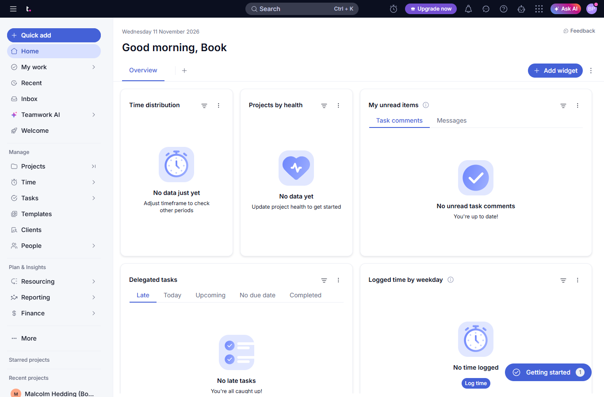
- **open: User menu**
  - URL: https://marketingcorps.eu.teamwork.com/app/home
  - Folder: `snapshots/s002__marketingcorps.eu.teamwork.com_app_home`
  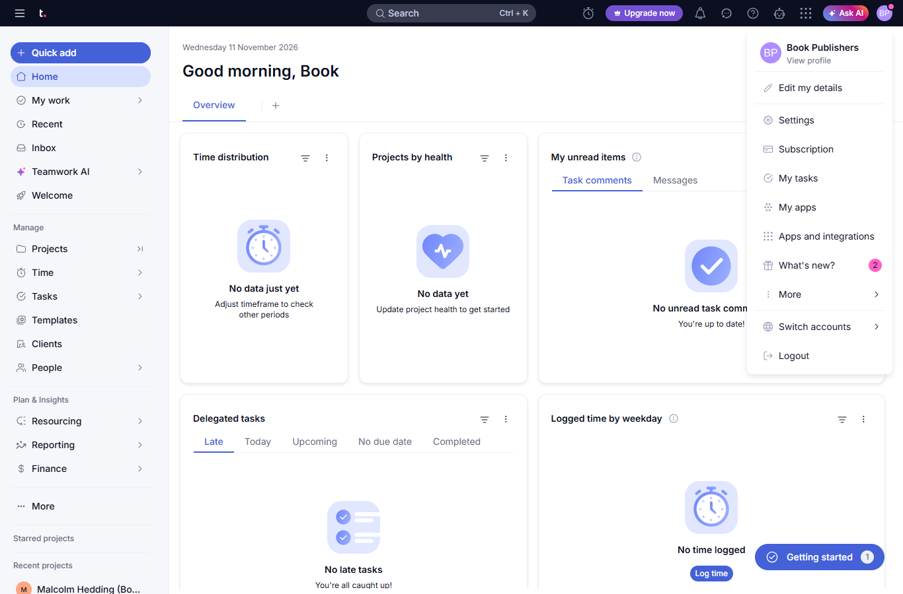
- **open: Quick add**
  - URL: https://marketingcorps.eu.teamwork.com/app/home
  - Folder: `snapshots/s003__marketingcorps.eu.teamwork.com_app_home`
  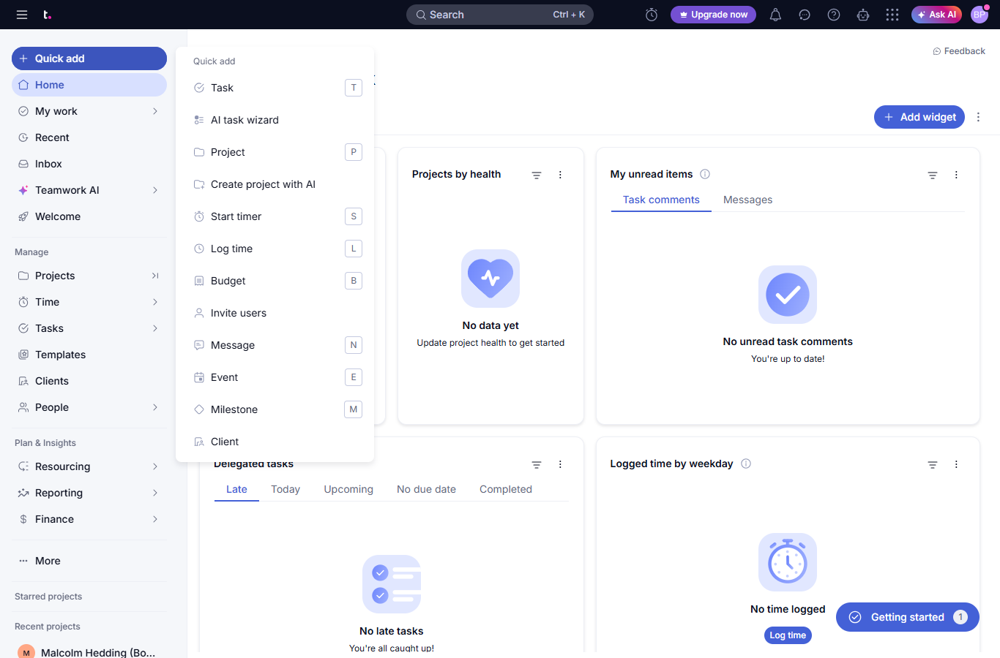
- **open: Recent**
  - URL: https://marketingcorps.eu.teamwork.com/app/home
  - Folder: `snapshots/s004__marketingcorps.eu.teamwork.com_app_home`
  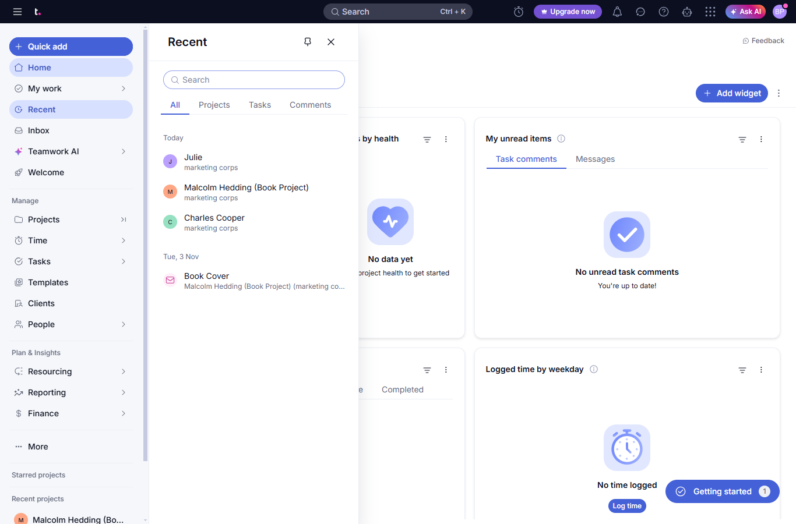
- **open: Jump to**
  - URL: https://marketingcorps.eu.teamwork.com/app/home
  - Folder: `snapshots/s005__marketingcorps.eu.teamwork.com_app_home`
  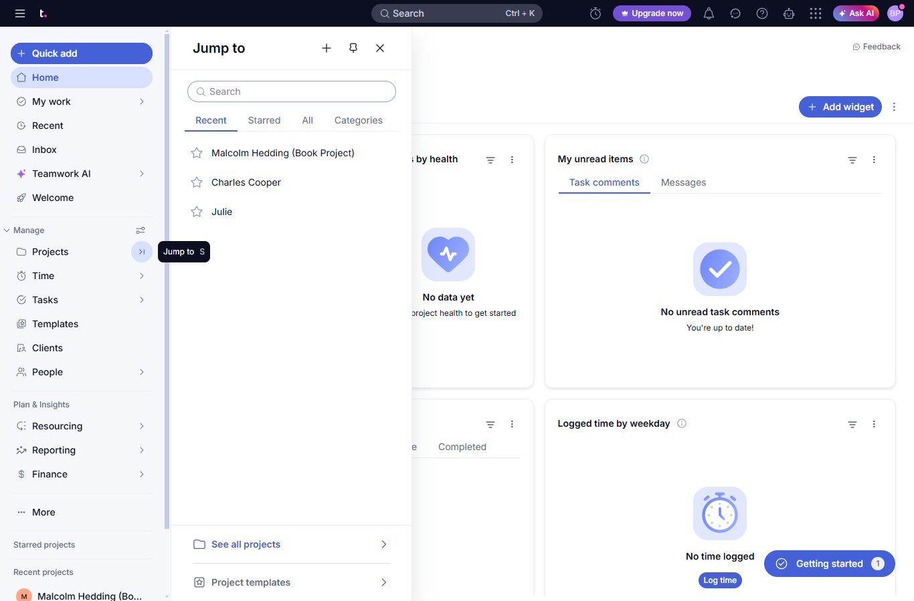

#### Controls

- **Skip to main content** — link, anchor — https://marketingcorps.eu.teamwork.com/app/home#v-0
- **Teamwork.com home** — link, navigate — https://marketingcorps.eu.teamwork.com/app/
- **Home** — link, navigate — https://marketingcorps.eu.teamwork.com/app/home
- **My work** — link, navigate — https://marketingcorps.eu.teamwork.com/app/work/projects
- **Inbox** — link, navigate — https://marketingcorps.eu.teamwork.com/app/inbox
- **Teamwork AI** — link, navigate — https://marketingcorps.eu.teamwork.com/app/ai/ask
- **Welcome** — link, navigate — https://marketingcorps.eu.teamwork.com/app/welcome
- **Projects** — link, navigate — https://marketingcorps.eu.teamwork.com/app/projects
- **Time** — link, error — https://marketingcorps.eu.teamwork.com/app/time — Locator.scroll_into_view_if_needed: Timeout 2000ms exceeded.
Call log:
  - waiting for locator("[data-crawler-id=\"csitkuwy7\"]").first
    - locator resolved to visible <a id="v-24" href="/app/time" aria-label="Time" aria-haspopup="menu" aria-expanded="false" data-crawler-id="csitkuwy7" data-identifier="side-nav-time-button" class="group/AppShellSidebarNavigationItem peer/AppShellSidebarNavigationItem relative flex h-8 min-w-8 flex-1 appearance-none items-center gap-2 overflow-hidden rounded-full pl-2 ring-2 ring-transparent text-left text-body-1 font-medium no-underline transition-colors outline-none bg-(--app-shell-sidebar-color-item-background-default) text-(…>…</a>

- **Tasks** — link, navigate — https://marketingcorps.eu.teamwork.com/app/tasks/completedTasks
- **Clients** — link, navigate — https://marketingcorps.eu.teamwork.com/app/clients
- **People** — link, error — https://marketingcorps.eu.teamwork.com/app/people — Locator.scroll_into_view_if_needed: Timeout 324ms exceeded.
Call log:
  - attempting scroll into view action
    - waiting for element to be stable

- **Resourcing** — link, error — https://marketingcorps.eu.teamwork.com/app/planning — Locator.scroll_into_view_if_needed: Timeout 119ms exceeded.
Call log:
  - attempting scroll into view action
    - waiting for element to be stable

- **Reporting** — link, navigate — https://marketingcorps.eu.teamwork.com/app/reports/all
- **Finance** — link, navigate — https://marketingcorps.eu.teamwork.com/app/finance/invoices/table
- **M Malcolm Hedding (Book Project)** — link, navigate — https://marketingcorps.eu.teamwork.com/app/projects/622746/tasks/list
- **C Charles Cooper** — link, error — https://marketingcorps.eu.teamwork.com/app/projects/622742 — Locator.scroll_into_view_if_needed: Timeout 61ms exceeded.
Call log:
  - attempting scroll into view action
    - waiting for element to be stable

- **J Julie** — link, navigate — https://marketingcorps.eu.teamwork.com/app/projects/622744/tasks/list
- **Collapse sidebar** — button, not-opened — state budget exhausted
- **Search Ctrl + K** — button, not-opened — state budget exhausted
- **Start a new timer** — button, not-opened — state budget exhausted
- **Upgrade now** — button, not-opened — state budget exhausted
- **Notifications** — button, not-opened — state budget exhausted
- **Chat** — button, not-opened — state budget exhausted
- **Help** — button, not-opened — state budget exhausted
- **Automations** — button, not-opened — state budget exhausted
- **Other apps** — button, error — Locator.scroll_into_view_if_needed: Timeout 2000ms exceeded.
Call log:
  - waiting for locator("[data-crawler-id=\"c6caunih4\"]").first
    - locator resolved to visible <button id="v-5" type="button" aria-haspopup="menu" aria-expanded="false" aria-label="Other apps" data-crawler-id="c6caunih4" data-identifier="app-shell-header-other-apps" class="relative flex size-7 shrink items-center justify-center rounded-full transition-colors outline-none bg-(--app-shell-header-color-surface) text-(--app-shell-header-color-icon-default) hover:bg-(--app-shell-header-color-item-background-hover) hover:text-(--app-shell-header-color-icon-hover) focus-visible:ring-2 focus-visible:ri…>…</button>

- **Ask AI** — button, not-opened — state budget exhausted
- **User menu** — button, open
- **Quick add** — button, open
- **Recent** — button, open
- **Manage** — button, not-opened — state budget exhausted
- **Jump to** — button, open
- **Templates** — button, not-opened — state budget exhausted
- **Plan & Insights** — button, not-opened — state budget exhausted
- **More** — button, not-opened — state budget exhausted
- **Starred projects** — button, not-opened — state budget exhausted
- **Recent projects** — button, not-opened — state budget exhausted
- **Feedback** — button, not-opened — state budget exhausted
- **Add dashboard** — button, not-opened — state budget exhausted
- **Add widget** — button, not-opened — state budget exhausted
- **Dashboard options** — button, not-opened — state budget exhausted
- **A default filter is applied. Adjust it to refine your results.** — button, not-opened — state budget exhausted
- **Options** — button, not-opened — state budget exhausted
- **Projects by health** — button, not-opened — state budget exhausted
- **Apply widget filters** — button, not-opened — state budget exhausted
- **Options** — button, not-opened — state budget exhausted
- **My unread items** — button, not-opened — state budget exhausted
- **Filter** — button, not-opened — state budget exhausted
- **Options** — button, not-opened — state budget exhausted
- **Delegated tasks** — button, recorded
- **Filter** — button, recorded
- **Options** — button, recorded
- **Logged time by weekday** — button, recorded
- **A default filter is applied. Adjust it to refine your results.** — button, recorded
- **Options** — button, recorded
- **Log time** — button, recorded
- **Tasks** — button, recorded
- **Filter** — button, recorded
- **Options** — button, recorded
- **Private notes** — button, recorded
- **Options** — button, not-opened — state budget exhausted
- **Apply widget filters** — button, recorded
- **Options** — button, recorded
- **Apply widget filters** — button, recorded
- **Options** — button, recorded
- **Add task** — button, recorded
- **Tasks by assignee × status** — button, recorded
- **Apply widget filters** — button, recorded
- **Options** — button, recorded
- **Add task** — button, recorded
- **Getting started 1** — button, recorded
- **Overview** — tab, skipped — already selected
- **Task comments** — tab, skipped — already selected
- **Messages** — tab, not-opened — state budget exhausted
- **Late** — tab, skipped — already selected
- **Today** — tab, recorded
- **Upcoming** — tab, recorded
- **No due date** — tab, recorded
- **Completed** — tab, recorded
- **Late** — tab, skipped — already selected
- **Today** — tab, recorded
- **Upcoming** — tab, recorded
- **No due date** — tab, recorded
- **Completed** — tab, recorded
- **Late 0** — tab, recorded
- **Today 0** — tab, recorded
- **Upcoming 0** — tab, skipped — already selected
- **Completed 0** — tab, recorded
- **My tasks** — link, navigate — https://marketingcorps.eu.teamwork.com/app/work/tasks
- **My calendar** — link, navigate — https://marketingcorps.eu.teamwork.com/app/work/calendar
- **My timesheet** — link, navigate — https://marketingcorps.eu.teamwork.com/app/work/timesheet
- **My projects** — link, navigate — https://marketingcorps.eu.teamwork.com/app/work/projects
- **Activity** — link, navigate — https://marketingcorps.eu.teamwork.com/app/work/activity
- **Private notes** — button, not-opened — state budget exhausted
- **Options** — button, not-opened — state budget exhausted
- **Apply widget filters** — button, not-opened — state budget exhausted
- **Getting started 1** — button, not-opened — state budget exhausted
- **Late 0** — tab, not-opened — state budget exhausted
- **Today 0** — tab, not-opened — state budget exhausted
- **Upcoming 0** — tab, skipped — already selected
- **Completed 0** — tab, not-opened — state budget exhausted
- **Ask AI** — link, navigate — https://marketingcorps.eu.teamwork.com/app/ai/ask
- **AI Teammates** — link, navigate — https://marketingcorps.eu.teamwork.com/app/ai/teammates
- **Getting started 1** — button, recorded
- **AI skills NEW** — button, recorded
- **Private notes** — button, recorded
- **Apply widget filters** — button, recorded
- **Options** — button, recorded
- **Getting started 1** — button, recorded
- **AI skills NEW** — button, recorded
- **Late 0** — tab, recorded
- **Today 0** — tab, recorded
- **Upcoming 0** — tab, skipped — already selected
- **Completed 0** — tab, recorded
- **Tasks** — link, navigate — https://marketingcorps.eu.teamwork.com/app/tasks/tasks
- **Board** — link, navigate — https://marketingcorps.eu.teamwork.com/app/tasks/board
- **Table** — link, navigate — https://marketingcorps.eu.teamwork.com/app/tasks/table
- **Completed tasks** — link, navigate — https://marketingcorps.eu.teamwork.com/app/tasks/completedTasks
- **Customize** — button, not-opened — state budget exhausted
- **Getting started 1** — button, recorded
- **All reports** — link, navigate — https://marketingcorps.eu.teamwork.com/app/reports/all
- **Custom Reports** — link, navigate — https://marketingcorps.eu.teamwork.com/app/reports/custom-reports
- **Scheduled reports** — link, navigate — https://marketingcorps.eu.teamwork.com/app/reports/scheduled
- **Customize** — button, recorded
- **Rates** — link, navigate — https://marketingcorps.eu.teamwork.com/app/finance/rates
- **Budgets** — link, navigate — https://marketingcorps.eu.teamwork.com/app/finance/budgets
- **Invoices** — link, navigate — https://marketingcorps.eu.teamwork.com/app/finance/invoices
- **Expenses** — link, navigate — https://marketingcorps.eu.teamwork.com/app/finance/expenses
- **Logged time by weekday** — button, recorded
- **A default filter is applied. Adjust it to refine your results.** — button, recorded
- **Log time** — button, recorded
- **Tasks** — button, recorded
- **Filter** — button, recorded
- **Options** — button, recorded
- **Private notes** — button, recorded
- **Options** — button, recorded
- **Apply widget filters** — button, recorded
- **Options** — button, recorded
- **Apply widget filters** — button, recorded
- **Options** — button, recorded
- **Add task** — button, recorded
- **Tasks by assignee × status** — button, recorded
- **Apply widget filters** — button, recorded
- **Options** — button, recorded
- **Add task** — button, recorded
- **Getting started 1** — button, recorded
- **Late 0** — tab, recorded
- **Today 0** — tab, recorded
- **Upcoming 0** — tab, skipped — already selected
- **Completed 0** — tab, recorded
- **General tasks** — link, navigate — https://marketingcorps.eu.teamwork.com/app/tasklists/2420320
- **Private notes** — button, recorded
- **Options** — button, recorded
- **Apply widget filters** — button, recorded
- **Options** — button, recorded
- **Getting started 1** — button, recorded
- **Getting started 1** — button, recorded
- **Book Publishers View profile** — link, navigate — https://marketingcorps.eu.teamwork.com/app/people/555920
- **Settings** — link, navigate — https://marketingcorps.eu.teamwork.com/app/settings
- **Subscription** — link, navigate — https://marketingcorps.eu.teamwork.com/app/settings/subscription
- **My tasks** — link, navigate — https://marketingcorps.eu.teamwork.com/app/people/555920/tasks
- **My apps** — link, navigate — https://marketingcorps.eu.teamwork.com/app/people/555920/integrations
- **Apps and integrations** — link, navigate — https://marketingcorps.eu.teamwork.com/app/settings/integrations
- **Edit my details** — button, recorded
- **What's new? 2** — button, recorded
- **More** — button, recorded
- **Switch accounts** — button, recorded
- **Logout** — button, skipped — submits a form or changes data
- **Task T T** — button, recorded
- **AI task wizard** — button, recorded
- **Project P P** — button, recorded
- **Create project with AI** — button, recorded
- **Start timer S S** — button, recorded
- **Log time L L** — button, recorded
- **Budget B B** — button, recorded
- **Invite users** — button, recorded
- **Message N N** — button, recorded
- **Event E E** — button, recorded
- **Milestone M M** — button, recorded
- **Client** — button, recorded
- **J Julie marketing corps** — link, navigate — https://marketingcorps.eu.teamwork.com/app/projects/622744
- **M Malcolm Hedding (Book Project) marketing corps** — link, navigate — https://marketingcorps.eu.teamwork.com/app/projects/622746
- **C Charles Cooper marketing corps** — link, navigate — https://marketingcorps.eu.teamwork.com/app/projects/622742
- **Book Cover Malcolm Hedding (Book Project) (marketing corps)** — link, navigate — https://marketingcorps.eu.teamwork.com/app/messages/519066
- **Pin this panel** — button, recorded
- **Close** — button, recorded
- **Feedback** — button, recorded
- **Add dashboard** — button, recorded
- **Add widget** — button, recorded
- **Dashboard options** — button, recorded
- **A default filter is applied. Adjust it to refine your results.** — button, recorded
- **Projects by health** — button, recorded
- **Apply widget filters** — button, recorded
- **Options** — button, recorded
- **My unread items** — button, recorded
- **Filter** — button, recorded
- **Options** — button, recorded
- **Delegated tasks** — button, recorded
- **Filter** — button, recorded
- **Options** — button, recorded
- **Logged time by weekday** — button, recorded
- **A default filter is applied. Adjust it to refine your results.** — button, recorded
- **Log time** — button, recorded
- **Tasks** — button, recorded
- **Filter** — button, recorded
- **Options** — button, recorded
- **Private notes** — button, recorded
- **Options** — button, recorded
- **Apply widget filters** — button, recorded
- **Options** — button, recorded
- **Add task** — button, recorded
- **Tasks by assignee × status** — button, recorded
- **Apply widget filters** — button, recorded
- **Options** — button, recorded
- **Add task** — button, recorded
- **Getting started 1** — button, recorded
- **All** — tab, skipped — already selected
- **Projects** — tab, recorded
- **Tasks** — tab, recorded
- **Comments** — tab, recorded
- **Overview** — tab, skipped — already selected
- **Task comments** — tab, skipped — already selected
- **Messages** — tab, recorded
- **Late** — tab, skipped — already selected
- **Today** — tab, recorded
- **Upcoming** — tab, recorded
- **No due date** — tab, recorded
- **Completed** — tab, recorded
- **Late** — tab, skipped — already selected
- **Today** — tab, recorded
- **Upcoming** — tab, recorded
- **No due date** — tab, recorded
- **Completed** — tab, recorded
- **Late 0** — tab, recorded
- **Today 0** — tab, recorded
- **Upcoming 0** — tab, skipped — already selected
- **Completed 0** — tab, recorded
- **Malcolm Hedding (Book Project)** — link, navigate — https://marketingcorps.eu.teamwork.com/app/projects/622746
- **Charles Cooper** — link, navigate — https://marketingcorps.eu.teamwork.com/app/projects/622742
- **Julie** — link, navigate — https://marketingcorps.eu.teamwork.com/app/projects/622744
- **See all projects** — link, navigate — https://marketingcorps.eu.teamwork.com/app/projects/list
- **Project templates** — link, navigate — https://marketingcorps.eu.teamwork.com/app/projects/templates
- **Add project** — button, recorded
- **Pin this panel** — button, recorded
- **Close** — button, recorded
- **Add to Starred** — button, recorded
- **Add to Starred** — button, recorded
- **Add to Starred** — button, recorded
- **Feedback** — button, recorded
- **Add dashboard** — button, recorded
- **Add widget** — button, recorded
- **Dashboard options** — button, recorded
- **A default filter is applied. Adjust it to refine your results.** — button, recorded
- **Projects by health** — button, recorded
- **Apply widget filters** — button, recorded
- **Options** — button, recorded
- **My unread items** — button, recorded
- **Filter** — button, recorded
- **Options** — button, recorded
- **Delegated tasks** — button, recorded
- **Filter** — button, recorded
- **Options** — button, recorded
- **Logged time by weekday** — button, recorded
- **A default filter is applied. Adjust it to refine your results.** — button, recorded
- **Log time** — button, recorded
- **Tasks** — button, recorded
- **Filter** — button, recorded
- **Options** — button, recorded
- **Private notes** — button, recorded
- **Options** — button, recorded
- **Tasks by assignee × status** — button, recorded
- **Apply widget filters** — button, recorded
- **Options** — button, recorded
- **Add task** — button, recorded
- **Getting started 1** — button, recorded
- **Recent** — tab, skipped — already selected
- **Starred** — tab, recorded
- **All** — tab, recorded
- **Categories** — tab, recorded

### Inbox - marketing corps

- URL: https://marketingcorps.eu.teamwork.com/app/inbox
- Requested: https://marketingcorps.eu.teamwork.com/app/inbox
- Status: 200
- Depth: 1

#### Outline

- Inbox
      - Nothing to preview

#### States

- **default**
  - URL: https://marketingcorps.eu.teamwork.com/app/inbox
  - Folder: `snapshots/s006__marketingcorps.eu.teamwork.com_app_inbox`
  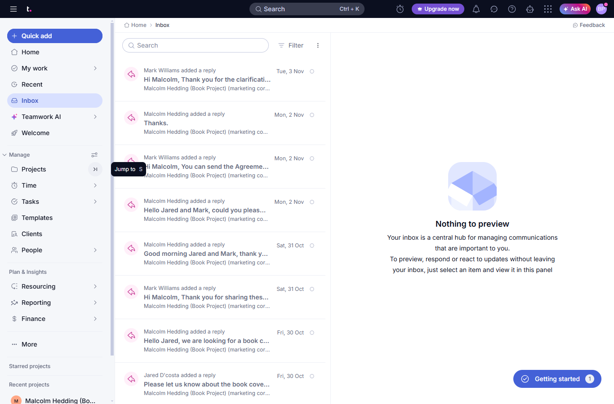
- **open: Other apps**
  - URL: https://marketingcorps.eu.teamwork.com/app/inbox
  - Folder: `snapshots/s007__marketingcorps.eu.teamwork.com_app_inbox`
  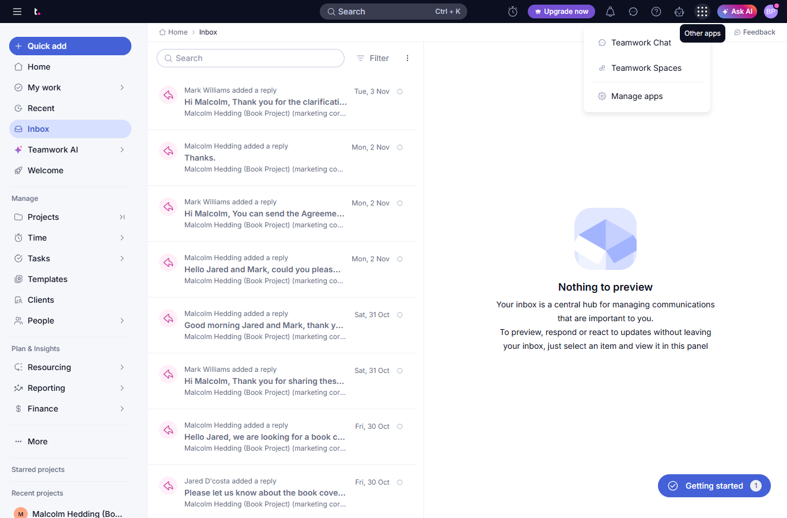
- **open: User menu**
  - URL: https://marketingcorps.eu.teamwork.com/app/inbox
  - Folder: `snapshots/s008__marketingcorps.eu.teamwork.com_app_inbox`
  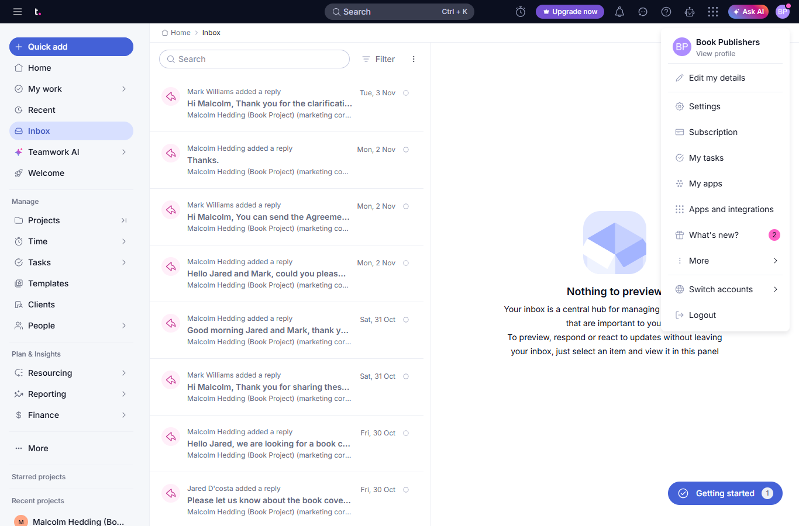
- **open: Quick add**
  - URL: https://marketingcorps.eu.teamwork.com/app/inbox
  - Folder: `snapshots/s009__marketingcorps.eu.teamwork.com_app_inbox`
  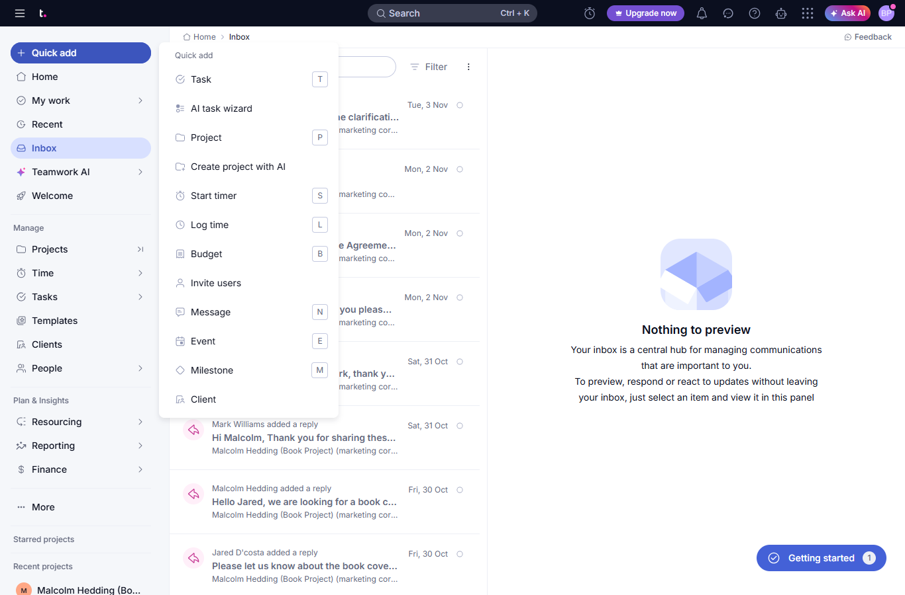
- **open: Recent**
  - URL: https://marketingcorps.eu.teamwork.com/app/inbox
  - Folder: `snapshots/s010__marketingcorps.eu.teamwork.com_app_inbox`
  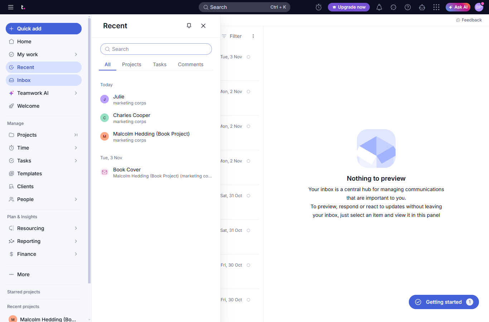

#### Controls

- **Skip to main content** — link, anchor — https://marketingcorps.eu.teamwork.com/app/inbox#v-0
- **Teamwork.com home** — link, navigate — https://marketingcorps.eu.teamwork.com/app/
- **Home** — link, navigate — https://marketingcorps.eu.teamwork.com/app/home
- **My work** — link, navigate — https://marketingcorps.eu.teamwork.com/app/work/projects
- **Inbox** — link, navigate — https://marketingcorps.eu.teamwork.com/app/inbox
- **Teamwork AI** — link, navigate — https://marketingcorps.eu.teamwork.com/app/ai/ask
- **Welcome** — link, navigate — https://marketingcorps.eu.teamwork.com/app/welcome
- **Projects** — link, navigate — https://marketingcorps.eu.teamwork.com/app/projects
- **Time** — link, navigate — https://marketingcorps.eu.teamwork.com/app/time/approvals
- **Tasks** — link, navigate — https://marketingcorps.eu.teamwork.com/app/tasks/completedTasks
- **Clients** — link, navigate — https://marketingcorps.eu.teamwork.com/app/clients
- **People** — link, navigate — https://marketingcorps.eu.teamwork.com/app/people/people
- **Resourcing** — link, navigate — https://marketingcorps.eu.teamwork.com/app/planning/chart
- **Reporting** — link, navigate — https://marketingcorps.eu.teamwork.com/app/reports/all
- **Finance** — link, navigate — https://marketingcorps.eu.teamwork.com/app/finance/invoices/table
- **M Malcolm Hedding (Book Project)** — link, navigate — https://marketingcorps.eu.teamwork.com/app/projects/622746/tasks/list
- **C Charles Cooper** — link, navigate — https://marketingcorps.eu.teamwork.com/app/projects/622742/tasks/list
- **J Julie** — link, navigate — https://marketingcorps.eu.teamwork.com/app/projects/622744/tasks/list
- **Home** — link, navigate — https://marketingcorps.eu.teamwork.com/app/home
- **Inbox** — link, navigate — https://marketingcorps.eu.teamwork.com/app/inbox
- **Collapse sidebar** — button, not-opened — state budget exhausted
- **Search Ctrl + K** — button, not-opened — state budget exhausted
- **Start a new timer** — button, not-opened — state budget exhausted
- **Upgrade now** — button, not-opened — state budget exhausted
- **Notifications** — button, not-opened — state budget exhausted
- **Chat** — button, not-opened — state budget exhausted
- **Help** — button, not-opened — state budget exhausted
- **Automations** — button, not-opened — state budget exhausted
- **Other apps** — button, open
- **Ask AI** — button, not-opened — state budget exhausted
- **User menu** — button, open
- **Quick add** — button, open
- **Recent** — button, open
- **Manage** — button, not-opened — state budget exhausted
- **Customize** — button, recorded
- **Jump to** — button, not-opened — state budget exhausted
- **Templates** — button, not-opened — state budget exhausted
- **Plan & Insights** — button, not-opened — state budget exhausted
- **More** — button, not-opened — state budget exhausted
- **Starred projects** — button, not-opened — state budget exhausted
- **Recent projects** — button, not-opened — state budget exhausted
- **Feedback** — button, not-opened — state budget exhausted
- **Filter** — button, not-opened — state budget exhausted
- **Options** — button, not-opened — state budget exhausted
- **Mark as unread** — button, not-opened — state budget exhausted
- **Mark as unread** — button, not-opened — state budget exhausted
- **Mark as unread** — button, not-opened — state budget exhausted
- **Mark as unread** — button, not-opened — state budget exhausted
- **Mark as unread** — button, not-opened — state budget exhausted
- **Mark as unread** — button, not-opened — state budget exhausted
- **Mark as unread** — button, not-opened — state budget exhausted
- **Mark as unread** — button, not-opened — state budget exhausted
- **Mark as unread** — button, not-opened — state budget exhausted
- **Mark as unread** — button, not-opened — state budget exhausted
- **Mark as unread** — button, not-opened — state budget exhausted
- **Mark as unread** — button, not-opened — state budget exhausted
- **Mark as unread** — button, not-opened — state budget exhausted
- **Mark as unread** — button, not-opened — state budget exhausted
- **Mark as unread** — button, not-opened — state budget exhausted
- **Mark as unread** — button, not-opened — state budget exhausted
- **Mark as unread** — button, not-opened — state budget exhausted
- **Mark as unread** — button, not-opened — state budget exhausted
- **Getting started 1** — button, not-opened — state budget exhausted
- **Filter** — menu, not-opened — state budget exhausted
- **My tasks** — link, navigate — https://marketingcorps.eu.teamwork.com/app/work/tasks
- **My calendar** — link, navigate — https://marketingcorps.eu.teamwork.com/app/work/calendar
- **My timesheet** — link, navigate — https://marketingcorps.eu.teamwork.com/app/work/timesheet
- **My projects** — link, navigate — https://marketingcorps.eu.teamwork.com/app/work/projects
- **Activity** — link, navigate — https://marketingcorps.eu.teamwork.com/app/work/activity
- **Ask AI** — link, navigate — https://marketingcorps.eu.teamwork.com/app/ai/ask
- **AI Teammates** — link, navigate — https://marketingcorps.eu.teamwork.com/app/ai/teammates
- **AI skills NEW** — button, recorded
- **My timesheet** — link, navigate — https://marketingcorps.eu.teamwork.com/app/time/user
- **Company timesheet** — link, navigate — https://marketingcorps.eu.teamwork.com/app/time/company
- **All time** — link, navigate — https://marketingcorps.eu.teamwork.com/app/time/all
- **Approvals** — link, navigate — https://marketingcorps.eu.teamwork.com/app/time/approvals
- **Tasks** — link, navigate — https://marketingcorps.eu.teamwork.com/app/tasks/tasks
- **Board** — link, navigate — https://marketingcorps.eu.teamwork.com/app/tasks/board
- **Table** — link, navigate — https://marketingcorps.eu.teamwork.com/app/tasks/table
- **Completed tasks** — link, navigate — https://marketingcorps.eu.teamwork.com/app/tasks/completedTasks
- **People** — link, navigate — https://marketingcorps.eu.teamwork.com/app/people/people
- **Roles** — link, navigate — https://marketingcorps.eu.teamwork.com/app/people/roles
- **Skills NEW** — link, navigate — https://marketingcorps.eu.teamwork.com/app/people/skills
- **Teams** — link, navigate — https://marketingcorps.eu.teamwork.com/app/people/teams
- **Statuses** — link, navigate — https://marketingcorps.eu.teamwork.com/app/people/statuses
- **Overview** — link, navigate — https://marketingcorps.eu.teamwork.com/app/planning/overview
- **Schedule** — link, navigate — https://marketingcorps.eu.teamwork.com/app/planning/schedule
- **Workload** — link, navigate — https://marketingcorps.eu.teamwork.com/app/planning/workload
- **Portfolio** — link, navigate — https://marketingcorps.eu.teamwork.com/app/planning/portfolio
- **Chart** — link, navigate — https://marketingcorps.eu.teamwork.com/app/planning/chart
- **Customize** — button, recorded
- **All reports** — link, navigate — https://marketingcorps.eu.teamwork.com/app/reports/all
- **Custom Reports** — link, navigate — https://marketingcorps.eu.teamwork.com/app/reports/custom-reports
- **Scheduled reports** — link, navigate — https://marketingcorps.eu.teamwork.com/app/reports/scheduled
- **Rates** — link, navigate — https://marketingcorps.eu.teamwork.com/app/finance/rates
- **Budgets** — link, navigate — https://marketingcorps.eu.teamwork.com/app/finance/budgets
- **Invoices** — link, navigate — https://marketingcorps.eu.teamwork.com/app/finance/invoices
- **Expenses** — link, navigate — https://marketingcorps.eu.teamwork.com/app/finance/expenses
- **Teamwork Chat** — link, navigate — https://marketingcorps.eu.teamwork.com/chat
- **Teamwork Spaces** — link, navigate — https://marketingcorps.eu.teamwork.com/spaces
- **Manage apps** — button, recorded
- **Book Publishers View profile** — link, navigate — https://marketingcorps.eu.teamwork.com/app/people/555920
- **Settings** — link, navigate — https://marketingcorps.eu.teamwork.com/app/settings
- **Subscription** — link, navigate — https://marketingcorps.eu.teamwork.com/app/settings/subscription
- **My tasks** — link, navigate — https://marketingcorps.eu.teamwork.com/app/people/555920/tasks
- **My apps** — link, navigate — https://marketingcorps.eu.teamwork.com/app/people/555920/integrations
- **Apps and integrations** — link, navigate — https://marketingcorps.eu.teamwork.com/app/settings/integrations
- **Edit my details** — button, recorded
- **What's new? 2** — button, recorded
- **More** — button, recorded
- **Switch accounts** — button, recorded
- **Logout** — button, skipped — submits a form or changes data
- **Task T T** — button, recorded
- **AI task wizard** — button, recorded
- **Project P P** — button, recorded
- **Create project with AI** — button, recorded
- **Start timer S S** — button, recorded
- **Log time L L** — button, recorded
- **Budget B B** — button, recorded
- **Invite users** — button, recorded
- **Message N N** — button, recorded
- **Event E E** — button, recorded
- **Milestone M M** — button, recorded
- **Client** — button, recorded
- **J Julie marketing corps** — link, navigate — https://marketingcorps.eu.teamwork.com/app/projects/622744
- **C Charles Cooper marketing corps** — link, navigate — https://marketingcorps.eu.teamwork.com/app/projects/622742
- **M Malcolm Hedding (Book Project) marketing corps** — link, navigate — https://marketingcorps.eu.teamwork.com/app/projects/622746
- **Book Cover Malcolm Hedding (Book Project) (marketing corps)** — link, navigate — https://marketingcorps.eu.teamwork.com/app/messages/519066
- **Home** — link, navigate — https://marketingcorps.eu.teamwork.com/app/home
- **Inbox** — link, navigate — https://marketingcorps.eu.teamwork.com/app/inbox
- **Pin this panel** — button, recorded
- **Close** — button, recorded
- **Feedback** — button, recorded
- **Filter** — button, recorded
- **Options** — button, recorded
- **Mark as unread** — button, recorded
- **Mark as unread** — button, recorded
- **Mark as unread** — button, recorded
- **Getting started 1** — button, recorded
- **All** — tab, skipped — already selected
- **Projects** — tab, recorded
- **Tasks** — tab, recorded
- **Comments** — tab, recorded

### Welcome - marketing corps

- URL: https://marketingcorps.eu.teamwork.com/app/welcome/the-fundamentals
- Requested: https://marketingcorps.eu.teamwork.com/app/welcome
- Status: 200
- Depth: 1

#### Outline

- Welcome to Teamwork.com
  - Balance your team's workload with confidence
  - What success looks like
  - Resources

#### States

- **default**
  - URL: https://marketingcorps.eu.teamwork.com/app/welcome/the-fundamentals
  - Folder: `snapshots/s011__marketingcorps.eu.teamwork.com_app_welcome_the-fundamentals`
  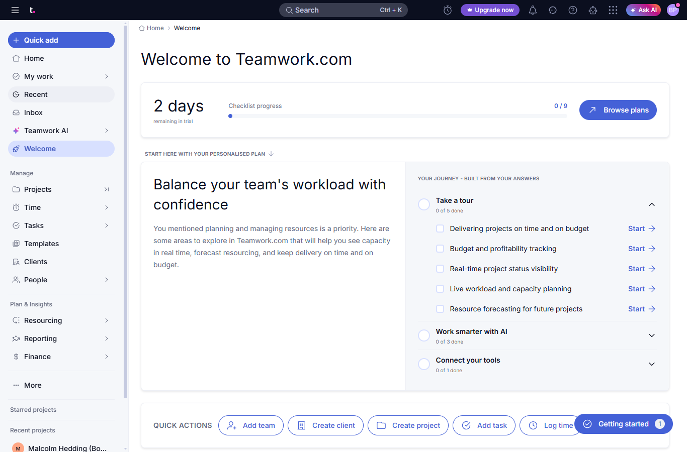
- **open: Other apps**
  - URL: https://marketingcorps.eu.teamwork.com/app/welcome/the-fundamentals
  - Folder: `snapshots/s012__marketingcorps.eu.teamwork.com_app_welcome_the-fundamentals`
  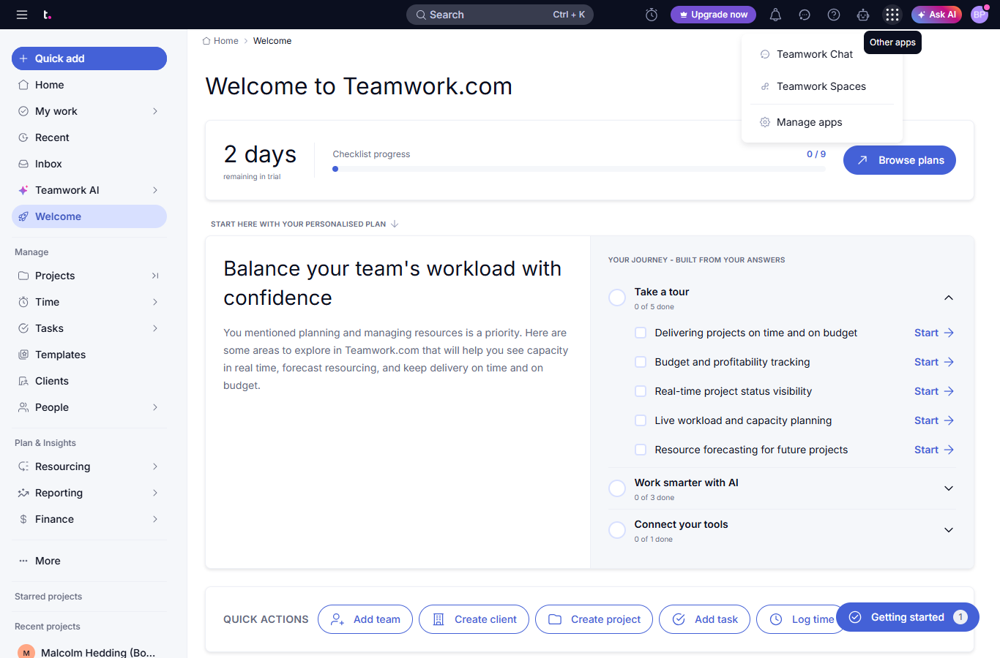
- **open: User menu**
  - URL: https://marketingcorps.eu.teamwork.com/app/welcome/the-fundamentals
  - Folder: `snapshots/s013__marketingcorps.eu.teamwork.com_app_welcome_the-fundamentals`
  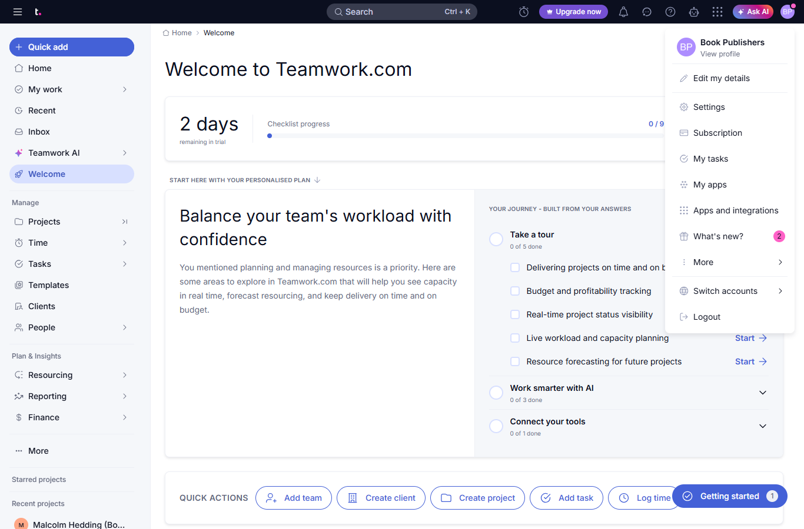
- **open: Quick add**
  - URL: https://marketingcorps.eu.teamwork.com/app/welcome/the-fundamentals
  - Folder: `snapshots/s014__marketingcorps.eu.teamwork.com_app_welcome_the-fundamentals`
  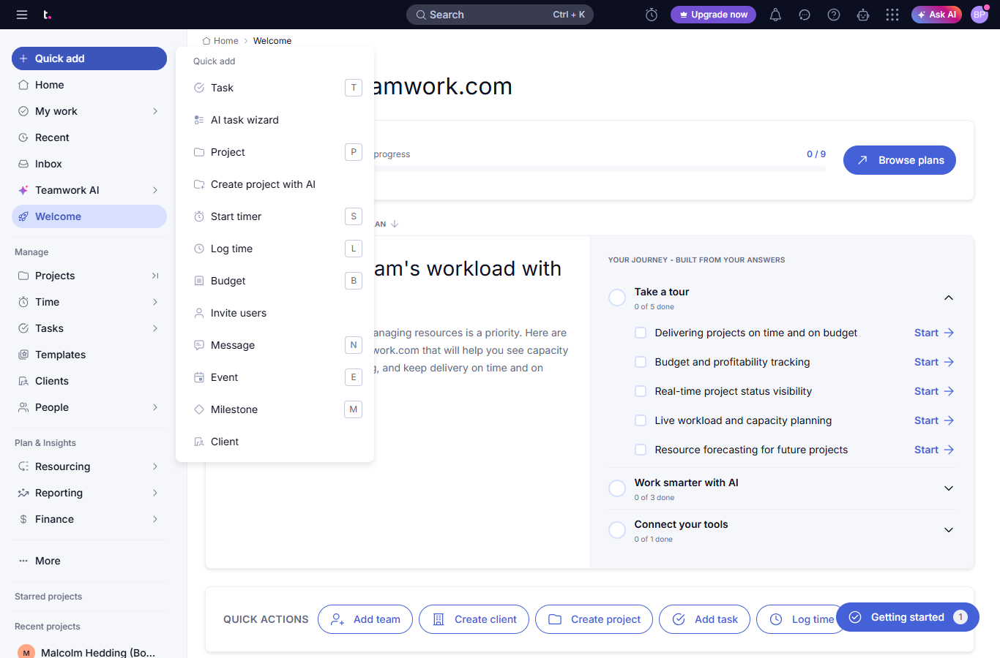
- **open: Recent**
  - URL: https://marketingcorps.eu.teamwork.com/app/welcome/the-fundamentals
  - Folder: `snapshots/s015__marketingcorps.eu.teamwork.com_app_welcome_the-fundamentals`
  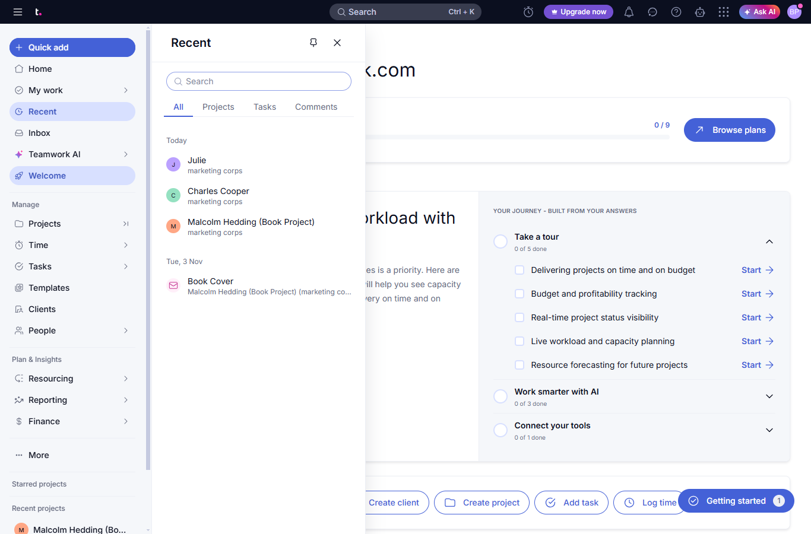

#### Controls

- **Skip to main content** — link, anchor — https://marketingcorps.eu.teamwork.com/app/welcome/the-fundamentals#v-0
- **Teamwork.com home** — link, navigate — https://marketingcorps.eu.teamwork.com/app/
- **Home** — link, navigate — https://marketingcorps.eu.teamwork.com/app/home
- **My work** — link, navigate — https://marketingcorps.eu.teamwork.com/app/work/projects
- **Inbox** — link, navigate — https://marketingcorps.eu.teamwork.com/app/inbox
- **Teamwork AI** — link, navigate — https://marketingcorps.eu.teamwork.com/app/ai/ask
- **Welcome** — link, navigate — https://marketingcorps.eu.teamwork.com/app/welcome
- **Projects** — link, navigate — https://marketingcorps.eu.teamwork.com/app/projects
- **Time** — link, navigate — https://marketingcorps.eu.teamwork.com/app/time/approvals
- **Tasks** — link, navigate — https://marketingcorps.eu.teamwork.com/app/tasks/completedTasks
- **Clients** — link, navigate — https://marketingcorps.eu.teamwork.com/app/clients
- **People** — link, navigate — https://marketingcorps.eu.teamwork.com/app/people/people
- **Resourcing** — link, navigate — https://marketingcorps.eu.teamwork.com/app/planning/chart
- **Reporting** — link, navigate — https://marketingcorps.eu.teamwork.com/app/reports/all
- **Finance** — link, navigate — https://marketingcorps.eu.teamwork.com/app/finance/invoices/table
- **M Malcolm Hedding (Book Project)** — link, navigate — https://marketingcorps.eu.teamwork.com/app/projects/622746/tasks/list
- **C Charles Cooper** — link, navigate — https://marketingcorps.eu.teamwork.com/app/projects/622742/tasks/list
- **J Julie** — link, navigate — https://marketingcorps.eu.teamwork.com/app/projects/622744/tasks/list
- **Home** — link, navigate — https://marketingcorps.eu.teamwork.com/app/home
- **Welcome** — link, navigate — https://marketingcorps.eu.teamwork.com/app/welcome
- **Start** — link, external — https://teamwork.navattic.com/iz6y0z70
- **Start** — link, external — https://teamwork.navattic.com/cq7d05ev
- **Start** — link, external — https://teamwork.navattic.com/6z6u0vip
- **Start** — link, external — https://teamwork.navattic.com/yf6u0pwq
- **Start** — link, external — https://teamwork.navattic.com/uaem0xjg
- **Start** — link, external — https://teamwork.navattic.com/61lk0x1f
- **Start** — link, navigate — https://marketingcorps.eu.teamwork.com/app/ai/teammates
- **Start** — link, external — https://www.teamwork.com/blog/mcp-server/
- **Start** — link, navigate — https://marketingcorps.eu.teamwork.com/app/settings/integrations/all
- **Read their story** — link, external — https://www.teamwork.com/customer-stories/pravda-media-group/
- **Read their story** — link, external — https://www.teamwork.com/customer-stories/invanity/
- **Educational webinars** — link, external — https://www.teamwork.com/webinars/
- **Help docs** — link, external — https://support.teamwork.com/projects
- **Contact support** — link, external — https://www.teamwork.com/support/
- **Collapse sidebar** — button, not-opened — state budget exhausted
- **Search Ctrl + K** — button, not-opened — state budget exhausted
- **Start a new timer** — button, not-opened — state budget exhausted
- **Upgrade now** — button, not-opened — state budget exhausted
- **Notifications** — button, not-opened — state budget exhausted
- **Chat** — button, not-opened — state budget exhausted
- **Help** — button, not-opened — state budget exhausted
- **Automations** — button, not-opened — state budget exhausted
- **Other apps** — button, open
- **Ask AI** — button, not-opened — state budget exhausted
- **User menu** — button, open
- **Quick add** — button, open
- **Recent** — button, open
- **Manage** — button, not-opened — state budget exhausted
- **Jump to** — button, not-opened — state budget exhausted
- **Templates** — button, not-opened — state budget exhausted
- **Plan & Insights** — button, not-opened — state budget exhausted
- **More** — button, not-opened — state budget exhausted
- **Starred projects** — button, not-opened — state budget exhausted
- **Recent projects** — button, not-opened — state budget exhausted
- **Browse plans** — button, not-opened — state budget exhausted
- **Take a tour 0 of 5 done** — button, not-opened — state budget exhausted
- **Work smarter with AI 0 of 3 done** — button, not-opened — state budget exhausted
- **Connect your tools 0 of 1 done** — button, not-opened — state budget exhausted
- **Add team** — button, not-opened — state budget exhausted
- **Create client** — button, not-opened — state budget exhausted
- **Create project** — button, not-opened — state budget exhausted
- **Add task** — button, not-opened — state budget exhausted
- **Log time** — button, not-opened — state budget exhausted
- **Ask AI CHAT** — button, not-opened — state budget exhausted
- **Getting started 1** — button, not-opened — state budget exhausted
- **My tasks** — link, navigate — https://marketingcorps.eu.teamwork.com/app/work/tasks
- **My calendar** — link, navigate — https://marketingcorps.eu.teamwork.com/app/work/calendar
- **My timesheet** — link, navigate — https://marketingcorps.eu.teamwork.com/app/work/timesheet
- **My projects** — link, navigate — https://marketingcorps.eu.teamwork.com/app/work/projects
- **Activity** — link, navigate — https://marketingcorps.eu.teamwork.com/app/work/activity
- **Ask AI** — link, navigate — https://marketingcorps.eu.teamwork.com/app/ai/ask
- **AI Teammates** — link, navigate — https://marketingcorps.eu.teamwork.com/app/ai/teammates
- **AI skills NEW** — button, recorded
- **My timesheet** — link, navigate — https://marketingcorps.eu.teamwork.com/app/time/user
- **Company timesheet** — link, navigate — https://marketingcorps.eu.teamwork.com/app/time/company
- **All time** — link, navigate — https://marketingcorps.eu.teamwork.com/app/time/all
- **Approvals** — link, navigate — https://marketingcorps.eu.teamwork.com/app/time/approvals
- **Customize** — button, recorded
- **Tasks** — link, navigate — https://marketingcorps.eu.teamwork.com/app/tasks/tasks
- **Board** — link, navigate — https://marketingcorps.eu.teamwork.com/app/tasks/board
- **Table** — link, navigate — https://marketingcorps.eu.teamwork.com/app/tasks/table
- **Completed tasks** — link, navigate — https://marketingcorps.eu.teamwork.com/app/tasks/completedTasks
- **People** — link, navigate — https://marketingcorps.eu.teamwork.com/app/people/people
- **Roles** — link, navigate — https://marketingcorps.eu.teamwork.com/app/people/roles
- **Skills NEW** — link, navigate — https://marketingcorps.eu.teamwork.com/app/people/skills
- **Teams** — link, navigate — https://marketingcorps.eu.teamwork.com/app/people/teams
- **Statuses** — link, navigate — https://marketingcorps.eu.teamwork.com/app/people/statuses
- **Overview** — link, navigate — https://marketingcorps.eu.teamwork.com/app/planning/overview
- **Schedule** — link, navigate — https://marketingcorps.eu.teamwork.com/app/planning/schedule
- **Workload** — link, navigate — https://marketingcorps.eu.teamwork.com/app/planning/workload
- **Portfolio** — link, navigate — https://marketingcorps.eu.teamwork.com/app/planning/portfolio
- **Chart** — link, navigate — https://marketingcorps.eu.teamwork.com/app/planning/chart
- **Customize** — button, recorded
- **All reports** — link, navigate — https://marketingcorps.eu.teamwork.com/app/reports/all
- **Custom Reports** — link, navigate — https://marketingcorps.eu.teamwork.com/app/reports/custom-reports
- **Scheduled reports** — link, navigate — https://marketingcorps.eu.teamwork.com/app/reports/scheduled
- **Rates** — link, navigate — https://marketingcorps.eu.teamwork.com/app/finance/rates
- **Budgets** — link, navigate — https://marketingcorps.eu.teamwork.com/app/finance/budgets
- **Invoices** — link, navigate — https://marketingcorps.eu.teamwork.com/app/finance/invoices
- **Expenses** — link, navigate — https://marketingcorps.eu.teamwork.com/app/finance/expenses
- **General tasks** — link, navigate — https://marketingcorps.eu.teamwork.com/app/tasklists/2420320
- **Teamwork Chat** — link, navigate — https://marketingcorps.eu.teamwork.com/chat
- **Teamwork Spaces** — link, navigate — https://marketingcorps.eu.teamwork.com/spaces
- **Manage apps** — button, recorded
- **Book Publishers View profile** — link, navigate — https://marketingcorps.eu.teamwork.com/app/people/555920
- **Settings** — link, navigate — https://marketingcorps.eu.teamwork.com/app/settings
- **Subscription** — link, navigate — https://marketingcorps.eu.teamwork.com/app/settings/subscription
- **My tasks** — link, navigate — https://marketingcorps.eu.teamwork.com/app/people/555920/tasks
- **My apps** — link, navigate — https://marketingcorps.eu.teamwork.com/app/people/555920/integrations
- **Apps and integrations** — link, navigate — https://marketingcorps.eu.teamwork.com/app/settings/integrations
- **Edit my details** — button, recorded
- **What's new? 2** — button, recorded
- **More** — button, recorded
- **Switch accounts** — button, recorded
- **Logout** — button, skipped — submits a form or changes data
- **Task T T** — button, recorded
- **AI task wizard** — button, recorded
- **Project P P** — button, recorded
- **Create project with AI** — button, recorded
- **Start timer S S** — button, recorded
- **Log time L L** — button, recorded
- **Budget B B** — button, recorded
- **Invite users** — button, recorded
- **Message N N** — button, recorded
- **Event E E** — button, recorded
- **Milestone M M** — button, recorded
- **Client** — button, recorded
- **J Julie marketing corps** — link, navigate — https://marketingcorps.eu.teamwork.com/app/projects/622744
- **C Charles Cooper marketing corps** — link, navigate — https://marketingcorps.eu.teamwork.com/app/projects/622742
- **M Malcolm Hedding (Book Project) marketing corps** — link, navigate — https://marketingcorps.eu.teamwork.com/app/projects/622746
- **Book Cover Malcolm Hedding (Book Project) (marketing corps)** — link, navigate — https://marketingcorps.eu.teamwork.com/app/messages/519066
- **Home** — link, navigate — https://marketingcorps.eu.teamwork.com/app/home
- **Welcome** — link, navigate — https://marketingcorps.eu.teamwork.com/app/welcome
- **Start** — link, external — https://teamwork.navattic.com/iz6y0z70
- **Start** — link, external — https://teamwork.navattic.com/cq7d05ev
- **Start** — link, external — https://teamwork.navattic.com/6z6u0vip
- **Start** — link, external — https://teamwork.navattic.com/yf6u0pwq
- **Start** — link, external — https://teamwork.navattic.com/uaem0xjg
- **Start** — link, external — https://teamwork.navattic.com/61lk0x1f
- **Start** — link, navigate — https://marketingcorps.eu.teamwork.com/app/ai/teammates
- **Start** — link, external — https://www.teamwork.com/blog/mcp-server/
- **Start** — link, navigate — https://marketingcorps.eu.teamwork.com/app/settings/integrations/all
- **Read their story** — link, external — https://www.teamwork.com/customer-stories/pravda-media-group/
- **Read their story** — link, external — https://www.teamwork.com/customer-stories/invanity/
- **Educational webinars** — link, external — https://www.teamwork.com/webinars/
- **Help docs** — link, external — https://support.teamwork.com/projects
- **Contact support** — link, external — https://www.teamwork.com/support/
- **Pin this panel** — button, recorded
- **Close** — button, recorded
- **Browse plans** — button, recorded
- **Take a tour 0 of 5 done** — button, recorded
- **Work smarter with AI 0 of 3 done** — button, recorded
- **Connect your tools 0 of 1 done** — button, recorded
- **Add team** — button, recorded
- **Create client** — button, recorded
- **Create project** — button, recorded
- **Add task** — button, recorded
- **Log time** — button, recorded
- **Ask AI CHAT** — button, recorded
- **Getting started 1** — button, recorded
- **All** — tab, skipped — already selected
- **Projects** — tab, recorded
- **Tasks** — tab, recorded
- **Comments** — tab, recorded

### Project list - marketing corps

- URL: https://marketingcorps.eu.teamwork.com/app/projects/list
- Requested: https://marketingcorps.eu.teamwork.com/app/projects
- Status: 200
- Depth: 1

#### Outline

- Project list
    - Categories

#### States

- **default**
  - URL: https://marketingcorps.eu.teamwork.com/app/projects/list
  - Folder: `snapshots/s016__marketingcorps.eu.teamwork.com_app_projects_list`
  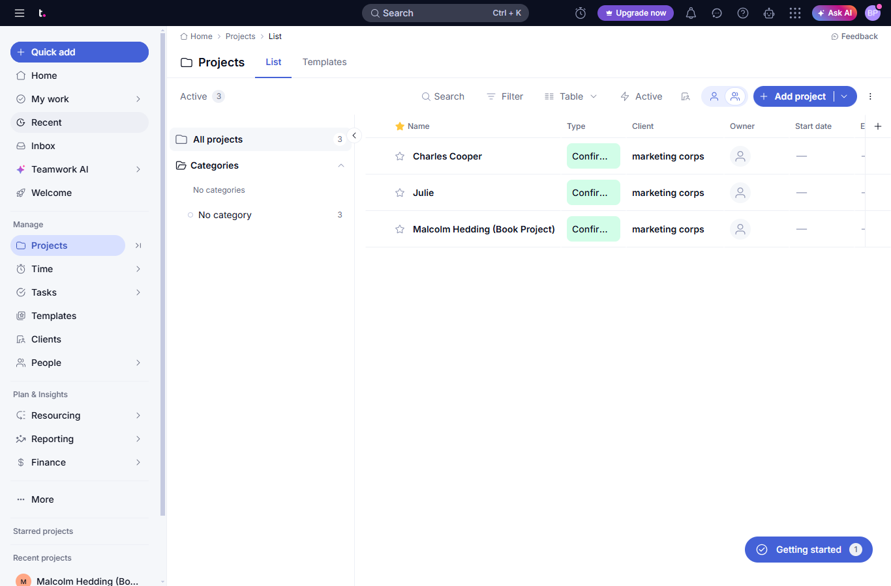
- **open: Other apps**
  - URL: https://marketingcorps.eu.teamwork.com/app/projects/list
  - Folder: `snapshots/s017__marketingcorps.eu.teamwork.com_app_projects_list`
  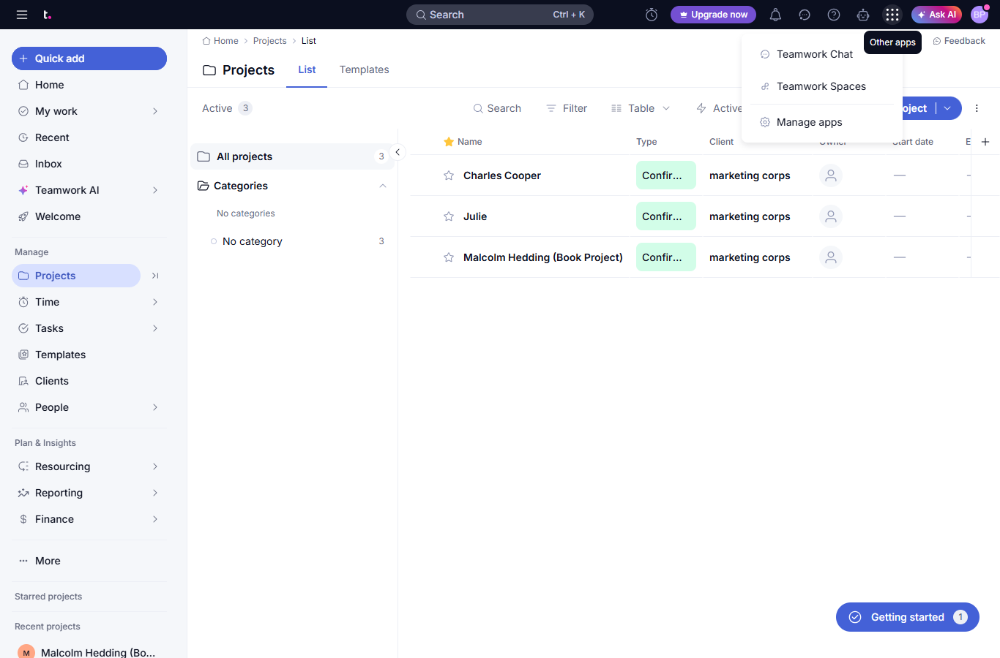
- **open: User menu**
  - URL: https://marketingcorps.eu.teamwork.com/app/projects/list
  - Folder: `snapshots/s018__marketingcorps.eu.teamwork.com_app_projects_list`
  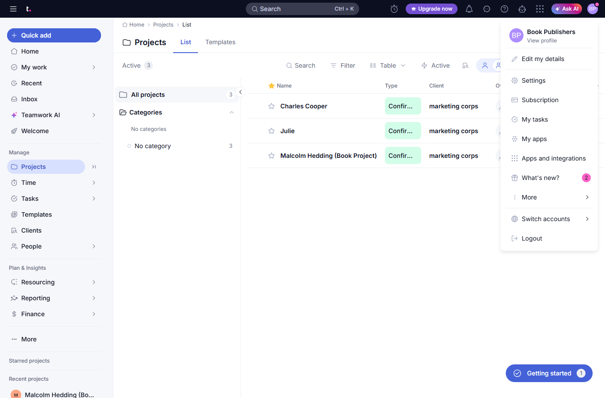
- **open: Quick add**
  - URL: https://marketingcorps.eu.teamwork.com/app/projects/list
  - Folder: `snapshots/s019__marketingcorps.eu.teamwork.com_app_projects_list`
  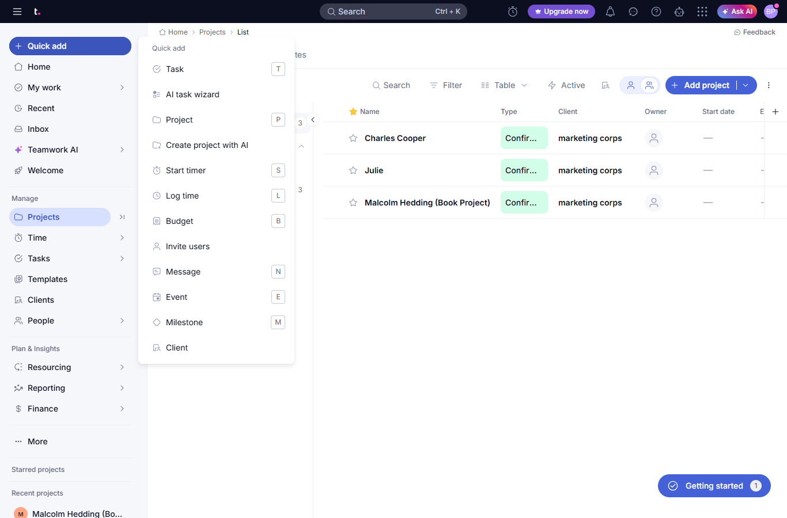
- **open: Recent**
  - URL: https://marketingcorps.eu.teamwork.com/app/projects/list
  - Folder: `snapshots/s020__marketingcorps.eu.teamwork.com_app_projects_list`
  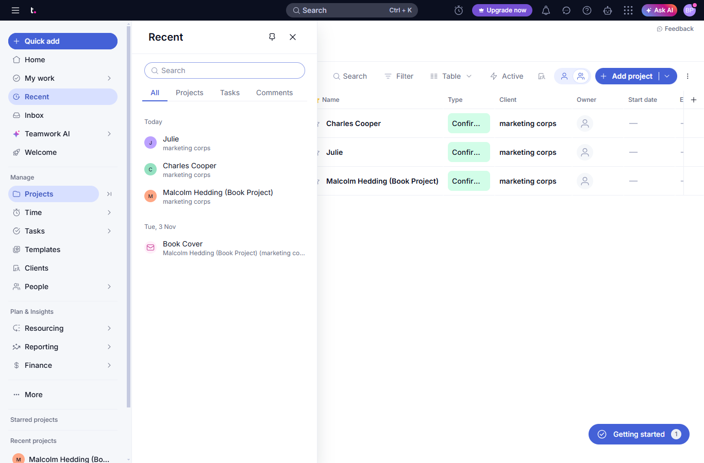

#### Controls

- **Skip to main content** — link, anchor — https://marketingcorps.eu.teamwork.com/app/projects/list#v-0
- **Teamwork.com home** — link, navigate — https://marketingcorps.eu.teamwork.com/app/
- **Home** — link, navigate — https://marketingcorps.eu.teamwork.com/app/home
- **My work** — link, navigate — https://marketingcorps.eu.teamwork.com/app/work/projects
- **Inbox** — link, navigate — https://marketingcorps.eu.teamwork.com/app/inbox
- **Teamwork AI** — link, navigate — https://marketingcorps.eu.teamwork.com/app/ai/ask
- **Welcome** — link, navigate — https://marketingcorps.eu.teamwork.com/app/welcome
- **Projects** — link, navigate — https://marketingcorps.eu.teamwork.com/app/projects
- **Time** — link, navigate — https://marketingcorps.eu.teamwork.com/app/time/approvals
- **Tasks** — link, navigate — https://marketingcorps.eu.teamwork.com/app/tasks/completedTasks
- **Clients** — link, navigate — https://marketingcorps.eu.teamwork.com/app/clients
- **People** — link, navigate — https://marketingcorps.eu.teamwork.com/app/people/people
- **Resourcing** — link, navigate — https://marketingcorps.eu.teamwork.com/app/planning/chart
- **Reporting** — link, navigate — https://marketingcorps.eu.teamwork.com/app/reports/all
- **Finance** — link, navigate — https://marketingcorps.eu.teamwork.com/app/finance/invoices/table
- **M Malcolm Hedding (Book Project)** — link, navigate — https://marketingcorps.eu.teamwork.com/app/projects/622746/tasks/list
- **C Charles Cooper** — link, navigate — https://marketingcorps.eu.teamwork.com/app/projects/622742/tasks/list
- **J Julie** — link, navigate — https://marketingcorps.eu.teamwork.com/app/projects/622744/tasks/list
- **Home** — link, navigate — https://marketingcorps.eu.teamwork.com/app/home
- **Projects** — link, navigate — https://marketingcorps.eu.teamwork.com/app/projects/list
- **List** — link, navigate — https://marketingcorps.eu.teamwork.com/app/projects/list
- **List** — link, navigate — https://marketingcorps.eu.teamwork.com/app/projects/list
- **Templates** — link, navigate — https://marketingcorps.eu.teamwork.com/app/projects/templates
- **All projects 3** — link, navigate — https://marketingcorps.eu.teamwork.com/app/projects/list?catid=
- **No category 3** — link, navigate — https://marketingcorps.eu.teamwork.com/app/projects/list?catid=0
- **Charles Cooper** — link, navigate — https://marketingcorps.eu.teamwork.com/app/projects/622742
- **marketing corps** — link, navigate — https://marketingcorps.eu.teamwork.com/app/clients/210624/overview
- **Julie** — link, navigate — https://marketingcorps.eu.teamwork.com/app/projects/622744
- **marketing corps** — link, navigate — https://marketingcorps.eu.teamwork.com/app/clients/210624/overview
- **Malcolm Hedding (Book Project)** — link, navigate — https://marketingcorps.eu.teamwork.com/app/projects/622746
- **marketing corps** — link, navigate — https://marketingcorps.eu.teamwork.com/app/clients/210624/overview
- **Collapse sidebar** — button, not-opened — state budget exhausted
- **Search Ctrl + K** — button, not-opened — state budget exhausted
- **Start a new timer** — button, not-opened — state budget exhausted
- **Upgrade now** — button, not-opened — state budget exhausted
- **Notifications** — button, not-opened — state budget exhausted
- **Chat** — button, not-opened — state budget exhausted
- **Help** — button, not-opened — state budget exhausted
- **Automations** — button, not-opened — state budget exhausted
- **Other apps** — button, open
- **Ask AI** — button, not-opened — state budget exhausted
- **User menu** — button, open
- **Quick add** — button, open
- **Recent** — button, open
- **Manage** — button, not-opened — state budget exhausted
- **Jump to** — button, not-opened — state budget exhausted
- **Templates** — button, not-opened — state budget exhausted
- **Plan & Insights** — button, not-opened — state budget exhausted
- **More** — button, not-opened — state budget exhausted
- **Starred projects** — button, not-opened — state budget exhausted
- **Recent projects** — button, not-opened — state budget exhausted
- **Feedback** — button, not-opened — state budget exhausted
- **Filter** — button, not-opened — state budget exhausted
- **Table** — button, not-opened — state budget exhausted
- **Active** — button, not-opened — state budget exhausted
- **Group projects by client** — button, not-opened — state budget exhausted
- **My projects** — button, not-opened — state budget exhausted
- **All projects** — button, not-opened — state budget exhausted
- **Add project** — button, not-opened — state budget exhausted
- **More options** — button, not-opened — state budget exhausted
- **Options** — button, not-opened — state budget exhausted
- **Close panel** — button, not-opened — state budget exhausted
- **Categories** — button, not-opened — state budget exhausted
- **Clear sorting** — button, not-opened — state budget exhausted
- **Sort column by "Name"** — button, not-opened — state budget exhausted
- **Sort column by "Client"** — button, not-opened — state budget exhausted
- **Sort column by "Owner"** — button, not-opened — state budget exhausted
- **Sort column by "Start date"** — button, not-opened — state budget exhausted
- **Sort column by "End date"** — button, not-opened — state budget exhausted
- **About Workflow** — button, not-opened — state budget exhausted
- **Sort column by "Health"** — button, not-opened — state budget exhausted
- **About Latest activity** — button, not-opened — state budget exhausted
- **Sort column by "Last active"** — button, not-opened — state budget exhausted
- **Choose columns to display** — button, not-opened — state budget exhausted
- **Star project** — button, not-opened — state budget exhausted
- **Assign project owner** — button, not-opened — state budget exhausted
- **button** — button, not-opened — state budget exhausted
- **button** — button, not-opened — state budget exhausted
- **Star project** — button, not-opened — state budget exhausted
- **Assign project owner** — button, not-opened — state budget exhausted
- **button** — button, not-opened — state budget exhausted
- **button** — button, not-opened — state budget exhausted
- **Star project** — button, not-opened — state budget exhausted
- **Assign project owner** — button, not-opened — state budget exhausted
- **button** — button, not-opened — state budget exhausted
- **button** — button, not-opened — state budget exhausted
- **Getting started 1** — button, not-opened — state budget exhausted
- **Filter** — menu, not-opened — state budget exhausted
- **You replied** — menu, not-opened — state budget exhausted
- **You added a project** — menu, not-opened — state budget exhausted
- **Mark Williams replied** — menu, not-opened — state budget exhausted
- **My tasks** — link, navigate — https://marketingcorps.eu.teamwork.com/app/work/tasks
- **My calendar** — link, navigate — https://marketingcorps.eu.teamwork.com/app/work/calendar
- **My timesheet** — link, navigate — https://marketingcorps.eu.teamwork.com/app/work/timesheet
- **My projects** — link, navigate — https://marketingcorps.eu.teamwork.com/app/work/projects
- **Activity** — link, navigate — https://marketingcorps.eu.teamwork.com/app/work/activity
- **Ask AI** — link, navigate — https://marketingcorps.eu.teamwork.com/app/ai/ask
- **AI Teammates** — link, navigate — https://marketingcorps.eu.teamwork.com/app/ai/teammates
- **AI skills NEW** — button, recorded
- **My timesheet** — link, navigate — https://marketingcorps.eu.teamwork.com/app/time/user
- **Company timesheet** — link, navigate — https://marketingcorps.eu.teamwork.com/app/time/company
- **All time** — link, navigate — https://marketingcorps.eu.teamwork.com/app/time/all
- **Approvals** — link, navigate — https://marketingcorps.eu.teamwork.com/app/time/approvals
- **Customize** — button, recorded
- **Tasks** — link, navigate — https://marketingcorps.eu.teamwork.com/app/tasks/tasks
- **Board** — link, navigate — https://marketingcorps.eu.teamwork.com/app/tasks/board
- **Table** — link, navigate — https://marketingcorps.eu.teamwork.com/app/tasks/table
- **Completed tasks** — link, navigate — https://marketingcorps.eu.teamwork.com/app/tasks/completedTasks
- **People** — link, navigate — https://marketingcorps.eu.teamwork.com/app/people/people
- **Roles** — link, navigate — https://marketingcorps.eu.teamwork.com/app/people/roles
- **Skills NEW** — link, navigate — https://marketingcorps.eu.teamwork.com/app/people/skills
- **Teams** — link, navigate — https://marketingcorps.eu.teamwork.com/app/people/teams
- **Statuses** — link, navigate — https://marketingcorps.eu.teamwork.com/app/people/statuses
- **Overview** — link, navigate — https://marketingcorps.eu.teamwork.com/app/planning/overview
- **Schedule** — link, navigate — https://marketingcorps.eu.teamwork.com/app/planning/schedule
- **Workload** — link, navigate — https://marketingcorps.eu.teamwork.com/app/planning/workload
- **Portfolio** — link, navigate — https://marketingcorps.eu.teamwork.com/app/planning/portfolio
- **Chart** — link, navigate — https://marketingcorps.eu.teamwork.com/app/planning/chart
- **Customize** — button, recorded
- **All reports** — link, navigate — https://marketingcorps.eu.teamwork.com/app/reports/all
- **Custom Reports** — link, navigate — https://marketingcorps.eu.teamwork.com/app/reports/custom-reports
- **Scheduled reports** — link, navigate — https://marketingcorps.eu.teamwork.com/app/reports/scheduled
- **Rates** — link, navigate — https://marketingcorps.eu.teamwork.com/app/finance/rates
- **Budgets** — link, navigate — https://marketingcorps.eu.teamwork.com/app/finance/budgets
- **Invoices** — link, navigate — https://marketingcorps.eu.teamwork.com/app/finance/invoices
- **Expenses** — link, navigate — https://marketingcorps.eu.teamwork.com/app/finance/expenses
- **Teamwork Chat** — link, navigate — https://marketingcorps.eu.teamwork.com/chat
- **Teamwork Spaces** — link, navigate — https://marketingcorps.eu.teamwork.com/spaces
- **Manage apps** — button, recorded
- **Book Publishers View profile** — link, navigate — https://marketingcorps.eu.teamwork.com/app/people/555920
- **Settings** — link, navigate — https://marketingcorps.eu.teamwork.com/app/settings
- **Subscription** — link, navigate — https://marketingcorps.eu.teamwork.com/app/settings/subscription
- **My tasks** — link, navigate — https://marketingcorps.eu.teamwork.com/app/people/555920/tasks
- **My apps** — link, navigate — https://marketingcorps.eu.teamwork.com/app/people/555920/integrations
- **Apps and integrations** — link, navigate — https://marketingcorps.eu.teamwork.com/app/settings/integrations
- **Edit my details** — button, recorded
- **What's new? 2** — button, recorded
- **More** — button, recorded
- **Switch accounts** — button, recorded
- **Logout** — button, skipped — submits a form or changes data
- **Task T T** — button, recorded
- **AI task wizard** — button, recorded
- **Project P P** — button, recorded
- **Create project with AI** — button, recorded
- **Start timer S S** — button, recorded
- **Log time L L** — button, recorded
- **Budget B B** — button, recorded
- **Invite users** — button, recorded
- **Message N N** — button, recorded
- **Event E E** — button, recorded
- **Milestone M M** — button, recorded
- **Client** — button, recorded
- **J Julie marketing corps** — link, navigate — https://marketingcorps.eu.teamwork.com/app/projects/622744
- **C Charles Cooper marketing corps** — link, navigate — https://marketingcorps.eu.teamwork.com/app/projects/622742
- **M Malcolm Hedding (Book Project) marketing corps** — link, navigate — https://marketingcorps.eu.teamwork.com/app/projects/622746
- **Book Cover Malcolm Hedding (Book Project) (marketing corps)** — link, navigate — https://marketingcorps.eu.teamwork.com/app/messages/519066
- **Home** — link, navigate — https://marketingcorps.eu.teamwork.com/app/home
- **Projects** — link, navigate — https://marketingcorps.eu.teamwork.com/app/projects/list
- **List** — link, navigate — https://marketingcorps.eu.teamwork.com/app/projects/list
- **List** — link, navigate — https://marketingcorps.eu.teamwork.com/app/projects/list
- **Templates** — link, navigate — https://marketingcorps.eu.teamwork.com/app/projects/templates
- **All projects 3** — link, navigate — https://marketingcorps.eu.teamwork.com/app/projects/list?catid=
- **No category 3** — link, navigate — https://marketingcorps.eu.teamwork.com/app/projects/list?catid=0
- **Charles Cooper** — link, navigate — https://marketingcorps.eu.teamwork.com/app/projects/622742
- **Julie** — link, navigate — https://marketingcorps.eu.teamwork.com/app/projects/622744
- **marketing corps** — link, navigate — https://marketingcorps.eu.teamwork.com/app/clients/210624/overview
- **Malcolm Hedding (Book Project)** — link, navigate — https://marketingcorps.eu.teamwork.com/app/projects/622746
- **marketing corps** — link, navigate — https://marketingcorps.eu.teamwork.com/app/clients/210624/overview
- **Pin this panel** — button, recorded
- **Close** — button, recorded
- **Feedback** — button, recorded
- **Filter** — button, recorded
- **Table** — button, recorded
- **Active** — button, recorded
- **Group projects by client** — button, recorded
- **My projects** — button, recorded
- **All projects** — button, recorded
- **Add project** — button, recorded
- **More options** — button, recorded
- **Options** — button, recorded
- **Close panel** — button, recorded
- **Categories** — button, recorded
- **Clear sorting** — button, recorded
- **Sort column by "Name"** — button, recorded
- **Sort column by "Client"** — button, recorded
- **Sort column by "Owner"** — button, recorded
- **Sort column by "Start date"** — button, recorded
- **Sort column by "End date"** — button, recorded
- **About Workflow** — button, recorded
- **Sort column by "Health"** — button, recorded
- **About Latest activity** — button, recorded
- **Sort column by "Last active"** — button, recorded
- **Choose columns to display** — button, recorded
- **Star project** — button, recorded
- **Assign project owner** — button, recorded
- **button** — button, recorded
- **button** — button, recorded
- **Star project** — button, recorded
- **Assign project owner** — button, recorded
- **button** — button, recorded
- **button** — button, recorded
- **Star project** — button, recorded
- **Assign project owner** — button, recorded
- **button** — button, recorded
- **button** — button, recorded
- **Getting started 1** — button, recorded
- **All** — tab, skipped — already selected
- **Projects** — tab, recorded
- **Tasks** — tab, recorded
- **Comments** — tab, recorded

### Clients - marketing corps

- URL: https://marketingcorps.eu.teamwork.com/app/clients/clients
- Requested: https://marketingcorps.eu.teamwork.com/app/clients
- Status: 200
- Depth: 1

#### Outline

- Clients

#### States

- **default**
  - URL: https://marketingcorps.eu.teamwork.com/app/clients/clients
  - Folder: `snapshots/s021__marketingcorps.eu.teamwork.com_app_clients_clients`
  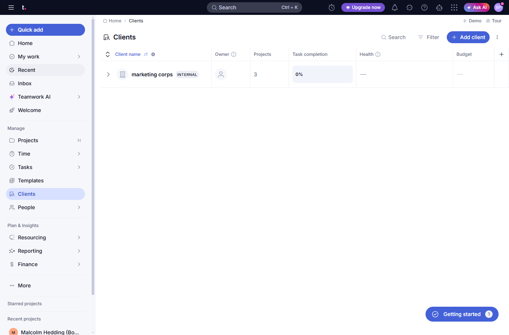
- **open: Other apps**
  - URL: https://marketingcorps.eu.teamwork.com/app/clients/clients
  - Folder: `snapshots/s022__marketingcorps.eu.teamwork.com_app_clients_clients`
  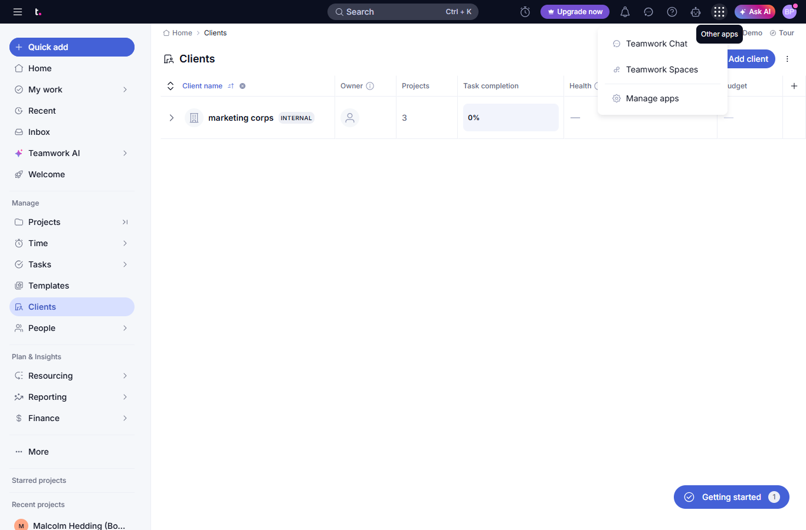
- **open: User menu**
  - URL: https://marketingcorps.eu.teamwork.com/app/clients/clients
  - Folder: `snapshots/s023__marketingcorps.eu.teamwork.com_app_clients_clients`
  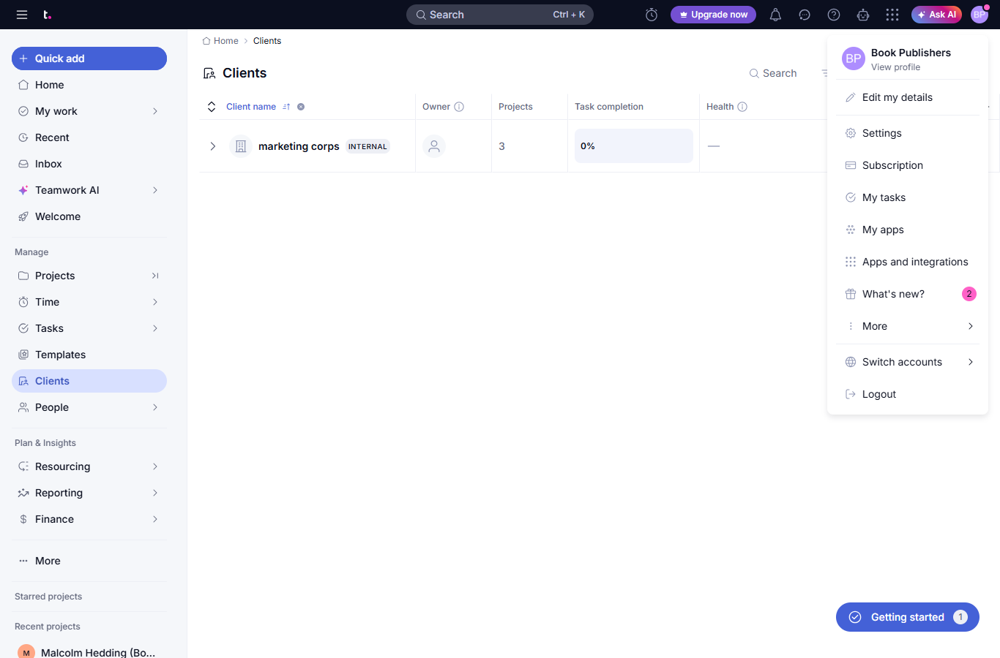
- **open: Quick add**
  - URL: https://marketingcorps.eu.teamwork.com/app/clients/clients
  - Folder: `snapshots/s024__marketingcorps.eu.teamwork.com_app_clients_clients`
  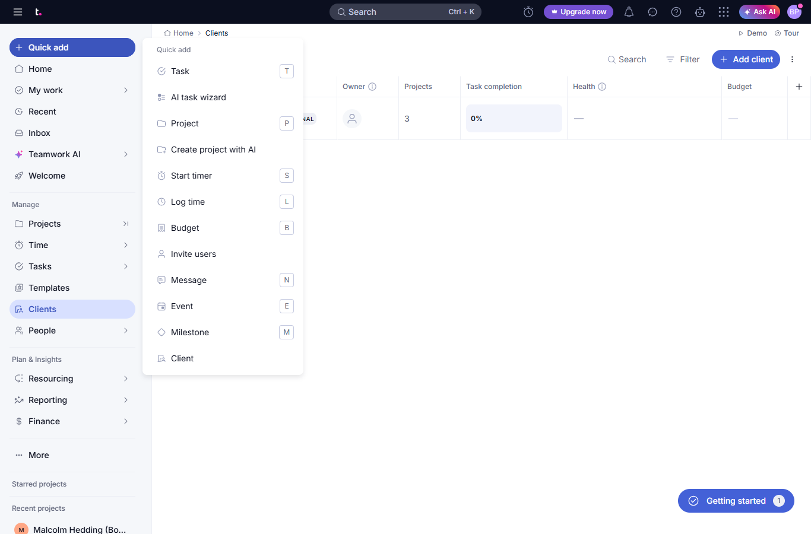
- **open: Recent**
  - URL: https://marketingcorps.eu.teamwork.com/app/clients/clients
  - Folder: `snapshots/s025__marketingcorps.eu.teamwork.com_app_clients_clients`
  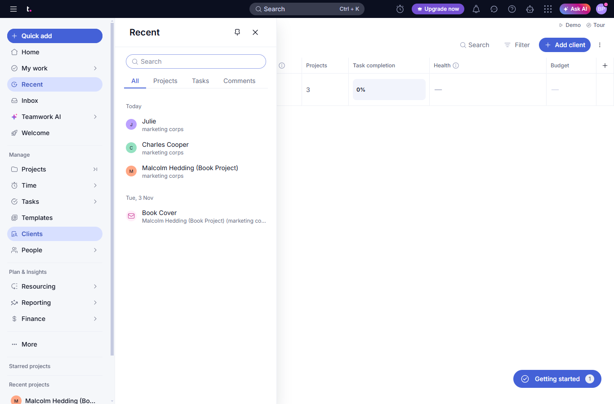

#### Controls

- **Skip to main content** — link, anchor — https://marketingcorps.eu.teamwork.com/app/clients/clients#v-0
- **Teamwork.com home** — link, navigate — https://marketingcorps.eu.teamwork.com/app/
- **Home** — link, navigate — https://marketingcorps.eu.teamwork.com/app/home
- **My work** — link, navigate — https://marketingcorps.eu.teamwork.com/app/work/projects
- **Inbox** — link, navigate — https://marketingcorps.eu.teamwork.com/app/inbox
- **Teamwork AI** — link, navigate — https://marketingcorps.eu.teamwork.com/app/ai/ask
- **Welcome** — link, navigate — https://marketingcorps.eu.teamwork.com/app/welcome
- **Projects** — link, navigate — https://marketingcorps.eu.teamwork.com/app/projects
- **Time** — link, navigate — https://marketingcorps.eu.teamwork.com/app/time/approvals
- **Tasks** — link, navigate — https://marketingcorps.eu.teamwork.com/app/tasks/completedTasks
- **Clients** — link, navigate — https://marketingcorps.eu.teamwork.com/app/clients
- **People** — link, navigate — https://marketingcorps.eu.teamwork.com/app/people/people
- **Resourcing** — link, navigate — https://marketingcorps.eu.teamwork.com/app/planning/chart
- **Reporting** — link, navigate — https://marketingcorps.eu.teamwork.com/app/reports/all
- **Finance** — link, navigate — https://marketingcorps.eu.teamwork.com/app/finance/invoices/table
- **M Malcolm Hedding (Book Project)** — link, navigate — https://marketingcorps.eu.teamwork.com/app/projects/622746/tasks/list
- **C Charles Cooper** — link, navigate — https://marketingcorps.eu.teamwork.com/app/projects/622742/tasks/list
- **J Julie** — link, navigate — https://marketingcorps.eu.teamwork.com/app/projects/622744/tasks/list
- **Home** — link, navigate — https://marketingcorps.eu.teamwork.com/app/home
- **Clients** — link, navigate — https://marketingcorps.eu.teamwork.com/app/clients
- **marketing corps** — link, navigate — https://marketingcorps.eu.teamwork.com/app/clients/210624/overview
- **Collapse sidebar** — button, not-opened — state budget exhausted
- **Search Ctrl + K** — button, not-opened — state budget exhausted
- **Start a new timer** — button, not-opened — state budget exhausted
- **Upgrade now** — button, not-opened — state budget exhausted
- **Notifications** — button, not-opened — state budget exhausted
- **Chat** — button, not-opened — state budget exhausted
- **Help** — button, not-opened — state budget exhausted
- **Automations** — button, not-opened — state budget exhausted
- **Other apps** — button, open
- **Ask AI** — button, not-opened — state budget exhausted
- **User menu** — button, open
- **Quick add** — button, open
- **Recent** — button, open
- **Manage** — button, not-opened — state budget exhausted
- **Jump to** — button, not-opened — state budget exhausted
- **Templates** — button, not-opened — state budget exhausted
- **Plan & Insights** — button, not-opened — state budget exhausted
- **More** — button, not-opened — state budget exhausted
- **Starred projects** — button, not-opened — state budget exhausted
- **Recent projects** — button, not-opened — state budget exhausted
- **Demo** — button, not-opened — state budget exhausted
- **Tour** — button, not-opened — state budget exhausted
- **Filter** — button, not-opened — state budget exhausted
- **Add client** — button, not-opened — state budget exhausted
- **Options** — button, not-opened — state budget exhausted
- **Expand all rows** — button, not-opened — state budget exhausted
- **Sort column by "Client name"** — button, not-opened — state budget exhausted
- **Clear sorting** — button, not-opened — state budget exhausted
- **About Owner** — button, not-opened — state budget exhausted
- **Sort column by "Projects"** — button, not-opened — state budget exhausted
- **Sort column by "Task completion"** — button, not-opened — state budget exhausted
- **About Health** — button, not-opened — state budget exhausted
- **Choose columns to display** — button, not-opened — state budget exhausted
- **Expand row** — button, not-opened — state budget exhausted
- **Assign to someone** — button, skipped — disabled
- **3** — button, not-opened — state budget exhausted
- **Getting started 1** — button, not-opened — state budget exhausted
- **Filter** — menu, not-opened — state budget exhausted
- **My tasks** — link, navigate — https://marketingcorps.eu.teamwork.com/app/work/tasks
- **My calendar** — link, navigate — https://marketingcorps.eu.teamwork.com/app/work/calendar
- **My timesheet** — link, navigate — https://marketingcorps.eu.teamwork.com/app/work/timesheet
- **My projects** — link, navigate — https://marketingcorps.eu.teamwork.com/app/work/projects
- **Activity** — link, navigate — https://marketingcorps.eu.teamwork.com/app/work/activity
- **Ask AI** — link, navigate — https://marketingcorps.eu.teamwork.com/app/ai/ask
- **AI Teammates** — link, navigate — https://marketingcorps.eu.teamwork.com/app/ai/teammates
- **AI skills NEW** — button, recorded
- **My timesheet** — link, navigate — https://marketingcorps.eu.teamwork.com/app/time/user
- **Company timesheet** — link, navigate — https://marketingcorps.eu.teamwork.com/app/time/company
- **All time** — link, navigate — https://marketingcorps.eu.teamwork.com/app/time/all
- **Approvals** — link, navigate — https://marketingcorps.eu.teamwork.com/app/time/approvals
- **Customize** — button, recorded
- **Tasks** — link, navigate — https://marketingcorps.eu.teamwork.com/app/tasks/tasks
- **Board** — link, navigate — https://marketingcorps.eu.teamwork.com/app/tasks/board
- **Table** — link, navigate — https://marketingcorps.eu.teamwork.com/app/tasks/table
- **Completed tasks** — link, navigate — https://marketingcorps.eu.teamwork.com/app/tasks/completedTasks
- **People** — link, navigate — https://marketingcorps.eu.teamwork.com/app/people/people
- **Roles** — link, navigate — https://marketingcorps.eu.teamwork.com/app/people/roles
- **Skills NEW** — link, navigate — https://marketingcorps.eu.teamwork.com/app/people/skills
- **Teams** — link, navigate — https://marketingcorps.eu.teamwork.com/app/people/teams
- **Statuses** — link, navigate — https://marketingcorps.eu.teamwork.com/app/people/statuses
- **Overview** — link, navigate — https://marketingcorps.eu.teamwork.com/app/planning/overview
- **Schedule** — link, navigate — https://marketingcorps.eu.teamwork.com/app/planning/schedule
- **Workload** — link, navigate — https://marketingcorps.eu.teamwork.com/app/planning/workload
- **Portfolio** — link, navigate — https://marketingcorps.eu.teamwork.com/app/planning/portfolio
- **Chart** — link, navigate — https://marketingcorps.eu.teamwork.com/app/planning/chart
- **Customize** — button, recorded
- **All reports** — link, navigate — https://marketingcorps.eu.teamwork.com/app/reports/all
- **Custom Reports** — link, navigate — https://marketingcorps.eu.teamwork.com/app/reports/custom-reports
- **Scheduled reports** — link, navigate — https://marketingcorps.eu.teamwork.com/app/reports/scheduled
- **Rates** — link, navigate — https://marketingcorps.eu.teamwork.com/app/finance/rates
- **Budgets** — link, navigate — https://marketingcorps.eu.teamwork.com/app/finance/budgets
- **Invoices** — link, navigate — https://marketingcorps.eu.teamwork.com/app/finance/invoices
- **Expenses** — link, navigate — https://marketingcorps.eu.teamwork.com/app/finance/expenses
- **General tasks** — link, navigate — https://marketingcorps.eu.teamwork.com/app/tasklists/2420320
- **Teamwork Chat** — link, navigate — https://marketingcorps.eu.teamwork.com/chat
- **Teamwork Spaces** — link, navigate — https://marketingcorps.eu.teamwork.com/spaces
- **Manage apps** — button, recorded
- **Book Publishers View profile** — link, navigate — https://marketingcorps.eu.teamwork.com/app/people/555920
- **Settings** — link, navigate — https://marketingcorps.eu.teamwork.com/app/settings
- **Subscription** — link, navigate — https://marketingcorps.eu.teamwork.com/app/settings/subscription
- **My tasks** — link, navigate — https://marketingcorps.eu.teamwork.com/app/people/555920/tasks
- **My apps** — link, navigate — https://marketingcorps.eu.teamwork.com/app/people/555920/integrations
- **Apps and integrations** — link, navigate — https://marketingcorps.eu.teamwork.com/app/settings/integrations
- **Edit my details** — button, recorded
- **What's new? 2** — button, recorded
- **More** — button, recorded
- **Switch accounts** — button, recorded
- **Logout** — button, skipped — submits a form or changes data
- **Task T T** — button, recorded
- **AI task wizard** — button, recorded
- **Project P P** — button, recorded
- **Create project with AI** — button, recorded
- **Start timer S S** — button, recorded
- **Log time L L** — button, recorded
- **Budget B B** — button, recorded
- **Invite users** — button, recorded
- **Message N N** — button, recorded
- **Event E E** — button, recorded
- **Milestone M M** — button, recorded
- **Client** — button, recorded
- **J Julie marketing corps** — link, navigate — https://marketingcorps.eu.teamwork.com/app/projects/622744
- **C Charles Cooper marketing corps** — link, navigate — https://marketingcorps.eu.teamwork.com/app/projects/622742
- **M Malcolm Hedding (Book Project) marketing corps** — link, navigate — https://marketingcorps.eu.teamwork.com/app/projects/622746
- **Book Cover Malcolm Hedding (Book Project) (marketing corps)** — link, navigate — https://marketingcorps.eu.teamwork.com/app/messages/519066
- **Home** — link, navigate — https://marketingcorps.eu.teamwork.com/app/home
- **Clients** — link, navigate — https://marketingcorps.eu.teamwork.com/app/clients
- **marketing corps** — link, navigate — https://marketingcorps.eu.teamwork.com/app/clients/210624/overview
- **Pin this panel** — button, recorded
- **Close** — button, recorded
- **Demo** — button, recorded
- **Tour** — button, recorded
- **Filter** — button, recorded
- **Add client** — button, recorded
- **Options** — button, recorded
- **Expand all rows** — button, recorded
- **Sort column by "Client name"** — button, recorded
- **Clear sorting** — button, recorded
- **About Owner** — button, recorded
- **Sort column by "Projects"** — button, recorded
- **Sort column by "Task completion"** — button, recorded
- **About Health** — button, recorded
- **Choose columns to display** — button, recorded
- **Expand row** — button, recorded
- **Assign to someone** — button, skipped — disabled
- **3** — button, recorded
- **Getting started 1** — button, recorded
- **All** — tab, skipped — already selected
- **Projects** — tab, recorded
- **Tasks** — tab, recorded
- **Comments** — tab, recorded

### Projects - Home - marketing corps

- URL: https://marketingcorps.eu.teamwork.com/app/work/projects
- Requested: https://marketingcorps.eu.teamwork.com/app/work/projects
- Status: 200
- Depth: 1

#### Outline

- Projects - Home

#### States

- **default**
  - URL: https://marketingcorps.eu.teamwork.com/app/work/projects
  - Folder: `snapshots/s026__marketingcorps.eu.teamwork.com_app_work_projects`
  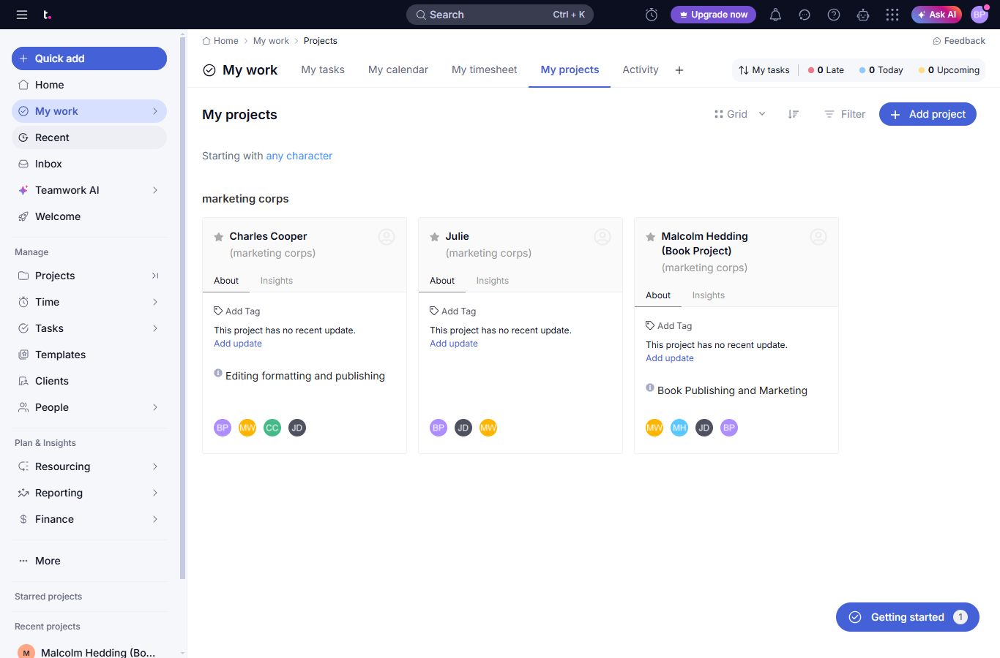
- **open: My work**
  - URL: https://marketingcorps.eu.teamwork.com/app/work/projects
  - Folder: `snapshots/s027__marketingcorps.eu.teamwork.com_app_work_projects`
  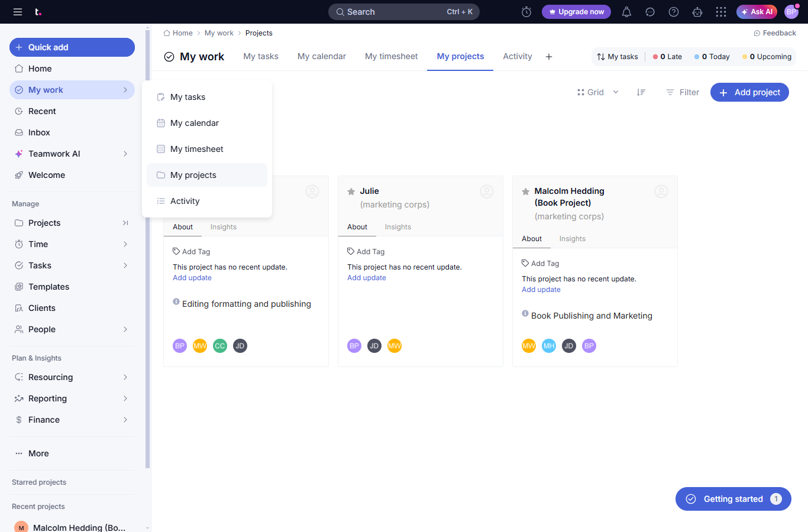
- **open: Other apps**
  - URL: https://marketingcorps.eu.teamwork.com/app/work/projects
  - Folder: `snapshots/s028__marketingcorps.eu.teamwork.com_app_work_projects`
  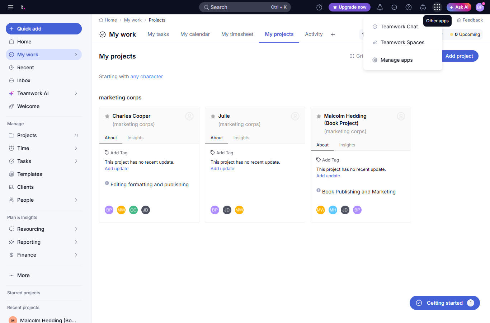
- **open: User menu**
  - URL: https://marketingcorps.eu.teamwork.com/app/work/projects
  - Folder: `snapshots/s029__marketingcorps.eu.teamwork.com_app_work_projects`
  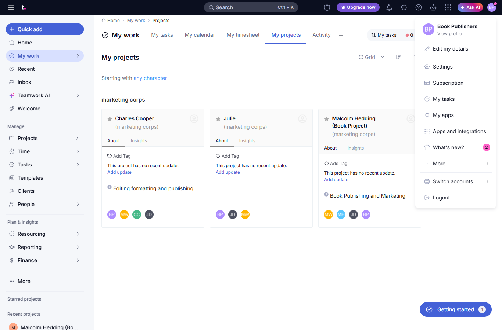
- **open: Quick add**
  - URL: https://marketingcorps.eu.teamwork.com/app/work/projects
  - Folder: `snapshots/s030__marketingcorps.eu.teamwork.com_app_work_projects`
  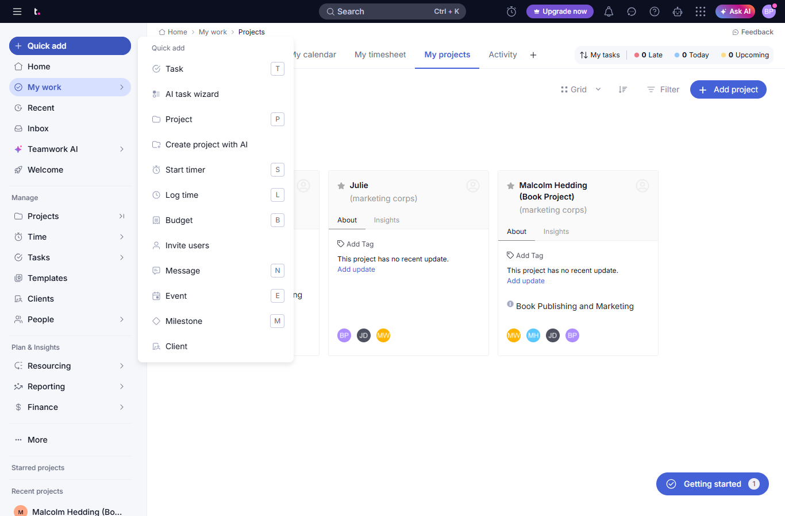

#### Controls

- **Skip to main content** — link, anchor — https://marketingcorps.eu.teamwork.com/app/work/projects#v-0
- **Teamwork.com home** — link, navigate — https://marketingcorps.eu.teamwork.com/app/
- **Home** — link, navigate — https://marketingcorps.eu.teamwork.com/app/home
- **My work** — link, open — https://marketingcorps.eu.teamwork.com/app/work
- **Inbox** — link, navigate — https://marketingcorps.eu.teamwork.com/app/inbox
- **Teamwork AI** — link, navigate — https://marketingcorps.eu.teamwork.com/app/ai/ask
- **Welcome** — link, navigate — https://marketingcorps.eu.teamwork.com/app/welcome
- **Projects** — link, navigate — https://marketingcorps.eu.teamwork.com/app/projects
- **Time** — link, navigate — https://marketingcorps.eu.teamwork.com/app/time/approvals
- **Tasks** — link, navigate — https://marketingcorps.eu.teamwork.com/app/tasks/completedTasks
- **Clients** — link, navigate — https://marketingcorps.eu.teamwork.com/app/clients
- **People** — link, navigate — https://marketingcorps.eu.teamwork.com/app/people/people
- **Resourcing** — link, navigate — https://marketingcorps.eu.teamwork.com/app/planning/chart
- **Reporting** — link, navigate — https://marketingcorps.eu.teamwork.com/app/reports/all
- **Finance** — link, navigate — https://marketingcorps.eu.teamwork.com/app/finance/invoices/table
- **M Malcolm Hedding (Book Project)** — link, navigate — https://marketingcorps.eu.teamwork.com/app/projects/622746/tasks/list
- **C Charles Cooper** — link, navigate — https://marketingcorps.eu.teamwork.com/app/projects/622742/tasks/list
- **J Julie** — link, navigate — https://marketingcorps.eu.teamwork.com/app/projects/622744/tasks/list
- **Home** — link, navigate — https://marketingcorps.eu.teamwork.com/app/home
- **My work** — link, navigate — https://marketingcorps.eu.teamwork.com/app/work
- **Projects** — link, navigate — https://marketingcorps.eu.teamwork.com/app/home/projects
- **My tasks** — link, navigate — https://marketingcorps.eu.teamwork.com/app/work/tasks
- **My calendar** — link, navigate — https://marketingcorps.eu.teamwork.com/app/work/calendar
- **My timesheet** — link, navigate — https://marketingcorps.eu.teamwork.com/app/work/timesheet
- **My projects** — link, navigate — https://marketingcorps.eu.teamwork.com/app/work/projects
- **Activity** — link, navigate — https://marketingcorps.eu.teamwork.com/app/work/activity
- **Collapse sidebar** — button, not-opened — state budget exhausted
- **Search Ctrl + K** — button, not-opened — state budget exhausted
- **Start a new timer** — button, not-opened — state budget exhausted
- **Upgrade now** — button, not-opened — state budget exhausted
- **Notifications** — button, not-opened — state budget exhausted
- **Chat** — button, not-opened — state budget exhausted
- **Help** — button, not-opened — state budget exhausted
- **Automations** — button, not-opened — state budget exhausted
- **Other apps** — button, open
- **Ask AI** — button, not-opened — state budget exhausted
- **User menu** — button, open
- **Quick add** — button, open
- **Recent** — button, not-opened — state budget exhausted
- **Manage** — button, not-opened — state budget exhausted
- **Jump to** — button, not-opened — state budget exhausted
- **Templates** — button, not-opened — state budget exhausted
- **Plan & Insights** — button, not-opened — state budget exhausted
- **More** — button, not-opened — state budget exhausted
- **Starred projects** — button, not-opened — state budget exhausted
- **Recent projects** — button, not-opened — state budget exhausted
- **Feedback** — button, not-opened — state budget exhausted
- **Choose tabs to display** — button, not-opened — state budget exhausted
- **My tasks** — button, not-opened — state budget exhausted
- **0 Late** — button, not-opened — state budget exhausted
- **0 Today** — button, not-opened — state budget exhausted
- **0 Upcoming** — button, not-opened — state budget exhausted
- **Getting started 1** — button, not-opened — state budget exhausted
- **My tasks** — link, navigate — https://marketingcorps.eu.teamwork.com/app/work/tasks
- **My calendar** — link, navigate — https://marketingcorps.eu.teamwork.com/app/work/calendar
- **My timesheet** — link, navigate — https://marketingcorps.eu.teamwork.com/app/work/timesheet
- **My projects** — link, navigate — https://marketingcorps.eu.teamwork.com/app/work/projects
- **Activity** — link, navigate — https://marketingcorps.eu.teamwork.com/app/work/activity
- **Ask AI** — link, navigate — https://marketingcorps.eu.teamwork.com/app/ai/ask
- **AI Teammates** — link, navigate — https://marketingcorps.eu.teamwork.com/app/ai/teammates
- **AI skills NEW** — button, recorded
- **My timesheet** — link, navigate — https://marketingcorps.eu.teamwork.com/app/time/user
- **Company timesheet** — link, navigate — https://marketingcorps.eu.teamwork.com/app/time/company
- **All time** — link, navigate — https://marketingcorps.eu.teamwork.com/app/time/all
- **Approvals** — link, navigate — https://marketingcorps.eu.teamwork.com/app/time/approvals
- **Customize** — button, recorded
- **Tasks** — link, navigate — https://marketingcorps.eu.teamwork.com/app/tasks/tasks
- **Board** — link, navigate — https://marketingcorps.eu.teamwork.com/app/tasks/board
- **Table** — link, navigate — https://marketingcorps.eu.teamwork.com/app/tasks/table
- **Completed tasks** — link, navigate — https://marketingcorps.eu.teamwork.com/app/tasks/completedTasks
- **People** — link, navigate — https://marketingcorps.eu.teamwork.com/app/people/people
- **Roles** — link, navigate — https://marketingcorps.eu.teamwork.com/app/people/roles
- **Skills NEW** — link, navigate — https://marketingcorps.eu.teamwork.com/app/people/skills
- **Teams** — link, navigate — https://marketingcorps.eu.teamwork.com/app/people/teams
- **Statuses** — link, navigate — https://marketingcorps.eu.teamwork.com/app/people/statuses
- **Overview** — link, navigate — https://marketingcorps.eu.teamwork.com/app/planning/overview
- **Schedule** — link, navigate — https://marketingcorps.eu.teamwork.com/app/planning/schedule
- **Workload** — link, navigate — https://marketingcorps.eu.teamwork.com/app/planning/workload
- **Portfolio** — link, navigate — https://marketingcorps.eu.teamwork.com/app/planning/portfolio
- **Chart** — link, navigate — https://marketingcorps.eu.teamwork.com/app/planning/chart
- **Customize** — button, recorded
- **All reports** — link, navigate — https://marketingcorps.eu.teamwork.com/app/reports/all
- **Custom Reports** — link, navigate — https://marketingcorps.eu.teamwork.com/app/reports/custom-reports
- **Scheduled reports** — link, navigate — https://marketingcorps.eu.teamwork.com/app/reports/scheduled
- **Rates** — link, navigate — https://marketingcorps.eu.teamwork.com/app/finance/rates
- **Budgets** — link, navigate — https://marketingcorps.eu.teamwork.com/app/finance/budgets
- **Invoices** — link, navigate — https://marketingcorps.eu.teamwork.com/app/finance/invoices
- **Expenses** — link, navigate — https://marketingcorps.eu.teamwork.com/app/finance/expenses
- **General tasks** — link, navigate — https://marketingcorps.eu.teamwork.com/app/tasklists/2420320
- **Teamwork Chat** — link, navigate — https://marketingcorps.eu.teamwork.com/chat
- **Teamwork Spaces** — link, navigate — https://marketingcorps.eu.teamwork.com/spaces
- **Manage apps** — button, recorded
- **Book Publishers View profile** — link, navigate — https://marketingcorps.eu.teamwork.com/app/people/555920
- **Settings** — link, navigate — https://marketingcorps.eu.teamwork.com/app/settings
- **Subscription** — link, navigate — https://marketingcorps.eu.teamwork.com/app/settings/subscription
- **My tasks** — link, navigate — https://marketingcorps.eu.teamwork.com/app/people/555920/tasks
- **My apps** — link, navigate — https://marketingcorps.eu.teamwork.com/app/people/555920/integrations
- **Apps and integrations** — link, navigate — https://marketingcorps.eu.teamwork.com/app/settings/integrations
- **Edit my details** — button, recorded
- **What's new? 2** — button, recorded
- **More** — button, recorded
- **Switch accounts** — button, recorded
- **Logout** — button, skipped — submits a form or changes data
- **Task T T** — button, recorded
- **AI task wizard** — button, recorded
- **Project P P** — button, recorded
- **Create project with AI** — button, recorded
- **Start timer S S** — button, recorded
- **Log time L L** — button, recorded
- **Budget B B** — button, recorded
- **Invite users** — button, recorded
- **Message N N** — button, recorded
- **Event E E** — button, recorded
- **Milestone M M** — button, recorded
- **Client** — button, recorded

### My tasks - Home - marketing corps

- URL: https://marketingcorps.eu.teamwork.com/app/work/tasks
- Requested: https://marketingcorps.eu.teamwork.com/app/work/tasks
- Status: 200
- Depth: 1

#### Outline

- My tasks - Home
  - My work

#### States

- **default**
  - URL: https://marketingcorps.eu.teamwork.com/app/work/tasks
  - Folder: `snapshots/s031__marketingcorps.eu.teamwork.com_app_work_tasks`
  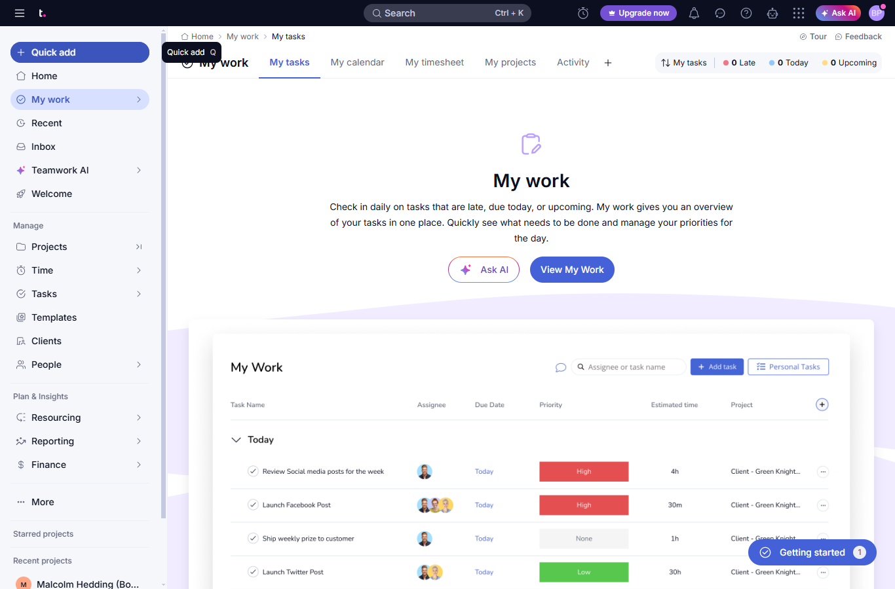
- **open: My work**
  - URL: https://marketingcorps.eu.teamwork.com/app/work/tasks
  - Folder: `snapshots/s032__marketingcorps.eu.teamwork.com_app_work_tasks`
  
- **open: Other apps**
  - URL: https://marketingcorps.eu.teamwork.com/app/work/tasks
  - Folder: `snapshots/s033__marketingcorps.eu.teamwork.com_app_work_tasks`
  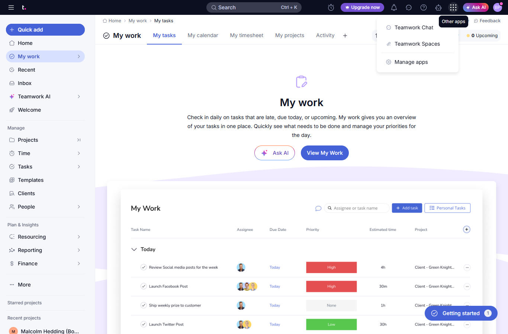
- **open: User menu**
  - URL: https://marketingcorps.eu.teamwork.com/app/work/tasks
  - Folder: `snapshots/s034__marketingcorps.eu.teamwork.com_app_work_tasks`
  
- **open: Quick add**
  - URL: https://marketingcorps.eu.teamwork.com/app/work/tasks
  - Folder: `snapshots/s035__marketingcorps.eu.teamwork.com_app_work_tasks`
  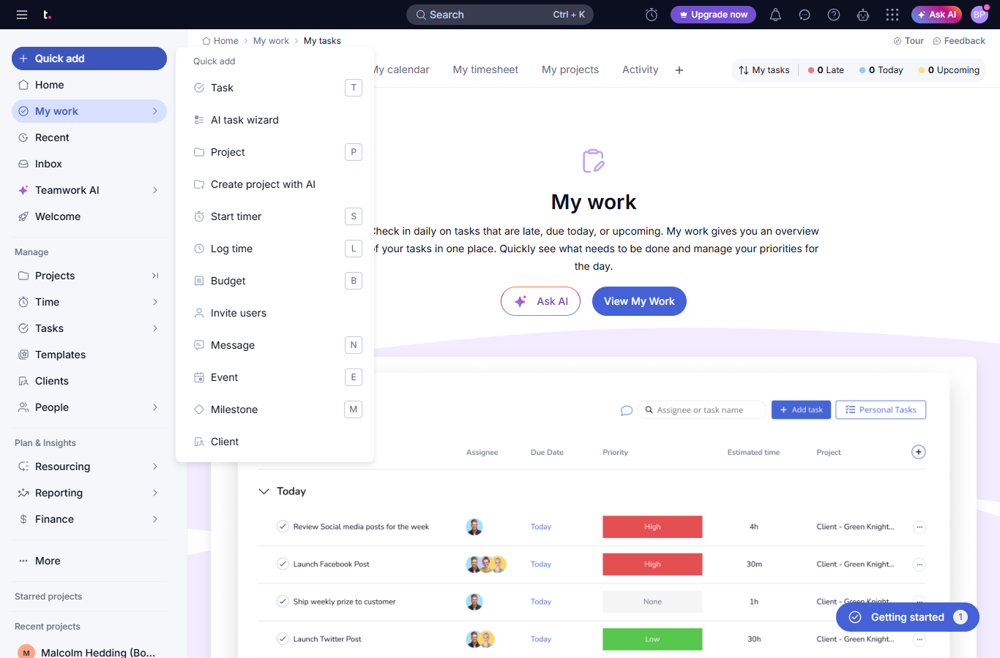

#### Controls

- **Skip to main content** — link, anchor — https://marketingcorps.eu.teamwork.com/app/work/tasks#v-0
- **Teamwork.com home** — link, navigate — https://marketingcorps.eu.teamwork.com/app/
- **Home** — link, navigate — https://marketingcorps.eu.teamwork.com/app/home
- **My work** — link, open — https://marketingcorps.eu.teamwork.com/app/work
- **Inbox** — link, navigate — https://marketingcorps.eu.teamwork.com/app/inbox
- **Teamwork AI** — link, navigate — https://marketingcorps.eu.teamwork.com/app/ai/ask
- **Welcome** — link, navigate — https://marketingcorps.eu.teamwork.com/app/welcome
- **Projects** — link, navigate — https://marketingcorps.eu.teamwork.com/app/projects
- **Time** — link, navigate — https://marketingcorps.eu.teamwork.com/app/time/approvals
- **Tasks** — link, navigate — https://marketingcorps.eu.teamwork.com/app/tasks/completedTasks
- **Clients** — link, navigate — https://marketingcorps.eu.teamwork.com/app/clients
- **People** — link, navigate — https://marketingcorps.eu.teamwork.com/app/people/people
- **Resourcing** — link, navigate — https://marketingcorps.eu.teamwork.com/app/planning/chart
- **Reporting** — link, navigate — https://marketingcorps.eu.teamwork.com/app/reports/all
- **Finance** — link, navigate — https://marketingcorps.eu.teamwork.com/app/finance/invoices/table
- **M Malcolm Hedding (Book Project)** — link, navigate — https://marketingcorps.eu.teamwork.com/app/projects/622746/tasks/list
- **C Charles Cooper** — link, navigate — https://marketingcorps.eu.teamwork.com/app/projects/622742/tasks/list
- **J Julie** — link, navigate — https://marketingcorps.eu.teamwork.com/app/projects/622744/tasks/list
- **Home** — link, navigate — https://marketingcorps.eu.teamwork.com/app/home
- **My work** — link, navigate — https://marketingcorps.eu.teamwork.com/app/work
- **My tasks** — link, navigate — https://marketingcorps.eu.teamwork.com/app/work/tasks
- **My tasks** — link, navigate — https://marketingcorps.eu.teamwork.com/app/work/tasks
- **My calendar** — link, navigate — https://marketingcorps.eu.teamwork.com/app/work/calendar
- **My timesheet** — link, navigate — https://marketingcorps.eu.teamwork.com/app/work/timesheet
- **My projects** — link, navigate — https://marketingcorps.eu.teamwork.com/app/work/projects
- **Activity** — link, navigate — https://marketingcorps.eu.teamwork.com/app/work/activity
- **Collapse sidebar** — button, not-opened — state budget exhausted
- **Search Ctrl + K** — button, not-opened — state budget exhausted
- **Start a new timer** — button, not-opened — state budget exhausted
- **Upgrade now** — button, not-opened — state budget exhausted
- **Notifications** — button, not-opened — state budget exhausted
- **Chat** — button, not-opened — state budget exhausted
- **Help** — button, not-opened — state budget exhausted
- **Automations** — button, not-opened — state budget exhausted
- **Other apps** — button, open
- **Ask AI** — button, not-opened — state budget exhausted
- **User menu** — button, open
- **Quick add** — button, open
- **Recent** — button, not-opened — state budget exhausted
- **Manage** — button, not-opened — state budget exhausted
- **Jump to** — button, not-opened — state budget exhausted
- **Templates** — button, not-opened — state budget exhausted
- **Plan & Insights** — button, not-opened — state budget exhausted
- **More** — button, not-opened — state budget exhausted
- **Starred projects** — button, not-opened — state budget exhausted
- **Recent projects** — button, not-opened — state budget exhausted
- **Tour** — button, not-opened — state budget exhausted
- **Feedback** — button, not-opened — state budget exhausted
- **Choose tabs to display** — button, not-opened — state budget exhausted
- **My tasks** — button, not-opened — state budget exhausted
- **0 Late** — button, not-opened — state budget exhausted
- **0 Today** — button, not-opened — state budget exhausted
- **0 Upcoming** — button, not-opened — state budget exhausted
- **Ask AI** — button, not-opened — state budget exhausted
- **View My Work** — button, not-opened — state budget exhausted
- **Getting started 1** — button, not-opened — state budget exhausted
- **My tasks** — link, navigate — https://marketingcorps.eu.teamwork.com/app/work/tasks
- **My calendar** — link, navigate — https://marketingcorps.eu.teamwork.com/app/work/calendar
- **My timesheet** — link, navigate — https://marketingcorps.eu.teamwork.com/app/work/timesheet
- **My projects** — link, navigate — https://marketingcorps.eu.teamwork.com/app/work/projects
- **Activity** — link, navigate — https://marketingcorps.eu.teamwork.com/app/work/activity
- **Ask AI** — link, navigate — https://marketingcorps.eu.teamwork.com/app/ai/ask
- **AI Teammates** — link, navigate — https://marketingcorps.eu.teamwork.com/app/ai/teammates
- **AI skills NEW** — button, recorded
- **My timesheet** — link, navigate — https://marketingcorps.eu.teamwork.com/app/time/user
- **Company timesheet** — link, navigate — https://marketingcorps.eu.teamwork.com/app/time/company
- **All time** — link, navigate — https://marketingcorps.eu.teamwork.com/app/time/all
- **Approvals** — link, navigate — https://marketingcorps.eu.teamwork.com/app/time/approvals
- **Customize** — button, recorded
- **Tasks** — link, navigate — https://marketingcorps.eu.teamwork.com/app/tasks/tasks
- **Board** — link, navigate — https://marketingcorps.eu.teamwork.com/app/tasks/board
- **Table** — link, navigate — https://marketingcorps.eu.teamwork.com/app/tasks/table
- **Completed tasks** — link, navigate — https://marketingcorps.eu.teamwork.com/app/tasks/completedTasks
- **People** — link, navigate — https://marketingcorps.eu.teamwork.com/app/people/people
- **Roles** — link, navigate — https://marketingcorps.eu.teamwork.com/app/people/roles
- **Skills NEW** — link, navigate — https://marketingcorps.eu.teamwork.com/app/people/skills
- **Teams** — link, navigate — https://marketingcorps.eu.teamwork.com/app/people/teams
- **Statuses** — link, navigate — https://marketingcorps.eu.teamwork.com/app/people/statuses
- **Overview** — link, navigate — https://marketingcorps.eu.teamwork.com/app/planning/overview
- **Schedule** — link, navigate — https://marketingcorps.eu.teamwork.com/app/planning/schedule
- **Workload** — link, navigate — https://marketingcorps.eu.teamwork.com/app/planning/workload
- **Portfolio** — link, navigate — https://marketingcorps.eu.teamwork.com/app/planning/portfolio
- **Chart** — link, navigate — https://marketingcorps.eu.teamwork.com/app/planning/chart
- **Customize** — button, recorded
- **All reports** — link, navigate — https://marketingcorps.eu.teamwork.com/app/reports/all
- **Custom Reports** — link, navigate — https://marketingcorps.eu.teamwork.com/app/reports/custom-reports
- **Scheduled reports** — link, navigate — https://marketingcorps.eu.teamwork.com/app/reports/scheduled
- **Rates** — link, navigate — https://marketingcorps.eu.teamwork.com/app/finance/rates
- **Budgets** — link, navigate — https://marketingcorps.eu.teamwork.com/app/finance/budgets
- **Invoices** — link, navigate — https://marketingcorps.eu.teamwork.com/app/finance/invoices
- **Expenses** — link, navigate — https://marketingcorps.eu.teamwork.com/app/finance/expenses
- **General tasks** — link, navigate — https://marketingcorps.eu.teamwork.com/app/tasklists/2420320
- **Teamwork Chat** — link, navigate — https://marketingcorps.eu.teamwork.com/chat
- **Teamwork Spaces** — link, navigate — https://marketingcorps.eu.teamwork.com/spaces
- **Manage apps** — button, recorded
- **Book Publishers View profile** — link, navigate — https://marketingcorps.eu.teamwork.com/app/people/555920
- **Settings** — link, navigate — https://marketingcorps.eu.teamwork.com/app/settings
- **Subscription** — link, navigate — https://marketingcorps.eu.teamwork.com/app/settings/subscription
- **My tasks** — link, navigate — https://marketingcorps.eu.teamwork.com/app/people/555920/tasks
- **My apps** — link, navigate — https://marketingcorps.eu.teamwork.com/app/people/555920/integrations
- **Apps and integrations** — link, navigate — https://marketingcorps.eu.teamwork.com/app/settings/integrations
- **Edit my details** — button, recorded
- **What's new? 2** — button, recorded
- **More** — button, recorded
- **Switch accounts** — button, recorded
- **Logout** — button, skipped — submits a form or changes data
- **Task T T** — button, recorded
- **AI task wizard** — button, recorded
- **Project P P** — button, recorded
- **Create project with AI** — button, recorded
- **Start timer S S** — button, recorded
- **Log time L L** — button, recorded
- **Budget B B** — button, recorded
- **Invite users** — button, recorded
- **Message N N** — button, recorded
- **Event E E** — button, recorded
- **Milestone M M** — button, recorded
- **Client** — button, recorded

### My calendar - Home - marketing corps

- URL: https://marketingcorps.eu.teamwork.com/app/work/calendar
- Requested: https://marketingcorps.eu.teamwork.com/app/work/calendar
- Status: 200
- Depth: 1

#### Outline

- My calendar - Home

#### States

- **default**
  - URL: https://marketingcorps.eu.teamwork.com/app/work/calendar
  - Folder: `snapshots/s036__marketingcorps.eu.teamwork.com_app_work_calendar`
  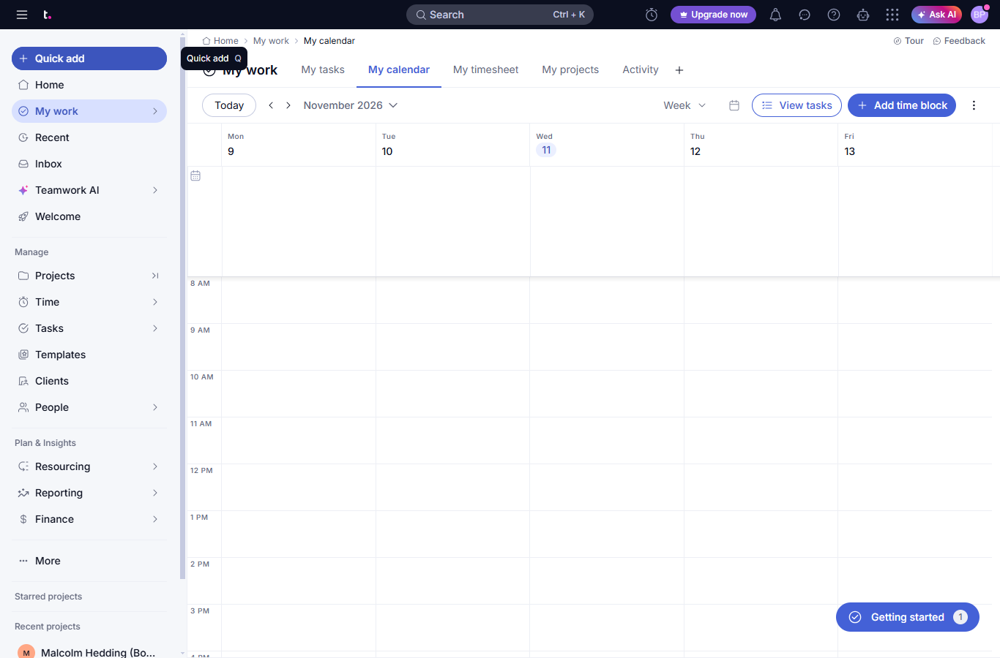
- **open: My work**
  - URL: https://marketingcorps.eu.teamwork.com/app/work/calendar
  - Folder: `snapshots/s037__marketingcorps.eu.teamwork.com_app_work_calendar`
  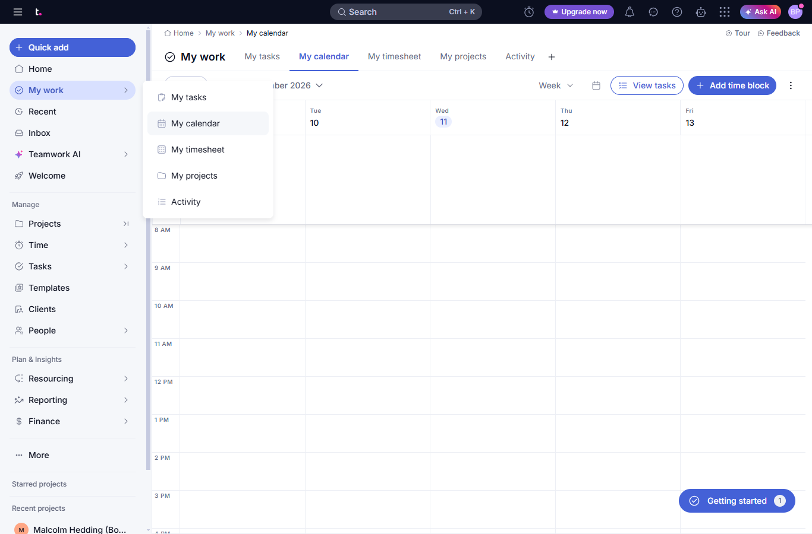
- **open: Other apps**
  - URL: https://marketingcorps.eu.teamwork.com/app/work/calendar
  - Folder: `snapshots/s038__marketingcorps.eu.teamwork.com_app_work_calendar`
  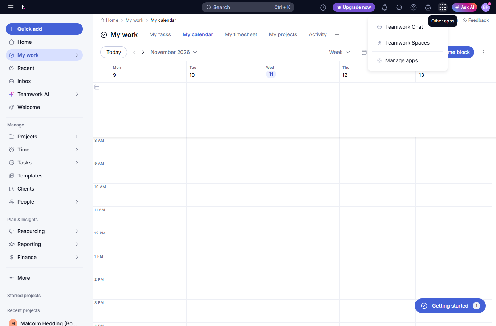
- **open: User menu**
  - URL: https://marketingcorps.eu.teamwork.com/app/work/calendar
  - Folder: `snapshots/s039__marketingcorps.eu.teamwork.com_app_work_calendar`
  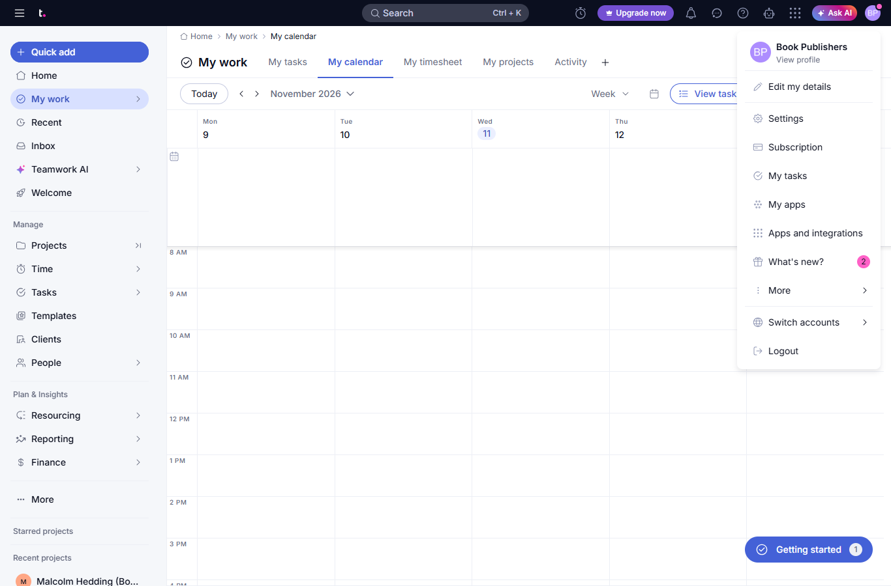
- **open: Quick add**
  - URL: https://marketingcorps.eu.teamwork.com/app/work/calendar
  - Folder: `snapshots/s040__marketingcorps.eu.teamwork.com_app_work_calendar`
  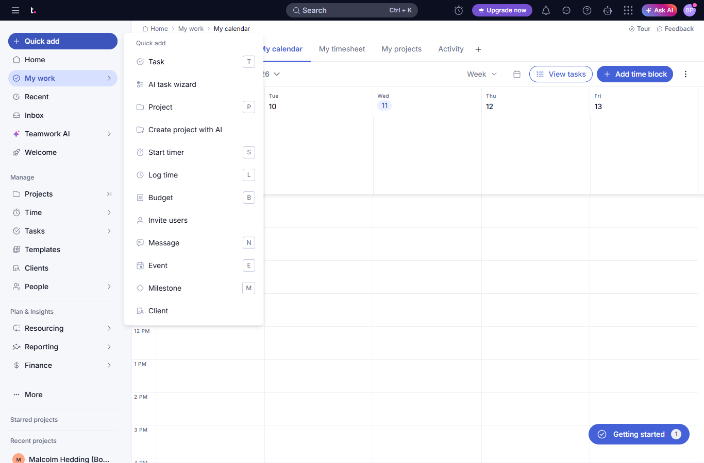

#### Controls

- **Skip to main content** — link, anchor — https://marketingcorps.eu.teamwork.com/app/work/calendar#v-0
- **Teamwork.com home** — link, navigate — https://marketingcorps.eu.teamwork.com/app/
- **Home** — link, navigate — https://marketingcorps.eu.teamwork.com/app/home
- **My work** — link, open — https://marketingcorps.eu.teamwork.com/app/work
- **Inbox** — link, navigate — https://marketingcorps.eu.teamwork.com/app/inbox
- **Teamwork AI** — link, navigate — https://marketingcorps.eu.teamwork.com/app/ai/ask
- **Welcome** — link, navigate — https://marketingcorps.eu.teamwork.com/app/welcome
- **Projects** — link, navigate — https://marketingcorps.eu.teamwork.com/app/projects
- **Time** — link, navigate — https://marketingcorps.eu.teamwork.com/app/time/approvals
- **Tasks** — link, navigate — https://marketingcorps.eu.teamwork.com/app/tasks/completedTasks
- **Clients** — link, navigate — https://marketingcorps.eu.teamwork.com/app/clients
- **People** — link, navigate — https://marketingcorps.eu.teamwork.com/app/people/people
- **Resourcing** — link, navigate — https://marketingcorps.eu.teamwork.com/app/planning/chart
- **Reporting** — link, navigate — https://marketingcorps.eu.teamwork.com/app/reports/all
- **Finance** — link, navigate — https://marketingcorps.eu.teamwork.com/app/finance/invoices/table
- **M Malcolm Hedding (Book Project)** — link, navigate — https://marketingcorps.eu.teamwork.com/app/projects/622746/tasks/list
- **C Charles Cooper** — link, navigate — https://marketingcorps.eu.teamwork.com/app/projects/622742/tasks/list
- **J Julie** — link, navigate — https://marketingcorps.eu.teamwork.com/app/projects/622744/tasks/list
- **Home** — link, navigate — https://marketingcorps.eu.teamwork.com/app/home
- **My work** — link, navigate — https://marketingcorps.eu.teamwork.com/app/work
- **My calendar** — link, navigate — https://marketingcorps.eu.teamwork.com/app/home/calendar
- **My tasks** — link, navigate — https://marketingcorps.eu.teamwork.com/app/work/tasks
- **My calendar** — link, navigate — https://marketingcorps.eu.teamwork.com/app/work/calendar
- **My timesheet** — link, navigate — https://marketingcorps.eu.teamwork.com/app/work/timesheet
- **My projects** — link, navigate — https://marketingcorps.eu.teamwork.com/app/work/projects
- **Activity** — link, navigate — https://marketingcorps.eu.teamwork.com/app/work/activity
- **Collapse sidebar** — button, not-opened — state budget exhausted
- **Search Ctrl + K** — button, not-opened — state budget exhausted
- **Start a new timer** — button, not-opened — state budget exhausted
- **Upgrade now** — button, not-opened — state budget exhausted
- **Notifications** — button, not-opened — state budget exhausted
- **Chat** — button, not-opened — state budget exhausted
- **Help** — button, not-opened — state budget exhausted
- **Automations** — button, not-opened — state budget exhausted
- **Other apps** — button, open
- **Ask AI** — button, not-opened — state budget exhausted
- **User menu** — button, open
- **Quick add** — button, open
- **Recent** — button, not-opened — state budget exhausted
- **Manage** — button, not-opened — state budget exhausted
- **Jump to** — button, not-opened — state budget exhausted
- **Templates** — button, not-opened — state budget exhausted
- **Plan & Insights** — button, not-opened — state budget exhausted
- **More** — button, not-opened — state budget exhausted
- **Starred projects** — button, not-opened — state budget exhausted
- **Recent projects** — button, not-opened — state budget exhausted
- **Tour** — button, not-opened — state budget exhausted
- **Feedback** — button, not-opened — state budget exhausted
- **Choose tabs to display** — button, not-opened — state budget exhausted
- **Today** — button, not-opened — state budget exhausted
- **Previous week** — button, not-opened — state budget exhausted
- **Next week** — button, not-opened — state budget exhausted
- **November 2026** — button, not-opened — state budget exhausted
- **Week** — button, not-opened — state budget exhausted
- **button** — button, not-opened — state budget exhausted
- **View tasks** — button, not-opened — state budget exhausted
- **Add time block** — button, not-opened — state budget exhausted
- **Options** — button, not-opened — state budget exhausted
- **Getting started 1** — button, not-opened — state budget exhausted
- **My tasks** — link, navigate — https://marketingcorps.eu.teamwork.com/app/work/tasks
- **My calendar** — link, navigate — https://marketingcorps.eu.teamwork.com/app/work/calendar
- **My timesheet** — link, navigate — https://marketingcorps.eu.teamwork.com/app/work/timesheet
- **My projects** — link, navigate — https://marketingcorps.eu.teamwork.com/app/work/projects
- **Activity** — link, navigate — https://marketingcorps.eu.teamwork.com/app/work/activity
- **Ask AI** — link, navigate — https://marketingcorps.eu.teamwork.com/app/ai/ask
- **AI Teammates** — link, navigate — https://marketingcorps.eu.teamwork.com/app/ai/teammates
- **AI skills NEW** — button, recorded
- **My timesheet** — link, navigate — https://marketingcorps.eu.teamwork.com/app/time/user
- **Company timesheet** — link, navigate — https://marketingcorps.eu.teamwork.com/app/time/company
- **All time** — link, navigate — https://marketingcorps.eu.teamwork.com/app/time/all
- **Approvals** — link, navigate — https://marketingcorps.eu.teamwork.com/app/time/approvals
- **Customize** — button, recorded
- **Tasks** — link, navigate — https://marketingcorps.eu.teamwork.com/app/tasks/tasks
- **Board** — link, navigate — https://marketingcorps.eu.teamwork.com/app/tasks/board
- **Table** — link, navigate — https://marketingcorps.eu.teamwork.com/app/tasks/table
- **Completed tasks** — link, navigate — https://marketingcorps.eu.teamwork.com/app/tasks/completedTasks
- **People** — link, navigate — https://marketingcorps.eu.teamwork.com/app/people/people
- **Roles** — link, navigate — https://marketingcorps.eu.teamwork.com/app/people/roles
- **Skills NEW** — link, navigate — https://marketingcorps.eu.teamwork.com/app/people/skills
- **Teams** — link, navigate — https://marketingcorps.eu.teamwork.com/app/people/teams
- **Statuses** — link, navigate — https://marketingcorps.eu.teamwork.com/app/people/statuses
- **Overview** — link, navigate — https://marketingcorps.eu.teamwork.com/app/planning/overview
- **Schedule** — link, navigate — https://marketingcorps.eu.teamwork.com/app/planning/schedule
- **Workload** — link, navigate — https://marketingcorps.eu.teamwork.com/app/planning/workload
- **Portfolio** — link, navigate — https://marketingcorps.eu.teamwork.com/app/planning/portfolio
- **Chart** — link, navigate — https://marketingcorps.eu.teamwork.com/app/planning/chart
- **Customize** — button, recorded
- **All reports** — link, navigate — https://marketingcorps.eu.teamwork.com/app/reports/all
- **Custom Reports** — link, navigate — https://marketingcorps.eu.teamwork.com/app/reports/custom-reports
- **Scheduled reports** — link, navigate — https://marketingcorps.eu.teamwork.com/app/reports/scheduled
- **Rates** — link, navigate — https://marketingcorps.eu.teamwork.com/app/finance/rates
- **Budgets** — link, navigate — https://marketingcorps.eu.teamwork.com/app/finance/budgets
- **Invoices** — link, navigate — https://marketingcorps.eu.teamwork.com/app/finance/invoices
- **Expenses** — link, navigate — https://marketingcorps.eu.teamwork.com/app/finance/expenses
- **Teamwork Chat** — link, navigate — https://marketingcorps.eu.teamwork.com/chat
- **Teamwork Spaces** — link, navigate — https://marketingcorps.eu.teamwork.com/spaces
- **Manage apps** — button, recorded
- **Book Publishers View profile** — link, navigate — https://marketingcorps.eu.teamwork.com/app/people/555920
- **Settings** — link, navigate — https://marketingcorps.eu.teamwork.com/app/settings
- **Subscription** — link, navigate — https://marketingcorps.eu.teamwork.com/app/settings/subscription
- **My tasks** — link, navigate — https://marketingcorps.eu.teamwork.com/app/people/555920/tasks
- **My apps** — link, navigate — https://marketingcorps.eu.teamwork.com/app/people/555920/integrations
- **Apps and integrations** — link, navigate — https://marketingcorps.eu.teamwork.com/app/settings/integrations
- **Edit my details** — button, recorded
- **What's new? 2** — button, recorded
- **More** — button, recorded
- **Switch accounts** — button, recorded
- **Logout** — button, skipped — submits a form or changes data
- **Task T T** — button, recorded
- **AI task wizard** — button, recorded
- **Project P P** — button, recorded
- **Create project with AI** — button, recorded
- **Start timer S S** — button, recorded
- **Log time L L** — button, recorded
- **Budget B B** — button, recorded
- **Invite users** — button, recorded
- **Message N N** — button, recorded
- **Event E E** — button, recorded
- **Milestone M M** — button, recorded
- **Client** — button, recorded

### My timesheet - Home - marketing corps

- URL: https://marketingcorps.eu.teamwork.com/app/work/timesheet
- Requested: https://marketingcorps.eu.teamwork.com/app/work/timesheet
- Status: 200
- Depth: 1

#### Outline

- My timesheet - Home
      - Let's start building your timesheet

#### States

- **default**
  - URL: https://marketingcorps.eu.teamwork.com/app/work/timesheet
  - Folder: `snapshots/s041__marketingcorps.eu.teamwork.com_app_work_timesheet`
  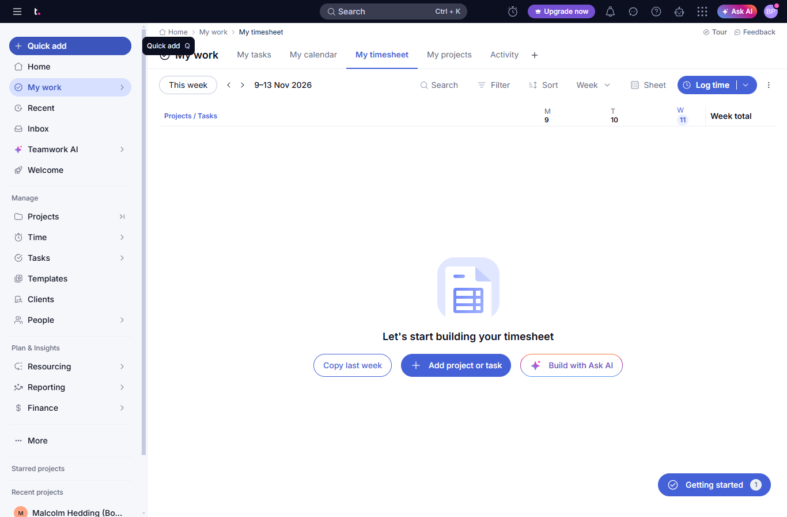
- **open: My work**
  - URL: https://marketingcorps.eu.teamwork.com/app/work/timesheet
  - Folder: `snapshots/s042__marketingcorps.eu.teamwork.com_app_work_timesheet`
  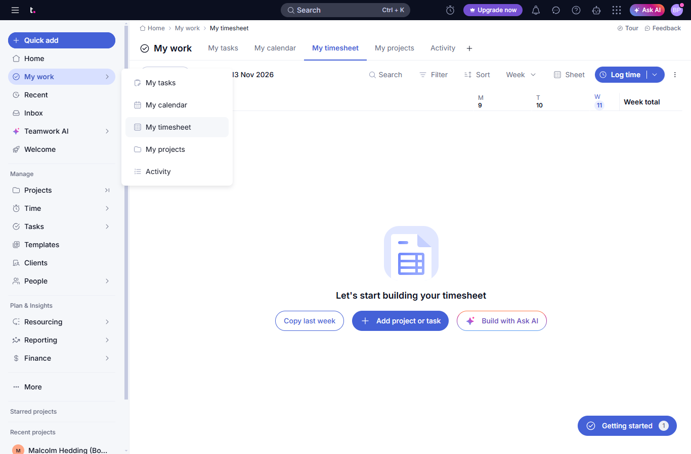
- **open: Other apps**
  - URL: https://marketingcorps.eu.teamwork.com/app/work/timesheet
  - Folder: `snapshots/s043__marketingcorps.eu.teamwork.com_app_work_timesheet`
  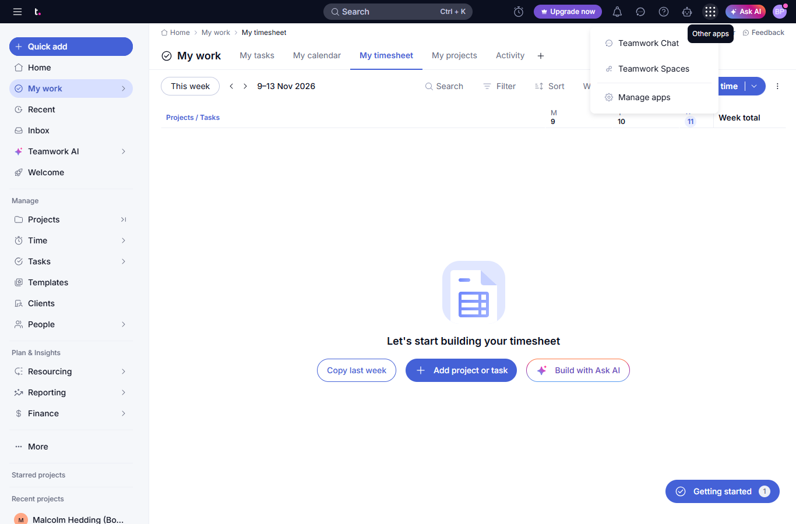
- **open: User menu**
  - URL: https://marketingcorps.eu.teamwork.com/app/work/timesheet
  - Folder: `snapshots/s044__marketingcorps.eu.teamwork.com_app_work_timesheet`
  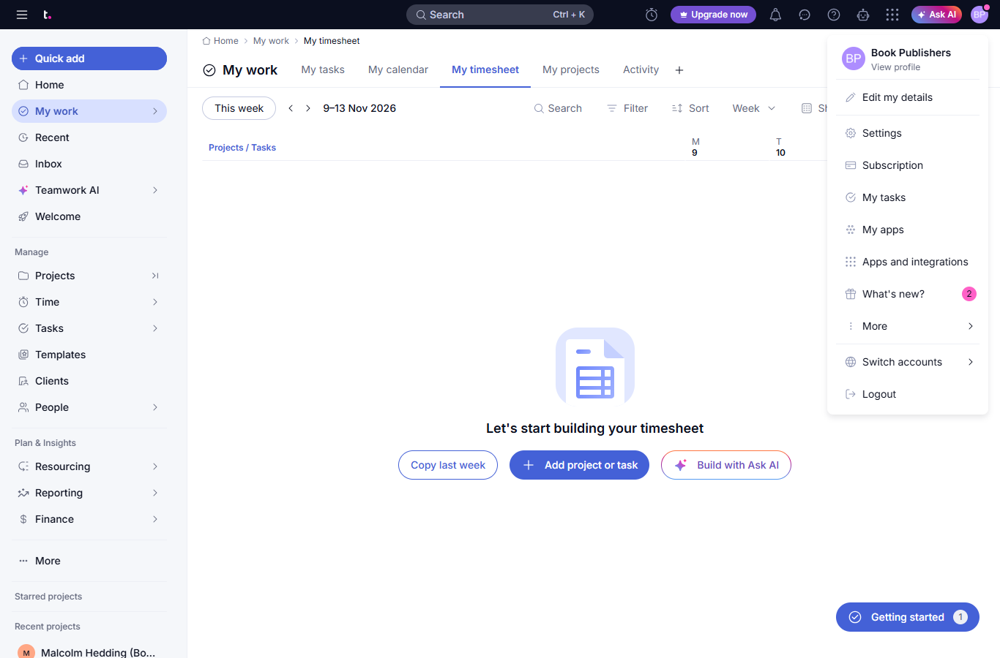
- **open: Quick add**
  - URL: https://marketingcorps.eu.teamwork.com/app/work/timesheet
  - Folder: `snapshots/s045__marketingcorps.eu.teamwork.com_app_work_timesheet`
  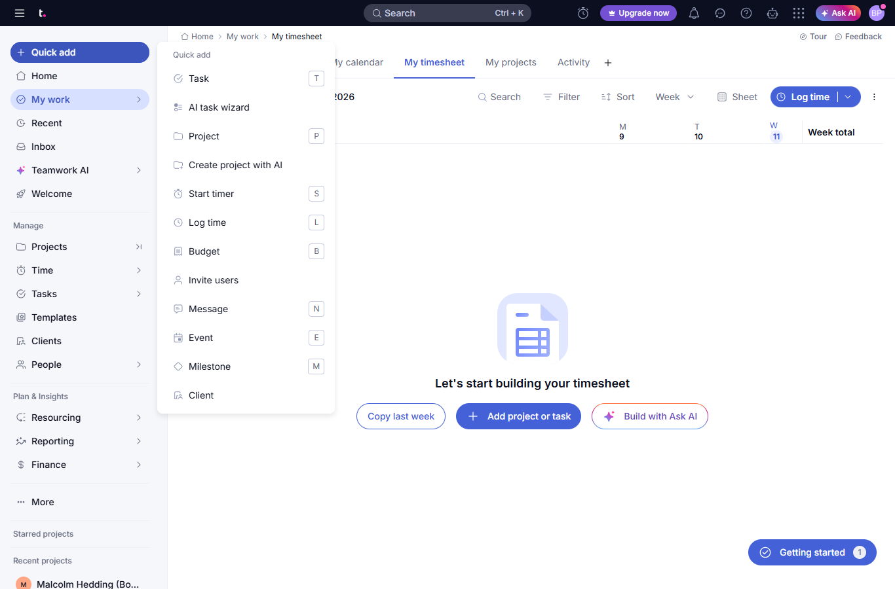

#### Controls

- **Skip to main content** — link, anchor — https://marketingcorps.eu.teamwork.com/app/work/timesheet#v-0
- **Teamwork.com home** — link, navigate — https://marketingcorps.eu.teamwork.com/app/
- **Home** — link, navigate — https://marketingcorps.eu.teamwork.com/app/home
- **My work** — link, open — https://marketingcorps.eu.teamwork.com/app/work
- **Inbox** — link, navigate — https://marketingcorps.eu.teamwork.com/app/inbox
- **Teamwork AI** — link, navigate — https://marketingcorps.eu.teamwork.com/app/ai/ask
- **Welcome** — link, navigate — https://marketingcorps.eu.teamwork.com/app/welcome
- **Projects** — link, navigate — https://marketingcorps.eu.teamwork.com/app/projects
- **Time** — link, navigate — https://marketingcorps.eu.teamwork.com/app/time/approvals
- **Tasks** — link, navigate — https://marketingcorps.eu.teamwork.com/app/tasks/completedTasks
- **Clients** — link, navigate — https://marketingcorps.eu.teamwork.com/app/clients
- **People** — link, navigate — https://marketingcorps.eu.teamwork.com/app/people/people
- **Resourcing** — link, navigate — https://marketingcorps.eu.teamwork.com/app/planning/chart
- **Reporting** — link, navigate — https://marketingcorps.eu.teamwork.com/app/reports/all
- **Finance** — link, navigate — https://marketingcorps.eu.teamwork.com/app/finance/invoices/table
- **M Malcolm Hedding (Book Project)** — link, navigate — https://marketingcorps.eu.teamwork.com/app/projects/622746/tasks/list
- **C Charles Cooper** — link, navigate — https://marketingcorps.eu.teamwork.com/app/projects/622742/tasks/list
- **J Julie** — link, navigate — https://marketingcorps.eu.teamwork.com/app/projects/622744/tasks/list
- **Home** — link, navigate — https://marketingcorps.eu.teamwork.com/app/home
- **My work** — link, navigate — https://marketingcorps.eu.teamwork.com/app/work
- **My timesheet** — link, navigate — https://marketingcorps.eu.teamwork.com/app/home/timesheet
- **My tasks** — link, navigate — https://marketingcorps.eu.teamwork.com/app/work/tasks
- **My calendar** — link, navigate — https://marketingcorps.eu.teamwork.com/app/work/calendar
- **My timesheet** — link, navigate — https://marketingcorps.eu.teamwork.com/app/work/timesheet
- **My projects** — link, navigate — https://marketingcorps.eu.teamwork.com/app/work/projects
- **Activity** — link, navigate — https://marketingcorps.eu.teamwork.com/app/work/activity
- **Collapse sidebar** — button, not-opened — state budget exhausted
- **Search Ctrl + K** — button, not-opened — state budget exhausted
- **Start a new timer** — button, not-opened — state budget exhausted
- **Upgrade now** — button, not-opened — state budget exhausted
- **Notifications** — button, not-opened — state budget exhausted
- **Chat** — button, not-opened — state budget exhausted
- **Help** — button, not-opened — state budget exhausted
- **Automations** — button, not-opened — state budget exhausted
- **Other apps** — button, open
- **Ask AI** — button, not-opened — state budget exhausted
- **User menu** — button, open
- **Quick add** — button, open
- **Recent** — button, not-opened — state budget exhausted
- **Manage** — button, not-opened — state budget exhausted
- **Jump to** — button, not-opened — state budget exhausted
- **Templates** — button, not-opened — state budget exhausted
- **Plan & Insights** — button, not-opened — state budget exhausted
- **More** — button, not-opened — state budget exhausted
- **Starred projects** — button, not-opened — state budget exhausted
- **Recent projects** — button, not-opened — state budget exhausted
- **Tour** — button, not-opened — state budget exhausted
- **Feedback** — button, not-opened — state budget exhausted
- **Choose tabs to display** — button, not-opened — state budget exhausted
- **This week** — button, not-opened — state budget exhausted
- **Go to previous week** — button, not-opened — state budget exhausted
- **Go to next week** — button, not-opened — state budget exhausted
- **9–13 Nov 2026** — button, not-opened — state budget exhausted
- **Filter** — button, not-opened — state budget exhausted
- **Sort** — button, not-opened — state budget exhausted
- **Week** — button, not-opened — state budget exhausted
- **Sheet** — button, not-opened — state budget exhausted
- **Log time** — button, not-opened — state budget exhausted
- **More options** — button, not-opened — state budget exhausted
- **Options** — button, not-opened — state budget exhausted
- **Order by closest due date** — button, not-opened — state budget exhausted
- **Copy last week** — button, not-opened — state budget exhausted
- **Add project or task** — button, not-opened — state budget exhausted
- **Build with Ask AI** — button, not-opened — state budget exhausted
- **Getting started 1** — button, not-opened — state budget exhausted
- **Filter** — menu, not-opened — state budget exhausted
- **My tasks** — link, navigate — https://marketingcorps.eu.teamwork.com/app/work/tasks
- **My calendar** — link, navigate — https://marketingcorps.eu.teamwork.com/app/work/calendar
- **My timesheet** — link, navigate — https://marketingcorps.eu.teamwork.com/app/work/timesheet
- **My projects** — link, navigate — https://marketingcorps.eu.teamwork.com/app/work/projects
- **Activity** — link, navigate — https://marketingcorps.eu.teamwork.com/app/work/activity
- **Ask AI** — link, navigate — https://marketingcorps.eu.teamwork.com/app/ai/ask
- **AI Teammates** — link, navigate — https://marketingcorps.eu.teamwork.com/app/ai/teammates
- **AI skills NEW** — button, recorded
- **My timesheet** — link, navigate — https://marketingcorps.eu.teamwork.com/app/time/user
- **Company timesheet** — link, navigate — https://marketingcorps.eu.teamwork.com/app/time/company
- **All time** — link, navigate — https://marketingcorps.eu.teamwork.com/app/time/all
- **Approvals** — link, navigate — https://marketingcorps.eu.teamwork.com/app/time/approvals
- **Customize** — button, recorded
- **Tasks** — link, navigate — https://marketingcorps.eu.teamwork.com/app/tasks/tasks
- **Board** — link, navigate — https://marketingcorps.eu.teamwork.com/app/tasks/board
- **Table** — link, navigate — https://marketingcorps.eu.teamwork.com/app/tasks/table
- **Completed tasks** — link, navigate — https://marketingcorps.eu.teamwork.com/app/tasks/completedTasks
- **People** — link, navigate — https://marketingcorps.eu.teamwork.com/app/people/people
- **Roles** — link, navigate — https://marketingcorps.eu.teamwork.com/app/people/roles
- **Skills NEW** — link, navigate — https://marketingcorps.eu.teamwork.com/app/people/skills
- **Teams** — link, navigate — https://marketingcorps.eu.teamwork.com/app/people/teams
- **Statuses** — link, navigate — https://marketingcorps.eu.teamwork.com/app/people/statuses
- **Overview** — link, navigate — https://marketingcorps.eu.teamwork.com/app/planning/overview
- **Schedule** — link, navigate — https://marketingcorps.eu.teamwork.com/app/planning/schedule
- **Workload** — link, navigate — https://marketingcorps.eu.teamwork.com/app/planning/workload
- **Portfolio** — link, navigate — https://marketingcorps.eu.teamwork.com/app/planning/portfolio
- **Chart** — link, navigate — https://marketingcorps.eu.teamwork.com/app/planning/chart
- **Customize** — button, recorded
- **All reports** — link, navigate — https://marketingcorps.eu.teamwork.com/app/reports/all
- **Custom Reports** — link, navigate — https://marketingcorps.eu.teamwork.com/app/reports/custom-reports
- **Scheduled reports** — link, navigate — https://marketingcorps.eu.teamwork.com/app/reports/scheduled
- **Rates** — link, navigate — https://marketingcorps.eu.teamwork.com/app/finance/rates
- **Budgets** — link, navigate — https://marketingcorps.eu.teamwork.com/app/finance/budgets
- **Invoices** — link, navigate — https://marketingcorps.eu.teamwork.com/app/finance/invoices
- **Expenses** — link, navigate — https://marketingcorps.eu.teamwork.com/app/finance/expenses
- **Teamwork Chat** — link, navigate — https://marketingcorps.eu.teamwork.com/chat
- **Teamwork Spaces** — link, navigate — https://marketingcorps.eu.teamwork.com/spaces
- **Manage apps** — button, recorded
- **Book Publishers View profile** — link, navigate — https://marketingcorps.eu.teamwork.com/app/people/555920
- **Settings** — link, navigate — https://marketingcorps.eu.teamwork.com/app/settings
- **Subscription** — link, navigate — https://marketingcorps.eu.teamwork.com/app/settings/subscription
- **My tasks** — link, navigate — https://marketingcorps.eu.teamwork.com/app/people/555920/tasks
- **My apps** — link, navigate — https://marketingcorps.eu.teamwork.com/app/people/555920/integrations
- **Apps and integrations** — link, navigate — https://marketingcorps.eu.teamwork.com/app/settings/integrations
- **Edit my details** — button, recorded
- **What's new? 2** — button, recorded
- **More** — button, recorded
- **Switch accounts** — button, recorded
- **Logout** — button, skipped — submits a form or changes data
- **Task T T** — button, recorded
- **AI task wizard** — button, recorded
- **Project P P** — button, recorded
- **Create project with AI** — button, recorded
- **Start timer S S** — button, recorded
- **Log time L L** — button, recorded
- **Budget B B** — button, recorded
- **Invite users** — button, recorded
- **Message N N** — button, recorded
- **Event E E** — button, recorded
- **Milestone M M** — button, recorded
- **Client** — button, recorded

### Activity - Home - marketing corps

- URL: https://marketingcorps.eu.teamwork.com/app/work/activity
- Requested: https://marketingcorps.eu.teamwork.com/app/work/activity
- Status: 200
- Depth: 1

#### Outline

- Activity - Home

#### States

- **default**
  - URL: https://marketingcorps.eu.teamwork.com/app/work/activity
  - Folder: `snapshots/s046__marketingcorps.eu.teamwork.com_app_work_activity`
  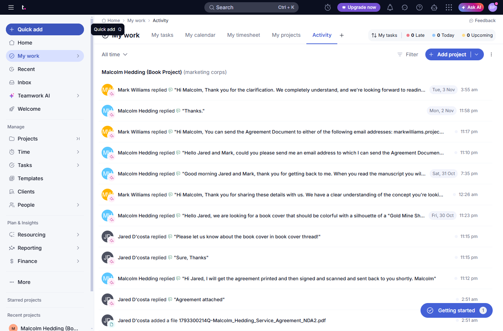
- **open: My work**
  - URL: https://marketingcorps.eu.teamwork.com/app/work/activity
  - Folder: `snapshots/s047__marketingcorps.eu.teamwork.com_app_work_activity`
  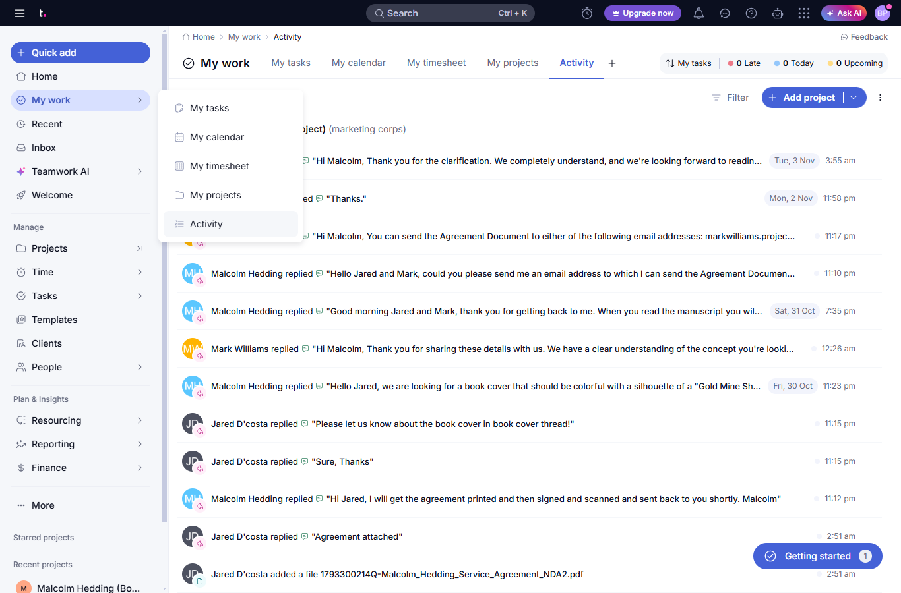
- **open: Other apps**
  - URL: https://marketingcorps.eu.teamwork.com/app/work/activity
  - Folder: `snapshots/s048__marketingcorps.eu.teamwork.com_app_work_activity`
  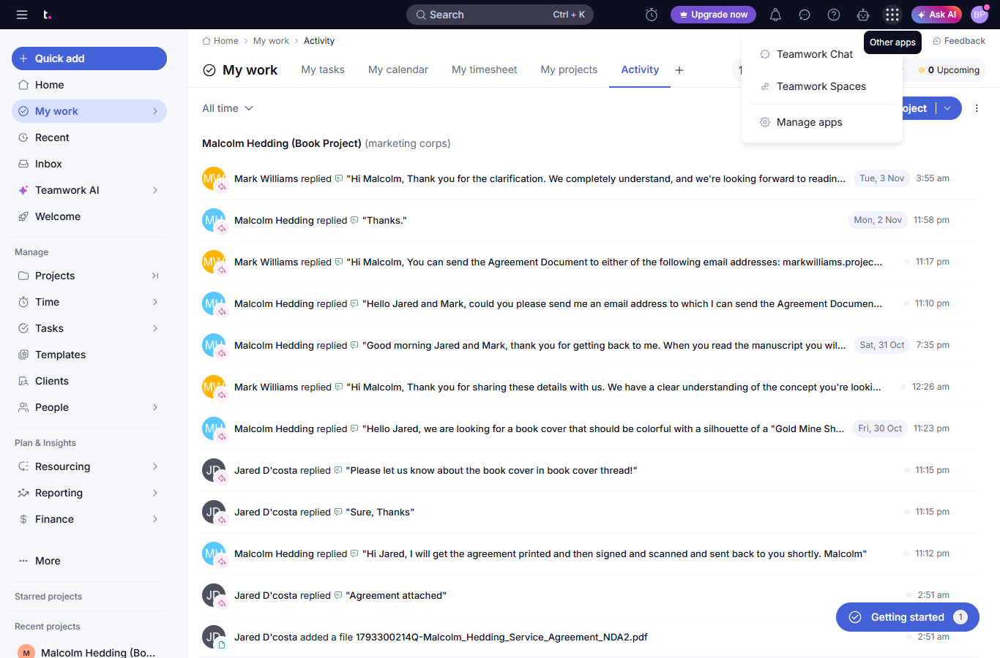
- **open: User menu**
  - URL: https://marketingcorps.eu.teamwork.com/app/work/activity
  - Folder: `snapshots/s049__marketingcorps.eu.teamwork.com_app_work_activity`
  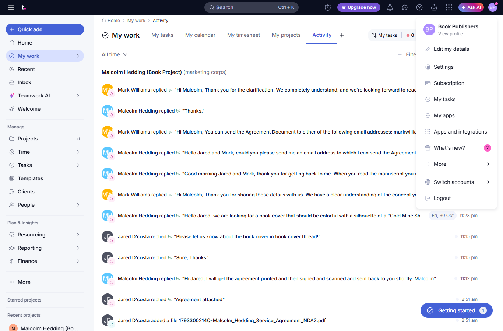
- **open: Quick add**
  - URL: https://marketingcorps.eu.teamwork.com/app/work/activity
  - Folder: `snapshots/s050__marketingcorps.eu.teamwork.com_app_work_activity`
  

#### Controls

- **Skip to main content** — link, anchor — https://marketingcorps.eu.teamwork.com/app/work/activity#v-0
- **Teamwork.com home** — link, navigate — https://marketingcorps.eu.teamwork.com/app/
- **Home** — link, navigate — https://marketingcorps.eu.teamwork.com/app/home
- **My work** — link, open — https://marketingcorps.eu.teamwork.com/app/work
- **Inbox** — link, navigate — https://marketingcorps.eu.teamwork.com/app/inbox
- **Teamwork AI** — link, navigate — https://marketingcorps.eu.teamwork.com/app/ai/ask
- **Welcome** — link, navigate — https://marketingcorps.eu.teamwork.com/app/welcome
- **Projects** — link, navigate — https://marketingcorps.eu.teamwork.com/app/projects
- **Time** — link, navigate — https://marketingcorps.eu.teamwork.com/app/time/approvals
- **Tasks** — link, navigate — https://marketingcorps.eu.teamwork.com/app/tasks/completedTasks
- **Clients** — link, navigate — https://marketingcorps.eu.teamwork.com/app/clients
- **People** — link, navigate — https://marketingcorps.eu.teamwork.com/app/people/people
- **Resourcing** — link, navigate — https://content.usage.teamwork.com/guide-content/ckpd1lMeS-_8Dsy6weX94ThIMkA/C9L5bsn1dX9Q_qytzbmI2kC2lAo/oDsHzAVRX8tAd_khe-GiZZ_6yNI.dom.jsonp?sha256=WXJlM6PdNjhXhpU6WSigBh7jUHys_Q78CDgRBt-D3EA
  - redirect: 304 https://content.usage.teamwork.com/guide-content/ckpd1lMeS-_8Dsy6weX94ThIMkA/C9L5bsn1dX9Q_qytzbmI2kC2lAo/oDsHzAVRX8tAd_khe-GiZZ_6yNI.dom.jsonp?sha256=WXJlM6PdNjhXhpU6WSigBh7jUHys_Q78CDgRBt-D3EA
- **Reporting** — link, navigate — https://marketingcorps.eu.teamwork.com/app/reports/all
- **Finance** — link, navigate — https://marketingcorps.eu.teamwork.com/app/finance/invoices/table
- **M Malcolm Hedding (Book Project)** — link, navigate — https://marketingcorps.eu.teamwork.com/app/projects/622746/tasks/list
- **C Charles Cooper** — link, navigate — https://marketingcorps.eu.teamwork.com/app/projects/622742/tasks/list
- **J Julie** — link, navigate — https://marketingcorps.eu.teamwork.com/app/projects/622744/tasks/list
- **Home** — link, navigate — https://marketingcorps.eu.teamwork.com/app/home
- **My work** — link, navigate — https://marketingcorps.eu.teamwork.com/app/work
- **Activity** — link, navigate — https://marketingcorps.eu.teamwork.com/app/home/activity
- **My tasks** — link, navigate — https://marketingcorps.eu.teamwork.com/app/work/tasks
- **My calendar** — link, navigate — https://marketingcorps.eu.teamwork.com/app/work/calendar
- **My timesheet** — link, navigate — https://marketingcorps.eu.teamwork.com/app/work/timesheet
- **My projects** — link, navigate — https://marketingcorps.eu.teamwork.com/app/work/projects
- **Activity** — link, navigate — https://marketingcorps.eu.teamwork.com/app/work/activity
- **Malcolm Hedding (Book Project)** — link, navigate — https://marketingcorps.eu.teamwork.com/app/projects/622746
- **(marketing corps)** — link, navigate — https://marketingcorps.eu.teamwork.com/app/clients/210624
- **Mark Williams** — link, navigate — https://marketingcorps.eu.teamwork.com/app/people/555930/details
- **"Hi Malcolm, Thank you for the clarification. We completely understand, and we're looking forward to reading your manuscript to better understand the story and the significance of featuring the mine shaft headgear on the cover. I've also sent"** — link, navigate — https://marketingcorps.eu.teamwork.com/app/messages/519066?pmp=1462943
- **Malcolm Hedding** — link, navigate — https://marketingcorps.eu.teamwork.com/app/people/555933/details
- **"Thanks."** — link, navigate — https://marketingcorps.eu.teamwork.com/app/messages/519065?pmp=1462942
- **Mark Williams** — link, navigate — https://marketingcorps.eu.teamwork.com/app/people/555930/details
- **"Hi Malcolm, You can send the Agreement Document to either of the following email addresses: markwilliams.project008@gmail.com jared.dcosta12@gmail.com We look forward to receiving it. Best regards, Jared D Costa & Mark"** — link, navigate — https://marketingcorps.eu.teamwork.com/app/messages/519065?pmp=1462941
- **Malcolm Hedding** — link, navigate — https://marketingcorps.eu.teamwork.com/app/people/555933/details
- **"Hello Jared and Mark, could you please send me an email address to which I can send the Agreement Document. Thanks, Malcolm."** — link, navigate — https://marketingcorps.eu.teamwork.com/app/messages/519065?pmp=1462940
- **Malcolm Hedding** — link, navigate — https://marketingcorps.eu.teamwork.com/app/people/555933/details
- **"Good morning Jared and Mark, thank you for getting back to me. When you read the manuscript you will understand why I wish to have the head gear of a mine shaft on the cover. Anyway, I am working on everything that you need and will frequently get back..."** — link, navigate — https://marketingcorps.eu.teamwork.com/app/messages/519066?pmp=1462918
- **Mark Williams** — link, navigate — https://marketingcorps.eu.teamwork.com/app/people/555930/details
- **"Hi Malcolm, Thank you for sharing these details with us. We have a clear understanding of the concept you're looking for. The idea of incorporating a colorful design with a silhouette of a gold mine shaft and its headgear sounds very interesting. W..."** — link, navigate — https://marketingcorps.eu.teamwork.com/app/messages/519066?pmp=1462916
- **Malcolm Hedding** — link, navigate — https://marketingcorps.eu.teamwork.com/app/people/555933/details
- **"Hello Jared, we are looking for a book cover that should be colorful with a silhouette of a "Gold Mine Shaft with its head gear" in it. You may have to google this to find out what I mean! Also, we have lived in four countries; South Africa where we we..."** — link, navigate — https://marketingcorps.eu.teamwork.com/app/messages/519066?pmp=1462914
- **Jared D'costa** — link, navigate — https://marketingcorps.eu.teamwork.com/app/people/555931/details
- **"Please let us know about the book cover in book cover thread!"** — link, navigate — https://marketingcorps.eu.teamwork.com/app/messages/519065?pmp=1462913
- **Jared D'costa** — link, navigate — https://marketingcorps.eu.teamwork.com/app/people/555931/details
- **"Sure, Thanks"** — link, navigate — https://marketingcorps.eu.teamwork.com/app/messages/519065?pmp=1462912
- **Malcolm Hedding** — link, navigate — https://marketingcorps.eu.teamwork.com/app/people/555933/details
- **"Hi Jared, I will get the agreement printed and then signed and scanned and sent back to you shortly. Malcolm"** — link, navigate — https://marketingcorps.eu.teamwork.com/app/messages/519065?pmp=1462911
- **Jared D'costa** — link, navigate — https://marketingcorps.eu.teamwork.com/app/people/555931/details
- **"Agreement attached"** — link, navigate — https://marketingcorps.eu.teamwork.com/app/messages/519065?pmp=1462897
- **Jared D'costa** — link, navigate — https://marketingcorps.eu.teamwork.com/app/people/555931/details
- **1793300214Q-Malcolm_Hedding_Service_Agreement_NDA2.pdf** — link, navigate — https://marketingcorps.eu.teamwork.com/app/files/4039376
- **"Sure"** — link, navigate — https://marketingcorps.eu.teamwork.com/app/messages/519065?pmp=1462892
- **Jared D'costa** — link, navigate — https://marketingcorps.eu.teamwork.com/app/people/555931/details
- **Book Cover** — link, navigate — https://marketingcorps.eu.teamwork.com/app/messages/519066?scrollTo=1462891
- **Malcolm Hedding** — link, navigate — https://marketingcorps.eu.teamwork.com/app/people/555933/details
- **"I will send you the manuscript in two weeks"** — link, navigate — https://marketingcorps.eu.teamwork.com/app/messages/519065?pmp=1462890
- **Jared D'costa** — link, navigate — https://marketingcorps.eu.teamwork.com/app/people/555931/details
- **"Hello"** — link, navigate — https://marketingcorps.eu.teamwork.com/app/messages/519065?pmp=1462889
- **Jared D'costa** — link, navigate — https://marketingcorps.eu.teamwork.com/app/people/555931/details
- **Manuscript** — link, navigate — https://marketingcorps.eu.teamwork.com/app/messages/519065?scrollTo=1462888
- **Malcolm Hedding (Book Project)** — link, navigate — https://marketingcorps.eu.teamwork.com/app/projects/622746
- **Malcolm Hedding (Book Project)** — link, navigate — https://marketingcorps.eu.teamwork.com/app/projects/622746
- **Charles Cooper** — link, navigate — https://marketingcorps.eu.teamwork.com/app/projects/622742
- **(marketing corps)** — link, navigate — https://marketingcorps.eu.teamwork.com/app/clients/210624
- **"gsgssdg"** — link, navigate — https://marketingcorps.eu.teamwork.com/app/messages/519064?pmp=1462887
- **Mark Williams** — link, navigate — https://marketingcorps.eu.teamwork.com/app/people/555930/details
- **"Hello This Mark"** — link, navigate — https://marketingcorps.eu.teamwork.com/app/messages/519064?pmp=1462886
- **Julie** — link, navigate — https://marketingcorps.eu.teamwork.com/app/projects/622744
- **(marketing corps)** — link, navigate — https://marketingcorps.eu.teamwork.com/app/clients/210624
- **Julie** — link, navigate — https://marketingcorps.eu.teamwork.com/app/projects/622744
- **Charles Cooper** — link, navigate — https://marketingcorps.eu.teamwork.com/app/projects/622742
- **(marketing corps)** — link, navigate — https://marketingcorps.eu.teamwork.com/app/clients/210624
- **Charles Cooper** — link, navigate — https://marketingcorps.eu.teamwork.com/app/people/555932/details
- **"Thank you"** — link, navigate — https://marketingcorps.eu.teamwork.com/app/messages/519064?pmp=1462885
- **Jared D'costa** — link, navigate — https://marketingcorps.eu.teamwork.com/app/people/555931/details
- **"Hello Coco"** — link, navigate — https://marketingcorps.eu.teamwork.com/app/messages/519064?pmp=1462884
- **Publishing** — link, navigate — https://marketingcorps.eu.teamwork.com/app/messages/519064?scrollTo=1462883
- **Charles Cooper** — link, navigate — https://marketingcorps.eu.teamwork.com/app/projects/622742
- **Collapse sidebar** — button, not-opened — state budget exhausted
- **Search Ctrl + K** — button, not-opened — state budget exhausted
- **Start a new timer** — button, not-opened — state budget exhausted
- **Upgrade now** — button, not-opened — state budget exhausted
- **Notifications** — button, not-opened — state budget exhausted
- **Chat** — button, not-opened — state budget exhausted
- **Help** — button, not-opened — state budget exhausted
- **Automations** — button, not-opened — state budget exhausted
- **Other apps** — button, open
- **Ask AI** — button, not-opened — state budget exhausted
- **User menu** — button, open
- **Quick add** — button, open
- **Recent** — button, not-opened — state budget exhausted
- **Manage** — button, not-opened — state budget exhausted
- **Jump to** — button, not-opened — state budget exhausted
- **Templates** — button, not-opened — state budget exhausted
- **Plan & Insights** — button, not-opened — state budget exhausted
- **More** — button, not-opened — state budget exhausted
- **Starred projects** — button, not-opened — state budget exhausted
- **Recent projects** — button, not-opened — state budget exhausted
- **Feedback** — button, not-opened — state budget exhausted
- **Choose tabs to display** — button, not-opened — state budget exhausted
- **My tasks** — button, not-opened — state budget exhausted
- **0 Late** — button, not-opened — state budget exhausted
- **0 Today** — button, not-opened — state budget exhausted
- **0 Upcoming** — button, not-opened — state budget exhausted
- **All time** — button, not-opened — state budget exhausted
- **Filter** — button, not-opened — state budget exhausted
- **Add project** — button, not-opened — state budget exhausted
- **More options** — button, not-opened — state budget exhausted
- **Options** — button, not-opened — state budget exhausted
- **button** — button, not-opened — state budget exhausted
- **button** — button, not-opened — state budget exhausted
- **button** — button, not-opened — state budget exhausted
- **button** — button, not-opened — state budget exhausted
- **button** — button, not-opened — state budget exhausted
- **button** — button, not-opened — state budget exhausted
- **button** — button, not-opened — state budget exhausted
- **button** — button, not-opened — state budget exhausted
- **button** — button, not-opened — state budget exhausted
- **button** — button, not-opened — state budget exhausted
- **button** — button, not-opened — state budget exhausted
- **button** — button, not-opened — state budget exhausted
- **button** — button, not-opened — state budget exhausted
- **button** — button, not-opened — state budget exhausted
- **button** — button, not-opened — state budget exhausted
- **button** — button, not-opened — state budget exhausted
- **button** — button, not-opened — state budget exhausted
- **button** — button, not-opened — state budget exhausted
- **button** — button, not-opened — state budget exhausted
- **button** — button, not-opened — state budget exhausted
- **button** — button, not-opened — state budget exhausted
- **button** — button, not-opened — state budget exhausted
- **button** — button, not-opened — state budget exhausted
- **button** — button, not-opened — state budget exhausted
- **button** — button, not-opened — state budget exhausted
- **button** — button, not-opened — state budget exhausted
- **Getting started 1** — button, not-opened — state budget exhausted
- **Filter** — menu, not-opened — state budget exhausted
- **My tasks** — link, navigate — https://marketingcorps.eu.teamwork.com/app/work/tasks
- **My calendar** — link, navigate — https://marketingcorps.eu.teamwork.com/app/work/calendar
- **My timesheet** — link, navigate — https://marketingcorps.eu.teamwork.com/app/work/timesheet
- **My projects** — link, navigate — https://marketingcorps.eu.teamwork.com/app/work/projects
- **Activity** — link, navigate — https://marketingcorps.eu.teamwork.com/app/work/activity
- **Ask AI** — link, navigate — https://marketingcorps.eu.teamwork.com/app/ai/ask
- **AI Teammates** — link, navigate — https://marketingcorps.eu.teamwork.com/app/ai/teammates
- **AI skills NEW** — button, recorded
- **My timesheet** — link, navigate — https://marketingcorps.eu.teamwork.com/app/time/user
- **Company timesheet** — link, navigate — https://marketingcorps.eu.teamwork.com/app/time/company
- **All time** — link, navigate — https://marketingcorps.eu.teamwork.com/app/time/all
- **Approvals** — link, navigate — https://marketingcorps.eu.teamwork.com/app/time/approvals
- **Customize** — button, recorded
- **Tasks** — link, navigate — https://marketingcorps.eu.teamwork.com/app/tasks/tasks
- **Board** — link, navigate — https://marketingcorps.eu.teamwork.com/app/tasks/board
- **Table** — link, navigate — https://marketingcorps.eu.teamwork.com/app/tasks/table
- **Completed tasks** — link, navigate — https://marketingcorps.eu.teamwork.com/app/tasks/completedTasks
- **People** — link, navigate — https://marketingcorps.eu.teamwork.com/app/people/people
- **Roles** — link, navigate — https://marketingcorps.eu.teamwork.com/app/people/roles
- **Skills NEW** — link, navigate — https://marketingcorps.eu.teamwork.com/app/people/skills
- **Teams** — link, navigate — https://marketingcorps.eu.teamwork.com/app/people/teams
- **Statuses** — link, navigate — https://marketingcorps.eu.teamwork.com/app/people/statuses
- **Overview** — link, navigate — https://marketingcorps.eu.teamwork.com/app/planning/overview
- **Schedule** — link, navigate — https://marketingcorps.eu.teamwork.com/app/planning/schedule
- **Workload** — link, navigate — https://marketingcorps.eu.teamwork.com/app/planning/workload
- **Portfolio** — link, navigate — https://marketingcorps.eu.teamwork.com/app/planning/portfolio
- **Chart** — link, navigate — https://marketingcorps.eu.teamwork.com/app/planning/chart
- **Customize** — button, recorded
- **All reports** — link, navigate — https://marketingcorps.eu.teamwork.com/app/reports/all
- **Custom Reports** — link, navigate — https://marketingcorps.eu.teamwork.com/app/reports/custom-reports
- **Scheduled reports** — link, navigate — https://marketingcorps.eu.teamwork.com/app/reports/scheduled
- **Rates** — link, navigate — https://marketingcorps.eu.teamwork.com/app/finance/rates
- **Budgets** — link, navigate — https://marketingcorps.eu.teamwork.com/app/finance/budgets
- **Invoices** — link, navigate — https://marketingcorps.eu.teamwork.com/app/finance/invoices
- **Expenses** — link, navigate — https://marketingcorps.eu.teamwork.com/app/finance/expenses
- **Teamwork Chat** — link, navigate — https://marketingcorps.eu.teamwork.com/chat
- **Teamwork Spaces** — link, navigate — https://marketingcorps.eu.teamwork.com/spaces
- **Manage apps** — button, recorded
- **Book Publishers View profile** — link, navigate — https://marketingcorps.eu.teamwork.com/app/people/555920
- **Settings** — link, navigate — https://marketingcorps.eu.teamwork.com/app/settings
- **Subscription** — link, navigate — https://marketingcorps.eu.teamwork.com/app/settings/subscription
- **My tasks** — link, navigate — https://marketingcorps.eu.teamwork.com/app/people/555920/tasks
- **My apps** — link, navigate — https://marketingcorps.eu.teamwork.com/app/people/555920/integrations
- **Apps and integrations** — link, navigate — https://marketingcorps.eu.teamwork.com/app/settings/integrations
- **Edit my details** — button, recorded
- **What's new? 2** — button, recorded
- **More** — button, recorded
- **Switch accounts** — button, recorded
- **Logout** — button, skipped — submits a form or changes data
- **Task T T** — button, recorded
- **AI task wizard** — button, recorded
- **Project P P** — button, recorded
- **Create project with AI** — button, recorded
- **Start timer S S** — button, recorded
- **Log time L L** — button, recorded
- **Budget B B** — button, recorded
- **Invite users** — button, recorded
- **Message N N** — button, recorded
- **Event E E** — button, recorded
- **Milestone M M** — button, recorded
- **Client** — button, recorded

### Ask AI - marketing corps

- URL: https://marketingcorps.eu.teamwork.com/app/ai/ask
- Requested: https://marketingcorps.eu.teamwork.com/app/ai/ask
- Status: 200
- Depth: 1

#### Outline

      - Chats
      - No chats yet
- Hello Book,

#### States

- **default**
  - URL: https://marketingcorps.eu.teamwork.com/app/ai/ask
  - Folder: `snapshots/s051__marketingcorps.eu.teamwork.com_app_ai_ask`
  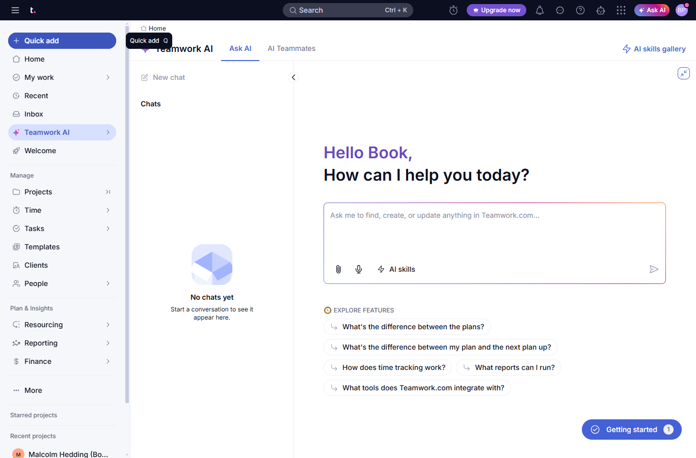
- **open: Teamwork AI**
  - URL: https://marketingcorps.eu.teamwork.com/app/ai/ask
  - Folder: `snapshots/s052__marketingcorps.eu.teamwork.com_app_ai_ask`
  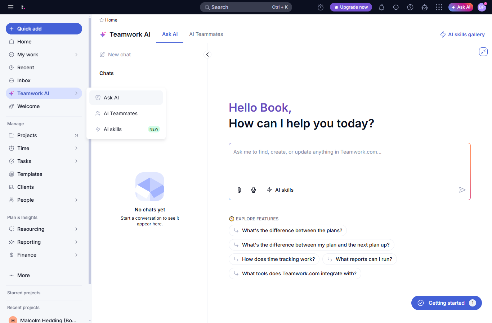
- **open: Other apps**
  - URL: https://marketingcorps.eu.teamwork.com/app/ai/ask
  - Folder: `snapshots/s053__marketingcorps.eu.teamwork.com_app_ai_ask`
  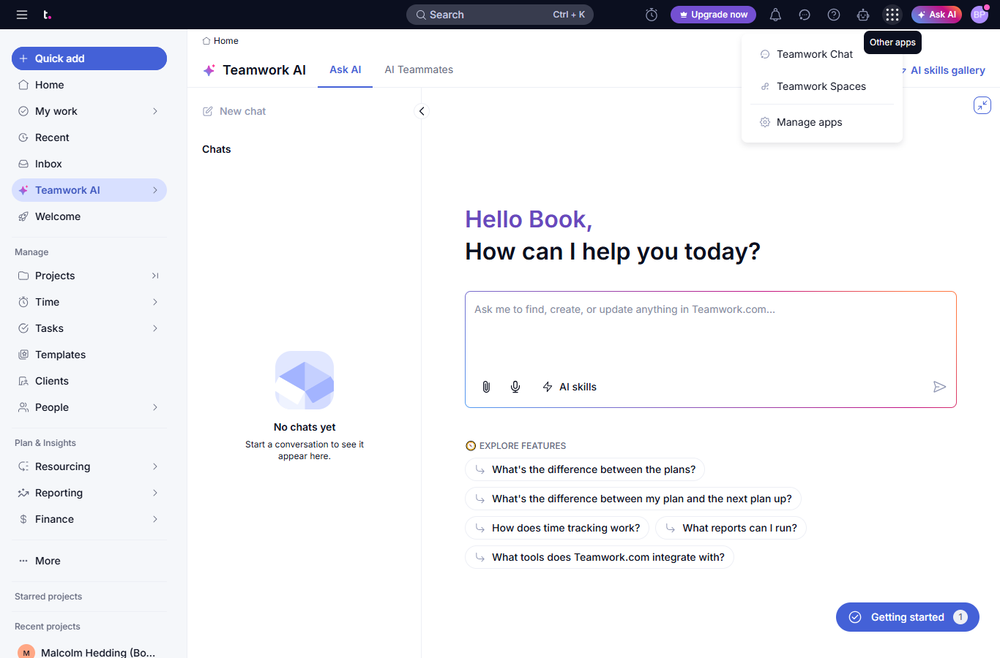
- **open: User menu**
  - URL: https://marketingcorps.eu.teamwork.com/app/ai/ask
  - Folder: `snapshots/s054__marketingcorps.eu.teamwork.com_app_ai_ask`
  
- **open: Quick add**
  - URL: https://marketingcorps.eu.teamwork.com/app/ai/ask
  - Folder: `snapshots/s055__marketingcorps.eu.teamwork.com_app_ai_ask`
  

#### Controls

- **Skip to main content** — link, anchor — https://marketingcorps.eu.teamwork.com/app/ai/ask#v-0
- **Teamwork.com home** — link, navigate — https://marketingcorps.eu.teamwork.com/app/
- **Home** — link, navigate — https://marketingcorps.eu.teamwork.com/app/home
- **My work** — link, navigate — https://marketingcorps.eu.teamwork.com/app/work/activity
- **Inbox** — link, navigate — https://marketingcorps.eu.teamwork.com/app/inbox
- **Teamwork AI** — link, open — https://marketingcorps.eu.teamwork.com/app/ai/ask
- **Welcome** — link, navigate — https://marketingcorps.eu.teamwork.com/app/welcome
- **Projects** — link, navigate — https://marketingcorps.eu.teamwork.com/app/projects
- **Time** — link, navigate — https://marketingcorps.eu.teamwork.com/app/time/approvals
- **Tasks** — link, navigate — https://marketingcorps.eu.teamwork.com/app/tasks/completedTasks
- **Clients** — link, navigate — https://marketingcorps.eu.teamwork.com/app/clients
- **People** — link, navigate — https://content.usage.teamwork.com/guide-content/rBwf_3g3whWqQ9HIMUQBZdZtDZY/1KEGUEMhTt5r4Axqtx1qmJJIb3s/aZz2qOMCNYZZ6ezG9eflt08q-IM.dom.jsonp?sha256=xJyg1dBkWpaTaOQZlHMd6y3Zp4bHGgV9ofmZxsOYETY
  - redirect: 304 https://content.usage.teamwork.com/guide-content/rBwf_3g3whWqQ9HIMUQBZdZtDZY/1KEGUEMhTt5r4Axqtx1qmJJIb3s/aZz2qOMCNYZZ6ezG9eflt08q-IM.dom.jsonp?sha256=xJyg1dBkWpaTaOQZlHMd6y3Zp4bHGgV9ofmZxsOYETY
- **Resourcing** — link, navigate — https://marketingcorps.eu.teamwork.com/app/planning/chart
- **Reporting** — link, navigate — https://marketingcorps.eu.teamwork.com/app/reports/all
- **Finance** — link, navigate — https://marketingcorps.eu.teamwork.com/app/finance/invoices/table
- **M Malcolm Hedding (Book Project)** — link, navigate — https://marketingcorps.eu.teamwork.com/app/projects/622746/tasks/list
- **C Charles Cooper** — link, navigate — https://marketingcorps.eu.teamwork.com/app/projects/622742/tasks/list
- **J Julie** — link, navigate — https://marketingcorps.eu.teamwork.com/app/projects/622744/tasks/list
- **Home** — link, navigate — https://marketingcorps.eu.teamwork.com/app/home
- **Ask AI** — link, navigate — https://marketingcorps.eu.teamwork.com/app/ai/ask
- **AI Teammates** — link, navigate — https://marketingcorps.eu.teamwork.com/app/ai/teammates
- **AI skills gallery** — link, navigate — https://marketingcorps.eu.teamwork.com/app/ai/skills/templates
- **Collapse sidebar** — button, not-opened — state budget exhausted
- **Search Ctrl + K** — button, not-opened — state budget exhausted
- **Start a new timer** — button, not-opened — state budget exhausted
- **Upgrade now** — button, not-opened — state budget exhausted
- **Notifications** — button, not-opened — state budget exhausted
- **Chat** — button, not-opened — state budget exhausted
- **Help** — button, not-opened — state budget exhausted
- **Automations** — button, not-opened — state budget exhausted
- **Other apps** — button, open
- **Ask AI** — button, not-opened — state budget exhausted
- **User menu** — button, open
- **Quick add** — button, open
- **Recent** — button, not-opened — state budget exhausted
- **Manage** — button, not-opened — state budget exhausted
- **Jump to** — button, not-opened — state budget exhausted
- **Templates** — button, not-opened — state budget exhausted
- **Plan & Insights** — button, not-opened — state budget exhausted
- **More** — button, not-opened — state budget exhausted
- **Starred projects** — button, not-opened — state budget exhausted
- **Recent projects** — button, not-opened — state budget exhausted
- **New chat** — button, skipped — disabled
- **Hide recent chats** — button, not-opened — state budget exhausted
- **Collapse to side panel** — button, not-opened — state budget exhausted
- **Attach file** — button, not-opened — state budget exhausted
- **Dictate by voice** — button, not-opened — state budget exhausted
- **AI skills** — button, not-opened — state budget exhausted
- **Send** — button, skipped — disabled
- **What's the difference between the plans?** — button, not-opened — state budget exhausted
- **What's the difference between my plan and the next plan up?** — button, not-opened — state budget exhausted
- **How does time tracking work?** — button, not-opened — state budget exhausted
- **What reports can I run?** — button, not-opened — state budget exhausted
- **What tools does Teamwork.com integrate with?** — button, not-opened — state budget exhausted
- **Getting started 1** — button, not-opened — state budget exhausted
- **My tasks** — link, navigate — https://marketingcorps.eu.teamwork.com/app/work/tasks
- **My calendar** — link, navigate — https://marketingcorps.eu.teamwork.com/app/work/calendar
- **My timesheet** — link, navigate — https://marketingcorps.eu.teamwork.com/app/work/timesheet
- **My projects** — link, navigate — https://marketingcorps.eu.teamwork.com/app/work/projects
- **Activity** — link, navigate — https://marketingcorps.eu.teamwork.com/app/work/activity
- **Ask AI** — link, navigate — https://marketingcorps.eu.teamwork.com/app/ai/ask
- **AI Teammates** — link, navigate — https://marketingcorps.eu.teamwork.com/app/ai/teammates
- **AI skills NEW** — button, recorded
- **My timesheet** — link, navigate — https://marketingcorps.eu.teamwork.com/app/time/user
- **Company timesheet** — link, navigate — https://marketingcorps.eu.teamwork.com/app/time/company
- **All time** — link, navigate — https://marketingcorps.eu.teamwork.com/app/time/all
- **Approvals** — link, navigate — https://marketingcorps.eu.teamwork.com/app/time/approvals
- **Customize** — button, recorded
- **Tasks** — link, navigate — https://marketingcorps.eu.teamwork.com/app/tasks/tasks
- **Board** — link, navigate — https://marketingcorps.eu.teamwork.com/app/tasks/board
- **Table** — link, navigate — https://marketingcorps.eu.teamwork.com/app/tasks/table
- **Completed tasks** — link, navigate — https://marketingcorps.eu.teamwork.com/app/tasks/completedTasks
- **People** — link, navigate — https://marketingcorps.eu.teamwork.com/app/people/people
- **Roles** — link, navigate — https://marketingcorps.eu.teamwork.com/app/people/roles
- **Skills NEW** — link, navigate — https://marketingcorps.eu.teamwork.com/app/people/skills
- **Teams** — link, navigate — https://marketingcorps.eu.teamwork.com/app/people/teams
- **Statuses** — link, navigate — https://marketingcorps.eu.teamwork.com/app/people/statuses
- **Overview** — link, navigate — https://marketingcorps.eu.teamwork.com/app/planning/overview
- **Schedule** — link, navigate — https://marketingcorps.eu.teamwork.com/app/planning/schedule
- **Workload** — link, navigate — https://marketingcorps.eu.teamwork.com/app/planning/workload
- **Portfolio** — link, navigate — https://marketingcorps.eu.teamwork.com/app/planning/portfolio
- **Chart** — link, navigate — https://marketingcorps.eu.teamwork.com/app/planning/chart
- **Customize** — button, recorded
- **All reports** — link, navigate — https://marketingcorps.eu.teamwork.com/app/reports/all
- **Custom Reports** — link, navigate — https://marketingcorps.eu.teamwork.com/app/reports/custom-reports
- **Scheduled reports** — link, navigate — https://marketingcorps.eu.teamwork.com/app/reports/scheduled
- **Rates** — link, navigate — https://marketingcorps.eu.teamwork.com/app/finance/rates
- **Budgets** — link, navigate — https://marketingcorps.eu.teamwork.com/app/finance/budgets
- **Invoices** — link, navigate — https://marketingcorps.eu.teamwork.com/app/finance/invoices
- **Expenses** — link, navigate — https://marketingcorps.eu.teamwork.com/app/finance/expenses
- **General tasks** — link, navigate — https://marketingcorps.eu.teamwork.com/app/tasklists/2420320
- **Teamwork Chat** — link, navigate — https://marketingcorps.eu.teamwork.com/chat
- **Teamwork Spaces** — link, navigate — https://marketingcorps.eu.teamwork.com/spaces
- **Manage apps** — button, recorded
- **Book Publishers View profile** — link, navigate — https://marketingcorps.eu.teamwork.com/app/people/555920
- **Settings** — link, navigate — https://marketingcorps.eu.teamwork.com/app/settings
- **Subscription** — link, navigate — https://marketingcorps.eu.teamwork.com/app/settings/subscription
- **My tasks** — link, navigate — https://marketingcorps.eu.teamwork.com/app/people/555920/tasks
- **My apps** — link, navigate — https://marketingcorps.eu.teamwork.com/app/people/555920/integrations
- **Apps and integrations** — link, navigate — https://marketingcorps.eu.teamwork.com/app/settings/integrations
- **Edit my details** — button, recorded
- **What's new? 2** — button, recorded
- **More** — button, recorded
- **Switch accounts** — button, recorded
- **Logout** — button, skipped — submits a form or changes data
- **Task T T** — button, recorded
- **AI task wizard** — button, recorded
- **Project P P** — button, recorded
- **Create project with AI** — button, recorded
- **Start timer S S** — button, recorded
- **Log time L L** — button, recorded
- **Budget B B** — button, recorded
- **Invite users** — button, recorded
- **Message N N** — button, recorded
- **Event E E** — button, recorded
- **Milestone M M** — button, recorded
- **Client** — button, recorded

#### Forms

- lsc-form-v-46 (GET https://marketingcorps.eu.teamwork.com/app/ai/ask)
  - Fields: file

### Teammate onboarding - marketing corps

- URL: https://marketingcorps.eu.teamwork.com/app/ai/teammates/personalAssistant/onboard
- Requested: https://marketingcorps.eu.teamwork.com/app/ai/teammates
- Status: 200
- Depth: 1

#### Outline

      - Teamwork AI is free to try until 10 November 2026
- Scout
- Hi, I'm Scout, your personal assistant.

#### States

- **default**
  - URL: https://marketingcorps.eu.teamwork.com/app/ai/teammates/personalAssistant/onboard
  - Folder: `snapshots/s056__marketingcorps.eu.teamwork.com_app_ai_teammates_personalAssistant_onboard`
  
- **open: Other apps**
  - URL: https://marketingcorps.eu.teamwork.com/app/ai/teammates/personalAssistant/onboard
  - Folder: `snapshots/s057__marketingcorps.eu.teamwork.com_app_ai_teammates_personalAssistant_onboard`
  
- **open: User menu**
  - URL: https://marketingcorps.eu.teamwork.com/app/ai/teammates/personalAssistant/onboard
  - Folder: `snapshots/s058__marketingcorps.eu.teamwork.com_app_ai_teammates_personalAssistant_onboard`
  
- **open: Quick add**
  - URL: https://marketingcorps.eu.teamwork.com/app/ai/teammates/personalAssistant/onboard
  - Folder: `snapshots/s059__marketingcorps.eu.teamwork.com_app_ai_teammates_personalAssistant_onboard`
  
- **open: Recent**
  - URL: https://marketingcorps.eu.teamwork.com/app/ai/teammates/personalAssistant/onboard
  - Folder: `snapshots/s060__marketingcorps.eu.teamwork.com_app_ai_teammates_personalAssistant_onboard`
  

#### Controls

- **Skip to main content** — link, anchor — https://marketingcorps.eu.teamwork.com/app/ai/teammates/personalAssistant/onboard#v-0
- **Teamwork.com home** — link, navigate — https://marketingcorps.eu.teamwork.com/app/
- **Home** — link, navigate — https://marketingcorps.eu.teamwork.com/app/home
- **My work** — link, navigate — https://marketingcorps.eu.teamwork.com/app/work/activity
- **Inbox** — link, navigate — https://marketingcorps.eu.teamwork.com/app/inbox
- **Teamwork AI** — link, navigate — https://marketingcorps.eu.teamwork.com/app/ai/ask
- **Welcome** — link, navigate — https://marketingcorps.eu.teamwork.com/app/welcome
- **Projects** — link, navigate — https://marketingcorps.eu.teamwork.com/app/projects
- **Time** — link, navigate — https://marketingcorps.eu.teamwork.com/app/time/approvals
- **Tasks** — link, navigate — https://marketingcorps.eu.teamwork.com/app/tasks/completedTasks
- **Clients** — link, navigate — https://marketingcorps.eu.teamwork.com/app/clients
- **People** — link, navigate — https://marketingcorps.eu.teamwork.com/app/people/people
- **Resourcing** — link, navigate — https://marketingcorps.eu.teamwork.com/app/planning/chart
- **Reporting** — link, navigate — https://content.usage.teamwork.com/guide-content/ZJ44SXiepD1VkFp_fTY-SaHr9kA/mrTimoJcogADO_PsvaIDGyS4d4I/92rS9je-59thzEozRXZYjmIlOOo.dom.jsonp?sha256=h7_zbjVGyJlxJek4nMLYVez6703BlxZQ5lLZUqBj_ww
  - redirect: 304 https://content.usage.teamwork.com/guide-content/ZJ44SXiepD1VkFp_fTY-SaHr9kA/mrTimoJcogADO_PsvaIDGyS4d4I/92rS9je-59thzEozRXZYjmIlOOo.dom.jsonp?sha256=h7_zbjVGyJlxJek4nMLYVez6703BlxZQ5lLZUqBj_ww
- **Finance** — link, navigate — https://marketingcorps.eu.teamwork.com/app/finance/invoices/table
- **M Malcolm Hedding (Book Project)** — link, navigate — https://marketingcorps.eu.teamwork.com/app/projects/622746/tasks/list
- **C Charles Cooper** — link, navigate — https://marketingcorps.eu.teamwork.com/app/projects/622742/tasks/list
- **J Julie** — link, navigate — https://marketingcorps.eu.teamwork.com/app/projects/622744/tasks/list
- **Home** — link, navigate — https://marketingcorps.eu.teamwork.com/app/home
- **AI Teammates** — link, navigate — https://marketingcorps.eu.teamwork.com/app/ai/teammates
- **Scout** — link, navigate — https://marketingcorps.eu.teamwork.com/app/ai/teammates/personalAssistant
- **Onboard** — link, navigate — https://marketingcorps.eu.teamwork.com/app/ai/teammates/personalAssistant/onboard
- **Ask AI** — link, navigate — https://marketingcorps.eu.teamwork.com/app/ai/ask
- **AI Teammates** — link, navigate — https://marketingcorps.eu.teamwork.com/app/ai/teammates
- **credits** — link, external — https://support.teamwork.com/projects/TeamworkAI/ai-features-and-credit-usage
- **Learn how credits work** — link, external — https://support.teamwork.com/projects/TeamworkAI/ai-credits-overview
- **Collapse sidebar** — button, not-opened — state budget exhausted
- **Search Ctrl + K** — button, not-opened — state budget exhausted
- **Start a new timer** — button, not-opened — state budget exhausted
- **Upgrade now** — button, not-opened — state budget exhausted
- **Notifications** — button, not-opened — state budget exhausted
- **Chat** — button, not-opened — state budget exhausted
- **Help** — button, not-opened — state budget exhausted
- **Automations** — button, not-opened — state budget exhausted
- **Other apps** — button, open
- **Ask AI** — button, not-opened — state budget exhausted
- **User menu** — button, open
- **Quick add** — button, open
- **Recent** — button, open
- **Manage** — button, not-opened — state budget exhausted
- **Jump to** — button, not-opened — state budget exhausted
- **Templates** — button, not-opened — state budget exhausted
- **Plan & Insights** — button, not-opened — state budget exhausted
- **More** — button, not-opened — state budget exhausted
- **Starred projects** — button, not-opened — state budget exhausted
- **Recent projects** — button, not-opened — state budget exhausted
- **Feedback** — button, not-opened — state budget exhausted
- **Close** — button, not-opened — state budget exhausted
- **Scout Personal assistant** — button, not-opened — state budget exhausted
- **Manage Teammates** — button, not-opened — state budget exhausted
- **Manage Teammate access** — button, not-opened — state budget exhausted
- **Getting started 1** — button, not-opened — state budget exhausted
- **My tasks** — link, navigate — https://marketingcorps.eu.teamwork.com/app/work/tasks
- **My calendar** — link, navigate — https://marketingcorps.eu.teamwork.com/app/work/calendar
- **My timesheet** — link, navigate — https://marketingcorps.eu.teamwork.com/app/work/timesheet
- **My projects** — link, navigate — https://marketingcorps.eu.teamwork.com/app/work/projects
- **Activity** — link, navigate — https://marketingcorps.eu.teamwork.com/app/work/activity
- **Ask AI** — link, navigate — https://marketingcorps.eu.teamwork.com/app/ai/ask
- **AI Teammates** — link, navigate — https://marketingcorps.eu.teamwork.com/app/ai/teammates
- **AI skills NEW** — button, recorded
- **My timesheet** — link, navigate — https://marketingcorps.eu.teamwork.com/app/time/user
- **Company timesheet** — link, navigate — https://marketingcorps.eu.teamwork.com/app/time/company
- **All time** — link, navigate — https://marketingcorps.eu.teamwork.com/app/time/all
- **Approvals** — link, navigate — https://marketingcorps.eu.teamwork.com/app/time/approvals
- **Customize** — button, recorded
- **Tasks** — link, navigate — https://marketingcorps.eu.teamwork.com/app/tasks/tasks
- **Board** — link, navigate — https://marketingcorps.eu.teamwork.com/app/tasks/board
- **Table** — link, navigate — https://marketingcorps.eu.teamwork.com/app/tasks/table
- **Completed tasks** — link, navigate — https://marketingcorps.eu.teamwork.com/app/tasks/completedTasks
- **People** — link, navigate — https://marketingcorps.eu.teamwork.com/app/people/people
- **Roles** — link, navigate — https://marketingcorps.eu.teamwork.com/app/people/roles
- **Skills NEW** — link, navigate — https://marketingcorps.eu.teamwork.com/app/people/skills
- **Teams** — link, navigate — https://marketingcorps.eu.teamwork.com/app/people/teams
- **Statuses** — link, navigate — https://marketingcorps.eu.teamwork.com/app/people/statuses
- **Overview** — link, navigate — https://marketingcorps.eu.teamwork.com/app/planning/overview
- **Schedule** — link, navigate — https://marketingcorps.eu.teamwork.com/app/planning/schedule
- **Workload** — link, navigate — https://marketingcorps.eu.teamwork.com/app/planning/workload
- **Portfolio** — link, navigate — https://marketingcorps.eu.teamwork.com/app/planning/portfolio
- **Chart** — link, navigate — https://marketingcorps.eu.teamwork.com/app/planning/chart
- **Customize** — button, recorded
- **All reports** — link, navigate — https://marketingcorps.eu.teamwork.com/app/reports/all
- **Custom Reports** — link, navigate — https://marketingcorps.eu.teamwork.com/app/reports/custom-reports
- **Scheduled reports** — link, navigate — https://marketingcorps.eu.teamwork.com/app/reports/scheduled
- **Rates** — link, navigate — https://marketingcorps.eu.teamwork.com/app/finance/rates
- **Budgets** — link, navigate — https://marketingcorps.eu.teamwork.com/app/finance/budgets
- **Invoices** — link, navigate — https://marketingcorps.eu.teamwork.com/app/finance/invoices
- **Expenses** — link, navigate — https://marketingcorps.eu.teamwork.com/app/finance/expenses
- **General tasks** — link, navigate — https://marketingcorps.eu.teamwork.com/app/tasklists/2420320
- **Teamwork Chat** — link, navigate — https://marketingcorps.eu.teamwork.com/chat
- **Teamwork Spaces** — link, navigate — https://marketingcorps.eu.teamwork.com/spaces
- **Manage apps** — button, recorded
- **Book Publishers View profile** — link, navigate — https://marketingcorps.eu.teamwork.com/app/people/555920
- **Settings** — link, navigate — https://marketingcorps.eu.teamwork.com/app/settings
- **Subscription** — link, navigate — https://marketingcorps.eu.teamwork.com/app/settings/subscription
- **My tasks** — link, navigate — https://marketingcorps.eu.teamwork.com/app/people/555920/tasks
- **My apps** — link, navigate — https://marketingcorps.eu.teamwork.com/app/people/555920/integrations
- **Apps and integrations** — link, navigate — https://marketingcorps.eu.teamwork.com/app/settings/integrations
- **Edit my details** — button, recorded
- **What's new? 2** — button, recorded
- **More** — button, recorded
- **Switch accounts** — button, recorded
- **Logout** — button, skipped — submits a form or changes data
- **Task T T** — button, recorded
- **AI task wizard** — button, recorded
- **Project P P** — button, recorded
- **Create project with AI** — button, recorded
- **Start timer S S** — button, recorded
- **Log time L L** — button, recorded
- **Budget B B** — button, recorded
- **Invite users** — button, recorded
- **Message N N** — button, recorded
- **Event E E** — button, recorded
- **Milestone M M** — button, recorded
- **Client** — button, recorded
- **J Julie marketing corps** — link, navigate — https://marketingcorps.eu.teamwork.com/app/projects/622744
- **C Charles Cooper marketing corps** — link, navigate — https://marketingcorps.eu.teamwork.com/app/projects/622742
- **M Malcolm Hedding (Book Project) marketing corps** — link, navigate — https://marketingcorps.eu.teamwork.com/app/projects/622746
- **Book Cover Malcolm Hedding (Book Project) (marketing corps)** — link, navigate — https://marketingcorps.eu.teamwork.com/app/messages/519066
- **Home** — link, navigate — https://marketingcorps.eu.teamwork.com/app/home
- **Scout** — link, navigate — https://marketingcorps.eu.teamwork.com/app/ai/teammates/personalAssistant
- **Onboard** — link, navigate — https://marketingcorps.eu.teamwork.com/app/ai/teammates/personalAssistant/onboard
- **credits** — link, external — https://support.teamwork.com/projects/TeamworkAI/ai-features-and-credit-usage
- **Learn how credits work** — link, external — https://support.teamwork.com/projects/TeamworkAI/ai-credits-overview
- **Pin this panel** — button, recorded
- **Feedback** — button, recorded
- **Close** — button, recorded
- **Scout Personal assistant** — button, recorded
- **Manage Teammates** — button, recorded
- **Manage Teammate access** — button, recorded
- **Getting started 1** — button, recorded
- **All** — tab, skipped — already selected
- **Projects** — tab, recorded
- **Tasks** — tab, recorded
- **Comments** — tab, recorded

### All completed tasks - marketing corps

- URL: https://marketingcorps.eu.teamwork.com/app/tasks/completedTasks
- Requested: https://marketingcorps.eu.teamwork.com/app/tasks/completedTasks
- Status: 200
- Depth: 1

#### Outline

- All completed tasks

#### States

- **default**
  - URL: https://marketingcorps.eu.teamwork.com/app/tasks/completedTasks
  - Folder: `snapshots/s061__marketingcorps.eu.teamwork.com_app_tasks_completedTasks`
  
- **open: Tasks**
  - URL: https://marketingcorps.eu.teamwork.com/app/tasks/completedTasks
  - Folder: `snapshots/s062__marketingcorps.eu.teamwork.com_app_tasks_completedTasks`
  
- **open: Other apps**
  - URL: https://marketingcorps.eu.teamwork.com/app/tasks/completedTasks
  - Folder: `snapshots/s063__marketingcorps.eu.teamwork.com_app_tasks_completedTasks`
  
- **open: User menu**
  - URL: https://marketingcorps.eu.teamwork.com/app/tasks/completedTasks
  - Folder: `snapshots/s064__marketingcorps.eu.teamwork.com_app_tasks_completedTasks`
  
- **open: Quick add**
  - URL: https://marketingcorps.eu.teamwork.com/app/tasks/completedTasks
  - Folder: `snapshots/s065__marketingcorps.eu.teamwork.com_app_tasks_completedTasks`
  

#### Controls

- **Skip to main content** — link, anchor — https://marketingcorps.eu.teamwork.com/app/tasks/completedTasks#v-0
- **Teamwork.com home** — link, navigate — https://marketingcorps.eu.teamwork.com/app/
- **Home** — link, navigate — https://marketingcorps.eu.teamwork.com/app/home
- **My work** — link, navigate — https://marketingcorps.eu.teamwork.com/app/work/activity
- **Inbox** — link, navigate — https://marketingcorps.eu.teamwork.com/app/inbox
- **Teamwork AI** — link, navigate — https://marketingcorps.eu.teamwork.com/app/ai/ask
- **Welcome** — link, navigate — https://marketingcorps.eu.teamwork.com/app/welcome
- **Projects** — link, navigate — https://marketingcorps.eu.teamwork.com/app/projects
- **Time** — link, navigate — https://marketingcorps.eu.teamwork.com/app/time/approvals
- **Tasks** — link, open — https://marketingcorps.eu.teamwork.com/app/tasks
- **Clients** — link, navigate — https://marketingcorps.eu.teamwork.com/app/clients
- **People** — link, navigate — https://marketingcorps.eu.teamwork.com/app/people/people
- **Resourcing** — link, navigate — https://marketingcorps.eu.teamwork.com/app/planning/chart
- **Reporting** — link, navigate — https://marketingcorps.eu.teamwork.com/app/reports/all
- **Finance** — link, navigate — https://marketingcorps.eu.teamwork.com/app/finance/invoices/table
- **M Malcolm Hedding (Book Project)** — link, navigate — https://marketingcorps.eu.teamwork.com/app/projects/622746/tasks/list
- **C Charles Cooper** — link, navigate — https://marketingcorps.eu.teamwork.com/app/projects/622742/tasks/list
- **J Julie** — link, navigate — https://marketingcorps.eu.teamwork.com/app/projects/622744/tasks/list
- **Home** — link, navigate — https://marketingcorps.eu.teamwork.com/app/home
- **Tasks** — link, navigate — https://marketingcorps.eu.teamwork.com/app/tasks
- **Completed tasks** — link, navigate — https://marketingcorps.eu.teamwork.com/app/tasks/completedTasks
- **Tasks** — link, navigate — https://marketingcorps.eu.teamwork.com/app/tasks/tasks
- **Board** — link, navigate — https://marketingcorps.eu.teamwork.com/app/tasks/board
- **Table** — link, navigate — https://marketingcorps.eu.teamwork.com/app/tasks/table
- **Completed tasks** — link, navigate — https://marketingcorps.eu.teamwork.com/app/tasks/completedTasks
- **Collapse sidebar** — button, not-opened — state budget exhausted
- **Search Ctrl + K** — button, not-opened — state budget exhausted
- **Start a new timer** — button, not-opened — state budget exhausted
- **Upgrade now** — button, not-opened — state budget exhausted
- **Notifications** — button, not-opened — state budget exhausted
- **Chat** — button, not-opened — state budget exhausted
- **Help** — button, not-opened — state budget exhausted
- **Automations** — button, not-opened — state budget exhausted
- **Other apps** — button, open
- **Ask AI** — button, not-opened — state budget exhausted
- **User menu** — button, open
- **Quick add** — button, open
- **Recent** — button, not-opened — state budget exhausted
- **Manage** — button, not-opened — state budget exhausted
- **Jump to** — button, not-opened — state budget exhausted
- **Templates** — button, not-opened — state budget exhausted
- **Plan & Insights** — button, not-opened — state budget exhausted
- **More** — button, not-opened — state budget exhausted
- **Starred projects** — button, not-opened — state budget exhausted
- **Recent projects** — button, not-opened — state budget exhausted
- **Feedback** — button, not-opened — state budget exhausted
- **Getting started 1** — button, not-opened — state budget exhausted
- **My tasks** — link, navigate — https://marketingcorps.eu.teamwork.com/app/work/tasks
- **My calendar** — link, navigate — https://marketingcorps.eu.teamwork.com/app/work/calendar
- **My timesheet** — link, navigate — https://marketingcorps.eu.teamwork.com/app/work/timesheet
- **My projects** — link, navigate — https://marketingcorps.eu.teamwork.com/app/work/projects
- **Activity** — link, navigate — https://marketingcorps.eu.teamwork.com/app/work/activity
- **My timesheet** — link, navigate — https://marketingcorps.eu.teamwork.com/app/time/user
- **Company timesheet** — link, navigate — https://marketingcorps.eu.teamwork.com/app/time/company
- **All time** — link, navigate — https://marketingcorps.eu.teamwork.com/app/time/all
- **Approvals** — link, navigate — https://marketingcorps.eu.teamwork.com/app/time/approvals
- **Customize** — button, recorded
- **Tasks** — link, navigate — https://marketingcorps.eu.teamwork.com/app/tasks/tasks
- **Board** — link, navigate — https://marketingcorps.eu.teamwork.com/app/tasks/board
- **Table** — link, navigate — https://marketingcorps.eu.teamwork.com/app/tasks/table
- **Completed tasks** — link, navigate — https://marketingcorps.eu.teamwork.com/app/tasks/completedTasks
- **People** — link, navigate — https://marketingcorps.eu.teamwork.com/app/people/people
- **Roles** — link, navigate — https://marketingcorps.eu.teamwork.com/app/people/roles
- **Skills NEW** — link, navigate — https://marketingcorps.eu.teamwork.com/app/people/skills
- **Teams** — link, navigate — https://marketingcorps.eu.teamwork.com/app/people/teams
- **Statuses** — link, navigate — https://marketingcorps.eu.teamwork.com/app/people/statuses
- **Overview** — link, navigate — https://marketingcorps.eu.teamwork.com/app/planning/overview
- **Schedule** — link, navigate — https://marketingcorps.eu.teamwork.com/app/planning/schedule
- **Workload** — link, navigate — https://marketingcorps.eu.teamwork.com/app/planning/workload
- **Portfolio** — link, navigate — https://marketingcorps.eu.teamwork.com/app/planning/portfolio
- **Chart** — link, navigate — https://marketingcorps.eu.teamwork.com/app/planning/chart
- **Customize** — button, recorded
- **All reports** — link, navigate — https://marketingcorps.eu.teamwork.com/app/reports/all
- **Custom Reports** — link, navigate — https://marketingcorps.eu.teamwork.com/app/reports/custom-reports
- **Scheduled reports** — link, navigate — https://marketingcorps.eu.teamwork.com/app/reports/scheduled
- **Rates** — link, navigate — https://marketingcorps.eu.teamwork.com/app/finance/rates
- **Budgets** — link, navigate — https://marketingcorps.eu.teamwork.com/app/finance/budgets
- **Invoices** — link, navigate — https://marketingcorps.eu.teamwork.com/app/finance/invoices
- **Expenses** — link, navigate — https://marketingcorps.eu.teamwork.com/app/finance/expenses
- **General tasks** — link, navigate — https://marketingcorps.eu.teamwork.com/app/tasklists/2420320
- **Teamwork Chat** — link, navigate — https://marketingcorps.eu.teamwork.com/chat
- **Teamwork Spaces** — link, navigate — https://marketingcorps.eu.teamwork.com/spaces
- **Manage apps** — button, recorded
- **Book Publishers View profile** — link, navigate — https://marketingcorps.eu.teamwork.com/app/people/555920
- **Settings** — link, navigate — https://marketingcorps.eu.teamwork.com/app/settings
- **Subscription** — link, navigate — https://marketingcorps.eu.teamwork.com/app/settings/subscription
- **My tasks** — link, navigate — https://marketingcorps.eu.teamwork.com/app/people/555920/tasks
- **My apps** — link, navigate — https://marketingcorps.eu.teamwork.com/app/people/555920/integrations
- **Apps and integrations** — link, navigate — https://marketingcorps.eu.teamwork.com/app/settings/integrations
- **Edit my details** — button, recorded
- **What's new? 2** — button, recorded
- **More** — button, recorded
- **Switch accounts** — button, recorded
- **Logout** — button, skipped — submits a form or changes data
- **Task T T** — button, recorded
- **AI task wizard** — button, recorded
- **Project P P** — button, recorded
- **Create project with AI** — button, recorded
- **Start timer S S** — button, recorded
- **Log time L L** — button, recorded
- **Budget B B** — button, recorded
- **Invite users** — button, recorded
- **Message N N** — button, recorded
- **Event E E** — button, recorded
- **Milestone M M** — button, recorded
- **Client** — button, recorded

### All active tasks - marketing corps

- URL: https://marketingcorps.eu.teamwork.com/app/tasks/tasks
- Requested: https://marketingcorps.eu.teamwork.com/app/tasks/tasks
- Status: 200
- Depth: 1

#### Outline

- All active tasks

#### States

- **default**
  - URL: https://marketingcorps.eu.teamwork.com/app/tasks/tasks
  - Folder: `snapshots/s066__marketingcorps.eu.teamwork.com_app_tasks_tasks`
  
- **open: Tasks**
  - URL: https://marketingcorps.eu.teamwork.com/app/tasks/tasks
  - Folder: `snapshots/s067__marketingcorps.eu.teamwork.com_app_tasks_tasks`
  
- **open: Other apps**
  - URL: https://marketingcorps.eu.teamwork.com/app/tasks/tasks
  - Folder: `snapshots/s068__marketingcorps.eu.teamwork.com_app_tasks_tasks`
  
- **open: User menu**
  - URL: https://marketingcorps.eu.teamwork.com/app/tasks/tasks
  - Folder: `snapshots/s069__marketingcorps.eu.teamwork.com_app_tasks_tasks`
  
- **open: Quick add**
  - URL: https://marketingcorps.eu.teamwork.com/app/tasks/tasks
  - Folder: `snapshots/s070__marketingcorps.eu.teamwork.com_app_tasks_tasks`
  

#### Controls

- **Skip to main content** — link, anchor — https://marketingcorps.eu.teamwork.com/app/tasks/tasks#v-0
- **Teamwork.com home** — link, navigate — https://marketingcorps.eu.teamwork.com/app/
- **Home** — link, navigate — https://marketingcorps.eu.teamwork.com/app/home
- **My work** — link, navigate — https://marketingcorps.eu.teamwork.com/app/work/activity
- **Inbox** — link, navigate — https://marketingcorps.eu.teamwork.com/app/inbox
- **Teamwork AI** — link, navigate — https://marketingcorps.eu.teamwork.com/app/ai/ask
- **Welcome** — link, navigate — https://marketingcorps.eu.teamwork.com/app/welcome
- **Projects** — link, navigate — https://marketingcorps.eu.teamwork.com/app/projects
- **Time** — link, navigate — https://marketingcorps.eu.teamwork.com/app/time/approvals
- **Tasks** — link, open — https://marketingcorps.eu.teamwork.com/app/tasks
- **Clients** — link, navigate — https://marketingcorps.eu.teamwork.com/app/clients
- **People** — link, navigate — https://marketingcorps.eu.teamwork.com/app/people/people
- **Resourcing** — link, navigate — https://marketingcorps.eu.teamwork.com/app/planning/chart
- **Reporting** — link, navigate — https://marketingcorps.eu.teamwork.com/app/reports/all
- **Finance** — link, navigate — https://marketingcorps.eu.teamwork.com/app/finance/invoices/table
- **M Malcolm Hedding (Book Project)** — link, navigate — https://marketingcorps.eu.teamwork.com/app/projects/622746/tasks/list
- **C Charles Cooper** — link, navigate — https://marketingcorps.eu.teamwork.com/app/projects/622742/tasks/list
- **J Julie** — link, navigate — https://marketingcorps.eu.teamwork.com/app/projects/622744/tasks/list
- **Home** — link, navigate — https://marketingcorps.eu.teamwork.com/app/home
- **Tasks** — link, navigate — https://marketingcorps.eu.teamwork.com/app/tasks
- **All active tasks** — link, navigate — https://marketingcorps.eu.teamwork.com/app/tasks/tasks
- **Tasks** — link, navigate — https://marketingcorps.eu.teamwork.com/app/tasks/tasks
- **Board** — link, navigate — https://marketingcorps.eu.teamwork.com/app/tasks/board
- **Table** — link, navigate — https://marketingcorps.eu.teamwork.com/app/tasks/table
- **Completed tasks** — link, navigate — https://marketingcorps.eu.teamwork.com/app/tasks/completedTasks
- **Collapse sidebar** — button, not-opened — state budget exhausted
- **Search Ctrl + K** — button, not-opened — state budget exhausted
- **Start a new timer** — button, not-opened — state budget exhausted
- **Upgrade now** — button, not-opened — state budget exhausted
- **Notifications** — button, not-opened — state budget exhausted
- **Chat** — button, not-opened — state budget exhausted
- **Help** — button, not-opened — state budget exhausted
- **Automations** — button, not-opened — state budget exhausted
- **Other apps** — button, open
- **Ask AI** — button, not-opened — state budget exhausted
- **User menu** — button, open
- **Quick add** — button, open
- **Recent** — button, not-opened — state budget exhausted
- **Manage** — button, not-opened — state budget exhausted
- **Jump to** — button, not-opened — state budget exhausted
- **Templates** — button, not-opened — state budget exhausted
- **Plan & Insights** — button, not-opened — state budget exhausted
- **More** — button, not-opened — state budget exhausted
- **Starred projects** — button, not-opened — state budget exhausted
- **Recent projects** — button, not-opened — state budget exhausted
- **Feedback** — button, not-opened — state budget exhausted
- **Getting started 1** — button, not-opened — state budget exhausted
- **My tasks** — link, navigate — https://marketingcorps.eu.teamwork.com/app/work/tasks
- **My calendar** — link, navigate — https://marketingcorps.eu.teamwork.com/app/work/calendar
- **My timesheet** — link, navigate — https://marketingcorps.eu.teamwork.com/app/work/timesheet
- **My projects** — link, navigate — https://marketingcorps.eu.teamwork.com/app/work/projects
- **Activity** — link, navigate — https://marketingcorps.eu.teamwork.com/app/work/activity
- **Ask AI** — link, navigate — https://marketingcorps.eu.teamwork.com/app/ai/ask
- **AI Teammates** — link, navigate — https://marketingcorps.eu.teamwork.com/app/ai/teammates
- **AI skills NEW** — button, recorded
- **My timesheet** — link, navigate — https://marketingcorps.eu.teamwork.com/app/time/user
- **Company timesheet** — link, navigate — https://marketingcorps.eu.teamwork.com/app/time/company
- **All time** — link, navigate — https://marketingcorps.eu.teamwork.com/app/time/all
- **Approvals** — link, navigate — https://marketingcorps.eu.teamwork.com/app/time/approvals
- **Customize** — button, recorded
- **Tasks** — link, navigate — https://marketingcorps.eu.teamwork.com/app/tasks/tasks
- **Board** — link, navigate — https://marketingcorps.eu.teamwork.com/app/tasks/board
- **Table** — link, navigate — https://marketingcorps.eu.teamwork.com/app/tasks/table
- **Completed tasks** — link, navigate — https://marketingcorps.eu.teamwork.com/app/tasks/completedTasks
- **People** — link, navigate — https://marketingcorps.eu.teamwork.com/app/people/people
- **Roles** — link, navigate — https://marketingcorps.eu.teamwork.com/app/people/roles
- **Skills NEW** — link, navigate — https://marketingcorps.eu.teamwork.com/app/people/skills
- **Teams** — link, navigate — https://marketingcorps.eu.teamwork.com/app/people/teams
- **Statuses** — link, navigate — https://marketingcorps.eu.teamwork.com/app/people/statuses
- **Overview** — link, navigate — https://marketingcorps.eu.teamwork.com/app/planning/overview
- **Schedule** — link, navigate — https://marketingcorps.eu.teamwork.com/app/planning/schedule
- **Workload** — link, navigate — https://marketingcorps.eu.teamwork.com/app/planning/workload
- **Portfolio** — link, navigate — https://marketingcorps.eu.teamwork.com/app/planning/portfolio
- **Chart** — link, navigate — https://marketingcorps.eu.teamwork.com/app/planning/chart
- **Customize** — button, recorded
- **All reports** — link, navigate — https://marketingcorps.eu.teamwork.com/app/reports/all
- **Custom Reports** — link, navigate — https://marketingcorps.eu.teamwork.com/app/reports/custom-reports
- **Scheduled reports** — link, navigate — https://marketingcorps.eu.teamwork.com/app/reports/scheduled
- **Rates** — link, navigate — https://marketingcorps.eu.teamwork.com/app/finance/rates
- **Budgets** — link, navigate — https://marketingcorps.eu.teamwork.com/app/finance/budgets
- **Invoices** — link, navigate — https://marketingcorps.eu.teamwork.com/app/finance/invoices
- **Expenses** — link, navigate — https://marketingcorps.eu.teamwork.com/app/finance/expenses
- **General tasks** — link, navigate — https://marketingcorps.eu.teamwork.com/app/tasklists/2420320
- **Teamwork Chat** — link, navigate — https://marketingcorps.eu.teamwork.com/chat
- **Teamwork Spaces** — link, navigate — https://marketingcorps.eu.teamwork.com/spaces
- **Manage apps** — button, recorded
- **Book Publishers View profile** — link, navigate — https://marketingcorps.eu.teamwork.com/app/people/555920
- **Settings** — link, navigate — https://marketingcorps.eu.teamwork.com/app/settings
- **Subscription** — link, navigate — https://marketingcorps.eu.teamwork.com/app/settings/subscription
- **My tasks** — link, navigate — https://marketingcorps.eu.teamwork.com/app/people/555920/tasks
- **My apps** — link, navigate — https://marketingcorps.eu.teamwork.com/app/people/555920/integrations
- **Apps and integrations** — link, navigate — https://marketingcorps.eu.teamwork.com/app/settings/integrations
- **Edit my details** — button, recorded
- **What's new? 2** — button, recorded
- **More** — button, recorded
- **Switch accounts** — button, recorded
- **Logout** — button, skipped — submits a form or changes data
- **Task T T** — button, recorded
- **AI task wizard** — button, recorded
- **Project P P** — button, recorded
- **Create project with AI** — button, recorded
- **Start timer S S** — button, recorded
- **Log time L L** — button, recorded
- **Budget B B** — button, recorded
- **Invite users** — button, recorded
- **Message N N** — button, recorded
- **Event E E** — button, recorded
- **Milestone M M** — button, recorded
- **Client** — button, recorded

### Board - marketing corps

- URL: https://marketingcorps.eu.teamwork.com/app/tasks/board
- Requested: https://marketingcorps.eu.teamwork.com/app/tasks/board
- Status: 200
- Depth: 1

#### Outline

- Board
  - Workflows

#### States

- **default**
  - URL: https://marketingcorps.eu.teamwork.com/app/tasks/board
  - Folder: `snapshots/s071__marketingcorps.eu.teamwork.com_app_tasks_board`
  
- **open: Tasks**
  - URL: https://marketingcorps.eu.teamwork.com/app/tasks/board
  - Folder: `snapshots/s072__marketingcorps.eu.teamwork.com_app_tasks_board`
  
- **open: Other apps**
  - URL: https://marketingcorps.eu.teamwork.com/app/tasks/board
  - Folder: `snapshots/s073__marketingcorps.eu.teamwork.com_app_tasks_board`
  
- **open: User menu**
  - URL: https://marketingcorps.eu.teamwork.com/app/tasks/board
  - Folder: `snapshots/s074__marketingcorps.eu.teamwork.com_app_tasks_board`
  
- **open: Quick add**
  - URL: https://marketingcorps.eu.teamwork.com/app/tasks/board
  - Folder: `snapshots/s075__marketingcorps.eu.teamwork.com_app_tasks_board`
  

#### Controls

- **Skip to main content** — link, anchor — https://marketingcorps.eu.teamwork.com/app/tasks/board#v-0
- **Teamwork.com home** — link, navigate — https://marketingcorps.eu.teamwork.com/app/
- **Home** — link, navigate — https://marketingcorps.eu.teamwork.com/app/home
- **My work** — link, navigate — https://marketingcorps.eu.teamwork.com/app/work/activity
- **Inbox** — link, navigate — https://marketingcorps.eu.teamwork.com/app/inbox
- **Teamwork AI** — link, navigate — https://marketingcorps.eu.teamwork.com/app/ai/ask
- **Welcome** — link, navigate — https://marketingcorps.eu.teamwork.com/app/welcome
- **Projects** — link, navigate — https://marketingcorps.eu.teamwork.com/app/projects
- **Time** — link, navigate — https://marketingcorps.eu.teamwork.com/app/time/approvals
- **Tasks** — link, open — https://marketingcorps.eu.teamwork.com/app/tasks
- **Clients** — link, navigate — https://marketingcorps.eu.teamwork.com/app/clients
- **People** — link, navigate — https://marketingcorps.eu.teamwork.com/app/people/people
- **Resourcing** — link, navigate — https://content.usage.teamwork.com/guide-content/wIXAw4O7lOconeIPNHqsAOLQ8-o/XhA5jSqD6g4ORZn3aIdc2XFJVtU/omnk5pxfoL0vspDUc6CYH9x7rk4.dom.jsonp?sha256=g5oI4zgX3qr3e0pNWzgiMU66foO0SvqoB7Cj3ySx9Yk
  - redirect: 304 https://content.usage.teamwork.com/guide-content/wIXAw4O7lOconeIPNHqsAOLQ8-o/XhA5jSqD6g4ORZn3aIdc2XFJVtU/omnk5pxfoL0vspDUc6CYH9x7rk4.dom.jsonp?sha256=g5oI4zgX3qr3e0pNWzgiMU66foO0SvqoB7Cj3ySx9Yk
- **Reporting** — link, navigate — https://marketingcorps.eu.teamwork.com/app/reports/all
- **Finance** — link, navigate — https://marketingcorps.eu.teamwork.com/app/finance/invoices/table
- **M Malcolm Hedding (Book Project)** — link, navigate — https://marketingcorps.eu.teamwork.com/app/projects/622746/tasks/list
- **C Charles Cooper** — link, navigate — https://marketingcorps.eu.teamwork.com/app/projects/622742/tasks/list
- **J Julie** — link, navigate — https://marketingcorps.eu.teamwork.com/app/projects/622744/tasks/list
- **Home** — link, navigate — https://marketingcorps.eu.teamwork.com/app/home
- **Tasks** — link, navigate — https://marketingcorps.eu.teamwork.com/app/tasks
- **Board** — link, navigate — https://marketingcorps.eu.teamwork.com/app/tasks/board
- **Tasks** — link, navigate — https://marketingcorps.eu.teamwork.com/app/tasks/tasks
- **Board** — link, navigate — https://marketingcorps.eu.teamwork.com/app/tasks/board
- **Table** — link, navigate — https://marketingcorps.eu.teamwork.com/app/tasks/table
- **Completed tasks** — link, navigate — https://marketingcorps.eu.teamwork.com/app/tasks/completedTasks
- **Collapse sidebar** — button, not-opened — state budget exhausted
- **Search Ctrl + K** — button, not-opened — state budget exhausted
- **Start a new timer** — button, not-opened — state budget exhausted
- **Upgrade now** — button, not-opened — state budget exhausted
- **Notifications** — button, not-opened — state budget exhausted
- **Chat** — button, not-opened — state budget exhausted
- **Help** — button, not-opened — state budget exhausted
- **Automations** — button, not-opened — state budget exhausted
- **Other apps** — button, open
- **Ask AI** — button, not-opened — state budget exhausted
- **User menu** — button, open
- **Quick add** — button, open
- **Recent** — button, not-opened — state budget exhausted
- **Manage** — button, not-opened — state budget exhausted
- **Jump to** — button, not-opened — state budget exhausted
- **Templates** — button, not-opened — state budget exhausted
- **Plan & Insights** — button, not-opened — state budget exhausted
- **More** — button, not-opened — state budget exhausted
- **Starred projects** — button, not-opened — state budget exhausted
- **Recent projects** — button, not-opened — state budget exhausted
- **Feedback** — button, not-opened — state budget exhausted
- **Add workflow** — button, not-opened — state budget exhausted
- **Watch demo** — button, not-opened — state budget exhausted
- **Getting started 1** — button, not-opened — state budget exhausted
- **My tasks** — link, navigate — https://marketingcorps.eu.teamwork.com/app/work/tasks
- **My calendar** — link, navigate — https://marketingcorps.eu.teamwork.com/app/work/calendar
- **My timesheet** — link, navigate — https://marketingcorps.eu.teamwork.com/app/work/timesheet
- **My projects** — link, navigate — https://marketingcorps.eu.teamwork.com/app/work/projects
- **Activity** — link, navigate — https://marketingcorps.eu.teamwork.com/app/work/activity
- **Ask AI** — link, navigate — https://marketingcorps.eu.teamwork.com/app/ai/ask
- **AI Teammates** — link, navigate — https://marketingcorps.eu.teamwork.com/app/ai/teammates
- **AI skills NEW** — button, recorded
- **My timesheet** — link, navigate — https://marketingcorps.eu.teamwork.com/app/time/user
- **Company timesheet** — link, navigate — https://marketingcorps.eu.teamwork.com/app/time/company
- **All time** — link, navigate — https://marketingcorps.eu.teamwork.com/app/time/all
- **Approvals** — link, navigate — https://marketingcorps.eu.teamwork.com/app/time/approvals
- **Customize** — button, recorded
- **Tasks** — link, navigate — https://marketingcorps.eu.teamwork.com/app/tasks/tasks
- **Board** — link, navigate — https://marketingcorps.eu.teamwork.com/app/tasks/board
- **Table** — link, navigate — https://marketingcorps.eu.teamwork.com/app/tasks/table
- **Completed tasks** — link, navigate — https://marketingcorps.eu.teamwork.com/app/tasks/completedTasks
- **People** — link, navigate — https://marketingcorps.eu.teamwork.com/app/people/people
- **Roles** — link, navigate — https://marketingcorps.eu.teamwork.com/app/people/roles
- **Skills NEW** — link, navigate — https://marketingcorps.eu.teamwork.com/app/people/skills
- **Teams** — link, navigate — https://marketingcorps.eu.teamwork.com/app/people/teams
- **Statuses** — link, navigate — https://marketingcorps.eu.teamwork.com/app/people/statuses
- **Overview** — link, navigate — https://marketingcorps.eu.teamwork.com/app/planning/overview
- **Schedule** — link, navigate — https://marketingcorps.eu.teamwork.com/app/planning/schedule
- **Workload** — link, navigate — https://marketingcorps.eu.teamwork.com/app/planning/workload
- **Portfolio** — link, navigate — https://marketingcorps.eu.teamwork.com/app/planning/portfolio
- **Chart** — link, navigate — https://marketingcorps.eu.teamwork.com/app/planning/chart
- **Customize** — button, recorded
- **All reports** — link, navigate — https://marketingcorps.eu.teamwork.com/app/reports/all
- **Custom Reports** — link, navigate — https://marketingcorps.eu.teamwork.com/app/reports/custom-reports
- **Scheduled reports** — link, navigate — https://marketingcorps.eu.teamwork.com/app/reports/scheduled
- **Rates** — link, navigate — https://marketingcorps.eu.teamwork.com/app/finance/rates
- **Budgets** — link, navigate — https://marketingcorps.eu.teamwork.com/app/finance/budgets
- **Invoices** — link, navigate — https://marketingcorps.eu.teamwork.com/app/finance/invoices
- **Expenses** — link, navigate — https://marketingcorps.eu.teamwork.com/app/finance/expenses
- **General tasks** — link, navigate — https://marketingcorps.eu.teamwork.com/app/tasklists/2420320
- **Teamwork Chat** — link, navigate — https://marketingcorps.eu.teamwork.com/chat
- **Teamwork Spaces** — link, navigate — https://marketingcorps.eu.teamwork.com/spaces
- **Manage apps** — button, recorded
- **Book Publishers View profile** — link, navigate — https://marketingcorps.eu.teamwork.com/app/people/555920
- **Settings** — link, navigate — https://marketingcorps.eu.teamwork.com/app/settings
- **Subscription** — link, navigate — https://marketingcorps.eu.teamwork.com/app/settings/subscription
- **My tasks** — link, navigate — https://marketingcorps.eu.teamwork.com/app/people/555920/tasks
- **My apps** — link, navigate — https://marketingcorps.eu.teamwork.com/app/people/555920/integrations
- **Apps and integrations** — link, navigate — https://marketingcorps.eu.teamwork.com/app/settings/integrations
- **Edit my details** — button, recorded
- **What's new? 2** — button, recorded
- **More** — button, recorded
- **Switch accounts** — button, recorded
- **Logout** — button, skipped — submits a form or changes data
- **Task T T** — button, recorded
- **AI task wizard** — button, recorded
- **Project P P** — button, recorded
- **Create project with AI** — button, recorded
- **Start timer S S** — button, recorded
- **Log time L L** — button, recorded
- **Budget B B** — button, recorded
- **Invite users** — button, recorded
- **Message N N** — button, recorded
- **Event E E** — button, recorded
- **Milestone M M** — button, recorded
- **Client** — button, recorded

### Table - marketing corps

- URL: https://marketingcorps.eu.teamwork.com/app/tasks/table
- Requested: https://marketingcorps.eu.teamwork.com/app/tasks/table
- Status: 200
- Depth: 1

#### Outline

- Table
      - No tasks

#### States

- **default**
  - URL: https://marketingcorps.eu.teamwork.com/app/tasks/table
  - Folder: `snapshots/s076__marketingcorps.eu.teamwork.com_app_tasks_table`
  
- **open: Tasks**
  - URL: https://marketingcorps.eu.teamwork.com/app/tasks/table
  - Folder: `snapshots/s077__marketingcorps.eu.teamwork.com_app_tasks_table`
  
- **open: Other apps**
  - URL: https://marketingcorps.eu.teamwork.com/app/tasks/table
  - Folder: `snapshots/s078__marketingcorps.eu.teamwork.com_app_tasks_table`
  
- **open: User menu**
  - URL: https://marketingcorps.eu.teamwork.com/app/tasks/table
  - Folder: `snapshots/s079__marketingcorps.eu.teamwork.com_app_tasks_table`
  
- **open: Quick add**
  - URL: https://marketingcorps.eu.teamwork.com/app/tasks/table
  - Folder: `snapshots/s080__marketingcorps.eu.teamwork.com_app_tasks_table`
  

#### Controls

- **Skip to main content** — link, anchor — https://marketingcorps.eu.teamwork.com/app/tasks/table#v-0
- **Teamwork.com home** — link, navigate — https://marketingcorps.eu.teamwork.com/app/
- **Home** — link, navigate — https://marketingcorps.eu.teamwork.com/app/home
- **My work** — link, navigate — https://marketingcorps.eu.teamwork.com/app/work/activity
- **Inbox** — link, navigate — https://marketingcorps.eu.teamwork.com/app/inbox
- **Teamwork AI** — link, navigate — https://marketingcorps.eu.teamwork.com/app/ai/ask
- **Welcome** — link, navigate — https://marketingcorps.eu.teamwork.com/app/welcome
- **Projects** — link, navigate — https://marketingcorps.eu.teamwork.com/app/projects
- **Time** — link, navigate — https://marketingcorps.eu.teamwork.com/app/time/approvals
- **Tasks** — link, open — https://marketingcorps.eu.teamwork.com/app/tasks
- **Clients** — link, navigate — https://marketingcorps.eu.teamwork.com/app/clients
- **People** — link, navigate — https://content.usage.teamwork.com/guide-content/dXiF0bUJ4MjQfGlHWkGnql887So/EDqQxeIEa07okQ9DsLvM6h69ccs/7t3s_1RqN2FYv5j5ANhiR4v3hSg.dom.jsonp?sha256=fac5qT7nSpSjVs9_j9wDT3BxHFeV8cBZN12cRKNBSl4
  - redirect: 304 https://content.usage.teamwork.com/guide-content/dXiF0bUJ4MjQfGlHWkGnql887So/EDqQxeIEa07okQ9DsLvM6h69ccs/7t3s_1RqN2FYv5j5ANhiR4v3hSg.dom.jsonp?sha256=fac5qT7nSpSjVs9_j9wDT3BxHFeV8cBZN12cRKNBSl4
- **Resourcing** — link, navigate — https://marketingcorps.eu.teamwork.com/app/planning/chart
- **Reporting** — link, navigate — https://marketingcorps.eu.teamwork.com/app/reports/all
- **Finance** — link, navigate — https://marketingcorps.eu.teamwork.com/app/finance/invoices/table
- **M Malcolm Hedding (Book Project)** — link, navigate — https://marketingcorps.eu.teamwork.com/app/projects/622746/tasks/list
- **C Charles Cooper** — link, navigate — https://marketingcorps.eu.teamwork.com/app/projects/622742/tasks/list
- **J Julie** — link, navigate — https://marketingcorps.eu.teamwork.com/app/projects/622744/tasks/list
- **Home** — link, navigate — https://marketingcorps.eu.teamwork.com/app/home
- **Tasks** — link, navigate — https://marketingcorps.eu.teamwork.com/app/tasks
- **Table** — link, navigate — https://marketingcorps.eu.teamwork.com/app/tasks/table
- **Tasks** — link, navigate — https://marketingcorps.eu.teamwork.com/app/tasks/tasks
- **Board** — link, navigate — https://marketingcorps.eu.teamwork.com/app/tasks/board
- **Table** — link, navigate — https://marketingcorps.eu.teamwork.com/app/tasks/table
- **Completed tasks** — link, navigate — https://marketingcorps.eu.teamwork.com/app/tasks/completedTasks
- **Collapse sidebar** — button, not-opened — state budget exhausted
- **Search Ctrl + K** — button, not-opened — state budget exhausted
- **Start a new timer** — button, not-opened — state budget exhausted
- **Upgrade now** — button, not-opened — state budget exhausted
- **Notifications** — button, not-opened — state budget exhausted
- **Chat** — button, not-opened — state budget exhausted
- **Help** — button, not-opened — state budget exhausted
- **Automations** — button, not-opened — state budget exhausted
- **Other apps** — button, open
- **Ask AI** — button, not-opened — state budget exhausted
- **User menu** — button, open
- **Quick add** — button, open
- **Recent** — button, not-opened — state budget exhausted
- **Manage** — button, not-opened — state budget exhausted
- **Jump to** — button, not-opened — state budget exhausted
- **Templates** — button, not-opened — state budget exhausted
- **Plan & Insights** — button, not-opened — state budget exhausted
- **More** — button, not-opened — state budget exhausted
- **Starred projects** — button, not-opened — state budget exhausted
- **Recent projects** — button, not-opened — state budget exhausted
- **Feedback** — button, not-opened — state budget exhausted
- **Filter** — button, not-opened — state budget exhausted
- **Only show tasks assigned to me** — button, not-opened — state budget exhausted
- **Show tasks assigned to everyone** — button, not-opened — state budget exhausted
- **Group** — button, not-opened — state budget exhausted
- **Add task** — button, not-opened — state budget exhausted
- **More options** — button, not-opened — state budget exhausted
- **Options** — button, not-opened — state budget exhausted
- **Getting started 1** — button, not-opened — state budget exhausted
- **Filter** — menu, not-opened — state budget exhausted
- **My tasks** — link, navigate — https://marketingcorps.eu.teamwork.com/app/work/tasks
- **My calendar** — link, navigate — https://marketingcorps.eu.teamwork.com/app/work/calendar
- **My timesheet** — link, navigate — https://marketingcorps.eu.teamwork.com/app/work/timesheet
- **My projects** — link, navigate — https://marketingcorps.eu.teamwork.com/app/work/projects
- **Activity** — link, navigate — https://marketingcorps.eu.teamwork.com/app/work/activity
- **Home** — link, navigate — https://marketingcorps.eu.teamwork.com/app/home
- **Tasks** — link, navigate — https://marketingcorps.eu.teamwork.com/app/tasks
- **Table** — link, navigate — https://marketingcorps.eu.teamwork.com/app/tasks/table
- **Tasks** — link, navigate — https://marketingcorps.eu.teamwork.com/app/tasks/tasks
- **Board** — link, navigate — https://marketingcorps.eu.teamwork.com/app/tasks/board
- **Completed tasks** — link, navigate — https://marketingcorps.eu.teamwork.com/app/tasks/completedTasks
- **Ask AI** — link, navigate — https://marketingcorps.eu.teamwork.com/app/ai/ask
- **AI Teammates** — link, navigate — https://marketingcorps.eu.teamwork.com/app/ai/teammates
- **AI skills NEW** — button, recorded
- **Filter** — menu, recorded
- **My timesheet** — link, navigate — https://marketingcorps.eu.teamwork.com/app/time/user
- **Company timesheet** — link, navigate — https://marketingcorps.eu.teamwork.com/app/time/company
- **All time** — link, navigate — https://marketingcorps.eu.teamwork.com/app/time/all
- **Approvals** — link, navigate — https://marketingcorps.eu.teamwork.com/app/time/approvals
- **Customize** — button, recorded
- **Tasks** — link, navigate — https://marketingcorps.eu.teamwork.com/app/tasks/tasks
- **Board** — link, navigate — https://marketingcorps.eu.teamwork.com/app/tasks/board
- **Table** — link, navigate — https://marketingcorps.eu.teamwork.com/app/tasks/table
- **Completed tasks** — link, navigate — https://marketingcorps.eu.teamwork.com/app/tasks/completedTasks
- **People** — link, navigate — https://marketingcorps.eu.teamwork.com/app/people/people
- **Roles** — link, navigate — https://marketingcorps.eu.teamwork.com/app/people/roles
- **Skills NEW** — link, navigate — https://marketingcorps.eu.teamwork.com/app/people/skills
- **Teams** — link, navigate — https://marketingcorps.eu.teamwork.com/app/people/teams
- **Statuses** — link, navigate — https://marketingcorps.eu.teamwork.com/app/people/statuses
- **Overview** — link, navigate — https://marketingcorps.eu.teamwork.com/app/planning/overview
- **Schedule** — link, navigate — https://marketingcorps.eu.teamwork.com/app/planning/schedule
- **Workload** — link, navigate — https://marketingcorps.eu.teamwork.com/app/planning/workload
- **Portfolio** — link, navigate — https://marketingcorps.eu.teamwork.com/app/planning/portfolio
- **Chart** — link, navigate — https://marketingcorps.eu.teamwork.com/app/planning/chart
- **Customize** — button, recorded
- **All reports** — link, navigate — https://marketingcorps.eu.teamwork.com/app/reports/all
- **Custom Reports** — link, navigate — https://marketingcorps.eu.teamwork.com/app/reports/custom-reports
- **Scheduled reports** — link, navigate — https://marketingcorps.eu.teamwork.com/app/reports/scheduled
- **Rates** — link, navigate — https://marketingcorps.eu.teamwork.com/app/finance/rates
- **Budgets** — link, navigate — https://marketingcorps.eu.teamwork.com/app/finance/budgets
- **Invoices** — link, navigate — https://marketingcorps.eu.teamwork.com/app/finance/invoices
- **Expenses** — link, navigate — https://marketingcorps.eu.teamwork.com/app/finance/expenses
- **General tasks** — link, navigate — https://marketingcorps.eu.teamwork.com/app/tasklists/2420320
- **Teamwork Chat** — link, navigate — https://marketingcorps.eu.teamwork.com/chat
- **Teamwork Spaces** — link, navigate — https://marketingcorps.eu.teamwork.com/spaces
- **Manage apps** — button, recorded
- **Book Publishers View profile** — link, navigate — https://marketingcorps.eu.teamwork.com/app/people/555920
- **Settings** — link, navigate — https://marketingcorps.eu.teamwork.com/app/settings
- **Subscription** — link, navigate — https://marketingcorps.eu.teamwork.com/app/settings/subscription
- **My tasks** — link, navigate — https://marketingcorps.eu.teamwork.com/app/people/555920/tasks
- **My apps** — link, navigate — https://marketingcorps.eu.teamwork.com/app/people/555920/integrations
- **Apps and integrations** — link, navigate — https://marketingcorps.eu.teamwork.com/app/settings/integrations
- **Edit my details** — button, recorded
- **What's new? 2** — button, recorded
- **More** — button, recorded
- **Switch accounts** — button, recorded
- **Logout** — button, skipped — submits a form or changes data
- **Task T T** — button, recorded
- **AI task wizard** — button, recorded
- **Project P P** — button, recorded
- **Create project with AI** — button, recorded
- **Start timer S S** — button, recorded
- **Log time L L** — button, recorded
- **Budget B B** — button, recorded
- **Invite users** — button, recorded
- **Message N N** — button, recorded
- **Event E E** — button, recorded
- **Milestone M M** — button, recorded
- **Client** — button, recorded

### All - Reporting - marketing corps

- URL: https://marketingcorps.eu.teamwork.com/app/reports/all
- Requested: https://marketingcorps.eu.teamwork.com/app/reports/all
- Status: 200
- Depth: 1

#### Outline

- All - Reporting
  - Custom Reports

#### States

- **default**
  - URL: https://marketingcorps.eu.teamwork.com/app/reports/all
  - Folder: `snapshots/s081__marketingcorps.eu.teamwork.com_app_reports_all`
  
- **open: Reporting**
  - URL: https://marketingcorps.eu.teamwork.com/app/reports/all
  - Folder: `snapshots/s082__marketingcorps.eu.teamwork.com_app_reports_all`
  
- **open: Other apps**
  - URL: https://marketingcorps.eu.teamwork.com/app/reports/all
  - Folder: `snapshots/s083__marketingcorps.eu.teamwork.com_app_reports_all`
  
- **open: User menu**
  - URL: https://marketingcorps.eu.teamwork.com/app/reports/all
  - Folder: `snapshots/s084__marketingcorps.eu.teamwork.com_app_reports_all`
  
- **open: Quick add**
  - URL: https://marketingcorps.eu.teamwork.com/app/reports/all
  - Folder: `snapshots/s085__marketingcorps.eu.teamwork.com_app_reports_all`
  

#### Controls

- **Skip to main content** — link, anchor — https://marketingcorps.eu.teamwork.com/app/reports/all#v-0
- **Teamwork.com home** — link, navigate — https://marketingcorps.eu.teamwork.com/app/
- **Home** — link, navigate — https://marketingcorps.eu.teamwork.com/app/home
- **My work** — link, navigate — https://marketingcorps.eu.teamwork.com/app/work/activity
- **Inbox** — link, navigate — https://marketingcorps.eu.teamwork.com/app/inbox
- **Teamwork AI** — link, navigate — https://marketingcorps.eu.teamwork.com/app/ai/ask
- **Welcome** — link, navigate — https://marketingcorps.eu.teamwork.com/app/welcome
- **Projects** — link, navigate — https://marketingcorps.eu.teamwork.com/app/projects
- **Time** — link, navigate — https://marketingcorps.eu.teamwork.com/app/time/approvals
- **Tasks** — link, navigate — https://marketingcorps.eu.teamwork.com/app/tasks/table
- **Clients** — link, navigate — https://marketingcorps.eu.teamwork.com/app/clients
- **People** — link, navigate — https://marketingcorps.eu.teamwork.com/app/people/people
- **Resourcing** — link, navigate — https://marketingcorps.eu.teamwork.com/app/planning/chart
- **Reporting** — link, open — https://marketingcorps.eu.teamwork.com/app/reports/all
- **Finance** — link, navigate — https://marketingcorps.eu.teamwork.com/app/finance/invoices/table
- **M Malcolm Hedding (Book Project)** — link, navigate — https://marketingcorps.eu.teamwork.com/app/projects/622746/tasks/list
- **C Charles Cooper** — link, navigate — https://marketingcorps.eu.teamwork.com/app/projects/622742/tasks/list
- **J Julie** — link, navigate — https://marketingcorps.eu.teamwork.com/app/projects/622744/tasks/list
- **Home** — link, navigate — https://marketingcorps.eu.teamwork.com/app/home
- **Reporting** — link, navigate — https://marketingcorps.eu.teamwork.com/app/reports/all
- **All reports** — link, navigate — https://marketingcorps.eu.teamwork.com/app/reports/all
- **Custom Reports** — link, navigate — https://marketingcorps.eu.teamwork.com/app/reports/custom-reports
- **Scheduled reports** — link, navigate — https://marketingcorps.eu.teamwork.com/app/reports/scheduled
- **Project health See status, due dates, and clients for every project - so you can spot at-risk work early. Projects Risk** — link, navigate — https://marketingcorps.eu.teamwork.com/app/reports/health
- **Utilization See available, logged, and estimated time for every person - so you can balance team capacity. Capacity Targets** — link, navigate — https://marketingcorps.eu.teamwork.com/app/reports/utilization
- **Time See logged time across users, tasks, projects, and companies - so you can bill accurately. Logged time Billability** — link, navigate — https://marketingcorps.eu.teamwork.com/app/reports/time
- **Planned vs Actual Compare planned vs actual delivery across projects and tasks - so you can catch slippage early. Delivery Milestones** — link, navigate — https://marketingcorps.eu.teamwork.com/app/reports/plannedvsactual/
- **Invoice status Track paid and outstanding invoices across every project - so you can keep cash flow healthy. Billing Clients** — link, navigate — https://marketingcorps.eu.teamwork.com/app/reports/invoices
- **Budget insights Track every project budget in real time - total, used, and remaining - so you catch overruns early. Budget burn Profit** — link, navigate — https://marketingcorps.eu.teamwork.com/app/reports/budget-insights
- **Collapse sidebar** — button, not-opened — state budget exhausted
- **Search Ctrl + K** — button, not-opened — state budget exhausted
- **Start a new timer** — button, not-opened — state budget exhausted
- **Upgrade now** — button, not-opened — state budget exhausted
- **Notifications** — button, not-opened — state budget exhausted
- **Chat** — button, not-opened — state budget exhausted
- **Help** — button, not-opened — state budget exhausted
- **Automations** — button, not-opened — state budget exhausted
- **Other apps** — button, open
- **Ask AI** — button, not-opened — state budget exhausted
- **User menu** — button, open
- **Quick add** — button, open
- **Recent** — button, not-opened — state budget exhausted
- **Manage** — button, not-opened — state budget exhausted
- **Jump to** — button, not-opened — state budget exhausted
- **Templates** — button, not-opened — state budget exhausted
- **Plan & Insights** — button, not-opened — state budget exhausted
- **More** — button, not-opened — state budget exhausted
- **Starred projects** — button, not-opened — state budget exhausted
- **Recent projects** — button, not-opened — state budget exhausted
- **Feedback** — button, not-opened — state budget exhausted
- **Sort** — button, not-opened — state budget exhausted
- **Grid** — button, not-opened — state budget exhausted
- **Ask AI** — button, not-opened — state budget exhausted
- **Request a demo** — button, not-opened — state budget exhausted
- **Getting started 1** — button, not-opened — state budget exhausted
- **All** — tab, not-opened — state budget exhausted
- **Starred** — tab, not-opened — state budget exhausted
- **Recommended** — tab, skipped — already selected
- **Financials** — tab, not-opened — state budget exhausted
- **Time & Utilization** — tab, not-opened — state budget exhausted
- **Tasks** — tab, not-opened — state budget exhausted
- **My tasks** — link, navigate — https://marketingcorps.eu.teamwork.com/app/work/tasks
- **My calendar** — link, navigate — https://marketingcorps.eu.teamwork.com/app/work/calendar
- **My timesheet** — link, navigate — https://marketingcorps.eu.teamwork.com/app/work/timesheet
- **My projects** — link, navigate — https://marketingcorps.eu.teamwork.com/app/work/projects
- **Activity** — link, navigate — https://marketingcorps.eu.teamwork.com/app/work/activity
- **Ask AI** — link, navigate — https://marketingcorps.eu.teamwork.com/app/ai/ask
- **AI Teammates** — link, navigate — https://marketingcorps.eu.teamwork.com/app/ai/teammates
- **AI skills NEW** — button, recorded
- **My timesheet** — link, navigate — https://marketingcorps.eu.teamwork.com/app/time/user
- **Company timesheet** — link, navigate — https://marketingcorps.eu.teamwork.com/app/time/company
- **All time** — link, navigate — https://marketingcorps.eu.teamwork.com/app/time/all
- **Approvals** — link, navigate — https://marketingcorps.eu.teamwork.com/app/time/approvals
- **Customize** — button, recorded
- **Tasks** — link, navigate — https://marketingcorps.eu.teamwork.com/app/tasks/tasks
- **Board** — link, navigate — https://marketingcorps.eu.teamwork.com/app/tasks/board
- **Table** — link, navigate — https://marketingcorps.eu.teamwork.com/app/tasks/table
- **Completed tasks** — link, navigate — https://marketingcorps.eu.teamwork.com/app/tasks/completedTasks
- **People** — link, navigate — https://marketingcorps.eu.teamwork.com/app/people/people
- **Roles** — link, navigate — https://marketingcorps.eu.teamwork.com/app/people/roles
- **Skills NEW** — link, navigate — https://marketingcorps.eu.teamwork.com/app/people/skills
- **Teams** — link, navigate — https://marketingcorps.eu.teamwork.com/app/people/teams
- **Statuses** — link, navigate — https://marketingcorps.eu.teamwork.com/app/people/statuses
- **Overview** — link, navigate — https://marketingcorps.eu.teamwork.com/app/planning/overview
- **Schedule** — link, navigate — https://marketingcorps.eu.teamwork.com/app/planning/schedule
- **Workload** — link, navigate — https://marketingcorps.eu.teamwork.com/app/planning/workload
- **Portfolio** — link, navigate — https://marketingcorps.eu.teamwork.com/app/planning/portfolio
- **Chart** — link, navigate — https://marketingcorps.eu.teamwork.com/app/planning/chart
- **Customize** — button, recorded
- **All reports** — link, navigate — https://marketingcorps.eu.teamwork.com/app/reports/all
- **Custom Reports** — link, navigate — https://marketingcorps.eu.teamwork.com/app/reports/custom-reports
- **Scheduled reports** — link, navigate — https://marketingcorps.eu.teamwork.com/app/reports/scheduled
- **Rates** — link, navigate — https://marketingcorps.eu.teamwork.com/app/finance/rates
- **Budgets** — link, navigate — https://marketingcorps.eu.teamwork.com/app/finance/budgets
- **Invoices** — link, navigate — https://marketingcorps.eu.teamwork.com/app/finance/invoices
- **Expenses** — link, navigate — https://marketingcorps.eu.teamwork.com/app/finance/expenses
- **General tasks** — link, navigate — https://marketingcorps.eu.teamwork.com/app/tasklists/2420320
- **Teamwork Chat** — link, navigate — https://marketingcorps.eu.teamwork.com/chat
- **Teamwork Spaces** — link, navigate — https://marketingcorps.eu.teamwork.com/spaces
- **Manage apps** — button, recorded
- **Book Publishers View profile** — link, navigate — https://marketingcorps.eu.teamwork.com/app/people/555920
- **Settings** — link, navigate — https://marketingcorps.eu.teamwork.com/app/settings
- **Subscription** — link, navigate — https://marketingcorps.eu.teamwork.com/app/settings/subscription
- **My tasks** — link, navigate — https://marketingcorps.eu.teamwork.com/app/people/555920/tasks
- **My apps** — link, navigate — https://marketingcorps.eu.teamwork.com/app/people/555920/integrations
- **Apps and integrations** — link, navigate — https://marketingcorps.eu.teamwork.com/app/settings/integrations
- **Edit my details** — button, recorded
- **What's new? 2** — button, recorded
- **More** — button, recorded
- **Switch accounts** — button, recorded
- **Logout** — button, skipped — submits a form or changes data
- **Task T T** — button, recorded
- **AI task wizard** — button, recorded
- **Project P P** — button, recorded
- **Create project with AI** — button, recorded
- **Start timer S S** — button, recorded
- **Log time L L** — button, recorded
- **Budget B B** — button, recorded
- **Invite users** — button, recorded
- **Message N N** — button, recorded
- **Event E E** — button, recorded
- **Milestone M M** — button, recorded
- **Client** — button, recorded

### Custom Reports - Reporting - marketing corps

- URL: https://marketingcorps.eu.teamwork.com/app/reports/custom-reports
- Requested: https://marketingcorps.eu.teamwork.com/app/reports/custom-reports
- Status: 200
- Depth: 1

#### Outline

- Custom Reports - Reporting
  - Custom Reports

#### States

- **default**
  - URL: https://marketingcorps.eu.teamwork.com/app/reports/custom-reports
  - Folder: `snapshots/s086__marketingcorps.eu.teamwork.com_app_reports_custom-reports`
  
- **open: Other apps**
  - URL: https://marketingcorps.eu.teamwork.com/app/reports/custom-reports
  - Folder: `snapshots/s087__marketingcorps.eu.teamwork.com_app_reports_custom-reports`
  
- **open: User menu**
  - URL: https://marketingcorps.eu.teamwork.com/app/reports/custom-reports
  - Folder: `snapshots/s088__marketingcorps.eu.teamwork.com_app_reports_custom-reports`
  
- **open: Quick add**
  - URL: https://marketingcorps.eu.teamwork.com/app/reports/custom-reports
  - Folder: `snapshots/s089__marketingcorps.eu.teamwork.com_app_reports_custom-reports`
  
- **open: Recent**
  - URL: https://marketingcorps.eu.teamwork.com/app/reports/custom-reports
  - Folder: `snapshots/s090__marketingcorps.eu.teamwork.com_app_reports_custom-reports`
  

#### Controls

- **Skip to main content** — link, anchor — https://marketingcorps.eu.teamwork.com/app/reports/custom-reports#v-0
- **Teamwork.com home** — link, navigate — https://marketingcorps.eu.teamwork.com/app/
- **Home** — link, navigate — https://marketingcorps.eu.teamwork.com/app/home
- **My work** — link, navigate — https://marketingcorps.eu.teamwork.com/app/work/activity
- **Inbox** — link, navigate — https://marketingcorps.eu.teamwork.com/app/inbox
- **Teamwork AI** — link, navigate — https://marketingcorps.eu.teamwork.com/app/ai/ask
- **Welcome** — link, navigate — https://marketingcorps.eu.teamwork.com/app/welcome
- **Projects** — link, navigate — https://marketingcorps.eu.teamwork.com/app/projects
- **Time** — link, navigate — https://marketingcorps.eu.teamwork.com/app/time/approvals
- **Tasks** — link, navigate — https://marketingcorps.eu.teamwork.com/app/tasks/table
- **Clients** — link, navigate — https://marketingcorps.eu.teamwork.com/app/clients
- **People** — link, navigate — https://marketingcorps.eu.teamwork.com/app/people/people
- **Resourcing** — link, navigate — https://marketingcorps.eu.teamwork.com/app/planning/chart
- **Reporting** — link, navigate — https://marketingcorps.eu.teamwork.com/app/reports/all
- **Finance** — link, navigate — https://marketingcorps.eu.teamwork.com/app/finance/invoices/table
- **M Malcolm Hedding (Book Project)** — link, navigate — https://marketingcorps.eu.teamwork.com/app/projects/622746/tasks/list
- **C Charles Cooper** — link, navigate — https://marketingcorps.eu.teamwork.com/app/projects/622742/tasks/list
- **J Julie** — link, navigate — https://marketingcorps.eu.teamwork.com/app/projects/622744/tasks/list
- **Home** — link, navigate — https://marketingcorps.eu.teamwork.com/app/home
- **Reporting** — link, navigate — https://marketingcorps.eu.teamwork.com/app/reports/all
- **Custom Reports** — link, navigate — https://marketingcorps.eu.teamwork.com/app/reports/custom-reports
- **All reports** — link, navigate — https://marketingcorps.eu.teamwork.com/app/reports/all
- **Custom Reports** — link, navigate — https://marketingcorps.eu.teamwork.com/app/reports/custom-reports
- **Scheduled reports** — link, navigate — https://marketingcorps.eu.teamwork.com/app/reports/scheduled
- **Collapse sidebar** — button, not-opened — state budget exhausted
- **Search Ctrl + K** — button, not-opened — state budget exhausted
- **Start a new timer** — button, not-opened — state budget exhausted
- **Upgrade now** — button, not-opened — state budget exhausted
- **Notifications** — button, not-opened — state budget exhausted
- **Chat** — button, not-opened — state budget exhausted
- **Help** — button, not-opened — state budget exhausted
- **Automations** — button, not-opened — state budget exhausted
- **Other apps** — button, open
- **Ask AI** — button, not-opened — state budget exhausted
- **User menu** — button, open
- **Quick add** — button, open
- **Recent** — button, open
- **Manage** — button, not-opened — state budget exhausted
- **Jump to** — button, not-opened — state budget exhausted
- **Templates** — button, not-opened — state budget exhausted
- **Plan & Insights** — button, not-opened — state budget exhausted
- **More** — button, not-opened — state budget exhausted
- **Starred projects** — button, not-opened — state budget exhausted
- **Recent projects** — button, not-opened — state budget exhausted
- **Demo** — button, not-opened — state budget exhausted
- **Feedback** — button, not-opened — state budget exhausted
- **Ask AI** — button, not-opened — state budget exhausted
- **Request a demo** — button, not-opened — state budget exhausted
- **Getting started 1** — button, not-opened — state budget exhausted
- **My tasks** — link, navigate — https://marketingcorps.eu.teamwork.com/app/work/tasks
- **My calendar** — link, navigate — https://marketingcorps.eu.teamwork.com/app/work/calendar
- **My timesheet** — link, navigate — https://marketingcorps.eu.teamwork.com/app/work/timesheet
- **My projects** — link, navigate — https://marketingcorps.eu.teamwork.com/app/work/projects
- **Activity** — link, navigate — https://marketingcorps.eu.teamwork.com/app/work/activity
- **Ask AI** — link, navigate — https://marketingcorps.eu.teamwork.com/app/ai/ask
- **AI Teammates** — link, navigate — https://marketingcorps.eu.teamwork.com/app/ai/teammates
- **AI skills NEW** — button, recorded
- **My timesheet** — link, navigate — https://marketingcorps.eu.teamwork.com/app/time/user
- **Company timesheet** — link, navigate — https://marketingcorps.eu.teamwork.com/app/time/company
- **All time** — link, navigate — https://marketingcorps.eu.teamwork.com/app/time/all
- **Approvals** — link, navigate — https://marketingcorps.eu.teamwork.com/app/time/approvals
- **Customize** — button, recorded
- **Tasks** — link, navigate — https://marketingcorps.eu.teamwork.com/app/tasks/tasks
- **Board** — link, navigate — https://marketingcorps.eu.teamwork.com/app/tasks/board
- **Table** — link, navigate — https://marketingcorps.eu.teamwork.com/app/tasks/table
- **Completed tasks** — link, navigate — https://marketingcorps.eu.teamwork.com/app/tasks/completedTasks
- **People** — link, navigate — https://marketingcorps.eu.teamwork.com/app/people/people
- **Roles** — link, navigate — https://marketingcorps.eu.teamwork.com/app/people/roles
- **Skills NEW** — link, navigate — https://marketingcorps.eu.teamwork.com/app/people/skills
- **Teams** — link, navigate — https://marketingcorps.eu.teamwork.com/app/people/teams
- **Statuses** — link, navigate — https://marketingcorps.eu.teamwork.com/app/people/statuses
- **Overview** — link, navigate — https://marketingcorps.eu.teamwork.com/app/planning/overview
- **Schedule** — link, navigate — https://marketingcorps.eu.teamwork.com/app/planning/schedule
- **Workload** — link, navigate — https://marketingcorps.eu.teamwork.com/app/planning/workload
- **Portfolio** — link, navigate — https://marketingcorps.eu.teamwork.com/app/planning/portfolio
- **Chart** — link, navigate — https://marketingcorps.eu.teamwork.com/app/planning/chart
- **Customize** — button, recorded
- **All reports** — link, navigate — https://marketingcorps.eu.teamwork.com/app/reports/all
- **Custom Reports** — link, navigate — https://marketingcorps.eu.teamwork.com/app/reports/custom-reports
- **Scheduled reports** — link, navigate — https://marketingcorps.eu.teamwork.com/app/reports/scheduled
- **Rates** — link, navigate — https://marketingcorps.eu.teamwork.com/app/finance/rates
- **Budgets** — link, navigate — https://marketingcorps.eu.teamwork.com/app/finance/budgets
- **Invoices** — link, navigate — https://marketingcorps.eu.teamwork.com/app/finance/invoices
- **Expenses** — link, navigate — https://marketingcorps.eu.teamwork.com/app/finance/expenses
- **General tasks** — link, navigate — https://marketingcorps.eu.teamwork.com/app/tasklists/2420320
- **Teamwork Chat** — link, navigate — https://marketingcorps.eu.teamwork.com/chat
- **Teamwork Spaces** — link, navigate — https://marketingcorps.eu.teamwork.com/spaces
- **Manage apps** — button, recorded
- **Book Publishers View profile** — link, navigate — https://marketingcorps.eu.teamwork.com/app/people/555920
- **Settings** — link, navigate — https://marketingcorps.eu.teamwork.com/app/settings
- **Subscription** — link, navigate — https://marketingcorps.eu.teamwork.com/app/settings/subscription
- **My tasks** — link, navigate — https://marketingcorps.eu.teamwork.com/app/people/555920/tasks
- **My apps** — link, navigate — https://marketingcorps.eu.teamwork.com/app/people/555920/integrations
- **Apps and integrations** — link, navigate — https://marketingcorps.eu.teamwork.com/app/settings/integrations
- **Edit my details** — button, recorded
- **What's new? 2** — button, recorded
- **More** — button, recorded
- **Switch accounts** — button, recorded
- **Logout** — button, skipped — submits a form or changes data
- **Task T T** — button, recorded
- **AI task wizard** — button, recorded
- **Project P P** — button, recorded
- **Create project with AI** — button, recorded
- **Start timer S S** — button, recorded
- **Log time L L** — button, recorded
- **Budget B B** — button, recorded
- **Invite users** — button, recorded
- **Message N N** — button, recorded
- **Event E E** — button, recorded
- **Milestone M M** — button, recorded
- **Client** — button, recorded
- **J Julie marketing corps** — link, navigate — https://marketingcorps.eu.teamwork.com/app/projects/622744
- **C Charles Cooper marketing corps** — link, navigate — https://marketingcorps.eu.teamwork.com/app/projects/622742
- **M Malcolm Hedding (Book Project) marketing corps** — link, navigate — https://marketingcorps.eu.teamwork.com/app/projects/622746
- **Book Cover Malcolm Hedding (Book Project) (marketing corps)** — link, navigate — https://marketingcorps.eu.teamwork.com/app/messages/519066
- **Home** — link, navigate — https://marketingcorps.eu.teamwork.com/app/home
- **Reporting** — link, navigate — https://marketingcorps.eu.teamwork.com/app/reports/all
- **Custom Reports** — link, navigate — https://marketingcorps.eu.teamwork.com/app/reports/custom-reports
- **All reports** — link, navigate — https://marketingcorps.eu.teamwork.com/app/reports/all
- **Custom Reports** — link, navigate — https://marketingcorps.eu.teamwork.com/app/reports/custom-reports
- **Scheduled reports** — link, navigate — https://marketingcorps.eu.teamwork.com/app/reports/scheduled
- **Pin this panel** — button, recorded
- **Close** — button, recorded
- **Demo** — button, recorded
- **Feedback** — button, recorded
- **Ask AI** — button, recorded
- **Request a demo** — button, recorded
- **Getting started 1** — button, recorded
- **All** — tab, skipped — already selected
- **Projects** — tab, recorded
- **Tasks** — tab, recorded
- **Comments** — tab, recorded

### Scheduled - Reporting - marketing corps

- URL: https://marketingcorps.eu.teamwork.com/app/reports/scheduled
- Requested: https://marketingcorps.eu.teamwork.com/app/reports/scheduled
- Status: 200
- Depth: 1

#### Outline

- Scheduled - Reporting
  - Scheduled Reports
      - Available on the Optimize plan

#### States

- **default**
  - URL: https://marketingcorps.eu.teamwork.com/app/reports/scheduled
  - Folder: `snapshots/s091__marketingcorps.eu.teamwork.com_app_reports_scheduled`
  
- **open: Other apps**
  - URL: https://marketingcorps.eu.teamwork.com/app/reports/scheduled
  - Folder: `snapshots/s092__marketingcorps.eu.teamwork.com_app_reports_scheduled`
  
- **open: User menu**
  - URL: https://marketingcorps.eu.teamwork.com/app/reports/scheduled
  - Folder: `snapshots/s093__marketingcorps.eu.teamwork.com_app_reports_scheduled`
  
- **open: Quick add**
  - URL: https://marketingcorps.eu.teamwork.com/app/reports/scheduled
  - Folder: `snapshots/s094__marketingcorps.eu.teamwork.com_app_reports_scheduled`
  
- **open: Recent**
  - URL: https://marketingcorps.eu.teamwork.com/app/reports/scheduled
  - Folder: `snapshots/s095__marketingcorps.eu.teamwork.com_app_reports_scheduled`
  

#### Controls

- **Skip to main content** — link, anchor — https://marketingcorps.eu.teamwork.com/app/reports/scheduled#v-0
- **Teamwork.com home** — link, navigate — https://marketingcorps.eu.teamwork.com/app/
- **Home** — link, navigate — https://marketingcorps.eu.teamwork.com/app/home
- **My work** — link, navigate — https://marketingcorps.eu.teamwork.com/app/work/activity
- **Inbox** — link, navigate — https://marketingcorps.eu.teamwork.com/app/inbox
- **Teamwork AI** — link, navigate — https://marketingcorps.eu.teamwork.com/app/ai/ask
- **Welcome** — link, navigate — https://marketingcorps.eu.teamwork.com/app/welcome
- **Projects** — link, navigate — https://marketingcorps.eu.teamwork.com/app/projects
- **Time** — link, navigate — https://marketingcorps.eu.teamwork.com/app/time/approvals
- **Tasks** — link, navigate — https://content.usage.teamwork.com/guide-content/MVKmfyX7GoV-QICMGmSZjI1ZDSk/zt2u3cZ6fXII1gXrvQIkyONWO-k/lsjNSxtOLOhzFkVpjuiTjEg_MbQ.dom.jsonp?sha256=TG3GtMxWEm0BPUfTwEb8kszFcyz5qmKTOZreWvv1sEs
  - redirect: 304 https://content.usage.teamwork.com/guide-content/MVKmfyX7GoV-QICMGmSZjI1ZDSk/zt2u3cZ6fXII1gXrvQIkyONWO-k/lsjNSxtOLOhzFkVpjuiTjEg_MbQ.dom.jsonp?sha256=TG3GtMxWEm0BPUfTwEb8kszFcyz5qmKTOZreWvv1sEs
- **Clients** — link, navigate — https://marketingcorps.eu.teamwork.com/app/clients
- **People** — link, navigate — https://content.usage.teamwork.com/guide-content/7U96uLgT4PNYP2zD-XfhIJRZbq0/pVNOF-YF0QHTLuRpVKow4dX_x1k/bV6wHJZ5nA39ZN9tuLTbxt6wtT0.dom.jsonp?sha256=rWLyakw89hVebHFaX_YrfRbxosifht3Y0yTARnAFr4w
  - redirect: 304 https://content.usage.teamwork.com/guide-content/7U96uLgT4PNYP2zD-XfhIJRZbq0/pVNOF-YF0QHTLuRpVKow4dX_x1k/bV6wHJZ5nA39ZN9tuLTbxt6wtT0.dom.jsonp?sha256=rWLyakw89hVebHFaX_YrfRbxosifht3Y0yTARnAFr4w
- **Resourcing** — link, navigate — https://marketingcorps.eu.teamwork.com/app/planning/chart
- **Reporting** — link, navigate — https://content.usage.teamwork.com/guide-content/HCskJ7ucB-BGERIn1r15JSyDFcg/QXc10Up0HyTx3sVvY0Y2BjpR7mg/ddyunMPmmRiJiO-fEXbmy3BFnaU.dom.jsonp?sha256=zDSFncA9WD2kU9zxwwBK8TS7mUNy8XU8BrSqbeNxQtk
  - redirect: 304 https://content.usage.teamwork.com/guide-content/HCskJ7ucB-BGERIn1r15JSyDFcg/QXc10Up0HyTx3sVvY0Y2BjpR7mg/ddyunMPmmRiJiO-fEXbmy3BFnaU.dom.jsonp?sha256=zDSFncA9WD2kU9zxwwBK8TS7mUNy8XU8BrSqbeNxQtk
- **Finance** — link, navigate — https://marketingcorps.eu.teamwork.com/app/finance/invoices/table
- **M Malcolm Hedding (Book Project)** — link, error — https://marketingcorps.eu.teamwork.com/app/projects/622746 — Locator.scroll_into_view_if_needed: Timeout 1985ms exceeded.
Call log:
  - attempting scroll into view action
    - waiting for element to be stable

- **C Charles Cooper** — link, navigate — https://content.usage.teamwork.com/guide-content/0ONBu__cE6O0NAoNFKYEU3aQjz0/wBCsRYuqnDvLbZU4I-FQD1pL9pY/UVMKc_DbGw5RZC90MKdu_Puc3zc.dom.jsonp?sha256=KUQAlyAHQB0vTKnPcT3zN_NE6SgCIZF5dN6JE2m4Huw
  - redirect: 304 https://content.usage.teamwork.com/guide-content/0ONBu__cE6O0NAoNFKYEU3aQjz0/wBCsRYuqnDvLbZU4I-FQD1pL9pY/UVMKc_DbGw5RZC90MKdu_Puc3zc.dom.jsonp?sha256=KUQAlyAHQB0vTKnPcT3zN_NE6SgCIZF5dN6JE2m4Huw
- **J Julie** — link, navigate — https://marketingcorps.eu.teamwork.com/app/projects/622744/tasks/list
- **Home** — link, navigate — https://marketingcorps.eu.teamwork.com/app/home
- **Reporting** — link, navigate — https://marketingcorps.eu.teamwork.com/app/reports/all
- **Scheduled reports** — link, navigate — https://marketingcorps.eu.teamwork.com/app/reports/scheduled
- **All reports** — link, navigate — https://marketingcorps.eu.teamwork.com/app/reports/all
- **Custom Reports** — link, navigate — https://marketingcorps.eu.teamwork.com/app/reports/custom-reports
- **Scheduled reports** — link, navigate — https://marketingcorps.eu.teamwork.com/app/reports/scheduled
- **Collapse sidebar** — button, not-opened — state budget exhausted
- **Search Ctrl + K** — button, not-opened — state budget exhausted
- **Start a new timer** — button, not-opened — state budget exhausted
- **Upgrade now** — button, not-opened — state budget exhausted
- **Notifications** — button, not-opened — state budget exhausted
- **Chat** — button, not-opened — state budget exhausted
- **Help** — button, not-opened — state budget exhausted
- **Automations** — button, not-opened — state budget exhausted
- **Other apps** — button, open
- **Ask AI** — button, not-opened — state budget exhausted
- **User menu** — button, open
- **Quick add** — button, open
- **Recent** — button, open
- **Manage** — button, not-opened — state budget exhausted
- **Jump to** — button, not-opened — state budget exhausted
- **Templates** — button, not-opened — state budget exhausted
- **Plan & Insights** — button, not-opened — state budget exhausted
- **More** — button, not-opened — state budget exhausted
- **Starred projects** — button, not-opened — state budget exhausted
- **Recent projects** — button, not-opened — state budget exhausted
- **Demo** — button, not-opened — state budget exhausted
- **Feedback** — button, not-opened — state budget exhausted
- **Ask AI** — button, not-opened — state budget exhausted
- **Upgrade plan** — button, not-opened — state budget exhausted
- **Getting started 1** — button, not-opened — state budget exhausted
- **My tasks** — link, navigate — https://marketingcorps.eu.teamwork.com/app/work/tasks
- **My calendar** — link, navigate — https://marketingcorps.eu.teamwork.com/app/work/calendar
- **My timesheet** — link, navigate — https://marketingcorps.eu.teamwork.com/app/work/timesheet
- **My projects** — link, navigate — https://marketingcorps.eu.teamwork.com/app/work/projects
- **Activity** — link, navigate — https://marketingcorps.eu.teamwork.com/app/work/activity
- **Ask AI** — link, navigate — https://marketingcorps.eu.teamwork.com/app/ai/ask
- **AI Teammates** — link, navigate — https://marketingcorps.eu.teamwork.com/app/ai/teammates
- **AI skills NEW** — button, recorded
- **My timesheet** — link, navigate — https://marketingcorps.eu.teamwork.com/app/time/user
- **Company timesheet** — link, navigate — https://marketingcorps.eu.teamwork.com/app/time/company
- **All time** — link, navigate — https://marketingcorps.eu.teamwork.com/app/time/all
- **Approvals** — link, navigate — https://marketingcorps.eu.teamwork.com/app/time/approvals
- **Customize** — button, recorded
- **Home** — link, navigate — https://marketingcorps.eu.teamwork.com/app/home
- **Reporting** — link, navigate — https://marketingcorps.eu.teamwork.com/app/reports/all
- **Scheduled reports** — link, navigate — https://marketingcorps.eu.teamwork.com/app/reports/scheduled
- **All reports** — link, navigate — https://marketingcorps.eu.teamwork.com/app/reports/all
- **Custom Reports** — link, navigate — https://marketingcorps.eu.teamwork.com/app/reports/custom-reports
- **People** — link, navigate — https://marketingcorps.eu.teamwork.com/app/people/people
- **Roles** — link, navigate — https://marketingcorps.eu.teamwork.com/app/people/roles
- **Skills NEW** — link, navigate — https://marketingcorps.eu.teamwork.com/app/people/skills
- **Teams** — link, navigate — https://marketingcorps.eu.teamwork.com/app/people/teams
- **Statuses** — link, navigate — https://marketingcorps.eu.teamwork.com/app/people/statuses
- **Overview** — link, navigate — https://marketingcorps.eu.teamwork.com/app/planning/overview
- **Schedule** — link, navigate — https://marketingcorps.eu.teamwork.com/app/planning/schedule
- **Workload** — link, navigate — https://marketingcorps.eu.teamwork.com/app/planning/workload
- **Portfolio** — link, navigate — https://marketingcorps.eu.teamwork.com/app/planning/portfolio
- **Chart** — link, navigate — https://marketingcorps.eu.teamwork.com/app/planning/chart
- **Customize** — button, recorded
- **All reports** — link, navigate — https://marketingcorps.eu.teamwork.com/app/reports/all
- **Custom Reports** — link, navigate — https://marketingcorps.eu.teamwork.com/app/reports/custom-reports
- **Scheduled reports** — link, navigate — https://marketingcorps.eu.teamwork.com/app/reports/scheduled
- **Teamwork Chat** — link, navigate — https://marketingcorps.eu.teamwork.com/chat
- **Teamwork Spaces** — link, navigate — https://marketingcorps.eu.teamwork.com/spaces
- **Manage apps** — button, recorded
- **Book Publishers View profile** — link, navigate — https://marketingcorps.eu.teamwork.com/app/people/555920
- **Settings** — link, navigate — https://marketingcorps.eu.teamwork.com/app/settings
- **Subscription** — link, navigate — https://marketingcorps.eu.teamwork.com/app/settings/subscription
- **My tasks** — link, navigate — https://marketingcorps.eu.teamwork.com/app/people/555920/tasks
- **My apps** — link, navigate — https://marketingcorps.eu.teamwork.com/app/people/555920/integrations
- **Apps and integrations** — link, navigate — https://marketingcorps.eu.teamwork.com/app/settings/integrations
- **Edit my details** — button, recorded
- **What's new? 2** — button, recorded
- **More** — button, recorded
- **Switch accounts** — button, recorded
- **Logout** — button, skipped — submits a form or changes data
- **Task T T** — button, recorded
- **AI task wizard** — button, recorded
- **Project P P** — button, recorded
- **Create project with AI** — button, recorded
- **Start timer S S** — button, recorded
- **Log time L L** — button, recorded
- **Budget B B** — button, recorded
- **Invite users** — button, recorded
- **Message N N** — button, recorded
- **Event E E** — button, recorded
- **Milestone M M** — button, recorded
- **Client** — button, recorded
- **J Julie marketing corps** — link, navigate — https://marketingcorps.eu.teamwork.com/app/projects/622744
- **C Charles Cooper marketing corps** — link, navigate — https://marketingcorps.eu.teamwork.com/app/projects/622742
- **M Malcolm Hedding (Book Project) marketing corps** — link, navigate — https://marketingcorps.eu.teamwork.com/app/projects/622746
- **Book Cover Malcolm Hedding (Book Project) (marketing corps)** — link, navigate — https://marketingcorps.eu.teamwork.com/app/messages/519066
- **Home** — link, navigate — https://marketingcorps.eu.teamwork.com/app/home
- **Reporting** — link, navigate — https://marketingcorps.eu.teamwork.com/app/reports/all
- **Scheduled reports** — link, navigate — https://marketingcorps.eu.teamwork.com/app/reports/scheduled
- **All reports** — link, navigate — https://marketingcorps.eu.teamwork.com/app/reports/all
- **Custom Reports** — link, navigate — https://marketingcorps.eu.teamwork.com/app/reports/custom-reports
- **Scheduled reports** — link, navigate — https://marketingcorps.eu.teamwork.com/app/reports/scheduled
- **Pin this panel** — button, recorded
- **Close** — button, recorded
- **Demo** — button, recorded
- **Feedback** — button, recorded
- **Ask AI** — button, recorded
- **Upgrade plan** — button, recorded
- **Getting started 1** — button, recorded
- **All** — tab, skipped — already selected
- **Projects** — tab, recorded
- **Tasks** — tab, recorded
- **Comments** — tab, recorded

### Invoices - marketing corps

- URL: https://marketingcorps.eu.teamwork.com/app/finance/invoices/table
- Requested: https://marketingcorps.eu.teamwork.com/app/finance/invoices/table
- Status: 200
- Depth: 1

#### Outline

- Invoices
      - No invoices yet

#### States

- **default**
  - URL: https://marketingcorps.eu.teamwork.com/app/finance/invoices/table
  - Folder: `snapshots/s096__marketingcorps.eu.teamwork.com_app_finance_invoices_table`
  
- **open: Finance**
  - URL: https://marketingcorps.eu.teamwork.com/app/finance/invoices/table
  - Folder: `snapshots/s097__marketingcorps.eu.teamwork.com_app_finance_invoices_table`
  
- **open: Recent**
  - URL: https://marketingcorps.eu.teamwork.com/app/finance/invoices/table
  - Folder: `snapshots/s098__marketingcorps.eu.teamwork.com_app_finance_invoices_table`
  
- **open: More**
  - URL: https://marketingcorps.eu.teamwork.com/app/finance/invoices/table
  - Folder: `snapshots/s099__marketingcorps.eu.teamwork.com_app_finance_invoices_table`
  
- **open: Starred projects**
  - URL: https://marketingcorps.eu.teamwork.com/app/finance/invoices/table
  - Folder: `snapshots/s100__marketingcorps.eu.teamwork.com_app_finance_invoices_table`
  

#### Controls

- **Skip to main content** — link, anchor — https://marketingcorps.eu.teamwork.com/app/finance/invoices/table#v-0
- **Teamwork.com home** — link, navigate — https://marketingcorps.eu.teamwork.com/app/
- **Home** — link, navigate — https://marketingcorps.eu.teamwork.com/app/home
- **My work** — link, navigate — https://marketingcorps.eu.teamwork.com/app/work/activity
- **Inbox** — link, navigate — https://marketingcorps.eu.teamwork.com/app/inbox
- **Teamwork AI** — link, navigate — https://marketingcorps.eu.teamwork.com/app/ai/ask
- **Welcome** — link, navigate — https://marketingcorps.eu.teamwork.com/app/welcome
- **Projects** — link, navigate — https://marketingcorps.eu.teamwork.com/app/projects
- **Time** — link, navigate — https://marketingcorps.eu.teamwork.com/app/time/approvals
- **Tasks** — link, navigate — https://marketingcorps.eu.teamwork.com/app/tasks/table
- **Clients** — link, navigate — https://marketingcorps.eu.teamwork.com/app/clients
- **People** — link, navigate — https://content.usage.teamwork.com/guide-content/HCskJ7ucB-BGERIn1r15JSyDFcg/QXc10Up0HyTx3sVvY0Y2BjpR7mg/ddyunMPmmRiJiO-fEXbmy3BFnaU.dom.jsonp?sha256=zDSFncA9WD2kU9zxwwBK8TS7mUNy8XU8BrSqbeNxQtk
  - redirect: 304 https://content.usage.teamwork.com/guide-content/HCskJ7ucB-BGERIn1r15JSyDFcg/QXc10Up0HyTx3sVvY0Y2BjpR7mg/ddyunMPmmRiJiO-fEXbmy3BFnaU.dom.jsonp?sha256=zDSFncA9WD2kU9zxwwBK8TS7mUNy8XU8BrSqbeNxQtk → 304 https://content.usage.teamwork.com/guide-content/6rykXpWWoWd3abrqGoFse57NwXg/00WkWsGV2e1wGFtPCFwoHPIRcCg/3nK9XyZeoj1bC2_gEKMyCxPvySE.dom.jsonp?sha256=-He9UYLcaUd21jzlzkViPlnmKjdnT9IBHOCC_lL6QxM
- **Resourcing** — link, navigate — https://marketingcorps.eu.teamwork.com/app/planning/chart
- **Reporting** — link, navigate — https://marketingcorps.eu.teamwork.com/app/reports/all
- **Finance** — link, open — https://marketingcorps.eu.teamwork.com/app/finance
- **M Malcolm Hedding (Book Project)** — link, error — https://marketingcorps.eu.teamwork.com/app/projects/622746 — Locator.scroll_into_view_if_needed: Timeout 1763ms exceeded.
Call log:
  - attempting scroll into view action
    - waiting for element to be stable

- **C Charles Cooper** — link, navigate — https://content.usage.teamwork.com/guide-content/6CmjQ0pZhVs4BEMiPMsQ8tghlZs/7-eisrEr1nGHR6MyrE7v-wqJIDQ/k4MSZBu2Wtsv0BWq_Kyt3du2x6o.dom.jsonp?sha256=2gWVPyu_mmOxdVJQDbnmM-7Q9lkHZ6VZShR4wvjttes
  - redirect: 304 https://content.usage.teamwork.com/guide-content/6CmjQ0pZhVs4BEMiPMsQ8tghlZs/7-eisrEr1nGHR6MyrE7v-wqJIDQ/k4MSZBu2Wtsv0BWq_Kyt3du2x6o.dom.jsonp?sha256=2gWVPyu_mmOxdVJQDbnmM-7Q9lkHZ6VZShR4wvjttes
- **J Julie** — link, navigate — https://marketingcorps.eu.teamwork.com/app/projects/622744/tasks/list
- **Home** — link, navigate — https://marketingcorps.eu.teamwork.com/app/home
- **Finance** — link, navigate — https://marketingcorps.eu.teamwork.com/app/finance
- **Invoices** — link, navigate — https://marketingcorps.eu.teamwork.com/app/finance/invoices
- **Rates** — link, navigate — https://marketingcorps.eu.teamwork.com/app/finance/rates
- **Budgets** — link, navigate — https://marketingcorps.eu.teamwork.com/app/finance/budgets
- **Invoices** — link, navigate — https://marketingcorps.eu.teamwork.com/app/finance/invoices
- **Expenses** — link, navigate — https://marketingcorps.eu.teamwork.com/app/finance/expenses
- **Collapse sidebar** — button, not-opened — state budget exhausted
- **Search Ctrl + K** — button, not-opened — state budget exhausted
- **Start a new timer** — button, not-opened — state budget exhausted
- **Upgrade now** — button, not-opened — state budget exhausted
- **Notifications** — button, not-opened — state budget exhausted
- **Chat** — button, not-opened — state budget exhausted
- **Help** — button, not-opened — state budget exhausted
- **Automations** — button, not-opened — state budget exhausted
- **Other apps** — button, error — Locator.scroll_into_view_if_needed: Timeout 1701ms exceeded.
Call log:
  - attempting scroll into view action
    - waiting for element to be stable

- **Ask AI** — button, not-opened — state budget exhausted
- **User menu** — button, error — Locator.scroll_into_view_if_needed: Timeout 1979ms exceeded.
Call log:
  - attempting scroll into view action
    - waiting for element to be stable

- **Quick add** — button, error — Locator.scroll_into_view_if_needed: Timeout 1985ms exceeded.
Call log:
  - attempting scroll into view action
    - waiting for element to be stable

- **Recent** — button, open
- **Manage** — button, not-opened — state budget exhausted
- **Jump to** — button, error — Locator.scroll_into_view_if_needed: Timeout 1949ms exceeded.
Call log:
  - attempting scroll into view action
    - waiting for element to be stable

- **Templates** — button, error — Locator.scroll_into_view_if_needed: Timeout 1985ms exceeded.
Call log:
  - attempting scroll into view action
    - waiting for element to be stable

- **Plan & Insights** — button, not-opened — state budget exhausted
- **More** — button, open
- **Starred projects** — button, open
- **Recent projects** — button, not-opened — state budget exhausted
- **Feedback** — button, not-opened — state budget exhausted
- **Table** — button, not-opened — state budget exhausted
- **Filter** — button, not-opened — state budget exhausted
- **Add invoice** — button, not-opened — state budget exhausted
- **Add an invoice** — button, not-opened — state budget exhausted
- **Getting started 1** — button, not-opened — state budget exhausted
- **Filter** — menu, recorded
- **Home** — link, navigate — https://marketingcorps.eu.teamwork.com/app/home
- **Finance** — link, navigate — https://marketingcorps.eu.teamwork.com/app/finance
- **Invoices** — link, navigate — https://marketingcorps.eu.teamwork.com/app/finance/invoices
- **Rates** — link, navigate — https://marketingcorps.eu.teamwork.com/app/finance/rates
- **Budgets** — link, navigate — https://marketingcorps.eu.teamwork.com/app/finance/budgets
- **Expenses** — link, navigate — https://marketingcorps.eu.teamwork.com/app/finance/expenses
- **Filter** — menu, not-opened — state budget exhausted
- **Customize** — button, recorded
- **Customize** — button, recorded
- **Rates** — link, navigate — https://marketingcorps.eu.teamwork.com/app/finance/rates
- **Budgets** — link, navigate — https://marketingcorps.eu.teamwork.com/app/finance/budgets
- **Invoices** — link, navigate — https://marketingcorps.eu.teamwork.com/app/finance/invoices
- **Expenses** — link, navigate — https://marketingcorps.eu.teamwork.com/app/finance/expenses
- **J Julie marketing corps** — link, navigate — https://marketingcorps.eu.teamwork.com/app/projects/622744
- **C Charles Cooper marketing corps** — link, navigate — https://marketingcorps.eu.teamwork.com/app/projects/622742
- **M Malcolm Hedding (Book Project) marketing corps** — link, navigate — https://marketingcorps.eu.teamwork.com/app/projects/622746
- **Book Cover Malcolm Hedding (Book Project) (marketing corps)** — link, navigate — https://marketingcorps.eu.teamwork.com/app/messages/519066
- **Home** — link, navigate — https://marketingcorps.eu.teamwork.com/app/home
- **Finance** — link, navigate — https://marketingcorps.eu.teamwork.com/app/finance
- **Invoices** — link, navigate — https://marketingcorps.eu.teamwork.com/app/finance/invoices
- **Pin this panel** — button, recorded
- **Close** — button, recorded
- **Feedback** — button, recorded
- **Table** — button, recorded
- **Filter** — button, recorded
- **Add invoice** — button, recorded
- **Add an invoice** — button, recorded
- **Getting started 1** — button, recorded
- **All** — tab, skipped — already selected
- **Projects** — tab, recorded
- **Tasks** — tab, recorded
- **Comments** — tab, recorded
- **Everything** — link, recorded — https://marketingcorps.eu.teamwork.com/app/everything
- **Calendar** — link, navigate — https://marketingcorps.eu.teamwork.com/app/calendar
- **Proofs** — link, navigate — https://marketingcorps.eu.teamwork.com/app/proofs
- **Automate** — button, recorded

### People rates - Rates - marketing corps

- URL: https://marketingcorps.eu.teamwork.com/app/finance/rates/people
- Requested: https://marketingcorps.eu.teamwork.com/app/finance/rates
- Status: 200
- Depth: 1

#### Outline

- 1 person

#### States

- **default**
  - URL: https://marketingcorps.eu.teamwork.com/app/finance/rates/people
  - Folder: `snapshots/s101__marketingcorps.eu.teamwork.com_app_finance_rates_people`
  
- **open: User menu**
  - URL: https://marketingcorps.eu.teamwork.com/app/finance/rates/people
  - Folder: `snapshots/s102__marketingcorps.eu.teamwork.com_app_finance_rates_people`
- **open: Quick add**
  - URL: https://marketingcorps.eu.teamwork.com/app/finance/rates/people
  - Folder: `snapshots/s103__marketingcorps.eu.teamwork.com_app_finance_rates_people`
  
- **open: Recent**
  - URL: https://marketingcorps.eu.teamwork.com/app/finance/rates/people
  - Folder: `snapshots/s104__marketingcorps.eu.teamwork.com_app_finance_rates_people`
  
- **open: Jump to**
  - URL: https://marketingcorps.eu.teamwork.com/app/finance/rates/people
  - Folder: `snapshots/s105__marketingcorps.eu.teamwork.com_app_finance_rates_people`
  

#### Controls

- **Skip to main content** — link, anchor — https://marketingcorps.eu.teamwork.com/app/finance/rates/people#v-0
- **Teamwork.com home** — link, navigate — https://marketingcorps.eu.teamwork.com/app/
- **Home** — link, navigate — https://marketingcorps.eu.teamwork.com/app/home
- **My work** — link, navigate — https://marketingcorps.eu.teamwork.com/app/work/activity
- **Inbox** — link, navigate — https://marketingcorps.eu.teamwork.com/app/inbox
- **Teamwork AI** — link, navigate — https://marketingcorps.eu.teamwork.com/app/ai/ask
- **Welcome** — link, navigate — https://marketingcorps.eu.teamwork.com/app/welcome
- **Projects** — link, navigate — https://marketingcorps.eu.teamwork.com/app/projects
- **Time** — link, error — https://marketingcorps.eu.teamwork.com/app/time — Locator.scroll_into_view_if_needed: Timeout 1563ms exceeded.
Call log:
  - attempting scroll into view action
    - waiting for element to be stable

- **Tasks** — link, navigate — https://marketingcorps.eu.teamwork.com/app/tasks/table
- **Clients** — link, navigate — https://marketingcorps.eu.teamwork.com/app/clients
- **People** — link, navigate — https://marketingcorps.eu.teamwork.com/app/people/people
- **Resourcing** — link, navigate — https://marketingcorps.eu.teamwork.com/app/planning/chart
- **Reporting** — link, error — https://marketingcorps.eu.teamwork.com/app/reports/all — Locator.scroll_into_view_if_needed: Timeout 1976ms exceeded.
Call log:
  - attempting scroll into view action
    - waiting for element to be stable

- **Finance** — link, error — https://marketingcorps.eu.teamwork.com/app/finance — Locator.scroll_into_view_if_needed: Timeout 1242ms exceeded.
Call log:
  - attempting scroll into view action
    - waiting for element to be stable

- **M Malcolm Hedding (Book Project)** — link, navigate — https://content.usage.teamwork.com/guide-content/C_vsUom4005KiuOlAtvlTP0jJU0/zC1NOMU2gVwznhUBw45pZ6u_5CQ/jU3UJxjvlcbdJLcGhpgWzeqfYjI.dom.jsonp?sha256=An5-YmZOmAxcAxUKteo_D1qa6GrcYkdnzTuaQJvBdTE
  - redirect: 304 https://content.usage.teamwork.com/guide-content/C_vsUom4005KiuOlAtvlTP0jJU0/zC1NOMU2gVwznhUBw45pZ6u_5CQ/jU3UJxjvlcbdJLcGhpgWzeqfYjI.dom.jsonp?sha256=An5-YmZOmAxcAxUKteo_D1qa6GrcYkdnzTuaQJvBdTE
- **C Charles Cooper** — link, navigate — https://marketingcorps.eu.teamwork.com/app/projects/622742/tasks/list
- **J Julie** — link, navigate — https://marketingcorps.eu.teamwork.com/app/projects/622744/tasks/list
- **Home** — link, navigate — https://marketingcorps.eu.teamwork.com/app/home
- **Finance** — link, navigate — https://marketingcorps.eu.teamwork.com/app/finance
- **Rates** — link, navigate — https://marketingcorps.eu.teamwork.com/app/finance/rates
- **Rates** — link, navigate — https://marketingcorps.eu.teamwork.com/app/finance/rates
- **Budgets** — link, navigate — https://marketingcorps.eu.teamwork.com/app/finance/budgets
- **Invoices** — link, navigate — https://marketingcorps.eu.teamwork.com/app/finance/invoices
- **Expenses** — link, navigate — https://marketingcorps.eu.teamwork.com/app/finance/expenses
- **People** — link, navigate — https://marketingcorps.eu.teamwork.com/app/finance/rates/people
- **Roles** — link, navigate — https://marketingcorps.eu.teamwork.com/app/finance/rates/roles
- **Book Publishers** — link, navigate — https://marketingcorps.eu.teamwork.com/app/people/555920/details
- **Collapse sidebar** — button, not-opened — state budget exhausted
- **Search Ctrl + K** — button, not-opened — state budget exhausted
- **Start a new timer** — button, not-opened — state budget exhausted
- **Upgrade now** — button, not-opened — state budget exhausted
- **Notifications** — button, not-opened — state budget exhausted
- **Chat** — button, not-opened — state budget exhausted
- **Help** — button, not-opened — state budget exhausted
- **Automations** — button, not-opened — state budget exhausted
- **Other apps** — button, error — Locator.scroll_into_view_if_needed: Timeout 1964ms exceeded.
Call log:
  - attempting scroll into view action
    - waiting for element to be stable

- **Ask AI** — button, not-opened — state budget exhausted
- **User menu** — button, open
- **Quick add** — button, open
- **Recent** — button, open
- **Manage** — button, not-opened — state budget exhausted
- **Jump to** — button, open
- **Templates** — button, not-opened — state budget exhausted
- **Plan & Insights** — button, not-opened — state budget exhausted
- **More** — button, not-opened — state budget exhausted
- **Starred projects** — button, not-opened — state budget exhausted
- **Recent projects** — button, not-opened — state budget exhausted
- **Feedback** — button, not-opened — state budget exhausted
- **Filter** — button, not-opened — state budget exhausted
- **Sort column by "Name"** — button, not-opened — state budget exhausted
- **Clear sorting** — button, not-opened — state budget exhausted
- **About Billable rate** — button, not-opened — state budget exhausted
- **About Cost rate** — button, not-opened — state budget exhausted
- **Choose columns to display** — button, not-opened — state budget exhausted
- **Getting started 1** — button, not-opened — state budget exhausted
- **Filter** — menu, recorded
- **Home** — link, navigate — https://marketingcorps.eu.teamwork.com/app/home
- **Finance** — link, navigate — https://marketingcorps.eu.teamwork.com/app/finance
- **Rates** — link, navigate — https://marketingcorps.eu.teamwork.com/app/finance/rates
- **Rates** — link, navigate — https://marketingcorps.eu.teamwork.com/app/finance/rates
- **Budgets** — link, navigate — https://marketingcorps.eu.teamwork.com/app/finance/budgets
- **Invoices** — link, navigate — https://marketingcorps.eu.teamwork.com/app/finance/invoices
- **Expenses** — link, navigate — https://marketingcorps.eu.teamwork.com/app/finance/expenses
- **People** — link, navigate — https://marketingcorps.eu.teamwork.com/app/finance/rates/people
- **Roles** — link, navigate — https://marketingcorps.eu.teamwork.com/app/finance/rates/roles
- **Book Publishers** — link, navigate — https://marketingcorps.eu.teamwork.com/app/people/555920/details
- **Customize** — button, not-opened — state budget exhausted
- **Filter** — menu, not-opened — state budget exhausted
- **Customize** — button, recorded
- **Overview** — link, navigate — https://marketingcorps.eu.teamwork.com/app/planning/overview
- **Schedule** — link, navigate — https://marketingcorps.eu.teamwork.com/app/planning/schedule
- **Workload** — link, navigate — https://marketingcorps.eu.teamwork.com/app/planning/workload
- **Portfolio** — link, navigate — https://marketingcorps.eu.teamwork.com/app/planning/portfolio
- **Chart** — link, navigate — https://marketingcorps.eu.teamwork.com/app/planning/chart
- **Book Publishers View profile** — link, navigate — https://marketingcorps.eu.teamwork.com/app/people/555920
- **Settings** — link, navigate — https://marketingcorps.eu.teamwork.com/app/settings
- **Subscription** — link, navigate — https://marketingcorps.eu.teamwork.com/app/settings/subscription
- **My tasks** — link, navigate — https://marketingcorps.eu.teamwork.com/app/people/555920/tasks
- **My apps** — link, navigate — https://marketingcorps.eu.teamwork.com/app/people/555920/integrations
- **Apps and integrations** — link, navigate — https://marketingcorps.eu.teamwork.com/app/settings/integrations
- **Edit my details** — button, recorded
- **What's new? 2** — button, recorded
- **More** — button, recorded
- **Switch accounts** — button, recorded
- **Logout** — button, skipped — submits a form or changes data
- **Task T T** — button, recorded
- **AI task wizard** — button, recorded
- **Project P P** — button, recorded
- **Create project with AI** — button, recorded
- **Start timer S S** — button, recorded
- **Log time L L** — button, recorded
- **Budget B B** — button, recorded
- **Invite users** — button, recorded
- **Message N N** — button, recorded
- **Event E E** — button, recorded
- **Milestone M M** — button, recorded
- **Client** — button, recorded
- **J Julie marketing corps** — link, navigate — https://marketingcorps.eu.teamwork.com/app/projects/622744
- **C Charles Cooper marketing corps** — link, navigate — https://marketingcorps.eu.teamwork.com/app/projects/622742
- **M Malcolm Hedding (Book Project) marketing corps** — link, navigate — https://marketingcorps.eu.teamwork.com/app/projects/622746
- **Book Cover Malcolm Hedding (Book Project) (marketing corps)** — link, navigate — https://marketingcorps.eu.teamwork.com/app/messages/519066
- **Home** — link, navigate — https://marketingcorps.eu.teamwork.com/app/home
- **Finance** — link, navigate — https://marketingcorps.eu.teamwork.com/app/finance
- **Rates** — link, navigate — https://marketingcorps.eu.teamwork.com/app/finance/rates
- **Rates** — link, navigate — https://marketingcorps.eu.teamwork.com/app/finance/rates
- **Budgets** — link, navigate — https://marketingcorps.eu.teamwork.com/app/finance/budgets
- **Invoices** — link, navigate — https://marketingcorps.eu.teamwork.com/app/finance/invoices
- **Expenses** — link, navigate — https://marketingcorps.eu.teamwork.com/app/finance/expenses
- **People** — link, navigate — https://marketingcorps.eu.teamwork.com/app/finance/rates/people
- **Roles** — link, navigate — https://marketingcorps.eu.teamwork.com/app/finance/rates/roles
- **Book Publishers** — link, navigate — https://marketingcorps.eu.teamwork.com/app/people/555920/details
- **Pin this panel** — button, recorded
- **Close** — button, recorded
- **Feedback** — button, recorded
- **Filter** — button, recorded
- **Sort column by "Name"** — button, recorded
- **Clear sorting** — button, recorded
- **About Billable rate** — button, recorded
- **About Cost rate** — button, recorded
- **Choose columns to display** — button, recorded
- **Getting started 1** — button, recorded
- **All** — tab, skipped — already selected
- **Projects** — tab, recorded
- **Tasks** — tab, recorded
- **Comments** — tab, recorded
- **Malcolm Hedding (Book Project)** — link, navigate — https://marketingcorps.eu.teamwork.com/app/projects/622746
- **Charles Cooper** — link, navigate — https://marketingcorps.eu.teamwork.com/app/projects/622742
- **Julie** — link, navigate — https://marketingcorps.eu.teamwork.com/app/projects/622744
- **See all projects** — link, navigate — https://marketingcorps.eu.teamwork.com/app/projects/list
- **Project templates** — link, navigate — https://marketingcorps.eu.teamwork.com/app/projects/templates
- **Home** — link, navigate — https://marketingcorps.eu.teamwork.com/app/home
- **Finance** — link, navigate — https://marketingcorps.eu.teamwork.com/app/finance
- **Rates** — link, navigate — https://marketingcorps.eu.teamwork.com/app/finance/rates
- **Budgets** — link, navigate — https://marketingcorps.eu.teamwork.com/app/finance/budgets
- **Invoices** — link, navigate — https://marketingcorps.eu.teamwork.com/app/finance/invoices
- **Expenses** — link, navigate — https://marketingcorps.eu.teamwork.com/app/finance/expenses
- **People** — link, navigate — https://marketingcorps.eu.teamwork.com/app/finance/rates/people
- **Roles** — link, navigate — https://marketingcorps.eu.teamwork.com/app/finance/rates/roles
- **Book Publishers** — link, navigate — https://marketingcorps.eu.teamwork.com/app/people/555920/details
- **Add project** — button, recorded
- **Pin this panel** — button, recorded
- **Close** — button, recorded
- **Add to Starred** — button, recorded
- **Add to Starred** — button, recorded
- **Add to Starred** — button, recorded
- **Feedback** — button, recorded
- **Filter** — button, recorded
- **Sort column by "Name"** — button, recorded
- **Clear sorting** — button, recorded
- **About Billable rate** — button, recorded
- **About Cost rate** — button, recorded
- **Choose columns to display** — button, recorded
- **Getting started 1** — button, recorded
- **Recent** — tab, skipped — already selected
- **Starred** — tab, recorded
- **All** — tab, recorded
- **Categories** — tab, recorded
- **Filter** — menu, recorded

### Budgets - marketing corps

- URL: https://marketingcorps.eu.teamwork.com/app/finance/budgets
- Requested: https://marketingcorps.eu.teamwork.com/app/finance/budgets
- Status: 200
- Depth: 1

#### Outline

- Budgets

#### States

- **default**
  - URL: https://marketingcorps.eu.teamwork.com/app/finance/budgets
  - Folder: `snapshots/s106__marketingcorps.eu.teamwork.com_app_finance_budgets`
  
- **open: Finance**
  - URL: https://marketingcorps.eu.teamwork.com/app/finance/budgets
  - Folder: `snapshots/s107__marketingcorps.eu.teamwork.com_app_finance_budgets`
  
- **open: Other apps**
  - URL: https://marketingcorps.eu.teamwork.com/app/finance/budgets
  - Folder: `snapshots/s108__marketingcorps.eu.teamwork.com_app_finance_budgets`
  
- **open: User menu**
  - URL: https://marketingcorps.eu.teamwork.com/app/finance/budgets
  - Folder: `snapshots/s109__marketingcorps.eu.teamwork.com_app_finance_budgets`
  
- **open: Quick add**
  - URL: https://marketingcorps.eu.teamwork.com/app/finance/budgets
  - Folder: `snapshots/s110__marketingcorps.eu.teamwork.com_app_finance_budgets`
  

#### Controls

- **Skip to main content** — link, anchor — https://marketingcorps.eu.teamwork.com/app/finance/budgets#v-0
- **Teamwork.com home** — link, navigate — https://marketingcorps.eu.teamwork.com/app/
- **Home** — link, navigate — https://marketingcorps.eu.teamwork.com/app/home
- **My work** — link, navigate — https://marketingcorps.eu.teamwork.com/app/work/activity
- **Inbox** — link, navigate — https://marketingcorps.eu.teamwork.com/app/inbox
- **Teamwork AI** — link, navigate — https://marketingcorps.eu.teamwork.com/app/ai/ask
- **Welcome** — link, navigate — https://marketingcorps.eu.teamwork.com/app/welcome
- **Projects** — link, navigate — https://marketingcorps.eu.teamwork.com/app/projects
- **Time** — link, error — https://marketingcorps.eu.teamwork.com/app/time — Locator.scroll_into_view_if_needed: Timeout 1939ms exceeded.
Call log:
  - attempting scroll into view action
    - waiting for element to be stable

- **Tasks** — link, navigate — https://marketingcorps.eu.teamwork.com/app/tasks/table
- **Clients** — link, navigate — https://marketingcorps.eu.teamwork.com/app/clients
- **People** — link, navigate — https://marketingcorps.eu.teamwork.com/app/people/people
- **Resourcing** — link, navigate — https://content.usage.teamwork.com/guide-content/PAFTphp3ym8saqzfVJoeBY_HoeU/TMj-fQtQHvZK4Q3SFgaM5Uh-zBE/bvc2XLbpLm5diWe_K-UE-OFZiaE.dom.jsonp?sha256=gZo5mwOIUIG_nG43mZZJNqOzyJgqzGUWFrZbve9BXak
  - redirect: 304 https://content.usage.teamwork.com/guide-content/PAFTphp3ym8saqzfVJoeBY_HoeU/TMj-fQtQHvZK4Q3SFgaM5Uh-zBE/bvc2XLbpLm5diWe_K-UE-OFZiaE.dom.jsonp?sha256=gZo5mwOIUIG_nG43mZZJNqOzyJgqzGUWFrZbve9BXak
- **Reporting** — link, navigate — https://marketingcorps.eu.teamwork.com/app/reports/all
- **Finance** — link, open — https://marketingcorps.eu.teamwork.com/app/finance
- **M Malcolm Hedding (Book Project)** — link, navigate — https://marketingcorps.eu.teamwork.com/app/projects/622746/tasks/list
- **C Charles Cooper** — link, navigate — https://marketingcorps.eu.teamwork.com/app/projects/622742/tasks/list
- **J Julie** — link, navigate — https://marketingcorps.eu.teamwork.com/app/projects/622744/tasks/list
- **Home** — link, navigate — https://marketingcorps.eu.teamwork.com/app/home
- **Finance** — link, navigate — https://marketingcorps.eu.teamwork.com/app/finance
- **Budgets** — link, navigate — https://marketingcorps.eu.teamwork.com/app/finance/budgets
- **Rates** — link, navigate — https://marketingcorps.eu.teamwork.com/app/finance/rates
- **Budgets** — link, navigate — https://marketingcorps.eu.teamwork.com/app/finance/budgets
- **Invoices** — link, navigate — https://marketingcorps.eu.teamwork.com/app/finance/invoices
- **Expenses** — link, navigate — https://marketingcorps.eu.teamwork.com/app/finance/expenses
- **Malcolm Hedding (Book Project)** — link, navigate — https://marketingcorps.eu.teamwork.com/app/projects/622746/finance/budgets
- **marketing corps** — link, navigate — https://marketingcorps.eu.teamwork.com/app/clients/210624/overview
- **Set project rates** — link, navigate — https://marketingcorps.eu.teamwork.com/app/projects/622746/finance/rates
- **Julie** — link, navigate — https://marketingcorps.eu.teamwork.com/app/projects/622744/finance/budgets
- **marketing corps** — link, navigate — https://marketingcorps.eu.teamwork.com/app/clients/210624/overview
- **Set project rates** — link, navigate — https://marketingcorps.eu.teamwork.com/app/projects/622744/finance/rates
- **Charles Cooper** — link, navigate — https://marketingcorps.eu.teamwork.com/app/projects/622742/finance/budgets
- **marketing corps** — link, navigate — https://marketingcorps.eu.teamwork.com/app/clients/210624/overview
- **Set project rates** — link, navigate — https://marketingcorps.eu.teamwork.com/app/projects/622742/finance/rates
- **Collapse sidebar** — button, not-opened — state budget exhausted
- **Search Ctrl + K** — button, not-opened — state budget exhausted
- **Start a new timer** — button, not-opened — state budget exhausted
- **Upgrade now** — button, not-opened — state budget exhausted
- **Notifications** — button, not-opened — state budget exhausted
- **Chat** — button, not-opened — state budget exhausted
- **Help** — button, not-opened — state budget exhausted
- **Automations** — button, not-opened — state budget exhausted
- **Other apps** — button, open
- **Ask AI** — button, not-opened — state budget exhausted
- **User menu** — button, open
- **Quick add** — button, open
- **Recent** — button, not-opened — state budget exhausted
- **Manage** — button, not-opened — state budget exhausted
- **Customize** — button, recorded
- **Jump to** — button, not-opened — state budget exhausted
- **Templates** — button, not-opened — state budget exhausted
- **Plan & Insights** — button, not-opened — state budget exhausted
- **More** — button, not-opened — state budget exhausted
- **Starred projects** — button, not-opened — state budget exhausted
- **Recent projects** — button, not-opened — state budget exhausted
- **Demo** — button, not-opened — state budget exhausted
- **Feedback** — button, not-opened — state budget exhausted
- **Filter** — button, not-opened — state budget exhausted
- **Active** — button, not-opened — state budget exhausted
- **Add budget** — button, not-opened — state budget exhausted
- **Sort column by "Project name"** — button, not-opened — state budget exhausted
- **Clear sorting** — button, not-opened — state budget exhausted
- **Sort column by "Client"** — button, not-opened — state budget exhausted
- **Sort column by "Owner"** — button, not-opened — state budget exhausted
- **Sort column by "Start date"** — button, not-opened — state budget exhausted
- **Sort column by "End date"** — button, not-opened — state budget exhausted
- **Assign project owner** — button, not-opened — state budget exhausted
- **button** — button, not-opened — state budget exhausted
- **button** — button, not-opened — state budget exhausted
- **Assign project owner** — button, not-opened — state budget exhausted
- **button** — button, not-opened — state budget exhausted
- **button** — button, not-opened — state budget exhausted
- **Assign project owner** — button, not-opened — state budget exhausted
- **button** — button, not-opened — state budget exhausted
- **button** — button, not-opened — state budget exhausted
- **Getting started 1** — button, not-opened — state budget exhausted
- **Filter** — menu, not-opened — state budget exhausted
- **Home** — link, navigate — https://marketingcorps.eu.teamwork.com/app/home
- **Finance** — link, navigate — https://marketingcorps.eu.teamwork.com/app/finance
- **Budgets** — link, navigate — https://marketingcorps.eu.teamwork.com/app/finance/budgets
- **Rates** — link, navigate — https://marketingcorps.eu.teamwork.com/app/finance/rates
- **Budgets** — link, navigate — https://marketingcorps.eu.teamwork.com/app/finance/budgets
- **Invoices** — link, navigate — https://marketingcorps.eu.teamwork.com/app/finance/invoices
- **Expenses** — link, navigate — https://marketingcorps.eu.teamwork.com/app/finance/expenses
- **Malcolm Hedding (Book Project)** — link, navigate — https://marketingcorps.eu.teamwork.com/app/projects/622746/finance/budgets
- **marketing corps** — link, navigate — https://marketingcorps.eu.teamwork.com/app/clients/210624/overview
- **Set project rates** — link, navigate — https://marketingcorps.eu.teamwork.com/app/projects/622746/finance/rates
- **Julie** — link, navigate — https://marketingcorps.eu.teamwork.com/app/projects/622744/finance/budgets
- **Set project rates** — link, navigate — https://marketingcorps.eu.teamwork.com/app/projects/622744/finance/rates
- **Charles Cooper** — link, navigate — https://marketingcorps.eu.teamwork.com/app/projects/622742/finance/budgets
- **Set project rates** — link, navigate — https://marketingcorps.eu.teamwork.com/app/projects/622742/finance/rates
- **Filter** — menu, recorded
- **Customize** — button, recorded
- **Rates** — link, navigate — https://marketingcorps.eu.teamwork.com/app/finance/rates
- **Budgets** — link, navigate — https://marketingcorps.eu.teamwork.com/app/finance/budgets
- **Invoices** — link, navigate — https://marketingcorps.eu.teamwork.com/app/finance/invoices
- **Expenses** — link, navigate — https://marketingcorps.eu.teamwork.com/app/finance/expenses
- **Everything** — link, recorded — https://marketingcorps.eu.teamwork.com/app/everything
- **Calendar** — link, navigate — https://marketingcorps.eu.teamwork.com/app/calendar
- **Proofs** — link, navigate — https://marketingcorps.eu.teamwork.com/app/proofs
- **Automate** — button, recorded
- **Teamwork Chat** — link, navigate — https://marketingcorps.eu.teamwork.com/chat
- **Teamwork Spaces** — link, navigate — https://marketingcorps.eu.teamwork.com/spaces
- **Manage apps** — button, recorded
- **Book Publishers View profile** — link, navigate — https://marketingcorps.eu.teamwork.com/app/people/555920
- **Settings** — link, navigate — https://marketingcorps.eu.teamwork.com/app/settings
- **Subscription** — link, navigate — https://marketingcorps.eu.teamwork.com/app/settings/subscription
- **My tasks** — link, navigate — https://marketingcorps.eu.teamwork.com/app/people/555920/tasks
- **My apps** — link, navigate — https://marketingcorps.eu.teamwork.com/app/people/555920/integrations
- **Apps and integrations** — link, navigate — https://marketingcorps.eu.teamwork.com/app/settings/integrations
- **Edit my details** — button, recorded
- **What's new? 2** — button, recorded
- **More** — button, recorded
- **Switch accounts** — button, recorded
- **Logout** — button, skipped — submits a form or changes data
- **Task T T** — button, recorded
- **AI task wizard** — button, recorded
- **Project P P** — button, recorded
- **Create project with AI** — button, recorded
- **Start timer S S** — button, recorded
- **Log time L L** — button, recorded
- **Budget B B** — button, recorded
- **Invite users** — button, recorded
- **Message N N** — button, recorded
- **Event E E** — button, recorded
- **Milestone M M** — button, recorded
- **Client** — button, recorded

### Expenses - marketing corps

- URL: https://marketingcorps.eu.teamwork.com/app/finance/expenses
- Requested: https://marketingcorps.eu.teamwork.com/app/finance/expenses
- Status: 200
- Depth: 1

#### Outline

- Expenses
      - Track expenses

#### States

- **default**
  - URL: https://marketingcorps.eu.teamwork.com/app/finance/expenses
  - Folder: `snapshots/s111__marketingcorps.eu.teamwork.com_app_finance_expenses`
  
- **open: Other apps**
  - URL: https://marketingcorps.eu.teamwork.com/app/finance/expenses
  - Folder: `snapshots/s112__marketingcorps.eu.teamwork.com_app_finance_expenses`
  
- **open: User menu**
  - URL: https://marketingcorps.eu.teamwork.com/app/finance/expenses
  - Folder: `snapshots/s113__marketingcorps.eu.teamwork.com_app_finance_expenses`
  
- **open: Quick add**
  - URL: https://marketingcorps.eu.teamwork.com/app/finance/expenses
  - Folder: `snapshots/s114__marketingcorps.eu.teamwork.com_app_finance_expenses`
  
- **open: Recent**
  - URL: https://marketingcorps.eu.teamwork.com/app/finance/expenses
  - Folder: `snapshots/s115__marketingcorps.eu.teamwork.com_app_finance_expenses`
  

#### Controls

- **Skip to main content** — link, anchor — https://marketingcorps.eu.teamwork.com/app/finance/expenses#v-0
- **Teamwork.com home** — link, navigate — https://marketingcorps.eu.teamwork.com/app/
- **Home** — link, navigate — https://marketingcorps.eu.teamwork.com/app/home
- **My work** — link, navigate — https://marketingcorps.eu.teamwork.com/app/work/activity
- **Inbox** — link, navigate — https://marketingcorps.eu.teamwork.com/app/inbox
- **Teamwork AI** — link, navigate — https://marketingcorps.eu.teamwork.com/app/ai/ask
- **Welcome** — link, navigate — https://marketingcorps.eu.teamwork.com/app/welcome
- **Projects** — link, navigate — https://marketingcorps.eu.teamwork.com/app/projects
- **Time** — link, navigate — https://marketingcorps.eu.teamwork.com/app/time/approvals
- **Tasks** — link, navigate — https://marketingcorps.eu.teamwork.com/app/tasks/table
- **Clients** — link, navigate — https://marketingcorps.eu.teamwork.com/app/clients
- **People** — link, navigate — https://marketingcorps.eu.teamwork.com/app/people/people
- **Resourcing** — link, navigate — https://marketingcorps.eu.teamwork.com/app/planning/chart
- **Reporting** — link, navigate — https://marketingcorps.eu.teamwork.com/app/reports/all
- **Finance** — link, error — https://marketingcorps.eu.teamwork.com/app/finance — Locator.scroll_into_view_if_needed: Timeout 1377ms exceeded.
Call log:
  - attempting scroll into view action
    - waiting for element to be stable

- **M Malcolm Hedding (Book Project)** — link, navigate — https://marketingcorps.eu.teamwork.com/app/projects/622746/tasks/list
- **C Charles Cooper** — link, navigate — https://marketingcorps.eu.teamwork.com/app/projects/622742/tasks/list
- **J Julie** — link, navigate — https://marketingcorps.eu.teamwork.com/app/projects/622744/tasks/list
- **Home** — link, navigate — https://marketingcorps.eu.teamwork.com/app/home
- **Finance** — link, navigate — https://marketingcorps.eu.teamwork.com/app/finance
- **Expenses** — link, navigate — https://marketingcorps.eu.teamwork.com/app/finance/expenses
- **Rates** — link, navigate — https://marketingcorps.eu.teamwork.com/app/finance/rates
- **Budgets** — link, navigate — https://marketingcorps.eu.teamwork.com/app/finance/budgets
- **Invoices** — link, navigate — https://marketingcorps.eu.teamwork.com/app/finance/invoices
- **Expenses** — link, navigate — https://marketingcorps.eu.teamwork.com/app/finance/expenses
- **Collapse sidebar** — button, not-opened — state budget exhausted
- **Search Ctrl + K** — button, not-opened — state budget exhausted
- **Start a new timer** — button, not-opened — state budget exhausted
- **Upgrade now** — button, not-opened — state budget exhausted
- **Notifications** — button, not-opened — state budget exhausted
- **Chat** — button, not-opened — state budget exhausted
- **Help** — button, not-opened — state budget exhausted
- **Automations** — button, not-opened — state budget exhausted
- **Other apps** — button, open
- **Ask AI** — button, not-opened — state budget exhausted
- **User menu** — button, open
- **Quick add** — button, open
- **Recent** — button, open
- **Manage** — button, not-opened — state budget exhausted
- **Jump to** — button, not-opened — state budget exhausted
- **Templates** — button, not-opened — state budget exhausted
- **Plan & Insights** — button, not-opened — state budget exhausted
- **More** — button, not-opened — state budget exhausted
- **Starred projects** — button, not-opened — state budget exhausted
- **Recent projects** — button, not-opened — state budget exhausted
- **Feedback** — button, not-opened — state budget exhausted
- **Filter** — button, not-opened — state budget exhausted
- **All expenses** — button, not-opened — state budget exhausted
- **Add expense** — button, not-opened — state budget exhausted
- **Add expenses** — button, not-opened — state budget exhausted
- **Getting started 1** — button, not-opened — state budget exhausted
- **Filter** — menu, not-opened — state budget exhausted
- **My tasks** — link, navigate — https://marketingcorps.eu.teamwork.com/app/work/tasks
- **My calendar** — link, navigate — https://marketingcorps.eu.teamwork.com/app/work/calendar
- **My timesheet** — link, navigate — https://marketingcorps.eu.teamwork.com/app/work/timesheet
- **My projects** — link, navigate — https://marketingcorps.eu.teamwork.com/app/work/projects
- **Activity** — link, navigate — https://marketingcorps.eu.teamwork.com/app/work/activity
- **Ask AI** — link, navigate — https://marketingcorps.eu.teamwork.com/app/ai/ask
- **AI Teammates** — link, navigate — https://marketingcorps.eu.teamwork.com/app/ai/teammates
- **AI skills NEW** — button, recorded
- **My timesheet** — link, navigate — https://marketingcorps.eu.teamwork.com/app/time/user
- **Company timesheet** — link, navigate — https://marketingcorps.eu.teamwork.com/app/time/company
- **All time** — link, navigate — https://marketingcorps.eu.teamwork.com/app/time/all
- **Approvals** — link, navigate — https://marketingcorps.eu.teamwork.com/app/time/approvals
- **Customize** — button, recorded
- **Tasks** — link, navigate — https://marketingcorps.eu.teamwork.com/app/tasks/tasks
- **Board** — link, navigate — https://marketingcorps.eu.teamwork.com/app/tasks/board
- **Table** — link, navigate — https://marketingcorps.eu.teamwork.com/app/tasks/table
- **Completed tasks** — link, navigate — https://marketingcorps.eu.teamwork.com/app/tasks/completedTasks
- **People** — link, navigate — https://marketingcorps.eu.teamwork.com/app/people/people
- **Roles** — link, navigate — https://marketingcorps.eu.teamwork.com/app/people/roles
- **Skills NEW** — link, navigate — https://marketingcorps.eu.teamwork.com/app/people/skills
- **Teams** — link, navigate — https://marketingcorps.eu.teamwork.com/app/people/teams
- **Statuses** — link, navigate — https://marketingcorps.eu.teamwork.com/app/people/statuses
- **Overview** — link, navigate — https://marketingcorps.eu.teamwork.com/app/planning/overview
- **Schedule** — link, navigate — https://marketingcorps.eu.teamwork.com/app/planning/schedule
- **Workload** — link, navigate — https://marketingcorps.eu.teamwork.com/app/planning/workload
- **Portfolio** — link, navigate — https://marketingcorps.eu.teamwork.com/app/planning/portfolio
- **Chart** — link, navigate — https://marketingcorps.eu.teamwork.com/app/planning/chart
- **Customize** — button, recorded
- **All reports** — link, navigate — https://marketingcorps.eu.teamwork.com/app/reports/all
- **Custom Reports** — link, navigate — https://marketingcorps.eu.teamwork.com/app/reports/custom-reports
- **Scheduled reports** — link, navigate — https://marketingcorps.eu.teamwork.com/app/reports/scheduled
- **Everything** — link, recorded — https://marketingcorps.eu.teamwork.com/app/everything
- **Calendar** — link, navigate — https://marketingcorps.eu.teamwork.com/app/calendar
- **Proofs** — link, navigate — https://marketingcorps.eu.teamwork.com/app/proofs
- **Automate** — button, recorded
- **Teamwork Chat** — link, navigate — https://marketingcorps.eu.teamwork.com/chat
- **Teamwork Spaces** — link, navigate — https://marketingcorps.eu.teamwork.com/spaces
- **Manage apps** — button, recorded
- **Book Publishers View profile** — link, navigate — https://marketingcorps.eu.teamwork.com/app/people/555920
- **Settings** — link, navigate — https://marketingcorps.eu.teamwork.com/app/settings
- **Subscription** — link, navigate — https://marketingcorps.eu.teamwork.com/app/settings/subscription
- **My tasks** — link, navigate — https://marketingcorps.eu.teamwork.com/app/people/555920/tasks
- **My apps** — link, navigate — https://marketingcorps.eu.teamwork.com/app/people/555920/integrations
- **Apps and integrations** — link, navigate — https://marketingcorps.eu.teamwork.com/app/settings/integrations
- **Edit my details** — button, recorded
- **What's new? 2** — button, recorded
- **More** — button, recorded
- **Switch accounts** — button, recorded
- **Logout** — button, skipped — submits a form or changes data
- **Task T T** — button, recorded
- **AI task wizard** — button, recorded
- **Project P P** — button, recorded
- **Create project with AI** — button, recorded
- **Start timer S S** — button, recorded
- **Log time L L** — button, recorded
- **Budget B B** — button, recorded
- **Invite users** — button, recorded
- **Message N N** — button, recorded
- **Event E E** — button, recorded
- **Milestone M M** — button, recorded
- **Client** — button, recorded
- **J Julie marketing corps** — link, navigate — https://marketingcorps.eu.teamwork.com/app/projects/622744
- **C Charles Cooper marketing corps** — link, navigate — https://marketingcorps.eu.teamwork.com/app/projects/622742
- **M Malcolm Hedding (Book Project) marketing corps** — link, navigate — https://marketingcorps.eu.teamwork.com/app/projects/622746
- **Book Cover Malcolm Hedding (Book Project) (marketing corps)** — link, navigate — https://marketingcorps.eu.teamwork.com/app/messages/519066
- **Home** — link, navigate — https://marketingcorps.eu.teamwork.com/app/home
- **Finance** — link, navigate — https://marketingcorps.eu.teamwork.com/app/finance
- **Rates** — link, navigate — https://marketingcorps.eu.teamwork.com/app/finance/rates
- **Budgets** — link, navigate — https://marketingcorps.eu.teamwork.com/app/finance/budgets
- **Invoices** — link, navigate — https://marketingcorps.eu.teamwork.com/app/finance/invoices
- **Expenses** — link, navigate — https://marketingcorps.eu.teamwork.com/app/finance/expenses
- **Pin this panel** — button, recorded
- **Close** — button, recorded
- **Feedback** — button, recorded
- **Filter** — button, recorded
- **All expenses** — button, recorded
- **Add expense** — button, recorded
- **Add expenses** — button, recorded
- **Getting started 1** — button, recorded
- **All** — tab, skipped — already selected
- **Projects** — tab, recorded
- **Tasks** — tab, recorded
- **Comments** — tab, recorded

### Task lists - Malcolm Hedding (Book Project) - marketing corps

- URL: https://marketingcorps.eu.teamwork.com/app/projects/622746/tasks/list
- Requested: https://marketingcorps.eu.teamwork.com/app/projects/622746/tasks/list
- Status: 200
- Depth: 1

#### Outline

- Task lists - Malcolm Hedding (Book Project)
  - Task lists
    - General tasks
      - No tasks yet

#### States

- **default**
  - URL: https://marketingcorps.eu.teamwork.com/app/projects/622746/tasks/list
  - Folder: `snapshots/s116__marketingcorps.eu.teamwork.com_app_projects_622746_tasks_list`
  
- **open: M Malcolm Hedding (Book Project)**
  - URL: https://marketingcorps.eu.teamwork.com/app/projects/622746/tasks/list
  - Folder: `snapshots/s117__marketingcorps.eu.teamwork.com_app_projects_622746_tasks_list`
  
- **open: Other apps**
  - URL: https://marketingcorps.eu.teamwork.com/app/projects/622746/tasks/list
  - Folder: `snapshots/s118__marketingcorps.eu.teamwork.com_app_projects_622746_tasks_list`
  
- **open: User menu**
  - URL: https://marketingcorps.eu.teamwork.com/app/projects/622746/tasks/list
  - Folder: `snapshots/s119__marketingcorps.eu.teamwork.com_app_projects_622746_tasks_list`
  
- **open: Quick add**
  - URL: https://marketingcorps.eu.teamwork.com/app/projects/622746/tasks/list
  - Folder: `snapshots/s120__marketingcorps.eu.teamwork.com_app_projects_622746_tasks_list`
  

#### Controls

- **Skip to main content** — link, anchor — https://marketingcorps.eu.teamwork.com/app/projects/622746/tasks/list#v-0
- **Teamwork.com home** — link, navigate — https://marketingcorps.eu.teamwork.com/app/
- **Home** — link, navigate — https://marketingcorps.eu.teamwork.com/app/home
- **My work** — link, navigate — https://marketingcorps.eu.teamwork.com/app/work/activity
- **Inbox** — link, navigate — https://marketingcorps.eu.teamwork.com/app/inbox
- **Teamwork AI** — link, navigate — https://marketingcorps.eu.teamwork.com/app/ai/ask
- **Welcome** — link, navigate — https://marketingcorps.eu.teamwork.com/app/welcome
- **Projects** — link, navigate — https://marketingcorps.eu.teamwork.com/app/projects
- **Time** — link, navigate — https://marketingcorps.eu.teamwork.com/app/time/approvals
- **Tasks** — link, navigate — https://marketingcorps.eu.teamwork.com/app/tasks/table
- **Clients** — link, navigate — https://marketingcorps.eu.teamwork.com/app/clients
- **People** — link, navigate — https://marketingcorps.eu.teamwork.com/app/people/people
- **Resourcing** — link, navigate — https://marketingcorps.eu.teamwork.com/app/planning/chart
- **Reporting** — link, error — https://marketingcorps.eu.teamwork.com/app/reports/all — Locator.scroll_into_view_if_needed: Timeout 203ms exceeded.
Call log:
  - attempting scroll into view action
    - waiting for element to be stable

- **Finance** — link, navigate — https://marketingcorps.eu.teamwork.com/app/finance/invoices/table
- **M Malcolm Hedding (Book Project)** — link, open — https://marketingcorps.eu.teamwork.com/app/projects/622746
- **C Charles Cooper** — link, navigate — https://marketingcorps.eu.teamwork.com/app/projects/622742/tasks/list
- **J Julie** — link, error — https://marketingcorps.eu.teamwork.com/app/projects/622744 — Locator.scroll_into_view_if_needed: Timeout 836ms exceeded.
Call log:
  - attempting scroll into view action
    - waiting for element to be stable

- **Home** — link, navigate — https://marketingcorps.eu.teamwork.com/app/home
- **Projects** — link, navigate — https://marketingcorps.eu.teamwork.com/app/projects
- **Malcolm Hedding (Book Project)** — link, navigate — https://marketingcorps.eu.teamwork.com/app/projects/622746
- **List** — link, navigate — https://marketingcorps.eu.teamwork.com/app/projects/622746/tasks/list
- **Dashboard** — link, navigate — https://marketingcorps.eu.teamwork.com/app/projects/622746/overview
- **List** — link, navigate — https://marketingcorps.eu.teamwork.com/app/projects/622746/tasks/list
- **Board** — link, navigate — https://marketingcorps.eu.teamwork.com/app/projects/622746/tasks/board
- **Table** — link, navigate — https://marketingcorps.eu.teamwork.com/app/projects/622746/tasks/table
- **Timeline** — link, navigate — https://marketingcorps.eu.teamwork.com/app/projects/622746/tasks/timeline
- **Time** — link, navigate — https://marketingcorps.eu.teamwork.com/app/projects/622746/time
- **Finance** — link, navigate — https://marketingcorps.eu.teamwork.com/app/projects/622746/finance
- **Schedule** — link, navigate — https://marketingcorps.eu.teamwork.com/app/projects/622746/schedule
- **All lists 0** — link, navigate — https://marketingcorps.eu.teamwork.com/app/projects/622746/tasks/list?all=true
- **General tasks 0** — link, navigate — https://marketingcorps.eu.teamwork.com/app/tasklists/2420320/list
- **General tasks** — link, navigate — https://marketingcorps.eu.teamwork.com/app/tasklists/2420320/list
- **Collapse sidebar** — button, not-opened — state budget exhausted
- **Search Ctrl + K** — button, not-opened — state budget exhausted
- **Start a new timer** — button, not-opened — state budget exhausted
- **Upgrade now** — button, not-opened — state budget exhausted
- **Notifications** — button, not-opened — state budget exhausted
- **Chat** — button, not-opened — state budget exhausted
- **Help** — button, not-opened — state budget exhausted
- **Automations** — button, not-opened — state budget exhausted
- **Other apps** — button, open
- **Ask AI** — button, not-opened — state budget exhausted
- **User menu** — button, open
- **Quick add** — button, open
- **Recent** — button, not-opened — state budget exhausted
- **Manage** — button, not-opened — state budget exhausted
- **Jump to** — button, not-opened — state budget exhausted
- **Templates** — button, not-opened — state budget exhausted
- **Plan & Insights** — button, not-opened — state budget exhausted
- **More** — button, not-opened — state budget exhausted
- **Starred projects** — button, not-opened — state budget exhausted
- **Recent projects** — button, not-opened — state budget exhausted
- **Tour** — button, not-opened — state budget exhausted
- **Feedback** — button, not-opened — state budget exhausted
- **Change project icon** — button, not-opened — state budget exhausted
- **Add to Starred** — button, not-opened — state budget exhausted
- **Project options** — button, not-opened — state budget exhausted
- **Automate** — button, not-opened — state budget exhausted
- **Options** — button, not-opened — state budget exhausted
- **Expandable tabs** — button, not-opened — state budget exhausted
- **More...** — button, not-opened — state budget exhausted
- **Create custom item** — button, not-opened — state budget exhausted
- **Filter** — button, not-opened — state budget exhausted
- **Only show tasks assigned to me** — button, not-opened — state budget exhausted
- **Show tasks assigned to everyone** — button, not-opened — state budget exhausted
- **Ask AI about this project** — button, not-opened — state budget exhausted
- **Add task list** — button, not-opened — state budget exhausted
- **More ways to add task lists** — button, not-opened — state budget exhausted
- **Options** — button, not-opened — state budget exhausted
- **Close panel** — button, not-opened — state budget exhausted
- **Task lists** — button, not-opened — state budget exhausted
- **Move task list** — button, not-opened — state budget exhausted
- **Collapse list** — button, not-opened — state budget exhausted
- **Collapse details** — button, not-opened — state budget exhausted
- **List options** — button, not-opened — state budget exhausted
- **Add a task** — button, not-opened — state budget exhausted
- **What should I prioritise?** — button, not-opened — state budget exhausted
- **Add tasks with AI** — button, not-opened — state budget exhausted
- **Add tasks from scratch** — button, not-opened — state budget exhausted
- **Getting started 1** — button, not-opened — state budget exhausted
- **Filter** — menu, not-opened — state budget exhausted
- **My tasks** — link, navigate — https://marketingcorps.eu.teamwork.com/app/work/tasks
- **My calendar** — link, navigate — https://marketingcorps.eu.teamwork.com/app/work/calendar
- **My timesheet** — link, navigate — https://marketingcorps.eu.teamwork.com/app/work/timesheet
- **My projects** — link, navigate — https://marketingcorps.eu.teamwork.com/app/work/projects
- **Activity** — link, navigate — https://marketingcorps.eu.teamwork.com/app/work/activity
- **Getting started 1** — button, recorded
- **Ask AI** — link, navigate — https://marketingcorps.eu.teamwork.com/app/ai/ask
- **AI Teammates** — link, navigate — https://marketingcorps.eu.teamwork.com/app/ai/teammates
- **AI skills NEW** — button, recorded
- **My timesheet** — link, navigate — https://marketingcorps.eu.teamwork.com/app/time/user
- **Company timesheet** — link, navigate — https://marketingcorps.eu.teamwork.com/app/time/company
- **All time** — link, navigate — https://marketingcorps.eu.teamwork.com/app/time/all
- **Approvals** — link, navigate — https://marketingcorps.eu.teamwork.com/app/time/approvals
- **Customize** — button, recorded
- **Tasks** — link, navigate — https://marketingcorps.eu.teamwork.com/app/tasks/tasks
- **Board** — link, navigate — https://marketingcorps.eu.teamwork.com/app/tasks/board
- **Table** — link, navigate — https://marketingcorps.eu.teamwork.com/app/tasks/table
- **Completed tasks** — link, navigate — https://marketingcorps.eu.teamwork.com/app/tasks/completedTasks
- **People** — link, navigate — https://marketingcorps.eu.teamwork.com/app/people/people
- **Roles** — link, navigate — https://marketingcorps.eu.teamwork.com/app/people/roles
- **Skills NEW** — link, navigate — https://marketingcorps.eu.teamwork.com/app/people/skills
- **Teams** — link, navigate — https://marketingcorps.eu.teamwork.com/app/people/teams
- **Statuses** — link, navigate — https://marketingcorps.eu.teamwork.com/app/people/statuses
- **Home** — link, navigate — https://marketingcorps.eu.teamwork.com/app/home
- **Projects** — link, navigate — https://marketingcorps.eu.teamwork.com/app/projects
- **Malcolm Hedding (Book Project)** — link, navigate — https://marketingcorps.eu.teamwork.com/app/projects/622746
- **List** — link, navigate — https://marketingcorps.eu.teamwork.com/app/projects/622746/tasks/list
- **Dashboard** — link, navigate — https://marketingcorps.eu.teamwork.com/app/projects/622746/overview
- **List** — link, navigate — https://marketingcorps.eu.teamwork.com/app/projects/622746/tasks/list
- **Board** — link, navigate — https://marketingcorps.eu.teamwork.com/app/projects/622746/tasks/board
- **Table** — link, navigate — https://marketingcorps.eu.teamwork.com/app/projects/622746/tasks/table
- **Timeline** — link, navigate — https://marketingcorps.eu.teamwork.com/app/projects/622746/tasks/timeline
- **Time** — link, navigate — https://marketingcorps.eu.teamwork.com/app/projects/622746/time
- **Finance** — link, navigate — https://marketingcorps.eu.teamwork.com/app/projects/622746/finance
- **Schedule** — link, navigate — https://marketingcorps.eu.teamwork.com/app/projects/622746/schedule
- **All lists 0** — link, navigate — https://marketingcorps.eu.teamwork.com/app/projects/622746/tasks/list?all=true
- **General tasks 0** — link, navigate — https://marketingcorps.eu.teamwork.com/app/tasklists/2420320/list
- **General tasks** — link, navigate — https://marketingcorps.eu.teamwork.com/app/tasklists/2420320/list
- **Overview** — link, navigate — https://marketingcorps.eu.teamwork.com/app/planning/overview
- **Schedule** — link, navigate — https://marketingcorps.eu.teamwork.com/app/planning/schedule
- **Workload** — link, navigate — https://marketingcorps.eu.teamwork.com/app/planning/workload
- **Portfolio** — link, navigate — https://marketingcorps.eu.teamwork.com/app/planning/portfolio
- **Chart** — link, navigate — https://marketingcorps.eu.teamwork.com/app/planning/chart
- **Customize** — button, recorded
- **Filter** — menu, recorded
- **Overview** — link, navigate — https://marketingcorps.eu.teamwork.com/app/planning/overview
- **Schedule** — link, navigate — https://marketingcorps.eu.teamwork.com/app/planning/schedule
- **Workload** — link, navigate — https://marketingcorps.eu.teamwork.com/app/planning/workload
- **Portfolio** — link, navigate — https://marketingcorps.eu.teamwork.com/app/planning/portfolio
- **Chart** — link, navigate — https://marketingcorps.eu.teamwork.com/app/planning/chart
- **Rates** — link, navigate — https://marketingcorps.eu.teamwork.com/app/finance/rates
- **Budgets** — link, navigate — https://marketingcorps.eu.teamwork.com/app/finance/budgets
- **Invoices** — link, navigate — https://marketingcorps.eu.teamwork.com/app/finance/invoices
- **Expenses** — link, navigate — https://marketingcorps.eu.teamwork.com/app/finance/expenses
- **General tasks** — link, navigate — https://marketingcorps.eu.teamwork.com/app/tasklists/2420320
- **Teamwork Chat** — link, navigate — https://marketingcorps.eu.teamwork.com/chat
- **Teamwork Spaces** — link, navigate — https://marketingcorps.eu.teamwork.com/spaces
- **Manage apps** — button, recorded
- **Book Publishers View profile** — link, navigate — https://marketingcorps.eu.teamwork.com/app/people/555920
- **Settings** — link, navigate — https://marketingcorps.eu.teamwork.com/app/settings
- **Subscription** — link, navigate — https://marketingcorps.eu.teamwork.com/app/settings/subscription
- **My tasks** — link, navigate — https://marketingcorps.eu.teamwork.com/app/people/555920/tasks
- **My apps** — link, navigate — https://marketingcorps.eu.teamwork.com/app/people/555920/integrations
- **Apps and integrations** — link, navigate — https://marketingcorps.eu.teamwork.com/app/settings/integrations
- **Edit my details** — button, recorded
- **What's new? 2** — button, recorded
- **More** — button, recorded
- **Switch accounts** — button, recorded
- **Logout** — button, skipped — submits a form or changes data
- **Task T T** — button, recorded
- **AI task wizard** — button, recorded
- **Project P P** — button, recorded
- **Create project with AI** — button, recorded
- **Start timer S S** — button, recorded
- **Log time L L** — button, recorded
- **Budget B B** — button, recorded
- **Invite users** — button, recorded
- **Message N N** — button, recorded
- **Event E E** — button, recorded
- **Milestone M M** — button, recorded
- **Update** — button, recorded
- **Client** — button, recorded

### General tasks - Malcolm Hedding (Book Project) - marketing corps

- URL: https://marketingcorps.eu.teamwork.com/app/tasklists/2420320/list
- Requested: https://marketingcorps.eu.teamwork.com/app/tasklists/2420320
- Status: 200
- Depth: 1

#### Outline

- General tasks - Malcolm Hedding (Book Project)
  - Task lists
    - General tasks
      - No tasks yet

#### States

- **default**
  - URL: https://marketingcorps.eu.teamwork.com/app/tasklists/2420320/list
  - Folder: `snapshots/s121__marketingcorps.eu.teamwork.com_app_tasklists_2420320_list`
  
- **open: User menu**
  - URL: https://marketingcorps.eu.teamwork.com/app/tasklists/2420320/list
  - Folder: `snapshots/s122__marketingcorps.eu.teamwork.com_app_tasklists_2420320_list`
  
- **open: Quick add**
  - URL: https://marketingcorps.eu.teamwork.com/app/tasklists/2420320/list
  - Folder: `snapshots/s123__marketingcorps.eu.teamwork.com_app_tasklists_2420320_list`
  
- **open: Jump to**
  - URL: https://marketingcorps.eu.teamwork.com/app/tasklists/2420320/list
  - Folder: `snapshots/s124__marketingcorps.eu.teamwork.com_app_tasklists_2420320_list`
  
- **open: More**
  - URL: https://marketingcorps.eu.teamwork.com/app/tasklists/2420320/list
  - Folder: `snapshots/s125__marketingcorps.eu.teamwork.com_app_tasklists_2420320_list`
  

#### Controls

- **Skip to main content** — link, anchor — https://marketingcorps.eu.teamwork.com/app/tasklists/2420320/list#v-0
- **Teamwork.com home** — link, navigate — https://marketingcorps.eu.teamwork.com/app/
- **Home** — link, navigate — https://marketingcorps.eu.teamwork.com/app/home
- **My work** — link, navigate — https://marketingcorps.eu.teamwork.com/app/work/activity
- **Inbox** — link, navigate — https://marketingcorps.eu.teamwork.com/app/inbox
- **Teamwork AI** — link, navigate — https://marketingcorps.eu.teamwork.com/app/ai/ask
- **Welcome** — link, navigate — https://marketingcorps.eu.teamwork.com/app/welcome
- **Projects** — link, navigate — https://marketingcorps.eu.teamwork.com/app/projects
- **Time** — link, navigate — https://marketingcorps.eu.teamwork.com/app/time/approvals
- **Tasks** — link, navigate — https://marketingcorps.eu.teamwork.com/app/tasks/table
- **Clients** — link, navigate — https://marketingcorps.eu.teamwork.com/app/clients
- **People** — link, navigate — https://marketingcorps.eu.teamwork.com/app/people/people
- **Resourcing** — link, error — https://marketingcorps.eu.teamwork.com/app/planning — Locator.scroll_into_view_if_needed: Timeout 587ms exceeded.
Call log:
  - attempting scroll into view action
    - waiting for element to be stable

- **Reporting** — link, navigate — https://marketingcorps.eu.teamwork.com/app/reports/all
- **Finance** — link, error — https://marketingcorps.eu.teamwork.com/app/finance — Locator.scroll_into_view_if_needed: Timeout 247ms exceeded.
Call log:
  - attempting scroll into view action
    - waiting for element to be stable

- **M Malcolm Hedding (Book Project)** — link, error — https://marketingcorps.eu.teamwork.com/app/projects/622746 — Locator.scroll_into_view_if_needed: Timeout 430ms exceeded.
Call log:
  - attempting scroll into view action
    - waiting for element to be stable

- **C Charles Cooper** — link, navigate — https://marketingcorps.eu.teamwork.com/app/projects/622742/tasks/list
- **J Julie** — link, navigate — https://marketingcorps.eu.teamwork.com/app/projects/622744/tasks/list
- **Home** — link, navigate — https://marketingcorps.eu.teamwork.com/app/home
- **Projects** — link, navigate — https://marketingcorps.eu.teamwork.com/app/projects
- **Malcolm Hedding (Book Project)** — link, navigate — https://marketingcorps.eu.teamwork.com/app/projects/622746
- **List** — link, navigate — https://marketingcorps.eu.teamwork.com/app/projects/622746/tasks/list
- **Dashboard** — link, navigate — https://marketingcorps.eu.teamwork.com/app/projects/622746/overview
- **List** — link, navigate — https://marketingcorps.eu.teamwork.com/app/projects/622746/tasks/list
- **Board** — link, navigate — https://marketingcorps.eu.teamwork.com/app/projects/622746/tasks/board
- **Table** — link, navigate — https://marketingcorps.eu.teamwork.com/app/projects/622746/tasks/table
- **Timeline** — link, navigate — https://marketingcorps.eu.teamwork.com/app/projects/622746/tasks/timeline
- **Time** — link, navigate — https://marketingcorps.eu.teamwork.com/app/projects/622746/time
- **Finance** — link, navigate — https://marketingcorps.eu.teamwork.com/app/projects/622746/finance
- **Schedule** — link, navigate — https://marketingcorps.eu.teamwork.com/app/projects/622746/schedule
- **All lists 0** — link, navigate — https://marketingcorps.eu.teamwork.com/app/projects/622746/tasks/list?all=true
- **General tasks 0** — link, navigate — https://marketingcorps.eu.teamwork.com/app/tasklists/2420320/list
- **Collapse sidebar** — button, not-opened — state budget exhausted
- **Search Ctrl + K** — button, not-opened — state budget exhausted
- **Start a new timer** — button, not-opened — state budget exhausted
- **Upgrade now** — button, not-opened — state budget exhausted
- **Notifications** — button, not-opened — state budget exhausted
- **Chat** — button, not-opened — state budget exhausted
- **Help** — button, not-opened — state budget exhausted
- **Automations** — button, not-opened — state budget exhausted
- **Other apps** — button, error — Locator.scroll_into_view_if_needed: Timeout 1100ms exceeded.
Call log:
  - attempting scroll into view action
    - waiting for element to be stable

- **Ask AI** — button, not-opened — state budget exhausted
- **User menu** — button, open
- **Quick add** — button, open
- **Recent** — button, error — Locator.scroll_into_view_if_needed: Timeout 214ms exceeded.
Call log:
  - attempting scroll into view action
    - waiting for element to be stable

- **Manage** — button, not-opened — state budget exhausted
- **Jump to** — button, open
- **Templates** — button, error — Locator.scroll_into_view_if_needed: Timeout 1103ms exceeded.
Call log:
  - attempting scroll into view action
    - waiting for element to be stable

- **Plan & Insights** — button, not-opened — state budget exhausted
- **More** — button, open
- **Starred projects** — button, not-opened — state budget exhausted
- **Recent projects** — button, not-opened — state budget exhausted
- **Tour** — button, not-opened — state budget exhausted
- **Feedback** — button, not-opened — state budget exhausted
- **Change project icon** — button, not-opened — state budget exhausted
- **Add to Starred** — button, not-opened — state budget exhausted
- **Project options** — button, not-opened — state budget exhausted
- **Automate** — button, not-opened — state budget exhausted
- **Options** — button, not-opened — state budget exhausted
- **Expandable tabs** — button, not-opened — state budget exhausted
- **More...** — button, not-opened — state budget exhausted
- **Create custom item** — button, not-opened — state budget exhausted
- **Filter** — button, not-opened — state budget exhausted
- **Only show tasks assigned to me** — button, not-opened — state budget exhausted
- **Show tasks assigned to everyone** — button, not-opened — state budget exhausted
- **Ask AI about this project** — button, not-opened — state budget exhausted
- **Add a task** — button, not-opened — state budget exhausted
- **More options** — button, not-opened — state budget exhausted
- **Options** — button, not-opened — state budget exhausted
- **Close panel** — button, not-opened — state budget exhausted
- **Task lists** — button, not-opened — state budget exhausted
- **Collapse details** — button, not-opened — state budget exhausted
- **List options** — button, not-opened — state budget exhausted
- **Add a task** — button, not-opened — state budget exhausted
- **What should I prioritise?** — button, not-opened — state budget exhausted
- **Add tasks with AI** — button, not-opened — state budget exhausted
- **Add tasks from scratch** — button, not-opened — state budget exhausted
- **Getting started 1** — button, not-opened — state budget exhausted
- **Filter** — menu, not-opened — state budget exhausted
- **My tasks** — link, navigate — https://marketingcorps.eu.teamwork.com/app/work/tasks
- **My calendar** — link, navigate — https://marketingcorps.eu.teamwork.com/app/work/calendar
- **My timesheet** — link, navigate — https://marketingcorps.eu.teamwork.com/app/work/timesheet
- **My projects** — link, navigate — https://marketingcorps.eu.teamwork.com/app/work/projects
- **Activity** — link, navigate — https://marketingcorps.eu.teamwork.com/app/work/activity
- **Getting started 1** — button, recorded
- **Ask AI** — link, navigate — https://marketingcorps.eu.teamwork.com/app/ai/ask
- **AI Teammates** — link, navigate — https://marketingcorps.eu.teamwork.com/app/ai/teammates
- **AI skills NEW** — button, recorded
- **Home** — link, navigate — https://marketingcorps.eu.teamwork.com/app/home
- **Projects** — link, navigate — https://marketingcorps.eu.teamwork.com/app/projects
- **Malcolm Hedding (Book Project)** — link, navigate — https://marketingcorps.eu.teamwork.com/app/projects/622746
- **List** — link, navigate — https://marketingcorps.eu.teamwork.com/app/projects/622746/tasks/list
- **Dashboard** — link, navigate — https://marketingcorps.eu.teamwork.com/app/projects/622746/overview
- **List** — link, navigate — https://marketingcorps.eu.teamwork.com/app/projects/622746/tasks/list
- **Board** — link, navigate — https://marketingcorps.eu.teamwork.com/app/projects/622746/tasks/board
- **Table** — link, navigate — https://marketingcorps.eu.teamwork.com/app/projects/622746/tasks/table
- **Timeline** — link, navigate — https://marketingcorps.eu.teamwork.com/app/projects/622746/tasks/timeline
- **Time** — link, navigate — https://marketingcorps.eu.teamwork.com/app/projects/622746/time
- **Finance** — link, navigate — https://marketingcorps.eu.teamwork.com/app/projects/622746/finance
- **Schedule** — link, navigate — https://marketingcorps.eu.teamwork.com/app/projects/622746/schedule
- **All lists 0** — link, navigate — https://marketingcorps.eu.teamwork.com/app/projects/622746/tasks/list?all=true
- **General tasks 0** — link, navigate — https://marketingcorps.eu.teamwork.com/app/tasklists/2420320/list
- **My timesheet** — link, navigate — https://marketingcorps.eu.teamwork.com/app/time/user
- **Company timesheet** — link, navigate — https://marketingcorps.eu.teamwork.com/app/time/company
- **All time** — link, navigate — https://marketingcorps.eu.teamwork.com/app/time/all
- **Approvals** — link, navigate — https://marketingcorps.eu.teamwork.com/app/time/approvals
- **Customize** — button, recorded
- **Filter** — menu, recorded
- **Tasks** — link, navigate — https://marketingcorps.eu.teamwork.com/app/tasks/tasks
- **Board** — link, navigate — https://marketingcorps.eu.teamwork.com/app/tasks/board
- **Table** — link, navigate — https://marketingcorps.eu.teamwork.com/app/tasks/table
- **Completed tasks** — link, navigate — https://marketingcorps.eu.teamwork.com/app/tasks/completedTasks
- **People** — link, navigate — https://marketingcorps.eu.teamwork.com/app/people/people
- **Roles** — link, navigate — https://marketingcorps.eu.teamwork.com/app/people/roles
- **Skills NEW** — link, navigate — https://marketingcorps.eu.teamwork.com/app/people/skills
- **Teams** — link, navigate — https://marketingcorps.eu.teamwork.com/app/people/teams
- **Statuses** — link, navigate — https://marketingcorps.eu.teamwork.com/app/people/statuses
- **All reports** — link, navigate — https://marketingcorps.eu.teamwork.com/app/reports/all
- **Custom Reports** — link, navigate — https://marketingcorps.eu.teamwork.com/app/reports/custom-reports
- **Scheduled reports** — link, navigate — https://marketingcorps.eu.teamwork.com/app/reports/scheduled
- **Customize** — button, recorded
- **Book Publishers View profile** — link, navigate — https://marketingcorps.eu.teamwork.com/app/people/555920
- **Settings** — link, navigate — https://marketingcorps.eu.teamwork.com/app/settings
- **Subscription** — link, navigate — https://marketingcorps.eu.teamwork.com/app/settings/subscription
- **My tasks** — link, navigate — https://marketingcorps.eu.teamwork.com/app/people/555920/tasks
- **My apps** — link, navigate — https://marketingcorps.eu.teamwork.com/app/people/555920/integrations
- **Apps and integrations** — link, navigate — https://marketingcorps.eu.teamwork.com/app/settings/integrations
- **Edit my details** — button, recorded
- **What's new? 2** — button, recorded
- **More** — button, recorded
- **Switch accounts** — button, recorded
- **Logout** — button, skipped — submits a form or changes data
- **Task T T** — button, recorded
- **AI task wizard** — button, recorded
- **Project P P** — button, recorded
- **Create project with AI** — button, recorded
- **Start timer S S** — button, recorded
- **Log time L L** — button, recorded
- **Budget B B** — button, recorded
- **Invite users** — button, recorded
- **Message N N** — button, recorded
- **Event E E** — button, recorded
- **Milestone M M** — button, recorded
- **Update** — button, recorded
- **Client** — button, recorded
- **Malcolm Hedding (Book Project)** — link, navigate — https://marketingcorps.eu.teamwork.com/app/projects/622746
- **Charles Cooper** — link, navigate — https://marketingcorps.eu.teamwork.com/app/projects/622742
- **Julie** — link, navigate — https://marketingcorps.eu.teamwork.com/app/projects/622744
- **See all projects** — link, navigate — https://marketingcorps.eu.teamwork.com/app/projects/list
- **Project templates** — link, navigate — https://marketingcorps.eu.teamwork.com/app/projects/templates
- **Home** — link, navigate — https://marketingcorps.eu.teamwork.com/app/home
- **Projects** — link, navigate — https://marketingcorps.eu.teamwork.com/app/projects
- **Malcolm Hedding (Book Project)** — link, navigate — https://marketingcorps.eu.teamwork.com/app/projects/622746
- **List** — link, navigate — https://marketingcorps.eu.teamwork.com/app/projects/622746/tasks/list
- **Dashboard** — link, navigate — https://marketingcorps.eu.teamwork.com/app/projects/622746/overview
- **List** — link, navigate — https://marketingcorps.eu.teamwork.com/app/projects/622746/tasks/list
- **Board** — link, navigate — https://marketingcorps.eu.teamwork.com/app/projects/622746/tasks/board
- **Table** — link, navigate — https://marketingcorps.eu.teamwork.com/app/projects/622746/tasks/table
- **Timeline** — link, navigate — https://marketingcorps.eu.teamwork.com/app/projects/622746/tasks/timeline
- **Time** — link, navigate — https://marketingcorps.eu.teamwork.com/app/projects/622746/time
- **Finance** — link, navigate — https://marketingcorps.eu.teamwork.com/app/projects/622746/finance
- **Schedule** — link, navigate — https://marketingcorps.eu.teamwork.com/app/projects/622746/schedule
- **All lists 0** — link, navigate — https://marketingcorps.eu.teamwork.com/app/projects/622746/tasks/list?all=true
- **General tasks 0** — link, navigate — https://marketingcorps.eu.teamwork.com/app/tasklists/2420320/list
- **Add project** — button, recorded
- **Pin this panel** — button, recorded
- **Close** — button, recorded
- **Add to Starred** — button, recorded
- **Add to Starred** — button, recorded
- **Add to Starred** — button, recorded
- **Tour** — button, recorded
- **Feedback** — button, recorded
- **Change project icon** — button, recorded
- **Add to Starred** — button, recorded
- **Project options** — button, recorded
- **Automate** — button, recorded
- **Expandable tabs** — button, recorded
- **More...** — button, recorded
- **Create custom item** — button, recorded
- **Filter** — button, recorded
- **Only show tasks assigned to me** — button, recorded
- **Show tasks assigned to everyone** — button, recorded
- **Ask AI about this project** — button, recorded
- **More options** — button, recorded
- **Options** — button, recorded
- **Close panel** — button, recorded
- **Task lists** — button, recorded
- **Collapse details** — button, recorded
- **List options** — button, recorded
- **Add a task** — button, recorded
- **What should I prioritise?** — button, recorded
- **Add tasks with AI** — button, recorded
- **Add tasks from scratch** — button, recorded
- **Getting started 1** — button, recorded
- **Recent** — tab, skipped — already selected
- **Starred** — tab, recorded
- **All** — tab, recorded
- **Categories** — tab, recorded
- **Filter** — menu, recorded
- **Everything** — link, recorded — https://marketingcorps.eu.teamwork.com/app/everything
- **Calendar** — link, navigate — https://marketingcorps.eu.teamwork.com/app/calendar
- **Proofs** — link, navigate — https://marketingcorps.eu.teamwork.com/app/proofs
- **Automate** — button, recorded

### Task lists - Julie - marketing corps

- URL: https://marketingcorps.eu.teamwork.com/app/projects/622744/tasks/list
- Requested: https://marketingcorps.eu.teamwork.com/app/projects/622744/tasks/list
- Status: 200
- Depth: 1

#### Outline

- Task lists - Julie
  - Task lists
    - General tasks
      - No tasks yet

#### States

- **default**
  - URL: https://marketingcorps.eu.teamwork.com/app/projects/622744/tasks/list
  - Folder: `snapshots/s126__marketingcorps.eu.teamwork.com_app_projects_622744_tasks_list`
  
- **open: J Julie**
  - URL: https://marketingcorps.eu.teamwork.com/app/projects/622744/tasks/list
  - Folder: `snapshots/s127__marketingcorps.eu.teamwork.com_app_projects_622744_tasks_list`
  
- **open: User menu**
  - URL: https://marketingcorps.eu.teamwork.com/app/projects/622744/tasks/list
  - Folder: `snapshots/s128__marketingcorps.eu.teamwork.com_app_projects_622744_tasks_list`
  
- **open: Quick add**
  - URL: https://marketingcorps.eu.teamwork.com/app/projects/622744/tasks/list
  - Folder: `snapshots/s129__marketingcorps.eu.teamwork.com_app_projects_622744_tasks_list`
  
- **open: Jump to**
  - URL: https://marketingcorps.eu.teamwork.com/app/projects/622744/tasks/list
  - Folder: `snapshots/s130__marketingcorps.eu.teamwork.com_app_projects_622744_tasks_list`
  

#### Controls

- **Skip to main content** — link, anchor — https://marketingcorps.eu.teamwork.com/app/projects/622744/tasks/list#v-0
- **Teamwork.com home** — link, navigate — https://marketingcorps.eu.teamwork.com/app/
- **Home** — link, navigate — https://marketingcorps.eu.teamwork.com/app/home
- **My work** — link, navigate — https://marketingcorps.eu.teamwork.com/app/work/activity
- **Inbox** — link, navigate — https://marketingcorps.eu.teamwork.com/app/inbox
- **Teamwork AI** — link, navigate — https://marketingcorps.eu.teamwork.com/app/ai/ask
- **Welcome** — link, navigate — https://marketingcorps.eu.teamwork.com/app/welcome
- **Projects** — link, navigate — https://marketingcorps.eu.teamwork.com/app/projects
- **Time** — link, navigate — https://marketingcorps.eu.teamwork.com/app/time/approvals
- **Tasks** — link, navigate — https://content.usage.teamwork.com/guide.-323232.1628003552188.css
  - redirect: 304 https://content.usage.teamwork.com/guide.-323232.1628003552188.css
- **Clients** — link, navigate — https://marketingcorps.eu.teamwork.com/app/clients
- **People** — link, error — https://marketingcorps.eu.teamwork.com/app/people — Locator.scroll_into_view_if_needed: Timeout 2000ms exceeded.
Call log:
  - waiting for locator("[data-crawler-id=\"cuen7x4w0\"]").first
    - locator resolved to visible <a id="v-28" href="/app/people" aria-label="People" aria-haspopup="menu" aria-expanded="false" data-crawler-id="cuen7x4w0" data-identifier="side-nav-people-button" class="group/AppShellSidebarNavigationItem peer/AppShellSidebarNavigationItem relative flex h-8 min-w-8 flex-1 appearance-none items-center gap-2 overflow-hidden rounded-full pl-2 ring-2 ring-transparent text-left text-body-1 font-medium no-underline transition-colors outline-none bg-(--app-shell-sidebar-color-item-background-default) …>…</a>

- **Resourcing** — link, navigate — https://marketingcorps.eu.teamwork.com/app/planning/chart
- **Reporting** — link, navigate — https://marketingcorps.eu.teamwork.com/app/reports/all
- **Finance** — link, error — https://marketingcorps.eu.teamwork.com/app/finance — Locator.scroll_into_view_if_needed: Timeout 438ms exceeded.
Call log:
  - attempting scroll into view action
    - waiting for element to be stable

- **M Malcolm Hedding (Book Project)** — link, error — https://marketingcorps.eu.teamwork.com/app/projects/622746 — Locator.scroll_into_view_if_needed: Timeout 1088ms exceeded.
Call log:
  - attempting scroll into view action
    - waiting for element to be stable

- **C Charles Cooper** — link, navigate — https://content.usage.teamwork.com/guide-content/xgzvsyu2quyZtF3GcWujqNf_mTM/OSJz1vR48l77indc5C9Ut4SMeEM/EI0nNf-1OoGfkmYwV9dW7cJNP-U.dom.jsonp?sha256=PIllXX3vn4IkBQR5yPLo2rcEspKBwMoUFyfRqX3Mrcc
  - redirect: 304 https://content.usage.teamwork.com/guide-content/xgzvsyu2quyZtF3GcWujqNf_mTM/OSJz1vR48l77indc5C9Ut4SMeEM/EI0nNf-1OoGfkmYwV9dW7cJNP-U.dom.jsonp?sha256=PIllXX3vn4IkBQR5yPLo2rcEspKBwMoUFyfRqX3Mrcc
- **J Julie** — link, open — https://marketingcorps.eu.teamwork.com/app/projects/622744
- **Home** — link, navigate — https://marketingcorps.eu.teamwork.com/app/home
- **Projects** — link, navigate — https://marketingcorps.eu.teamwork.com/app/projects
- **Julie** — link, navigate — https://marketingcorps.eu.teamwork.com/app/projects/622744
- **List** — link, navigate — https://marketingcorps.eu.teamwork.com/app/projects/622744/tasks/list
- **Dashboard** — link, navigate — https://marketingcorps.eu.teamwork.com/app/projects/622744/overview
- **List** — link, navigate — https://marketingcorps.eu.teamwork.com/app/projects/622744/tasks/list
- **Board** — link, navigate — https://marketingcorps.eu.teamwork.com/app/projects/622744/tasks/board
- **Table** — link, navigate — https://marketingcorps.eu.teamwork.com/app/projects/622744/tasks/table
- **Timeline** — link, navigate — https://marketingcorps.eu.teamwork.com/app/projects/622744/tasks/timeline
- **Time** — link, navigate — https://marketingcorps.eu.teamwork.com/app/projects/622744/time
- **Finance** — link, navigate — https://marketingcorps.eu.teamwork.com/app/projects/622744/finance
- **Schedule** — link, navigate — https://marketingcorps.eu.teamwork.com/app/projects/622744/schedule
- **All lists 0** — link, navigate — https://marketingcorps.eu.teamwork.com/app/projects/622744/tasks/list?all=true
- **General tasks 0** — link, navigate — https://marketingcorps.eu.teamwork.com/app/tasklists/2420318/list
- **General tasks** — link, navigate — https://marketingcorps.eu.teamwork.com/app/tasklists/2420318/list
- **Everything** — link, recorded — https://marketingcorps.eu.teamwork.com/app/everything
- **Calendar** — link, navigate — https://marketingcorps.eu.teamwork.com/app/calendar
- **Proofs** — link, navigate — https://marketingcorps.eu.teamwork.com/app/proofs
- **Collapse sidebar** — button, not-opened — state budget exhausted
- **Search Ctrl + K** — button, not-opened — state budget exhausted
- **Start a new timer** — button, not-opened — state budget exhausted
- **Upgrade now** — button, not-opened — state budget exhausted
- **Notifications** — button, not-opened — state budget exhausted
- **Chat** — button, not-opened — state budget exhausted
- **Help** — button, not-opened — state budget exhausted
- **Automations** — button, not-opened — state budget exhausted
- **Other apps** — button, error — Locator.scroll_into_view_if_needed: Timeout 377ms exceeded.
Call log:
  - attempting scroll into view action
    - waiting for element to be stable

- **Ask AI** — button, not-opened — state budget exhausted
- **User menu** — button, open
- **Quick add** — button, open
- **Recent** — button, error — Locator.scroll_into_view_if_needed: Timeout 297ms exceeded.
Call log:
  - attempting scroll into view action
    - waiting for element to be stable

- **Manage** — button, not-opened — state budget exhausted
- **Jump to** — button, open
- **Templates** — button, not-opened — state budget exhausted
- **Plan & Insights** — button, not-opened — state budget exhausted
- **More** — button, not-opened — state budget exhausted
- **Starred projects** — button, not-opened — state budget exhausted
- **Recent projects** — button, not-opened — state budget exhausted
- **Tour** — button, not-opened — state budget exhausted
- **Feedback** — button, not-opened — state budget exhausted
- **Change project icon** — button, not-opened — state budget exhausted
- **Add to Starred** — button, not-opened — state budget exhausted
- **Project options** — button, not-opened — state budget exhausted
- **Automate** — button, not-opened — state budget exhausted
- **Options** — button, not-opened — state budget exhausted
- **Expandable tabs** — button, not-opened — state budget exhausted
- **More...** — button, not-opened — state budget exhausted
- **Create custom item** — button, not-opened — state budget exhausted
- **Filter** — button, not-opened — state budget exhausted
- **Only show tasks assigned to me** — button, not-opened — state budget exhausted
- **Show tasks assigned to everyone** — button, not-opened — state budget exhausted
- **Ask AI about this project** — button, not-opened — state budget exhausted
- **Add task list** — button, not-opened — state budget exhausted
- **More ways to add task lists** — button, not-opened — state budget exhausted
- **Options** — button, not-opened — state budget exhausted
- **Close panel** — button, not-opened — state budget exhausted
- **Task lists** — button, not-opened — state budget exhausted
- **Move task list** — button, not-opened — state budget exhausted
- **Collapse list** — button, not-opened — state budget exhausted
- **Collapse details** — button, not-opened — state budget exhausted
- **List options** — button, not-opened — state budget exhausted
- **Add a task** — button, not-opened — state budget exhausted
- **What should I prioritise?** — button, not-opened — state budget exhausted
- **Add tasks with AI** — button, recorded
- **Add tasks from scratch** — button, recorded
- **Getting started 1** — button, recorded
- **Automate** — button, recorded
- **Filter** — menu, not-opened — state budget exhausted
- **My tasks** — link, navigate — https://marketingcorps.eu.teamwork.com/app/work/tasks
- **My calendar** — link, navigate — https://marketingcorps.eu.teamwork.com/app/work/calendar
- **My timesheet** — link, navigate — https://marketingcorps.eu.teamwork.com/app/work/timesheet
- **My projects** — link, navigate — https://marketingcorps.eu.teamwork.com/app/work/projects
- **Activity** — link, navigate — https://marketingcorps.eu.teamwork.com/app/work/activity
- **Ask AI** — link, navigate — https://marketingcorps.eu.teamwork.com/app/ai/ask
- **AI Teammates** — link, navigate — https://marketingcorps.eu.teamwork.com/app/ai/teammates
- **AI skills NEW** — button, recorded
- **Home** — link, navigate — https://marketingcorps.eu.teamwork.com/app/home
- **Projects** — link, navigate — https://marketingcorps.eu.teamwork.com/app/projects
- **Julie** — link, navigate — https://marketingcorps.eu.teamwork.com/app/projects/622744
- **List** — link, navigate — https://marketingcorps.eu.teamwork.com/app/projects/622744/tasks/list
- **Dashboard** — link, navigate — https://marketingcorps.eu.teamwork.com/app/projects/622744/overview
- **List** — link, navigate — https://marketingcorps.eu.teamwork.com/app/projects/622744/tasks/list
- **Board** — link, navigate — https://marketingcorps.eu.teamwork.com/app/projects/622744/tasks/board
- **Table** — link, navigate — https://marketingcorps.eu.teamwork.com/app/projects/622744/tasks/table
- **Timeline** — link, navigate — https://marketingcorps.eu.teamwork.com/app/projects/622744/tasks/timeline
- **Time** — link, navigate — https://marketingcorps.eu.teamwork.com/app/projects/622744/time
- **Finance** — link, navigate — https://marketingcorps.eu.teamwork.com/app/projects/622744/finance
- **Schedule** — link, navigate — https://marketingcorps.eu.teamwork.com/app/projects/622744/schedule
- **All lists 0** — link, navigate — https://marketingcorps.eu.teamwork.com/app/projects/622744/tasks/list?all=true
- **General tasks 0** — link, navigate — https://marketingcorps.eu.teamwork.com/app/tasklists/2420318/list
- **General tasks** — link, navigate — https://marketingcorps.eu.teamwork.com/app/tasklists/2420318/list
- **Customize** — button, not-opened — state budget exhausted
- **Getting started 1** — button, not-opened — state budget exhausted
- **Filter** — menu, recorded
- **Tasks** — link, navigate — https://marketingcorps.eu.teamwork.com/app/tasks/tasks
- **Board** — link, navigate — https://marketingcorps.eu.teamwork.com/app/tasks/board
- **Table** — link, navigate — https://marketingcorps.eu.teamwork.com/app/tasks/table
- **Completed tasks** — link, navigate — https://marketingcorps.eu.teamwork.com/app/tasks/completedTasks
- **Overview** — link, navigate — https://marketingcorps.eu.teamwork.com/app/planning/overview
- **Schedule** — link, navigate — https://marketingcorps.eu.teamwork.com/app/planning/schedule
- **Workload** — link, navigate — https://marketingcorps.eu.teamwork.com/app/planning/workload
- **Portfolio** — link, navigate — https://marketingcorps.eu.teamwork.com/app/planning/portfolio
- **Chart** — link, navigate — https://marketingcorps.eu.teamwork.com/app/planning/chart
- **Customize** — button, recorded
- **All reports** — link, navigate — https://marketingcorps.eu.teamwork.com/app/reports/all
- **Custom Reports** — link, navigate — https://marketingcorps.eu.teamwork.com/app/reports/custom-reports
- **Scheduled reports** — link, navigate — https://marketingcorps.eu.teamwork.com/app/reports/scheduled
- **All reports** — link, navigate — https://marketingcorps.eu.teamwork.com/app/reports/all
- **Custom Reports** — link, navigate — https://marketingcorps.eu.teamwork.com/app/reports/custom-reports
- **Scheduled reports** — link, navigate — https://marketingcorps.eu.teamwork.com/app/reports/scheduled
- **General tasks** — link, navigate — https://marketingcorps.eu.teamwork.com/app/tasklists/2420318
- **Book Publishers View profile** — link, navigate — https://marketingcorps.eu.teamwork.com/app/people/555920
- **Settings** — link, navigate — https://marketingcorps.eu.teamwork.com/app/settings
- **Subscription** — link, navigate — https://marketingcorps.eu.teamwork.com/app/settings/subscription
- **My tasks** — link, navigate — https://marketingcorps.eu.teamwork.com/app/people/555920/tasks
- **My apps** — link, navigate — https://marketingcorps.eu.teamwork.com/app/people/555920/integrations
- **Apps and integrations** — link, navigate — https://marketingcorps.eu.teamwork.com/app/settings/integrations
- **Edit my details** — button, recorded
- **What's new? 2** — button, recorded
- **More** — button, recorded
- **Switch accounts** — button, recorded
- **Logout** — button, skipped — submits a form or changes data
- **Task T T** — button, recorded
- **AI task wizard** — button, recorded
- **Project P P** — button, recorded
- **Create project with AI** — button, recorded
- **Start timer S S** — button, recorded
- **Log time L L** — button, recorded
- **Budget B B** — button, recorded
- **Invite users** — button, recorded
- **Message N N** — button, recorded
- **Event E E** — button, recorded
- **Milestone M M** — button, recorded
- **Update** — button, recorded
- **Client** — button, recorded
- **Malcolm Hedding (Book Project)** — link, navigate — https://marketingcorps.eu.teamwork.com/app/projects/622746
- **Charles Cooper** — link, navigate — https://marketingcorps.eu.teamwork.com/app/projects/622742
- **See all projects** — link, navigate — https://marketingcorps.eu.teamwork.com/app/projects/list
- **Project templates** — link, navigate — https://marketingcorps.eu.teamwork.com/app/projects/templates
- **Home** — link, navigate — https://marketingcorps.eu.teamwork.com/app/home
- **Projects** — link, navigate — https://marketingcorps.eu.teamwork.com/app/projects
- **Julie** — link, navigate — https://marketingcorps.eu.teamwork.com/app/projects/622744
- **List** — link, navigate — https://marketingcorps.eu.teamwork.com/app/projects/622744/tasks/list
- **Dashboard** — link, navigate — https://marketingcorps.eu.teamwork.com/app/projects/622744/overview
- **List** — link, navigate — https://marketingcorps.eu.teamwork.com/app/projects/622744/tasks/list
- **Board** — link, navigate — https://marketingcorps.eu.teamwork.com/app/projects/622744/tasks/board
- **Table** — link, navigate — https://marketingcorps.eu.teamwork.com/app/projects/622744/tasks/table
- **Timeline** — link, navigate — https://marketingcorps.eu.teamwork.com/app/projects/622744/tasks/timeline
- **Time** — link, navigate — https://marketingcorps.eu.teamwork.com/app/projects/622744/time
- **Finance** — link, navigate — https://marketingcorps.eu.teamwork.com/app/projects/622744/finance
- **Schedule** — link, navigate — https://marketingcorps.eu.teamwork.com/app/projects/622744/schedule
- **All lists 0** — link, navigate — https://marketingcorps.eu.teamwork.com/app/projects/622744/tasks/list?all=true
- **General tasks 0** — link, navigate — https://marketingcorps.eu.teamwork.com/app/tasklists/2420318/list
- **General tasks** — link, navigate — https://marketingcorps.eu.teamwork.com/app/tasklists/2420318/list
- **Add project** — button, recorded
- **Pin this panel** — button, recorded
- **Close** — button, recorded
- **Add to Starred** — button, recorded
- **Add to Starred** — button, recorded
- **Add to Starred** — button, recorded
- **Tour** — button, recorded
- **Feedback** — button, recorded
- **Change project icon** — button, recorded
- **Add to Starred** — button, recorded
- **Project options** — button, recorded
- **Automate** — button, recorded
- **Expandable tabs** — button, recorded
- **More...** — button, recorded
- **Create custom item** — button, recorded
- **Filter** — button, recorded
- **Only show tasks assigned to me** — button, recorded
- **Show tasks assigned to everyone** — button, recorded
- **Ask AI about this project** — button, recorded
- **Add task list** — button, recorded
- **More ways to add task lists** — button, recorded
- **Options** — button, recorded
- **Close panel** — button, recorded
- **Task lists** — button, recorded
- **Move task list** — button, recorded
- **Collapse list** — button, recorded
- **Collapse details** — button, recorded
- **List options** — button, recorded
- **Add a task** — button, recorded
- **What should I prioritise?** — button, recorded
- **Add tasks with AI** — button, recorded
- **Add tasks from scratch** — button, recorded
- **Getting started 1** — button, recorded
- **Recent** — tab, skipped — already selected
- **Starred** — tab, recorded
- **All** — tab, recorded
- **Categories** — tab, recorded
- **Filter** — menu, recorded

### Integrations - Book Publishers - marketing corps

- URL: https://marketingcorps.eu.teamwork.com/app/people/555920/integrations/all
- Requested: https://marketingcorps.eu.teamwork.com/app/people/555920
- Status: 200
- Depth: 1

#### Outline

- Integrations - Book Publishers

#### States

- **default**
  - URL: https://marketingcorps.eu.teamwork.com/app/people/555920/integrations/all
  - Folder: `snapshots/s131__marketingcorps.eu.teamwork.com_app_people_555920_integrations_all`
  
- **open: Other apps**
  - URL: https://marketingcorps.eu.teamwork.com/app/people/555920/integrations/all
  - Folder: `snapshots/s132__marketingcorps.eu.teamwork.com_app_people_555920_integrations_all`
  
- **open: User menu**
  - URL: https://marketingcorps.eu.teamwork.com/app/people/555920/integrations/all
  - Folder: `snapshots/s133__marketingcorps.eu.teamwork.com_app_people_555920_integrations_all`
  
- **open: Quick add**
  - URL: https://marketingcorps.eu.teamwork.com/app/people/555920/integrations/all
  - Folder: `snapshots/s134__marketingcorps.eu.teamwork.com_app_people_555920_integrations_all`
  
- **open: Recent**
  - URL: https://marketingcorps.eu.teamwork.com/app/people/555920/integrations/all
  - Folder: `snapshots/s135__marketingcorps.eu.teamwork.com_app_people_555920_integrations_all`
  

#### Controls

- **Skip to main content** — link, anchor — https://marketingcorps.eu.teamwork.com/app/people/555920/integrations/all#v-0
- **Teamwork.com home** — link, navigate — https://marketingcorps.eu.teamwork.com/app/
- **Home** — link, navigate — https://marketingcorps.eu.teamwork.com/app/home
- **My work** — link, navigate — https://marketingcorps.eu.teamwork.com/app/work/activity
- **Inbox** — link, navigate — https://marketingcorps.eu.teamwork.com/app/inbox
- **Teamwork AI** — link, navigate — https://marketingcorps.eu.teamwork.com/app/ai/ask
- **Welcome** — link, navigate — https://marketingcorps.eu.teamwork.com/app/welcome
- **Projects** — link, navigate — https://marketingcorps.eu.teamwork.com/app/projects
- **Time** — link, navigate — https://marketingcorps.eu.teamwork.com/app/time/approvals
- **Tasks** — link, navigate — https://marketingcorps.eu.teamwork.com/app/tasks/table
- **Clients** — link, navigate — https://marketingcorps.eu.teamwork.com/app/clients
- **People** — link, navigate — https://marketingcorps.eu.teamwork.com/app/people/people
- **Resourcing** — link, navigate — https://a.storyblok.com/f/99519/150x150/6a3d517665/teamwork-apps-150x150-icon.png
  - redirect: 304 https://a.storyblok.com/f/99519/150x150/6a3d517665/teamwork-apps-150x150-icon.png
- **Reporting** — link, navigate — https://a.storyblok.com/f/99519/150x150/6a3d517665/teamwork-apps-150x150-icon.png
  - redirect: 304 https://a.storyblok.com/f/99519/150x150/6a3d517665/teamwork-apps-150x150-icon.png
- **Finance** — link, navigate — https://marketingcorps.eu.teamwork.com/app/finance/invoices/table
- **M Malcolm Hedding (Book Project)** — link, navigate — https://marketingcorps.eu.teamwork.com/app/projects/622746/tasks/list
- **C Charles Cooper** — link, navigate — https://marketingcorps.eu.teamwork.com/app/projects/622742/tasks/list
- **J Julie** — link, navigate — https://marketingcorps.eu.teamwork.com/app/projects/622744/tasks/list
- **Home** — link, navigate — https://marketingcorps.eu.teamwork.com/app/home
- **People** — link, navigate — https://marketingcorps.eu.teamwork.com/app/people
- **Book Publishers** — link, navigate — https://marketingcorps.eu.teamwork.com/app/people/555920
- **Integrations** — link, navigate — https://marketingcorps.eu.teamwork.com/app/people/555920/integrations
- **All** — link, navigate — https://marketingcorps.eu.teamwork.com/app/people/555920/integrations/all
- **marketing corps** — link, navigate — https://marketingcorps.eu.teamwork.com/app/clients/210624
- **Details** — link, navigate — https://marketingcorps.eu.teamwork.com/app/people/555920/details
- **Events** — link, navigate — https://marketingcorps.eu.teamwork.com/app/people/555920/events
- **Projects 3** — link, navigate — https://marketingcorps.eu.teamwork.com/app/people/555920/projects
- **Tasks** — link, navigate — https://marketingcorps.eu.teamwork.com/app/people/555920/tasks
- **Teams** — link, navigate — https://marketingcorps.eu.teamwork.com/app/people/555920/teams
- **Completed** — link, navigate — https://marketingcorps.eu.teamwork.com/app/people/555920/completed
- **Milestones** — link, navigate — https://marketingcorps.eu.teamwork.com/app/people/555920/milestones
- **Time** — link, navigate — https://marketingcorps.eu.teamwork.com/app/people/555920/time
- **Activity** — link, navigate — https://marketingcorps.eu.teamwork.com/app/people/555920/activity
- **Integrations** — link, navigate — https://marketingcorps.eu.teamwork.com/app/people/555920/integrations
- **Collapse sidebar** — button, not-opened — state budget exhausted
- **Search Ctrl + K** — button, not-opened — state budget exhausted
- **Start a new timer** — button, not-opened — state budget exhausted
- **Upgrade now** — button, not-opened — state budget exhausted
- **Notifications** — button, not-opened — state budget exhausted
- **Chat** — button, not-opened — state budget exhausted
- **Help** — button, not-opened — state budget exhausted
- **Automations** — button, not-opened — state budget exhausted
- **Other apps** — button, open
- **Ask AI** — button, not-opened — state budget exhausted
- **User menu** — button, open
- **Quick add** — button, open
- **Recent** — button, open
- **Manage** — button, not-opened — state budget exhausted
- **Customize** — button, recorded
- **Jump to** — button, not-opened — state budget exhausted
- **Templates** — button, not-opened — state budget exhausted
- **Plan & Insights** — button, not-opened — state budget exhausted
- **More** — button, not-opened — state budget exhausted
- **Starred projects** — button, not-opened — state budget exhausted
- **Recent projects** — button, not-opened — state budget exhausted
- **Feedback** — button, not-opened — state budget exhausted
- **Start chat** — button, not-opened — state budget exhausted
- **Edit profile** — button, not-opened — state budget exhausted
- **Options** — button, not-opened — state budget exhausted
- **Getting started 1** — button, not-opened — state budget exhausted
- **My tasks** — link, navigate — https://marketingcorps.eu.teamwork.com/app/work/tasks
- **My calendar** — link, navigate — https://marketingcorps.eu.teamwork.com/app/work/calendar
- **My timesheet** — link, navigate — https://marketingcorps.eu.teamwork.com/app/work/timesheet
- **My projects** — link, navigate — https://marketingcorps.eu.teamwork.com/app/work/projects
- **Activity** — link, navigate — https://marketingcorps.eu.teamwork.com/app/work/activity
- **Ask AI** — link, navigate — https://marketingcorps.eu.teamwork.com/app/ai/ask
- **AI Teammates** — link, navigate — https://marketingcorps.eu.teamwork.com/app/ai/teammates
- **AI skills NEW** — button, recorded
- **My timesheet** — link, navigate — https://marketingcorps.eu.teamwork.com/app/time/user
- **Company timesheet** — link, navigate — https://marketingcorps.eu.teamwork.com/app/time/company
- **All time** — link, navigate — https://marketingcorps.eu.teamwork.com/app/time/all
- **Approvals** — link, navigate — https://marketingcorps.eu.teamwork.com/app/time/approvals
- **Tasks** — link, navigate — https://marketingcorps.eu.teamwork.com/app/tasks/tasks
- **Board** — link, navigate — https://marketingcorps.eu.teamwork.com/app/tasks/board
- **Table** — link, navigate — https://marketingcorps.eu.teamwork.com/app/tasks/table
- **Completed tasks** — link, navigate — https://marketingcorps.eu.teamwork.com/app/tasks/completedTasks
- **People** — link, navigate — https://marketingcorps.eu.teamwork.com/app/people/people
- **Roles** — link, navigate — https://marketingcorps.eu.teamwork.com/app/people/roles
- **Skills NEW** — link, navigate — https://marketingcorps.eu.teamwork.com/app/people/skills
- **Teams** — link, navigate — https://marketingcorps.eu.teamwork.com/app/people/teams
- **Statuses** — link, navigate — https://marketingcorps.eu.teamwork.com/app/people/statuses
- **Overview** — link, navigate — https://marketingcorps.eu.teamwork.com/app/planning/overview
- **Schedule** — link, navigate — https://marketingcorps.eu.teamwork.com/app/planning/schedule
- **Workload** — link, navigate — https://marketingcorps.eu.teamwork.com/app/planning/workload
- **Portfolio** — link, navigate — https://marketingcorps.eu.teamwork.com/app/planning/portfolio
- **Chart** — link, navigate — https://marketingcorps.eu.teamwork.com/app/planning/chart
- **Customize** — button, recorded
- **All reports** — link, navigate — https://marketingcorps.eu.teamwork.com/app/reports/all
- **Custom Reports** — link, navigate — https://marketingcorps.eu.teamwork.com/app/reports/custom-reports
- **Scheduled reports** — link, navigate — https://marketingcorps.eu.teamwork.com/app/reports/scheduled
- **Rates** — link, navigate — https://marketingcorps.eu.teamwork.com/app/finance/rates
- **Budgets** — link, navigate — https://marketingcorps.eu.teamwork.com/app/finance/budgets
- **Invoices** — link, navigate — https://marketingcorps.eu.teamwork.com/app/finance/invoices
- **Expenses** — link, navigate — https://marketingcorps.eu.teamwork.com/app/finance/expenses
- **Everything** — link, recorded — https://marketingcorps.eu.teamwork.com/app/everything
- **Calendar** — link, navigate — https://marketingcorps.eu.teamwork.com/app/calendar
- **Proofs** — link, navigate — https://marketingcorps.eu.teamwork.com/app/proofs
- **Automate** — button, recorded
- **Teamwork Chat** — link, navigate — https://marketingcorps.eu.teamwork.com/chat
- **Teamwork Spaces** — link, navigate — https://marketingcorps.eu.teamwork.com/spaces
- **Manage apps** — button, recorded
- **Book Publishers View profile** — link, navigate — https://marketingcorps.eu.teamwork.com/app/people/555920
- **Settings** — link, navigate — https://marketingcorps.eu.teamwork.com/app/settings
- **Subscription** — link, navigate — https://marketingcorps.eu.teamwork.com/app/settings/subscription
- **My tasks** — link, navigate — https://marketingcorps.eu.teamwork.com/app/people/555920/tasks
- **My apps** — link, navigate — https://marketingcorps.eu.teamwork.com/app/people/555920/integrations
- **Apps and integrations** — link, navigate — https://marketingcorps.eu.teamwork.com/app/settings/integrations
- **Edit my details** — button, recorded
- **What's new? 2** — button, recorded
- **More** — button, recorded
- **Switch accounts** — button, recorded
- **Logout** — button, skipped — submits a form or changes data
- **Task T T** — button, recorded
- **AI task wizard** — button, recorded
- **Project P P** — button, recorded
- **Create project with AI** — button, recorded
- **Start timer S S** — button, recorded
- **Log time L L** — button, recorded
- **Budget B B** — button, recorded
- **Invite users** — button, recorded
- **Message N N** — button, recorded
- **Event E E** — button, recorded
- **Milestone M M** — button, recorded
- **Client** — button, recorded
- **J Julie marketing corps** — link, navigate — https://marketingcorps.eu.teamwork.com/app/projects/622744
- **C Charles Cooper marketing corps** — link, navigate — https://marketingcorps.eu.teamwork.com/app/projects/622742
- **M Malcolm Hedding (Book Project) marketing corps** — link, navigate — https://marketingcorps.eu.teamwork.com/app/projects/622746
- **General tasks Malcolm Hedding (Book Project) (marketing corps)** — link, navigate — https://marketingcorps.eu.teamwork.com/app/tasklists/2420320
- **Book Cover Malcolm Hedding (Book Project) (marketing corps)** — link, navigate — https://marketingcorps.eu.teamwork.com/app/messages/519066
- **Home** — link, navigate — https://marketingcorps.eu.teamwork.com/app/home
- **People** — link, navigate — https://marketingcorps.eu.teamwork.com/app/people
- **Book Publishers** — link, navigate — https://marketingcorps.eu.teamwork.com/app/people/555920
- **Integrations** — link, navigate — https://marketingcorps.eu.teamwork.com/app/people/555920/integrations
- **All** — link, navigate — https://marketingcorps.eu.teamwork.com/app/people/555920/integrations/all
- **marketing corps** — link, navigate — https://marketingcorps.eu.teamwork.com/app/clients/210624
- **Details** — link, navigate — https://marketingcorps.eu.teamwork.com/app/people/555920/details
- **Events** — link, navigate — https://marketingcorps.eu.teamwork.com/app/people/555920/events
- **Projects 3** — link, navigate — https://marketingcorps.eu.teamwork.com/app/people/555920/projects
- **Tasks** — link, navigate — https://marketingcorps.eu.teamwork.com/app/people/555920/tasks
- **Teams** — link, navigate — https://marketingcorps.eu.teamwork.com/app/people/555920/teams
- **Completed** — link, navigate — https://marketingcorps.eu.teamwork.com/app/people/555920/completed
- **Milestones** — link, navigate — https://marketingcorps.eu.teamwork.com/app/people/555920/milestones
- **Time** — link, navigate — https://marketingcorps.eu.teamwork.com/app/people/555920/time
- **Activity** — link, navigate — https://marketingcorps.eu.teamwork.com/app/people/555920/activity
- **Integrations** — link, navigate — https://marketingcorps.eu.teamwork.com/app/people/555920/integrations
- **Pin this panel** — button, recorded
- **Close** — button, recorded
- **Feedback** — button, recorded
- **Start chat** — button, recorded
- **Edit profile** — button, recorded
- **Options** — button, recorded
- **Getting started 1** — button, recorded
- **All** — tab, skipped — already selected
- **Projects** — tab, recorded
- **Tasks** — tab, recorded
- **Comments** — tab, recorded

### Integrations - Settings - marketing corps

- URL: https://marketingcorps.eu.teamwork.com/app/settings
- Requested: https://marketingcorps.eu.teamwork.com/app/settings
- Status: 200
- Depth: 1

#### Outline

- Integrations - Settings
  - Claude
  - ChatGPT
  - Microsoft Copilot
  - Salesforce
  - NetSuite
  - Teamwork Desk
  - Teamwork Chat
  - Teamwork Spaces
  - Teamwork Document Editor
  - QuickBooks Online: Basic
  - QuickBooks Online: Advanced
  - Outlook Calendar
  - Google Calendar
  - Dropbox
  - Google Drive
  - Box.com
  - Microsoft OneDrive Personal
  - Microsoft OneDrive for Business
  - Microsoft SharePoint
  - Harvest
  - FreshBooks
  - HubSpot
  - Your website or Intranet
  - Custom Styles
  - Google Sign In
  - Xero
  - Yoxel

#### States

- **default**
  - URL: https://marketingcorps.eu.teamwork.com/app/settings/integrations/all
  - Folder: `snapshots/s136__marketingcorps.eu.teamwork.com_app_settings_integrations_all`
  
- **open: Other apps**
  - URL: https://marketingcorps.eu.teamwork.com/app/settings/integrations/all
  - Folder: `snapshots/s137__marketingcorps.eu.teamwork.com_app_settings_integrations_all`
  
- **open: User menu**
  - URL: https://marketingcorps.eu.teamwork.com/app/settings/integrations/all
  - Folder: `snapshots/s138__marketingcorps.eu.teamwork.com_app_settings_integrations_all`
  
- **open: Quick add**
  - URL: https://marketingcorps.eu.teamwork.com/app/settings/integrations/all
  - Folder: `snapshots/s139__marketingcorps.eu.teamwork.com_app_settings_integrations_all`
  
- **open: Recent**
  - URL: https://marketingcorps.eu.teamwork.com/app/settings/integrations/all
  - Folder: `snapshots/s140__marketingcorps.eu.teamwork.com_app_settings_integrations_all`
  

#### Controls

- **Skip to main content** — link, anchor — https://marketingcorps.eu.teamwork.com/app/settings/integrations/all#v-0
- **Teamwork.com home** — link, navigate — https://marketingcorps.eu.teamwork.com/app/
- **Home** — link, navigate — https://marketingcorps.eu.teamwork.com/app/home
- **My work** — link, navigate — https://marketingcorps.eu.teamwork.com/app/work/activity
- **Inbox** — link, navigate — https://marketingcorps.eu.teamwork.com/app/inbox
- **Teamwork AI** — link, navigate — https://marketingcorps.eu.teamwork.com/app/ai/ask
- **Welcome** — link, navigate — https://marketingcorps.eu.teamwork.com/app/welcome
- **Projects** — link, navigate — https://marketingcorps.eu.teamwork.com/app/projects
- **Time** — link, navigate — https://marketingcorps.eu.teamwork.com/app/time/approvals
- **Tasks** — link, navigate — https://marketingcorps.eu.teamwork.com/app/tasks/table
- **Clients** — link, navigate — https://marketingcorps.eu.teamwork.com/app/clients
- **People** — link, navigate — https://marketingcorps.eu.teamwork.com/app/people/people
- **Resourcing** — link, navigate — https://marketingcorps.eu.teamwork.com/app/planning/chart
- **Reporting** — link, navigate — https://marketingcorps.eu.teamwork.com/app/reports/all
- **Finance** — link, navigate — https://marketingcorps.eu.teamwork.com/app/finance/invoices/table
- **M Malcolm Hedding (Book Project)** — link, navigate — https://marketingcorps.eu.teamwork.com/app/tasklists/2420320/list
- **C Charles Cooper** — link, navigate — https://marketingcorps.eu.teamwork.com/app/projects/622742/tasks/list
- **J Julie** — link, navigate — https://marketingcorps.eu.teamwork.com/app/projects/622744/tasks/list
- **Home** — link, navigate — https://marketingcorps.eu.teamwork.com/app/home
- **Settings** — link, navigate — https://marketingcorps.eu.teamwork.com/app/settings
- **Integrations** — link, navigate — https://marketingcorps.eu.teamwork.com/app/settings/integrations
- **General** — link, navigate — https://marketingcorps.eu.teamwork.com/app/settings/general
- **Projects** — link, navigate — https://marketingcorps.eu.teamwork.com/app/settings/projects
- **Subscription** — link, navigate — https://marketingcorps.eu.teamwork.com/app/settings/subscription
- **Currencies** — link, navigate — https://marketingcorps.eu.teamwork.com/app/settings/currencies
- **Time** — link, navigate — https://marketingcorps.eu.teamwork.com/app/settings/time
- **Logo** — link, navigate — https://marketingcorps.eu.teamwork.com/app/settings/logo
- **Working hours** — link, navigate — https://marketingcorps.eu.teamwork.com/app/settings/workinghours
- **Appearance** — link, navigate — https://marketingcorps.eu.teamwork.com/app/settings/appearance
- **Integrations** — link, navigate — https://marketingcorps.eu.teamwork.com/app/settings/integrations
- **here** — link, external — https://www.teamwork.com/integrations
- **See how** — link, external — https://www.teamwork.com/blog/claude-cowork-teamwork/
- **See how** — link, external — https://www.teamwork.com/blog/chatgpt-mcp-connector-teamwork/
- **See how** — link, external — https://www.teamwork.com/blog/mcp-server/
- **Learn more about Salesforce** — link, external — https://support.teamwork.com/projects/salesforce/salesforce-integration
- **Learn more about NetSuite** — link, external — https://support.teamwork.com/projects/netsuite/netsuite-integration
- **Upgrade to integrate NetSuite** — link, navigate — https://marketingcorps.eu.teamwork.com/app/settings/subscription
- **Learn more about Teamwork Desk** — link, navigate — https://marketingcorps.eu.teamwork.com/desk/
- **Here** — link, navigate — https://marketingcorps.eu.teamwork.com/chat/
- **Open Teamwork Chat** — link, navigate — https://marketingcorps.eu.teamwork.com/chat/
- **Here** — link, navigate — https://marketingcorps.eu.teamwork.com/spaces/
- **Open Teamwork Spaces** — link, navigate — https://marketingcorps.eu.teamwork.com/spaces/
- **Download here** — link, external — https://www.teamwork.com/integrations/document-editor/
- **read this article** — link, external — https://support.teamwork.com/projects/quickbooks-online/quickbooks-advanced
- **Learn more about this integration** — link, external — https://support.teamwork.com/projects/addons-and-integrations/outlook-calendar-integration
- **Learn more about this integration** — link, external — https://support.teamwork.com/projects/calendar/google-calendar-integration
- **Dropbox.com** — link, external — https://www.dropbox.com/
- **Google Drive** — link, external — http://docs.google.com/
- **BOX.com** — link, external — http://box.com/
- **OneDrive Personal** — link, external — https://onedrive.live.com/
- **OneDrive for Business** — link, external — https://onedrive.live.com/about/business/
- **SharePoint** — link, external — https://products.office.com/en-us/sharepoint
- **GetHarvest.com** — link, external — https://www.getharvest.com/
- **View FAQ's** — link, external — https://support.teamwork.com/projects/integrations2/enabling-harvest-integration-on-your-site
- **Read our FAQs** — link, external — https://support.teamwork.com/projects/billing/edit-and-export-invoices
- **Xero.com** — link, external — https://www.xero.com/
- **Yoxel.com** — link, external — http://www.yoxel.com/teamwork-sync/
- **Collapse sidebar** — button, not-opened — state budget exhausted
- **Search Ctrl + K** — button, not-opened — state budget exhausted
- **Start a new timer** — button, not-opened — state budget exhausted
- **Upgrade now** — button, not-opened — state budget exhausted
- **Notifications** — button, not-opened — state budget exhausted
- **Chat** — button, not-opened — state budget exhausted
- **Help** — button, not-opened — state budget exhausted
- **Automations** — button, not-opened — state budget exhausted
- **Other apps** — button, open
- **Ask AI** — button, not-opened — state budget exhausted
- **User menu** — button, open
- **Quick add** — button, open
- **Recent** — button, open
- **Manage** — button, not-opened — state budget exhausted
- **Jump to** — button, not-opened — state budget exhausted
- **Templates** — button, not-opened — state budget exhausted
- **Plan & Insights** — button, not-opened — state budget exhausted
- **More** — button, not-opened — state budget exhausted
- **Starred projects** — button, not-opened — state budget exhausted
- **Recent projects** — button, not-opened — state budget exhausted
- **Feedback** — button, not-opened — state budget exhausted
- **More...** — button, not-opened — state budget exhausted
- **Watch video** — button, not-opened — state budget exhausted
- **Watch video** — button, not-opened — state budget exhausted
- **Manage** — button, not-opened — state budget exhausted
- **Watch video** — button, not-opened — state budget exhausted
- **Enable** — button, not-opened — state budget exhausted
- **Disable** — button, not-opened — state budget exhausted
- **Disable** — button, not-opened — state budget exhausted
- **Enable** — button, not-opened — state budget exhausted
- **Enable** — button, not-opened — state budget exhausted
- **Enable** — button, not-opened — state budget exhausted
- **Disable** — button, not-opened — state budget exhausted
- **Manage users** — button, not-opened — state budget exhausted
- **Disable** — button, not-opened — state budget exhausted
- **Manage users** — button, not-opened — state budget exhausted
- **Enable** — button, not-opened — state budget exhausted
- **Disable** — button, not-opened — state budget exhausted
- **Complete** — button, not-opened — state budget exhausted
- **Authorize access** — button, not-opened — state budget exhausted
- **Enable** — button, not-opened — state budget exhausted
- **Enable** — button, not-opened — state budget exhausted
- **Enable** — button, not-opened — state budget exhausted
- **Enable** — button, not-opened — state budget exhausted
- **Enable** — button, not-opened — state budget exhausted
- **Enable** — button, not-opened — state budget exhausted
- **Enable** — button, not-opened — state budget exhausted
- **View forms** — button, not-opened — state budget exhausted
- **Manage CSS** — button, not-opened — state budget exhausted
- **Enable** — button, not-opened — state budget exhausted
- **Enable** — button, not-opened — state budget exhausted
- **Enable** — button, not-opened — state budget exhausted
- **Getting started 1** — button, not-opened — state budget exhausted
- **My tasks** — link, navigate — https://marketingcorps.eu.teamwork.com/app/work/tasks
- **My calendar** — link, navigate — https://marketingcorps.eu.teamwork.com/app/work/calendar
- **My timesheet** — link, navigate — https://marketingcorps.eu.teamwork.com/app/work/timesheet
- **My projects** — link, navigate — https://marketingcorps.eu.teamwork.com/app/work/projects
- **Activity** — link, navigate — https://marketingcorps.eu.teamwork.com/app/work/activity
- **Ask AI** — link, navigate — https://marketingcorps.eu.teamwork.com/app/ai/ask
- **AI Teammates** — link, navigate — https://marketingcorps.eu.teamwork.com/app/ai/teammates
- **AI skills NEW** — button, recorded
- **My timesheet** — link, navigate — https://marketingcorps.eu.teamwork.com/app/time/user
- **Company timesheet** — link, navigate — https://marketingcorps.eu.teamwork.com/app/time/company
- **All time** — link, navigate — https://marketingcorps.eu.teamwork.com/app/time/all
- **Approvals** — link, navigate — https://marketingcorps.eu.teamwork.com/app/time/approvals
- **Customize** — button, recorded
- **Tasks** — link, navigate — https://marketingcorps.eu.teamwork.com/app/tasks/tasks
- **Board** — link, navigate — https://marketingcorps.eu.teamwork.com/app/tasks/board
- **Table** — link, navigate — https://marketingcorps.eu.teamwork.com/app/tasks/table
- **Completed tasks** — link, navigate — https://marketingcorps.eu.teamwork.com/app/tasks/completedTasks
- **People** — link, navigate — https://marketingcorps.eu.teamwork.com/app/people/people
- **Roles** — link, navigate — https://marketingcorps.eu.teamwork.com/app/people/roles
- **Skills NEW** — link, navigate — https://marketingcorps.eu.teamwork.com/app/people/skills
- **Teams** — link, navigate — https://marketingcorps.eu.teamwork.com/app/people/teams
- **Statuses** — link, navigate — https://marketingcorps.eu.teamwork.com/app/people/statuses
- **Overview** — link, navigate — https://marketingcorps.eu.teamwork.com/app/planning/overview
- **Schedule** — link, navigate — https://marketingcorps.eu.teamwork.com/app/planning/schedule
- **Workload** — link, navigate — https://marketingcorps.eu.teamwork.com/app/planning/workload
- **Portfolio** — link, navigate — https://marketingcorps.eu.teamwork.com/app/planning/portfolio
- **Chart** — link, navigate — https://marketingcorps.eu.teamwork.com/app/planning/chart
- **Customize** — button, recorded
- **All reports** — link, navigate — https://marketingcorps.eu.teamwork.com/app/reports/all
- **Custom Reports** — link, navigate — https://marketingcorps.eu.teamwork.com/app/reports/custom-reports
- **Scheduled reports** — link, navigate — https://marketingcorps.eu.teamwork.com/app/reports/scheduled
- **Rates** — link, navigate — https://marketingcorps.eu.teamwork.com/app/finance/rates
- **Budgets** — link, navigate — https://marketingcorps.eu.teamwork.com/app/finance/budgets
- **Invoices** — link, navigate — https://marketingcorps.eu.teamwork.com/app/finance/invoices
- **Expenses** — link, navigate — https://marketingcorps.eu.teamwork.com/app/finance/expenses
- **Everything** — link, recorded — https://marketingcorps.eu.teamwork.com/app/everything
- **Calendar** — link, navigate — https://marketingcorps.eu.teamwork.com/app/calendar
- **Proofs** — link, navigate — https://marketingcorps.eu.teamwork.com/app/proofs
- **Automate** — button, recorded
- **Teamwork Chat** — link, navigate — https://marketingcorps.eu.teamwork.com/chat
- **Teamwork Spaces** — link, navigate — https://marketingcorps.eu.teamwork.com/spaces
- **Manage apps** — button, recorded
- **Book Publishers View profile** — link, navigate — https://marketingcorps.eu.teamwork.com/app/people/555920
- **Settings** — link, navigate — https://marketingcorps.eu.teamwork.com/app/settings
- **Subscription** — link, navigate — https://marketingcorps.eu.teamwork.com/app/settings/subscription
- **My tasks** — link, navigate — https://marketingcorps.eu.teamwork.com/app/people/555920/tasks
- **My apps** — link, navigate — https://marketingcorps.eu.teamwork.com/app/people/555920/integrations
- **Apps and integrations** — link, navigate — https://marketingcorps.eu.teamwork.com/app/settings/integrations
- **Edit my details** — button, recorded
- **What's new? 2** — button, recorded
- **More** — button, recorded
- **Switch accounts** — button, recorded
- **Logout** — button, skipped — submits a form or changes data
- **Task T T** — button, recorded
- **AI task wizard** — button, recorded
- **Project P P** — button, recorded
- **Create project with AI** — button, recorded
- **Start timer S S** — button, recorded
- **Log time L L** — button, recorded
- **Budget B B** — button, recorded
- **Invite users** — button, recorded
- **Message N N** — button, recorded
- **Event E E** — button, recorded
- **Milestone M M** — button, recorded
- **Client** — button, recorded
- **J Julie marketing corps** — link, navigate — https://marketingcorps.eu.teamwork.com/app/projects/622744
- **C Charles Cooper marketing corps** — link, navigate — https://marketingcorps.eu.teamwork.com/app/projects/622742
- **M Malcolm Hedding (Book Project) marketing corps** — link, navigate — https://marketingcorps.eu.teamwork.com/app/projects/622746
- **General tasks Malcolm Hedding (Book Project) (marketing corps)** — link, navigate — https://marketingcorps.eu.teamwork.com/app/tasklists/2420320
- **Book Cover Malcolm Hedding (Book Project) (marketing corps)** — link, navigate — https://marketingcorps.eu.teamwork.com/app/messages/519066
- **Home** — link, navigate — https://marketingcorps.eu.teamwork.com/app/home
- **Settings** — link, navigate — https://marketingcorps.eu.teamwork.com/app/settings
- **Integrations** — link, navigate — https://marketingcorps.eu.teamwork.com/app/settings/integrations
- **General** — link, navigate — https://marketingcorps.eu.teamwork.com/app/settings/general
- **Projects** — link, navigate — https://marketingcorps.eu.teamwork.com/app/settings/projects
- **Subscription** — link, navigate — https://marketingcorps.eu.teamwork.com/app/settings/subscription
- **Currencies** — link, navigate — https://marketingcorps.eu.teamwork.com/app/settings/currencies
- **Time** — link, navigate — https://marketingcorps.eu.teamwork.com/app/settings/time
- **Logo** — link, navigate — https://marketingcorps.eu.teamwork.com/app/settings/logo
- **Working hours** — link, navigate — https://marketingcorps.eu.teamwork.com/app/settings/workinghours
- **Appearance** — link, navigate — https://marketingcorps.eu.teamwork.com/app/settings/appearance
- **Integrations** — link, navigate — https://marketingcorps.eu.teamwork.com/app/settings/integrations
- **here** — link, external — https://www.teamwork.com/integrations
- **See how** — link, external — https://www.teamwork.com/blog/claude-cowork-teamwork/
- **See how** — link, external — https://www.teamwork.com/blog/chatgpt-mcp-connector-teamwork/
- **See how** — link, external — https://www.teamwork.com/blog/mcp-server/
- **Learn more about Salesforce** — link, external — https://support.teamwork.com/projects/salesforce/salesforce-integration
- **Learn more about NetSuite** — link, external — https://support.teamwork.com/projects/netsuite/netsuite-integration
- **Upgrade to integrate NetSuite** — link, navigate — https://marketingcorps.eu.teamwork.com/app/settings/subscription
- **Learn more about Teamwork Desk** — link, navigate — https://marketingcorps.eu.teamwork.com/desk/
- **Here** — link, navigate — https://marketingcorps.eu.teamwork.com/chat/
- **Open Teamwork Chat** — link, navigate — https://marketingcorps.eu.teamwork.com/chat/
- **Here** — link, navigate — https://marketingcorps.eu.teamwork.com/spaces/
- **Open Teamwork Spaces** — link, navigate — https://marketingcorps.eu.teamwork.com/spaces/
- **Download here** — link, external — https://www.teamwork.com/integrations/document-editor/
- **read this article** — link, external — https://support.teamwork.com/projects/quickbooks-online/quickbooks-advanced
- **Learn more about this integration** — link, external — https://support.teamwork.com/projects/addons-and-integrations/outlook-calendar-integration
- **Learn more about this integration** — link, external — https://support.teamwork.com/projects/calendar/google-calendar-integration
- **Dropbox.com** — link, external — https://www.dropbox.com/
- **Google Drive** — link, external — http://docs.google.com/
- **BOX.com** — link, external — http://box.com/
- **OneDrive Personal** — link, external — https://onedrive.live.com/
- **OneDrive for Business** — link, external — https://onedrive.live.com/about/business/
- **SharePoint** — link, external — https://products.office.com/en-us/sharepoint
- **GetHarvest.com** — link, external — https://www.getharvest.com/
- **View FAQ's** — link, external — https://support.teamwork.com/projects/integrations2/enabling-harvest-integration-on-your-site
- **Read our FAQs** — link, external — https://support.teamwork.com/projects/billing/edit-and-export-invoices
- **Xero.com** — link, external — https://www.xero.com/
- **Yoxel.com** — link, external — http://www.yoxel.com/teamwork-sync/
- **Pin this panel** — button, recorded
- **Close** — button, recorded
- **Feedback** — button, recorded
- **More...** — button, recorded
- **Watch video** — button, recorded
- **Manage** — button, recorded
- **Watch video** — button, recorded
- **Disable** — button, recorded
- **Disable** — button, recorded
- **Enable** — button, recorded
- **Enable** — button, recorded
- **Disable** — button, recorded
- **Manage users** — button, recorded
- **Disable** — button, recorded
- **Manage users** — button, recorded
- **Disable** — button, recorded
- **Complete** — button, recorded
- **Authorize access** — button, recorded
- **Enable** — button, recorded
- **Enable** — button, recorded
- **Enable** — button, recorded
- **View forms** — button, recorded
- **Manage CSS** — button, recorded
- **Enable** — button, recorded
- **Enable** — button, recorded
- **Enable** — button, recorded
- **Getting started 1** — button, recorded
- **All** — tab, skipped — already selected
- **Projects** — tab, recorded
- **Tasks** — tab, recorded
- **Comments** — tab, recorded

### Subscription - Settings - marketing corps

- URL: https://marketingcorps.eu.teamwork.com/app/settings/subscription/plans
- Requested: https://marketingcorps.eu.teamwork.com/app/settings/subscription
- Status: 200
- Depth: 1

#### Outline

- Subscription - Settings
        - Teamwork - Accelerate
    - Teamwork.com products
        - Desk
        - Chat
        - Spaces
    - Delete site

#### States

- **default**
  - URL: https://marketingcorps.eu.teamwork.com/app/settings/subscription/plans
  - Folder: `snapshots/s141__marketingcorps.eu.teamwork.com_app_settings_subscription_plans`
  
- **open: Other apps**
  - URL: https://marketingcorps.eu.teamwork.com/app/settings/subscription/plans
  - Folder: `snapshots/s142__marketingcorps.eu.teamwork.com_app_settings_subscription_plans`
  
- **open: User menu**
  - URL: https://marketingcorps.eu.teamwork.com/app/settings/subscription/plans
  - Folder: `snapshots/s143__marketingcorps.eu.teamwork.com_app_settings_subscription_plans`
  
- **open: Quick add**
  - URL: https://marketingcorps.eu.teamwork.com/app/settings/subscription/plans
  - Folder: `snapshots/s144__marketingcorps.eu.teamwork.com_app_settings_subscription_plans`
  
- **open: Recent**
  - URL: https://marketingcorps.eu.teamwork.com/app/settings/subscription/plans
  - Folder: `snapshots/s145__marketingcorps.eu.teamwork.com_app_settings_subscription_plans`
  

#### Controls

- **Skip to main content** — link, anchor — https://marketingcorps.eu.teamwork.com/app/settings/subscription/plans#v-0
- **Teamwork.com home** — link, navigate — https://marketingcorps.eu.teamwork.com/app/
- **Home** — link, navigate — https://marketingcorps.eu.teamwork.com/app/home
- **My work** — link, navigate — https://marketingcorps.eu.teamwork.com/app/work/activity
- **Inbox** — link, navigate — https://marketingcorps.eu.teamwork.com/app/inbox
- **Teamwork AI** — link, navigate — https://marketingcorps.eu.teamwork.com/app/ai/ask
- **Welcome** — link, navigate — https://marketingcorps.eu.teamwork.com/app/welcome
- **Projects** — link, navigate — https://marketingcorps.eu.teamwork.com/app/projects
- **Time** — link, navigate — https://marketingcorps.eu.teamwork.com/app/time/approvals
- **Tasks** — link, navigate — https://marketingcorps.eu.teamwork.com/app/tasks/table
- **Clients** — link, navigate — https://marketingcorps.eu.teamwork.com/app/clients
- **People** — link, navigate — https://marketingcorps.eu.teamwork.com/app/people/people
- **Resourcing** — link, navigate — https://marketingcorps.eu.teamwork.com/app/planning/chart
- **Reporting** — link, navigate — https://marketingcorps.eu.teamwork.com/app/reports/all
- **Finance** — link, navigate — https://marketingcorps.eu.teamwork.com/app/finance/invoices/table
- **M Malcolm Hedding (Book Project)** — link, navigate — https://marketingcorps.eu.teamwork.com/app/tasklists/2420320/list?projectId=622746
- **C Charles Cooper** — link, navigate — https://marketingcorps.eu.teamwork.com/app/projects/622742/tasks/list
- **J Julie** — link, navigate — https://marketingcorps.eu.teamwork.com/app/projects/622744/tasks/list
- **Home** — link, navigate — https://marketingcorps.eu.teamwork.com/app/home
- **Settings** — link, navigate — https://marketingcorps.eu.teamwork.com/app/settings
- **Subscription** — link, navigate — https://marketingcorps.eu.teamwork.com/app/settings/subscription
- **General** — link, navigate — https://marketingcorps.eu.teamwork.com/app/settings/general
- **Projects** — link, navigate — https://marketingcorps.eu.teamwork.com/app/settings/projects
- **Subscription** — link, navigate — https://marketingcorps.eu.teamwork.com/app/settings/subscription
- **Currencies** — link, navigate — https://marketingcorps.eu.teamwork.com/app/settings/currencies
- **Time** — link, navigate — https://marketingcorps.eu.teamwork.com/app/settings/time
- **Logo** — link, navigate — https://marketingcorps.eu.teamwork.com/app/settings/logo
- **Working hours** — link, navigate — https://marketingcorps.eu.teamwork.com/app/settings/workinghours
- **Appearance** — link, navigate — https://marketingcorps.eu.teamwork.com/app/settings/appearance
- **Integrations** — link, navigate — https://marketingcorps.eu.teamwork.com/app/settings/integrations
- **Plan management** — link, navigate — https://marketingcorps.eu.teamwork.com/app/settings/subscription/plans
- **Billing management** — link, navigate — https://marketingcorps.eu.teamwork.com/app/settings/subscription/billing
- **Invoice history** — link, navigate — https://marketingcorps.eu.teamwork.com/app/settings/subscription/invoices
- **Go to Desk** — link, navigate — https://marketingcorps.eu.teamwork.com/desk/
- **Learn more** — link, external — https://www.teamwork.com/desk/
- **Go to Chat** — link, navigate — https://marketingcorps.eu.teamwork.com/chat/
- **Learn more** — link, external — https://www.teamwork.com/chat/
- **Go to Spaces** — link, navigate — https://marketingcorps.eu.teamwork.com/spaces/
- **Learn more** — link, external — https://www.teamwork.com/spaces/
- **Collapse sidebar** — button, not-opened — state budget exhausted
- **Search Ctrl + K** — button, not-opened — state budget exhausted
- **Start a new timer** — button, not-opened — state budget exhausted
- **Upgrade now** — button, not-opened — state budget exhausted
- **Notifications** — button, not-opened — state budget exhausted
- **Chat** — button, not-opened — state budget exhausted
- **Help** — button, not-opened — state budget exhausted
- **Automations** — button, not-opened — state budget exhausted
- **Other apps** — button, open
- **Ask AI** — button, not-opened — state budget exhausted
- **User menu** — button, open
- **Quick add** — button, open
- **Recent** — button, open
- **Manage** — button, not-opened — state budget exhausted
- **Jump to** — button, not-opened — state budget exhausted
- **Templates** — button, not-opened — state budget exhausted
- **Plan & Insights** — button, not-opened — state budget exhausted
- **More** — button, not-opened — state budget exhausted
- **Starred projects** — button, not-opened — state budget exhausted
- **Recent projects** — button, not-opened — state budget exhausted
- **More...** — button, not-opened — state budget exhausted
- **Cancel plan: Teamwork - Accelerate** — button, skipped — disabled
- **Manage plan: Teamwork - Accelerate** — button, not-opened — state budget exhausted
- **Contact us!** — button, not-opened — state budget exhausted
- **Watch demo** — button, not-opened — state budget exhausted
- **Watch demo** — button, not-opened — state budget exhausted
- **Watch demo** — button, not-opened — state budget exhausted
- **Delete site** — button, skipped — submits a form or changes data
- **My tasks** — link, navigate — https://marketingcorps.eu.teamwork.com/app/work/tasks
- **My calendar** — link, navigate — https://marketingcorps.eu.teamwork.com/app/work/calendar
- **My timesheet** — link, navigate — https://marketingcorps.eu.teamwork.com/app/work/timesheet
- **My projects** — link, navigate — https://marketingcorps.eu.teamwork.com/app/work/projects
- **Activity** — link, navigate — https://marketingcorps.eu.teamwork.com/app/work/activity
- **Ask AI** — link, navigate — https://marketingcorps.eu.teamwork.com/app/ai/ask
- **AI Teammates** — link, navigate — https://marketingcorps.eu.teamwork.com/app/ai/teammates
- **AI skills NEW** — button, recorded
- **My timesheet** — link, navigate — https://marketingcorps.eu.teamwork.com/app/time/user
- **Company timesheet** — link, navigate — https://marketingcorps.eu.teamwork.com/app/time/company
- **All time** — link, navigate — https://marketingcorps.eu.teamwork.com/app/time/all
- **Approvals** — link, navigate — https://marketingcorps.eu.teamwork.com/app/time/approvals
- **Customize** — button, recorded
- **Tasks** — link, navigate — https://marketingcorps.eu.teamwork.com/app/tasks/tasks
- **Board** — link, navigate — https://marketingcorps.eu.teamwork.com/app/tasks/board
- **Table** — link, navigate — https://marketingcorps.eu.teamwork.com/app/tasks/table
- **Completed tasks** — link, navigate — https://marketingcorps.eu.teamwork.com/app/tasks/completedTasks
- **People** — link, navigate — https://marketingcorps.eu.teamwork.com/app/people/people
- **Roles** — link, navigate — https://marketingcorps.eu.teamwork.com/app/people/roles
- **Skills NEW** — link, navigate — https://marketingcorps.eu.teamwork.com/app/people/skills
- **Teams** — link, navigate — https://marketingcorps.eu.teamwork.com/app/people/teams
- **Statuses** — link, navigate — https://marketingcorps.eu.teamwork.com/app/people/statuses
- **Overview** — link, navigate — https://marketingcorps.eu.teamwork.com/app/planning/overview
- **Schedule** — link, navigate — https://marketingcorps.eu.teamwork.com/app/planning/schedule
- **Workload** — link, navigate — https://marketingcorps.eu.teamwork.com/app/planning/workload
- **Portfolio** — link, navigate — https://marketingcorps.eu.teamwork.com/app/planning/portfolio
- **Chart** — link, navigate — https://marketingcorps.eu.teamwork.com/app/planning/chart
- **Customize** — button, recorded
- **All reports** — link, navigate — https://marketingcorps.eu.teamwork.com/app/reports/all
- **Custom Reports** — link, navigate — https://marketingcorps.eu.teamwork.com/app/reports/custom-reports
- **Scheduled reports** — link, navigate — https://marketingcorps.eu.teamwork.com/app/reports/scheduled
- **Rates** — link, navigate — https://marketingcorps.eu.teamwork.com/app/finance/rates
- **Budgets** — link, navigate — https://marketingcorps.eu.teamwork.com/app/finance/budgets
- **Invoices** — link, navigate — https://marketingcorps.eu.teamwork.com/app/finance/invoices
- **Expenses** — link, navigate — https://marketingcorps.eu.teamwork.com/app/finance/expenses
- **Everything** — link, recorded — https://marketingcorps.eu.teamwork.com/app/everything
- **Calendar** — link, navigate — https://marketingcorps.eu.teamwork.com/app/calendar
- **Proofs** — link, navigate — https://marketingcorps.eu.teamwork.com/app/proofs
- **Automate** — button, recorded
- **Teamwork Chat** — link, navigate — https://marketingcorps.eu.teamwork.com/chat
- **Teamwork Spaces** — link, navigate — https://marketingcorps.eu.teamwork.com/spaces
- **Manage apps** — button, recorded
- **Book Publishers View profile** — link, navigate — https://marketingcorps.eu.teamwork.com/app/people/555920
- **Settings** — link, navigate — https://marketingcorps.eu.teamwork.com/app/settings
- **Subscription** — link, navigate — https://marketingcorps.eu.teamwork.com/app/settings/subscription
- **My tasks** — link, navigate — https://marketingcorps.eu.teamwork.com/app/people/555920/tasks
- **My apps** — link, navigate — https://marketingcorps.eu.teamwork.com/app/people/555920/integrations
- **Apps and integrations** — link, navigate — https://marketingcorps.eu.teamwork.com/app/settings/integrations
- **Edit my details** — button, recorded
- **What's new? 2** — button, recorded
- **More** — button, recorded
- **Switch accounts** — button, recorded
- **Logout** — button, skipped — submits a form or changes data
- **Task T T** — button, recorded
- **AI task wizard** — button, recorded
- **Project P P** — button, recorded
- **Create project with AI** — button, recorded
- **Start timer S S** — button, recorded
- **Log time L L** — button, recorded
- **Budget B B** — button, recorded
- **Invite users** — button, recorded
- **Message N N** — button, recorded
- **Event E E** — button, recorded
- **Milestone M M** — button, recorded
- **Client** — button, recorded
- **J Julie marketing corps** — link, navigate — https://marketingcorps.eu.teamwork.com/app/projects/622744
- **C Charles Cooper marketing corps** — link, navigate — https://marketingcorps.eu.teamwork.com/app/projects/622742
- **M Malcolm Hedding (Book Project) marketing corps** — link, navigate — https://marketingcorps.eu.teamwork.com/app/projects/622746
- **General tasks Malcolm Hedding (Book Project) (marketing corps)** — link, navigate — https://marketingcorps.eu.teamwork.com/app/tasklists/2420320
- **Book Cover Malcolm Hedding (Book Project) (marketing corps)** — link, navigate — https://marketingcorps.eu.teamwork.com/app/messages/519066
- **Home** — link, navigate — https://marketingcorps.eu.teamwork.com/app/home
- **Settings** — link, navigate — https://marketingcorps.eu.teamwork.com/app/settings
- **Subscription** — link, navigate — https://marketingcorps.eu.teamwork.com/app/settings/subscription
- **General** — link, navigate — https://marketingcorps.eu.teamwork.com/app/settings/general
- **Projects** — link, navigate — https://marketingcorps.eu.teamwork.com/app/settings/projects
- **Subscription** — link, navigate — https://marketingcorps.eu.teamwork.com/app/settings/subscription
- **Currencies** — link, navigate — https://marketingcorps.eu.teamwork.com/app/settings/currencies
- **Time** — link, navigate — https://marketingcorps.eu.teamwork.com/app/settings/time
- **Logo** — link, navigate — https://marketingcorps.eu.teamwork.com/app/settings/logo
- **Working hours** — link, navigate — https://marketingcorps.eu.teamwork.com/app/settings/workinghours
- **Appearance** — link, navigate — https://marketingcorps.eu.teamwork.com/app/settings/appearance
- **Integrations** — link, navigate — https://marketingcorps.eu.teamwork.com/app/settings/integrations
- **Plan management** — link, navigate — https://marketingcorps.eu.teamwork.com/app/settings/subscription/plans
- **Billing management** — link, navigate — https://marketingcorps.eu.teamwork.com/app/settings/subscription/billing
- **Invoice history** — link, navigate — https://marketingcorps.eu.teamwork.com/app/settings/subscription/invoices
- **Go to Desk** — link, navigate — https://marketingcorps.eu.teamwork.com/desk/
- **Learn more** — link, external — https://www.teamwork.com/desk/
- **Go to Chat** — link, navigate — https://marketingcorps.eu.teamwork.com/chat/
- **Learn more** — link, external — https://www.teamwork.com/chat/
- **Go to Spaces** — link, navigate — https://marketingcorps.eu.teamwork.com/spaces/
- **Learn more** — link, external — https://www.teamwork.com/spaces/
- **Pin this panel** — button, recorded
- **Close** — button, recorded
- **More...** — button, recorded
- **Cancel plan: Teamwork - Accelerate** — button, skipped — disabled
- **Manage plan: Teamwork - Accelerate** — button, recorded
- **Contact us!** — button, recorded
- **Watch demo** — button, recorded
- **Watch demo** — button, recorded
- **Watch demo** — button, recorded
- **Delete site** — button, skipped — submits a form or changes data
- **All** — tab, skipped — already selected
- **Projects** — tab, recorded
- **Tasks** — tab, recorded
- **Comments** — tab, recorded

### Tasks - Book Publishers - marketing corps

- URL: https://marketingcorps.eu.teamwork.com/app/people/555920/tasks
- Requested: https://marketingcorps.eu.teamwork.com/app/people/555920/tasks
- Status: 200
- Depth: 1

#### Outline

- Tasks - Book Publishers

#### States

- **default**
  - URL: https://marketingcorps.eu.teamwork.com/app/people/555920/tasks
  - Folder: `snapshots/s146__marketingcorps.eu.teamwork.com_app_people_555920_tasks`
  
- **open: Other apps**
  - URL: https://marketingcorps.eu.teamwork.com/app/people/555920/tasks
  - Folder: `snapshots/s147__marketingcorps.eu.teamwork.com_app_people_555920_tasks`
  
- **open: User menu**
  - URL: https://marketingcorps.eu.teamwork.com/app/people/555920/tasks
  - Folder: `snapshots/s148__marketingcorps.eu.teamwork.com_app_people_555920_tasks`
  
- **open: Quick add**
  - URL: https://marketingcorps.eu.teamwork.com/app/people/555920/tasks
  - Folder: `snapshots/s149__marketingcorps.eu.teamwork.com_app_people_555920_tasks`
  
- **open: Recent**
  - URL: https://marketingcorps.eu.teamwork.com/app/people/555920/tasks
  - Folder: `snapshots/s150__marketingcorps.eu.teamwork.com_app_people_555920_tasks`
  

#### Controls

- **Skip to main content** — link, anchor — https://marketingcorps.eu.teamwork.com/app/people/555920/tasks#v-0
- **Teamwork.com home** — link, navigate — https://marketingcorps.eu.teamwork.com/app/
- **Home** — link, navigate — https://marketingcorps.eu.teamwork.com/app/home
- **My work** — link, navigate — https://marketingcorps.eu.teamwork.com/app/work/activity
- **Inbox** — link, navigate — https://marketingcorps.eu.teamwork.com/app/inbox
- **Teamwork AI** — link, navigate — https://marketingcorps.eu.teamwork.com/app/ai/ask
- **Welcome** — link, navigate — https://marketingcorps.eu.teamwork.com/app/welcome
- **Projects** — link, navigate — https://marketingcorps.eu.teamwork.com/app/projects
- **Time** — link, navigate — https://marketingcorps.eu.teamwork.com/app/time/approvals
- **Tasks** — link, navigate — https://marketingcorps.eu.teamwork.com/app/tasks/table
- **Clients** — link, navigate — https://marketingcorps.eu.teamwork.com/app/clients
- **People** — link, navigate — https://marketingcorps.eu.teamwork.com/app/people/people
- **Resourcing** — link, navigate — https://marketingcorps.eu.teamwork.com/app/planning/chart
- **Reporting** — link, navigate — https://content.usage.teamwork.com/guide-content/MVKmfyX7GoV-QICMGmSZjI1ZDSk/zt2u3cZ6fXII1gXrvQIkyONWO-k/lsjNSxtOLOhzFkVpjuiTjEg_MbQ.dom.jsonp?sha256=TG3GtMxWEm0BPUfTwEb8kszFcyz5qmKTOZreWvv1sEs
  - redirect: 304 https://content.usage.teamwork.com/guide-content/MVKmfyX7GoV-QICMGmSZjI1ZDSk/zt2u3cZ6fXII1gXrvQIkyONWO-k/lsjNSxtOLOhzFkVpjuiTjEg_MbQ.dom.jsonp?sha256=TG3GtMxWEm0BPUfTwEb8kszFcyz5qmKTOZreWvv1sEs
- **Finance** — link, navigate — https://marketingcorps.eu.teamwork.com/app/finance/invoices/table
- **M Malcolm Hedding (Book Project)** — link, navigate — https://marketingcorps.eu.teamwork.com/app/tasklists/2420320/list
- **C Charles Cooper** — link, navigate — https://marketingcorps.eu.teamwork.com/app/projects/622742/tasks/list
- **J Julie** — link, navigate — https://marketingcorps.eu.teamwork.com/app/projects/622744/tasks/list
- **Home** — link, navigate — https://marketingcorps.eu.teamwork.com/app/home
- **People** — link, navigate — https://marketingcorps.eu.teamwork.com/app/people
- **Book Publishers** — link, navigate — https://marketingcorps.eu.teamwork.com/app/people/555920
- **Tasks** — link, navigate — https://marketingcorps.eu.teamwork.com/app/people/555920/tasks
- **marketing corps** — link, navigate — https://marketingcorps.eu.teamwork.com/app/clients/210624
- **Details** — link, navigate — https://marketingcorps.eu.teamwork.com/app/people/555920/details
- **Events** — link, navigate — https://marketingcorps.eu.teamwork.com/app/people/555920/events
- **Projects 3** — link, navigate — https://marketingcorps.eu.teamwork.com/app/people/555920/projects
- **Tasks** — link, navigate — https://marketingcorps.eu.teamwork.com/app/people/555920/tasks
- **Teams** — link, navigate — https://marketingcorps.eu.teamwork.com/app/people/555920/teams
- **Completed** — link, navigate — https://marketingcorps.eu.teamwork.com/app/people/555920/completed
- **Milestones** — link, navigate — https://marketingcorps.eu.teamwork.com/app/people/555920/milestones
- **Time** — link, navigate — https://marketingcorps.eu.teamwork.com/app/people/555920/time
- **Activity** — link, navigate — https://marketingcorps.eu.teamwork.com/app/people/555920/activity
- **Integrations** — link, navigate — https://marketingcorps.eu.teamwork.com/app/people/555920/integrations
- **Collapse sidebar** — button, not-opened — state budget exhausted
- **Search Ctrl + K** — button, not-opened — state budget exhausted
- **Start a new timer** — button, not-opened — state budget exhausted
- **Upgrade now** — button, not-opened — state budget exhausted
- **Notifications** — button, not-opened — state budget exhausted
- **Chat** — button, not-opened — state budget exhausted
- **Help** — button, not-opened — state budget exhausted
- **Automations** — button, not-opened — state budget exhausted
- **Other apps** — button, open
- **Ask AI** — button, not-opened — state budget exhausted
- **User menu** — button, open
- **Quick add** — button, open
- **Recent** — button, open
- **Manage** — button, not-opened — state budget exhausted
- **Jump to** — button, not-opened — state budget exhausted
- **Templates** — button, not-opened — state budget exhausted
- **Plan & Insights** — button, not-opened — state budget exhausted
- **More** — button, not-opened — state budget exhausted
- **Starred projects** — button, not-opened — state budget exhausted
- **Recent projects** — button, not-opened — state budget exhausted
- **Start chat** — button, not-opened — state budget exhausted
- **Edit profile** — button, not-opened — state budget exhausted
- **Options** — button, not-opened — state budget exhausted
- **Getting started 1** — button, not-opened — state budget exhausted
- **My tasks** — link, navigate — https://marketingcorps.eu.teamwork.com/app/work/tasks
- **My calendar** — link, navigate — https://marketingcorps.eu.teamwork.com/app/work/calendar
- **My timesheet** — link, navigate — https://marketingcorps.eu.teamwork.com/app/work/timesheet
- **My projects** — link, navigate — https://marketingcorps.eu.teamwork.com/app/work/projects
- **Activity** — link, navigate — https://marketingcorps.eu.teamwork.com/app/work/activity
- **Ask AI** — link, navigate — https://marketingcorps.eu.teamwork.com/app/ai/ask
- **AI Teammates** — link, navigate — https://marketingcorps.eu.teamwork.com/app/ai/teammates
- **AI skills NEW** — button, recorded
- **My timesheet** — link, navigate — https://marketingcorps.eu.teamwork.com/app/time/user
- **Company timesheet** — link, navigate — https://marketingcorps.eu.teamwork.com/app/time/company
- **All time** — link, navigate — https://marketingcorps.eu.teamwork.com/app/time/all
- **Approvals** — link, navigate — https://marketingcorps.eu.teamwork.com/app/time/approvals
- **Customize** — button, recorded
- **Tasks** — link, navigate — https://marketingcorps.eu.teamwork.com/app/tasks/tasks
- **Board** — link, navigate — https://marketingcorps.eu.teamwork.com/app/tasks/board
- **Table** — link, navigate — https://marketingcorps.eu.teamwork.com/app/tasks/table
- **Completed tasks** — link, navigate — https://marketingcorps.eu.teamwork.com/app/tasks/completedTasks
- **People** — link, navigate — https://marketingcorps.eu.teamwork.com/app/people/people
- **Roles** — link, navigate — https://marketingcorps.eu.teamwork.com/app/people/roles
- **Skills NEW** — link, navigate — https://marketingcorps.eu.teamwork.com/app/people/skills
- **Teams** — link, navigate — https://marketingcorps.eu.teamwork.com/app/people/teams
- **Statuses** — link, navigate — https://marketingcorps.eu.teamwork.com/app/people/statuses
- **Overview** — link, navigate — https://marketingcorps.eu.teamwork.com/app/planning/overview
- **Schedule** — link, navigate — https://marketingcorps.eu.teamwork.com/app/planning/schedule
- **Workload** — link, navigate — https://marketingcorps.eu.teamwork.com/app/planning/workload
- **Portfolio** — link, navigate — https://marketingcorps.eu.teamwork.com/app/planning/portfolio
- **Chart** — link, navigate — https://marketingcorps.eu.teamwork.com/app/planning/chart
- **Customize** — button, recorded
- **All reports** — link, navigate — https://marketingcorps.eu.teamwork.com/app/reports/all
- **Custom Reports** — link, navigate — https://marketingcorps.eu.teamwork.com/app/reports/custom-reports
- **Scheduled reports** — link, navigate — https://marketingcorps.eu.teamwork.com/app/reports/scheduled
- **Rates** — link, navigate — https://marketingcorps.eu.teamwork.com/app/finance/rates
- **Budgets** — link, navigate — https://marketingcorps.eu.teamwork.com/app/finance/budgets
- **Invoices** — link, navigate — https://marketingcorps.eu.teamwork.com/app/finance/invoices
- **Expenses** — link, navigate — https://marketingcorps.eu.teamwork.com/app/finance/expenses
- **Everything** — link, recorded — https://marketingcorps.eu.teamwork.com/app/everything
- **Calendar** — link, navigate — https://marketingcorps.eu.teamwork.com/app/calendar
- **Proofs** — link, navigate — https://marketingcorps.eu.teamwork.com/app/proofs
- **Automate** — button, recorded
- **Teamwork Chat** — link, navigate — https://marketingcorps.eu.teamwork.com/chat
- **Teamwork Spaces** — link, navigate — https://marketingcorps.eu.teamwork.com/spaces
- **Manage apps** — button, recorded
- **Book Publishers View profile** — link, navigate — https://marketingcorps.eu.teamwork.com/app/people/555920
- **Settings** — link, navigate — https://marketingcorps.eu.teamwork.com/app/settings
- **Subscription** — link, navigate — https://marketingcorps.eu.teamwork.com/app/settings/subscription
- **My tasks** — link, navigate — https://marketingcorps.eu.teamwork.com/app/people/555920/tasks
- **My apps** — link, navigate — https://marketingcorps.eu.teamwork.com/app/people/555920/integrations
- **Apps and integrations** — link, navigate — https://marketingcorps.eu.teamwork.com/app/settings/integrations
- **Edit my details** — button, recorded
- **What's new? 2** — button, recorded
- **More** — button, recorded
- **Switch accounts** — button, recorded
- **Logout** — button, skipped — submits a form or changes data
- **Task T T** — button, recorded
- **AI task wizard** — button, recorded
- **Project P P** — button, recorded
- **Create project with AI** — button, recorded
- **Start timer S S** — button, recorded
- **Log time L L** — button, recorded
- **Budget B B** — button, recorded
- **Invite users** — button, recorded
- **Message N N** — button, recorded
- **Event E E** — button, recorded
- **Milestone M M** — button, recorded
- **Client** — button, recorded
- **J Julie marketing corps** — link, navigate — https://marketingcorps.eu.teamwork.com/app/projects/622744
- **C Charles Cooper marketing corps** — link, navigate — https://marketingcorps.eu.teamwork.com/app/projects/622742
- **General tasks Malcolm Hedding (Book Project) (marketing corps)** — link, navigate — https://marketingcorps.eu.teamwork.com/app/tasklists/2420320
- **M Malcolm Hedding (Book Project) marketing corps** — link, navigate — https://marketingcorps.eu.teamwork.com/app/projects/622746
- **Book Cover Malcolm Hedding (Book Project) (marketing corps)** — link, navigate — https://marketingcorps.eu.teamwork.com/app/messages/519066
- **Home** — link, navigate — https://marketingcorps.eu.teamwork.com/app/home
- **People** — link, navigate — https://marketingcorps.eu.teamwork.com/app/people
- **Book Publishers** — link, navigate — https://marketingcorps.eu.teamwork.com/app/people/555920
- **marketing corps** — link, navigate — https://marketingcorps.eu.teamwork.com/app/clients/210624
- **Details** — link, navigate — https://marketingcorps.eu.teamwork.com/app/people/555920/details
- **Events** — link, navigate — https://marketingcorps.eu.teamwork.com/app/people/555920/events
- **Projects 3** — link, navigate — https://marketingcorps.eu.teamwork.com/app/people/555920/projects
- **Tasks** — link, navigate — https://marketingcorps.eu.teamwork.com/app/people/555920/tasks
- **Teams** — link, navigate — https://marketingcorps.eu.teamwork.com/app/people/555920/teams
- **Completed** — link, navigate — https://marketingcorps.eu.teamwork.com/app/people/555920/completed
- **Milestones** — link, navigate — https://marketingcorps.eu.teamwork.com/app/people/555920/milestones
- **Time** — link, navigate — https://marketingcorps.eu.teamwork.com/app/people/555920/time
- **Activity** — link, navigate — https://marketingcorps.eu.teamwork.com/app/people/555920/activity
- **Integrations** — link, navigate — https://marketingcorps.eu.teamwork.com/app/people/555920/integrations
- **Pin this panel** — button, recorded
- **Close** — button, recorded
- **Start chat** — button, recorded
- **Edit profile** — button, recorded
- **Options** — button, recorded
- **Getting started 1** — button, recorded
- **All** — tab, skipped — already selected
- **Projects** — tab, recorded
- **Tasks** — tab, recorded
- **Comments** — tab, recorded

### Integrations - Settings - marketing corps

- URL: https://marketingcorps.eu.teamwork.com/app/settings/integrations/all
- Requested: https://marketingcorps.eu.teamwork.com/app/settings/integrations
- Status: 200
- Depth: 1

#### Outline

- Integrations - Settings
  - Claude
  - ChatGPT
  - Microsoft Copilot
  - Salesforce
  - NetSuite
  - Teamwork Desk
  - Teamwork Chat
  - Teamwork Spaces
  - Teamwork Document Editor
  - QuickBooks Online: Basic
  - QuickBooks Online: Advanced
  - Outlook Calendar
  - Google Calendar
  - Dropbox
  - Google Drive
  - Box.com
  - Microsoft OneDrive Personal
  - Microsoft OneDrive for Business
  - Microsoft SharePoint
  - Harvest
  - FreshBooks
  - HubSpot
  - Your website or Intranet
  - Custom Styles
  - Google Sign In
  - Xero
  - Yoxel

#### States

- **default**
  - URL: https://marketingcorps.eu.teamwork.com/app/settings/integrations/all
  - Folder: `snapshots/s151__marketingcorps.eu.teamwork.com_app_settings_integrations_all`
  
- **open: Other apps**
  - URL: https://marketingcorps.eu.teamwork.com/app/settings/integrations/all
  - Folder: `snapshots/s152__marketingcorps.eu.teamwork.com_app_settings_integrations_all`
  
- **open: User menu**
  - URL: https://marketingcorps.eu.teamwork.com/app/settings/integrations/all
  - Folder: `snapshots/s153__marketingcorps.eu.teamwork.com_app_settings_integrations_all`
  
- **open: Quick add**
  - URL: https://marketingcorps.eu.teamwork.com/app/settings/integrations/all
  - Folder: `snapshots/s154__marketingcorps.eu.teamwork.com_app_settings_integrations_all`
  
- **open: Recent**
  - URL: https://marketingcorps.eu.teamwork.com/app/settings/integrations/all
  - Folder: `snapshots/s155__marketingcorps.eu.teamwork.com_app_settings_integrations_all`
  

#### Controls

- **Skip to main content** — link, anchor — https://marketingcorps.eu.teamwork.com/app/settings/integrations/all#v-0
- **Teamwork.com home** — link, navigate — https://marketingcorps.eu.teamwork.com/app/
- **Home** — link, navigate — https://marketingcorps.eu.teamwork.com/app/home
- **My work** — link, navigate — https://marketingcorps.eu.teamwork.com/app/work/activity
- **Inbox** — link, navigate — https://marketingcorps.eu.teamwork.com/app/inbox
- **Teamwork AI** — link, navigate — https://marketingcorps.eu.teamwork.com/app/ai/ask
- **Welcome** — link, navigate — https://marketingcorps.eu.teamwork.com/app/welcome
- **Projects** — link, navigate — https://marketingcorps.eu.teamwork.com/app/projects
- **Time** — link, navigate — https://marketingcorps.eu.teamwork.com/app/time/approvals
- **Tasks** — link, navigate — https://marketingcorps.eu.teamwork.com/app/tasks/table
- **Clients** — link, navigate — https://marketingcorps.eu.teamwork.com/app/clients
- **People** — link, navigate — https://marketingcorps.eu.teamwork.com/app/people/people
- **Resourcing** — link, navigate — https://static.hotjar.com/c/hotjar-266036.js?sv=6
  - redirect: 304 https://static.hotjar.com/c/hotjar-266036.js?sv=6
- **Reporting** — link, navigate — https://marketingcorps.eu.teamwork.com/app/reports/all
- **Finance** — link, navigate — https://marketingcorps.eu.teamwork.com/app/finance/invoices/table
- **M Malcolm Hedding (Book Project)** — link, navigate — https://marketingcorps.eu.teamwork.com/app/tasklists/2420320/list
- **C Charles Cooper** — link, navigate — https://marketingcorps.eu.teamwork.com/app/projects/622742/tasks/list
- **J Julie** — link, navigate — https://marketingcorps.eu.teamwork.com/app/projects/622744/tasks/list
- **Home** — link, navigate — https://marketingcorps.eu.teamwork.com/app/home
- **Settings** — link, navigate — https://marketingcorps.eu.teamwork.com/app/settings
- **Integrations** — link, navigate — https://marketingcorps.eu.teamwork.com/app/settings/integrations
- **General** — link, navigate — https://marketingcorps.eu.teamwork.com/app/settings/general
- **Projects** — link, navigate — https://marketingcorps.eu.teamwork.com/app/settings/projects
- **Subscription** — link, navigate — https://marketingcorps.eu.teamwork.com/app/settings/subscription
- **Currencies** — link, navigate — https://marketingcorps.eu.teamwork.com/app/settings/currencies
- **Time** — link, navigate — https://marketingcorps.eu.teamwork.com/app/settings/time
- **Logo** — link, navigate — https://marketingcorps.eu.teamwork.com/app/settings/logo
- **Working hours** — link, navigate — https://marketingcorps.eu.teamwork.com/app/settings/workinghours
- **Appearance** — link, navigate — https://marketingcorps.eu.teamwork.com/app/settings/appearance
- **Integrations** — link, navigate — https://marketingcorps.eu.teamwork.com/app/settings/integrations
- **here** — link, external — https://www.teamwork.com/integrations
- **See how** — link, external — https://www.teamwork.com/blog/claude-cowork-teamwork/
- **See how** — link, external — https://www.teamwork.com/blog/chatgpt-mcp-connector-teamwork/
- **See how** — link, external — https://www.teamwork.com/blog/mcp-server/
- **Learn more about Salesforce** — link, external — https://support.teamwork.com/projects/salesforce/salesforce-integration
- **Learn more about NetSuite** — link, external — https://support.teamwork.com/projects/netsuite/netsuite-integration
- **Upgrade to integrate NetSuite** — link, navigate — https://marketingcorps.eu.teamwork.com/app/settings/subscription
- **Learn more about Teamwork Desk** — link, navigate — https://marketingcorps.eu.teamwork.com/desk/
- **Here** — link, navigate — https://marketingcorps.eu.teamwork.com/chat/
- **Open Teamwork Chat** — link, navigate — https://marketingcorps.eu.teamwork.com/chat/
- **Here** — link, navigate — https://marketingcorps.eu.teamwork.com/spaces/
- **Open Teamwork Spaces** — link, navigate — https://marketingcorps.eu.teamwork.com/spaces/
- **Download here** — link, external — https://www.teamwork.com/integrations/document-editor/
- **read this article** — link, external — https://support.teamwork.com/projects/quickbooks-online/quickbooks-advanced
- **Learn more about this integration** — link, external — https://support.teamwork.com/projects/addons-and-integrations/outlook-calendar-integration
- **Learn more about this integration** — link, external — https://support.teamwork.com/projects/calendar/google-calendar-integration
- **Dropbox.com** — link, external — https://www.dropbox.com/
- **Google Drive** — link, external — http://docs.google.com/
- **BOX.com** — link, external — http://box.com/
- **OneDrive Personal** — link, external — https://onedrive.live.com/
- **OneDrive for Business** — link, external — https://onedrive.live.com/about/business/
- **SharePoint** — link, external — https://products.office.com/en-us/sharepoint
- **GetHarvest.com** — link, external — https://www.getharvest.com/
- **View FAQ's** — link, external — https://support.teamwork.com/projects/integrations2/enabling-harvest-integration-on-your-site
- **Read our FAQs** — link, external — https://support.teamwork.com/projects/billing/edit-and-export-invoices
- **Xero.com** — link, external — https://www.xero.com/
- **Yoxel.com** — link, external — http://www.yoxel.com/teamwork-sync/
- **Collapse sidebar** — button, not-opened — state budget exhausted
- **Search Ctrl + K** — button, not-opened — state budget exhausted
- **Start a new timer** — button, not-opened — state budget exhausted
- **Upgrade now** — button, not-opened — state budget exhausted
- **Notifications** — button, not-opened — state budget exhausted
- **Chat** — button, not-opened — state budget exhausted
- **Help** — button, not-opened — state budget exhausted
- **Automations** — button, not-opened — state budget exhausted
- **Other apps** — button, open
- **Ask AI** — button, not-opened — state budget exhausted
- **User menu** — button, open
- **Quick add** — button, open
- **Recent** — button, open
- **Manage** — button, not-opened — state budget exhausted
- **Jump to** — button, not-opened — state budget exhausted
- **Templates** — button, not-opened — state budget exhausted
- **Plan & Insights** — button, not-opened — state budget exhausted
- **More** — button, not-opened — state budget exhausted
- **Starred projects** — button, not-opened — state budget exhausted
- **Recent projects** — button, not-opened — state budget exhausted
- **Feedback** — button, not-opened — state budget exhausted
- **More...** — button, not-opened — state budget exhausted
- **Watch video** — button, not-opened — state budget exhausted
- **Watch video** — button, not-opened — state budget exhausted
- **Manage** — button, not-opened — state budget exhausted
- **Watch video** — button, not-opened — state budget exhausted
- **Enable** — button, not-opened — state budget exhausted
- **Disable** — button, not-opened — state budget exhausted
- **Disable** — button, not-opened — state budget exhausted
- **Enable** — button, not-opened — state budget exhausted
- **Enable** — button, not-opened — state budget exhausted
- **Enable** — button, not-opened — state budget exhausted
- **Disable** — button, not-opened — state budget exhausted
- **Manage users** — button, not-opened — state budget exhausted
- **Disable** — button, not-opened — state budget exhausted
- **Manage users** — button, not-opened — state budget exhausted
- **Enable** — button, not-opened — state budget exhausted
- **Disable** — button, not-opened — state budget exhausted
- **Complete** — button, not-opened — state budget exhausted
- **Authorize access** — button, not-opened — state budget exhausted
- **Enable** — button, not-opened — state budget exhausted
- **Enable** — button, not-opened — state budget exhausted
- **Enable** — button, not-opened — state budget exhausted
- **Enable** — button, not-opened — state budget exhausted
- **Enable** — button, not-opened — state budget exhausted
- **Enable** — button, not-opened — state budget exhausted
- **Enable** — button, not-opened — state budget exhausted
- **View forms** — button, not-opened — state budget exhausted
- **Manage CSS** — button, not-opened — state budget exhausted
- **Enable** — button, not-opened — state budget exhausted
- **Enable** — button, not-opened — state budget exhausted
- **Enable** — button, not-opened — state budget exhausted
- **Getting started 1** — button, not-opened — state budget exhausted
- **My tasks** — link, navigate — https://marketingcorps.eu.teamwork.com/app/work/tasks
- **My calendar** — link, navigate — https://marketingcorps.eu.teamwork.com/app/work/calendar
- **My timesheet** — link, navigate — https://marketingcorps.eu.teamwork.com/app/work/timesheet
- **My projects** — link, navigate — https://marketingcorps.eu.teamwork.com/app/work/projects
- **Activity** — link, navigate — https://marketingcorps.eu.teamwork.com/app/work/activity
- **Ask AI** — link, navigate — https://marketingcorps.eu.teamwork.com/app/ai/ask
- **AI Teammates** — link, navigate — https://marketingcorps.eu.teamwork.com/app/ai/teammates
- **AI skills NEW** — button, recorded
- **My timesheet** — link, navigate — https://marketingcorps.eu.teamwork.com/app/time/user
- **Company timesheet** — link, navigate — https://marketingcorps.eu.teamwork.com/app/time/company
- **All time** — link, navigate — https://marketingcorps.eu.teamwork.com/app/time/all
- **Approvals** — link, navigate — https://marketingcorps.eu.teamwork.com/app/time/approvals
- **Customize** — button, recorded
- **Tasks** — link, navigate — https://marketingcorps.eu.teamwork.com/app/tasks/tasks
- **Board** — link, navigate — https://marketingcorps.eu.teamwork.com/app/tasks/board
- **Table** — link, navigate — https://marketingcorps.eu.teamwork.com/app/tasks/table
- **Completed tasks** — link, navigate — https://marketingcorps.eu.teamwork.com/app/tasks/completedTasks
- **People** — link, navigate — https://marketingcorps.eu.teamwork.com/app/people/people
- **Roles** — link, navigate — https://marketingcorps.eu.teamwork.com/app/people/roles
- **Skills NEW** — link, navigate — https://marketingcorps.eu.teamwork.com/app/people/skills
- **Teams** — link, navigate — https://marketingcorps.eu.teamwork.com/app/people/teams
- **Statuses** — link, navigate — https://marketingcorps.eu.teamwork.com/app/people/statuses
- **Overview** — link, navigate — https://marketingcorps.eu.teamwork.com/app/planning/overview
- **Schedule** — link, navigate — https://marketingcorps.eu.teamwork.com/app/planning/schedule
- **Workload** — link, navigate — https://marketingcorps.eu.teamwork.com/app/planning/workload
- **Portfolio** — link, navigate — https://marketingcorps.eu.teamwork.com/app/planning/portfolio
- **Chart** — link, navigate — https://marketingcorps.eu.teamwork.com/app/planning/chart
- **Customize** — button, recorded
- **All reports** — link, navigate — https://marketingcorps.eu.teamwork.com/app/reports/all
- **Custom Reports** — link, navigate — https://marketingcorps.eu.teamwork.com/app/reports/custom-reports
- **Scheduled reports** — link, navigate — https://marketingcorps.eu.teamwork.com/app/reports/scheduled
- **Rates** — link, navigate — https://marketingcorps.eu.teamwork.com/app/finance/rates
- **Budgets** — link, navigate — https://marketingcorps.eu.teamwork.com/app/finance/budgets
- **Invoices** — link, navigate — https://marketingcorps.eu.teamwork.com/app/finance/invoices
- **Expenses** — link, navigate — https://marketingcorps.eu.teamwork.com/app/finance/expenses
- **Everything** — link, recorded — https://marketingcorps.eu.teamwork.com/app/everything
- **Calendar** — link, navigate — https://marketingcorps.eu.teamwork.com/app/calendar
- **Proofs** — link, navigate — https://marketingcorps.eu.teamwork.com/app/proofs
- **Automate** — button, recorded
- **Teamwork Chat** — link, navigate — https://marketingcorps.eu.teamwork.com/chat
- **Teamwork Spaces** — link, navigate — https://marketingcorps.eu.teamwork.com/spaces
- **Manage apps** — button, recorded
- **Book Publishers View profile** — link, navigate — https://marketingcorps.eu.teamwork.com/app/people/555920
- **Settings** — link, navigate — https://marketingcorps.eu.teamwork.com/app/settings
- **Subscription** — link, navigate — https://marketingcorps.eu.teamwork.com/app/settings/subscription
- **My tasks** — link, navigate — https://marketingcorps.eu.teamwork.com/app/people/555920/tasks
- **My apps** — link, navigate — https://marketingcorps.eu.teamwork.com/app/people/555920/integrations
- **Apps and integrations** — link, navigate — https://marketingcorps.eu.teamwork.com/app/settings/integrations
- **Edit my details** — button, recorded
- **What's new? 2** — button, recorded
- **More** — button, recorded
- **Switch accounts** — button, recorded
- **Logout** — button, skipped — submits a form or changes data
- **Task T T** — button, recorded
- **AI task wizard** — button, recorded
- **Project P P** — button, recorded
- **Create project with AI** — button, recorded
- **Start timer S S** — button, recorded
- **Log time L L** — button, recorded
- **Budget B B** — button, recorded
- **Invite users** — button, recorded
- **Message N N** — button, recorded
- **Event E E** — button, recorded
- **Milestone M M** — button, recorded
- **Client** — button, recorded
- **J Julie marketing corps** — link, navigate — https://marketingcorps.eu.teamwork.com/app/projects/622744
- **C Charles Cooper marketing corps** — link, navigate — https://marketingcorps.eu.teamwork.com/app/projects/622742
- **General tasks Malcolm Hedding (Book Project) (marketing corps)** — link, navigate — https://marketingcorps.eu.teamwork.com/app/tasklists/2420320
- **M Malcolm Hedding (Book Project) marketing corps** — link, navigate — https://marketingcorps.eu.teamwork.com/app/projects/622746
- **Book Cover Malcolm Hedding (Book Project) (marketing corps)** — link, navigate — https://marketingcorps.eu.teamwork.com/app/messages/519066
- **Home** — link, navigate — https://marketingcorps.eu.teamwork.com/app/home
- **Settings** — link, navigate — https://marketingcorps.eu.teamwork.com/app/settings
- **Integrations** — link, navigate — https://marketingcorps.eu.teamwork.com/app/settings/integrations
- **General** — link, navigate — https://marketingcorps.eu.teamwork.com/app/settings/general
- **Projects** — link, navigate — https://marketingcorps.eu.teamwork.com/app/settings/projects
- **Subscription** — link, navigate — https://marketingcorps.eu.teamwork.com/app/settings/subscription
- **Currencies** — link, navigate — https://marketingcorps.eu.teamwork.com/app/settings/currencies
- **Time** — link, navigate — https://marketingcorps.eu.teamwork.com/app/settings/time
- **Logo** — link, navigate — https://marketingcorps.eu.teamwork.com/app/settings/logo
- **Working hours** — link, navigate — https://marketingcorps.eu.teamwork.com/app/settings/workinghours
- **Appearance** — link, navigate — https://marketingcorps.eu.teamwork.com/app/settings/appearance
- **Integrations** — link, navigate — https://marketingcorps.eu.teamwork.com/app/settings/integrations
- **here** — link, external — https://www.teamwork.com/integrations
- **See how** — link, external — https://www.teamwork.com/blog/claude-cowork-teamwork/
- **See how** — link, external — https://www.teamwork.com/blog/chatgpt-mcp-connector-teamwork/
- **See how** — link, external — https://www.teamwork.com/blog/mcp-server/
- **Learn more about Salesforce** — link, external — https://support.teamwork.com/projects/salesforce/salesforce-integration
- **Learn more about NetSuite** — link, external — https://support.teamwork.com/projects/netsuite/netsuite-integration
- **Upgrade to integrate NetSuite** — link, navigate — https://marketingcorps.eu.teamwork.com/app/settings/subscription
- **Learn more about Teamwork Desk** — link, navigate — https://marketingcorps.eu.teamwork.com/desk/
- **Here** — link, navigate — https://marketingcorps.eu.teamwork.com/chat/
- **Open Teamwork Chat** — link, navigate — https://marketingcorps.eu.teamwork.com/chat/
- **Here** — link, navigate — https://marketingcorps.eu.teamwork.com/spaces/
- **Open Teamwork Spaces** — link, navigate — https://marketingcorps.eu.teamwork.com/spaces/
- **Download here** — link, external — https://www.teamwork.com/integrations/document-editor/
- **read this article** — link, external — https://support.teamwork.com/projects/quickbooks-online/quickbooks-advanced
- **Learn more about this integration** — link, external — https://support.teamwork.com/projects/addons-and-integrations/outlook-calendar-integration
- **Learn more about this integration** — link, external — https://support.teamwork.com/projects/calendar/google-calendar-integration
- **Dropbox.com** — link, external — https://www.dropbox.com/
- **Google Drive** — link, external — http://docs.google.com/
- **BOX.com** — link, external — http://box.com/
- **OneDrive Personal** — link, external — https://onedrive.live.com/
- **OneDrive for Business** — link, external — https://onedrive.live.com/about/business/
- **SharePoint** — link, external — https://products.office.com/en-us/sharepoint
- **GetHarvest.com** — link, external — https://www.getharvest.com/
- **View FAQ's** — link, external — https://support.teamwork.com/projects/integrations2/enabling-harvest-integration-on-your-site
- **Read our FAQs** — link, external — https://support.teamwork.com/projects/billing/edit-and-export-invoices
- **Xero.com** — link, external — https://www.xero.com/
- **Yoxel.com** — link, external — http://www.yoxel.com/teamwork-sync/
- **Pin this panel** — button, recorded
- **Close** — button, recorded
- **Feedback** — button, recorded
- **More...** — button, recorded
- **Watch video** — button, recorded
- **Manage** — button, recorded
- **Watch video** — button, recorded
- **Disable** — button, recorded
- **Disable** — button, recorded
- **Enable** — button, recorded
- **Enable** — button, recorded
- **Disable** — button, recorded
- **Manage users** — button, recorded
- **Disable** — button, recorded
- **Manage users** — button, recorded
- **Disable** — button, recorded
- **Complete** — button, recorded
- **Authorize access** — button, recorded
- **Enable** — button, recorded
- **Enable** — button, recorded
- **Enable** — button, recorded
- **View forms** — button, recorded
- **Manage CSS** — button, recorded
- **Enable** — button, recorded
- **Enable** — button, recorded
- **Enable** — button, recorded
- **Getting started 1** — button, recorded
- **All** — tab, skipped — already selected
- **Projects** — tab, recorded
- **Tasks** — tab, recorded
- **Comments** — tab, recorded

### General tasks - Malcolm Hedding (Book Project) - marketing corps

- URL: https://marketingcorps.eu.teamwork.com/app/tasklists/2420320/list?projectId=622746
- Requested: https://marketingcorps.eu.teamwork.com/app/projects/622746
- Status: 200
- Depth: 1

#### Outline

- General tasks - Malcolm Hedding (Book Project)
  - Task lists
    - General tasks
      - No tasks yet

#### States

- **default**
  - URL: https://marketingcorps.eu.teamwork.com/app/tasklists/2420320/list
  - Folder: `snapshots/s156__marketingcorps.eu.teamwork.com_app_tasklists_2420320_list`
  
- **open: M Malcolm Hedding (Book Project)**
  - URL: https://marketingcorps.eu.teamwork.com/app/tasklists/2420320/list
  - Folder: `snapshots/s157__marketingcorps.eu.teamwork.com_app_tasklists_2420320_list`
  
- **open: Other apps**
  - URL: https://marketingcorps.eu.teamwork.com/app/tasklists/2420320/list
  - Folder: `snapshots/s158__marketingcorps.eu.teamwork.com_app_tasklists_2420320_list`
  
- **open: Quick add**
  - URL: https://marketingcorps.eu.teamwork.com/app/tasklists/2420320/list
  - Folder: `snapshots/s159__marketingcorps.eu.teamwork.com_app_tasklists_2420320_list`
  
- **open: Recent**
  - URL: https://marketingcorps.eu.teamwork.com/app/tasklists/2420320/list
  - Folder: `snapshots/s160__marketingcorps.eu.teamwork.com_app_tasklists_2420320_list`
  

#### Controls

- **Skip to main content** — link, anchor — https://marketingcorps.eu.teamwork.com/app/tasklists/2420320/list#v-0
- **Teamwork.com home** — link, navigate — https://marketingcorps.eu.teamwork.com/app/
- **Home** — link, navigate — https://marketingcorps.eu.teamwork.com/app/home
- **My work** — link, navigate — https://marketingcorps.eu.teamwork.com/app/work/activity
- **Inbox** — link, navigate — https://marketingcorps.eu.teamwork.com/app/inbox
- **Teamwork AI** — link, navigate — https://marketingcorps.eu.teamwork.com/app/ai/ask
- **Welcome** — link, navigate — https://marketingcorps.eu.teamwork.com/app/welcome
- **Projects** — link, navigate — https://marketingcorps.eu.teamwork.com/app/projects
- **Time** — link, navigate — https://marketingcorps.eu.teamwork.com/app/time/approvals
- **Tasks** — link, navigate — https://content.usage.teamwork.com/guide-content/0ONBu__cE6O0NAoNFKYEU3aQjz0/wBCsRYuqnDvLbZU4I-FQD1pL9pY/UVMKc_DbGw5RZC90MKdu_Puc3zc.dom.jsonp?sha256=KUQAlyAHQB0vTKnPcT3zN_NE6SgCIZF5dN6JE2m4Huw
  - redirect: 304 https://content.usage.teamwork.com/guide-content/0ONBu__cE6O0NAoNFKYEU3aQjz0/wBCsRYuqnDvLbZU4I-FQD1pL9pY/UVMKc_DbGw5RZC90MKdu_Puc3zc.dom.jsonp?sha256=KUQAlyAHQB0vTKnPcT3zN_NE6SgCIZF5dN6JE2m4Huw
- **Clients** — link, navigate — https://marketingcorps.eu.teamwork.com/app/clients
- **People** — link, error — https://marketingcorps.eu.teamwork.com/app/people — Locator.scroll_into_view_if_needed: Timeout 731ms exceeded.
Call log:
  - attempting scroll into view action
    - waiting for element to be stable

- **Resourcing** — link, navigate — https://marketingcorps.eu.teamwork.com/app/planning/chart
- **Reporting** — link, navigate — https://marketingcorps.eu.teamwork.com/app/reports/all
- **Finance** — link, navigate — https://marketingcorps.eu.teamwork.com/app/finance/invoices/table
- **M Malcolm Hedding (Book Project)** — link, open — https://marketingcorps.eu.teamwork.com/app/projects/622746
- **C Charles Cooper** — link, navigate — https://marketingcorps.eu.teamwork.com/app/projects/622742/tasks/list
- **J Julie** — link, navigate — https://marketingcorps.eu.teamwork.com/app/projects/622744/tasks/list
- **Home** — link, navigate — https://marketingcorps.eu.teamwork.com/app/home
- **Projects** — link, navigate — https://marketingcorps.eu.teamwork.com/app/projects
- **Malcolm Hedding (Book Project)** — link, navigate — https://marketingcorps.eu.teamwork.com/app/projects/622746
- **List** — link, navigate — https://marketingcorps.eu.teamwork.com/app/projects/622746/tasks/list
- **Dashboard** — link, navigate — https://marketingcorps.eu.teamwork.com/app/projects/622746/overview
- **List** — link, navigate — https://marketingcorps.eu.teamwork.com/app/projects/622746/tasks/list
- **Board** — link, navigate — https://marketingcorps.eu.teamwork.com/app/projects/622746/tasks/board
- **Table** — link, navigate — https://marketingcorps.eu.teamwork.com/app/projects/622746/tasks/table
- **Timeline** — link, navigate — https://marketingcorps.eu.teamwork.com/app/projects/622746/tasks/timeline
- **Time** — link, navigate — https://marketingcorps.eu.teamwork.com/app/projects/622746/time
- **Finance** — link, navigate — https://marketingcorps.eu.teamwork.com/app/projects/622746/finance
- **Schedule** — link, navigate — https://marketingcorps.eu.teamwork.com/app/projects/622746/schedule
- **All lists 0** — link, navigate — https://marketingcorps.eu.teamwork.com/app/projects/622746/tasks/list?all=true
- **General tasks 0** — link, navigate — https://marketingcorps.eu.teamwork.com/app/tasklists/2420320/list
- **Collapse sidebar** — button, not-opened — state budget exhausted
- **Search Ctrl + K** — button, not-opened — state budget exhausted
- **Start a new timer** — button, not-opened — state budget exhausted
- **Upgrade now** — button, not-opened — state budget exhausted
- **Notifications** — button, not-opened — state budget exhausted
- **Chat** — button, not-opened — state budget exhausted
- **Help** — button, not-opened — state budget exhausted
- **Automations** — button, not-opened — state budget exhausted
- **Other apps** — button, open
- **Ask AI** — button, not-opened — state budget exhausted
- **User menu** — button, error — Locator.scroll_into_view_if_needed: Timeout 1619ms exceeded.
Call log:
  - attempting scroll into view action
    - waiting for element to be stable

- **Quick add** — button, open
- **Recent** — button, open
- **Manage** — button, not-opened — state budget exhausted
- **Jump to** — button, not-opened — state budget exhausted
- **Templates** — button, not-opened — state budget exhausted
- **Plan & Insights** — button, not-opened — state budget exhausted
- **More** — button, not-opened — state budget exhausted
- **Starred projects** — button, not-opened — state budget exhausted
- **Recent projects** — button, not-opened — state budget exhausted
- **Tour** — button, not-opened — state budget exhausted
- **Feedback** — button, not-opened — state budget exhausted
- **Change project icon** — button, not-opened — state budget exhausted
- **Add to Starred** — button, not-opened — state budget exhausted
- **Project options** — button, not-opened — state budget exhausted
- **Automate** — button, not-opened — state budget exhausted
- **Options** — button, not-opened — state budget exhausted
- **Expandable tabs** — button, not-opened — state budget exhausted
- **More...** — button, not-opened — state budget exhausted
- **Create custom item** — button, not-opened — state budget exhausted
- **Filter** — button, not-opened — state budget exhausted
- **Only show tasks assigned to me** — button, not-opened — state budget exhausted
- **Show tasks assigned to everyone** — button, not-opened — state budget exhausted
- **Ask AI about this project** — button, not-opened — state budget exhausted
- **Add a task** — button, not-opened — state budget exhausted
- **More options** — button, not-opened — state budget exhausted
- **Options** — button, not-opened — state budget exhausted
- **Close panel** — button, not-opened — state budget exhausted
- **Task lists** — button, not-opened — state budget exhausted
- **Collapse details** — button, not-opened — state budget exhausted
- **List options** — button, not-opened — state budget exhausted
- **Add a task** — button, not-opened — state budget exhausted
- **What should I prioritise?** — button, not-opened — state budget exhausted
- **Add tasks with AI** — button, recorded
- **Add tasks from scratch** — button, recorded
- **Getting started 1** — button, recorded
- **Filter** — menu, not-opened — state budget exhausted
- **My tasks** — link, navigate — https://marketingcorps.eu.teamwork.com/app/work/tasks
- **My calendar** — link, navigate — https://marketingcorps.eu.teamwork.com/app/work/calendar
- **My timesheet** — link, navigate — https://marketingcorps.eu.teamwork.com/app/work/timesheet
- **My projects** — link, navigate — https://marketingcorps.eu.teamwork.com/app/work/projects
- **Activity** — link, navigate — https://marketingcorps.eu.teamwork.com/app/work/activity
- **Getting started 1** — button, not-opened — state budget exhausted
- **Ask AI** — link, navigate — https://marketingcorps.eu.teamwork.com/app/ai/ask
- **AI Teammates** — link, navigate — https://marketingcorps.eu.teamwork.com/app/ai/teammates
- **AI skills NEW** — button, recorded
- **My timesheet** — link, navigate — https://marketingcorps.eu.teamwork.com/app/time/user
- **Company timesheet** — link, navigate — https://marketingcorps.eu.teamwork.com/app/time/company
- **All time** — link, navigate — https://marketingcorps.eu.teamwork.com/app/time/all
- **Approvals** — link, navigate — https://marketingcorps.eu.teamwork.com/app/time/approvals
- **Customize** — button, recorded
- **Tasks** — link, navigate — https://marketingcorps.eu.teamwork.com/app/tasks/tasks
- **Board** — link, navigate — https://marketingcorps.eu.teamwork.com/app/tasks/board
- **Table** — link, navigate — https://marketingcorps.eu.teamwork.com/app/tasks/table
- **Completed tasks** — link, navigate — https://marketingcorps.eu.teamwork.com/app/tasks/completedTasks
- **Overview** — link, navigate — https://marketingcorps.eu.teamwork.com/app/planning/overview
- **Schedule** — link, navigate — https://marketingcorps.eu.teamwork.com/app/planning/schedule
- **Workload** — link, navigate — https://marketingcorps.eu.teamwork.com/app/planning/workload
- **Portfolio** — link, navigate — https://marketingcorps.eu.teamwork.com/app/planning/portfolio
- **Chart** — link, navigate — https://marketingcorps.eu.teamwork.com/app/planning/chart
- **Customize** — button, recorded
- **All reports** — link, navigate — https://marketingcorps.eu.teamwork.com/app/reports/all
- **Custom Reports** — link, navigate — https://marketingcorps.eu.teamwork.com/app/reports/custom-reports
- **Scheduled reports** — link, navigate — https://marketingcorps.eu.teamwork.com/app/reports/scheduled
- **Rates** — link, navigate — https://marketingcorps.eu.teamwork.com/app/finance/rates
- **Budgets** — link, navigate — https://marketingcorps.eu.teamwork.com/app/finance/budgets
- **Invoices** — link, navigate — https://marketingcorps.eu.teamwork.com/app/finance/invoices
- **Expenses** — link, navigate — https://marketingcorps.eu.teamwork.com/app/finance/expenses
- **General tasks** — link, navigate — https://marketingcorps.eu.teamwork.com/app/tasklists/2420320
- **Teamwork Chat** — link, navigate — https://marketingcorps.eu.teamwork.com/chat
- **Teamwork Spaces** — link, navigate — https://marketingcorps.eu.teamwork.com/spaces
- **Manage apps** — button, recorded
- **Task T T** — button, recorded
- **AI task wizard** — button, recorded
- **Project P P** — button, recorded
- **Create project with AI** — button, recorded
- **Start timer S S** — button, recorded
- **Log time L L** — button, recorded
- **Budget B B** — button, recorded
- **Invite users** — button, recorded
- **Message N N** — button, recorded
- **Event E E** — button, recorded
- **Milestone M M** — button, recorded
- **Update** — button, recorded
- **Client** — button, recorded
- **General tasks Malcolm Hedding (Book Project) (marketing corps)** — link, navigate — https://marketingcorps.eu.teamwork.com/app/tasklists/2420320
- **M Malcolm Hedding (Book Project) marketing corps** — link, navigate — https://marketingcorps.eu.teamwork.com/app/projects/622746
- **J Julie marketing corps** — link, navigate — https://marketingcorps.eu.teamwork.com/app/projects/622744
- **C Charles Cooper marketing corps** — link, navigate — https://marketingcorps.eu.teamwork.com/app/projects/622742
- **Book Cover Malcolm Hedding (Book Project) (marketing corps)** — link, navigate — https://marketingcorps.eu.teamwork.com/app/messages/519066
- **Home** — link, navigate — https://marketingcorps.eu.teamwork.com/app/home
- **Projects** — link, navigate — https://marketingcorps.eu.teamwork.com/app/projects
- **Malcolm Hedding (Book Project)** — link, navigate — https://marketingcorps.eu.teamwork.com/app/projects/622746
- **List** — link, navigate — https://marketingcorps.eu.teamwork.com/app/projects/622746/tasks/list
- **Dashboard** — link, navigate — https://marketingcorps.eu.teamwork.com/app/projects/622746/overview
- **List** — link, navigate — https://marketingcorps.eu.teamwork.com/app/projects/622746/tasks/list
- **Board** — link, navigate — https://marketingcorps.eu.teamwork.com/app/projects/622746/tasks/board
- **Table** — link, navigate — https://marketingcorps.eu.teamwork.com/app/projects/622746/tasks/table
- **Timeline** — link, navigate — https://marketingcorps.eu.teamwork.com/app/projects/622746/tasks/timeline
- **Time** — link, navigate — https://marketingcorps.eu.teamwork.com/app/projects/622746/time
- **Finance** — link, navigate — https://marketingcorps.eu.teamwork.com/app/projects/622746/finance
- **Schedule** — link, navigate — https://marketingcorps.eu.teamwork.com/app/projects/622746/schedule
- **All lists 0** — link, navigate — https://marketingcorps.eu.teamwork.com/app/projects/622746/tasks/list?all=true
- **General tasks 0** — link, navigate — https://marketingcorps.eu.teamwork.com/app/tasklists/2420320/list
- **Pin this panel** — button, recorded
- **Close** — button, recorded
- **Tour** — button, recorded
- **Feedback** — button, recorded
- **Change project icon** — button, recorded
- **Add to Starred** — button, recorded
- **Project options** — button, recorded
- **Automate** — button, recorded
- **Options** — button, recorded
- **Expandable tabs** — button, recorded
- **More...** — button, recorded
- **Create custom item** — button, recorded
- **Filter** — button, recorded
- **Only show tasks assigned to me** — button, recorded
- **Show tasks assigned to everyone** — button, recorded
- **Ask AI about this project** — button, recorded
- **Add a task** — button, recorded
- **More options** — button, recorded
- **Options** — button, recorded
- **Close panel** — button, recorded
- **Task lists** — button, recorded
- **Collapse details** — button, recorded
- **List options** — button, recorded
- **Add a task** — button, recorded
- **What should I prioritise?** — button, recorded
- **Add tasks with AI** — button, recorded
- **Add tasks from scratch** — button, recorded
- **Getting started 1** — button, recorded
- **All** — tab, skipped — already selected
- **Projects** — tab, recorded
- **Tasks** — tab, recorded
- **Comments** — tab, recorded

### Task lists - Charles Cooper - marketing corps

- URL: https://marketingcorps.eu.teamwork.com/app/projects/622742/tasks/list
- Requested: https://marketingcorps.eu.teamwork.com/app/projects/622742
- Status: 200
- Depth: 1

#### Outline

- Task lists - Charles Cooper
  - Task lists
    - General tasks
      - No tasks yet

#### States

- **default**
  - URL: https://marketingcorps.eu.teamwork.com/app/projects/622742/tasks/list
  - Folder: `snapshots/s161__marketingcorps.eu.teamwork.com_app_projects_622742_tasks_list`
  
- **open: C Charles Cooper**
  - URL: https://marketingcorps.eu.teamwork.com/app/projects/622742/tasks/list
  - Folder: `snapshots/s162__marketingcorps.eu.teamwork.com_app_projects_622742_tasks_list`
  
- **open: Other apps**
  - URL: https://marketingcorps.eu.teamwork.com/app/projects/622742/tasks/list
  - Folder: `snapshots/s163__marketingcorps.eu.teamwork.com_app_projects_622742_tasks_list`
  
- **open: User menu**
  - URL: https://marketingcorps.eu.teamwork.com/app/projects/622742/tasks/list
  - Folder: `snapshots/s164__marketingcorps.eu.teamwork.com_app_projects_622742_tasks_list`
  
- **open: Quick add**
  - URL: https://marketingcorps.eu.teamwork.com/app/projects/622742/tasks/list
  - Folder: `snapshots/s165__marketingcorps.eu.teamwork.com_app_projects_622742_tasks_list`
  

#### Controls

- **Skip to main content** — link, anchor — https://marketingcorps.eu.teamwork.com/app/projects/622742/tasks/list#v-0
- **Teamwork.com home** — link, navigate — https://marketingcorps.eu.teamwork.com/app/
- **Home** — link, navigate — https://marketingcorps.eu.teamwork.com/app/home
- **My work** — link, navigate — https://content.usage.teamwork.com/guide-content/6CmjQ0pZhVs4BEMiPMsQ8tghlZs/7-eisrEr1nGHR6MyrE7v-wqJIDQ/k4MSZBu2Wtsv0BWq_Kyt3du2x6o.dom.jsonp?sha256=2gWVPyu_mmOxdVJQDbnmM-7Q9lkHZ6VZShR4wvjttes
  - redirect: 304 https://content.usage.teamwork.com/guide-content/6CmjQ0pZhVs4BEMiPMsQ8tghlZs/7-eisrEr1nGHR6MyrE7v-wqJIDQ/k4MSZBu2Wtsv0BWq_Kyt3du2x6o.dom.jsonp?sha256=2gWVPyu_mmOxdVJQDbnmM-7Q9lkHZ6VZShR4wvjttes
- **Inbox** — link, navigate — https://marketingcorps.eu.teamwork.com/app/inbox
- **Teamwork AI** — link, navigate — https://marketingcorps.eu.teamwork.com/app/ai/ask
- **Welcome** — link, navigate — https://marketingcorps.eu.teamwork.com/app/welcome
- **Projects** — link, navigate — https://marketingcorps.eu.teamwork.com/app/projects
- **Time** — link, navigate — https://marketingcorps.eu.teamwork.com/app/time/approvals
- **Tasks** — link, error — https://marketingcorps.eu.teamwork.com/app/tasks — Locator.scroll_into_view_if_needed: Timeout 1125ms exceeded.
Call log:
  - attempting scroll into view action
    - waiting for element to be stable

- **Clients** — link, navigate — https://marketingcorps.eu.teamwork.com/app/clients
- **People** — link, error — https://marketingcorps.eu.teamwork.com/app/people — Locator.scroll_into_view_if_needed: Timeout 2000ms exceeded.
Call log:
  - waiting for locator("[data-crawler-id=\"ceujfcs9e\"]").first
    - locator resolved to visible <a id="v-28" href="/app/people" aria-label="People" aria-haspopup="menu" aria-expanded="false" data-crawler-id="ceujfcs9e" data-identifier="side-nav-people-button" class="group/AppShellSidebarNavigationItem peer/AppShellSidebarNavigationItem relative flex h-8 min-w-8 flex-1 appearance-none items-center gap-2 overflow-hidden rounded-full pl-2 ring-2 ring-transparent text-left text-body-1 font-medium no-underline transition-colors outline-none bg-(--app-shell-sidebar-color-item-background-default) …>…</a>

- **Resourcing** — link, navigate — https://marketingcorps.eu.teamwork.com/app/planning/chart
- **Reporting** — link, navigate — https://marketingcorps.eu.teamwork.com/app/reports/all
- **Finance** — link, error — https://marketingcorps.eu.teamwork.com/app/finance — Locator.scroll_into_view_if_needed: Timeout 1118ms exceeded.
Call log:
  - attempting scroll into view action
    - waiting for element to be stable

- **M Malcolm Hedding (Book Project)** — link, error — https://marketingcorps.eu.teamwork.com/app/projects/622746 — Locator.scroll_into_view_if_needed: Timeout 659ms exceeded.
Call log:
  - attempting scroll into view action
    - waiting for element to be stable

- **C Charles Cooper** — link, open — https://marketingcorps.eu.teamwork.com/app/projects/622742
- **J Julie** — link, navigate — https://marketingcorps.eu.teamwork.com/app/projects/622744/tasks/list
- **Home** — link, navigate — https://marketingcorps.eu.teamwork.com/app/home
- **Projects** — link, navigate — https://marketingcorps.eu.teamwork.com/app/projects
- **Charles Cooper** — link, navigate — https://marketingcorps.eu.teamwork.com/app/projects/622742
- **List** — link, navigate — https://marketingcorps.eu.teamwork.com/app/projects/622742/tasks/list
- **Dashboard** — link, navigate — https://marketingcorps.eu.teamwork.com/app/projects/622742/overview
- **List** — link, navigate — https://marketingcorps.eu.teamwork.com/app/projects/622742/tasks/list
- **Board** — link, navigate — https://marketingcorps.eu.teamwork.com/app/projects/622742/tasks/board
- **Table** — link, navigate — https://marketingcorps.eu.teamwork.com/app/projects/622742/tasks/table
- **Timeline** — link, navigate — https://marketingcorps.eu.teamwork.com/app/projects/622742/tasks/timeline
- **Time** — link, navigate — https://marketingcorps.eu.teamwork.com/app/projects/622742/time
- **Finance** — link, navigate — https://marketingcorps.eu.teamwork.com/app/projects/622742/finance
- **Schedule** — link, navigate — https://marketingcorps.eu.teamwork.com/app/projects/622742/schedule
- **All lists 0** — link, navigate — https://marketingcorps.eu.teamwork.com/app/projects/622742/tasks/list?all=true
- **General tasks 0** — link, navigate — https://marketingcorps.eu.teamwork.com/app/tasklists/2420316/list
- **General tasks** — link, navigate — https://marketingcorps.eu.teamwork.com/app/tasklists/2420316/list
- **Collapse sidebar** — button, not-opened — state budget exhausted
- **Search Ctrl + K** — button, not-opened — state budget exhausted
- **Start a new timer** — button, not-opened — state budget exhausted
- **Upgrade now** — button, not-opened — state budget exhausted
- **Notifications** — button, not-opened — state budget exhausted
- **Chat** — button, not-opened — state budget exhausted
- **Help** — button, not-opened — state budget exhausted
- **Automations** — button, not-opened — state budget exhausted
- **Other apps** — button, open
- **Ask AI** — button, not-opened — state budget exhausted
- **User menu** — button, open
- **Quick add** — button, open
- **Recent** — button, not-opened — state budget exhausted
- **Manage** — button, not-opened — state budget exhausted
- **Jump to** — button, not-opened — state budget exhausted
- **Templates** — button, not-opened — state budget exhausted
- **Plan & Insights** — button, not-opened — state budget exhausted
- **More** — button, not-opened — state budget exhausted
- **Starred projects** — button, not-opened — state budget exhausted
- **Recent projects** — button, not-opened — state budget exhausted
- **Tour** — button, not-opened — state budget exhausted
- **Feedback** — button, not-opened — state budget exhausted
- **Change project icon** — button, not-opened — state budget exhausted
- **Add to Starred** — button, not-opened — state budget exhausted
- **Project options** — button, not-opened — state budget exhausted
- **Automate** — button, not-opened — state budget exhausted
- **Options** — button, not-opened — state budget exhausted
- **Expandable tabs** — button, not-opened — state budget exhausted
- **More...** — button, not-opened — state budget exhausted
- **Create custom item** — button, not-opened — state budget exhausted
- **Filter** — button, not-opened — state budget exhausted
- **Only show tasks assigned to me** — button, not-opened — state budget exhausted
- **Show tasks assigned to everyone** — button, not-opened — state budget exhausted
- **Ask AI about this project** — button, not-opened — state budget exhausted
- **Add task list** — button, not-opened — state budget exhausted
- **More ways to add task lists** — button, not-opened — state budget exhausted
- **Options** — button, not-opened — state budget exhausted
- **Close panel** — button, not-opened — state budget exhausted
- **Task lists** — button, not-opened — state budget exhausted
- **Move task list** — button, not-opened — state budget exhausted
- **Collapse list** — button, not-opened — state budget exhausted
- **Collapse details** — button, not-opened — state budget exhausted
- **List options** — button, not-opened — state budget exhausted
- **Add a task** — button, not-opened — state budget exhausted
- **What should I prioritise?** — button, not-opened — state budget exhausted
- **Add tasks with AI** — button, not-opened — state budget exhausted
- **Add tasks from scratch** — button, not-opened — state budget exhausted
- **Getting started 1** — button, not-opened — state budget exhausted
- **Filter** — menu, not-opened — state budget exhausted
- **My tasks** — link, navigate — https://marketingcorps.eu.teamwork.com/app/work/tasks
- **My calendar** — link, navigate — https://marketingcorps.eu.teamwork.com/app/work/calendar
- **My timesheet** — link, navigate — https://marketingcorps.eu.teamwork.com/app/work/timesheet
- **My projects** — link, navigate — https://marketingcorps.eu.teamwork.com/app/work/projects
- **Activity** — link, navigate — https://marketingcorps.eu.teamwork.com/app/work/activity
- **Ask AI** — link, navigate — https://marketingcorps.eu.teamwork.com/app/ai/ask
- **AI Teammates** — link, navigate — https://marketingcorps.eu.teamwork.com/app/ai/teammates
- **AI skills NEW** — button, recorded
- **Home** — link, navigate — https://marketingcorps.eu.teamwork.com/app/home
- **Projects** — link, navigate — https://marketingcorps.eu.teamwork.com/app/projects
- **Charles Cooper** — link, navigate — https://marketingcorps.eu.teamwork.com/app/projects/622742
- **List** — link, navigate — https://marketingcorps.eu.teamwork.com/app/projects/622742/tasks/list
- **Dashboard** — link, navigate — https://marketingcorps.eu.teamwork.com/app/projects/622742/overview
- **List** — link, navigate — https://marketingcorps.eu.teamwork.com/app/projects/622742/tasks/list
- **Board** — link, navigate — https://marketingcorps.eu.teamwork.com/app/projects/622742/tasks/board
- **Table** — link, navigate — https://marketingcorps.eu.teamwork.com/app/projects/622742/tasks/table
- **Timeline** — link, navigate — https://marketingcorps.eu.teamwork.com/app/projects/622742/tasks/timeline
- **Time** — link, navigate — https://marketingcorps.eu.teamwork.com/app/projects/622742/time
- **Finance** — link, navigate — https://marketingcorps.eu.teamwork.com/app/projects/622742/finance
- **Schedule** — link, navigate — https://marketingcorps.eu.teamwork.com/app/projects/622742/schedule
- **All lists 0** — link, navigate — https://marketingcorps.eu.teamwork.com/app/projects/622742/tasks/list?all=true
- **General tasks 0** — link, navigate — https://marketingcorps.eu.teamwork.com/app/tasklists/2420316/list
- **General tasks** — link, navigate — https://marketingcorps.eu.teamwork.com/app/tasklists/2420316/list
- **Customize** — button, recorded
- **Getting started 1** — button, recorded
- **Filter** — menu, recorded
- **My timesheet** — link, navigate — https://marketingcorps.eu.teamwork.com/app/time/user
- **Company timesheet** — link, navigate — https://marketingcorps.eu.teamwork.com/app/time/company
- **All time** — link, navigate — https://marketingcorps.eu.teamwork.com/app/time/all
- **Approvals** — link, navigate — https://marketingcorps.eu.teamwork.com/app/time/approvals
- **Overview** — link, navigate — https://marketingcorps.eu.teamwork.com/app/planning/overview
- **Schedule** — link, navigate — https://marketingcorps.eu.teamwork.com/app/planning/schedule
- **Workload** — link, navigate — https://marketingcorps.eu.teamwork.com/app/planning/workload
- **Portfolio** — link, navigate — https://marketingcorps.eu.teamwork.com/app/planning/portfolio
- **Chart** — link, navigate — https://marketingcorps.eu.teamwork.com/app/planning/chart
- **Customize** — button, recorded
- **All reports** — link, navigate — https://marketingcorps.eu.teamwork.com/app/reports/all
- **Custom Reports** — link, navigate — https://marketingcorps.eu.teamwork.com/app/reports/custom-reports
- **Scheduled reports** — link, navigate — https://marketingcorps.eu.teamwork.com/app/reports/scheduled
- **General tasks** — link, navigate — https://marketingcorps.eu.teamwork.com/app/tasklists/2420316
- **Teamwork Chat** — link, navigate — https://marketingcorps.eu.teamwork.com/chat
- **Teamwork Spaces** — link, navigate — https://marketingcorps.eu.teamwork.com/spaces
- **Manage apps** — button, recorded
- **Book Publishers View profile** — link, navigate — https://marketingcorps.eu.teamwork.com/app/people/555920
- **Settings** — link, navigate — https://marketingcorps.eu.teamwork.com/app/settings
- **Subscription** — link, navigate — https://marketingcorps.eu.teamwork.com/app/settings/subscription
- **My tasks** — link, navigate — https://marketingcorps.eu.teamwork.com/app/people/555920/tasks
- **My apps** — link, navigate — https://marketingcorps.eu.teamwork.com/app/people/555920/integrations
- **Apps and integrations** — link, navigate — https://marketingcorps.eu.teamwork.com/app/settings/integrations
- **Edit my details** — button, recorded
- **What's new? 2** — button, recorded
- **More** — button, recorded
- **Switch accounts** — button, recorded
- **Logout** — button, skipped — submits a form or changes data
- **Task T T** — button, recorded
- **AI task wizard** — button, recorded
- **Project P P** — button, recorded
- **Create project with AI** — button, recorded
- **Start timer S S** — button, recorded
- **Log time L L** — button, recorded
- **Budget B B** — button, recorded
- **Invite users** — button, recorded
- **Message N N** — button, recorded
- **Event E E** — button, recorded
- **Milestone M M** — button, recorded
- **Update** — button, recorded
- **Client** — button, recorded

### Messages - Malcolm Hedding (Book Project) - marketing corps

- URL: https://marketingcorps.eu.teamwork.com/app/messages/519066
- Requested: https://marketingcorps.eu.teamwork.com/app/messages/519066
- Status: 200
- Depth: 1

#### Outline

- Messages - Malcolm Hedding (Book Project)

#### States

- **default**
  - URL: https://marketingcorps.eu.teamwork.com/app/messages/519066
  - Folder: `snapshots/s166__marketingcorps.eu.teamwork.com_app_messages_519066`
  
- **open: User menu**
  - URL: https://marketingcorps.eu.teamwork.com/app/messages/519066
  - Folder: `snapshots/s167__marketingcorps.eu.teamwork.com_app_messages_519066`
  
- **open: Quick add**
  - URL: https://marketingcorps.eu.teamwork.com/app/messages/519066
  - Folder: `snapshots/s168__marketingcorps.eu.teamwork.com_app_messages_519066`
  
- **open: Recent**
  - URL: https://marketingcorps.eu.teamwork.com/app/messages/519066
  - Folder: `snapshots/s169__marketingcorps.eu.teamwork.com_app_messages_519066`
  
- **open: Jump to**
  - URL: https://marketingcorps.eu.teamwork.com/app/messages/519066
  - Folder: `snapshots/s170__marketingcorps.eu.teamwork.com_app_messages_519066`
  

#### Controls

- **Skip to main content** — link, anchor — https://marketingcorps.eu.teamwork.com/app/messages/519066#v-0
- **Teamwork.com home** — link, navigate — https://marketingcorps.eu.teamwork.com/app/
- **Home** — link, navigate — https://marketingcorps.eu.teamwork.com/app/home
- **My work** — link, navigate — https://marketingcorps.eu.teamwork.com/app/work/activity
- **Inbox** — link, navigate — https://marketingcorps.eu.teamwork.com/app/inbox
- **Teamwork AI** — link, navigate — https://marketingcorps.eu.teamwork.com/app/ai/ask
- **Welcome** — link, navigate — https://marketingcorps.eu.teamwork.com/app/welcome
- **Projects** — link, navigate — https://marketingcorps.eu.teamwork.com/app/projects
- **Time** — link, navigate — https://marketingcorps.eu.teamwork.com/app/time/approvals
- **Tasks** — link, navigate — https://marketingcorps.eu.teamwork.com/app/tasks/table
- **Clients** — link, navigate — https://marketingcorps.eu.teamwork.com/app/clients
- **People** — link, navigate — https://marketingcorps.eu.teamwork.com/app/people/people
- **Resourcing** — link, navigate — https://marketingcorps.eu.teamwork.com/app/planning/chart
- **Reporting** — link, navigate — https://marketingcorps.eu.teamwork.com/app/reports/all
- **Finance** — link, navigate — https://content.usage.teamwork.com/guide-content/BGDW456h6KhwJH2STyBYzYS8YTQ/wD_tlJ6pwQjHX_9tUWCyHDjeua4/1HgaP4oGos87mmZ7SOlptXp3mRs.dom.jsonp?sha256=sVwL-ueFFbZtfN95Bj7HbQbf0Ffd7NPzNDpaDTmtz4Y
  - redirect: 304 https://content.usage.teamwork.com/guide-content/BGDW456h6KhwJH2STyBYzYS8YTQ/wD_tlJ6pwQjHX_9tUWCyHDjeua4/1HgaP4oGos87mmZ7SOlptXp3mRs.dom.jsonp?sha256=sVwL-ueFFbZtfN95Bj7HbQbf0Ffd7NPzNDpaDTmtz4Y
- **M Malcolm Hedding (Book Project)** — link, navigate — https://marketingcorps.eu.teamwork.com/app/tasklists/2420320/list
- **C Charles Cooper** — link, navigate — https://marketingcorps.eu.teamwork.com/app/projects/622742/tasks/list
- **J Julie** — link, navigate — https://content.usage.teamwork.com/guide-content/C_vsUom4005KiuOlAtvlTP0jJU0/zC1NOMU2gVwznhUBw45pZ6u_5CQ/jU3UJxjvlcbdJLcGhpgWzeqfYjI.dom.jsonp?sha256=An5-YmZOmAxcAxUKteo_D1qa6GrcYkdnzTuaQJvBdTE
  - redirect: 304 https://content.usage.teamwork.com/guide-content/C_vsUom4005KiuOlAtvlTP0jJU0/zC1NOMU2gVwznhUBw45pZ6u_5CQ/jU3UJxjvlcbdJLcGhpgWzeqfYjI.dom.jsonp?sha256=An5-YmZOmAxcAxUKteo_D1qa6GrcYkdnzTuaQJvBdTE
- **Home** — link, navigate — https://marketingcorps.eu.teamwork.com/app/home
- **Projects** — link, navigate — https://marketingcorps.eu.teamwork.com/app/projects
- **Malcolm Hedding (Book Project)** — link, navigate — https://marketingcorps.eu.teamwork.com/app/projects/622746
- **Messages** — link, navigate — https://marketingcorps.eu.teamwork.com/app/projects/622746/messages
- **Dashboard** — link, navigate — https://marketingcorps.eu.teamwork.com/app/projects/622746/overview
- **List** — link, navigate — https://marketingcorps.eu.teamwork.com/app/projects/622746/tasks/list
- **Board** — link, navigate — https://marketingcorps.eu.teamwork.com/app/projects/622746/tasks/board
- **Table** — link, navigate — https://marketingcorps.eu.teamwork.com/app/projects/622746/tasks/table
- **Timeline** — link, navigate — https://marketingcorps.eu.teamwork.com/app/projects/622746/tasks/timeline
- **Time** — link, navigate — https://marketingcorps.eu.teamwork.com/app/projects/622746/time
- **Finance** — link, navigate — https://marketingcorps.eu.teamwork.com/app/projects/622746/finance
- **Schedule** — link, navigate — https://marketingcorps.eu.teamwork.com/app/projects/622746/schedule
- **Collapse sidebar** — button, not-opened — state budget exhausted
- **Search Ctrl + K** — button, not-opened — state budget exhausted
- **Start a new timer** — button, not-opened — state budget exhausted
- **Upgrade now** — button, not-opened — state budget exhausted
- **Notifications** — button, not-opened — state budget exhausted
- **Chat** — button, not-opened — state budget exhausted
- **Help** — button, not-opened — state budget exhausted
- **Automations** — button, not-opened — state budget exhausted
- **Other apps** — button, error — Locator.scroll_into_view_if_needed: Timeout 1111ms exceeded.
Call log:
  - attempting scroll into view action
    - waiting for element to be stable

- **Ask AI** — button, not-opened — state budget exhausted
- **User menu** — button, open
- **Quick add** — button, open
- **Recent** — button, open
- **Manage** — button, not-opened — state budget exhausted
- **Jump to** — button, open
- **Templates** — button, not-opened — state budget exhausted
- **Plan & Insights** — button, not-opened — state budget exhausted
- **More** — button, not-opened — state budget exhausted
- **Starred projects** — button, not-opened — state budget exhausted
- **Recent projects** — button, not-opened — state budget exhausted
- **Change project icon** — button, not-opened — state budget exhausted
- **Add to Starred** — button, not-opened — state budget exhausted
- **Project options** — button, not-opened — state budget exhausted
- **Automate** — button, not-opened — state budget exhausted
- **Options** — button, not-opened — state budget exhausted
- **Expandable tabs** — button, not-opened — state budget exhausted
- **More...** — button, not-opened — state budget exhausted
- **Create custom item** — button, not-opened — state budget exhausted
- **Getting started 1** — button, not-opened — state budget exhausted
- **My tasks** — link, navigate — https://marketingcorps.eu.teamwork.com/app/work/tasks
- **My calendar** — link, navigate — https://marketingcorps.eu.teamwork.com/app/work/calendar
- **My timesheet** — link, navigate — https://marketingcorps.eu.teamwork.com/app/work/timesheet
- **My projects** — link, navigate — https://marketingcorps.eu.teamwork.com/app/work/projects
- **Activity** — link, navigate — https://marketingcorps.eu.teamwork.com/app/work/activity
- **Ask AI** — link, navigate — https://marketingcorps.eu.teamwork.com/app/ai/ask
- **AI Teammates** — link, navigate — https://marketingcorps.eu.teamwork.com/app/ai/teammates
- **AI skills NEW** — button, recorded
- **My timesheet** — link, navigate — https://marketingcorps.eu.teamwork.com/app/time/user
- **Company timesheet** — link, navigate — https://marketingcorps.eu.teamwork.com/app/time/company
- **All time** — link, navigate — https://marketingcorps.eu.teamwork.com/app/time/all
- **Approvals** — link, navigate — https://marketingcorps.eu.teamwork.com/app/time/approvals
- **Customize** — button, not-opened — state budget exhausted
- **Tasks** — link, navigate — https://marketingcorps.eu.teamwork.com/app/tasks/tasks
- **Board** — link, navigate — https://marketingcorps.eu.teamwork.com/app/tasks/board
- **Table** — link, navigate — https://marketingcorps.eu.teamwork.com/app/tasks/table
- **Completed tasks** — link, navigate — https://marketingcorps.eu.teamwork.com/app/tasks/completedTasks
- **People** — link, navigate — https://marketingcorps.eu.teamwork.com/app/people/people
- **Roles** — link, navigate — https://marketingcorps.eu.teamwork.com/app/people/roles
- **Skills NEW** — link, navigate — https://marketingcorps.eu.teamwork.com/app/people/skills
- **Teams** — link, navigate — https://marketingcorps.eu.teamwork.com/app/people/teams
- **Statuses** — link, navigate — https://marketingcorps.eu.teamwork.com/app/people/statuses
- **Overview** — link, navigate — https://marketingcorps.eu.teamwork.com/app/planning/overview
- **Schedule** — link, navigate — https://marketingcorps.eu.teamwork.com/app/planning/schedule
- **Workload** — link, navigate — https://marketingcorps.eu.teamwork.com/app/planning/workload
- **Portfolio** — link, navigate — https://marketingcorps.eu.teamwork.com/app/planning/portfolio
- **Chart** — link, navigate — https://marketingcorps.eu.teamwork.com/app/planning/chart
- **Customize** — button, recorded
- **All reports** — link, navigate — https://marketingcorps.eu.teamwork.com/app/reports/all
- **Custom Reports** — link, navigate — https://marketingcorps.eu.teamwork.com/app/reports/custom-reports
- **Scheduled reports** — link, navigate — https://marketingcorps.eu.teamwork.com/app/reports/scheduled
- **Rates** — link, navigate — https://marketingcorps.eu.teamwork.com/app/finance/rates
- **Budgets** — link, navigate — https://marketingcorps.eu.teamwork.com/app/finance/budgets
- **Invoices** — link, navigate — https://marketingcorps.eu.teamwork.com/app/finance/invoices
- **Expenses** — link, navigate — https://marketingcorps.eu.teamwork.com/app/finance/expenses
- **Everything** — link, recorded — https://marketingcorps.eu.teamwork.com/app/everything
- **Calendar** — link, navigate — https://marketingcorps.eu.teamwork.com/app/calendar
- **Proofs** — link, navigate — https://marketingcorps.eu.teamwork.com/app/proofs
- **Automate** — button, recorded
- **Home** — link, navigate — https://marketingcorps.eu.teamwork.com/app/home
- **Projects** — link, navigate — https://marketingcorps.eu.teamwork.com/app/projects
- **Malcolm Hedding (Book Project)** — link, navigate — https://marketingcorps.eu.teamwork.com/app/projects/622746
- **Messages** — link, navigate — https://marketingcorps.eu.teamwork.com/app/projects/622746/messages
- **Dashboard** — link, navigate — https://marketingcorps.eu.teamwork.com/app/projects/622746/overview
- **List** — link, navigate — https://marketingcorps.eu.teamwork.com/app/projects/622746/tasks/list
- **Board** — link, navigate — https://marketingcorps.eu.teamwork.com/app/projects/622746/tasks/board
- **Table** — link, navigate — https://marketingcorps.eu.teamwork.com/app/projects/622746/tasks/table
- **Timeline** — link, navigate — https://marketingcorps.eu.teamwork.com/app/projects/622746/tasks/timeline
- **Time** — link, navigate — https://marketingcorps.eu.teamwork.com/app/projects/622746/time
- **Finance** — link, navigate — https://marketingcorps.eu.teamwork.com/app/projects/622746/finance
- **Schedule** — link, navigate — https://marketingcorps.eu.teamwork.com/app/projects/622746/schedule
- **Book Publishers View profile** — link, navigate — https://marketingcorps.eu.teamwork.com/app/people/555920
- **Settings** — link, navigate — https://marketingcorps.eu.teamwork.com/app/settings
- **Subscription** — link, navigate — https://marketingcorps.eu.teamwork.com/app/settings/subscription
- **My tasks** — link, navigate — https://marketingcorps.eu.teamwork.com/app/people/555920/tasks
- **My apps** — link, navigate — https://marketingcorps.eu.teamwork.com/app/people/555920/integrations
- **Apps and integrations** — link, navigate — https://marketingcorps.eu.teamwork.com/app/settings/integrations
- **Edit my details** — button, recorded
- **What's new? 2** — button, recorded
- **More** — button, recorded
- **Switch accounts** — button, recorded
- **Logout** — button, skipped — submits a form or changes data
- **Task T T** — button, recorded
- **AI task wizard** — button, recorded
- **Project P P** — button, recorded
- **Create project with AI** — button, recorded
- **Start timer S S** — button, recorded
- **Log time L L** — button, recorded
- **Budget B B** — button, recorded
- **Invite users** — button, recorded
- **Message N N** — button, recorded
- **Event E E** — button, recorded
- **Milestone M M** — button, recorded
- **Update** — button, recorded
- **Client** — button, recorded
- **Book Cover Malcolm Hedding (Book Project) (marketing corps)** — link, navigate — https://marketingcorps.eu.teamwork.com/app/messages/519066
- **M Malcolm Hedding (Book Project) marketing corps** — link, navigate — https://marketingcorps.eu.teamwork.com/app/projects/622746
- **J Julie marketing corps** — link, navigate — https://marketingcorps.eu.teamwork.com/app/projects/622744
- **C Charles Cooper marketing corps** — link, navigate — https://marketingcorps.eu.teamwork.com/app/projects/622742
- **General tasks Malcolm Hedding (Book Project) (marketing corps)** — link, navigate — https://marketingcorps.eu.teamwork.com/app/tasklists/2420320
- **Home** — link, navigate — https://marketingcorps.eu.teamwork.com/app/home
- **Projects** — link, navigate — https://marketingcorps.eu.teamwork.com/app/projects
- **Malcolm Hedding (Book Project)** — link, navigate — https://marketingcorps.eu.teamwork.com/app/projects/622746
- **Messages** — link, navigate — https://marketingcorps.eu.teamwork.com/app/projects/622746/messages
- **Dashboard** — link, navigate — https://marketingcorps.eu.teamwork.com/app/projects/622746/overview
- **List** — link, navigate — https://marketingcorps.eu.teamwork.com/app/projects/622746/tasks/list
- **Board** — link, navigate — https://marketingcorps.eu.teamwork.com/app/projects/622746/tasks/board
- **Table** — link, navigate — https://marketingcorps.eu.teamwork.com/app/projects/622746/tasks/table
- **Timeline** — link, navigate — https://marketingcorps.eu.teamwork.com/app/projects/622746/tasks/timeline
- **Time** — link, navigate — https://marketingcorps.eu.teamwork.com/app/projects/622746/time
- **Finance** — link, navigate — https://marketingcorps.eu.teamwork.com/app/projects/622746/finance
- **Schedule** — link, navigate — https://marketingcorps.eu.teamwork.com/app/projects/622746/schedule
- **Pin this panel** — button, recorded
- **Close** — button, recorded
- **Change project icon** — button, recorded
- **Add to Starred** — button, recorded
- **Project options** — button, recorded
- **Automate** — button, recorded
- **Options** — button, recorded
- **Expandable tabs** — button, recorded
- **More...** — button, recorded
- **Create custom item** — button, recorded
- **Getting started 1** — button, recorded
- **All** — tab, skipped — already selected
- **Projects** — tab, recorded
- **Tasks** — tab, recorded
- **Comments** — tab, recorded
- **Malcolm Hedding (Book Project)** — link, navigate — https://marketingcorps.eu.teamwork.com/app/projects/622746
- **Charles Cooper** — link, navigate — https://marketingcorps.eu.teamwork.com/app/projects/622742
- **Julie** — link, navigate — https://marketingcorps.eu.teamwork.com/app/projects/622744
- **See all projects** — link, navigate — https://marketingcorps.eu.teamwork.com/app/projects/list
- **Project templates** — link, navigate — https://marketingcorps.eu.teamwork.com/app/projects/templates
- **Add project** — button, recorded
- **Pin this panel** — button, recorded
- **Close** — button, recorded
- **Add to Starred** — button, recorded
- **Add to Starred** — button, recorded
- **Change project icon** — button, recorded
- **Add to Starred** — button, recorded
- **Project options** — button, recorded
- **Automate** — button, recorded
- **Options** — button, recorded
- **Expandable tabs** — button, recorded
- **More...** — button, recorded
- **Create custom item** — button, recorded
- **Getting started 1** — button, recorded
- **Recent** — tab, skipped — already selected
- **Starred** — tab, recorded
- **All** — tab, recorded
- **Categories** — tab, recorded

### Project templates - marketing corps

- URL: https://marketingcorps.eu.teamwork.com/app/projects/templates/projects/teamwork
- Requested: https://marketingcorps.eu.teamwork.com/app/projects/templates
- Status: 200
- Depth: 1

#### Outline

- Project templates

#### States

- **default**
  - URL: https://marketingcorps.eu.teamwork.com/app/projects/templates/projects/teamwork
  - Folder: `snapshots/s171__marketingcorps.eu.teamwork.com_app_projects_templates_projects_teamwork`
  
- **open: Other apps**
  - URL: https://marketingcorps.eu.teamwork.com/app/projects/templates/projects/teamwork
  - Folder: `snapshots/s172__marketingcorps.eu.teamwork.com_app_projects_templates_projects_teamwork`
  
- **open: User menu**
  - URL: https://marketingcorps.eu.teamwork.com/app/projects/templates/projects/teamwork
  - Folder: `snapshots/s173__marketingcorps.eu.teamwork.com_app_projects_templates_projects_teamwork`
  
- **open: Quick add**
  - URL: https://marketingcorps.eu.teamwork.com/app/projects/templates/projects/teamwork
  - Folder: `snapshots/s174__marketingcorps.eu.teamwork.com_app_projects_templates_projects_teamwork`
  
- **open: Recent**
  - URL: https://marketingcorps.eu.teamwork.com/app/projects/templates/projects/teamwork
  - Folder: `snapshots/s175__marketingcorps.eu.teamwork.com_app_projects_templates_projects_teamwork`
  

#### Controls

- **Skip to main content** — link, anchor — https://marketingcorps.eu.teamwork.com/app/projects/templates/projects/teamwork#v-0
- **Teamwork.com home** — link, navigate — https://marketingcorps.eu.teamwork.com/app/
- **Home** — link, navigate — https://marketingcorps.eu.teamwork.com/app/home
- **My work** — link, navigate — https://marketingcorps.eu.teamwork.com/app/work/activity
- **Inbox** — link, navigate — https://marketingcorps.eu.teamwork.com/app/inbox
- **Teamwork AI** — link, navigate — https://marketingcorps.eu.teamwork.com/app/ai/ask
- **Welcome** — link, navigate — https://marketingcorps.eu.teamwork.com/app/welcome
- **Projects** — link, navigate — https://marketingcorps.eu.teamwork.com/app/projects
- **Time** — link, navigate — https://marketingcorps.eu.teamwork.com/app/time/approvals
- **Tasks** — link, navigate — https://marketingcorps.eu.teamwork.com/app/tasks/table
- **Clients** — link, navigate — https://marketingcorps.eu.teamwork.com/app/clients
- **People** — link, navigate — https://marketingcorps.eu.teamwork.com/app/people/people
- **Resourcing** — link, navigate — https://marketingcorps.eu.teamwork.com/app/planning/chart
- **Reporting** — link, navigate — https://marketingcorps.eu.teamwork.com/app/reports/all
- **Finance** — link, navigate — https://marketingcorps.eu.teamwork.com/app/finance/invoices/table
- **M Malcolm Hedding (Book Project)** — link, navigate — https://marketingcorps.eu.teamwork.com/app/tasklists/2420320/list
- **C Charles Cooper** — link, navigate — https://marketingcorps.eu.teamwork.com/app/projects/622742/tasks/list
- **J Julie** — link, navigate — https://marketingcorps.eu.teamwork.com/app/projects/622744/tasks/list
- **Home** — link, navigate — https://marketingcorps.eu.teamwork.com/app/home
- **Projects** — link, navigate — https://marketingcorps.eu.teamwork.com/app/projects/list
- **Templates** — link, navigate — https://marketingcorps.eu.teamwork.com/app/projects/templates
- **List** — link, navigate — https://marketingcorps.eu.teamwork.com/app/projects/list
- **Templates** — link, navigate — https://marketingcorps.eu.teamwork.com/app/projects/templates
- **Collapse sidebar** — button, not-opened — state budget exhausted
- **Search Ctrl + K** — button, not-opened — state budget exhausted
- **Start a new timer** — button, not-opened — state budget exhausted
- **Upgrade now** — button, not-opened — state budget exhausted
- **Notifications** — button, not-opened — state budget exhausted
- **Chat** — button, not-opened — state budget exhausted
- **Help** — button, not-opened — state budget exhausted
- **Automations** — button, not-opened — state budget exhausted
- **Other apps** — button, open
- **Ask AI** — button, not-opened — state budget exhausted
- **User menu** — button, open
- **Quick add** — button, open
- **Recent** — button, open
- **Manage** — button, not-opened — state budget exhausted
- **Customize** — button, recorded
- **Jump to** — button, not-opened — state budget exhausted
- **Templates** — button, not-opened — state budget exhausted
- **Plan & Insights** — button, not-opened — state budget exhausted
- **More** — button, not-opened — state budget exhausted
- **Starred projects** — button, not-opened — state budget exhausted
- **Recent projects** — button, not-opened — state budget exhausted
- **Tour** — button, not-opened — state budget exhausted
- **Feedback** — button, not-opened — state budget exhausted
- **Getting started 1** — button, not-opened — state budget exhausted
- **My tasks** — link, navigate — https://marketingcorps.eu.teamwork.com/app/work/tasks
- **My calendar** — link, navigate — https://marketingcorps.eu.teamwork.com/app/work/calendar
- **My timesheet** — link, navigate — https://marketingcorps.eu.teamwork.com/app/work/timesheet
- **My projects** — link, navigate — https://marketingcorps.eu.teamwork.com/app/work/projects
- **Activity** — link, navigate — https://marketingcorps.eu.teamwork.com/app/work/activity
- **Ask AI** — link, navigate — https://marketingcorps.eu.teamwork.com/app/ai/ask
- **AI Teammates** — link, navigate — https://marketingcorps.eu.teamwork.com/app/ai/teammates
- **AI skills NEW** — button, recorded
- **My timesheet** — link, navigate — https://marketingcorps.eu.teamwork.com/app/time/user
- **Company timesheet** — link, navigate — https://marketingcorps.eu.teamwork.com/app/time/company
- **All time** — link, navigate — https://marketingcorps.eu.teamwork.com/app/time/all
- **Approvals** — link, navigate — https://marketingcorps.eu.teamwork.com/app/time/approvals
- **Tasks** — link, navigate — https://marketingcorps.eu.teamwork.com/app/tasks/tasks
- **Board** — link, navigate — https://marketingcorps.eu.teamwork.com/app/tasks/board
- **Table** — link, navigate — https://marketingcorps.eu.teamwork.com/app/tasks/table
- **Completed tasks** — link, navigate — https://marketingcorps.eu.teamwork.com/app/tasks/completedTasks
- **People** — link, navigate — https://marketingcorps.eu.teamwork.com/app/people/people
- **Roles** — link, navigate — https://marketingcorps.eu.teamwork.com/app/people/roles
- **Skills NEW** — link, navigate — https://marketingcorps.eu.teamwork.com/app/people/skills
- **Teams** — link, navigate — https://marketingcorps.eu.teamwork.com/app/people/teams
- **Statuses** — link, navigate — https://marketingcorps.eu.teamwork.com/app/people/statuses
- **Overview** — link, navigate — https://marketingcorps.eu.teamwork.com/app/planning/overview
- **Schedule** — link, navigate — https://marketingcorps.eu.teamwork.com/app/planning/schedule
- **Workload** — link, navigate — https://marketingcorps.eu.teamwork.com/app/planning/workload
- **Portfolio** — link, navigate — https://marketingcorps.eu.teamwork.com/app/planning/portfolio
- **Chart** — link, navigate — https://marketingcorps.eu.teamwork.com/app/planning/chart
- **Customize** — button, recorded
- **All reports** — link, navigate — https://marketingcorps.eu.teamwork.com/app/reports/all
- **Custom Reports** — link, navigate — https://marketingcorps.eu.teamwork.com/app/reports/custom-reports
- **Scheduled reports** — link, navigate — https://marketingcorps.eu.teamwork.com/app/reports/scheduled
- **Rates** — link, navigate — https://marketingcorps.eu.teamwork.com/app/finance/rates
- **Budgets** — link, navigate — https://marketingcorps.eu.teamwork.com/app/finance/budgets
- **Invoices** — link, navigate — https://marketingcorps.eu.teamwork.com/app/finance/invoices
- **Expenses** — link, navigate — https://marketingcorps.eu.teamwork.com/app/finance/expenses
- **Everything** — link, recorded — https://marketingcorps.eu.teamwork.com/app/everything
- **Calendar** — link, navigate — https://marketingcorps.eu.teamwork.com/app/calendar
- **Proofs** — link, navigate — https://marketingcorps.eu.teamwork.com/app/proofs
- **Automate** — button, recorded
- **Teamwork Chat** — link, navigate — https://marketingcorps.eu.teamwork.com/chat
- **Teamwork Spaces** — link, navigate — https://marketingcorps.eu.teamwork.com/spaces
- **Manage apps** — button, recorded
- **Book Publishers View profile** — link, navigate — https://marketingcorps.eu.teamwork.com/app/people/555920
- **Settings** — link, navigate — https://marketingcorps.eu.teamwork.com/app/settings
- **Subscription** — link, navigate — https://marketingcorps.eu.teamwork.com/app/settings/subscription
- **My tasks** — link, navigate — https://marketingcorps.eu.teamwork.com/app/people/555920/tasks
- **My apps** — link, navigate — https://marketingcorps.eu.teamwork.com/app/people/555920/integrations
- **Apps and integrations** — link, navigate — https://marketingcorps.eu.teamwork.com/app/settings/integrations
- **Edit my details** — button, recorded
- **What's new? 2** — button, recorded
- **More** — button, recorded
- **Switch accounts** — button, recorded
- **Logout** — button, skipped — submits a form or changes data
- **Task T T** — button, recorded
- **AI task wizard** — button, recorded
- **Project P P** — button, recorded
- **Create project with AI** — button, recorded
- **Start timer S S** — button, recorded
- **Log time L L** — button, recorded
- **Budget B B** — button, recorded
- **Invite users** — button, recorded
- **Message N N** — button, recorded
- **Event E E** — button, recorded
- **Milestone M M** — button, recorded
- **Client** — button, recorded
- **J Julie marketing corps** — link, navigate — https://marketingcorps.eu.teamwork.com/app/projects/622744
- **C Charles Cooper marketing corps** — link, navigate — https://marketingcorps.eu.teamwork.com/app/projects/622742
- **General tasks Malcolm Hedding (Book Project) (marketing corps)** — link, navigate — https://marketingcorps.eu.teamwork.com/app/tasklists/2420320
- **M Malcolm Hedding (Book Project) marketing corps** — link, navigate — https://marketingcorps.eu.teamwork.com/app/projects/622746
- **Book Cover Malcolm Hedding (Book Project) (marketing corps)** — link, navigate — https://marketingcorps.eu.teamwork.com/app/messages/519066
- **Home** — link, navigate — https://marketingcorps.eu.teamwork.com/app/home
- **Projects** — link, navigate — https://marketingcorps.eu.teamwork.com/app/projects/list
- **Templates** — link, navigate — https://marketingcorps.eu.teamwork.com/app/projects/templates
- **List** — link, navigate — https://marketingcorps.eu.teamwork.com/app/projects/list
- **Templates** — link, navigate — https://marketingcorps.eu.teamwork.com/app/projects/templates
- **Pin this panel** — button, recorded
- **Close** — button, recorded
- **Tour** — button, recorded
- **Feedback** — button, recorded
- **Getting started 1** — button, recorded
- **All** — tab, skipped — already selected
- **Projects** — tab, recorded
- **Tasks** — tab, recorded
- **Comments** — tab, recorded

### Time Approvals - marketing corps

- URL: https://marketingcorps.eu.teamwork.com/app/time/approvals
- Requested: https://marketingcorps.eu.teamwork.com/app/time/approvals
- Status: 200
- Depth: 2

#### Outline

- Time Approvals
  - Time Approvals

#### States

- **default**
  - URL: https://marketingcorps.eu.teamwork.com/app/time/approvals
  - Folder: `snapshots/s176__marketingcorps.eu.teamwork.com_app_time_approvals`
  
- **open: Time**
  - URL: https://marketingcorps.eu.teamwork.com/app/time/approvals
  - Folder: `snapshots/s177__marketingcorps.eu.teamwork.com_app_time_approvals`
  
- **open: Other apps**
  - URL: https://marketingcorps.eu.teamwork.com/app/time/approvals
  - Folder: `snapshots/s178__marketingcorps.eu.teamwork.com_app_time_approvals`
  
- **open: User menu**
  - URL: https://marketingcorps.eu.teamwork.com/app/time/approvals
  - Folder: `snapshots/s179__marketingcorps.eu.teamwork.com_app_time_approvals`
  
- **open: Quick add**
  - URL: https://marketingcorps.eu.teamwork.com/app/time/approvals
  - Folder: `snapshots/s180__marketingcorps.eu.teamwork.com_app_time_approvals`
  

#### Controls

- **Skip to main content** — link, anchor — https://marketingcorps.eu.teamwork.com/app/time/approvals#v-0
- **Teamwork.com home** — link, navigate — https://marketingcorps.eu.teamwork.com/app/
- **Home** — link, navigate — https://marketingcorps.eu.teamwork.com/app/home
- **My work** — link, navigate — https://marketingcorps.eu.teamwork.com/app/work/activity
- **Inbox** — link, navigate — https://marketingcorps.eu.teamwork.com/app/inbox
- **Teamwork AI** — link, navigate — https://marketingcorps.eu.teamwork.com/app/ai/ask
- **Welcome** — link, navigate — https://marketingcorps.eu.teamwork.com/app/welcome
- **Projects** — link, navigate — https://marketingcorps.eu.teamwork.com/app/projects
- **Time** — link, open — https://marketingcorps.eu.teamwork.com/app/time
- **Tasks** — link, navigate — https://marketingcorps.eu.teamwork.com/app/tasks/table
- **Clients** — link, navigate — https://marketingcorps.eu.teamwork.com/app/clients
- **People** — link, navigate — https://marketingcorps.eu.teamwork.com/app/people/people
- **Resourcing** — link, navigate — https://marketingcorps.eu.teamwork.com/app/planning/chart
- **Reporting** — link, navigate — https://marketingcorps.eu.teamwork.com/app/reports/all
- **Finance** — link, navigate — https://marketingcorps.eu.teamwork.com/app/finance/invoices/table
- **M Malcolm Hedding (Book Project)** — link, navigate — https://marketingcorps.eu.teamwork.com/app/tasklists/2420320/list?projectId=622746
- **C Charles Cooper** — link, navigate — https://marketingcorps.eu.teamwork.com/app/projects/622742/tasks/list
- **J Julie** — link, navigate — https://marketingcorps.eu.teamwork.com/app/projects/622744/tasks/list
- **Home** — link, navigate — https://marketingcorps.eu.teamwork.com/app/home
- **Time** — link, navigate — https://marketingcorps.eu.teamwork.com/app/time
- **Approvals** — link, navigate — https://marketingcorps.eu.teamwork.com/app/time/approvals
- **My timesheet** — link, navigate — https://marketingcorps.eu.teamwork.com/app/time/user
- **Company timesheet** — link, navigate — https://marketingcorps.eu.teamwork.com/app/time/company
- **All time** — link, navigate — https://marketingcorps.eu.teamwork.com/app/time/all
- **Approvals** — link, navigate — https://marketingcorps.eu.teamwork.com/app/time/approvals
- **Collapse sidebar** — button, not-opened — state budget exhausted
- **Search Ctrl + K** — button, not-opened — state budget exhausted
- **Start a new timer** — button, not-opened — state budget exhausted
- **Upgrade now** — button, not-opened — state budget exhausted
- **Notifications** — button, not-opened — state budget exhausted
- **Chat** — button, not-opened — state budget exhausted
- **Help** — button, not-opened — state budget exhausted
- **Automations** — button, not-opened — state budget exhausted
- **Other apps** — button, open
- **Ask AI** — button, not-opened — state budget exhausted
- **User menu** — button, open
- **Quick add** — button, open
- **Recent** — button, not-opened — state budget exhausted
- **Manage** — button, not-opened — state budget exhausted
- **Jump to** — button, not-opened — state budget exhausted
- **Templates** — button, not-opened — state budget exhausted
- **Plan & Insights** — button, not-opened — state budget exhausted
- **More** — button, not-opened — state budget exhausted
- **Starred projects** — button, not-opened — state budget exhausted
- **Recent projects** — button, not-opened — state budget exhausted
- **Demo** — button, not-opened — state budget exhausted
- **Feedback** — button, not-opened — state budget exhausted
- **Reminders off** — button, not-opened — state budget exhausted
- **Watch demo** — button, not-opened — state budget exhausted
- **Contact us** — button, not-opened — state budget exhausted
- **Getting started 1** — button, not-opened — state budget exhausted
- **My tasks** — link, navigate — https://marketingcorps.eu.teamwork.com/app/work/tasks
- **My calendar** — link, navigate — https://marketingcorps.eu.teamwork.com/app/work/calendar
- **My timesheet** — link, navigate — https://marketingcorps.eu.teamwork.com/app/work/timesheet
- **My projects** — link, navigate — https://marketingcorps.eu.teamwork.com/app/work/projects
- **Activity** — link, navigate — https://marketingcorps.eu.teamwork.com/app/work/activity
- **Ask AI** — link, navigate — https://marketingcorps.eu.teamwork.com/app/ai/ask
- **AI Teammates** — link, navigate — https://marketingcorps.eu.teamwork.com/app/ai/teammates
- **AI skills NEW** — button, recorded
- **My timesheet** — link, navigate — https://marketingcorps.eu.teamwork.com/app/time/user
- **Company timesheet** — link, navigate — https://marketingcorps.eu.teamwork.com/app/time/company
- **All time** — link, navigate — https://marketingcorps.eu.teamwork.com/app/time/all
- **Approvals** — link, navigate — https://marketingcorps.eu.teamwork.com/app/time/approvals
- **Customize** — button, recorded
- **Tasks** — link, navigate — https://marketingcorps.eu.teamwork.com/app/tasks/tasks
- **Board** — link, navigate — https://marketingcorps.eu.teamwork.com/app/tasks/board
- **Table** — link, navigate — https://marketingcorps.eu.teamwork.com/app/tasks/table
- **Completed tasks** — link, navigate — https://marketingcorps.eu.teamwork.com/app/tasks/completedTasks
- **People** — link, navigate — https://marketingcorps.eu.teamwork.com/app/people/people
- **Roles** — link, navigate — https://marketingcorps.eu.teamwork.com/app/people/roles
- **Skills NEW** — link, navigate — https://marketingcorps.eu.teamwork.com/app/people/skills
- **Teams** — link, navigate — https://marketingcorps.eu.teamwork.com/app/people/teams
- **Statuses** — link, navigate — https://marketingcorps.eu.teamwork.com/app/people/statuses
- **Overview** — link, navigate — https://marketingcorps.eu.teamwork.com/app/planning/overview
- **Schedule** — link, navigate — https://marketingcorps.eu.teamwork.com/app/planning/schedule
- **Workload** — link, navigate — https://marketingcorps.eu.teamwork.com/app/planning/workload
- **Portfolio** — link, navigate — https://marketingcorps.eu.teamwork.com/app/planning/portfolio
- **Chart** — link, navigate — https://marketingcorps.eu.teamwork.com/app/planning/chart
- **Customize** — button, recorded
- **All reports** — link, navigate — https://marketingcorps.eu.teamwork.com/app/reports/all
- **Custom Reports** — link, navigate — https://marketingcorps.eu.teamwork.com/app/reports/custom-reports
- **Scheduled reports** — link, navigate — https://marketingcorps.eu.teamwork.com/app/reports/scheduled
- **Rates** — link, navigate — https://marketingcorps.eu.teamwork.com/app/finance/rates
- **Budgets** — link, navigate — https://marketingcorps.eu.teamwork.com/app/finance/budgets
- **Invoices** — link, navigate — https://marketingcorps.eu.teamwork.com/app/finance/invoices
- **Expenses** — link, navigate — https://marketingcorps.eu.teamwork.com/app/finance/expenses
- **Everything** — link, recorded — https://marketingcorps.eu.teamwork.com/app/everything
- **Calendar** — link, navigate — https://marketingcorps.eu.teamwork.com/app/calendar
- **Proofs** — link, navigate — https://marketingcorps.eu.teamwork.com/app/proofs
- **Automate** — button, recorded
- **Teamwork Chat** — link, navigate — https://marketingcorps.eu.teamwork.com/chat
- **Teamwork Spaces** — link, navigate — https://marketingcorps.eu.teamwork.com/spaces
- **Manage apps** — button, recorded
- **Book Publishers View profile** — link, navigate — https://marketingcorps.eu.teamwork.com/app/people/555920
- **Settings** — link, navigate — https://marketingcorps.eu.teamwork.com/app/settings
- **Subscription** — link, navigate — https://marketingcorps.eu.teamwork.com/app/settings/subscription
- **My tasks** — link, navigate — https://marketingcorps.eu.teamwork.com/app/people/555920/tasks
- **My apps** — link, navigate — https://marketingcorps.eu.teamwork.com/app/people/555920/integrations
- **Apps and integrations** — link, navigate — https://marketingcorps.eu.teamwork.com/app/settings/integrations
- **Edit my details** — button, recorded
- **What's new? 2** — button, recorded
- **More** — button, recorded
- **Switch accounts** — button, recorded
- **Logout** — button, skipped — submits a form or changes data
- **Task T T** — button, recorded
- **AI task wizard** — button, recorded
- **Project P P** — button, recorded
- **Create project with AI** — button, recorded
- **Start timer S S** — button, recorded
- **Log time L L** — button, recorded
- **Budget B B** — button, recorded
- **Invite users** — button, recorded
- **Message N N** — button, recorded
- **Event E E** — button, recorded
- **Milestone M M** — button, recorded
- **Client** — button, recorded

### Timesheet - marketing corps

- URL: https://marketingcorps.eu.teamwork.com/app/time/user
- Requested: https://marketingcorps.eu.teamwork.com/app/time/user
- Status: 200
- Depth: 2

#### Outline

- Timesheet
      - Let's start building your timesheet
  - Track time from your timesheet

#### States

- **default**
  - URL: https://marketingcorps.eu.teamwork.com/app/time/user
  - Folder: `snapshots/s181__marketingcorps.eu.teamwork.com_app_time_user`
  
- **open: Time**
  - URL: https://marketingcorps.eu.teamwork.com/app/time/user
  - Folder: `snapshots/s182__marketingcorps.eu.teamwork.com_app_time_user`
  
- **open: Other apps**
  - URL: https://marketingcorps.eu.teamwork.com/app/time/user
  - Folder: `snapshots/s183__marketingcorps.eu.teamwork.com_app_time_user`
  
- **open: User menu**
  - URL: https://marketingcorps.eu.teamwork.com/app/time/user
  - Folder: `snapshots/s184__marketingcorps.eu.teamwork.com_app_time_user`
  
- **open: Recent**
  - URL: https://marketingcorps.eu.teamwork.com/app/time/user
  - Folder: `snapshots/s185__marketingcorps.eu.teamwork.com_app_time_user`
  

#### Controls

- **Skip to main content** — link, anchor — https://marketingcorps.eu.teamwork.com/app/time/user#v-0
- **Teamwork.com home** — link, navigate — https://marketingcorps.eu.teamwork.com/app/
- **Home** — link, navigate — https://marketingcorps.eu.teamwork.com/app/home
- **My work** — link, navigate — https://marketingcorps.eu.teamwork.com/app/work/activity
- **Inbox** — link, navigate — https://marketingcorps.eu.teamwork.com/app/inbox
- **Teamwork AI** — link, navigate — https://marketingcorps.eu.teamwork.com/app/ai/ask
- **Welcome** — link, navigate — https://marketingcorps.eu.teamwork.com/app/welcome
- **Projects** — link, navigate — https://marketingcorps.eu.teamwork.com/app/projects
- **Time** — link, open — https://marketingcorps.eu.teamwork.com/app/time
- **Tasks** — link, navigate — https://marketingcorps.eu.teamwork.com/app/tasks/table
- **Clients** — link, navigate — https://marketingcorps.eu.teamwork.com/app/clients
- **People** — link, navigate — https://marketingcorps.eu.teamwork.com/app/people/people
- **Resourcing** — link, navigate — https://marketingcorps.eu.teamwork.com/app/planning/chart
- **Reporting** — link, navigate — https://marketingcorps.eu.teamwork.com/app/reports/all
- **Finance** — link, navigate — https://marketingcorps.eu.teamwork.com/app/finance/invoices/table
- **M Malcolm Hedding (Book Project)** — link, navigate — https://marketingcorps.eu.teamwork.com/app/projects/622746/tasks/list
- **C Charles Cooper** — link, navigate — https://marketingcorps.eu.teamwork.com/app/projects/622742/tasks/list
- **J Julie** — link, navigate — https://marketingcorps.eu.teamwork.com/app/projects/622744/tasks/list
- **Home** — link, navigate — https://marketingcorps.eu.teamwork.com/app/home
- **Time** — link, navigate — https://marketingcorps.eu.teamwork.com/app/time
- **My timesheet** — link, navigate — https://marketingcorps.eu.teamwork.com/app/time/user
- **My timesheet** — link, navigate — https://marketingcorps.eu.teamwork.com/app/time/user
- **Company timesheet** — link, navigate — https://marketingcorps.eu.teamwork.com/app/time/company
- **All time** — link, navigate — https://marketingcorps.eu.teamwork.com/app/time/all
- **Approvals** — link, navigate — https://marketingcorps.eu.teamwork.com/app/time/approvals
- **Collapse sidebar** — button, not-opened — state budget exhausted
- **Search Ctrl + K** — button, not-opened — state budget exhausted
- **Start a new timer** — button, not-opened — state budget exhausted
- **Upgrade now** — button, not-opened — state budget exhausted
- **Notifications** — button, not-opened — state budget exhausted
- **Chat** — button, not-opened — state budget exhausted
- **Help** — button, not-opened — state budget exhausted
- **Automations** — button, not-opened — state budget exhausted
- **Other apps** — button, open
- **Ask AI** — button, not-opened — state budget exhausted
- **User menu** — button, open
- **Quick add** — button, error — Locator.scroll_into_view_if_needed: Timeout 371ms exceeded.
Call log:
  - attempting scroll into view action
    - waiting for element to be stable

- **Recent** — button, open
- **Manage** — button, not-opened — state budget exhausted
- **Jump to** — button, not-opened — state budget exhausted
- **Templates** — button, not-opened — state budget exhausted
- **Plan & Insights** — button, not-opened — state budget exhausted
- **More** — button, not-opened — state budget exhausted
- **Starred projects** — button, not-opened — state budget exhausted
- **Recent projects** — button, not-opened — state budget exhausted
- **Demo** — button, not-opened — state budget exhausted
- **Tour** — button, not-opened — state budget exhausted
- **Feedback** — button, not-opened — state budget exhausted
- **Reminders off** — button, not-opened — state budget exhausted
- **This week** — button, not-opened — state budget exhausted
- **Go to previous week** — button, not-opened — state budget exhausted
- **Go to next week** — button, not-opened — state budget exhausted
- **9–13 Nov 2026** — button, not-opened — state budget exhausted
- **Filter** — button, not-opened — state budget exhausted
- **Sort** — button, not-opened — state budget exhausted
- **Week** — button, not-opened — state budget exhausted
- **Sheet** — button, not-opened — state budget exhausted
- **Log time** — button, not-opened — state budget exhausted
- **More options** — button, not-opened — state budget exhausted
- **Options** — button, not-opened — state budget exhausted
- **Order by closest due date** — button, not-opened — state budget exhausted
- **Copy last week** — button, not-opened — state budget exhausted
- **Add project or task** — button, not-opened — state budget exhausted
- **Build with Ask AI** — button, not-opened — state budget exhausted
- **Getting started 1** — button, not-opened — state budget exhausted
- **Next** — button, recorded
- **Close** — button, recorded
- **Filter** — menu, not-opened — state budget exhausted
- **My tasks** — link, navigate — https://marketingcorps.eu.teamwork.com/app/work/tasks
- **My calendar** — link, navigate — https://marketingcorps.eu.teamwork.com/app/work/calendar
- **My timesheet** — link, navigate — https://marketingcorps.eu.teamwork.com/app/work/timesheet
- **My projects** — link, navigate — https://marketingcorps.eu.teamwork.com/app/work/projects
- **Activity** — link, navigate — https://marketingcorps.eu.teamwork.com/app/work/activity
- **Ask AI** — link, navigate — https://marketingcorps.eu.teamwork.com/app/ai/ask
- **AI Teammates** — link, navigate — https://marketingcorps.eu.teamwork.com/app/ai/teammates
- **AI skills NEW** — button, recorded
- **My timesheet** — link, navigate — https://marketingcorps.eu.teamwork.com/app/time/user
- **Company timesheet** — link, navigate — https://marketingcorps.eu.teamwork.com/app/time/company
- **All time** — link, navigate — https://marketingcorps.eu.teamwork.com/app/time/all
- **Approvals** — link, navigate — https://marketingcorps.eu.teamwork.com/app/time/approvals
- **Customize** — button, recorded
- **Tasks** — link, navigate — https://marketingcorps.eu.teamwork.com/app/tasks/tasks
- **Board** — link, navigate — https://marketingcorps.eu.teamwork.com/app/tasks/board
- **Table** — link, navigate — https://marketingcorps.eu.teamwork.com/app/tasks/table
- **Completed tasks** — link, navigate — https://marketingcorps.eu.teamwork.com/app/tasks/completedTasks
- **People** — link, navigate — https://marketingcorps.eu.teamwork.com/app/people/people
- **Roles** — link, navigate — https://marketingcorps.eu.teamwork.com/app/people/roles
- **Skills NEW** — link, navigate — https://marketingcorps.eu.teamwork.com/app/people/skills
- **Teams** — link, navigate — https://marketingcorps.eu.teamwork.com/app/people/teams
- **Statuses** — link, navigate — https://marketingcorps.eu.teamwork.com/app/people/statuses
- **Overview** — link, navigate — https://marketingcorps.eu.teamwork.com/app/planning/overview
- **Schedule** — link, navigate — https://marketingcorps.eu.teamwork.com/app/planning/schedule
- **Workload** — link, navigate — https://marketingcorps.eu.teamwork.com/app/planning/workload
- **Portfolio** — link, navigate — https://marketingcorps.eu.teamwork.com/app/planning/portfolio
- **Chart** — link, navigate — https://marketingcorps.eu.teamwork.com/app/planning/chart
- **Customize** — button, recorded
- **All reports** — link, navigate — https://marketingcorps.eu.teamwork.com/app/reports/all
- **Custom Reports** — link, navigate — https://marketingcorps.eu.teamwork.com/app/reports/custom-reports
- **Scheduled reports** — link, navigate — https://marketingcorps.eu.teamwork.com/app/reports/scheduled
- **Home** — link, navigate — https://marketingcorps.eu.teamwork.com/app/home
- **Time** — link, navigate — https://marketingcorps.eu.teamwork.com/app/time
- **My timesheet** — link, navigate — https://marketingcorps.eu.teamwork.com/app/time/user
- **My timesheet** — link, navigate — https://marketingcorps.eu.teamwork.com/app/time/user
- **Company timesheet** — link, navigate — https://marketingcorps.eu.teamwork.com/app/time/company
- **All time** — link, navigate — https://marketingcorps.eu.teamwork.com/app/time/all
- **Approvals** — link, navigate — https://marketingcorps.eu.teamwork.com/app/time/approvals
- **Rates** — link, navigate — https://marketingcorps.eu.teamwork.com/app/finance/rates
- **Budgets** — link, navigate — https://marketingcorps.eu.teamwork.com/app/finance/budgets
- **Invoices** — link, navigate — https://marketingcorps.eu.teamwork.com/app/finance/invoices
- **Expenses** — link, navigate — https://marketingcorps.eu.teamwork.com/app/finance/expenses
- **Getting started 1** — button, recorded
- **Filter** — menu, recorded
- **Teamwork Chat** — link, navigate — https://marketingcorps.eu.teamwork.com/chat
- **Teamwork Spaces** — link, navigate — https://marketingcorps.eu.teamwork.com/spaces
- **Manage apps** — button, recorded
- **Everything** — link, recorded — https://marketingcorps.eu.teamwork.com/app/everything
- **Calendar** — link, navigate — https://marketingcorps.eu.teamwork.com/app/calendar
- **Proofs** — link, navigate — https://marketingcorps.eu.teamwork.com/app/proofs
- **Automate** — button, recorded
- **Book Publishers View profile** — link, navigate — https://marketingcorps.eu.teamwork.com/app/people/555920
- **Settings** — link, navigate — https://marketingcorps.eu.teamwork.com/app/settings
- **Subscription** — link, navigate — https://marketingcorps.eu.teamwork.com/app/settings/subscription
- **My tasks** — link, navigate — https://marketingcorps.eu.teamwork.com/app/people/555920/tasks
- **My apps** — link, navigate — https://marketingcorps.eu.teamwork.com/app/people/555920/integrations
- **Apps and integrations** — link, navigate — https://marketingcorps.eu.teamwork.com/app/settings/integrations
- **Edit my details** — button, recorded
- **What's new? 2** — button, recorded
- **More** — button, recorded
- **Switch accounts** — button, recorded
- **Logout** — button, skipped — submits a form or changes data
- **J Julie marketing corps** — link, navigate — https://marketingcorps.eu.teamwork.com/app/projects/622744
- **C Charles Cooper marketing corps** — link, navigate — https://marketingcorps.eu.teamwork.com/app/projects/622742
- **M Malcolm Hedding (Book Project) marketing corps** — link, navigate — https://marketingcorps.eu.teamwork.com/app/projects/622746
- **General tasks Malcolm Hedding (Book Project) (marketing corps)** — link, navigate — https://marketingcorps.eu.teamwork.com/app/tasklists/2420320
- **Book Cover Malcolm Hedding (Book Project) (marketing corps)** — link, navigate — https://marketingcorps.eu.teamwork.com/app/messages/519066
- **Home** — link, navigate — https://marketingcorps.eu.teamwork.com/app/home
- **Time** — link, navigate — https://marketingcorps.eu.teamwork.com/app/time
- **My timesheet** — link, navigate — https://marketingcorps.eu.teamwork.com/app/time/user
- **Company timesheet** — link, navigate — https://marketingcorps.eu.teamwork.com/app/time/company
- **All time** — link, navigate — https://marketingcorps.eu.teamwork.com/app/time/all
- **Approvals** — link, navigate — https://marketingcorps.eu.teamwork.com/app/time/approvals
- **Pin this panel** — button, recorded
- **Close** — button, recorded
- **Demo** — button, recorded
- **Tour** — button, recorded
- **Feedback** — button, recorded
- **Reminders off** — button, recorded
- **This week** — button, recorded
- **Go to previous week** — button, recorded
- **Go to next week** — button, recorded
- **9–13 Nov 2026** — button, recorded
- **Filter** — button, recorded
- **Sort** — button, recorded
- **Week** — button, recorded
- **Sheet** — button, recorded
- **Log time** — button, recorded
- **More options** — button, recorded
- **Options** — button, recorded
- **Order by closest due date** — button, recorded
- **Copy last week** — button, recorded
- **Add project or task** — button, recorded
- **Build with Ask AI** — button, recorded
- **Getting started 1** — button, recorded
- **All** — tab, skipped — already selected
- **Projects** — tab, recorded
- **Tasks** — tab, recorded
- **Comments** — tab, recorded

### Company timesheet - marketing corps

- URL: https://marketingcorps.eu.teamwork.com/app/time/company
- Requested: https://marketingcorps.eu.teamwork.com/app/time/company
- Status: 200
- Depth: 2

#### Outline

- Company timesheet
  - Company timesheet

#### States

- **default**
  - URL: https://marketingcorps.eu.teamwork.com/app/time/company
  - Folder: `snapshots/s186__marketingcorps.eu.teamwork.com_app_time_company`
  
- **open: Time**
  - URL: https://marketingcorps.eu.teamwork.com/app/time/company
  - Folder: `snapshots/s187__marketingcorps.eu.teamwork.com_app_time_company`
  
- **open: Other apps**
  - URL: https://marketingcorps.eu.teamwork.com/app/time/company
  - Folder: `snapshots/s188__marketingcorps.eu.teamwork.com_app_time_company`
  
- **open: User menu**
  - URL: https://marketingcorps.eu.teamwork.com/app/time/company
  - Folder: `snapshots/s189__marketingcorps.eu.teamwork.com_app_time_company`
  
- **open: Quick add**
  - URL: https://marketingcorps.eu.teamwork.com/app/time/company
  - Folder: `snapshots/s190__marketingcorps.eu.teamwork.com_app_time_company`
  

#### Controls

- **Skip to main content** — link, anchor — https://marketingcorps.eu.teamwork.com/app/time/company#v-0
- **Teamwork.com home** — link, navigate — https://marketingcorps.eu.teamwork.com/app/
- **Home** — link, navigate — https://marketingcorps.eu.teamwork.com/app/home
- **My work** — link, navigate — https://marketingcorps.eu.teamwork.com/app/work/activity
- **Inbox** — link, navigate — https://marketingcorps.eu.teamwork.com/app/inbox
- **Teamwork AI** — link, navigate — https://marketingcorps.eu.teamwork.com/app/ai/ask
- **Welcome** — link, navigate — https://marketingcorps.eu.teamwork.com/app/welcome
- **Projects** — link, navigate — https://marketingcorps.eu.teamwork.com/app/projects
- **Time** — link, open — https://marketingcorps.eu.teamwork.com/app/time
- **Tasks** — link, navigate — https://marketingcorps.eu.teamwork.com/app/tasks/table
- **Clients** — link, navigate — https://marketingcorps.eu.teamwork.com/app/clients
- **People** — link, navigate — https://marketingcorps.eu.teamwork.com/app/people/people
- **Resourcing** — link, navigate — https://content.usage.teamwork.com/guide-content/ElIMAv9cczlhGBgIA7_WPCF2Eq0/pn9zCGZe3gYxVdltqSqvAlE7nk0/cZdj63_ONYJ65oLkEg69EcwWZRw.dom.jsonp?sha256=w4bhKDzf40Q39v2dydYMdZCd6NzoRdeAuBLV1WHVX1o
  - redirect: 304 https://content.usage.teamwork.com/guide-content/ElIMAv9cczlhGBgIA7_WPCF2Eq0/pn9zCGZe3gYxVdltqSqvAlE7nk0/cZdj63_ONYJ65oLkEg69EcwWZRw.dom.jsonp?sha256=w4bhKDzf40Q39v2dydYMdZCd6NzoRdeAuBLV1WHVX1o
- **Reporting** — link, navigate — https://content.usage.teamwork.com/guide-content/DFGqbEU4fnSBlWurXIX8l_6_SAs/GUUGQlNH4fULgHNjD08SzgG_lJA/xHYV3349fNzaxkRvTGcTTMccqTQ.dom.jsonp?sha256=AQYJwpmnmnvmSEurz2dGEgBUNjtMdrJE6e5frZ6vBhc
  - redirect: 304 https://content.usage.teamwork.com/guide-content/DFGqbEU4fnSBlWurXIX8l_6_SAs/GUUGQlNH4fULgHNjD08SzgG_lJA/xHYV3349fNzaxkRvTGcTTMccqTQ.dom.jsonp?sha256=AQYJwpmnmnvmSEurz2dGEgBUNjtMdrJE6e5frZ6vBhc → 304 https://content.usage.teamwork.com/guide-content/znfwVHFE0oS8xIps3DKtBgD3TdE/WszUavPDc1IKpJH3e12WcRyFvjM/cOQwPaoVRt9Hpj12v4DODmRhH3A.dom.jsonp?sha256=ggpU3rL9gmdPH4c639eUEDM8uTj48z4EXwx_VWGlK2I → 304 https://content.usage.teamwork.com/guide-content/rBwf_3g3whWqQ9HIMUQBZdZtDZY/1KEGUEMhTt5r4Axqtx1qmJJIb3s/aZz2qOMCNYZZ6ezG9eflt08q-IM.dom.jsonp?sha256=xJyg1dBkWpaTaOQZlHMd6y3Zp4bHGgV9ofmZxsOYETY
- **Finance** — link, navigate — https://marketingcorps.eu.teamwork.com/app/finance/invoices/table
- **M Malcolm Hedding (Book Project)** — link, navigate — https://marketingcorps.eu.teamwork.com/app/projects/622746/tasks/list
- **C Charles Cooper** — link, navigate — https://marketingcorps.eu.teamwork.com/app/projects/622742/tasks/list
- **J Julie** — link, navigate — https://marketingcorps.eu.teamwork.com/app/projects/622744/tasks/list
- **Home** — link, navigate — https://marketingcorps.eu.teamwork.com/app/home
- **Time** — link, navigate — https://marketingcorps.eu.teamwork.com/app/time
- **Company timesheet** — link, navigate — https://marketingcorps.eu.teamwork.com/app/time/company
- **My timesheet** — link, navigate — https://marketingcorps.eu.teamwork.com/app/time/user
- **Company timesheet** — link, navigate — https://marketingcorps.eu.teamwork.com/app/time/company
- **All time** — link, navigate — https://marketingcorps.eu.teamwork.com/app/time/all
- **Approvals** — link, navigate — https://marketingcorps.eu.teamwork.com/app/time/approvals
- **Collapse sidebar** — button, not-opened — state budget exhausted
- **Search Ctrl + K** — button, not-opened — state budget exhausted
- **Start a new timer** — button, not-opened — state budget exhausted
- **Upgrade now** — button, not-opened — state budget exhausted
- **Notifications** — button, not-opened — state budget exhausted
- **Chat** — button, not-opened — state budget exhausted
- **Help** — button, not-opened — state budget exhausted
- **Automations** — button, not-opened — state budget exhausted
- **Other apps** — button, open
- **Ask AI** — button, not-opened — state budget exhausted
- **User menu** — button, open
- **Quick add** — button, open
- **Recent** — button, not-opened — state budget exhausted
- **Manage** — button, not-opened — state budget exhausted
- **Jump to** — button, not-opened — state budget exhausted
- **Templates** — button, not-opened — state budget exhausted
- **Plan & Insights** — button, not-opened — state budget exhausted
- **More** — button, not-opened — state budget exhausted
- **Starred projects** — button, not-opened — state budget exhausted
- **Recent projects** — button, not-opened — state budget exhausted
- **Demo** — button, not-opened — state budget exhausted
- **Feedback** — button, not-opened — state budget exhausted
- **Reminders off** — button, not-opened — state budget exhausted
- **Ask AI** — button, not-opened — state budget exhausted
- **Log time** — button, not-opened — state budget exhausted
- **Getting started 1** — button, not-opened — state budget exhausted
- **My tasks** — link, navigate — https://marketingcorps.eu.teamwork.com/app/work/tasks
- **My calendar** — link, navigate — https://marketingcorps.eu.teamwork.com/app/work/calendar
- **My timesheet** — link, navigate — https://marketingcorps.eu.teamwork.com/app/work/timesheet
- **My projects** — link, navigate — https://marketingcorps.eu.teamwork.com/app/work/projects
- **Activity** — link, navigate — https://marketingcorps.eu.teamwork.com/app/work/activity
- **Ask AI** — link, navigate — https://marketingcorps.eu.teamwork.com/app/ai/ask
- **AI Teammates** — link, navigate — https://marketingcorps.eu.teamwork.com/app/ai/teammates
- **AI skills NEW** — button, recorded
- **My timesheet** — link, navigate — https://marketingcorps.eu.teamwork.com/app/time/user
- **Company timesheet** — link, navigate — https://marketingcorps.eu.teamwork.com/app/time/company
- **All time** — link, navigate — https://marketingcorps.eu.teamwork.com/app/time/all
- **Approvals** — link, navigate — https://marketingcorps.eu.teamwork.com/app/time/approvals
- **Customize** — button, recorded
- **Tasks** — link, navigate — https://marketingcorps.eu.teamwork.com/app/tasks/tasks
- **Board** — link, navigate — https://marketingcorps.eu.teamwork.com/app/tasks/board
- **Table** — link, navigate — https://marketingcorps.eu.teamwork.com/app/tasks/table
- **Completed tasks** — link, navigate — https://marketingcorps.eu.teamwork.com/app/tasks/completedTasks
- **People** — link, navigate — https://marketingcorps.eu.teamwork.com/app/people/people
- **Roles** — link, navigate — https://marketingcorps.eu.teamwork.com/app/people/roles
- **Skills NEW** — link, navigate — https://marketingcorps.eu.teamwork.com/app/people/skills
- **Teams** — link, navigate — https://marketingcorps.eu.teamwork.com/app/people/teams
- **Statuses** — link, navigate — https://marketingcorps.eu.teamwork.com/app/people/statuses
- **Overview** — link, navigate — https://marketingcorps.eu.teamwork.com/app/planning/overview
- **Schedule** — link, navigate — https://marketingcorps.eu.teamwork.com/app/planning/schedule
- **Workload** — link, navigate — https://marketingcorps.eu.teamwork.com/app/planning/workload
- **Portfolio** — link, navigate — https://marketingcorps.eu.teamwork.com/app/planning/portfolio
- **Chart** — link, navigate — https://marketingcorps.eu.teamwork.com/app/planning/chart
- **Customize** — button, recorded
- **All reports** — link, navigate — https://marketingcorps.eu.teamwork.com/app/reports/all
- **Custom Reports** — link, navigate — https://marketingcorps.eu.teamwork.com/app/reports/custom-reports
- **Scheduled reports** — link, navigate — https://marketingcorps.eu.teamwork.com/app/reports/scheduled
- **Rates** — link, navigate — https://marketingcorps.eu.teamwork.com/app/finance/rates
- **Budgets** — link, navigate — https://marketingcorps.eu.teamwork.com/app/finance/budgets
- **Invoices** — link, navigate — https://marketingcorps.eu.teamwork.com/app/finance/invoices
- **Expenses** — link, navigate — https://marketingcorps.eu.teamwork.com/app/finance/expenses
- **Everything** — link, recorded — https://marketingcorps.eu.teamwork.com/app/everything
- **Calendar** — link, navigate — https://marketingcorps.eu.teamwork.com/app/calendar
- **Proofs** — link, navigate — https://marketingcorps.eu.teamwork.com/app/proofs
- **Automate** — button, recorded
- **Teamwork Chat** — link, navigate — https://marketingcorps.eu.teamwork.com/chat
- **Teamwork Spaces** — link, navigate — https://marketingcorps.eu.teamwork.com/spaces
- **Manage apps** — button, recorded
- **Book Publishers View profile** — link, navigate — https://marketingcorps.eu.teamwork.com/app/people/555920
- **Settings** — link, navigate — https://marketingcorps.eu.teamwork.com/app/settings
- **Subscription** — link, navigate — https://marketingcorps.eu.teamwork.com/app/settings/subscription
- **My tasks** — link, navigate — https://marketingcorps.eu.teamwork.com/app/people/555920/tasks
- **My apps** — link, navigate — https://marketingcorps.eu.teamwork.com/app/people/555920/integrations
- **Apps and integrations** — link, navigate — https://marketingcorps.eu.teamwork.com/app/settings/integrations
- **Edit my details** — button, recorded
- **What's new? 2** — button, recorded
- **More** — button, recorded
- **Switch accounts** — button, recorded
- **Logout** — button, skipped — submits a form or changes data
- **Task T T** — button, recorded
- **AI task wizard** — button, recorded
- **Project P P** — button, recorded
- **Create project with AI** — button, recorded
- **Start timer S S** — button, recorded
- **Log time L L** — button, recorded
- **Budget B B** — button, recorded
- **Invite users** — button, recorded
- **Message N N** — button, recorded
- **Event E E** — button, recorded
- **Milestone M M** — button, recorded
- **Client** — button, recorded

### All time - marketing corps

- URL: https://marketingcorps.eu.teamwork.com/app/time/all
- Requested: https://marketingcorps.eu.teamwork.com/app/time/all
- Status: 200
- Depth: 2

#### Outline

- All time

#### States

- **default**
  - URL: https://marketingcorps.eu.teamwork.com/app/time/all
  - Folder: `snapshots/s191__marketingcorps.eu.teamwork.com_app_time_all`
  
- **open: Time**
  - URL: https://marketingcorps.eu.teamwork.com/app/time/all
  - Folder: `snapshots/s192__marketingcorps.eu.teamwork.com_app_time_all`
  
- **open: Other apps**
  - URL: https://marketingcorps.eu.teamwork.com/app/time/all
  - Folder: `snapshots/s193__marketingcorps.eu.teamwork.com_app_time_all`
  
- **open: User menu**
  - URL: https://marketingcorps.eu.teamwork.com/app/time/all
  - Folder: `snapshots/s194__marketingcorps.eu.teamwork.com_app_time_all`
  
- **open: Quick add**
  - URL: https://marketingcorps.eu.teamwork.com/app/time/all
  - Folder: `snapshots/s195__marketingcorps.eu.teamwork.com_app_time_all`
  

#### Controls

- **Skip to main content** — link, anchor — https://marketingcorps.eu.teamwork.com/app/time/all#v-0
- **Teamwork.com home** — link, navigate — https://marketingcorps.eu.teamwork.com/app/
- **Home** — link, navigate — https://marketingcorps.eu.teamwork.com/app/home
- **My work** — link, navigate — https://marketingcorps.eu.teamwork.com/app/work/activity
- **Inbox** — link, navigate — https://marketingcorps.eu.teamwork.com/app/inbox
- **Teamwork AI** — link, navigate — https://marketingcorps.eu.teamwork.com/app/ai/ask
- **Welcome** — link, navigate — https://marketingcorps.eu.teamwork.com/app/welcome
- **Projects** — link, navigate — https://marketingcorps.eu.teamwork.com/app/projects
- **Time** — link, open — https://marketingcorps.eu.teamwork.com/app/time
- **Tasks** — link, navigate — https://marketingcorps.eu.teamwork.com/app/tasks/table
- **Clients** — link, navigate — https://marketingcorps.eu.teamwork.com/app/clients
- **People** — link, navigate — https://marketingcorps.eu.teamwork.com/app/people/people
- **Resourcing** — link, navigate — https://marketingcorps.eu.teamwork.com/app/planning/chart
- **Reporting** — link, navigate — https://marketingcorps.eu.teamwork.com/app/reports/all
- **Finance** — link, navigate — https://marketingcorps.eu.teamwork.com/app/finance/invoices/table
- **M Malcolm Hedding (Book Project)** — link, navigate — https://marketingcorps.eu.teamwork.com/app/projects/622746/tasks/list
- **C Charles Cooper** — link, navigate — https://marketingcorps.eu.teamwork.com/app/projects/622742/tasks/list
- **J Julie** — link, navigate — https://marketingcorps.eu.teamwork.com/app/projects/622744/tasks/list
- **Home** — link, navigate — https://marketingcorps.eu.teamwork.com/app/home
- **Time** — link, navigate — https://marketingcorps.eu.teamwork.com/app/time
- **All time** — link, navigate — https://marketingcorps.eu.teamwork.com/app/time/all
- **My timesheet** — link, navigate — https://marketingcorps.eu.teamwork.com/app/time/user
- **Company timesheet** — link, navigate — https://marketingcorps.eu.teamwork.com/app/time/company
- **All time** — link, navigate — https://marketingcorps.eu.teamwork.com/app/time/all
- **Approvals** — link, navigate — https://marketingcorps.eu.teamwork.com/app/time/approvals
- **Collapse sidebar** — button, not-opened — state budget exhausted
- **Search Ctrl + K** — button, not-opened — state budget exhausted
- **Start a new timer** — button, not-opened — state budget exhausted
- **Upgrade now** — button, not-opened — state budget exhausted
- **Notifications** — button, not-opened — state budget exhausted
- **Chat** — button, not-opened — state budget exhausted
- **Help** — button, not-opened — state budget exhausted
- **Automations** — button, not-opened — state budget exhausted
- **Other apps** — button, open
- **Ask AI** — button, not-opened — state budget exhausted
- **User menu** — button, open
- **Quick add** — button, open
- **Recent** — button, not-opened — state budget exhausted
- **Manage** — button, not-opened — state budget exhausted
- **Jump to** — button, not-opened — state budget exhausted
- **Templates** — button, not-opened — state budget exhausted
- **Plan & Insights** — button, not-opened — state budget exhausted
- **More** — button, not-opened — state budget exhausted
- **Starred projects** — button, not-opened — state budget exhausted
- **Recent projects** — button, not-opened — state budget exhausted
- **Feedback** — button, not-opened — state budget exhausted
- **Reminders off** — button, not-opened — state budget exhausted
- **Getting started 1** — button, not-opened — state budget exhausted
- **My tasks** — link, navigate — https://marketingcorps.eu.teamwork.com/app/work/tasks
- **My calendar** — link, navigate — https://marketingcorps.eu.teamwork.com/app/work/calendar
- **My timesheet** — link, navigate — https://marketingcorps.eu.teamwork.com/app/work/timesheet
- **My projects** — link, navigate — https://marketingcorps.eu.teamwork.com/app/work/projects
- **Activity** — link, navigate — https://marketingcorps.eu.teamwork.com/app/work/activity
- **Ask AI** — link, navigate — https://marketingcorps.eu.teamwork.com/app/ai/ask
- **AI Teammates** — link, navigate — https://marketingcorps.eu.teamwork.com/app/ai/teammates
- **AI skills NEW** — button, recorded
- **My timesheet** — link, navigate — https://marketingcorps.eu.teamwork.com/app/time/user
- **Company timesheet** — link, navigate — https://marketingcorps.eu.teamwork.com/app/time/company
- **All time** — link, navigate — https://marketingcorps.eu.teamwork.com/app/time/all
- **Approvals** — link, navigate — https://marketingcorps.eu.teamwork.com/app/time/approvals
- **Customize** — button, recorded
- **Tasks** — link, navigate — https://marketingcorps.eu.teamwork.com/app/tasks/tasks
- **Board** — link, navigate — https://marketingcorps.eu.teamwork.com/app/tasks/board
- **Table** — link, navigate — https://marketingcorps.eu.teamwork.com/app/tasks/table
- **Completed tasks** — link, navigate — https://marketingcorps.eu.teamwork.com/app/tasks/completedTasks
- **People** — link, navigate — https://marketingcorps.eu.teamwork.com/app/people/people
- **Roles** — link, navigate — https://marketingcorps.eu.teamwork.com/app/people/roles
- **Skills NEW** — link, navigate — https://marketingcorps.eu.teamwork.com/app/people/skills
- **Teams** — link, navigate — https://marketingcorps.eu.teamwork.com/app/people/teams
- **Statuses** — link, navigate — https://marketingcorps.eu.teamwork.com/app/people/statuses
- **Overview** — link, navigate — https://marketingcorps.eu.teamwork.com/app/planning/overview
- **Schedule** — link, navigate — https://marketingcorps.eu.teamwork.com/app/planning/schedule
- **Workload** — link, navigate — https://marketingcorps.eu.teamwork.com/app/planning/workload
- **Portfolio** — link, navigate — https://marketingcorps.eu.teamwork.com/app/planning/portfolio
- **Chart** — link, navigate — https://marketingcorps.eu.teamwork.com/app/planning/chart
- **Customize** — button, recorded
- **All reports** — link, navigate — https://marketingcorps.eu.teamwork.com/app/reports/all
- **Custom Reports** — link, navigate — https://marketingcorps.eu.teamwork.com/app/reports/custom-reports
- **Scheduled reports** — link, navigate — https://marketingcorps.eu.teamwork.com/app/reports/scheduled
- **Rates** — link, navigate — https://marketingcorps.eu.teamwork.com/app/finance/rates
- **Budgets** — link, navigate — https://marketingcorps.eu.teamwork.com/app/finance/budgets
- **Invoices** — link, navigate — https://marketingcorps.eu.teamwork.com/app/finance/invoices
- **Expenses** — link, navigate — https://marketingcorps.eu.teamwork.com/app/finance/expenses
- **Everything** — link, recorded — https://marketingcorps.eu.teamwork.com/app/everything
- **Calendar** — link, navigate — https://marketingcorps.eu.teamwork.com/app/calendar
- **Proofs** — link, navigate — https://marketingcorps.eu.teamwork.com/app/proofs
- **Automate** — button, recorded
- **Teamwork Chat** — link, navigate — https://marketingcorps.eu.teamwork.com/chat
- **Teamwork Spaces** — link, navigate — https://marketingcorps.eu.teamwork.com/spaces
- **Manage apps** — button, recorded
- **Book Publishers View profile** — link, navigate — https://marketingcorps.eu.teamwork.com/app/people/555920
- **Settings** — link, navigate — https://marketingcorps.eu.teamwork.com/app/settings
- **Subscription** — link, navigate — https://marketingcorps.eu.teamwork.com/app/settings/subscription
- **My tasks** — link, navigate — https://marketingcorps.eu.teamwork.com/app/people/555920/tasks
- **My apps** — link, navigate — https://marketingcorps.eu.teamwork.com/app/people/555920/integrations
- **Apps and integrations** — link, navigate — https://marketingcorps.eu.teamwork.com/app/settings/integrations
- **Edit my details** — button, recorded
- **What's new? 2** — button, recorded
- **More** — button, recorded
- **Switch accounts** — button, recorded
- **Logout** — button, skipped — submits a form or changes data
- **Task T T** — button, recorded
- **AI task wizard** — button, recorded
- **Project P P** — button, recorded
- **Create project with AI** — button, recorded
- **Start timer S S** — button, recorded
- **Log time L L** — button, recorded
- **Budget B B** — button, recorded
- **Invite users** — button, recorded
- **Message N N** — button, recorded
- **Event E E** — button, recorded
- **Milestone M M** — button, recorded
- **Client** — button, recorded

### People - People - marketing corps

- URL: https://marketingcorps.eu.teamwork.com/app/people/people
- Requested: https://marketingcorps.eu.teamwork.com/app/people/people
- Status: 200
- Depth: 2

#### Outline

- 5 people

#### States

- **default**
  - URL: https://marketingcorps.eu.teamwork.com/app/people/people
  - Folder: `snapshots/s196__marketingcorps.eu.teamwork.com_app_people_people`
  
- **open: People**
  - URL: https://marketingcorps.eu.teamwork.com/app/people/people
  - Folder: `snapshots/s197__marketingcorps.eu.teamwork.com_app_people_people`
  
- **open: Other apps**
  - URL: https://marketingcorps.eu.teamwork.com/app/people/people
  - Folder: `snapshots/s198__marketingcorps.eu.teamwork.com_app_people_people`
  
- **open: User menu**
  - URL: https://marketingcorps.eu.teamwork.com/app/people/people
  - Folder: `snapshots/s199__marketingcorps.eu.teamwork.com_app_people_people`
  
- **open: Quick add**
  - URL: https://marketingcorps.eu.teamwork.com/app/people/people
  - Folder: `snapshots/s200__marketingcorps.eu.teamwork.com_app_people_people`
  

#### Controls

- **Skip to main content** — link, anchor — https://marketingcorps.eu.teamwork.com/app/people/people#v-0
- **Teamwork.com home** — link, navigate — https://marketingcorps.eu.teamwork.com/app/
- **Home** — link, navigate — https://marketingcorps.eu.teamwork.com/app/home
- **My work** — link, navigate — https://marketingcorps.eu.teamwork.com/app/work/activity
- **Inbox** — link, navigate — https://marketingcorps.eu.teamwork.com/app/inbox
- **Teamwork AI** — link, navigate — https://content.usage.teamwork.com/guide-content/L1weCrMm_Yz4l2rbldkmE-Su5oA/SXVvVncNhWpaP4QPsUMbKgOuzMY/ksmnR552AybuWB_PhW7WagyxcZQ.dom.jsonp?sha256=6Tc3qzCfiRqA-f8pjnJ3D7c7Gx3hXXciyNFc1Tfh_gY
  - redirect: 304 https://content.usage.teamwork.com/guide-content/L1weCrMm_Yz4l2rbldkmE-Su5oA/SXVvVncNhWpaP4QPsUMbKgOuzMY/ksmnR552AybuWB_PhW7WagyxcZQ.dom.jsonp?sha256=6Tc3qzCfiRqA-f8pjnJ3D7c7Gx3hXXciyNFc1Tfh_gY
- **Welcome** — link, navigate — https://marketingcorps.eu.teamwork.com/app/welcome
- **Projects** — link, navigate — https://marketingcorps.eu.teamwork.com/app/projects
- **Time** — link, navigate — https://marketingcorps.eu.teamwork.com/app/time/all
- **Tasks** — link, navigate — https://marketingcorps.eu.teamwork.com/app/tasks/table
- **Clients** — link, navigate — https://marketingcorps.eu.teamwork.com/app/clients
- **People** — link, open — https://marketingcorps.eu.teamwork.com/app/people
- **Resourcing** — link, navigate — https://marketingcorps.eu.teamwork.com/app/planning/chart
- **Reporting** — link, navigate — https://marketingcorps.eu.teamwork.com/app/reports/all
- **Finance** — link, navigate — https://marketingcorps.eu.teamwork.com/app/finance/invoices/table
- **M Malcolm Hedding (Book Project)** — link, navigate — https://marketingcorps.eu.teamwork.com/app/projects/622746/tasks/list
- **C Charles Cooper** — link, navigate — https://marketingcorps.eu.teamwork.com/app/projects/622742/tasks/list
- **J Julie** — link, navigate — https://marketingcorps.eu.teamwork.com/app/projects/622744/tasks/list
- **Home** — link, navigate — https://marketingcorps.eu.teamwork.com/app/home
- **People** — link, navigate — https://marketingcorps.eu.teamwork.com/app/people
- **People** — link, navigate — https://marketingcorps.eu.teamwork.com/app/people/people
- **People** — link, navigate — https://marketingcorps.eu.teamwork.com/app/people/people
- **Roles** — link, navigate — https://marketingcorps.eu.teamwork.com/app/people/roles
- **Skills NEW** — link, navigate — https://marketingcorps.eu.teamwork.com/app/people/skills
- **Teams** — link, navigate — https://marketingcorps.eu.teamwork.com/app/people/teams
- **Statuses** — link, navigate — https://marketingcorps.eu.teamwork.com/app/people/statuses
- **People** — link, navigate — https://marketingcorps.eu.teamwork.com/app/people/people
- **Placeholders NEW** — link, navigate — https://marketingcorps.eu.teamwork.com/app/people/people/placeholders
- **Book Publishers** — link, navigate — https://marketingcorps.eu.teamwork.com/app/people/555920/details
- **Charles Cooper** — link, navigate — https://marketingcorps.eu.teamwork.com/app/people/555932/details
- **Jared D'costa** — link, navigate — https://marketingcorps.eu.teamwork.com/app/people/555931/details
- **Malcolm Hedding** — link, navigate — https://marketingcorps.eu.teamwork.com/app/people/555933/details
- **Mark Williams** — link, navigate — https://marketingcorps.eu.teamwork.com/app/people/555930/details
- **Collapse sidebar** — button, not-opened — state budget exhausted
- **Search Ctrl + K** — button, not-opened — state budget exhausted
- **Start a new timer** — button, not-opened — state budget exhausted
- **Upgrade now** — button, not-opened — state budget exhausted
- **Notifications** — button, not-opened — state budget exhausted
- **Chat** — button, not-opened — state budget exhausted
- **Help** — button, not-opened — state budget exhausted
- **Automations** — button, not-opened — state budget exhausted
- **Other apps** — button, open
- **Ask AI** — button, not-opened — state budget exhausted
- **User menu** — button, open
- **Quick add** — button, open
- **Recent** — button, not-opened — state budget exhausted
- **Manage** — button, not-opened — state budget exhausted
- **Jump to** — button, not-opened — state budget exhausted
- **Templates** — button, not-opened — state budget exhausted
- **Plan & Insights** — button, not-opened — state budget exhausted
- **More** — button, not-opened — state budget exhausted
- **Starred projects** — button, not-opened — state budget exhausted
- **Recent projects** — button, not-opened — state budget exhausted
- **Tour** — button, not-opened — state budget exhausted
- **Feedback** — button, not-opened — state budget exhausted
- **Filter** — button, not-opened — state budget exhausted
- **Group people by client** — button, not-opened — state budget exhausted
- **Import** — button, not-opened — state budget exhausted
- **Invite users** — button, not-opened — state budget exhausted
- **More options** — button, not-opened — state budget exhausted
- **Options** — button, not-opened — state budget exhausted
- **Sort column by "Name"** — button, not-opened — state budget exhausted
- **Clear sorting** — button, not-opened — state budget exhausted
- **Sort column by "Client"** — button, not-opened — state budget exhausted
- **About Billable rate** — button, not-opened — state budget exhausted
- **About Cost rate** — button, not-opened — state budget exhausted
- **Sort column by "Date added"** — button, not-opened — state budget exhausted
- **Choose columns to display** — button, not-opened — state budget exhausted
- **$0.00** — button, not-opened — state budget exhausted
- **Getting started 1** — button, not-opened — state budget exhausted
- **Filter** — menu, not-opened — state budget exhausted
- **menu** — menu, not-opened — state budget exhausted
- **menu** — menu, not-opened — state budget exhausted
- **menu** — menu, not-opened — state budget exhausted
- **menu** — menu, not-opened — state budget exhausted
- **menu** — menu, not-opened — state budget exhausted
- **My tasks** — link, navigate — https://marketingcorps.eu.teamwork.com/app/work/tasks
- **My calendar** — link, navigate — https://marketingcorps.eu.teamwork.com/app/work/calendar
- **My timesheet** — link, navigate — https://marketingcorps.eu.teamwork.com/app/work/timesheet
- **My projects** — link, navigate — https://marketingcorps.eu.teamwork.com/app/work/projects
- **Activity** — link, navigate — https://marketingcorps.eu.teamwork.com/app/work/activity
- **Ask AI** — link, navigate — https://marketingcorps.eu.teamwork.com/app/ai/ask
- **AI Teammates** — link, navigate — https://marketingcorps.eu.teamwork.com/app/ai/teammates
- **AI skills NEW** — button, recorded
- **My timesheet** — link, navigate — https://marketingcorps.eu.teamwork.com/app/time/user
- **Company timesheet** — link, navigate — https://marketingcorps.eu.teamwork.com/app/time/company
- **All time** — link, navigate — https://marketingcorps.eu.teamwork.com/app/time/all
- **Approvals** — link, navigate — https://marketingcorps.eu.teamwork.com/app/time/approvals
- **Customize** — button, recorded
- **Tasks** — link, navigate — https://marketingcorps.eu.teamwork.com/app/tasks/tasks
- **Board** — link, navigate — https://marketingcorps.eu.teamwork.com/app/tasks/board
- **Table** — link, navigate — https://marketingcorps.eu.teamwork.com/app/tasks/table
- **Completed tasks** — link, navigate — https://marketingcorps.eu.teamwork.com/app/tasks/completedTasks
- **People** — link, navigate — https://marketingcorps.eu.teamwork.com/app/people/people
- **Roles** — link, navigate — https://marketingcorps.eu.teamwork.com/app/people/roles
- **Skills NEW** — link, navigate — https://marketingcorps.eu.teamwork.com/app/people/skills
- **Teams** — link, navigate — https://marketingcorps.eu.teamwork.com/app/people/teams
- **Statuses** — link, navigate — https://marketingcorps.eu.teamwork.com/app/people/statuses
- **All reports** — link, navigate — https://marketingcorps.eu.teamwork.com/app/reports/all
- **Custom Reports** — link, navigate — https://marketingcorps.eu.teamwork.com/app/reports/custom-reports
- **Scheduled reports** — link, navigate — https://marketingcorps.eu.teamwork.com/app/reports/scheduled
- **Customize** — button, recorded
- **Rates** — link, navigate — https://marketingcorps.eu.teamwork.com/app/finance/rates
- **Budgets** — link, navigate — https://marketingcorps.eu.teamwork.com/app/finance/budgets
- **Invoices** — link, navigate — https://marketingcorps.eu.teamwork.com/app/finance/invoices
- **Expenses** — link, navigate — https://marketingcorps.eu.teamwork.com/app/finance/expenses
- **Everything** — link, recorded — https://marketingcorps.eu.teamwork.com/app/everything
- **Calendar** — link, navigate — https://marketingcorps.eu.teamwork.com/app/calendar
- **Proofs** — link, navigate — https://marketingcorps.eu.teamwork.com/app/proofs
- **Automate** — button, recorded
- **Teamwork Chat** — link, navigate — https://marketingcorps.eu.teamwork.com/chat
- **Teamwork Spaces** — link, navigate — https://marketingcorps.eu.teamwork.com/spaces
- **Manage apps** — button, recorded
- **Book Publishers View profile** — link, navigate — https://marketingcorps.eu.teamwork.com/app/people/555920
- **Settings** — link, navigate — https://marketingcorps.eu.teamwork.com/app/settings
- **Subscription** — link, navigate — https://marketingcorps.eu.teamwork.com/app/settings/subscription
- **My tasks** — link, navigate — https://marketingcorps.eu.teamwork.com/app/people/555920/tasks
- **My apps** — link, navigate — https://marketingcorps.eu.teamwork.com/app/people/555920/integrations
- **Apps and integrations** — link, navigate — https://marketingcorps.eu.teamwork.com/app/settings/integrations
- **Edit my details** — button, recorded
- **What's new? 2** — button, recorded
- **More** — button, recorded
- **Switch accounts** — button, recorded
- **Logout** — button, skipped — submits a form or changes data
- **Task T T** — button, recorded
- **AI task wizard** — button, recorded
- **Project P P** — button, recorded
- **Create project with AI** — button, recorded
- **Start timer S S** — button, recorded
- **Log time L L** — button, recorded
- **Budget B B** — button, recorded
- **Invite users** — button, recorded
- **Message N N** — button, recorded
- **Event E E** — button, recorded
- **Milestone M M** — button, recorded
- **Client** — button, recorded

### Roles - People - marketing corps

- URL: https://marketingcorps.eu.teamwork.com/app/people/roles
- Requested: https://marketingcorps.eu.teamwork.com/app/people/roles
- Status: 200
- Depth: 2

#### Outline

- Roles - People
  - Roles

#### States

- **default**
  - URL: https://marketingcorps.eu.teamwork.com/app/people/roles
  - Folder: `snapshots/s201__marketingcorps.eu.teamwork.com_app_people_roles`
  
- **open: People**
  - URL: https://marketingcorps.eu.teamwork.com/app/people/roles
  - Folder: `snapshots/s202__marketingcorps.eu.teamwork.com_app_people_roles`
  
- **open: Other apps**
  - URL: https://marketingcorps.eu.teamwork.com/app/people/roles
  - Folder: `snapshots/s203__marketingcorps.eu.teamwork.com_app_people_roles`
  
- **open: User menu**
  - URL: https://marketingcorps.eu.teamwork.com/app/people/roles
  - Folder: `snapshots/s204__marketingcorps.eu.teamwork.com_app_people_roles`
  
- **open: Quick add**
  - URL: https://marketingcorps.eu.teamwork.com/app/people/roles
  - Folder: `snapshots/s205__marketingcorps.eu.teamwork.com_app_people_roles`
  

#### Controls

- **Skip to main content** — link, anchor — https://marketingcorps.eu.teamwork.com/app/people/roles#v-0
- **Teamwork.com home** — link, navigate — https://marketingcorps.eu.teamwork.com/app/
- **Home** — link, navigate — https://marketingcorps.eu.teamwork.com/app/home
- **My work** — link, navigate — https://marketingcorps.eu.teamwork.com/app/work/activity
- **Inbox** — link, navigate — https://marketingcorps.eu.teamwork.com/app/inbox
- **Teamwork AI** — link, navigate — https://marketingcorps.eu.teamwork.com/app/ai/ask
- **Welcome** — link, navigate — https://marketingcorps.eu.teamwork.com/app/welcome
- **Projects** — link, navigate — https://marketingcorps.eu.teamwork.com/app/projects
- **Time** — link, navigate — https://marketingcorps.eu.teamwork.com/app/time/all
- **Tasks** — link, navigate — https://marketingcorps.eu.teamwork.com/app/tasks/table
- **Clients** — link, navigate — https://marketingcorps.eu.teamwork.com/app/clients
- **People** — link, open — https://marketingcorps.eu.teamwork.com/app/people
- **Resourcing** — link, navigate — https://marketingcorps.eu.teamwork.com/app/planning/chart
- **Reporting** — link, navigate — https://marketingcorps.eu.teamwork.com/app/reports/all
- **Finance** — link, navigate — https://marketingcorps.eu.teamwork.com/app/finance/invoices/table
- **M Malcolm Hedding (Book Project)** — link, navigate — https://marketingcorps.eu.teamwork.com/app/projects/622746/tasks/list
- **C Charles Cooper** — link, navigate — https://marketingcorps.eu.teamwork.com/app/projects/622742/tasks/list
- **J Julie** — link, navigate — https://marketingcorps.eu.teamwork.com/app/projects/622744/tasks/list
- **Home** — link, navigate — https://marketingcorps.eu.teamwork.com/app/home
- **People** — link, navigate — https://marketingcorps.eu.teamwork.com/app/people
- **Roles** — link, navigate — https://marketingcorps.eu.teamwork.com/app/people/roles
- **People** — link, navigate — https://marketingcorps.eu.teamwork.com/app/people/people
- **Roles** — link, navigate — https://marketingcorps.eu.teamwork.com/app/people/roles
- **Skills NEW** — link, navigate — https://marketingcorps.eu.teamwork.com/app/people/skills
- **Teams** — link, navigate — https://marketingcorps.eu.teamwork.com/app/people/teams
- **Statuses** — link, navigate — https://marketingcorps.eu.teamwork.com/app/people/statuses
- **Collapse sidebar** — button, not-opened — state budget exhausted
- **Search Ctrl + K** — button, not-opened — state budget exhausted
- **Start a new timer** — button, not-opened — state budget exhausted
- **Upgrade now** — button, not-opened — state budget exhausted
- **Notifications** — button, not-opened — state budget exhausted
- **Chat** — button, not-opened — state budget exhausted
- **Help** — button, not-opened — state budget exhausted
- **Automations** — button, not-opened — state budget exhausted
- **Other apps** — button, open
- **Ask AI** — button, not-opened — state budget exhausted
- **User menu** — button, open
- **Quick add** — button, open
- **Recent** — button, not-opened — state budget exhausted
- **Manage** — button, not-opened — state budget exhausted
- **Jump to** — button, not-opened — state budget exhausted
- **Templates** — button, not-opened — state budget exhausted
- **Plan & Insights** — button, not-opened — state budget exhausted
- **More** — button, not-opened — state budget exhausted
- **Starred projects** — button, not-opened — state budget exhausted
- **Recent projects** — button, not-opened — state budget exhausted
- **Demo** — button, not-opened — state budget exhausted
- **Tour** — button, not-opened — state budget exhausted
- **Feedback** — button, not-opened — state budget exhausted
- **Ask AI** — button, not-opened — state budget exhausted
- **Add role** — button, not-opened — state budget exhausted
- **Getting started 1** — button, not-opened — state budget exhausted
- **My tasks** — link, navigate — https://marketingcorps.eu.teamwork.com/app/work/tasks
- **My calendar** — link, navigate — https://marketingcorps.eu.teamwork.com/app/work/calendar
- **My timesheet** — link, navigate — https://marketingcorps.eu.teamwork.com/app/work/timesheet
- **My projects** — link, navigate — https://marketingcorps.eu.teamwork.com/app/work/projects
- **Activity** — link, navigate — https://marketingcorps.eu.teamwork.com/app/work/activity
- **Ask AI** — link, navigate — https://marketingcorps.eu.teamwork.com/app/ai/ask
- **AI Teammates** — link, navigate — https://marketingcorps.eu.teamwork.com/app/ai/teammates
- **AI skills NEW** — button, recorded
- **My timesheet** — link, navigate — https://marketingcorps.eu.teamwork.com/app/time/user
- **Company timesheet** — link, navigate — https://marketingcorps.eu.teamwork.com/app/time/company
- **All time** — link, navigate — https://marketingcorps.eu.teamwork.com/app/time/all
- **Approvals** — link, navigate — https://marketingcorps.eu.teamwork.com/app/time/approvals
- **Customize** — button, recorded
- **Tasks** — link, navigate — https://marketingcorps.eu.teamwork.com/app/tasks/tasks
- **Board** — link, navigate — https://marketingcorps.eu.teamwork.com/app/tasks/board
- **Table** — link, navigate — https://marketingcorps.eu.teamwork.com/app/tasks/table
- **Completed tasks** — link, navigate — https://marketingcorps.eu.teamwork.com/app/tasks/completedTasks
- **People** — link, navigate — https://marketingcorps.eu.teamwork.com/app/people/people
- **Roles** — link, navigate — https://marketingcorps.eu.teamwork.com/app/people/roles
- **Skills NEW** — link, navigate — https://marketingcorps.eu.teamwork.com/app/people/skills
- **Teams** — link, navigate — https://marketingcorps.eu.teamwork.com/app/people/teams
- **Statuses** — link, navigate — https://marketingcorps.eu.teamwork.com/app/people/statuses
- **All reports** — link, navigate — https://marketingcorps.eu.teamwork.com/app/reports/all
- **Custom Reports** — link, navigate — https://marketingcorps.eu.teamwork.com/app/reports/custom-reports
- **Scheduled reports** — link, navigate — https://marketingcorps.eu.teamwork.com/app/reports/scheduled
- **Customize** — button, recorded
- **Rates** — link, navigate — https://marketingcorps.eu.teamwork.com/app/finance/rates
- **Budgets** — link, navigate — https://marketingcorps.eu.teamwork.com/app/finance/budgets
- **Invoices** — link, navigate — https://marketingcorps.eu.teamwork.com/app/finance/invoices
- **Expenses** — link, navigate — https://marketingcorps.eu.teamwork.com/app/finance/expenses
- **Everything** — link, recorded — https://marketingcorps.eu.teamwork.com/app/everything
- **Calendar** — link, navigate — https://marketingcorps.eu.teamwork.com/app/calendar
- **Proofs** — link, navigate — https://marketingcorps.eu.teamwork.com/app/proofs
- **Automate** — button, recorded
- **Teamwork Chat** — link, navigate — https://marketingcorps.eu.teamwork.com/chat
- **Teamwork Spaces** — link, navigate — https://marketingcorps.eu.teamwork.com/spaces
- **Manage apps** — button, recorded
- **Book Publishers View profile** — link, navigate — https://marketingcorps.eu.teamwork.com/app/people/555920
- **Settings** — link, navigate — https://marketingcorps.eu.teamwork.com/app/settings
- **Subscription** — link, navigate — https://marketingcorps.eu.teamwork.com/app/settings/subscription
- **My tasks** — link, navigate — https://marketingcorps.eu.teamwork.com/app/people/555920/tasks
- **My apps** — link, navigate — https://marketingcorps.eu.teamwork.com/app/people/555920/integrations
- **Apps and integrations** — link, navigate — https://marketingcorps.eu.teamwork.com/app/settings/integrations
- **Edit my details** — button, recorded
- **What's new? 2** — button, recorded
- **More** — button, recorded
- **Switch accounts** — button, recorded
- **Logout** — button, skipped — submits a form or changes data
- **Task T T** — button, recorded
- **AI task wizard** — button, recorded
- **Project P P** — button, recorded
- **Create project with AI** — button, recorded
- **Start timer S S** — button, recorded
- **Log time L L** — button, recorded
- **Budget B B** — button, recorded
- **Invite users** — button, recorded
- **Message N N** — button, recorded
- **Event E E** — button, recorded
- **Milestone M M** — button, recorded
- **Client** — button, recorded

### Skills - People - marketing corps

- URL: https://marketingcorps.eu.teamwork.com/app/people/skills
- Requested: https://marketingcorps.eu.teamwork.com/app/people/skills
- Status: 200
- Depth: 2

#### Outline

- Skills - People
  - Skills

#### States

- **default**
  - URL: https://marketingcorps.eu.teamwork.com/app/people/skills
  - Folder: `snapshots/s206__marketingcorps.eu.teamwork.com_app_people_skills`
  
- **open: Other apps**
  - URL: https://marketingcorps.eu.teamwork.com/app/people/skills
  - Folder: `snapshots/s207__marketingcorps.eu.teamwork.com_app_people_skills`
  
- **open: User menu**
  - URL: https://marketingcorps.eu.teamwork.com/app/people/skills
  - Folder: `snapshots/s208__marketingcorps.eu.teamwork.com_app_people_skills`
  
- **open: Quick add**
  - URL: https://marketingcorps.eu.teamwork.com/app/people/skills
  - Folder: `snapshots/s209__marketingcorps.eu.teamwork.com_app_people_skills`
  
- **open: Recent**
  - URL: https://marketingcorps.eu.teamwork.com/app/people/skills
  - Folder: `snapshots/s210__marketingcorps.eu.teamwork.com_app_people_skills`
  

#### Controls

- **Skip to main content** — link, anchor — https://marketingcorps.eu.teamwork.com/app/people/skills#v-0
- **Teamwork.com home** — link, navigate — https://marketingcorps.eu.teamwork.com/app/
- **Home** — link, navigate — https://marketingcorps.eu.teamwork.com/app/home
- **My work** — link, navigate — https://marketingcorps.eu.teamwork.com/app/work/activity
- **Inbox** — link, navigate — https://marketingcorps.eu.teamwork.com/app/inbox
- **Teamwork AI** — link, navigate — https://content.usage.teamwork.com/guide-content/EOWtwXD1Tso8inYUN8uBU5vpmA4/Lcp493D4H7r1Cknjd1tqEml6NLA/SP8NOPhqTqkvuh0XAcSjurx5TmQ.dom.jsonp?sha256=ZYQPkwVyN5bvCmk5Hr2d7_HY3On9sVzvwUyZVjK396U
  - redirect: 304 https://content.usage.teamwork.com/guide-content/EOWtwXD1Tso8inYUN8uBU5vpmA4/Lcp493D4H7r1Cknjd1tqEml6NLA/SP8NOPhqTqkvuh0XAcSjurx5TmQ.dom.jsonp?sha256=ZYQPkwVyN5bvCmk5Hr2d7_HY3On9sVzvwUyZVjK396U
- **Welcome** — link, navigate — https://marketingcorps.eu.teamwork.com/app/welcome
- **Projects** — link, navigate — https://marketingcorps.eu.teamwork.com/app/projects
- **Time** — link, navigate — https://marketingcorps.eu.teamwork.com/app/time/all
- **Tasks** — link, navigate — https://marketingcorps.eu.teamwork.com/app/tasks/table
- **Clients** — link, navigate — https://marketingcorps.eu.teamwork.com/app/clients
- **People** — link, navigate — https://marketingcorps.eu.teamwork.com/app/people/roles
- **Resourcing** — link, navigate — https://marketingcorps.eu.teamwork.com/app/planning/chart
- **Reporting** — link, navigate — https://content.usage.teamwork.com/guide-content/ZE3eRIFYaIN8DxWJyRJheQBZfcA/PW1QNV7OYTAM59Uv9o3IqbTrCp8/3PX7XhfVmt9SOCQOWUKRmnQwADk.dom.jsonp?sha256=cUz0MknwPH7trp0w49n4LWQiU5kNe7tCNcSWk0Zz3kE
  - redirect: 304 https://content.usage.teamwork.com/guide-content/ZE3eRIFYaIN8DxWJyRJheQBZfcA/PW1QNV7OYTAM59Uv9o3IqbTrCp8/3PX7XhfVmt9SOCQOWUKRmnQwADk.dom.jsonp?sha256=cUz0MknwPH7trp0w49n4LWQiU5kNe7tCNcSWk0Zz3kE
- **Finance** — link, navigate — https://marketingcorps.eu.teamwork.com/app/finance/invoices/table
- **M Malcolm Hedding (Book Project)** — link, navigate — https://marketingcorps.eu.teamwork.com/app/projects/622746/tasks/list
- **C Charles Cooper** — link, navigate — https://marketingcorps.eu.teamwork.com/app/projects/622742/tasks/list
- **J Julie** — link, navigate — https://marketingcorps.eu.teamwork.com/app/projects/622744/tasks/list
- **Home** — link, navigate — https://marketingcorps.eu.teamwork.com/app/home
- **People** — link, navigate — https://marketingcorps.eu.teamwork.com/app/people
- **Skills** — link, navigate — https://marketingcorps.eu.teamwork.com/app/people/skills
- **People** — link, navigate — https://marketingcorps.eu.teamwork.com/app/people/people
- **Roles** — link, navigate — https://marketingcorps.eu.teamwork.com/app/people/roles
- **Skills NEW** — link, navigate — https://marketingcorps.eu.teamwork.com/app/people/skills
- **Teams** — link, navigate — https://marketingcorps.eu.teamwork.com/app/people/teams
- **Statuses** — link, navigate — https://marketingcorps.eu.teamwork.com/app/people/statuses
- **Collapse sidebar** — button, not-opened — state budget exhausted
- **Search Ctrl + K** — button, not-opened — state budget exhausted
- **Start a new timer** — button, not-opened — state budget exhausted
- **Upgrade now** — button, not-opened — state budget exhausted
- **Notifications** — button, not-opened — state budget exhausted
- **Chat** — button, not-opened — state budget exhausted
- **Help** — button, not-opened — state budget exhausted
- **Automations** — button, not-opened — state budget exhausted
- **Other apps** — button, open
- **Ask AI** — button, not-opened — state budget exhausted
- **User menu** — button, open
- **Quick add** — button, open
- **Recent** — button, open
- **Manage** — button, not-opened — state budget exhausted
- **Jump to** — button, not-opened — state budget exhausted
- **Templates** — button, not-opened — state budget exhausted
- **Plan & Insights** — button, not-opened — state budget exhausted
- **More** — button, not-opened — state budget exhausted
- **Starred projects** — button, not-opened — state budget exhausted
- **Recent projects** — button, not-opened — state budget exhausted
- **Demo** — button, not-opened — state budget exhausted
- **Tour** — button, not-opened — state budget exhausted
- **Feedback** — button, not-opened — state budget exhausted
- **Upgrade plan** — button, not-opened — state budget exhausted
- **Getting started 1** — button, not-opened — state budget exhausted
- **My tasks** — link, navigate — https://marketingcorps.eu.teamwork.com/app/work/tasks
- **My calendar** — link, navigate — https://marketingcorps.eu.teamwork.com/app/work/calendar
- **My timesheet** — link, navigate — https://marketingcorps.eu.teamwork.com/app/work/timesheet
- **My projects** — link, navigate — https://marketingcorps.eu.teamwork.com/app/work/projects
- **Activity** — link, navigate — https://marketingcorps.eu.teamwork.com/app/work/activity
- **Ask AI** — link, navigate — https://marketingcorps.eu.teamwork.com/app/ai/ask
- **AI Teammates** — link, navigate — https://marketingcorps.eu.teamwork.com/app/ai/teammates
- **AI skills NEW** — button, recorded
- **My timesheet** — link, navigate — https://marketingcorps.eu.teamwork.com/app/time/user
- **Company timesheet** — link, navigate — https://marketingcorps.eu.teamwork.com/app/time/company
- **All time** — link, navigate — https://marketingcorps.eu.teamwork.com/app/time/all
- **Approvals** — link, navigate — https://marketingcorps.eu.teamwork.com/app/time/approvals
- **Customize** — button, recorded
- **Tasks** — link, navigate — https://marketingcorps.eu.teamwork.com/app/tasks/tasks
- **Board** — link, navigate — https://marketingcorps.eu.teamwork.com/app/tasks/board
- **Table** — link, navigate — https://marketingcorps.eu.teamwork.com/app/tasks/table
- **Completed tasks** — link, navigate — https://marketingcorps.eu.teamwork.com/app/tasks/completedTasks
- **People** — link, navigate — https://marketingcorps.eu.teamwork.com/app/people/people
- **Roles** — link, navigate — https://marketingcorps.eu.teamwork.com/app/people/roles
- **Skills NEW** — link, navigate — https://marketingcorps.eu.teamwork.com/app/people/skills
- **Teams** — link, navigate — https://marketingcorps.eu.teamwork.com/app/people/teams
- **Statuses** — link, navigate — https://marketingcorps.eu.teamwork.com/app/people/statuses
- **Overview** — link, navigate — https://marketingcorps.eu.teamwork.com/app/planning/overview
- **Schedule** — link, navigate — https://marketingcorps.eu.teamwork.com/app/planning/schedule
- **Workload** — link, navigate — https://marketingcorps.eu.teamwork.com/app/planning/workload
- **Portfolio** — link, navigate — https://marketingcorps.eu.teamwork.com/app/planning/portfolio
- **Chart** — link, navigate — https://marketingcorps.eu.teamwork.com/app/planning/chart
- **Customize** — button, recorded
- **All reports** — link, navigate — https://marketingcorps.eu.teamwork.com/app/reports/all
- **Custom Reports** — link, navigate — https://marketingcorps.eu.teamwork.com/app/reports/custom-reports
- **Scheduled reports** — link, navigate — https://marketingcorps.eu.teamwork.com/app/reports/scheduled
- **Rates** — link, navigate — https://marketingcorps.eu.teamwork.com/app/finance/rates
- **Budgets** — link, navigate — https://marketingcorps.eu.teamwork.com/app/finance/budgets
- **Invoices** — link, navigate — https://marketingcorps.eu.teamwork.com/app/finance/invoices
- **Expenses** — link, navigate — https://marketingcorps.eu.teamwork.com/app/finance/expenses
- **Everything** — link, recorded — https://marketingcorps.eu.teamwork.com/app/everything
- **Calendar** — link, navigate — https://marketingcorps.eu.teamwork.com/app/calendar
- **Proofs** — link, navigate — https://marketingcorps.eu.teamwork.com/app/proofs
- **Automate** — button, recorded
- **Teamwork Chat** — link, navigate — https://marketingcorps.eu.teamwork.com/chat
- **Teamwork Spaces** — link, navigate — https://marketingcorps.eu.teamwork.com/spaces
- **Manage apps** — button, recorded
- **Book Publishers View profile** — link, navigate — https://marketingcorps.eu.teamwork.com/app/people/555920
- **Settings** — link, navigate — https://marketingcorps.eu.teamwork.com/app/settings
- **Subscription** — link, navigate — https://marketingcorps.eu.teamwork.com/app/settings/subscription
- **My tasks** — link, navigate — https://marketingcorps.eu.teamwork.com/app/people/555920/tasks
- **My apps** — link, navigate — https://marketingcorps.eu.teamwork.com/app/people/555920/integrations
- **Apps and integrations** — link, navigate — https://marketingcorps.eu.teamwork.com/app/settings/integrations
- **Edit my details** — button, recorded
- **What's new? 2** — button, recorded
- **More** — button, recorded
- **Switch accounts** — button, recorded
- **Logout** — button, skipped — submits a form or changes data
- **Task T T** — button, recorded
- **AI task wizard** — button, recorded
- **Project P P** — button, recorded
- **Create project with AI** — button, recorded
- **Start timer S S** — button, recorded
- **Log time L L** — button, recorded
- **Budget B B** — button, recorded
- **Invite users** — button, recorded
- **Message N N** — button, recorded
- **Event E E** — button, recorded
- **Milestone M M** — button, recorded
- **Client** — button, recorded
- **J Julie marketing corps** — link, navigate — https://marketingcorps.eu.teamwork.com/app/projects/622744
- **C Charles Cooper marketing corps** — link, navigate — https://marketingcorps.eu.teamwork.com/app/projects/622742
- **M Malcolm Hedding (Book Project) marketing corps** — link, navigate — https://marketingcorps.eu.teamwork.com/app/projects/622746
- **General tasks Malcolm Hedding (Book Project) (marketing corps)** — link, navigate — https://marketingcorps.eu.teamwork.com/app/tasklists/2420320
- **Book Cover Malcolm Hedding (Book Project) (marketing corps)** — link, navigate — https://marketingcorps.eu.teamwork.com/app/messages/519066
- **Home** — link, navigate — https://marketingcorps.eu.teamwork.com/app/home
- **People** — link, navigate — https://marketingcorps.eu.teamwork.com/app/people
- **Skills** — link, navigate — https://marketingcorps.eu.teamwork.com/app/people/skills
- **Pin this panel** — button, recorded
- **Close** — button, recorded
- **Demo** — button, recorded
- **Tour** — button, recorded
- **Feedback** — button, recorded
- **Upgrade plan** — button, recorded
- **Getting started 1** — button, recorded
- **All** — tab, skipped — already selected
- **Projects** — tab, recorded
- **Tasks** — tab, recorded
- **Comments** — tab, recorded

### Teams - People - marketing corps

- URL: https://marketingcorps.eu.teamwork.com/app/people/teams
- Requested: https://marketingcorps.eu.teamwork.com/app/people/teams
- Status: 200
- Depth: 2

#### Outline

- Teams - People
      - There are no teams yet

#### States

- **default**
  - URL: https://marketingcorps.eu.teamwork.com/app/people/teams
  - Folder: `snapshots/s211__marketingcorps.eu.teamwork.com_app_people_teams`
  
- **open: People**
  - URL: https://marketingcorps.eu.teamwork.com/app/people/teams
  - Folder: `snapshots/s212__marketingcorps.eu.teamwork.com_app_people_teams`
  
- **open: Other apps**
  - URL: https://marketingcorps.eu.teamwork.com/app/people/teams
  - Folder: `snapshots/s213__marketingcorps.eu.teamwork.com_app_people_teams`
  
- **open: User menu**
  - URL: https://marketingcorps.eu.teamwork.com/app/people/teams
  - Folder: `snapshots/s214__marketingcorps.eu.teamwork.com_app_people_teams`
  
- **open: Quick add**
  - URL: https://marketingcorps.eu.teamwork.com/app/people/teams
  - Folder: `snapshots/s215__marketingcorps.eu.teamwork.com_app_people_teams`
  

#### Controls

- **Skip to main content** — link, anchor — https://marketingcorps.eu.teamwork.com/app/people/teams#v-0
- **Teamwork.com home** — link, navigate — https://marketingcorps.eu.teamwork.com/app/
- **Home** — link, navigate — https://marketingcorps.eu.teamwork.com/app/home
- **My work** — link, navigate — https://marketingcorps.eu.teamwork.com/app/work/activity
- **Inbox** — link, navigate — https://marketingcorps.eu.teamwork.com/app/inbox
- **Teamwork AI** — link, navigate — https://marketingcorps.eu.teamwork.com/app/ai/ask
- **Welcome** — link, navigate — https://marketingcorps.eu.teamwork.com/app/welcome
- **Projects** — link, navigate — https://marketingcorps.eu.teamwork.com/app/projects
- **Time** — link, navigate — https://marketingcorps.eu.teamwork.com/app/time/all
- **Tasks** — link, navigate — https://marketingcorps.eu.teamwork.com/app/tasks/table
- **Clients** — link, navigate — https://marketingcorps.eu.teamwork.com/app/clients
- **People** — link, open — https://marketingcorps.eu.teamwork.com/app/people
- **Resourcing** — link, navigate — https://marketingcorps.eu.teamwork.com/app/planning/chart
- **Reporting** — link, navigate — https://marketingcorps.eu.teamwork.com/app/reports/all
- **Finance** — link, navigate — https://content.usage.teamwork.com/guide-content/yVjpXaEIwY6n3NbtrGSAIKL_mg0/CzIcF4NOGYRGLVhIUWQM8Lm-gw4/ClV97E-z2sX64I31MFPN5gzgFrw.dom.jsonp?sha256=bcYf0VHgvr8TryISdRh6IM-SJqmaon1wsMrRIMW97Mw
  - redirect: 304 https://content.usage.teamwork.com/guide-content/yVjpXaEIwY6n3NbtrGSAIKL_mg0/CzIcF4NOGYRGLVhIUWQM8Lm-gw4/ClV97E-z2sX64I31MFPN5gzgFrw.dom.jsonp?sha256=bcYf0VHgvr8TryISdRh6IM-SJqmaon1wsMrRIMW97Mw
- **M Malcolm Hedding (Book Project)** — link, navigate — https://marketingcorps.eu.teamwork.com/app/projects/622746/tasks/list
- **C Charles Cooper** — link, navigate — https://marketingcorps.eu.teamwork.com/app/projects/622742/tasks/list
- **J Julie** — link, navigate — https://marketingcorps.eu.teamwork.com/app/projects/622744/tasks/list
- **Home** — link, navigate — https://marketingcorps.eu.teamwork.com/app/home
- **People** — link, navigate — https://marketingcorps.eu.teamwork.com/app/people
- **Teams** — link, navigate — https://marketingcorps.eu.teamwork.com/app/people/teams
- **People** — link, navigate — https://marketingcorps.eu.teamwork.com/app/people/people
- **Roles** — link, navigate — https://marketingcorps.eu.teamwork.com/app/people/roles
- **Skills NEW** — link, navigate — https://marketingcorps.eu.teamwork.com/app/people/skills
- **Teams** — link, navigate — https://marketingcorps.eu.teamwork.com/app/people/teams
- **Statuses** — link, navigate — https://marketingcorps.eu.teamwork.com/app/people/statuses
- **Collapse sidebar** — button, not-opened — state budget exhausted
- **Search Ctrl + K** — button, not-opened — state budget exhausted
- **Start a new timer** — button, not-opened — state budget exhausted
- **Upgrade now** — button, not-opened — state budget exhausted
- **Notifications** — button, not-opened — state budget exhausted
- **Chat** — button, not-opened — state budget exhausted
- **Help** — button, not-opened — state budget exhausted
- **Automations** — button, not-opened — state budget exhausted
- **Other apps** — button, open
- **Ask AI** — button, not-opened — state budget exhausted
- **User menu** — button, open
- **Quick add** — button, open
- **Recent** — button, not-opened — state budget exhausted
- **Manage** — button, not-opened — state budget exhausted
- **Jump to** — button, not-opened — state budget exhausted
- **Templates** — button, not-opened — state budget exhausted
- **Plan & Insights** — button, not-opened — state budget exhausted
- **More** — button, not-opened — state budget exhausted
- **Starred projects** — button, not-opened — state budget exhausted
- **Recent projects** — button, not-opened — state budget exhausted
- **Tour** — button, not-opened — state budget exhausted
- **Ask AI** — button, not-opened — state budget exhausted
- **Add a team** — button, not-opened — state budget exhausted
- **Getting started 1** — button, not-opened — state budget exhausted
- **My tasks** — link, navigate — https://marketingcorps.eu.teamwork.com/app/work/tasks
- **My calendar** — link, navigate — https://marketingcorps.eu.teamwork.com/app/work/calendar
- **My timesheet** — link, navigate — https://marketingcorps.eu.teamwork.com/app/work/timesheet
- **My projects** — link, navigate — https://marketingcorps.eu.teamwork.com/app/work/projects
- **Activity** — link, navigate — https://marketingcorps.eu.teamwork.com/app/work/activity
- **Ask AI** — link, navigate — https://marketingcorps.eu.teamwork.com/app/ai/ask
- **AI Teammates** — link, navigate — https://marketingcorps.eu.teamwork.com/app/ai/teammates
- **AI skills NEW** — button, recorded
- **My timesheet** — link, navigate — https://marketingcorps.eu.teamwork.com/app/time/user
- **Company timesheet** — link, navigate — https://marketingcorps.eu.teamwork.com/app/time/company
- **All time** — link, navigate — https://marketingcorps.eu.teamwork.com/app/time/all
- **Approvals** — link, navigate — https://marketingcorps.eu.teamwork.com/app/time/approvals
- **Customize** — button, recorded
- **Tasks** — link, navigate — https://marketingcorps.eu.teamwork.com/app/tasks/tasks
- **Board** — link, navigate — https://marketingcorps.eu.teamwork.com/app/tasks/board
- **Table** — link, navigate — https://marketingcorps.eu.teamwork.com/app/tasks/table
- **Completed tasks** — link, navigate — https://marketingcorps.eu.teamwork.com/app/tasks/completedTasks
- **People** — link, navigate — https://marketingcorps.eu.teamwork.com/app/people/people
- **Roles** — link, navigate — https://marketingcorps.eu.teamwork.com/app/people/roles
- **Skills NEW** — link, navigate — https://marketingcorps.eu.teamwork.com/app/people/skills
- **Teams** — link, navigate — https://marketingcorps.eu.teamwork.com/app/people/teams
- **Statuses** — link, navigate — https://marketingcorps.eu.teamwork.com/app/people/statuses
- **Overview** — link, navigate — https://marketingcorps.eu.teamwork.com/app/planning/overview
- **Schedule** — link, navigate — https://marketingcorps.eu.teamwork.com/app/planning/schedule
- **Workload** — link, navigate — https://marketingcorps.eu.teamwork.com/app/planning/workload
- **Portfolio** — link, navigate — https://marketingcorps.eu.teamwork.com/app/planning/portfolio
- **Chart** — link, navigate — https://marketingcorps.eu.teamwork.com/app/planning/chart
- **Customize** — button, recorded
- **All reports** — link, navigate — https://marketingcorps.eu.teamwork.com/app/reports/all
- **Custom Reports** — link, navigate — https://marketingcorps.eu.teamwork.com/app/reports/custom-reports
- **Scheduled reports** — link, navigate — https://marketingcorps.eu.teamwork.com/app/reports/scheduled
- **Rates** — link, navigate — https://marketingcorps.eu.teamwork.com/app/finance/rates
- **Budgets** — link, navigate — https://marketingcorps.eu.teamwork.com/app/finance/budgets
- **Invoices** — link, navigate — https://marketingcorps.eu.teamwork.com/app/finance/invoices
- **Expenses** — link, navigate — https://marketingcorps.eu.teamwork.com/app/finance/expenses
- **Everything** — link, recorded — https://marketingcorps.eu.teamwork.com/app/everything
- **Calendar** — link, navigate — https://marketingcorps.eu.teamwork.com/app/calendar
- **Proofs** — link, navigate — https://marketingcorps.eu.teamwork.com/app/proofs
- **Automate** — button, recorded
- **Teamwork Chat** — link, navigate — https://marketingcorps.eu.teamwork.com/chat
- **Teamwork Spaces** — link, navigate — https://marketingcorps.eu.teamwork.com/spaces
- **Manage apps** — button, recorded
- **Book Publishers View profile** — link, navigate — https://marketingcorps.eu.teamwork.com/app/people/555920
- **Settings** — link, navigate — https://marketingcorps.eu.teamwork.com/app/settings
- **Subscription** — link, navigate — https://marketingcorps.eu.teamwork.com/app/settings/subscription
- **My tasks** — link, navigate — https://marketingcorps.eu.teamwork.com/app/people/555920/tasks
- **My apps** — link, navigate — https://marketingcorps.eu.teamwork.com/app/people/555920/integrations
- **Apps and integrations** — link, navigate — https://marketingcorps.eu.teamwork.com/app/settings/integrations
- **Edit my details** — button, recorded
- **What's new? 2** — button, recorded
- **More** — button, recorded
- **Switch accounts** — button, recorded
- **Logout** — button, skipped — submits a form or changes data
- **Task T T** — button, recorded
- **AI task wizard** — button, recorded
- **Project P P** — button, recorded
- **Create project with AI** — button, recorded
- **Start timer S S** — button, recorded
- **Log time L L** — button, recorded
- **Budget B B** — button, recorded
- **Invite users** — button, recorded
- **Message N N** — button, recorded
- **Event E E** — button, recorded
- **Milestone M M** — button, recorded
- **Client** — button, recorded

### Statuses - People - marketing corps

- URL: https://marketingcorps.eu.teamwork.com/app/people/statuses
- Requested: https://marketingcorps.eu.teamwork.com/app/people/statuses
- Status: 200
- Depth: 2

#### Outline

- Statuses - People
      - No status updates yet

#### States

- **default**
  - URL: https://marketingcorps.eu.teamwork.com/app/people/statuses
  - Folder: `snapshots/s216__marketingcorps.eu.teamwork.com_app_people_statuses`
  
- **open: People**
  - URL: https://marketingcorps.eu.teamwork.com/app/people/statuses
  - Folder: `snapshots/s217__marketingcorps.eu.teamwork.com_app_people_statuses`
  
- **open: Other apps**
  - URL: https://marketingcorps.eu.teamwork.com/app/people/statuses
  - Folder: `snapshots/s218__marketingcorps.eu.teamwork.com_app_people_statuses`
  
- **open: User menu**
  - URL: https://marketingcorps.eu.teamwork.com/app/people/statuses
  - Folder: `snapshots/s219__marketingcorps.eu.teamwork.com_app_people_statuses`
  
- **open: Quick add**
  - URL: https://marketingcorps.eu.teamwork.com/app/people/statuses
  - Folder: `snapshots/s220__marketingcorps.eu.teamwork.com_app_people_statuses`
  

#### Controls

- **Skip to main content** — link, anchor — https://marketingcorps.eu.teamwork.com/app/people/statuses#v-0
- **Teamwork.com home** — link, navigate — https://marketingcorps.eu.teamwork.com/app/
- **Home** — link, navigate — https://marketingcorps.eu.teamwork.com/app/home
- **My work** — link, navigate — https://marketingcorps.eu.teamwork.com/app/work/activity
- **Inbox** — link, navigate — https://marketingcorps.eu.teamwork.com/app/inbox
- **Teamwork AI** — link, navigate — https://marketingcorps.eu.teamwork.com/app/ai/ask
- **Welcome** — link, navigate — https://marketingcorps.eu.teamwork.com/app/welcome
- **Projects** — link, navigate — https://marketingcorps.eu.teamwork.com/app/projects
- **Time** — link, navigate — https://marketingcorps.eu.teamwork.com/app/time/all
- **Tasks** — link, navigate — https://marketingcorps.eu.teamwork.com/app/tasks/table
- **Clients** — link, navigate — https://marketingcorps.eu.teamwork.com/app/clients
- **People** — link, open — https://marketingcorps.eu.teamwork.com/app/people
- **Resourcing** — link, navigate — https://marketingcorps.eu.teamwork.com/app/planning/chart
- **Reporting** — link, navigate — https://marketingcorps.eu.teamwork.com/app/reports/all
- **Finance** — link, navigate — https://content.usage.teamwork.com/guide-content/6CmjQ0pZhVs4BEMiPMsQ8tghlZs/7-eisrEr1nGHR6MyrE7v-wqJIDQ/k4MSZBu2Wtsv0BWq_Kyt3du2x6o.dom.jsonp?sha256=2gWVPyu_mmOxdVJQDbnmM-7Q9lkHZ6VZShR4wvjttes
  - redirect: 304 https://content.usage.teamwork.com/guide-content/6CmjQ0pZhVs4BEMiPMsQ8tghlZs/7-eisrEr1nGHR6MyrE7v-wqJIDQ/k4MSZBu2Wtsv0BWq_Kyt3du2x6o.dom.jsonp?sha256=2gWVPyu_mmOxdVJQDbnmM-7Q9lkHZ6VZShR4wvjttes
- **M Malcolm Hedding (Book Project)** — link, navigate — https://marketingcorps.eu.teamwork.com/app/projects/622746/tasks/list
- **C Charles Cooper** — link, navigate — https://marketingcorps.eu.teamwork.com/app/projects/622742/tasks/list
- **J Julie** — link, navigate — https://marketingcorps.eu.teamwork.com/app/projects/622744/tasks/list
- **Home** — link, navigate — https://marketingcorps.eu.teamwork.com/app/home
- **People** — link, navigate — https://marketingcorps.eu.teamwork.com/app/people
- **Statuses** — link, navigate — https://marketingcorps.eu.teamwork.com/app/people/statuses
- **People** — link, navigate — https://marketingcorps.eu.teamwork.com/app/people/people
- **Roles** — link, navigate — https://marketingcorps.eu.teamwork.com/app/people/roles
- **Skills NEW** — link, navigate — https://marketingcorps.eu.teamwork.com/app/people/skills
- **Teams** — link, navigate — https://marketingcorps.eu.teamwork.com/app/people/teams
- **Statuses** — link, navigate — https://marketingcorps.eu.teamwork.com/app/people/statuses
- **Collapse sidebar** — button, not-opened — state budget exhausted
- **Search Ctrl + K** — button, not-opened — state budget exhausted
- **Start a new timer** — button, not-opened — state budget exhausted
- **Upgrade now** — button, not-opened — state budget exhausted
- **Notifications** — button, not-opened — state budget exhausted
- **Chat** — button, not-opened — state budget exhausted
- **Help** — button, not-opened — state budget exhausted
- **Automations** — button, not-opened — state budget exhausted
- **Other apps** — button, open
- **Ask AI** — button, not-opened — state budget exhausted
- **User menu** — button, open
- **Quick add** — button, open
- **Recent** — button, not-opened — state budget exhausted
- **Manage** — button, not-opened — state budget exhausted
- **Jump to** — button, not-opened — state budget exhausted
- **Templates** — button, not-opened — state budget exhausted
- **Plan & Insights** — button, not-opened — state budget exhausted
- **More** — button, not-opened — state budget exhausted
- **Starred projects** — button, not-opened — state budget exhausted
- **Recent projects** — button, not-opened — state budget exhausted
- **View as timeline** — button, not-opened — state budget exhausted
- **View overview** — button, not-opened — state budget exhausted
- **Update my status** — button, not-opened — state budget exhausted
- **Options** — button, not-opened — state budget exhausted
- **Ask AI** — button, not-opened — state budget exhausted
- **Update my status** — button, not-opened — state budget exhausted
- **Getting started 1** — button, not-opened — state budget exhausted
- **My tasks** — link, navigate — https://marketingcorps.eu.teamwork.com/app/work/tasks
- **My calendar** — link, navigate — https://marketingcorps.eu.teamwork.com/app/work/calendar
- **My timesheet** — link, navigate — https://marketingcorps.eu.teamwork.com/app/work/timesheet
- **My projects** — link, navigate — https://marketingcorps.eu.teamwork.com/app/work/projects
- **Activity** — link, navigate — https://marketingcorps.eu.teamwork.com/app/work/activity
- **Ask AI** — link, navigate — https://marketingcorps.eu.teamwork.com/app/ai/ask
- **AI Teammates** — link, navigate — https://marketingcorps.eu.teamwork.com/app/ai/teammates
- **AI skills NEW** — button, recorded
- **My timesheet** — link, navigate — https://marketingcorps.eu.teamwork.com/app/time/user
- **Company timesheet** — link, navigate — https://marketingcorps.eu.teamwork.com/app/time/company
- **All time** — link, navigate — https://marketingcorps.eu.teamwork.com/app/time/all
- **Approvals** — link, navigate — https://marketingcorps.eu.teamwork.com/app/time/approvals
- **Customize** — button, recorded
- **Tasks** — link, navigate — https://marketingcorps.eu.teamwork.com/app/tasks/tasks
- **Board** — link, navigate — https://marketingcorps.eu.teamwork.com/app/tasks/board
- **Table** — link, navigate — https://marketingcorps.eu.teamwork.com/app/tasks/table
- **Completed tasks** — link, navigate — https://marketingcorps.eu.teamwork.com/app/tasks/completedTasks
- **People** — link, navigate — https://marketingcorps.eu.teamwork.com/app/people/people
- **Roles** — link, navigate — https://marketingcorps.eu.teamwork.com/app/people/roles
- **Skills NEW** — link, navigate — https://marketingcorps.eu.teamwork.com/app/people/skills
- **Teams** — link, navigate — https://marketingcorps.eu.teamwork.com/app/people/teams
- **Statuses** — link, navigate — https://marketingcorps.eu.teamwork.com/app/people/statuses
- **Overview** — link, navigate — https://marketingcorps.eu.teamwork.com/app/planning/overview
- **Schedule** — link, navigate — https://marketingcorps.eu.teamwork.com/app/planning/schedule
- **Workload** — link, navigate — https://marketingcorps.eu.teamwork.com/app/planning/workload
- **Portfolio** — link, navigate — https://marketingcorps.eu.teamwork.com/app/planning/portfolio
- **Chart** — link, navigate — https://marketingcorps.eu.teamwork.com/app/planning/chart
- **Customize** — button, recorded
- **All reports** — link, navigate — https://marketingcorps.eu.teamwork.com/app/reports/all
- **Custom Reports** — link, navigate — https://marketingcorps.eu.teamwork.com/app/reports/custom-reports
- **Scheduled reports** — link, navigate — https://marketingcorps.eu.teamwork.com/app/reports/scheduled
- **Rates** — link, navigate — https://marketingcorps.eu.teamwork.com/app/finance/rates
- **Budgets** — link, navigate — https://marketingcorps.eu.teamwork.com/app/finance/budgets
- **Invoices** — link, navigate — https://marketingcorps.eu.teamwork.com/app/finance/invoices
- **Expenses** — link, navigate — https://marketingcorps.eu.teamwork.com/app/finance/expenses
- **Everything** — link, recorded — https://marketingcorps.eu.teamwork.com/app/everything
- **Calendar** — link, navigate — https://marketingcorps.eu.teamwork.com/app/calendar
- **Proofs** — link, navigate — https://marketingcorps.eu.teamwork.com/app/proofs
- **Automate** — button, recorded
- **Teamwork Chat** — link, navigate — https://marketingcorps.eu.teamwork.com/chat
- **Teamwork Spaces** — link, navigate — https://marketingcorps.eu.teamwork.com/spaces
- **Manage apps** — button, recorded
- **Book Publishers View profile** — link, navigate — https://marketingcorps.eu.teamwork.com/app/people/555920
- **Settings** — link, navigate — https://marketingcorps.eu.teamwork.com/app/settings
- **Subscription** — link, navigate — https://marketingcorps.eu.teamwork.com/app/settings/subscription
- **My tasks** — link, navigate — https://marketingcorps.eu.teamwork.com/app/people/555920/tasks
- **My apps** — link, navigate — https://marketingcorps.eu.teamwork.com/app/people/555920/integrations
- **Apps and integrations** — link, navigate — https://marketingcorps.eu.teamwork.com/app/settings/integrations
- **Edit my details** — button, recorded
- **What's new? 2** — button, recorded
- **More** — button, recorded
- **Switch accounts** — button, recorded
- **Logout** — button, skipped — submits a form or changes data
- **Task T T** — button, recorded
- **AI task wizard** — button, recorded
- **Project P P** — button, recorded
- **Create project with AI** — button, recorded
- **Start timer S S** — button, recorded
- **Log time L L** — button, recorded
- **Budget B B** — button, recorded
- **Invite users** — button, recorded
- **Message N N** — button, recorded
- **Event E E** — button, recorded
- **Milestone M M** — button, recorded
- **Client** — button, recorded

### Chart - Resourcing - marketing corps

- URL: https://marketingcorps.eu.teamwork.com/app/planning/chart
- Requested: https://marketingcorps.eu.teamwork.com/app/planning/chart
- Status: 200
- Depth: 2

#### Outline

- Chart - Resourcing

#### States

- **default**
  - URL: https://marketingcorps.eu.teamwork.com/app/planning/chart
  - Folder: `snapshots/s221__marketingcorps.eu.teamwork.com_app_planning_chart`
  
- **open: Resourcing**
  - URL: https://marketingcorps.eu.teamwork.com/app/planning/chart
  - Folder: `snapshots/s222__marketingcorps.eu.teamwork.com_app_planning_chart`
  
- **open: Other apps**
  - URL: https://marketingcorps.eu.teamwork.com/app/planning/chart
  - Folder: `snapshots/s223__marketingcorps.eu.teamwork.com_app_planning_chart`
  
- **open: User menu**
  - URL: https://marketingcorps.eu.teamwork.com/app/planning/chart
  - Folder: `snapshots/s224__marketingcorps.eu.teamwork.com_app_planning_chart`
  
- **open: Quick add**
  - URL: https://marketingcorps.eu.teamwork.com/app/planning/chart
  - Folder: `snapshots/s225__marketingcorps.eu.teamwork.com_app_planning_chart`
  

#### Controls

- **Skip to main content** — link, anchor — https://marketingcorps.eu.teamwork.com/app/planning/chart#v-0
- **Teamwork.com home** — link, navigate — https://marketingcorps.eu.teamwork.com/app/
- **Home** — link, navigate — https://marketingcorps.eu.teamwork.com/app/home
- **My work** — link, navigate — https://marketingcorps.eu.teamwork.com/app/work/activity
- **Inbox** — link, navigate — https://marketingcorps.eu.teamwork.com/app/inbox
- **Teamwork AI** — link, navigate — https://marketingcorps.eu.teamwork.com/app/ai/ask
- **Welcome** — link, navigate — https://marketingcorps.eu.teamwork.com/app/welcome
- **Projects** — link, navigate — https://marketingcorps.eu.teamwork.com/app/projects
- **Time** — link, navigate — https://marketingcorps.eu.teamwork.com/app/time/all
- **Tasks** — link, navigate — https://marketingcorps.eu.teamwork.com/app/tasks/table
- **Clients** — link, navigate — https://marketingcorps.eu.teamwork.com/app/clients
- **People** — link, navigate — https://marketingcorps.eu.teamwork.com/app/people/statuses
- **Resourcing** — link, open — https://marketingcorps.eu.teamwork.com/app/planning
- **Reporting** — link, navigate — https://marketingcorps.eu.teamwork.com/app/reports/all
- **Finance** — link, navigate — https://marketingcorps.eu.teamwork.com/app/finance/invoices/table
- **M Malcolm Hedding (Book Project)** — link, navigate — https://marketingcorps.eu.teamwork.com/app/projects/622746/tasks/list
- **C Charles Cooper** — link, navigate — https://marketingcorps.eu.teamwork.com/app/projects/622742/tasks/list
- **J Julie** — link, navigate — https://marketingcorps.eu.teamwork.com/app/projects/622744/tasks/list
- **Home** — link, navigate — https://marketingcorps.eu.teamwork.com/app/home
- **Resourcing** — link, navigate — https://marketingcorps.eu.teamwork.com/app/planning
- **Chart** — link, navigate — https://marketingcorps.eu.teamwork.com/app/planning/chart
- **Overview** — link, navigate — https://marketingcorps.eu.teamwork.com/app/planning/overview
- **Schedule** — link, navigate — https://marketingcorps.eu.teamwork.com/app/planning/schedule
- **Workload** — link, navigate — https://marketingcorps.eu.teamwork.com/app/planning/workload
- **Portfolio** — link, navigate — https://marketingcorps.eu.teamwork.com/app/planning/portfolio
- **Chart** — link, navigate — https://marketingcorps.eu.teamwork.com/app/planning/chart
- **Collapse sidebar** — button, not-opened — state budget exhausted
- **Search Ctrl + K** — button, not-opened — state budget exhausted
- **Start a new timer** — button, not-opened — state budget exhausted
- **Upgrade now** — button, not-opened — state budget exhausted
- **Notifications** — button, not-opened — state budget exhausted
- **Chat** — button, not-opened — state budget exhausted
- **Help** — button, not-opened — state budget exhausted
- **Automations** — button, not-opened — state budget exhausted
- **Other apps** — button, open
- **Ask AI** — button, not-opened — state budget exhausted
- **User menu** — button, open
- **Quick add** — button, open
- **Recent** — button, not-opened — state budget exhausted
- **Manage** — button, not-opened — state budget exhausted
- **Jump to** — button, not-opened — state budget exhausted
- **Templates** — button, not-opened — state budget exhausted
- **Plan & Insights** — button, not-opened — state budget exhausted
- **More** — button, not-opened — state budget exhausted
- **Starred projects** — button, not-opened — state budget exhausted
- **Recent projects** — button, not-opened — state budget exhausted
- **Getting started 1** — button, not-opened — state budget exhausted
- **My tasks** — link, navigate — https://marketingcorps.eu.teamwork.com/app/work/tasks
- **My calendar** — link, navigate — https://marketingcorps.eu.teamwork.com/app/work/calendar
- **My timesheet** — link, navigate — https://marketingcorps.eu.teamwork.com/app/work/timesheet
- **My projects** — link, navigate — https://marketingcorps.eu.teamwork.com/app/work/projects
- **Activity** — link, navigate — https://marketingcorps.eu.teamwork.com/app/work/activity
- **Ask AI** — link, navigate — https://marketingcorps.eu.teamwork.com/app/ai/ask
- **AI Teammates** — link, navigate — https://marketingcorps.eu.teamwork.com/app/ai/teammates
- **AI skills NEW** — button, recorded
- **My timesheet** — link, navigate — https://marketingcorps.eu.teamwork.com/app/time/user
- **Company timesheet** — link, navigate — https://marketingcorps.eu.teamwork.com/app/time/company
- **All time** — link, navigate — https://marketingcorps.eu.teamwork.com/app/time/all
- **Approvals** — link, navigate — https://marketingcorps.eu.teamwork.com/app/time/approvals
- **Customize** — button, recorded
- **Tasks** — link, navigate — https://marketingcorps.eu.teamwork.com/app/tasks/tasks
- **Board** — link, navigate — https://marketingcorps.eu.teamwork.com/app/tasks/board
- **Table** — link, navigate — https://marketingcorps.eu.teamwork.com/app/tasks/table
- **Completed tasks** — link, navigate — https://marketingcorps.eu.teamwork.com/app/tasks/completedTasks
- **People** — link, navigate — https://marketingcorps.eu.teamwork.com/app/people/people
- **Roles** — link, navigate — https://marketingcorps.eu.teamwork.com/app/people/roles
- **Skills NEW** — link, navigate — https://marketingcorps.eu.teamwork.com/app/people/skills
- **Teams** — link, navigate — https://marketingcorps.eu.teamwork.com/app/people/teams
- **Statuses** — link, navigate — https://marketingcorps.eu.teamwork.com/app/people/statuses
- **Overview** — link, navigate — https://marketingcorps.eu.teamwork.com/app/planning/overview
- **Schedule** — link, navigate — https://marketingcorps.eu.teamwork.com/app/planning/schedule
- **Workload** — link, navigate — https://marketingcorps.eu.teamwork.com/app/planning/workload
- **Portfolio** — link, navigate — https://marketingcorps.eu.teamwork.com/app/planning/portfolio
- **Chart** — link, navigate — https://marketingcorps.eu.teamwork.com/app/planning/chart
- **Customize** — button, recorded
- **All reports** — link, navigate — https://marketingcorps.eu.teamwork.com/app/reports/all
- **Custom Reports** — link, navigate — https://marketingcorps.eu.teamwork.com/app/reports/custom-reports
- **Scheduled reports** — link, navigate — https://marketingcorps.eu.teamwork.com/app/reports/scheduled
- **Rates** — link, navigate — https://marketingcorps.eu.teamwork.com/app/finance/rates
- **Budgets** — link, navigate — https://marketingcorps.eu.teamwork.com/app/finance/budgets
- **Invoices** — link, navigate — https://marketingcorps.eu.teamwork.com/app/finance/invoices
- **Expenses** — link, navigate — https://marketingcorps.eu.teamwork.com/app/finance/expenses
- **Everything** — link, recorded — https://marketingcorps.eu.teamwork.com/app/everything
- **Calendar** — link, navigate — https://marketingcorps.eu.teamwork.com/app/calendar
- **Proofs** — link, navigate — https://marketingcorps.eu.teamwork.com/app/proofs
- **Automate** — button, recorded
- **Teamwork Chat** — link, navigate — https://marketingcorps.eu.teamwork.com/chat
- **Teamwork Spaces** — link, navigate — https://marketingcorps.eu.teamwork.com/spaces
- **Manage apps** — button, recorded
- **Book Publishers View profile** — link, navigate — https://marketingcorps.eu.teamwork.com/app/people/555920
- **Settings** — link, navigate — https://marketingcorps.eu.teamwork.com/app/settings
- **Subscription** — link, navigate — https://marketingcorps.eu.teamwork.com/app/settings/subscription
- **My tasks** — link, navigate — https://marketingcorps.eu.teamwork.com/app/people/555920/tasks
- **My apps** — link, navigate — https://marketingcorps.eu.teamwork.com/app/people/555920/integrations
- **Apps and integrations** — link, navigate — https://marketingcorps.eu.teamwork.com/app/settings/integrations
- **Edit my details** — button, recorded
- **What's new? 2** — button, recorded
- **More** — button, recorded
- **Switch accounts** — button, recorded
- **Logout** — button, skipped — submits a form or changes data
- **Task T T** — button, recorded
- **AI task wizard** — button, recorded
- **Project P P** — button, recorded
- **Create project with AI** — button, recorded
- **Start timer S S** — button, recorded
- **Log time L L** — button, recorded
- **Budget B B** — button, recorded
- **Invite users** — button, recorded
- **Message N N** — button, recorded
- **Event E E** — button, recorded
- **Milestone M M** — button, recorded
- **Client** — button, recorded

### Overview - Resourcing - marketing corps

- URL: https://marketingcorps.eu.teamwork.com/app/planning/overview
- Requested: https://marketingcorps.eu.teamwork.com/app/planning/overview
- Status: 200
- Depth: 2

#### Outline

- Overview - Resourcing

#### States

- **default**
  - URL: https://marketingcorps.eu.teamwork.com/app/planning/overview
  - Folder: `snapshots/s226__marketingcorps.eu.teamwork.com_app_planning_overview`
  
- **open: Resourcing**
  - URL: https://marketingcorps.eu.teamwork.com/app/planning/overview
  - Folder: `snapshots/s227__marketingcorps.eu.teamwork.com_app_planning_overview`
  
- **open: Other apps**
  - URL: https://marketingcorps.eu.teamwork.com/app/planning/overview
  - Folder: `snapshots/s228__marketingcorps.eu.teamwork.com_app_planning_overview`
  
- **open: User menu**
  - URL: https://marketingcorps.eu.teamwork.com/app/planning/overview
  - Folder: `snapshots/s229__marketingcorps.eu.teamwork.com_app_planning_overview`
  
- **open: Quick add**
  - URL: https://marketingcorps.eu.teamwork.com/app/planning/overview
  - Folder: `snapshots/s230__marketingcorps.eu.teamwork.com_app_planning_overview`
  

#### Controls

- **Skip to main content** — link, anchor — https://marketingcorps.eu.teamwork.com/app/planning/overview#v-0
- **Teamwork.com home** — link, navigate — https://marketingcorps.eu.teamwork.com/app/
- **Home** — link, navigate — https://marketingcorps.eu.teamwork.com/app/home
- **My work** — link, navigate — https://marketingcorps.eu.teamwork.com/app/work/activity
- **Inbox** — link, navigate — https://marketingcorps.eu.teamwork.com/app/inbox
- **Teamwork AI** — link, navigate — https://marketingcorps.eu.teamwork.com/app/ai/ask
- **Welcome** — link, navigate — https://marketingcorps.eu.teamwork.com/app/welcome
- **Projects** — link, navigate — https://marketingcorps.eu.teamwork.com/app/projects
- **Time** — link, navigate — https://marketingcorps.eu.teamwork.com/app/time/all
- **Tasks** — link, navigate — https://marketingcorps.eu.teamwork.com/app/tasks/table
- **Clients** — link, navigate — https://marketingcorps.eu.teamwork.com/app/clients
- **People** — link, navigate — https://marketingcorps.eu.teamwork.com/app/people/statuses
- **Resourcing** — link, open — https://marketingcorps.eu.teamwork.com/app/planning
- **Reporting** — link, navigate — https://marketingcorps.eu.teamwork.com/app/reports/all
- **Finance** — link, navigate — https://marketingcorps.eu.teamwork.com/app/finance/invoices/table
- **M Malcolm Hedding (Book Project)** — link, navigate — https://marketingcorps.eu.teamwork.com/app/projects/622746/tasks/list
- **C Charles Cooper** — link, navigate — https://marketingcorps.eu.teamwork.com/app/projects/622742/tasks/list
- **J Julie** — link, navigate — https://marketingcorps.eu.teamwork.com/app/projects/622744/tasks/list
- **Home** — link, navigate — https://marketingcorps.eu.teamwork.com/app/home
- **Resourcing** — link, navigate — https://marketingcorps.eu.teamwork.com/app/planning
- **Overview** — link, navigate — https://marketingcorps.eu.teamwork.com/app/planning/overview
- **Overview** — link, navigate — https://marketingcorps.eu.teamwork.com/app/planning/overview
- **Schedule** — link, navigate — https://marketingcorps.eu.teamwork.com/app/planning/schedule
- **Workload** — link, navigate — https://marketingcorps.eu.teamwork.com/app/planning/workload
- **Portfolio** — link, navigate — https://marketingcorps.eu.teamwork.com/app/planning/portfolio
- **Chart** — link, navigate — https://marketingcorps.eu.teamwork.com/app/planning/chart
- **marketing corps** — link, navigate — https://marketingcorps.eu.teamwork.com/app/clients/210624/
- **marketing corps** — link, navigate — https://marketingcorps.eu.teamwork.com/app/clients/210624/
- **marketing corps** — link, navigate — https://marketingcorps.eu.teamwork.com/app/clients/210624/
- **marketing corps** — link, navigate — https://marketingcorps.eu.teamwork.com/app/clients/210624/
- **Collapse sidebar** — button, not-opened — state budget exhausted
- **Search Ctrl + K** — button, not-opened — state budget exhausted
- **Start a new timer** — button, not-opened — state budget exhausted
- **Upgrade now** — button, not-opened — state budget exhausted
- **Notifications** — button, not-opened — state budget exhausted
- **Chat** — button, not-opened — state budget exhausted
- **Help** — button, not-opened — state budget exhausted
- **Automations** — button, not-opened — state budget exhausted
- **Other apps** — button, open
- **Ask AI** — button, not-opened — state budget exhausted
- **User menu** — button, open
- **Quick add** — button, open
- **Recent** — button, not-opened — state budget exhausted
- **Manage** — button, not-opened — state budget exhausted
- **Jump to** — button, not-opened — state budget exhausted
- **Templates** — button, not-opened — state budget exhausted
- **Plan & Insights** — button, not-opened — state budget exhausted
- **More** — button, not-opened — state budget exhausted
- **Starred projects** — button, not-opened — state budget exhausted
- **Recent projects** — button, not-opened — state budget exhausted
- **Tour** — button, not-opened — state budget exhausted
- **Feedback** — button, not-opened — state budget exhausted
- **This month** — button, not-opened — state budget exhausted
- **Previous month** — button, not-opened — state budget exhausted
- **Next month** — button, not-opened — state budget exhausted
- **1–30 Nov** — button, not-opened — state budget exhausted
- **Filter** — button, not-opened — state budget exhausted
- **Estimated** — button, not-opened — state budget exhausted
- **Logged** — button, not-opened — state budget exhausted
- **Available** — button, not-opened — state budget exhausted
- **User** — button, not-opened — state budget exhausted
- **Expand all** — button, not-opened — state budget exhausted
- **Sort column by "Name"** — button, not-opened — state budget exhausted
- **Clear sorting** — button, not-opened — state budget exhausted
- **Sort column by "Open tasks"** — button, not-opened — state budget exhausted
- **Sort column by "Completed tasks"** — button, not-opened — state budget exhausted
- **Sort column by "Available time"** — button, not-opened — state budget exhausted
- **About Available time** — button, not-opened — state budget exhausted
- **Sort column by "Unavailable time"** — button, not-opened — state budget exhausted
- **About Unavailable time** — button, not-opened — state budget exhausted
- **Sort column by "Estimated time"** — button, not-opened — state budget exhausted
- **About Estimated time** — button, not-opened — state budget exhausted
- **Sort column by "Logged time"** — button, not-opened — state budget exhausted
- **About Logged time** — button, not-opened — state budget exhausted
- **Sort column by "Time left to log"** — button, not-opened — state budget exhausted
- **About Time left to log** — button, not-opened — state budget exhausted
- **Sort column by "Total capacity"** — button, not-opened — state budget exhausted
- **About Total capacity** — button, not-opened — state budget exhausted
- **Sort column by "Remaining capacity"** — button, not-opened — state budget exhausted
- **About Remaining capacity** — button, not-opened — state budget exhausted
- **Sort column by "Projects"** — button, not-opened — state budget exhausted
- **Sort column by "Client"** — button, not-opened — state budget exhausted
- **Choose columns to display** — button, not-opened — state budget exhausted
- **Expand row** — button, not-opened — state budget exhausted
- **Assign role** — button, not-opened — state budget exhausted
- **0% 100%** — button, not-opened — state budget exhausted
- **Expand row** — button, not-opened — state budget exhausted
- **Assign role** — button, not-opened — state budget exhausted
- **0% 100%** — button, not-opened — state budget exhausted
- **Expand row** — button, not-opened — state budget exhausted
- **Assign role** — button, not-opened — state budget exhausted
- **0% 100%** — button, not-opened — state budget exhausted
- **Expand row** — button, not-opened — state budget exhausted
- **Assign role** — button, not-opened — state budget exhausted
- **0% 100%** — button, not-opened — state budget exhausted
- **0% 100%** — button, not-opened — state budget exhausted
- **Getting started 1** — button, not-opened — state budget exhausted
- **Filter** — menu, not-opened — state budget exhausted
- **My tasks** — link, navigate — https://marketingcorps.eu.teamwork.com/app/work/tasks
- **My calendar** — link, navigate — https://marketingcorps.eu.teamwork.com/app/work/calendar
- **My timesheet** — link, navigate — https://marketingcorps.eu.teamwork.com/app/work/timesheet
- **My projects** — link, navigate — https://marketingcorps.eu.teamwork.com/app/work/projects
- **Activity** — link, navigate — https://marketingcorps.eu.teamwork.com/app/work/activity
- **Ask AI** — link, navigate — https://marketingcorps.eu.teamwork.com/app/ai/ask
- **AI Teammates** — link, navigate — https://marketingcorps.eu.teamwork.com/app/ai/teammates
- **AI skills NEW** — button, recorded
- **My timesheet** — link, navigate — https://marketingcorps.eu.teamwork.com/app/time/user
- **Company timesheet** — link, navigate — https://marketingcorps.eu.teamwork.com/app/time/company
- **All time** — link, navigate — https://marketingcorps.eu.teamwork.com/app/time/all
- **Approvals** — link, navigate — https://marketingcorps.eu.teamwork.com/app/time/approvals
- **Customize** — button, recorded
- **Tasks** — link, navigate — https://marketingcorps.eu.teamwork.com/app/tasks/tasks
- **Board** — link, navigate — https://marketingcorps.eu.teamwork.com/app/tasks/board
- **Table** — link, navigate — https://marketingcorps.eu.teamwork.com/app/tasks/table
- **Completed tasks** — link, navigate — https://marketingcorps.eu.teamwork.com/app/tasks/completedTasks
- **People** — link, navigate — https://marketingcorps.eu.teamwork.com/app/people/people
- **Roles** — link, navigate — https://marketingcorps.eu.teamwork.com/app/people/roles
- **Skills NEW** — link, navigate — https://marketingcorps.eu.teamwork.com/app/people/skills
- **Teams** — link, navigate — https://marketingcorps.eu.teamwork.com/app/people/teams
- **Statuses** — link, navigate — https://marketingcorps.eu.teamwork.com/app/people/statuses
- **Overview** — link, navigate — https://marketingcorps.eu.teamwork.com/app/planning/overview
- **Schedule** — link, navigate — https://marketingcorps.eu.teamwork.com/app/planning/schedule
- **Workload** — link, navigate — https://marketingcorps.eu.teamwork.com/app/planning/workload
- **Portfolio** — link, navigate — https://marketingcorps.eu.teamwork.com/app/planning/portfolio
- **Chart** — link, navigate — https://marketingcorps.eu.teamwork.com/app/planning/chart
- **Customize** — button, recorded
- **All reports** — link, navigate — https://marketingcorps.eu.teamwork.com/app/reports/all
- **Custom Reports** — link, navigate — https://marketingcorps.eu.teamwork.com/app/reports/custom-reports
- **Scheduled reports** — link, navigate — https://marketingcorps.eu.teamwork.com/app/reports/scheduled
- **Rates** — link, navigate — https://marketingcorps.eu.teamwork.com/app/finance/rates
- **Budgets** — link, navigate — https://marketingcorps.eu.teamwork.com/app/finance/budgets
- **Invoices** — link, navigate — https://marketingcorps.eu.teamwork.com/app/finance/invoices
- **Expenses** — link, navigate — https://marketingcorps.eu.teamwork.com/app/finance/expenses
- **Everything** — link, recorded — https://marketingcorps.eu.teamwork.com/app/everything
- **Calendar** — link, navigate — https://marketingcorps.eu.teamwork.com/app/calendar
- **Proofs** — link, navigate — https://marketingcorps.eu.teamwork.com/app/proofs
- **Automate** — button, recorded
- **Teamwork Chat** — link, navigate — https://marketingcorps.eu.teamwork.com/chat
- **Teamwork Spaces** — link, navigate — https://marketingcorps.eu.teamwork.com/spaces
- **Manage apps** — button, recorded
- **Book Publishers View profile** — link, navigate — https://marketingcorps.eu.teamwork.com/app/people/555920
- **Settings** — link, navigate — https://marketingcorps.eu.teamwork.com/app/settings
- **Subscription** — link, navigate — https://marketingcorps.eu.teamwork.com/app/settings/subscription
- **My tasks** — link, navigate — https://marketingcorps.eu.teamwork.com/app/people/555920/tasks
- **My apps** — link, navigate — https://marketingcorps.eu.teamwork.com/app/people/555920/integrations
- **Apps and integrations** — link, navigate — https://marketingcorps.eu.teamwork.com/app/settings/integrations
- **Edit my details** — button, recorded
- **What's new? 2** — button, recorded
- **More** — button, recorded
- **Switch accounts** — button, recorded
- **Logout** — button, skipped — submits a form or changes data
- **Task T T** — button, recorded
- **AI task wizard** — button, recorded
- **Project P P** — button, recorded
- **Create project with AI** — button, recorded
- **Start timer S S** — button, recorded
- **Log time L L** — button, recorded
- **Budget B B** — button, recorded
- **Invite users** — button, recorded
- **Message N N** — button, recorded
- **Event E E** — button, recorded
- **Milestone M M** — button, recorded
- **Client** — button, recorded

### Projects - Resourcing - marketing corps

- URL: https://marketingcorps.eu.teamwork.com/app/planning/schedule/projects
- Requested: https://marketingcorps.eu.teamwork.com/app/planning/schedule
- Status: 200
- Depth: 2

#### Outline

- Projects - Resourcing
  - Schedule

#### States

- **default**
  - URL: https://marketingcorps.eu.teamwork.com/app/planning/schedule/projects
  - Folder: `snapshots/s231__marketingcorps.eu.teamwork.com_app_planning_schedule_projects`
  
- **open: Resourcing**
  - URL: https://marketingcorps.eu.teamwork.com/app/planning/schedule/projects
  - Folder: `snapshots/s232__marketingcorps.eu.teamwork.com_app_planning_schedule_projects`
  
- **open: Other apps**
  - URL: https://marketingcorps.eu.teamwork.com/app/planning/schedule/projects
  - Folder: `snapshots/s233__marketingcorps.eu.teamwork.com_app_planning_schedule_projects`
  
- **open: User menu**
  - URL: https://marketingcorps.eu.teamwork.com/app/planning/schedule/projects
  - Folder: `snapshots/s234__marketingcorps.eu.teamwork.com_app_planning_schedule_projects`
  
- **open: Quick add**
  - URL: https://marketingcorps.eu.teamwork.com/app/planning/schedule/projects
  - Folder: `snapshots/s235__marketingcorps.eu.teamwork.com_app_planning_schedule_projects`
  

#### Controls

- **Skip to main content** — link, anchor — https://marketingcorps.eu.teamwork.com/app/planning/schedule/projects#v-0
- **Teamwork.com home** — link, navigate — https://marketingcorps.eu.teamwork.com/app/
- **Home** — link, navigate — https://marketingcorps.eu.teamwork.com/app/home
- **My work** — link, navigate — https://marketingcorps.eu.teamwork.com/app/work/activity
- **Inbox** — link, navigate — https://marketingcorps.eu.teamwork.com/app/inbox
- **Teamwork AI** — link, navigate — https://marketingcorps.eu.teamwork.com/app/ai/ask
- **Welcome** — link, navigate — https://marketingcorps.eu.teamwork.com/app/welcome
- **Projects** — link, navigate — https://marketingcorps.eu.teamwork.com/app/projects
- **Time** — link, navigate — https://marketingcorps.eu.teamwork.com/app/time/all
- **Tasks** — link, navigate — https://marketingcorps.eu.teamwork.com/app/tasks/table
- **Clients** — link, navigate — https://marketingcorps.eu.teamwork.com/app/clients
- **People** — link, navigate — https://marketingcorps.eu.teamwork.com/app/people/statuses
- **Resourcing** — link, open — https://marketingcorps.eu.teamwork.com/app/planning
- **Reporting** — link, navigate — https://marketingcorps.eu.teamwork.com/app/reports/all
- **Finance** — link, navigate — https://marketingcorps.eu.teamwork.com/app/finance/invoices/table
- **M Malcolm Hedding (Book Project)** — link, navigate — https://marketingcorps.eu.teamwork.com/app/projects/622746/tasks/list
- **C Charles Cooper** — link, navigate — https://marketingcorps.eu.teamwork.com/app/projects/622742/tasks/list
- **J Julie** — link, navigate — https://marketingcorps.eu.teamwork.com/app/projects/622744/tasks/list
- **Home** — link, navigate — https://marketingcorps.eu.teamwork.com/app/home
- **Resourcing** — link, navigate — https://marketingcorps.eu.teamwork.com/app/planning
- **Scheduler** — link, navigate — https://marketingcorps.eu.teamwork.com/app/planning/schedule
- **Projects** — link, navigate — https://marketingcorps.eu.teamwork.com/app/planning/schedule/projects
- **Overview** — link, navigate — https://marketingcorps.eu.teamwork.com/app/planning/overview
- **Schedule** — link, navigate — https://marketingcorps.eu.teamwork.com/app/planning/schedule
- **Workload** — link, navigate — https://marketingcorps.eu.teamwork.com/app/planning/workload
- **Portfolio** — link, navigate — https://marketingcorps.eu.teamwork.com/app/planning/portfolio
- **Chart** — link, navigate — https://marketingcorps.eu.teamwork.com/app/planning/chart
- **Collapse sidebar** — button, not-opened — state budget exhausted
- **Search Ctrl + K** — button, not-opened — state budget exhausted
- **Start a new timer** — button, not-opened — state budget exhausted
- **Upgrade now** — button, not-opened — state budget exhausted
- **Notifications** — button, not-opened — state budget exhausted
- **Chat** — button, not-opened — state budget exhausted
- **Help** — button, not-opened — state budget exhausted
- **Automations** — button, not-opened — state budget exhausted
- **Other apps** — button, open
- **Ask AI** — button, not-opened — state budget exhausted
- **User menu** — button, open
- **Quick add** — button, open
- **Recent** — button, not-opened — state budget exhausted
- **Manage** — button, not-opened — state budget exhausted
- **Jump to** — button, not-opened — state budget exhausted
- **Templates** — button, not-opened — state budget exhausted
- **Plan & Insights** — button, not-opened — state budget exhausted
- **More** — button, not-opened — state budget exhausted
- **Starred projects** — button, not-opened — state budget exhausted
- **Recent projects** — button, not-opened — state budget exhausted
- **Demo** — button, not-opened — state budget exhausted
- **Tour** — button, not-opened — state budget exhausted
- **Feedback** — button, not-opened — state budget exhausted
- **Ask AI** — button, not-opened — state budget exhausted
- **Upgrade plan** — button, not-opened — state budget exhausted
- **Getting started 1** — button, not-opened — state budget exhausted
- **My tasks** — link, navigate — https://marketingcorps.eu.teamwork.com/app/work/tasks
- **My calendar** — link, navigate — https://marketingcorps.eu.teamwork.com/app/work/calendar
- **My timesheet** — link, navigate — https://marketingcorps.eu.teamwork.com/app/work/timesheet
- **My projects** — link, navigate — https://marketingcorps.eu.teamwork.com/app/work/projects
- **Activity** — link, navigate — https://marketingcorps.eu.teamwork.com/app/work/activity
- **Ask AI** — link, navigate — https://marketingcorps.eu.teamwork.com/app/ai/ask
- **AI Teammates** — link, navigate — https://marketingcorps.eu.teamwork.com/app/ai/teammates
- **AI skills NEW** — button, recorded
- **My timesheet** — link, navigate — https://marketingcorps.eu.teamwork.com/app/time/user
- **Company timesheet** — link, navigate — https://marketingcorps.eu.teamwork.com/app/time/company
- **All time** — link, navigate — https://marketingcorps.eu.teamwork.com/app/time/all
- **Approvals** — link, navigate — https://marketingcorps.eu.teamwork.com/app/time/approvals
- **Customize** — button, recorded
- **Tasks** — link, navigate — https://marketingcorps.eu.teamwork.com/app/tasks/tasks
- **Board** — link, navigate — https://marketingcorps.eu.teamwork.com/app/tasks/board
- **Table** — link, navigate — https://marketingcorps.eu.teamwork.com/app/tasks/table
- **Completed tasks** — link, navigate — https://marketingcorps.eu.teamwork.com/app/tasks/completedTasks
- **People** — link, navigate — https://marketingcorps.eu.teamwork.com/app/people/people
- **Roles** — link, navigate — https://marketingcorps.eu.teamwork.com/app/people/roles
- **Skills NEW** — link, navigate — https://marketingcorps.eu.teamwork.com/app/people/skills
- **Teams** — link, navigate — https://marketingcorps.eu.teamwork.com/app/people/teams
- **Statuses** — link, navigate — https://marketingcorps.eu.teamwork.com/app/people/statuses
- **Overview** — link, navigate — https://marketingcorps.eu.teamwork.com/app/planning/overview
- **Schedule** — link, navigate — https://marketingcorps.eu.teamwork.com/app/planning/schedule
- **Workload** — link, navigate — https://marketingcorps.eu.teamwork.com/app/planning/workload
- **Portfolio** — link, navigate — https://marketingcorps.eu.teamwork.com/app/planning/portfolio
- **Chart** — link, navigate — https://marketingcorps.eu.teamwork.com/app/planning/chart
- **Customize** — button, recorded
- **All reports** — link, navigate — https://marketingcorps.eu.teamwork.com/app/reports/all
- **Custom Reports** — link, navigate — https://marketingcorps.eu.teamwork.com/app/reports/custom-reports
- **Scheduled reports** — link, navigate — https://marketingcorps.eu.teamwork.com/app/reports/scheduled
- **Rates** — link, navigate — https://marketingcorps.eu.teamwork.com/app/finance/rates
- **Budgets** — link, navigate — https://marketingcorps.eu.teamwork.com/app/finance/budgets
- **Invoices** — link, navigate — https://marketingcorps.eu.teamwork.com/app/finance/invoices
- **Expenses** — link, navigate — https://marketingcorps.eu.teamwork.com/app/finance/expenses
- **Everything** — link, recorded — https://marketingcorps.eu.teamwork.com/app/everything
- **Calendar** — link, navigate — https://marketingcorps.eu.teamwork.com/app/calendar
- **Proofs** — link, navigate — https://marketingcorps.eu.teamwork.com/app/proofs
- **Automate** — button, recorded
- **Teamwork Chat** — link, navigate — https://marketingcorps.eu.teamwork.com/chat
- **Teamwork Spaces** — link, navigate — https://marketingcorps.eu.teamwork.com/spaces
- **Manage apps** — button, recorded
- **Book Publishers View profile** — link, navigate — https://marketingcorps.eu.teamwork.com/app/people/555920
- **Settings** — link, navigate — https://marketingcorps.eu.teamwork.com/app/settings
- **Subscription** — link, navigate — https://marketingcorps.eu.teamwork.com/app/settings/subscription
- **My tasks** — link, navigate — https://marketingcorps.eu.teamwork.com/app/people/555920/tasks
- **My apps** — link, navigate — https://marketingcorps.eu.teamwork.com/app/people/555920/integrations
- **Apps and integrations** — link, navigate — https://marketingcorps.eu.teamwork.com/app/settings/integrations
- **Edit my details** — button, recorded
- **What's new? 2** — button, recorded
- **More** — button, recorded
- **Switch accounts** — button, recorded
- **Logout** — button, skipped — submits a form or changes data
- **Task T T** — button, recorded
- **AI task wizard** — button, recorded
- **Project P P** — button, recorded
- **Create project with AI** — button, recorded
- **Start timer S S** — button, recorded
- **Log time L L** — button, recorded
- **Budget B B** — button, recorded
- **Invite users** — button, recorded
- **Message N N** — button, recorded
- **Event E E** — button, recorded
- **Milestone M M** — button, recorded
- **Client** — button, recorded

### Workload - Resourcing - marketing corps

- URL: https://marketingcorps.eu.teamwork.com/app/planning/workload
- Requested: https://marketingcorps.eu.teamwork.com/app/planning/workload
- Status: 200
- Depth: 2

#### Outline

- Workload - Resourcing

#### States

- **default**
  - URL: https://marketingcorps.eu.teamwork.com/app/planning/workload
  - Folder: `snapshots/s236__marketingcorps.eu.teamwork.com_app_planning_workload`
  
- **open: Resourcing**
  - URL: https://marketingcorps.eu.teamwork.com/app/planning/workload
  - Folder: `snapshots/s237__marketingcorps.eu.teamwork.com_app_planning_workload`
  
- **open: Other apps**
  - URL: https://marketingcorps.eu.teamwork.com/app/planning/workload
  - Folder: `snapshots/s238__marketingcorps.eu.teamwork.com_app_planning_workload`
  
- **open: User menu**
  - URL: https://marketingcorps.eu.teamwork.com/app/planning/workload
  - Folder: `snapshots/s239__marketingcorps.eu.teamwork.com_app_planning_workload`
  
- **open: Quick add**
  - URL: https://marketingcorps.eu.teamwork.com/app/planning/workload
  - Folder: `snapshots/s240__marketingcorps.eu.teamwork.com_app_planning_workload`
  

#### Controls

- **Skip to main content** — link, anchor — https://marketingcorps.eu.teamwork.com/app/planning/workload#v-0
- **Teamwork.com home** — link, navigate — https://marketingcorps.eu.teamwork.com/app/
- **Home** — link, navigate — https://marketingcorps.eu.teamwork.com/app/home
- **My work** — link, navigate — https://marketingcorps.eu.teamwork.com/app/work/activity
- **Inbox** — link, navigate — https://marketingcorps.eu.teamwork.com/app/inbox
- **Teamwork AI** — link, navigate — https://marketingcorps.eu.teamwork.com/app/ai/ask
- **Welcome** — link, navigate — https://marketingcorps.eu.teamwork.com/app/welcome
- **Projects** — link, navigate — https://marketingcorps.eu.teamwork.com/app/projects
- **Time** — link, error — https://marketingcorps.eu.teamwork.com/app/time — Locator.scroll_into_view_if_needed: Timeout 942ms exceeded.
Call log:
  - attempting scroll into view action
    - waiting for element to be stable

- **Tasks** — link, navigate — https://marketingcorps.eu.teamwork.com/app/tasks/table
- **Clients** — link, navigate — https://marketingcorps.eu.teamwork.com/app/clients
- **People** — link, navigate — https://marketingcorps.eu.teamwork.com/app/people/statuses
- **Resourcing** — link, open — https://marketingcorps.eu.teamwork.com/app/planning
- **Reporting** — link, navigate — https://marketingcorps.eu.teamwork.com/app/reports/all
- **Finance** — link, navigate — https://marketingcorps.eu.teamwork.com/app/finance/invoices/table
- **M Malcolm Hedding (Book Project)** — link, navigate — https://marketingcorps.eu.teamwork.com/app/projects/622746/tasks/list
- **C Charles Cooper** — link, navigate — https://marketingcorps.eu.teamwork.com/app/projects/622742/tasks/list
- **J Julie** — link, navigate — https://marketingcorps.eu.teamwork.com/app/projects/622744/tasks/list
- **Home** — link, navigate — https://marketingcorps.eu.teamwork.com/app/home
- **Resourcing** — link, navigate — https://marketingcorps.eu.teamwork.com/app/planning
- **Workload** — link, navigate — https://marketingcorps.eu.teamwork.com/app/planning/workload
- **Overview** — link, navigate — https://marketingcorps.eu.teamwork.com/app/planning/overview
- **Schedule** — link, navigate — https://marketingcorps.eu.teamwork.com/app/planning/schedule
- **Workload** — link, navigate — https://marketingcorps.eu.teamwork.com/app/planning/workload
- **Portfolio** — link, navigate — https://marketingcorps.eu.teamwork.com/app/planning/portfolio
- **Chart** — link, navigate — https://marketingcorps.eu.teamwork.com/app/planning/chart
- **Collapse sidebar** — button, not-opened — state budget exhausted
- **Search Ctrl + K** — button, not-opened — state budget exhausted
- **Start a new timer** — button, not-opened — state budget exhausted
- **Upgrade now** — button, not-opened — state budget exhausted
- **Notifications** — button, not-opened — state budget exhausted
- **Chat** — button, not-opened — state budget exhausted
- **Help** — button, not-opened — state budget exhausted
- **Automations** — button, not-opened — state budget exhausted
- **Other apps** — button, open
- **Ask AI** — button, not-opened — state budget exhausted
- **User menu** — button, open
- **Quick add** — button, open
- **Recent** — button, not-opened — state budget exhausted
- **Manage** — button, not-opened — state budget exhausted
- **Jump to** — button, not-opened — state budget exhausted
- **Templates** — button, not-opened — state budget exhausted
- **Plan & Insights** — button, not-opened — state budget exhausted
- **More** — button, not-opened — state budget exhausted
- **Starred projects** — button, not-opened — state budget exhausted
- **Recent projects** — button, not-opened — state budget exhausted
- **Demo** — button, not-opened — state budget exhausted
- **Tour** — button, not-opened — state budget exhausted
- **Feedback** — button, not-opened — state budget exhausted
- **Today** — button, not-opened — state budget exhausted
- **Filter** — button, not-opened — state budget exhausted
- **Enter full-screen** — button, not-opened — state budget exhausted
- **Week** — button, not-opened — state budget exhausted
- **AI utilization summary** — button, not-opened — state budget exhausted
- **Unplanned tasks** — button, not-opened — state budget exhausted
- **Add task** — button, not-opened — state budget exhausted
- **More options** — button, not-opened — state budget exhausted
- **Options** — button, not-opened — state budget exhausted
- **Expand all** — button, not-opened — state budget exhausted
- **Group by** — button, not-opened — state budget exhausted
- **Toggle expand** — button, not-opened — state budget exhausted
- **Assign role** — button, not-opened — state budget exhausted
- **Toggle expand** — button, not-opened — state budget exhausted
- **Assign role** — button, not-opened — state budget exhausted
- **Toggle expand** — button, not-opened — state budget exhausted
- **Assign role** — button, not-opened — state budget exhausted
- **Toggle expand** — button, not-opened — state budget exhausted
- **Assign role** — button, not-opened — state budget exhausted
- **Toggle expand** — button, not-opened — state budget exhausted
- **Assign role** — button, not-opened — state budget exhausted
- **Getting started 1** — button, not-opened — state budget exhausted
- **Filter** — menu, not-opened — state budget exhausted
- **0h | 40h** — menu, not-opened — state budget exhausted
- **0h | 40h** — menu, not-opened — state budget exhausted
- **0h | 40h** — menu, not-opened — state budget exhausted
- **0h | 40h** — menu, not-opened — state budget exhausted
- **0h | 40h** — menu, not-opened — state budget exhausted
- **My tasks** — link, navigate — https://marketingcorps.eu.teamwork.com/app/work/tasks
- **My calendar** — link, navigate — https://marketingcorps.eu.teamwork.com/app/work/calendar
- **My timesheet** — link, navigate — https://marketingcorps.eu.teamwork.com/app/work/timesheet
- **My projects** — link, navigate — https://marketingcorps.eu.teamwork.com/app/work/projects
- **Activity** — link, navigate — https://marketingcorps.eu.teamwork.com/app/work/activity
- **Getting started 1** — button, recorded
- **Ask AI** — link, navigate — https://marketingcorps.eu.teamwork.com/app/ai/ask
- **AI Teammates** — link, navigate — https://marketingcorps.eu.teamwork.com/app/ai/teammates
- **AI skills NEW** — button, recorded
- **Tasks** — link, navigate — https://marketingcorps.eu.teamwork.com/app/tasks/tasks
- **Board** — link, navigate — https://marketingcorps.eu.teamwork.com/app/tasks/board
- **Table** — link, navigate — https://marketingcorps.eu.teamwork.com/app/tasks/table
- **Completed tasks** — link, navigate — https://marketingcorps.eu.teamwork.com/app/tasks/completedTasks
- **Customize** — button, recorded
- **0h | 0h** — menu, recorded
- **0h | 0h** — menu, recorded
- **0h | 0h** — menu, recorded
- **0h | 0h** — menu, recorded
- **0h | 0h** — menu, recorded
- **People** — link, navigate — https://marketingcorps.eu.teamwork.com/app/people/people
- **Roles** — link, navigate — https://marketingcorps.eu.teamwork.com/app/people/roles
- **Skills NEW** — link, navigate — https://marketingcorps.eu.teamwork.com/app/people/skills
- **Teams** — link, navigate — https://marketingcorps.eu.teamwork.com/app/people/teams
- **Statuses** — link, navigate — https://marketingcorps.eu.teamwork.com/app/people/statuses
- **Overview** — link, navigate — https://marketingcorps.eu.teamwork.com/app/planning/overview
- **Schedule** — link, navigate — https://marketingcorps.eu.teamwork.com/app/planning/schedule
- **Workload** — link, navigate — https://marketingcorps.eu.teamwork.com/app/planning/workload
- **Portfolio** — link, navigate — https://marketingcorps.eu.teamwork.com/app/planning/portfolio
- **Chart** — link, navigate — https://marketingcorps.eu.teamwork.com/app/planning/chart
- **Customize** — button, recorded
- **Rates** — link, navigate — https://marketingcorps.eu.teamwork.com/app/finance/rates
- **Budgets** — link, navigate — https://marketingcorps.eu.teamwork.com/app/finance/budgets
- **Invoices** — link, navigate — https://marketingcorps.eu.teamwork.com/app/finance/invoices
- **Expenses** — link, navigate — https://marketingcorps.eu.teamwork.com/app/finance/expenses
- **Everything** — link, recorded — https://marketingcorps.eu.teamwork.com/app/everything
- **Calendar** — link, navigate — https://marketingcorps.eu.teamwork.com/app/calendar
- **Proofs** — link, navigate — https://marketingcorps.eu.teamwork.com/app/proofs
- **Automate** — button, recorded
- **Teamwork Chat** — link, navigate — https://marketingcorps.eu.teamwork.com/chat
- **Teamwork Spaces** — link, navigate — https://marketingcorps.eu.teamwork.com/spaces
- **Manage apps** — button, recorded
- **Book Publishers View profile** — link, navigate — https://marketingcorps.eu.teamwork.com/app/people/555920
- **Settings** — link, navigate — https://marketingcorps.eu.teamwork.com/app/settings
- **Subscription** — link, navigate — https://marketingcorps.eu.teamwork.com/app/settings/subscription
- **My tasks** — link, navigate — https://marketingcorps.eu.teamwork.com/app/people/555920/tasks
- **My apps** — link, navigate — https://marketingcorps.eu.teamwork.com/app/people/555920/integrations
- **Apps and integrations** — link, navigate — https://marketingcorps.eu.teamwork.com/app/settings/integrations
- **Edit my details** — button, recorded
- **What's new? 2** — button, recorded
- **More** — button, recorded
- **Switch accounts** — button, recorded
- **Logout** — button, skipped — submits a form or changes data
- **Task T T** — button, recorded
- **AI task wizard** — button, recorded
- **Project P P** — button, recorded
- **Create project with AI** — button, recorded
- **Start timer S S** — button, recorded
- **Log time L L** — button, recorded
- **Budget B B** — button, recorded
- **Invite users** — button, recorded
- **Message N N** — button, recorded
- **Event E E** — button, recorded
- **Milestone M M** — button, recorded
- **Client** — button, recorded

### Boards - Portfolio - Resourcing - marketing corps

- URL: https://marketingcorps.eu.teamwork.com/app/planning/portfolio/boards
- Requested: https://marketingcorps.eu.teamwork.com/app/planning/portfolio
- Status: 200
- Depth: 2

#### Outline

- Boards - Portfolio - Resourcing

#### States

- **default**
  - URL: https://marketingcorps.eu.teamwork.com/app/planning/portfolio/boards
  - Folder: `snapshots/s241__marketingcorps.eu.teamwork.com_app_planning_portfolio_boards`
  
- **open: Resourcing**
  - URL: https://marketingcorps.eu.teamwork.com/app/planning/portfolio/boards
  - Folder: `snapshots/s242__marketingcorps.eu.teamwork.com_app_planning_portfolio_boards`
  
- **open: Other apps**
  - URL: https://marketingcorps.eu.teamwork.com/app/planning/portfolio/boards
  - Folder: `snapshots/s243__marketingcorps.eu.teamwork.com_app_planning_portfolio_boards`
  
- **open: User menu**
  - URL: https://marketingcorps.eu.teamwork.com/app/planning/portfolio/boards
  - Folder: `snapshots/s244__marketingcorps.eu.teamwork.com_app_planning_portfolio_boards`
  
- **open: Quick add**
  - URL: https://marketingcorps.eu.teamwork.com/app/planning/portfolio/boards
  - Folder: `snapshots/s245__marketingcorps.eu.teamwork.com_app_planning_portfolio_boards`
  

#### Controls

- **Skip to main content** — link, anchor — https://marketingcorps.eu.teamwork.com/app/planning/portfolio/boards#v-0
- **Teamwork.com home** — link, navigate — https://marketingcorps.eu.teamwork.com/app/
- **Home** — link, navigate — https://marketingcorps.eu.teamwork.com/app/home
- **My work** — link, navigate — https://marketingcorps.eu.teamwork.com/app/work/activity
- **Inbox** — link, navigate — https://marketingcorps.eu.teamwork.com/app/inbox
- **Teamwork AI** — link, navigate — https://marketingcorps.eu.teamwork.com/app/ai/ask
- **Welcome** — link, navigate — https://marketingcorps.eu.teamwork.com/app/welcome
- **Projects** — link, navigate — https://marketingcorps.eu.teamwork.com/app/projects
- **Time** — link, navigate — https://marketingcorps.eu.teamwork.com/app/time/all
- **Tasks** — link, navigate — https://marketingcorps.eu.teamwork.com/app/tasks/table
- **Clients** — link, navigate — https://marketingcorps.eu.teamwork.com/app/clients
- **People** — link, navigate — https://marketingcorps.eu.teamwork.com/app/people/statuses
- **Resourcing** — link, open — https://marketingcorps.eu.teamwork.com/app/planning
- **Reporting** — link, navigate — https://marketingcorps.eu.teamwork.com/app/reports/all
- **Finance** — link, navigate — https://content.usage.teamwork.com/guide-content/sztI80345fOo3_vMdRjhMsy8Ph0/-NwTdQsCeq54_QoXVrbu1Xf9TWA/tDICNzg0as49ad_xIFXD8qb_dus.dom.jsonp?sha256=U7Q4PKIh-F30D6qF0HCRz0lQUvBpcQRi1Bq3sHzwHwA
  - redirect: 304 https://content.usage.teamwork.com/guide-content/sztI80345fOo3_vMdRjhMsy8Ph0/-NwTdQsCeq54_QoXVrbu1Xf9TWA/tDICNzg0as49ad_xIFXD8qb_dus.dom.jsonp?sha256=U7Q4PKIh-F30D6qF0HCRz0lQUvBpcQRi1Bq3sHzwHwA
- **M Malcolm Hedding (Book Project)** — link, navigate — https://marketingcorps.eu.teamwork.com/app/projects/622746/tasks/list
- **C Charles Cooper** — link, navigate — https://marketingcorps.eu.teamwork.com/app/projects/622742/tasks/list
- **J Julie** — link, navigate — https://marketingcorps.eu.teamwork.com/app/projects/622744/tasks/list
- **Home** — link, navigate — https://marketingcorps.eu.teamwork.com/app/home
- **Resourcing** — link, navigate — https://marketingcorps.eu.teamwork.com/app/planning
- **Portfolio** — link, navigate — https://marketingcorps.eu.teamwork.com/app/planning/portfolio
- **Boards** — link, navigate — https://marketingcorps.eu.teamwork.com/app/planning/portfolio/boards
- **Overview** — link, navigate — https://marketingcorps.eu.teamwork.com/app/planning/overview
- **Schedule** — link, navigate — https://marketingcorps.eu.teamwork.com/app/planning/schedule
- **Workload** — link, navigate — https://marketingcorps.eu.teamwork.com/app/planning/workload
- **Portfolio** — link, navigate — https://marketingcorps.eu.teamwork.com/app/planning/portfolio
- **Chart** — link, navigate — https://marketingcorps.eu.teamwork.com/app/planning/chart
- **Collapse sidebar** — button, not-opened — state budget exhausted
- **Search Ctrl + K** — button, not-opened — state budget exhausted
- **Start a new timer** — button, not-opened — state budget exhausted
- **Upgrade now** — button, not-opened — state budget exhausted
- **Notifications** — button, not-opened — state budget exhausted
- **Chat** — button, not-opened — state budget exhausted
- **Help** — button, not-opened — state budget exhausted
- **Automations** — button, not-opened — state budget exhausted
- **Other apps** — button, open
- **Ask AI** — button, not-opened — state budget exhausted
- **User menu** — button, open
- **Quick add** — button, open
- **Recent** — button, not-opened — state budget exhausted
- **Manage** — button, not-opened — state budget exhausted
- **Jump to** — button, not-opened — state budget exhausted
- **Templates** — button, not-opened — state budget exhausted
- **Plan & Insights** — button, not-opened — state budget exhausted
- **More** — button, not-opened — state budget exhausted
- **Starred projects** — button, not-opened — state budget exhausted
- **Recent projects** — button, not-opened — state budget exhausted
- **Getting started 1** — button, not-opened — state budget exhausted
- **My tasks** — link, navigate — https://marketingcorps.eu.teamwork.com/app/work/tasks
- **My calendar** — link, navigate — https://marketingcorps.eu.teamwork.com/app/work/calendar
- **My timesheet** — link, navigate — https://marketingcorps.eu.teamwork.com/app/work/timesheet
- **My projects** — link, navigate — https://marketingcorps.eu.teamwork.com/app/work/projects
- **Activity** — link, navigate — https://marketingcorps.eu.teamwork.com/app/work/activity
- **Ask AI** — link, navigate — https://marketingcorps.eu.teamwork.com/app/ai/ask
- **AI Teammates** — link, navigate — https://marketingcorps.eu.teamwork.com/app/ai/teammates
- **AI skills NEW** — button, recorded
- **My timesheet** — link, navigate — https://marketingcorps.eu.teamwork.com/app/time/user
- **Company timesheet** — link, navigate — https://marketingcorps.eu.teamwork.com/app/time/company
- **All time** — link, navigate — https://marketingcorps.eu.teamwork.com/app/time/all
- **Approvals** — link, navigate — https://marketingcorps.eu.teamwork.com/app/time/approvals
- **Customize** — button, recorded
- **Tasks** — link, navigate — https://marketingcorps.eu.teamwork.com/app/tasks/tasks
- **Board** — link, navigate — https://marketingcorps.eu.teamwork.com/app/tasks/board
- **Table** — link, navigate — https://marketingcorps.eu.teamwork.com/app/tasks/table
- **Completed tasks** — link, navigate — https://marketingcorps.eu.teamwork.com/app/tasks/completedTasks
- **People** — link, navigate — https://marketingcorps.eu.teamwork.com/app/people/people
- **Roles** — link, navigate — https://marketingcorps.eu.teamwork.com/app/people/roles
- **Skills NEW** — link, navigate — https://marketingcorps.eu.teamwork.com/app/people/skills
- **Teams** — link, navigate — https://marketingcorps.eu.teamwork.com/app/people/teams
- **Statuses** — link, navigate — https://marketingcorps.eu.teamwork.com/app/people/statuses
- **Overview** — link, navigate — https://marketingcorps.eu.teamwork.com/app/planning/overview
- **Schedule** — link, navigate — https://marketingcorps.eu.teamwork.com/app/planning/schedule
- **Workload** — link, navigate — https://marketingcorps.eu.teamwork.com/app/planning/workload
- **Portfolio** — link, navigate — https://marketingcorps.eu.teamwork.com/app/planning/portfolio
- **Chart** — link, navigate — https://marketingcorps.eu.teamwork.com/app/planning/chart
- **Customize** — button, recorded
- **All reports** — link, navigate — https://marketingcorps.eu.teamwork.com/app/reports/all
- **Custom Reports** — link, navigate — https://marketingcorps.eu.teamwork.com/app/reports/custom-reports
- **Scheduled reports** — link, navigate — https://marketingcorps.eu.teamwork.com/app/reports/scheduled
- **Rates** — link, navigate — https://marketingcorps.eu.teamwork.com/app/finance/rates
- **Budgets** — link, navigate — https://marketingcorps.eu.teamwork.com/app/finance/budgets
- **Invoices** — link, navigate — https://marketingcorps.eu.teamwork.com/app/finance/invoices
- **Expenses** — link, navigate — https://marketingcorps.eu.teamwork.com/app/finance/expenses
- **Everything** — link, recorded — https://marketingcorps.eu.teamwork.com/app/everything
- **Calendar** — link, navigate — https://marketingcorps.eu.teamwork.com/app/calendar
- **Proofs** — link, navigate — https://marketingcorps.eu.teamwork.com/app/proofs
- **Automate** — button, recorded
- **Teamwork Chat** — link, navigate — https://marketingcorps.eu.teamwork.com/chat
- **Teamwork Spaces** — link, navigate — https://marketingcorps.eu.teamwork.com/spaces
- **Manage apps** — button, recorded
- **Book Publishers View profile** — link, navigate — https://marketingcorps.eu.teamwork.com/app/people/555920
- **Settings** — link, navigate — https://marketingcorps.eu.teamwork.com/app/settings
- **Subscription** — link, navigate — https://marketingcorps.eu.teamwork.com/app/settings/subscription
- **My tasks** — link, navigate — https://marketingcorps.eu.teamwork.com/app/people/555920/tasks
- **My apps** — link, navigate — https://marketingcorps.eu.teamwork.com/app/people/555920/integrations
- **Apps and integrations** — link, navigate — https://marketingcorps.eu.teamwork.com/app/settings/integrations
- **Edit my details** — button, recorded
- **What's new? 2** — button, recorded
- **More** — button, recorded
- **Switch accounts** — button, recorded
- **Logout** — button, skipped — submits a form or changes data
- **Task T T** — button, recorded
- **AI task wizard** — button, recorded
- **Project P P** — button, recorded
- **Create project with AI** — button, recorded
- **Start timer S S** — button, recorded
- **Log time L L** — button, recorded
- **Budget B B** — button, recorded
- **Invite users** — button, recorded
- **Message N N** — button, recorded
- **Event E E** — button, recorded
- **Milestone M M** — button, recorded
- **Client** — button, recorded

### Teamwork Chat - Playground

- URL: https://marketingcorps.eu.teamwork.com/chat/channels/49310
- Requested: https://marketingcorps.eu.teamwork.com/chat
- Status: 200
- Depth: 2

#### Outline

- No headings captured.

#### States

- **default**
  - URL: https://marketingcorps.eu.teamwork.com/chat/channels/49310
  - Folder: `snapshots/s246__marketingcorps.eu.teamwork.com_chat_channels_49310`
  
- **probe: button**
  - URL: https://marketingcorps.eu.teamwork.com/chat/channels/49310
  - Folder: `snapshots/s247__marketingcorps.eu.teamwork.com_chat_channels_49310`
  

#### Controls

- **Home** — link, navigate — https://marketingcorps.eu.teamwork.com/chat/
- **Highlights** — link, navigate — https://marketingcorps.eu.teamwork.com/chat/highlights/bookmarked
- **Channels** — link, navigate — https://marketingcorps.eu.teamwork.com/chat/channels/discover
- **People** — link, navigate — https://marketingcorps.eu.teamwork.com/chat/people
- **Check subscription details** — link, navigate — https://marketingcorps.eu.teamwork.com/#/settings/subscription
- **Playground 29 Oct You: Alpha created the channel.** — link, navigate — https://marketingcorps.eu.teamwork.com/chat/channels/49310
- **Charles Cooper** — link, navigate — https://marketingcorps.eu.teamwork.com/chat/people/555932
- **Jared D'costa** — link, navigate — https://marketingcorps.eu.teamwork.com/chat/people/555931
- **Malcolm Hedding** — link, navigate — https://marketingcorps.eu.teamwork.com/chat/people/555933
- **Mark Williams** — link, navigate — https://marketingcorps.eu.teamwork.com/chat/people/555930
- **6:26 AM** — link, navigate — https://marketingcorps.eu.teamwork.com/chat/channels/49310/messages/5850637
- **button** — button, error — Locator.click: Timeout 4000ms exceeded.
Call log:
  - waiting for locator("[data-crawler-id=\"ccaswu8mm\"]").first
    - locator resolved to <button data-crawler-id="ccaswu8mm" class="s-unified-header__button s-unified-header__button--add-new">…</button>
  - attempting click action
    2 × waiting for element to be visible, enabled and stable
      - element is visible, enabled and stable
      - scrolling into view if needed
      - done scrolling
      - 
…
 intercepts pointer events
    - retrying click action
    - waiting 20ms
    2 × waiting for element to be visible, enabled and stable
      - element is visible, enabled and stable
      - scrolling into view if needed
      - done scrolling
      - 
…
 intercepts pointer events
    - retrying click action
      - waiting 100ms
    7 × waiting for element to be visible, enabled and stable
      - element is visible, enabled and stable
      - scrolling into view if needed
      - done scrolling
      - 
…
 intercepts pointer events
    - retrying click action
      - waiting 500ms

- **button** — button, error — Locator.click: Timeout 4000ms exceeded.
Call log:
  - waiting for locator("[data-crawler-id=\"cvd9zbgv4\"]").first
    - locator resolved to <button data-crawler-id="cvd9zbgv4" class="s-unified-header__button s-unified-header__button--product-switcher">…</button>
  - attempting click action
    2 × waiting for element to be visible, enabled and stable
      - element is visible, enabled and stable
      - scrolling into view if needed
      - done scrolling
      - 
…
 intercepts pointer events
    - retrying click action
    - waiting 20ms
    2 × waiting for element to be visible, enabled and stable
      - element is visible, enabled and stable
      - scrolling into view if needed
      - done scrolling
      - 
…
 intercepts pointer events
    - retrying click action
      - waiting 100ms
    7 × waiting for element to be visible, enabled and stable
      - element is visible, enabled and stable
      - scrolling into view if needed
      - done scrolling
      - 
…
 intercepts pointer events
    - retrying click action
      - waiting 500ms

- **button** — button, error — Locator.click: Timeout 4000ms exceeded.
Call log:
  - waiting for locator("[data-crawler-id=\"cbwc97nwg\"]").first
    - locator resolved to <button data-crawler-id="cbwc97nwg" class="s-subscription-banner__close-button">…</button>
  - attempting click action
    2 × waiting for element to be visible, enabled and stable
      - element is visible, enabled and stable
      - scrolling into view if needed
      - done scrolling
      - 
…
 intercepts pointer events
    - retrying click action
    - waiting 20ms
    2 × waiting for element to be visible, enabled and stable
      - element is visible, enabled and stable
      - scrolling into view if needed
      - done scrolling
      - 
…
 intercepts pointer events
    - retrying click action
      - waiting 100ms
    7 × waiting for element to be visible, enabled and stable
      - element is visible, enabled and stable
      - scrolling into view if needed
      - done scrolling
      - 
…
 intercepts pointer events
    - retrying click action
      - waiting 500ms

- **button** — button, probe
- **Next** — button, no-effect — page did not change
- **button** — button, recorded
- **Cancel** — button, recorded
- **Skip** — button, recorded

#### Forms

- form 1 (GET https://marketingcorps.eu.teamwork.com/chat/channels/49310)
  - Fields: file

## Coverage

Page budget 50, depth budget 3, states per page 5.
Same-site scope includes the start host, the host after the first redirect, and their subdomains.
Native select options are read from the element. The operating-system popup is not a page screenshot.
One control is opened at a time from the default page, then the page is restored.
Iframes are recorded and same-site frame URLs are queued. Frame documents are captured when their URL is crawled.
Visual mode: Chrome stayed on screen. Cloudflare and login pages paused the scan until they were completed by hand.
25 URL(s) were not crawled:
https://js.stripe.com/v3/m-outer-3437aaddcdf6922d623e172c2d6f9278.html — out of scope
https://content.usage.teamwork.com/guide-content/ckpd1lMeS-_8Dsy6weX94ThIMkA/C9L5bsn1dX9Q_qytzbmI2kC2lAo/oDsHzAVRX8tAd_khe-GiZZ_6yNI.dom.jsonp?sha256=WXJlM6PdNjhXhpU6WSigBh7jUHys_Q78CDgRBt-D3EA — out of scope
https://content.usage.teamwork.com/guide-content/rBwf_3g3whWqQ9HIMUQBZdZtDZY/1KEGUEMhTt5r4Axqtx1qmJJIb3s/aZz2qOMCNYZZ6ezG9eflt08q-IM.dom.jsonp?sha256=xJyg1dBkWpaTaOQZlHMd6y3Zp4bHGgV9ofmZxsOYETY — out of scope
https://content.usage.teamwork.com/guide-content/ZJ44SXiepD1VkFp_fTY-SaHr9kA/mrTimoJcogADO_PsvaIDGyS4d4I/92rS9je-59thzEozRXZYjmIlOOo.dom.jsonp?sha256=h7_zbjVGyJlxJek4nMLYVez6703BlxZQ5lLZUqBj_ww — out of scope
https://content.usage.teamwork.com/guide-content/wIXAw4O7lOconeIPNHqsAOLQ8-o/XhA5jSqD6g4ORZn3aIdc2XFJVtU/omnk5pxfoL0vspDUc6CYH9x7rk4.dom.jsonp?sha256=g5oI4zgX3qr3e0pNWzgiMU66foO0SvqoB7Cj3ySx9Yk — out of scope
https://content.usage.teamwork.com/guide-content/dXiF0bUJ4MjQfGlHWkGnql887So/EDqQxeIEa07okQ9DsLvM6h69ccs/7t3s_1RqN2FYv5j5ANhiR4v3hSg.dom.jsonp?sha256=fac5qT7nSpSjVs9_j9wDT3BxHFeV8cBZN12cRKNBSl4 — out of scope
https://content.usage.teamwork.com/guide-content/MVKmfyX7GoV-QICMGmSZjI1ZDSk/zt2u3cZ6fXII1gXrvQIkyONWO-k/lsjNSxtOLOhzFkVpjuiTjEg_MbQ.dom.jsonp?sha256=TG3GtMxWEm0BPUfTwEb8kszFcyz5qmKTOZreWvv1sEs — out of scope
https://content.usage.teamwork.com/guide-content/7U96uLgT4PNYP2zD-XfhIJRZbq0/pVNOF-YF0QHTLuRpVKow4dX_x1k/bV6wHJZ5nA39ZN9tuLTbxt6wtT0.dom.jsonp?sha256=rWLyakw89hVebHFaX_YrfRbxosifht3Y0yTARnAFr4w — out of scope
https://content.usage.teamwork.com/guide-content/HCskJ7ucB-BGERIn1r15JSyDFcg/QXc10Up0HyTx3sVvY0Y2BjpR7mg/ddyunMPmmRiJiO-fEXbmy3BFnaU.dom.jsonp?sha256=zDSFncA9WD2kU9zxwwBK8TS7mUNy8XU8BrSqbeNxQtk — out of scope
https://content.usage.teamwork.com/guide-content/0ONBu__cE6O0NAoNFKYEU3aQjz0/wBCsRYuqnDvLbZU4I-FQD1pL9pY/UVMKc_DbGw5RZC90MKdu_Puc3zc.dom.jsonp?sha256=KUQAlyAHQB0vTKnPcT3zN_NE6SgCIZF5dN6JE2m4Huw — out of scope
https://content.usage.teamwork.com/guide-content/6CmjQ0pZhVs4BEMiPMsQ8tghlZs/7-eisrEr1nGHR6MyrE7v-wqJIDQ/k4MSZBu2Wtsv0BWq_Kyt3du2x6o.dom.jsonp?sha256=2gWVPyu_mmOxdVJQDbnmM-7Q9lkHZ6VZShR4wvjttes — out of scope
https://content.usage.teamwork.com/guide-content/C_vsUom4005KiuOlAtvlTP0jJU0/zC1NOMU2gVwznhUBw45pZ6u_5CQ/jU3UJxjvlcbdJLcGhpgWzeqfYjI.dom.jsonp?sha256=An5-YmZOmAxcAxUKteo_D1qa6GrcYkdnzTuaQJvBdTE — out of scope
https://content.usage.teamwork.com/guide-content/PAFTphp3ym8saqzfVJoeBY_HoeU/TMj-fQtQHvZK4Q3SFgaM5Uh-zBE/bvc2XLbpLm5diWe_K-UE-OFZiaE.dom.jsonp?sha256=gZo5mwOIUIG_nG43mZZJNqOzyJgqzGUWFrZbve9BXak — out of scope
https://content.usage.teamwork.com/guide.-323232.1628003552188.css — out of scope
https://content.usage.teamwork.com/guide-content/xgzvsyu2quyZtF3GcWujqNf_mTM/OSJz1vR48l77indc5C9Ut4SMeEM/EI0nNf-1OoGfkmYwV9dW7cJNP-U.dom.jsonp?sha256=PIllXX3vn4IkBQR5yPLo2rcEspKBwMoUFyfRqX3Mrcc — out of scope
https://a.storyblok.com/f/99519/150x150/6a3d517665/teamwork-apps-150x150-icon.png — out of scope
https://static.hotjar.com/c/hotjar-266036.js?sv=6 — out of scope
https://content.usage.teamwork.com/guide-content/BGDW456h6KhwJH2STyBYzYS8YTQ/wD_tlJ6pwQjHX_9tUWCyHDjeua4/1HgaP4oGos87mmZ7SOlptXp3mRs.dom.jsonp?sha256=sVwL-ueFFbZtfN95Bj7HbQbf0Ffd7NPzNDpaDTmtz4Y — out of scope
https://content.usage.teamwork.com/guide-content/ElIMAv9cczlhGBgIA7_WPCF2Eq0/pn9zCGZe3gYxVdltqSqvAlE7nk0/cZdj63_ONYJ65oLkEg69EcwWZRw.dom.jsonp?sha256=w4bhKDzf40Q39v2dydYMdZCd6NzoRdeAuBLV1WHVX1o — out of scope
https://content.usage.teamwork.com/guide-content/DFGqbEU4fnSBlWurXIX8l_6_SAs/GUUGQlNH4fULgHNjD08SzgG_lJA/xHYV3349fNzaxkRvTGcTTMccqTQ.dom.jsonp?sha256=AQYJwpmnmnvmSEurz2dGEgBUNjtMdrJE6e5frZ6vBhc — out of scope
https://content.usage.teamwork.com/guide-content/L1weCrMm_Yz4l2rbldkmE-Su5oA/SXVvVncNhWpaP4QPsUMbKgOuzMY/ksmnR552AybuWB_PhW7WagyxcZQ.dom.jsonp?sha256=6Tc3qzCfiRqA-f8pjnJ3D7c7Gx3hXXciyNFc1Tfh_gY — out of scope
https://content.usage.teamwork.com/guide-content/EOWtwXD1Tso8inYUN8uBU5vpmA4/Lcp493D4H7r1Cknjd1tqEml6NLA/SP8NOPhqTqkvuh0XAcSjurx5TmQ.dom.jsonp?sha256=ZYQPkwVyN5bvCmk5Hr2d7_HY3On9sVzvwUyZVjK396U — out of scope
https://content.usage.teamwork.com/guide-content/ZE3eRIFYaIN8DxWJyRJheQBZfcA/PW1QNV7OYTAM59Uv9o3IqbTrCp8/3PX7XhfVmt9SOCQOWUKRmnQwADk.dom.jsonp?sha256=cUz0MknwPH7trp0w49n4LWQiU5kNe7tCNcSWk0Zz3kE — out of scope
https://content.usage.teamwork.com/guide-content/yVjpXaEIwY6n3NbtrGSAIKL_mg0/CzIcF4NOGYRGLVhIUWQM8Lm-gw4/ClV97E-z2sX64I31MFPN5gzgFrw.dom.jsonp?sha256=bcYf0VHgvr8TryISdRh6IM-SJqmaon1wsMrRIMW97Mw — out of scope
https://content.usage.teamwork.com/guide-content/sztI80345fOo3_vMdRjhMsy8Ph0/-NwTdQsCeq54_QoXVrbu1Xf9TWA/tDICNzg0as49ad_xIFXD8qb_dus.dom.jsonp?sha256=U7Q4PKIh-F30D6qF0HCRz0lQUvBpcQRi1Bq3sHzwHwA — out of scope
1503 control(s) were inventoried but not opened because the state budget was exhausted.
